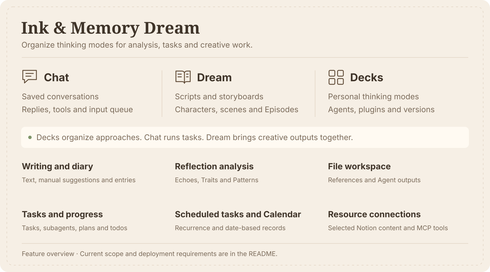
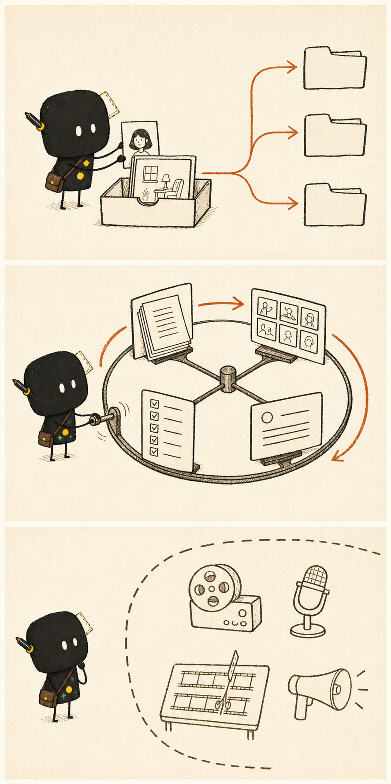
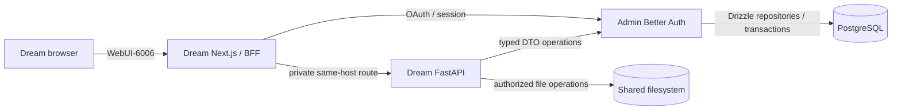

<!-- [Sync] 2026-10-11: pin publicly qualified Runtime0.1.12; normal local adoption and scoped consumer receipt are separate from remote deployment. -->
<!-- [Sync] 2026-10-10: replace root Agent.md references with the sole AGENTS.md work contract. -->
<!-- [Sync] 2026-10-09: document Deck thinking modes and link the current business PRD. -->
<!-- [Input] Notion product positioning, current business designs and PRDs, frontend features, manifests and environment templates. -->
<!-- [Output] Illustrated descriptions of module purpose and scope, plus operator setup and enablement conditions. -->
<!-- [Pos] Canonical English README; README.zh.md mirrors its structure, commands and facts. -->
<!-- [Sync] 2026-10-09: describe concrete product modules and thinking modes; replace the generic creation journey and update illustrations. -->

# Ink & Memory Dream

<p align="center">
  English · <a href="README.zh.md">中文</a>
</p>

**Ink & Memory helps users organize personal thinking modes and apply them to analysis, task execution and creative work.** Decks hold approaches to a kind of need, problem-solving paths and Agent configuration. Chat provides conversations and task entry points; Dream brings creative conversations and project outputs into one workbench. Writing, Analysis, Calendar and resource connections help users collect material, arrange work and return to existing tasks.

The product positioning follows the [Notion project description](https://app.notion.com/p/ink-and-memory-38f30b7547c3804cb8a0d1250a3b8ae2?source=copy_link#e4f30b7547c3837ab5d4815f3f1b0e37). Current module scope follows the repository's current designs. The Chinese interface calls Decks “思维模式”; the English interface retains Deck.



*Feature illustration based on the product positioning and [current navigation design](docs/design/story-workspace/product-scope-and-navigation.md).*

## Product modules

### Decks: thinking modes

Organize thinking approaches, problem-solving paths and execution methods for reuse in later work. Users can browse and try existing Decks or create their own, write names and descriptions, configure Agent roles and Claude plugins, and maintain drafts, content versions and enabled status. System Decks offer starting points such as screenplay and music creation, with entry points in Chat and Dream. Current functionality focuses on modes organized and configured by the user.

### Chat conversations

Discuss a concrete problem with an Agent, analyze material or carry out a task. Users can choose a model and Agent, attach reference files, read replies and tool results, search history and revisit earlier turns. During execution, they can add pending messages, adjust direction or move a message to an independent Chat. Saved conversations can be reopened and continued.

### Writing and diary

Record ideas, write text, and save and reopen writing sessions. “Go deeper” beneath a paragraph offers suggestions on request. Suggestions appear separately from the editable text and are saved with the writing; the latest suggestion supports regeneration or retry after failure. Ordinary typing and pauses do not generate suggestions automatically. Existing diary entries can also be opened by date from Calendar.

### Reflection analysis

Review existing diary entries to observe resonances, personal traits and recurring patterns in the writing. Users can request an analysis, browse Echoes, Traits and Patterns, read each item's explanation and evidence, and reopen historical reports. Analysis covers diary content; evaluation and feedback statistics for creative outcomes are not implemented.

### Tasks and progress

Follow tasks, subagent activity, plans and todos produced during Agent work, with current progress and available results in one place. Task details link to the associated Chat and source entry point for continued work. The activity sidebar collects priority items and history. These features track work that has already been created.

### Scheduled tasks and Calendar

Arrange one-time or recurring tasks, choose the execution model, and continue the original Chat or create a new Chat for each run. Calendar offers hourly, daily, weekdays, weekly and custom recurrence controls, with editing, pause, resume, run-now and execution-history actions. Date browsing switches between scheduled tasks, diary entries and Notion content, with links to the associated records.

### Resource connections

Give Agents access to selected external material and tools. The Notion connection supports account authorization, page or database selection, resource-index synchronization and on-demand reads of authorized page content. Selected resources are also available in Chat and Calendar. Managed MCP connections provide external tools. Settings is the full management surface, while Chat provides a lightweight entry. Interactive MCP Apps are currently a technical preview; public rendering is not enabled.

### File workspace

Read and use reference files and Agent outputs for the current conversation in one place. Users can attach files, open supported Markdown reports, images and diagrams, preview or download files, and reuse the material in later conversation turns. Files are organized around the current conversation. File previews do not provide image generation or video production.

### Dream creative workbench

Bring a creative task's ongoing conversation, shared material and Episode outputs together for review and continued work. The current focus is script organization and storyboarding: project-level characters and scenes can be reused across Episodes, while each Episode holds available outlines, scripts, storyboards, prompts and review reports. Users can reopen a saved creative task, continue working with the Agent beside its outputs, or return to the same Chat conversation.

<p align="center">
  
</p>

*Reused from the application's [creation guide](docs/design/story-workspace/project-and-episode-workbench.md#创作阶段指引). The upper panel shows shared project material, the middle panel shows Episode creation and review, and the lower panel shows future rendering, voice production and editing. The current workbench covers organizing, reading and collaborating on script and storyboard outputs.*

The primary navigation is **Chat, Dream and Decks**. **More** provides Writing, Timeline and Analysis. Settings manages language, theme, models and resource connections. The UI uses the warm paper [color system](docs/prd/color_system/README.md) and supports narrow screens. Language and theme persist in the current browser; see the [Settings design](docs/design/story-workspace/settings.md).

## Current scope and enablement

Automatic discovery of solution paths, automatic Skills/MCP/Plugin composition, full multi-Agent orchestration and creative-outcome feedback statistics remain future work. Dream does not yet provide a canvas, knowledge base or automatic script-to-finished-video production chain. Native Chat image generation and editing are also not delivered as current product features.

<details>
<summary>Deployment and capability requirements</summary>

Designs describe the intended features. Source, deployed capabilities and acceptance records determine availability in a running instance.

| Feature | Current deployment requirements |
| --- | --- |
| Chat queue and independent tasks | Require `dream.chat-input-queue.v1` / `dream.chat-task-session.v2` from Admin Drizzle 0064–0066. Running-owner controls currently require the same Dream process. See [task activity](docs/prd/chat/task-activity.md). |
| Scheduled tasks | Require Admin v3 capability from Drizzle 0077 and exact operations. Code supports once, daily, interval, hourly and weekly rules. The [latest recorded real-business receipt](docs/design/scheduled-tasks/codex-repeat-and-run-options-real-e2e.md) still requires successful normal-service model execution after the authority fix is loaded. |
| Notion synchronization update | Existing connector/index reads are implemented. The new ownership/accepted-version path passed isolated technical checks; normal capability publication, old-writer drain and service cutover remain pending in the [integration receipt](docs/exec/notion-sync-ownership-dream-integration-20261007.md). |
| MCP Apps | Technical preview only; `productionAppsEffective=false`. Public App rendering is disabled; ordinary tool results remain available. See the [integration design](docs/design/claude-mcp/mcp-apps-integration-strategy.md). |

</details>

## Open a running instance

On AutoDL, open the running instance in the console and select **WebUI-6006**. Sign in through Dream's login card; Admin handles password or Google authentication and returns you to Dream. The authenticated default page is Chat.

Use the console's current WebUI link because the public hostname changes with the instance. **WebUI-6008** opens the separate Admin console for operators.

| Entry | Internal listener | Purpose |
| --- | --- | --- |
| **WebUI-6006** | Next.js `127.0.0.1:6006` | Dream UI, same-origin authentication/BFF and API routes |
| Dream backend | FastAPI `127.0.0.1:8765` | Private Agent runtime, SSE, business orchestration and files |
| **WebUI-6008** | Admin `127.0.0.1:6008` | Operator console, authentication, data APIs and Gateway |
| Embedded PostgreSQL | `54329` | Private Admin persistence; Dream has no database credential |

For an unavailable entry after restart, follow the [AutoDL recovery runbook](docs/deploy/autodl-recovery.md). The dated [2026-09-18 release receipt](docs/exec/exec_autodl_release_20260918.md) records that deployment, not acceptance of every later feature. Other platform status is maintained in the [deployment matrix](deploy/README.md).

## Authentication and data boundaries

Admin is the authentication center and the only production database access service. Dream calls named, versioned Admin operations through typed DTO clients. Admin Services and typed Drizzle Repositories own authorization, transactions, locks and persistence.

A Dream product user and an Admin operator are separate business identities. Signing in to Dream never grants Admin management permission. Google is an external identity source for Admin Better Auth; Google tokens and arbitrary user-ID headers are not accepted as Dream business credentials.

Dream still owns product routes, Agent Runtime, EventBus, SSE, turn/resume/cancel behavior and authorized shared-filesystem operations. It has no PostgreSQL password, SQL/ORM runtime path, migration, runtime DDL or database fallback. Admin Drizzle is the only schema and migration authority.



## Run locally

### Requirements

- Dream branch `develop`; Admin branch `main`
- Python `>=3.12` with `uv`
- Node.js `>=22 <25`, Corepack and `pnpm@10.28.1`
- Admin checked out beside Dream
- Native Runtime host: macOS or Linux, arm64 or x64; the registry verifier rejects other targets

```bash
git clone --branch develop https://github.com/glide-the/im-dream.git ink-dream-memory
git clone --branch main https://github.com/glide-the/dream-im-platform.git ink-admin-memory
```

Prepare Admin, its embedded PostgreSQL, Gateway and service identities for a new installation. Migration and provisioning write to the configured database; use the intended installation target. Repeatable migration tests require a named disposable database:

```bash
cd ink-admin-memory
pnpm install
pnpm env:setup
pnpm env:check
pnpm db:migrate
pnpm db:migrate:check
pnpm product:provision-local-dream
pnpm gateway:provision-local-dream
pnpm local:stable
```

Install Dream and the exact native Runtime:

```bash
cd ../ink-dream-memory/backend
uv sync --frozen
npm install --global @glide-the/ink-claude-code-dream@0.1.12
npm install --global ntn@0.15.1
command -v ink-claude-code-dream
ink-claude-code-dream --version
ntn --version

# Verify the SDK and manifest-qualified normal PATH Runtime.
uv run python - <<'PY_RUNTIME'
from libs.claude_agent_kit.server.sdk_env import (
    require_dream_claude_sdk_distribution,
    resolve_claude_cli_path,
)
sdk = require_dream_claude_sdk_distribution()
cli = resolve_claude_cli_path()
if cli is None:
    raise SystemExit('Dream Runtime is missing from PATH')
print(f'SDK: {sdk.version}')
print(f'Qualified Runtime: {cli}')
PY_RUNTIME

cd ../frontend
corepack enable
corepack pnpm install --frozen-lockfile
```

The Runtime must report `2.1.241 (Claude Code)`. `uv` manages the Python SDK; npm manages the native Runtime and Notion CLI; pnpm manages the Web workspace. `uv sync` does not install the Runtime.

Create `backend/.env` and `frontend/.env.local` from [backend/.env.example](backend/.env.example) and [frontend/.env.example](frontend/.env.example). Configure the explicit Admin origin/issuer, Dream resource and the registered service/BFF identity. Dream env files must not contain `DATABASE_URL` or Provider secrets.

Use `localhost` consistently for public browser origins, OAuth callbacks and issuer/resource values, as in the frontend template. The private Python listener can use `127.0.0.1`.

<details>
<summary>Notion metadata, synchronization and diary response configuration</summary>

Remote metadata calls for selected standalone-page sync and today-updated snapshot verification require the server-owned `INK_NOTION_TODAY_API_VERSION=2026-03-11` in `backend/.env`, as set explicitly in the template. A local header capture confirmed that the pinned `ntn@0.15.1` sends this date both by default and with `--notion-version`; see the [503 repair receipt](docs/exec/notion-today-503-repair-20261006.md). Existing env files must add the key and restart their owned Dream backend because configuration is loaded at startup. The application has no fallback: absent or invalid configuration returns HTTP 503 with `detail.error_code=NOTION_API_VERSION_UNCONFIGURED`, while snapshot reads and the connector list still succeed. `INK_NOTION_ALLOWED_URL_HOSTS` configures exact HTTPS destination hosts; its defaults are in `backend/.env.example`. These settings apply to remote metadata verification; real-account upstream compatibility remains separate from the [isolated technical receipt](docs/exec/calendar-right-panel-tabs-implementation-20261005.md).

Selecting a Notion database includes its synchronized page rows in the Calendar candidate index; individual row selection is unnecessary. Restarting Dream does not rebuild persisted indexes. If an older index lacks upstream creation/edit timestamps, open Notion settings → Manage mounted sources → Sync now, then refresh Calendar. This uses the existing metadata-only synchronization path.

The new manual, first-selection and scheduled Notion sync consumer requires the exact `dream.notion-sync-ownership.v1` capability and four pinned request/claim/renew/finish operations. Admin owns execution claims, renewals and atomic snapshot acceptance. Dream caches an accepted version afterward; Calendar, facade reads and new Thread projections recover a missing cache through existing Admin reads and validate the full accepted identity and metadata-only payload. Chat turns do not trigger Notion synchronization or body downloads through this index path. Missing execution capabilities close new sync writes while keeping existing reads compatible. The 2026-10-07 integration receipt records the normal Admin catalog missing these operations and capability; normal migration, old-writer drain and claim enablement remain release prerequisites. No runtime DDL or age-based takeover is used. See the [integration receipt](docs/exec/notion-sync-ownership-dream-integration-20261007.md) and [formal connector design](docs/design/notion-session/connector-interaction.md).

</details>

Start the owned services in separate terminals:

```bash
# Dream backend
cd ink-dream-memory/backend
uv run uvicorn server:app --host 127.0.0.1 --port 8765

# Dream frontend
cd ink-dream-memory/frontend
INK_BACKEND_INTERNAL_URL=http://127.0.0.1:8765 NEXT_PUBLIC_WS_BASE_URL=ws://127.0.0.1:8765 corepack pnpm run dev --hostname 127.0.0.1 --port 5173
```

Open Dream at [Dream](http://localhost:5173) and Admin at [Admin](http://localhost:3000/admin).

## Supported versions and ownership

| Component | Current contract |
| --- | --- |
| Dream metadata | backend `0.1.4`, frontend `0.0.4`, API schema `2.0.0` |
| Next.js / React | `16.1.6` / `19.1.0` |
| Python SDK | `ink-claude-dream-agent-sdk==0.2.145` |
| Native Runtime | `@glide-the/ink-claude-code-dream@0.1.12` |
| Runtime compatibility | `2.1.241 (Claude Code)` |
| Notion CLI | `ntn@0.15.1` |
| Auth, PostgreSQL, Drizzle, Gateway, billing | Admin repository |
| Dream Web, Runtime, SSE, Threads/Runs and files | This repository |

## Build and verify

```bash
# Backend provider-free suite
PYTHONPATH=backend uv run --native-tls --project backend --frozen \
  --with pytest==9.1.1 --with pytest-asyncio \
  python -m pytest backend/tests -q

# Frontend checks
corepack pnpm --dir frontend exec tsc --noEmit --incremental false
corepack pnpm --dir frontend lint
NODE_ENV=production corepack pnpm --dir frontend build

# Published SDK/Runtime identity
python3 scripts/verify_claude_registry_release.py \
  --sdk-version 0.2.145 \
  --runtime-version 0.1.12 \
  --expected-cli-version '2.1.241 (Claude Code)'
```

Provider-free checks prove deterministic contracts. Real Google, model and business acceptance must use the normal Dream/Admin/Gateway/PostgreSQL services and a real authorized account.

## Troubleshooting and operating boundaries

- **WebUI returns 404 or does not open:** confirm the AutoDL instance is running, then follow the [recovery runbook](docs/deploy/autodl-recovery.md). Do not add a tunnel or hard-code the current public hostname.
- **Unable to check your session:** verify both WebUI mappings, Admin first, and confirm the projected issuer, Dream origin/resource and callback all came from the current instance.
- **Diary retrieval returns `session_projection_unavailable` / `ADMIN_RESPONSE_INVALID`:** if metadata reads succeed while full-text reads fail, check the server response budget before assuming a DTO mismatch. The backend template sets `INK_ADMIN_DREAM_MAX_RESPONSE_BYTES=16777216` (16 MiB); the code fallback remains 1 MiB when this optional setting is omitted. Admin HTTP and the private Session broker share this bound. Full text is read before fuzzy ranking and `limit`, so a small result limit does not reduce the incoming payload. Existing backend env files need an explicit budget and a restart of the owned backend process; new turns then receive the new broker bound. Strict response/request-ID checks remain enforced. See the [retrieval repair receipt](docs/exec/agent-diary-retrieval-capacity-repair-20261006.md).
- **`ADMIN_SERVICE_AUTH_UNAVAILABLE` or `ADMIN_TIMEOUT`:** verify Admin and its PostgreSQL before restarting Dream. Dream must not fall back to a database connection.
- **Runtime is not production-qualified:** verify `command -v ink-claude-code-dream`, the package-root `cli.js`, adjacent manifest, Runtime `0.1.12`, compatibility `2.1.241`, and required capabilities.
- **`uv sync` removed pytest:** use the ephemeral `uv run --with pytest...` command above or add a reviewed development dependency.
- **Chat reports insufficient Token allowance:** the user message is saved before Gateway rejects the model reservation. Fix the subscription/model allowance in Admin, reload the Thread, then decide whether to send again.
- **Chat says the message queue is unavailable:** check the target Admin PostgreSQL for `chat_input_queue`, `chat_task_session`, and `dream.chat-input-queue.v1` / `dream.chat-task-session.v2` schema capabilities. Admin Drizzle migrations 0064–0066 supply them; until the approved Admin migration is applied, Dream retains the draft and refuses queued input. Provider-free tests against an isolated database do not qualify the normal business database.
- **Chat returns `GATEWAY_API_KEY_INVALID`:** the Dream service key no longer matches Admin's active canonical-subject Gateway key. AutoDL sync and qualification now stop before replacing the runtime env when this binding is invalid. Recover or rotate the key through the Admin-owned release operation, restart only Dream so it reloads the private env, and rerun the real `create Thread -> POST /api/claude-agent -> SSE` acceptance before publishing.
- **MCP App does not appear:** public App rendering is disabled (`productionAppsEffective=false`). Check connection and tool availability; ordinary tool results remain available.

Never commit secrets, transcripts or user workspace contents. Browser input, user env, Decks, plugins and workspace settings cannot override server-owned model/resource configuration. Thread temporary files use the server-bound `{AGENT_CWD}/{thread_id}/.claude-tmp`; do not widen that boundary to `/tmp`.

`CLAUDE_CODE_CLI_PATH` is reserved for an explicit, reviewed absolute-path rollback, not a workaround for stale PATH. Dream does not silently select an ambient `claude` or SDK-bundled CLI. Application rollback does not reverse Admin database migrations. See [SDK/Runtime integration and rollback](docs/deploy/claude-sdk-runtime-packaging-and-integration.md).

Real send-path acceptance requires **create Thread → `POST /api/claude-agent` → authenticated model catalog → accepted SSE** through the normal Dream/Admin/Gateway/PostgreSQL path under [AGENTS.md](AGENTS.md#本机真实业务测试协议). Tests may clean only their own named processes, ports and temporary resources; browser checks reuse compatible installed Chrome. Preserve normal business Runs/logs unless cleanup was requested.

## Documentation

| Topic | Entry |
| --- | --- |
| Current product design | [Story Workspace](docs/design/story-workspace/README.md), [thinking modes PRD](docs/prd/deck/thinking-modes.md), [Deck design](docs/design/deck/README.md), [Chat PRDs](docs/prd/chat/.folder.md) |
| Writing and reflection | [Manual writing suggestions](docs/design/writing-manual-suggestions.md), [reflection analysis](docs/prd/reflection-blog.md) |
| Conversations and creation | [Input queue](docs/prd/chat/queued-input.md), [turn navigation](docs/prd/chat/turn-navigation.md), [Dream re-entry](docs/design/story-workspace/dream-workspace-and-reentry.md), [creative workbench](docs/design/story-workspace/project-and-episode-workbench.md) |
| Calendar and recurring tasks | [Calendar PRD](docs/prd/calendar/calendar-right-panel-tabs-prd.md), [scheduled-task design](docs/design/scheduled-tasks/codex-repeat-and-run-options.md) |
| Resources and tools | [Notion connector](docs/prd/notion-session/resource-connector.md), [connector interaction](docs/design/notion-session/connector-interaction.md), [MCP Apps](docs/design/claude-mcp/mcp-apps-integration-strategy.md) |
| Architecture and authentication | [Architecture](docs/architecture/项目架构设计说明.md), [Admin auth/data contract](docs/architecture/admin-auth-data-interaction.md), [backend API](backend/API.md) |
| Setup and deployment | [Platform status](deploy/README.md), [AutoDL](deploy/autodl-ssh/README.md), [AutoDL recovery](docs/deploy/autodl-recovery.md) |
| Repository and Agent rules | [Root work contract](AGENTS.md), [Agent behavior](docs/Agent.md), [rules index](docs/rules/README.md) |
