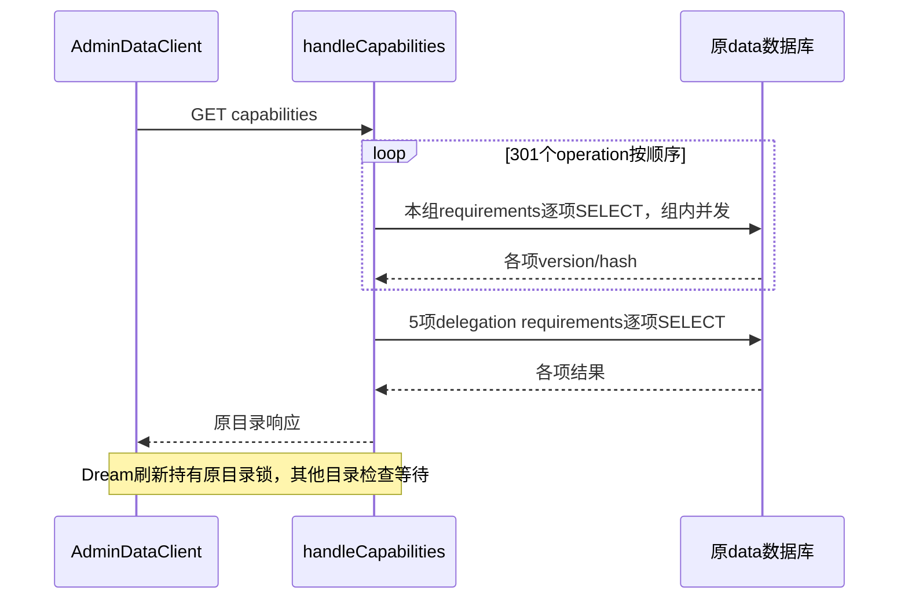
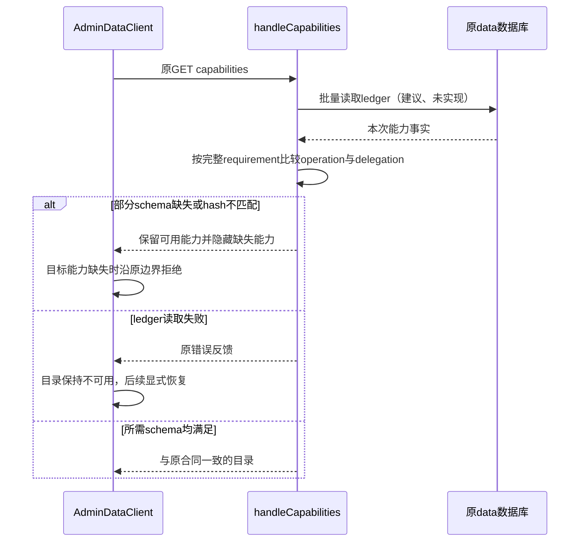
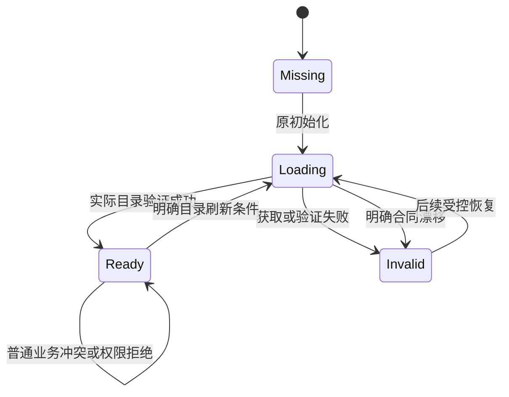

<!-- [Sync] 2026-11-16: 保留原分析与建议历史，末节追加三项 P0 实施及技术回执。 -->
<!-- [Input] Dream 37a07dab、Admin a6415f2当前源码、实际操作目录及无数据库的生产handler调用计数。 -->
<!-- [Output] Admin/Dream请求与查询放大证据、整理优先级、聚合边界、迁移影响和最小验证要求。 -->
<!-- [Pos] 跨仓库数据请求评审；原认证和数据所有权保留，全部优化建议尚未实现。 -->
<!-- [Sync] 2026-11-15: 核对capability目录1162次检查、错误触发刷新及共享锁、Agent串行请求与重复历史读取。 -->

# Admin / Dream 数据请求放大与边界整理

## 背景与问题

用户反馈Admin数据层存在大量请求、业务阻塞及等待过长，要求在TypeScript模块化迁移前整理边界。本轮核查使用当前本地Dream `develop / 37a07dab`与Admin `main / a6415f2`；开始时两个工作区均干净。此前架构稿中的旧HEAD属于原审查时点，本次结论以当前源码为准。

本次已确认查询放大、串行请求与目录刷新阻塞的代码路径。当前没有同一真实请求的网络/SQL阶段耗时，性能占比和优化后的实际收益保持待测。检查不调用模型、不连接真实数据库、不启动/停止业务服务，不修改业务代码。

## 目标与边界

整理顺序为：先消除同一事实的重复查询及无关刷新，再收敛一次用户动作对应的业务请求，随后处理重复历史装配。TypeScript Agent、MCP、插件模块继续迁入`frontend/packages`；Admin请求成本独立处理，避免把原调用链原样带入新包。

保留Admin数据库所有权、身份认证、用户/Thread/Run归属、实体授权、claim、原request ID、业务回执和结果不明保护。新增请求聚合复用现有Service/Repository和事务，无新增通用操作框架、独立缓存服务、恢复数据库或平台重写。

## 概念与规则

### 三种计数分别说明

| 对象 | 当前含义 | 本次证据 |
| --- | --- | --- |
| OperationCapabilityDTO | 操作名称、版本、hash及scope的本地协议描述 | 对象构造与本地匹配本身没有HTTP请求 |
| Dream到Admin的HTTP | principal、业务操作、授权创建、保存及receipt等跨服务调用 | 当前Agent准备按多个操作串行await，数量随业务分支变化 |
| Admin内部SQL | capability、签名公钥、身份、业务对象和回执查询 | 一个capability HTTP内部可以执行大量schema检查，HTTP数量与SQL数量分别计数 |

整理关注真实I/O、数据范围、锁范围与业务依赖。删除类型名称、只改写语言或把封装藏入另一个包均无法消除原有远端等待。

### 已确认的目录查询放大

Admin源码根为`/Users/dmeck/project/ink-admin-memory`。以下链接指向本机当前审查源码：

| 位置 | 当前行为 | 整理建议 |
| --- | --- | --- |
| [capabilitiesHandler.ts](/Users/dmeck/project/ink-admin-memory/app/lib/auth/capabilitiesHandler.ts:22) | 对每个operation依次执行一组Promise.all，组内逐项调用hasSchemaCapability；最后再检查delegation依赖 | 从实际data数据库批量读取一次ledger，按本地Map核对每个完整要求 |
| [dream/database.ts](/Users/dmeck/project/ink-admin-memory/app/lib/dream/database.ts:27) | hasSchemaCapability每次执行一条SELECT，无去重缓存 | 复用原模块完成批量读取和比较，避免逐项网络往返 |
| [withDataTransaction](/Users/dmeck/project/ink-admin-memory/app/lib/dream/database.ts:31) | 每个业务事务进入handler前，顺序查询requirements；数组中相同要求可能重复出现 | 在同一事务内按完整capability/version/hash去重并批量查询；缺失或冲突仍拒绝 |
| [chatThreadHandler.ts](/Users/dmeck/project/ink-admin-memory/app/lib/dream/chatThreadHandler.ts:30) | continuation与chat-input前缀共同追加queue要求；delegated请求还追加授权要求 | 去重相同schema事实，保留不同权限与实体归属检查 |

实际目录与隔离计数：

| 项目 | 数量 | 证据性质 |
| --- | ---: | --- |
| operation descriptor | 301 | 生成JSON与实际TS registry一致 |
| operation requirement引用 | 1157 | 实际TS registry求和 |
| operation中的完整独立requirement | 33 | 按完整描述去重 |
| delegation discovery requirement | 5 | 实际授权合同 |
| handleCapabilities调用hasSchemaCapability | 1162 | 生产handler仅替换认证/数据库后的实测调用计数 |
| 联合独立capability名称 | 34 | delegation包含一个operation目录之外的要求 |
| 隔离运行中的最大并发检查 | 8 | 批内Promise并发，operation各批次依次等待 |

`1162`表示检查函数调用次数。生产hasSchemaCapability每次执行一条SELECT，源码由此支持逐项数据库往返的判断；本次没有执行真实SQL，也没有测量线上耗时。初始认证、auth ledger读取等查询另计。

capabilitiesHandler已经通过auth数据库读取physical ledger。data数据库由另一个显式连接配置选择；优化必须从实际data连接批量读取其ledger，分别保持两端边界，不能直接把auth查询结果用于替代data校验。也无需引入长期跨请求缓存才能消除这1162次逐项检查。

### Dream的目录刷新与共享锁

| 当前来源 | 已确认行为 | 影响与处理 |
| --- | --- | --- |
| [AdminDataClient.capabilities_snapshot](../../backend/services/admin_data/client.py:134)及supports | 成功目录保存在进程内；supports只检查内存 | 普通热路径不会为每个DTO重新发capability HTTP，已有缓存继续复用 |
| [AdminRequestAuth.workflow_context](../../backend/services/admin_data/request_auth.py:274) | 捕获任意AdminDataError后把owner就绪标记设为False | 普通业务错误会使下一次authenticate重新拉目录，扩大错误影响 |
| [turn_persistence与gateway_runtime](../../backend/services/admin_data/request_auth.py:287) | 授权创建发生任意AdminDataError后同样重置就绪标记 | 业务拒绝/暂时传输失败需要与目录失效分别处理 |
| [AdminDataClient.capabilities](../../backend/services/admin_data/client.py:100) | 刷新期间持有_catalog_lock并执行HTTP | 同一client的supports/execute需要同一锁，长目录请求会阻塞其他准备；普通domain HTTP已在该锁外执行 |

选定规则为：只有实际目录初始化/刷新失败、明确的capability缺失或合同漂移进入原目录恢复流程。权限拒绝、实体冲突和普通业务网络失败沿原业务反馈处理，避免无依据重拉目录。未知目录仍fail closed。先减少不必要刷新并降低一次刷新成本；是否进一步调整锁内网络范围，依据后续并发验证决定。

### Agent准备阶段的HTTP串行链

以目录已缓存、普通前台发送、Thread存在、队列及Memory设置capability可用、无Deck变更和无Editor上下文、下列调用均成功的准备路径为例，源码至少包含以下8次顺序Admin调用：

| 顺序 | 调用 | 当前来源 |
| --- | --- | --- |
| 1 | principal | [authenticate](../../backend/services/admin_data/request_auth.py:243) |
| 2 | chat-thread.get | [Agent入口Thread校验](../../backend/routers/claude_agent.py:1094) |
| 3 | chat-input.list | [待处理输入保护](../../backend/routers/claude_agent.py:1160) |
| 4 | user-system-config.get | [用户配置](../../backend/routers/claude_agent.py:1189) |
| 5 | workflow-context.resolve | [Workflow归属](../../backend/routers/claude_agent.py:1273) |
| 6 | runtime delegation：gateway-cli | [Gateway授权](../../backend/routers/claude_agent.py:1433) |
| 7 | runtime delegation：server-persistence | [持久化授权](../../backend/routers/claude_agent.py:1447) |
| 8 | memory settings | [MemoryTurnProvider](../../backend/services/memory/behavior.py)构造时读取 |

该表为成功分支的源码调用清单，尚未作为真实请求追踪计数。它不包含首次JWKS/服务token/目录获取、模型目录、Deck绑定、启用记忆后的全历史、Service再次读取配置、最近笔记、MCP、continuation snapshot/claim/arm、SDK事件及最终保存。

业务校验存在真实依赖：Thread归属先于上下文，Deck绑定完成后再核对Workflow，query前的claim/arm确认先于模型调用。独立且只读的请求可以在这些前置条件满足后并行；授权创建等写入使用服务端业务聚合与明确回执，避免客户端盲目并行造成部分成功和重复提交。

### 热路径内部的重复读取

1. [verifyAdminAccessToken](/Users/dmeck/project/ink-admin-memory/app/lib/auth/accessToken.ts:23)默认查询公钥；一个业务HTTP中服务身份验证、用户principal或delegation解析可能分别读取密钥与身份。优先核对单请求中可共享的验证材料。签名轮换、过期、撤销和实体范围继续验证，长期缓存另按明确失效规则评审。
2. Route使用用户OAuth读取system config；[Service组装上下文](../../backend/claude_agent/service.py:1783)通过当前Thread grant再次读取。两者授权上下文不同，不能直接删除第二次校验。聚合接口应在同一受权业务阶段产生明确归属的快照。
3. MemoryTurnProvider启用记忆时读取全部用户消息以恢复边界；continuation又读取canonical history。可复用同一授权阶段的数据，跨请求或状态已变化时重新核对。
4. [ChatContinuationRepository](/Users/dmeck/project/ink-admin-memory/app/lib/dream/chatContinuationRepository.ts)的snapshot读取Thread、队列、managed队列及全部消息；claim再次计算snapshot，再读消息和多次listInputs；complete扫描消息核对终态。优先改为同一事务内复用未变化的数据、定向读取和UPDATE RETURNING，写入后更新相关快照，保留history digest、revision及原锁语义。
5. `snapshot`中对managed记录反复执行canonical.some/find/filter，存在随对话增长的内存扫描成本。可建立本次调用内的消息/turn索引，避免新增持久化索引系统或长期缓存。

## 选定的整理顺序

| 优先级 | 工作项 | 完成条件 |
| --- | --- | --- |
| P0 | capability discovery按实际data连接批量读ledger，本地比较完整要求 | 301项操作与delegation公开结果保持；移除逐项ledger往返；缺失/hash不匹配继续隐藏对应能力 |
| P0 | withDataTransaction在同一事务批量、去重requirements | 原handler前置校验保留，重复要求只读取一次，冲突要求拒绝 |
| P0 | 按错误归属整理Dream就绪标记失效 | 普通业务拒绝不触发全目录获取；真实目录失败仍拒绝并可恢复 |
| P1 | 按一次任务准备聚合上下文与独立purpose授权 | 原Thread/Deck/Run/用户归属在Admin检查；保留每种purpose和scope，减少HTTP与重复事务准备 |
| P1 | 同一事务内整理重复历史、队列与身份读取 | 结果、CAS、锁与失败状态保持；定向查询取代不必要全量读取 |
| P2 | 给实际请求建立阶段回执，选择下一项精简 | 记录冷/暖目录、端到端首事件、每个HTTP/SQL阶段、锁等待与消息数量；不记录正文、token或凭证 |

P0可独立于TypeScript迁移先交付，粗估2–4人日，包含缺失/漂移/并发合同验证。任务准备聚合约4–7人日，重复历史/单请求身份整理约2–4人日，均为一名熟悉代码的资深工程师粗估；实际接口范围确定后再收敛。后两项与原TS方案中5–8人日的Python业务接线存在重叠，估算分别列项，禁止直接相加成迁移总量。

### 业务聚合边界

新增业务接口均为建议、未实现。只在现有Admin服务中收敛具体用户动作：

- 任务准备：在已核对Thread和绑定后返回当前业务上下文与必要的独立purpose授权。复用现有Service/Repository，数据库事务中不等待模型或外部网络。
- 执行前claim/arm：保留在SDK query之前；transcript准备失败时仍允许原规则规定的安全重试。不能把不可撤销query提前到保存确认之前。
- 结果结束：可将同一turn的assistant保存与完成核对纳入一个业务事务，保留原请求ID和幂等回执。schema或新API合同按Admin发布流程接入。

保留旧客户端接口兼容；新增聚合按业务任务定义，避免建立任意operation批量执行入口、每字段HTTP、全用途凭据或前端可控制的SQL/用户ID。Agent正常完成路径不新增receipt轮询，只有写入结果不明时按原ID读取回执。

### 当前目录请求时序

### 选定方案与异常恢复

状态图为既有就绪机制的行为投影，错误分类整理为建议、未实现；新增缓存状态表、管理页面和持久化字段数量为零。

## 验证证据与后续最小验证

已完成的隔离证据位于`/tmp/ink-admin-request-audit-20261115/receipt.md`，由限定luna_test_runner执行，主Agent已复核脚本和回执：

| 命令（Admin目录） | 退出码 | 结果 |
| --- | ---: | --- |
| `python3 /tmp/ink-admin-request-audit-20261115/static-contract-count.py` | 0 | 301个descriptor、1157个引用、33个完整独立要求 |
| `./node_modules/.bin/tsx /tmp/ink-admin-request-audit-20261115/runtime-registry-count.ts` | 0 | 实际TS目录与JSON一致，另有5项delegation要求 |
| `./node_modules/.bin/vitest run --config /tmp/ink-admin-request-audit-20261115/vitest.config.ts` | 0 | 生产handler隔离调用计数1项通过，实际1162次检查，最大并发8 |
| `./node_modules/.bin/vitest run app/lib/auth/capabilitiesHandler.test.ts --config vitest.config.ts` | 0 | 原有provider-free测试7项通过 |

临时配置修订期间两次harness初始化失败已单列在回执，均未进入业务测试。最终命令通过；检查未触及真实数据。原HTML报告为既有忽略文件。本轮尚未实施优化，也没有改进前后耗时或真实业务验收结论。

实施时的最小验证为：相同ledger下旧/新目录一致、缺失/漂移/异常继续fail closed、实际批量查询次数、业务错误后零无关目录刷新、claim/arm/finish身份和回执一致。并发与故障注入使用明确隔离数据库；真实账户与设备性能检查另按当次授权走正常业务入口。

本轮文档检查使用`python3 /tmp/ink-admin-request-audit-20261115/docs/inventory-links-check.py`及`node /tmp/ink-admin-request-audit-20261115/docs/mermaid-browser-check.mjs`，三幅新增图解析及渲染通过。检查发现旧规范引用指向已失效worktree，已修正为当前Admin同名文档；原协议正文保持。文档回执位于`/tmp/ink-admin-request-audit-20261115/docs/receipt.md`，文档验证与上述隔离handler计数分别记录。

## 2026-11-16 P0 实施更新

上文保留 2026-11-15 分析、建议图示及当日证据。已授权实施的三项 P0 已进入源码：Admin 请求内一次读取实际 data ledger，原事务完整 requirement 去重与批量校验；Dream 按明确 capability/schema 错误失效目录，客户端统一维护就绪状态。业务接口聚合、锁内网络范围调整和 TypeScript 迁移保留后续范围。

实际技术命令与交付状态见[执行记录](../exec/admin-capability-performance-20261116.md)。现有 1162 次计数为旧实现隔离基线；新实现验证目录一致性及一次 batch 查询，无真实数据库耗时或端到端性能改善结论。
