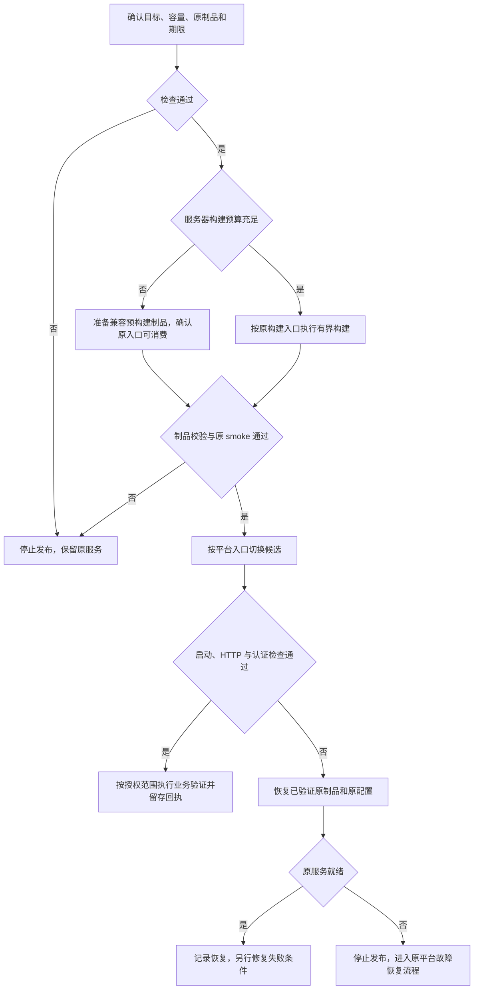

<!-- [Input] Dream 当前构建入口、Admin 发布事故记录、Node/systemd 官方资料与既有制品恢复流程。 -->
<!-- [Output] 发布资源检查、构建位置选择、失败识别及原制品恢复操作要求。 -->
<!-- [Pos] Dream 发布专项手册；与平台发布指南配套，Admin 的服务操作由 Admin 仓库维护。 -->
<!-- [Sync] 2026-11-02: 新增内存预算与构建失败恢复约束，仅交付文档。 -->

# Dream 构建内存与发布失败恢复

## 背景与问题

发布过程包含 Next.js 编译、类型检查、依赖准备及平台打包，峰值内存需要独立于应用运行内存评估。2026-11-02 的 Admin 发布记录发现 2048 MiB V8 old space 上限与约 1607 MiB 的 `MemTotal` 配置不匹配；公网 502 与 SSH 超时需要结合系统证据判断原因。[事故记录](../exec/ios-account-entry-fix-20261102.md)随后记录 512 MiB 堆构建发生 V8 heap 耗尽、worker SIGABRT，所观察 memcg 的 `oom=0`。这些记录分别对应容量风险、连接症状与堆耗尽，不能合并为同一个已确认内核 OOM。

本轮依据本地源码和记录编写手册，未连接服务器核对现状。事故中的 512 MiB 堆、900 MiB 初始构建限额均为单次参数，后续尝试及恢复结果以对应发布回执为准。

## 目标与边界

发布前确认容量、构建位置和恢复制品；失败后保留原服务与数据，避免重复构建扩大中断。本文覆盖 Dream Web/后端发布及 iOS 构建的资源检查；Admin 专用操作见其[专项手册](../../../ink-admin-memory/docs/release-build-memory-and-recovery.md)。

本轮仅新增文档与约束。业务、认证、权限、源码、脚本、数据库和服务器配置保持原状。服务器检查示例供后续已授权操作使用，本轮未执行。

## 当前代码事实与处理判断

| 当前事实与证据 | 操作影响 |
| --- | --- |
| [frontend/package.json:9](../../frontend/package.json#L9) 执行 `next build --webpack`；[next.config.js:18](../../frontend/next.config.js#L18) 由 `INK_NEXT_OUTPUT` 选择 standalone | 编译与运行分别评估；保留现有类型检查和依赖锁定 |
| [deploy/autodl-ssh/deploy.sh:300](../../deploy/autodl-ssh/deploy.sh#L300) 支持 `AUTODL_PREBUILT_FRONTEND_ARCHIVE`，上传时校验 SHA-256；[同脚本:334](../../deploy/autodl-ssh/deploy.sh#L334) 在服务器构建分支写入 `NODE_OPTIONS=--max-old-space-size=4096` | 外层较小的 `NODE_OPTIONS` 会被该命令覆盖。容量不足时使用已有兼容制品入口；调整该写死值需另行修改脚本并验证 |
| [同脚本:443](../../deploy/autodl-ssh/deploy.sh#L443) 先构建、smoke，再停止旧服务和切换；[同脚本:371](../../deploy/autodl-ssh/deploy.sh#L371) 的成功后清理会删除其他 release 和 previous 指针 | 切换失败可沿原 rollback 恢复；清理后的历史版本恢复依赖另行保留的完整制品，不能承诺旧目录始终存在 |
| [frontend/ios/scripts/build-rn-ios.sh:16](../../frontend/ios/scripts/build-rn-ios.sh#L16) 包含 frozen install、Next 构建与 Xcode 构建 | iOS 资源预算在 Mac 构建主机核对；原打包步骤和真实包资源校验继续沿用 |
| [.github/workflows/deploy-frontend.yml:26](../../.github/workflows/deploy-frontend.yml#L26) 仍使用 `npm ci` 与 `dist/version.txt`，当前前端采用 pnpm/Next | 该历史 workflow 尚有输入、产物差异；绿色历史记录不足以证明当前制品可用，本轮保留实现 |

方案收敛：复用已有构建、制品校验和恢复入口，补足操作约束。资源不足时优先准备匹配目标平台的制品；服务器原地构建须通过预算检查。本文不新增构建器或发布服务。

## 概念与规则

- `--max-old-space-size` 限制 V8 old space，进程还会占用 young generation、Buffer、原生模块和线程栈；子进程另计。接近堆上限会增加 GC 时间。[Node CLI](https://nodejs.org/api/cli.html#--max-old-space-sizesize-in-mib)
- `MemoryMax` 限制 unit 内进程组的内存；页缓存、子进程等纳入 cgroup 统计，祖先 cgroup 可进一步收紧有效额度。设置限额仅提供边界，构建所需容量仍须验证。[systemd 资源控制](https://www.freedesktop.org/software/systemd/man/latest/systemd.resource-control.html)
- 构建预算须同时覆盖：构建进程组峰值、运行服务及数据库峰值、系统和运维连接余量；以 `MemAvailable` 和有效 cgroup 额度核对。禁止用总内存直接充当构建额度，禁止将 RSS 相加结果视为精确 cgroup 用量。
- ECS 保持既有禁用 swap/zswap 与 `MemorySwapMax=0` 的约束；其他主机按既有策略检查。本任务不启用或调整交换。
- 同一资源预算内只执行一份发布构建。失败后先改变已确认的失败条件，再发起下一次有期限的构建；保留每次退出码及参数。

## 发布前最小检查

在实际 Linux 构建主机的私有终端执行；以已确认 unit 名替换示例变量。screen/容器托管按原平台指南确认 PID、容器和所有者，避免套用 Admin unit。

```bash
# 只读；保留容量、架构与交换状态。
date -Is
uname -m
free -m
swapon --show
df -h .

# 仅用于已经确认由 systemd 托管的目标。
release_unit='REPLACE_WITH_VERIFIED_UNIT.service'
systemctl show "$release_unit" \
  -p WorkingDirectory -p User -p MainPID -p ControlGroup \
  -p ActiveState -p SubState -p NRestarts \
  -p MemoryCurrent -p MemoryHigh -p MemoryMax -p EffectiveMemoryMax \
  -p MemorySwapMax -p Result -p ExecMainCode -p ExecMainStatus
```

预期取得运行位置、身份、当前占用及有效限制；旧 systemd 缺少字段时使用该机已有属性与 cgroup 文件核对。只在私有终端核对 `ExecStart`、drop-in、`NODE_OPTIONS` 来源及脚本内联赋值；对外只记录堆相关选项，禁止输出整个 Environment、`.env`、进程环境或完整命令行。

检查表：

| 检查项 | 放行依据 | 停止条件 |
| --- | --- | --- |
| 目标与原服务 | 主机、源码提交、真实入口、所有者和数据目录已确认 | 目标身份、运行来源或并发任务不明 |
| 构建容量 | 预算涵盖所有 worker、运行服务和系统余量，记录堆与进程组限额 | 内联值超出预算、限额不足或无峰值依据 |
| 制品与依赖 | 提交、锁文件、Node/pnpm、系统/架构及原生依赖匹配 | 只准备 `.next` 或 Mac `node_modules` 直接用于 Linux |
| 恢复准备 | 原完整制品、私有配置、启动入口和校验摘要可用 | 旧目录已清理且缺少完整归档 |
| 执行期限 | 开始时间、结束期限、终止对象与恢复负责人明确 | 无限等待或复用未知后台 watcher |

iOS 在 Mac 核对 Activity Monitor/既有内存诊断、磁盘和并行 Xcode/Next 作业。沿[真机手册](ios-iphone-install-release.md)验证包资源与来源；Linux cgroup 命令不适用于 iPhone。

## 构建、切换与恢复

1. **选择构建位置。** 资源充足的本地或 CI 主机可构建目标兼容制品；Linux 部署核对 OS、架构、libc、Node ABI、原生依赖、源码与锁文件。Dream AutoDL 沿已有预构建入口使用 Linux x64 制品；其余入口是否支持制品输入须按脚本确认。跨平台搬运未经验证的依赖禁止上线。
2. **准备完整候选。** 保留私有配置及原数据目录；standalone 须含追踪依赖、`public` 与 `.next/static`，复用原 API/MCP smoke。仅 `.next/BUILD_ID` 存在不能证明闭包完整。[Next.js output](https://nextjs.org/docs/app/api-reference/config/next-config-js/output)
3. **执行有界构建。** 服务器构建以核对后的峰值预算和现有参数为前提，保留类型检查。Admin 的 `NEXT_BUILD_CPUS` 等选项归 Admin 配置所有，Dream 当前配置未实现同名开关，禁止直接套用。`Type=oneshot` 的启动期限使用 `TimeoutStartSec`；`RuntimeMaxSec` 对该类型无效。[systemd.service](https://www.freedesktop.org/software/systemd/man/latest/systemd.service.html)
4. **验证后切换。** 复用所属平台的 smoke、切换和健康检查；旧服务停止前须有可用恢复制品。服务配置或构建位置的改动另行执行，本轮仅记录流程。
5. **失败优先恢复。** 构建失败且未切换时保留原服务；切换后失败时，核对旧制品仍存在，再按原平台 rollback 恢复。旧制品已被清理时，使用已校验归档恢复完整应用，禁止以重新构建作为唯一恢复方式。



## 错误识别与停止条件

| 证据 | 结论与处理 |
| --- | --- |
| `JavaScript heap out of memory`、相同 worker 的 SIGABRT | V8 堆耗尽；保留日志并重新评估构建位置/峰值。降低堆只会缩小可用容量，无法保证构建成功 |
| 同一时间、同一 cgroup 的 `memory.events` 中 `oom_kill` 增量，或内核日志明确记录目标被 OOM kill | 记录内核/cgroup OOM；`max` 增量或高占用单独用于资源压力诊断。[Linux cgroup v2](https://docs.kernel.org/admin-guide/cgroup-v2.html) |
| SIGKILL / 137 | 核对期限、操作者、systemd 和内核记录，信号本身不足以确定 OOM |
| SSH banner 超时、HTTP 502/503 | 按相同时间范围核对连接、监听、应用和资源证据；停止反复启动构建，根因待证据确认 |
| unit 为 activating/running，暂时 `Result=success` / `ExecMainStatus=0` | 等待实际构建结束、退出码及制品校验；中间属性不能作为构建完成回执 |

SSH 失联时优先使用已存在的、授权范围内的诊断入口；记录投递失败、等待执行和执行完成三种状态。确认待执行停止命令或 watcher 已结束，避免其随后终止恢复服务。强制重启、实例重启、调整资源限制须符合当次授权与恢复条件，禁止以连接超时直接触发重启。

恢复只涉及本轮明确拥有的构建和应用；保留 Admin PostgreSQL、账户、密钥、角色、权限及历史正文。禁止全局 `killall`、`pkill` 或删除未知目录。

## 完成判定与评审

每次回执记录：主机与时间、源码/锁文件摘要、构建位置、堆及进程组预算、峰值、退出码、制品摘要、切换前后入口、HTTP/认证结果、恢复情况。日志须脱敏。构建完成、安装启动、真实账户/模型验收与正式发布分别记录；实际模型调用仅按相应业务授权执行。

| 评审项 | 发现 | 处理与修订结果 | 剩余依赖 |
| --- | --- | --- | --- |
| 容量风险 | Dream 内联 4096 MiB 会覆盖外层选项 | 明确阻止超预算路径，复用已有预构建输入 | 后续发布前实测预算 |
| 恢复可执行性 | AutoDL 成功清理会移除旧 release | 分列切换失败 rollback 与归档恢复 | 操作者保留完整制品 |
| 最小范围 | 发布故障可沿原流程处理 | 仅增加手册、索引及根合同 | 运行调整另行验证 |
| 业务与数据 | 发布与业务验证拥有独立证据 | 保留原认证、权限及数据，不运行模型 | 后续业务验收 |

评审结论：**通过（文档方案）**。发布执行仍以目标身份、容量、兼容制品和恢复入口就绪为前提；本轮未执行构建、服务器配置、部署或真实业务验收。

官方资料查阅日期：**2026-11-02**。Node/systemd 选项使用前核对目标实际版本，仓库事实以表中当前源码为依据。
