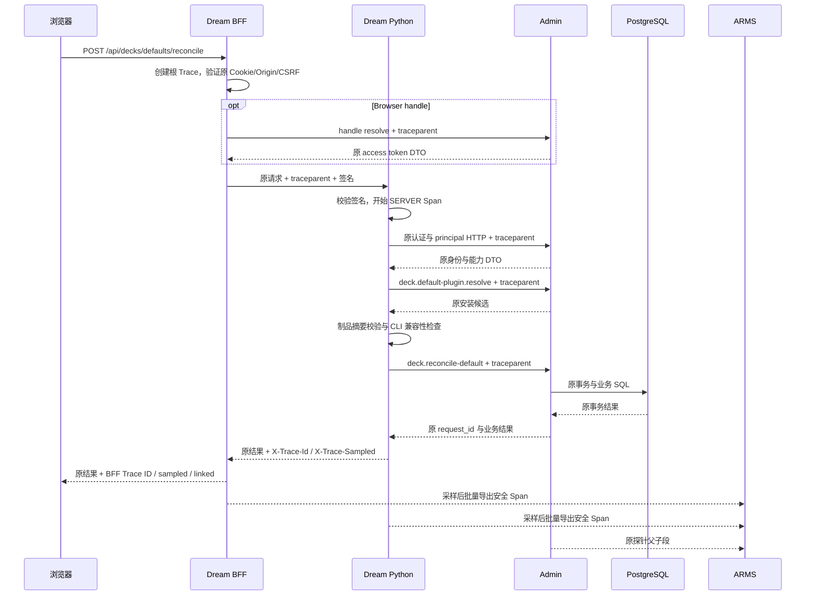
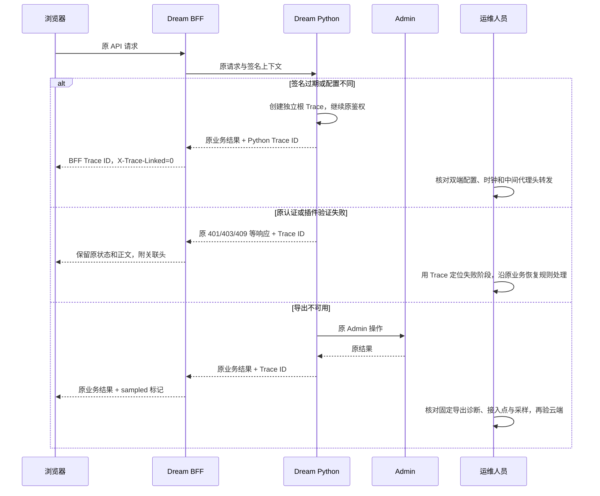

<!-- [Sync] 2026-11-19: trace registered Next API handlers and use matched FastAPI templates on the BFF. -->
<!-- [Sync] 2026-11-19: direct Web launch loads private settings and distinguishes Next.js, Python and Admin peers. -->
<!-- [Input] Dream server instrumentation, W3C propagation and the existing Admin ARMS deployment contract. -->
<!-- [Output] Private configuration, trace lookup, failure diagnosis and acceptance boundaries. -->
<!-- [Pos] Dream server operations guide; deployment and cloud configuration require separate authorization. -->
<!-- [Sync] 2026-11-19: register separate Web and private iOS installations in Beijing APM from startup spans. -->

# Dream 调用链查询与接入

## 范围与入口

Dream Web 的 Next.js BFF、Python HTTP 请求、Admin HTTP 调用和本地插件校验采用 OpenTelemetry。Deck 页面首次加载先等待 `POST /api/decks/defaults/reconcile`，随后发起目录读取；两个浏览器 HTTP 请求分别拥有 Trace ID，页面顺序保持现行实现。

本轮交付源码、隔离合同和跨语言集成验证。服务部署、服务重启、云端配置和真实 ARMS 数据到达分别验收。真实 reconcile 会写业务数据，执行需有对应业务授权。

既有 Admin 合同见 [Admin 监控发布部署要求](https://github.com/glide-the/dream-im-platform/blob/main/docs/observability-deployment-requirements.md)和[Admin 运维手册](https://app.notion.com/p/41830b7547c3810d9056c656f54c35af)。已读取的 2026-11-15 运维记录使用 `cn-beijing`、`default-cms-1230976711767463-cn-beijing`、应用 `ink-memory-admin`，HTTP、Next.js、undici 与 pg 由服务器 preload 管理。部署人员核对现场配置、W3C 提取和父级采样继续生效。资源与数据库指标使用既有 Prometheus 数据源，Trace 使用 ARMS 调用链存储。

## 服务端装配与配置

Python 入口为 `backend/server.py` 的 `TracedFastAPI`，容器仍执行原 `uvicorn server:app`。`uv sync --locked` 安装锁定的追踪 SDK。关闭追踪时运行时跳过 SDK 加载。容器沿原带 hash 的 `requirements.txt` 安装，导出命令为 `uv export --locked --no-dev --no-emit-project --output-file requirements.txt`。

Next 的 `createApiProxy` 接入独立 provider，通过 `AsyncLocalStorage` 传递当前上下文，保持 Next 全局 provider 和已有 preload 的所有权。关闭追踪时桥接模块跳过 SDK import。Python 同样延迟加载可选依赖。Dream 手动接缝覆盖原认证和 HTTP DTO 边界，服务端无需叠加 FastAPI、httpx、Next 或 undici 自动探针。Admin 保留现有服务器探针，仓库无需修改。

Web 的 Next.js 使用 `ink-memory-dream-web-next`，Python 使用 `ink-memory-dream-web-python`。两者用 `ink.dream.platform=web` 标记平台并共享签名密钥。普通 `pnpm dev`、`pnpm dev:online`、`uvicorn server:app`、VS Code Python 调试及本机 launcher 均由同一运行时入口读取权限为 `0600` 的 `~/.config/ink-memory/dream-web-trace.env`，也支持用 `INK_DREAM_WEB_TRACE_ENV_FILE` 指定同类配置。显式设置 `INK_TRACE_ENABLED` 时使用部署进程提供的配置。原 `ink-memory-dream-web` 名称按进程映射成对应 Web 服务，已有云端历史按旧名保留。

| 配置 | 默认与约束 | 用途 |
| --- | --- | --- |
| `INK_TRACE_ENABLED` | 未设置时关闭；启用值为 `true` | 控制本进程追踪 |
| `OTEL_SERVICE_NAME` | 各 Web 进程有独立默认名 | 部署可分别覆盖 ARMS 应用名 |
| `INK_TRACE_PYTHON_SERVICE_NAME` | `ink-memory-dream-web-python` | Python 改应用名时同步设置 Next 的下游服务名 |
| `INK_TRACE_HOST_NAME` | 可选的运维主机标签 | 为应用实例提供 `host.name`，可使用不含个人信息的标签 |
| `OTEL_EXPORTER_OTLP_TRACES_ENDPOINT` | 启用时必填，完整 HTTP(S) Trace 接入点 | 使用同一北京工作空间授权的 HTTP 接收入口；私有 URL 可含授权信息 |
| `OTEL_EXPORTER_OTLP_TRACES_HEADERS` | 按接入点要求配置 | 私有授权头；SDK 同时支持标准通用 OTLP headers |
| `INK_TRACE_CONTEXT_SECRET` | 启用时必填，至少 32 字节，两服务相同 | BFF 到 Python 的上下文签名；专用随机密钥 |
| `OTEL_TRACES_SAMPLER_ARG` | 根 Trace 比例 `0.1`，范围 `0..1` | 有父上下文时跟随父级决定 |
| `OTEL_BSP_MAX_QUEUE_SIZE` | 2048，正整数 | 每进程最大待导出 Span 数 |
| `OTEL_BSP_MAX_EXPORT_BATCH_SIZE` | 512，正整数，至多等于队列 | 每批最大 Span 数 |
| `OTEL_BSP_SCHEDULE_DELAY` | 5000 毫秒，正整数 | 批处理间隔 |

导出超时为三秒，SDK 采用有界批处理。队列满时丢弃观测数据。每进程预算需要结合 worker 数和主机容量核对。配置启用时，Python 的 ASGI lifespan 就绪或失败时采集 `dream.startup.web.python`，Next.js 的 `instrumentation.ts` 初始化 Node 探针并采集 `dream.startup.web.next`。这两项启动 Span 独立于请求采样率。两者使用 OTLP HTTP/protobuf 并写入各自的 APM 应用。客户端 Span 记录实际 `server.address`、`server.port` 和逻辑下游服务名。配置缺失、SDK 缺失或初始化失败时继续原业务路径，导出失败独立于业务响应。

阿里云接入点按控制台地域、网络和 HTTP 协议获取，见[官方 Python 接入说明](https://www.alibabacloud.com/help/zh/opentelemetry/user-guide/use-managed-service-for-opentelemetry-to-submit-the-trace-data-of-python-applications)。部署方须核对该接入点与已有 ARMS 应用处于同一查询工作空间，使用同一个 Trace ID 在控制台确认跨应用拼接。通用 OTLP 接收成功与 ARMS 云端查询成功分别留存证据。

服务配置放在独立环境文件。iOS `bundle-node.py` 检测到 `backend/.env` 或 `frontend/.env.local` 包含 `OTEL_*`、`ARMS_*` 或 `INK_TRACE_*` 赋值时停止打包。

## iOS 私有安装与查询

指定开发设备通过原 `devicectl device copy to` 将权限为 `0600` 的私有 JSON 放到应用数据容器的 `Library/Application Support/dream-otel.json`。文件包含完整 HTTPS OTLP `endpoint` 与上报 `headers`，按接入控制台提供的配置填写。凭据只保存在设备的私有安装配置中，禁止添加到 Xcode 资源、发布包或业务进程环境。普通安装缺少该配置时停用该探针。

收到本次嵌入式运行时启动结果时，后台线程初始化同一 Python 导出器，采集 `dream.startup.ios.runtime` 到 `ink-memory-dream-native`。成功或完成绑定时的失败按实际结果上报。随后 Native ASGI 与嵌入式 Next 到 Python 的回环请求共享同一端侧服务名。端侧为请求建立本地 Trace，向 Admin 传播现有 W3C 上下文。探针的线程和网络导出均不作为启动就绪条件。

打开[北京工作空间应用列表](https://cmsnext.console.aliyun.com/next/region/cn-beijing/workspace/default-cms-1230976711767463-cn-beijing/app/apm/application-list)。APM 在收到首笔 Span 后按 `service.name` 登记应用。启动 Trace 可按 `dream.startup.*` 对应的操作名查询。应用出现仅证明该服务名已有数据，Web BFF、Python 与 iPhone 各自的启动证据用对应操作名核对。

## 传播与采集规则

BFF 为每次公开请求创建根 Span，忽略浏览器提供的 `traceparent`、`tracestate`、`baggage`、诊断字段和签名。向 Python 注入 W3C `traceparent`，以 HMAC-SHA256 对秒级时间戳、traceparent、HTTP 方法和解码路径签名；Python 接受六十秒窗口内有效的专用密钥签名，拒绝重复字段。签名校验仅决定 Span 父级，原 OAuth、Cookie、CSRF、scope、principal 和资源归属照常校验。

Python 对直接客户端、过期签名、密钥不匹配和无签名请求创建根 Trace。服务间须保持时钟同步；BFF 与 Python 使用同一个入口路径。`tracestate` 与 `baggage` 在 Dream 边界丢弃。向 Admin 仅传播当前服务端 `traceparent`；Admin 已有探针负责生成 HTTP、pg 子段。原 `x-request-id`、DTO `request_id` 和业务幂等键保持原有生成与校验，Trace ID 用于诊断关联。

只记录固定阶段名、HTTP 方法、路由模板、状态、尝试次数、服务地址和耗时。Python 在已验签的 BFF 请求上返回匹配的路由模板。BFF 在同一 Trace ID 且模板符合 `/api` 规则时用它命名入口 Span。路由元数据保留在内部，响应给浏览器前过滤。BFF 本地处理的健康检查、MCP Apps、公开分享和旧认证入口直接使用固定模板，覆盖已处理的请求方法及 OPTIONS。网关预先拒绝、下游未匹配路由或未返回可用模板时，通用入口使用 `/api/[[...path]]`。Next 框架在处理函数调用前生成的 405 处于该探针的入口外。导出内容排除 Cookie、Authorization、请求与响应正文、查询参数、用户标识、插件路径与摘要、SQL 参数、模型和工具正文；错误状态只保存状态码。应用日志只增加安全关联字段，不新增日志或指标 exporter。原 CLI/MCP 子进程配置过滤器排除服务端追踪开关、签名密钥、接入点和授权头，凭据保留在服务端进程。

在「调用链分析」用 `X-Trace-Id` 展开同一请求。`X-Trace-Linked=1` 表示 BFF 与 Python 的 Trace ID 一致。Admin HTTP 与 PostgreSQL 客户端 Span 由 Admin 当前探针上报，需在同一 Trace ID 下确认。启动 Span 与业务请求各自有独立 Trace ID。

## 一次请求的耗时结构

| Span | 含义 |
| --- | --- |
| `POST /api/decks/defaults/reconcile`（Next.js） | BFF 从处理请求到响应流完成的总耗时 |
| `bff.authentication` | Cookie/Origin/CSRF 检查与可选 Admin handle 解析；原生 Bearer 复用原分支 |
| `admin.http`（BFF） | 原 Admin handle / capability / profile HTTP 与响应读取 |
| `dream.http` | BFF 到 Python 的 HTTP 与响应流 |
| `POST /api/decks/defaults/reconcile` | Python 完整请求，包括认证、业务与响应发送 |
| `dream.authentication` | 原 JWT/JWKS、服务令牌、capabilities、principal 链路 |
| `admin.oauth.token`、`admin.jwks` | 原冷路径的令牌与 JWKS 获取 |
| `admin.http`（Python） | 每次原 HTTP DTO 尝试，`dream.transport.attempt` 区分现有只读恢复 |
| `dream.deck.default_plugin.resolve` | Admin 默认插件解析 |
| `dream.deck.artifact.verify` | 本机制品校验 |
| `dream.deck.cli.compatibility` | 本机 CLI 兼容性检查 |
| `dream.deck.reconcile` | Admin 对账与原回执恢复 |
| Admin HTTP / pg 子段 | 由原服务器探针提供，区分事务、SQL 与连接申请 |

## 从浏览器或日志定位

1. 在开发者工具 Network 找到 `POST /api/decks/defaults/reconcile`，记录请求时间、状态及响应头 `X-Trace-Id`、`X-Trace-Sampled`、`X-Trace-Linked`。`linked=1` 表示 Python 响应与 BFF Trace ID 相同；该字段覆盖已到达 Python 的共享代理请求，BFF 提前拒绝会返回 `0`。
2. 服务日志以 `trace_id` 检索。BFF 输出 `dream.request` JSON；Python 的 `dream.trace` 输出 `trace_id`、`span_id`、`sampled`、方法、路由模板、状态和 `duration_ms`。原 Uvicorn 单行访问日志只有路径和状态，无法反推唯一 Trace ID。
3. 打开[北京 ARMS 应用列表](https://cmsnext.console.aliyun.com/next/region/cn-beijing/workspace/default-cms-1230976711767463-cn-beijing/app/apm/application-list)，选择实际 `OTEL_SERVICE_NAME`。在提供服务查 `POST /api/decks/defaults/reconcile`，或进入调用链分析按 Trace ID 和对应时间窗口查询。可按 `GET /api/claude-agent/scheduled-tasks/day` 或 `GET /api/claude-agent/scheduled-tasks/{task_id}/history` 查询 Next 与 Python 对应的入口 Span。操作参见[官方调用链查询说明](https://www.alibabacloud.com/help/zh/arms/application-monitoring/user-guide/trace-query)。
4. 展开 BFF、Python 和 `ink-memory-admin` 的父子段，比较认证、插件解析、本地制品、CLI 校验、对账及 Admin pg 子段。连接申请可能包含排队与新连接成本，具体等待类型结合数据库统计判断。

| 现象 | 判断与下一步 |
| --- | --- |
| BFF 无关联头、日志无追踪字段 | 核对显式开关、SDK 和配置初始化；确认经过共享 BFF API 入口 |
| `X-Trace-Sampled=0` | 根采样未命中；可保留日志关联，按另行授权的采样配置安排后续观测 |
| `sampled=1`，云端无 Trace | 核对时间/地域/工作空间、导出诊断、网络、授权及接收点；该标记仅表达本地采样决定 |
| `linked=0`，请求到达 Python | 对比双端日志时间与 Trace ID，核对签名密钥、时钟、路径和代理头；业务鉴权继续有效 |
| Python 下游 Span 存在，Admin 单独成链 | 核对 Admin preload 的 W3C extractor、父级采样、代理转发及云端接收工作空间 |
| Admin HTTP 段存在，pg 段缺失 | 核对原 pg 探针与实际数据库调用；缓存命中和提前失败按业务回执确认 |

## 验证与发布证据

隔离验证走生产 BFF 工厂、普通认证依赖、Deck 路由、插件校验调用和真实 Admin HTTP 构包，外部身份、制品与 Admin 响应使用合成输入，接收端使用内存 exporter 和随机 loopback 端口。测试中的 `admin.fixture.request` 为传播接收替身，云端 Admin/pg 子段由后续部署验收确认。

对应命令和结果维护在[执行记录](../exec/dream-arms-tracing-20261118.md)。文档路径、清单和 Mermaid 检查归文档验证。PR 检查与合并归远程交付；云端出现同一个 Trace ID 的 BFF、Python、Admin 和 pg 段后，方可记录 ARMS 到达验收。
