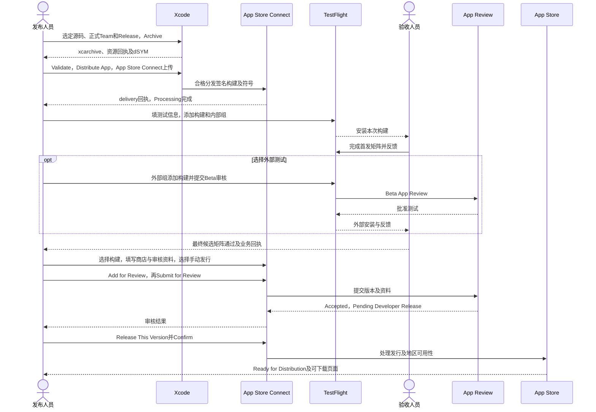
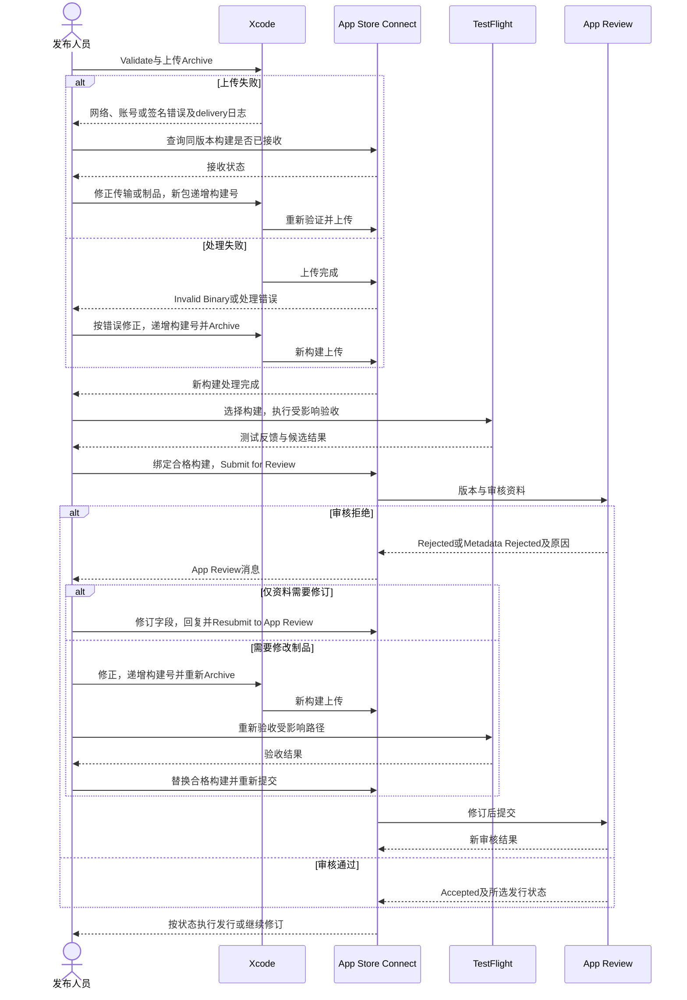
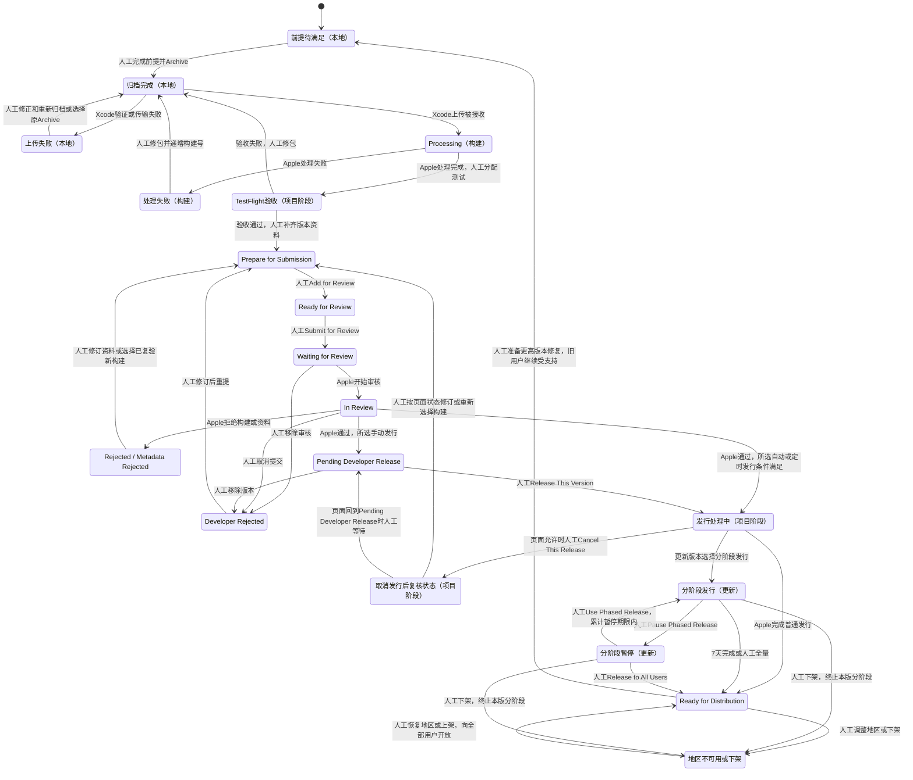

<!-- [Input] 当前 iOS 工程、资源装配脚本、分项交付回执及 Apple 官方发布要求。 -->
<!-- [Output] 从发布前提到 Archive、TestFlight、App Review、发行及故障恢复的独立操作手册。 -->
<!-- [Pos] iOS App Store 发布操作与发布人员流程评审；端侧实现归现有架构和认证文档。 -->
<!-- [Sync] 2026-11-02: 首次建立商店发布手册；只读核查及文档交付，实际上传、提审和发行留待后续执行。 -->

# Ink & Memory iOS App Store 上架操作手册

## 背景与问题

Ink & Memory 已具备 React Native 界面、包内 Next、Python、Node 和 Claude 运行资源。现有回执覆盖开发签名、模拟器分项验证、部分真机业务及构建24的覆盖安装。商店分发需要独立完成账号、工具链、分发签名、资源授权、隐私、功能验收及 App Review 条件。

**推荐路径：Apple Developer Program 正式团队 → 当前 `InkMemory` 工程的 Release Archive → Xcode Organizer 上传 App Store Connect → TestFlight 验证 → App Review → 手动发布至 App Store。** 使用当前 `com.inkmemory.mobile` 的前提为正式团队具有该标识的使用权，且应用记录、签名和能力一致。现有开发 IPA 仅作为开发回执留存。

本机 Xcode 16.4（16F6）、iOS 18.5 SDK 低于当前上传最低要求。Apple 自2026-04-28起要求 iOS 26 SDK 或更新 SDK；当前上传文档列明 iOS 构建使用 Xcode 26 或更新版本。后续选择 Apple 支持的正式 Xcode，核对其 macOS 要求并重新归档。最低运行系统与构建 SDK 分别管理，当前部署目标 iOS 16.4 保留至兼容性验证得出调整依据。[SDK最低要求](https://developer.apple.com/news/?id=ueeok6yw)、[上传支持](https://developer.apple.com/help/app-store-connect/manage-builds/upload-builds)、[Xcode系统要求](https://developer.apple.com/xcode/system-requirements)，查阅：2026-11-02。

## 目标与边界

- 发布人员可按本文顺序准备材料、构建、上传、测试、提审、发行和恢复问题；每步均定义操作位置、输入、操作、预期结果和失败处理。
- 本轮仅进行仓库只读核查、官方资料查询、文档编写和文档验证。代码、依赖、实际构建、签名材料、账号协议、上传、提审、发布及真实业务测试均未执行。
- 正常网页登录、退出、Client、PKCE、Cookie、CSRF、权限和现有公网 Admin 配置继续由原模块管理。发布前置工作须维持这些合同；每项功能或认证变更另行实施与验收。
- 端侧兼容完成作为工作基线。开发安装、模拟器、真实业务和商店资格各自记录证据；历史版本通过项须在最终 TestFlight 候选上复验。
- 复用[真机安装手册](ios-iphone-install-release.md)、[移动发布技术设计](mobile-app-release.md)、[认证排障指南](mobile-auth-troubleshooting.md)和[端侧架构](../design/multi-platform/mobile-runtime-architecture.md)。本文直接维护发布操作、业务验收入口及发布流程图。

## 发布对象与规则

### 当前源码与证据

核查日期：2026-11-02，Asia/Shanghai。起始分支 `develop`，HEAD `236f0ad4a9b9bb749aaf73dd1b4577c1844e0bc0`；起始 `git status --short` 为空。行号对应本次源码快照；后续发布以选定提交和制品回执重新核对。账号在线状态、证书可用性与 App Store Connect 应用记录本轮未访问。

| 对象 | 当前证据与定位 | 发布含义 |
| --- | --- | --- |
| 工程入口 | [`InkMemory.xcworkspace/contents.xcworkspacedata`](../../frontend/ios/InkMemory.xcworkspace/contents.xcworkspacedata) | 打开 workspace，包含应用工程与 Pods |
| Scheme、target、Archive | [`InkMemory.xcscheme`](../../frontend/ios/InkMemory.xcodeproj/xcshareddata/xcschemes/InkMemory.xcscheme)，L10–14、L36 | 应用 `InkMemory` 参与归档；`InkMemoryTests` 为测试目标；Archive 采用 Release |
| Release 身份 | [`project.pbxproj`](../../frontend/ios/InkMemory.xcodeproj/project.pbxproj)，L565–615 | `com.inkmemory.mobile`、`0.1.0`、源码构建号 `1`、Team `45KY254AF7`、Automatic signing；Team 的付费会员资格待核对 |
| 系统与设备 | 同一工程 L586、L612；[`Podfile`](../../frontend/ios/Podfile)，L13 | iOS 16.4；设备族 `1,2`，包含 iPhone 与 iPad；首发需覆盖 iPad 页面与截图 |
| 版本字段、回调、权限 | [`Info.plist`](../../frontend/ios/InkMemory/Info.plist)，L28–67 | 版本来自构建设置；账户 `.auth` 与 MCP `.mcp` scheme 分开；已声明相机、本地网络用途及本地网络传输 |
| 图标 | 工程 L569；本轮 `rg --files frontend/ios` 未发现 AppIcon 资源集 | `ASSETCATALOG_COMPILER_APPICON_NAME` 为空；需补正式图标资源、工程引用及商店图标 |
| entitlements | 本轮对 `frontend/ios` 文件与工程检索，未发现应用自有 `.entitlements` 或 `CODE_SIGN_ENTITLEMENTS` | 最终权限以 Xcode、profile 和签名产物核对；后续增加能力须同步标识与 profile |
| 隐私清单 | [`PrivacyInfo.xcprivacy`](../../frontend/ios/PrivacyInfo.xcprivacy)，L5–35；工程 L15 | 三类 required-reason API；收集类型数组为空、tracking=false；清单已加入资源，完整性待实际数据清点 |
| RN 与 Web | [`package.json`](../../frontend/package.json)，L6、L43–52；[`pnpm-lock.yaml`](../../frontend/pnpm-lock.yaml) | pnpm 10.28.1、Next 16.1.6、RN 0.81.5、RNW 0.21.4；安装解析以锁文件为准 |
| Python 与 Claude | [`python-dependencies.json`](../../frontend/ios/python-dependencies.json)，L2–7；[`pyproject.toml`](../../backend/pyproject.toml)，L35；[`node-dependencies.json`](../../frontend/ios/node-dependencies.json)，L2–28 | Python 3.13.17、SDK 0.2.145、Node 24.21.0、Runtime 0.1.12、CLI兼容2.1.241、ntn 0.15.1；分发许可逐项核对 |
| 资源装配 | 工程 L389–431；[`bundle-python.py`](../../frontend/ios/scripts/bundle-python.py)，L73–79、L104–149、L151–184；[`bundle-node.py`](../../frontend/ios/scripts/bundle-node.py)，L23–62 | Python及插件、Node、字体、Next由资源阶段装配；RN阶段使用 `index.native.js`，强制生成包内JS |
| 来源门禁 | [`bundle-next.py`](../../frontend/ios/scripts/bundle-next.py)，L23–48、L115–126；[`prepare-next.py`](../../frontend/ios/scripts/prepare-next.py) | 校验 checkout/prepared 来源，包内保留 `source-receipt.json`、`mobile-manifest.json`；门禁失败需重准备和重构建 |
| 配置打包 | `bundle-node.py` L57–63、L80–102；[`AdminDataConfig`](../../backend/services/admin_data/config.py)，L68–95、L117–125；[`admin-client.ts`](../../frontend/app/api/_auth/admin-client.ts)，L99 | 当前复制普通 env；后端及BFF消费服务凭证。外部分发前须处理服务端共享秘密依赖，源env正文本轮未读取 |
| 执行方式 | [`DreamNode.m`](../../frontend/ios/InkMemory/DreamNode.m)，L14–29；[`DreamGuestProcess.c`](../../frontend/ios/InkMemory/DreamGuestProcess.c)，L104–124、L175–194；[`guest-dependencies.json`](../../frontend/ios/guest-dependencies.json)，L2–8、L71 | Node使用 `--jitless`；Guest在应用进程解释执行；依赖声明 `local development`；公开API及商店适用性待最终制品验证 |
| 端侧插件 | [`ios_plugin_runtime.py`](../../backend/mobile_runtime/ios_plugin_runtime.py)，L21–49、L59–69 | 从包内摘要插件恢复；pip使用离线wheels；其他运行期下载、安装和生成代码执行范围须逐入口核对 |
| 已有开发制品 | [构建24安装记录](ios-iphone-install-release.md#2026-11-02-构建24覆盖安装与普通启动)，L614–629 | `0.1.0 (24)`覆盖原iPhone23并普通启动；2161项目录metadata保持；开发签名与页面/业务验收分列 |
| 已有业务证据 | [构建20真实业务](ios-iphone-install-release.md#系统验证后追加同一构建20真实业务)，L530–544；[集成记录](../exec/mobile-ios-integration-pr-20261102.md)，L16–30 | 真机原协议登录、配置、历史、一次Claude任务及正常Admin结算已有回执；可见界面、完整Notion与最终候选回归待完成 |

本机只读工具回执：`xcodebuild -version` 退出0，输出 Xcode 16.4 / 16F6；`xcodebuild -showsdks` 退出0，输出 iOS 18.5；`sw_vers -productVersion` 退出0，输出 macOS 15.7.4。本轮未调用 Archive、Run、证书导出或设备安装。

### 上架前置项及完成条件

下表按依赖排序。负责人为后续执行角色，实际姓名在发布记录中填写。

| 前置项 | 当前状态 | 最小后续操作及负责人 | 完成条件 |
| --- | --- | --- | --- |
| P1 账号与标识 | 付费会员、角色、协议、标识归属及应用记录待确认 | Account Holder/Admin核对会员、团队、角色、现有Bundle ID与应用记录 | 会员有效，协议有效，创建/上传/提审角色及应用访问齐备，同一Bundle ID可用 |
| P2 工具链 | 本机Xcode16.4/iOS18.5不满足上传门槛 | 发布工程人员准备符合Apple要求的正式Xcode，验证现有RN/Pods/Python/Node/Guest可归档 | Archive记录符合SDK、架构、最低系统与签名要求，Validate通过 |
| P3 分发凭证 | 开发身份已有历史回执，分发身份待确认 | 正式Team启用自动签名或准备手动分发证书/profile | Organizer能使用该Team完成App Store Connect分发签名，能力匹配 |
| P4 包内配置 | 普通env复制；代码要求服务凭证 | 认证负责人逐键分类，处理客户端可提取的共享服务凭证，完成可分发配置及正常登录回归 | 包内无服务端共享秘密、私钥或上传凭证；保持原公开业务入口和权限。单纯删除必需键会触发fail closed，须先完成相应工程工作 |
| P5 图标、隐私与权限 | AppIcon缺失，清单收集类型为空 | 补图标资源；按真实数据与required-reason API修订清单；核对相机/文件/本地网络用途 | 最终Archive图标与隐私报告正确；App Privacy、政策和运行行为一致 |
| P6 执行与分发授权 | Guest仍标记本地开发，Runtime有资格限定说明 | 负责人清点运行库、CLI、插件、wheels、字体及通知/源码提供义务；核对下载与执行能力 | 外部分发授权记录完整，代码来源/行为及公开API审查完成；2.5.2/4.7适用范围有说明及对应实现证据 |
| P7 登录与账户删除 | Google与注册入口存在；本轮范围未找到Apple登录及账户删除入口 | 产品/认证负责人确认4.8适用性与账户删除完整路径；按原认证体系补齐明确缺项 | 等效隐私登录方案或适用例外有证据；用户可从App发起账户及关联数据删除并获结果 |
| P8 商业与AI材料 | 订阅/Token读取页面存在，购买入口未见；数据共享与内容措施待确认 | 产品负责人确认收费路径、第三方AI数据告知及同意、内容举报处理和首发地区 | 适用支付规则、隐私与内容要求具备材料及实现；审核账户能访问首发全部功能 |
| P9 最终候选验收 | 分项历史通过；最终TestFlight未执行 | 验收人员完成本文矩阵并留存版本、设备、服务和正常Admin回执 | 全部发布必需项通过；受限功能明确展示适用条件；待完成核心路径清零 |
| P10 商店与地区材料 | 在线资料、截图及法规材料待确认 | 发布人员填写商店信息、地区、加密、适用许可及支持信息 | 必填项完整，页面可公开访问，地区所需材料已获确认 |

### 版本、签名和发布记录

- `MARKETING_VERSION` 对应 App Store 版本；`CURRENT_PROJECT_VERSION` 对应构建号。源码当前为 `0.1.0 (1)`，历史设备最新回执为 `0.1.0 (24)`。发布前读取 App Store Connect 已上传号，选择高于同版本已用号和当前内部候选号的新构建号。`25`仅可在确认所有已用号后采用；首发版本可继续使用合法的 `0.1.0`，也可由负责人确定正式版本。
- 后续在 Xcode target `General > Identity` 设置 Version/Build，并核对Release最终值。Organizer出现构建号管理选项时，采用已核定的号并复核上传后的号；若交由Xcode递增，必须把实际上传号回写发布记录。
- 开发签名使用 Apple Development 和开发profile；TestFlight/App Store采用正式Team的分发签名，由Xcode自动管理或由有效Apple Distribution证书及对应App Store Connect profile管理。开发profile的设备列表和短期有效期仅用于开发安装。
- 发布记录至少包含Git提交、工作区差异清单、Xcode/SDK、Bundle ID、Team、Version/Build、资源来源摘要、Archive/dSYM位置、上传delivery标识、TestFlight矩阵、审核消息和发行时间。凭证正文退出记录。

## 一、账号与应用记录准备

以下步骤属于后续实际操作。占位符均由负责人填写；本轮未登录开发者门户核对账号。

| 操作位置 | 输入或准备材料 | 具体操作 | 预期结果 | 失败处理 |
| --- | --- | --- | --- | --- |
| Developer Account → Membership details | `<正式Team名称>`、`<Team ID>`、会员持有人 | 核对Apple Developer Program会员状态、到期日、个人/组织主体；记录发布Team | 正式Team有效，主体具有应用及内容发行权 | Personal Team或会员过期时，由持有人完成加入/续费；保留当前开发包及数据 |
| App Store Connect → Users and Access | `<发布人员Apple Account>`、目标App访问 | 核对角色和App访问；应用创建/提审需要Account Holder、Admin或App Manager；上传另允许Developer；证书/标识权限独立核对 | 每项操作有获授权人员执行 | 由Account Holder/Admin补对应访问；Developer角色单独承担上传时，由有提审权限人员继续后续步骤 |
| Developer Account → Certificates, Identifiers & Profiles → Identifiers | `com.inkmemory.mobile`、正式Team、当前所需capabilities | 先查已有标识；同Team可使用时复用。缺失时由Account Holder/Admin注册Explicit App ID；仅勾选实际使用能力 | 标识归属与目标Team一致 | 被另一Team占用时先核对归属或转移条件；确需更换时，另行修订Bundle ID、回调、profile与升级数据方案并验证 |
| App Store Connect → Business → Agreements | 会员协议、主体信息、收费业务决定 | 持有人确认最新协议。免费分发按Developer Program协议；付费下载或IAP触发Paid Apps Agreement，补税务和银行资料 | 相关协议Active，无阻止创建/发行的待办 | 将协议或资料待办交主体负责人；暂停依赖步骤。免费首发仍核对实际待办及地区合规要求 |
| App Store Connect → Apps → `+` → New App | 名称`Ink & Memory`、iOS、主语言、`com.inkmemory.mobile`、`<内部唯一SKU>`、访问范围 | 先查同Bundle ID应用记录，已有时直接进入；新建时选择对应标识、填写SKU和语言，点击Create | 获得`<App Store Connect Apple ID>`及Prepare for Submission版本页 | 无Bundle ID选项时核对Team/权限/注册；名称冲突按实际可用名称处理，保留品牌权属材料 |

创建记录前须由Account Holder接受最新协议。SKU使用团队内部约定，记录创建后按Apple字段可编辑规则管理。[创建App](https://developer.apple.com/help/app-store-connect/create-an-app-record/add-a-new-app/)、[注册App ID](https://developer.apple.com/help/account/identifiers/register-an-app-id)、[协议](https://developer.apple.com/help/app-store-connect/manage-agreements/sign-and-update-agreements)，查阅：2026-11-02。

## 二、构建前准备

### 源码、配置与资源

| 操作位置 | 输入或准备材料 | 具体操作 | 预期结果 | 失败处理 |
| --- | --- | --- | --- | --- |
| 仓库根目录及发布记录 | `<发布提交>`、本轮允许使用的资源目录 | 读取`git status --short`、`git rev-parse HEAD`；锁定`frontend/pnpm-lock.yaml`、`frontend/ios/Podfile.lock`、`backend/uv.lock`及iOS三份dependencies JSON；登记必要工作区差异 | 资源与源码可追溯，用户及其他Agent改动完整保留 | 出现无关改动时逐项保留，另选清洁发布checkout；避免reset、全局格式化或覆盖共享准备目录 |
| Mac工具链 | 符合当期要求的正式Xcode | 核对`xcodebuild -version`、`xcodebuild -showsdks`及Apple系统要求；后续多Xcode并存时明确本轮`DEVELOPER_DIR` | 实际归档使用合格Xcode和iOS SDK | 工具链不满足时先准备兼容版本；本轮未安装或切换Xcode |
| 原配置所属模块与待签名副本 | 已审查的公开URL和可分发配置 | 保持现有公网Admin/Gateway；核对下表配置及认证注册。按P4处理服务凭证后复验；审查对象覆盖Next静态输出、JS、Python资源及所有包内env | 正常登录、业务与权限有效；包内无服务端共享秘密 | 必需凭证仍随包或删除后业务失效时，停止外部分发并完成最小认证工程工作；禁止放松校验 |
| iOS资源准备目录 | 锁定版本、已安装依赖、原准备脚本 | 按真机手册复用Python/Node/Guest/字体；源码变化时依次prepare Next、build、verify；共享根应单一执行者持有 | Next来源门禁通过，RN与后端资源来自本轮源码 | 缺资源时按脚本明确报错准备；旧来源时重准备和重构建；任何安装/下载留待后续执行 |
| Xcode target → General/Build Settings/Signing & Capabilities | 已确定版本、构建号、Team、图标及能力 | 核对Bundle ID、Version/Build、Deployment Target、iPhone+iPad、Release、AppIcon、权限和capabilities | 设置与应用记录、材料及实际能力一致 | 图标为空、能力或标识不一致时先修正并复验；保留原开发配置回执 |

当前图标缺项的后续操作：在应用target创建并加入Asset Catalog及AppIcon资源集，准备1024×1024正式图标，在target选择该AppIcon并核对Archive中的图标；具体变更另行执行。[Apple图标配置](https://developer.apple.com/documentation/xcode/configuring-your-app-icon)，查阅：2026-11-02。

| 配置项 | 正式包检查要求 |
| --- | --- |
| `INK_ADMIN_DREAM_BASE_URL`、`INK_ADMIN_DREAM_TRANSPORT_BASE_URL` | 使用现有可从审核设备访问的Admin HTTPS。最近开发回执为`https://ink-admin.suoxya.com`；执行时确认其持续可用及所有权 |
| `INK_ADMIN_AUTH_ISSUER`、`INK_ADMIN_PRODUCT_API_BASE_URL`、`INK_GATEWAY_BASE_URL` | 与现有Admin/Gateway及注册合同一致；issuer路径按原实现管理 |
| `INK_DREAM_PUBLIC_ORIGIN`、`INK_DREAM_BFF_REDIRECT_URI`及Client | 保留正常Web登录回调；手机loopback供包内服务使用，公网Admin接受原注册来源；禁止机械替换成MCP scheme |
| MCP callback | `com.inkmemory.mobile.mcp:/oauth/callback`按现行装配规则投影，须与Notion/MCP授权注册一致 |
| `INK_ADMIN_DREAM_SERVICE_SECRET`、BFF secret及其他服务端配置 | 按P4确认所有权及可分发方式；本轮仅从源码确定依赖，未读取实际值。打包前须消除共享服务身份暴露 |
| `INK_AGENT_SANDBOX_ENABLED` | 当前Release为`false`，对应既有部署规则；系统容器、原工具审批和资源权限继续生效。商店审核按实际执行能力判断 |

未来执行命令示例，仓库根目录运行；`IOS_RELEASE_ROOT`必须为本轮具名、可追溯且不覆盖既有制品的目录。环境变量需要在同一次构建及Xcode资源阶段一致传入；从Dock启动Xcode前另核对实际使用的Next根，防止采用默认旧目录。

```bash
export IOS_RELEASE_ROOT="<本轮发布工件绝对目录>"
export INK_IOS_NEXT_ROOT="$IOS_RELEASE_ROOT/Next"
python3 frontend/ios/scripts/prepare-next.py
pnpm --dir "$INK_IOS_NEXT_ROOT/build-source" build
python3 frontend/ios/scripts/bundle-next.py --verify-sources
```

`INK_IOS_NEXT_ROOT`须位于`frontend/ios/`内，符合现有脚本路径规则。`build-rn-ios.sh`包含依赖安装、`pod install`、字体准备及build；后续按缺失输入决定使用，已有资源齐备时直接Archive。[资源与配置操作](ios-iphone-install-release.md#资源与配置)与[认证分层排障](mobile-auth-troubleshooting.md)维护具体准备及恢复步骤。

### 正式制品来源核对

| 资源 | 核对方法 | 合格结果与失败处理 |
| --- | --- | --- |
| RN/Hermes | 确认归档日志执行`Bundle React Native code and images`、入口`index.native.js`；保留Metro输入及最终`main.jsbundle`摘要，沿既有[RN追溯记录](ios-iphone-install-release.md)的方法核对 | 归档JS来自本轮源码，脱离Metro启动；跳过打包或摘要异常时重新归档 |
| Next | 构建前后运行同根`bundle-next.py --verify-sources`；最终App内`next/source-receipt.json`和`next/mobile-manifest.json`对应同一根；检查manifest中`serverEntry`实际服务目录 | 来源摘要、BUILD_ID与实际服务根一致；来源过期即停止使用 |
| Python | 核对最终`app/`文件与本轮后端源码及锁定Python/wheels；framework与`.fwork`资源沿装配脚本；排除用户数据和无关开发文件 | 记录源码/二进制摘要与装配清单；漏文件或桌面扩展进入包时修正装配 |
| Node/Claude/ntn | 核对`node/runtime-adaptation.json`、platformFiles、`node/notion/manifest.json`及依赖锁；固定ntn二进制和LICENSE摘要按`bundle-node.py`门禁 | 采用锁定的运行库和当前平台适配，无Mac执行依赖；摘要不匹配即重准备 |
| Guest、插件、字体 | 核对`guest/manifest.json`、包内`plugin-artifacts/manifest.json`、原artifact摘要和字体回执；核对离线wheels及许可证清单 | 全部来自已核定输入，分发义务完成；本地开发限定或授权缺失时停止对外分发 |

来源核对覆盖归档实际App。`--verify-sources`校验Next来源；RN、Python、Node及Guest仍分别留存摘要回执。配置中的“credentials: excluded”描述Next准备阶段；最终`bundle-node.py`另行复制env，P4必须独立完成。

## 三、Archive与分发签名

### 签名方式和保管

推荐保留工程的`CODE_SIGN_STYLE=Automatic`，Team切换为已核定的正式Developer Program团队，由Xcode管理profile并在Organizer使用云管理分发证书；所需云证书访问由Account Holder/Admin授予。云证书私钥由Apple管理。正式Team与当前Team相同时，先核对会员升级及标识可用性，再继续。

手动签名适用于已有受控分发流程：Keychain中具备同Team的Apple Distribution证书及对应私钥，使用匹配显式App ID和capabilities的App Store Connect provisioning profile，在Release中选定。证书和profile均归发布Team；App Store profile供商店分发使用，开发设备登记列表用于开发或Ad Hoc。

私钥、`.p12`密码和上传凭证仅保存在Keychain或受控凭证系统；本轮不创建或导出。云签名可用时无需导出私钥。App Store Connect API `.p8`仅在后续明确选择自动上传时使用；本手册默认Xcode账号上传，新增上传平台数量为零。[云管理证书](https://developer.apple.com/help/account/certificates/cloud-managed-certificates/)、[Xcode分发](https://developer.apple.com/documentation/xcode/distributing-your-app-for-beta-testing-and-releases)，查阅：2026-11-02。

### 归档与留存操作

| 操作位置 | 输入或准备材料 | 具体操作 | 预期结果 | 失败处理 |
| --- | --- | --- | --- | --- |
| Xcode → Open | `frontend/ios/InkMemory.xcworkspace` | 打开workspace；选择scheme `InkMemory`，目标`Any iOS Device (arm64)`或当前Xcode的通用iOS真机目标 | 应用目标可归档，目标为iPhoneOS | 只打开project、scheme不可见或选择Simulator时，回到workspace及共享scheme |
| Product → Scheme → Edit Scheme → Archive | 发布配置、已准备资源 | 确认Build Configuration为Release；检查资源根与源码、Team、版本号；确认实际Release生成dSYM | Archive配置明确，主应用保留符号 | 缺资源按原准备脚本恢复；dSYM缺失时检查`Debug Information Format = DWARF with dSYM File`和第三方符号供应后重新归档 |
| Target InkMemory → Signing & Capabilities | 正式Team、自动或手动签名决定 | 选择Team和签名方式，核对Bundle ID及所需capabilities；解决所有签名错误 | Xcode能为当前目标配置合格签名 | 缺角色/证书/profile时由Team管理人员补齐；保留其他开发证书，避免撤销无关身份 |
| Product → Archive | P1–P8所需工程准备、发布版本及构建号 | 执行Archive，等待Organizer → Archives出现`InkMemory`；核对平台、版本、构建号、Team和源提交记录 | 生成iPhoneOS的`.xcarchive` | 编译/链接失败按实际报错修正，重新执行相关检查；工具链不能启动记录为构建前置失败 |
| Organizer → Archives | 本次Archive | 在Finder定位归档，核对`Products/Applications/InkMemory.app`、`dSYMs/`、Info及签名；必要时运行下方只读核对 | 归档包含正式配置及正确资源；签名与profile一致 | 签名后再改资源会破坏签名；回到资源准备重新归档 |
| 发布工件目录 | `<工件保管目录>`、Archive、符号、资源回执 | 保留原Archive；复制或导出归档备份、dSYM、摘要与发布记录。需要导出时由Organizer Custom中的App Store Connect导出选项生成适用IPA及export日志 | 崩溃可符号化，交付可追溯 | 第三方framework缺符号时记录可符号化范围并向供应方取得；避免承诺全栈符号齐全 |

Xcode默认归档通常位于`~/Library/Developer/Xcode/Archives/<日期>/`，最终路径从Organizer的Show in Finder获取；命令行可用`-archivePath`显式指定。保管目录由团队确定，并实施访问控制。上传原Archive时无需先导出IPA；开发IPA与商店导出IPA分开留存。dSYM用于定位线上崩溃，保留与最终二进制UUID一致的符号文件，使用`dwarfdump --uuid`核对。

未来命令行Archive示例，签名材料齐备后执行：

```bash
export IOS_VERSION="<本次商店版本>"
export IOS_BUILD="<已核定的新构建号>"
export IOS_TEAM_ID="<正式Developer Program Team ID>"
export IOS_ARCHIVE_PATH="$IOS_RELEASE_ROOT/InkMemory.xcarchive"
xcodebuild \
  -workspace frontend/ios/InkMemory.xcworkspace \
  -scheme InkMemory -configuration Release -sdk iphoneos \
  -destination 'generic/platform=iOS' \
  -archivePath "$IOS_ARCHIVE_PATH" \
  MARKETING_VERSION="$IOS_VERSION" CURRENT_PROJECT_VERSION="$IOS_BUILD" \
  DEVELOPMENT_TEAM="$IOS_TEAM_ID" archive
```

默认使用已存在的签名配置；需要Xcode在线创建或更新profile时，由后续执行人员在已获授权的账号流程中处理。命令未添加自动创建签名材料的参数。后续可对已选Archive执行：

```bash
export IOS_ARCHIVED_APP="$IOS_ARCHIVE_PATH/Products/Applications/InkMemory.app"
plutil -p "$IOS_ARCHIVED_APP/Info.plist"
codesign --verify --deep --strict "$IOS_ARCHIVED_APP"
codesign -d --entitlements :- "$IOS_ARCHIVED_APP"
dwarfdump --uuid "$IOS_ARCHIVED_APP/InkMemory"
```

权限核对关注Team标识、application-identifier、keychain组及实际能力；最终商店分发签名的`get-task-allow`应为false。归档可能先使用开发签名，Organizer分发阶段会按选定渠道处理签名；据最终上传/导出产物核对分发资格。命令输出仅限公开元数据，禁止遍历或输出包内env正文。

## 四、上传与TestFlight

| 操作位置 | 输入或准备材料 | 具体操作 | 预期结果 | 失败处理 |
| --- | --- | --- | --- | --- |
| Organizer → Archives → Validate App | 选定Archive、上传角色 | 若当前Xcode提供独立Validate App，先验证；同时检查后续分发流程中的validation摘要 | 平台、标识、签名、图标、版本及必需清单通过验证 | 按具体ITMS错误修正；警告逐项判定并记录，上传成功与资格验证分别记录 |
| Organizer → Distribute App | 发布Team、App Store Connect应用记录 | 选择App Store Connect；当前界面若先提供Upload/Export则选择Upload；若先提供分发方式卡片，选择App Store Connect，必要时从Custom进入同名渠道。核对签名、符号上传、版本/构建号，确认Upload | 获得delivery回执；同Bundle ID记录接收本次上传 | 禁止选择`TestFlight Internal Only`作为商店候选；认证/签名失败恢复后再传，保留delivery日志 |
| App Store Connect → App → TestFlight → iOS Builds；必要时查看Build Uploads | Version/Build、delivery标识 | 等待Processing转为Complete，查看邮件及构建详情；处理Failed、Missing Compliance或Invalid Binary等对应对象的反馈 | 构建可测试且标识、号段正确 | Failed按错误修正后重传；处理超过24小时按官方入口提交Feedback Assistant工单或联系支持；重试前核对已有构建 |
| TestFlight → Test Information | 测试描述、反馈邮箱、Beta App Review联系及可用账号 | 填写测试目的、业务入口、依赖、已知限制及适用审核资料 | 测试人员和Beta Review能完成操作 | 审核登录失效时修复原账号访问和后端可达性；凭证只填审核专用字段 |
| TestFlight → Internal Testing → `+` | 有App访问的内部用户、目标构建 | 建立组，Add Builds选择本次构建，填写What to Test，邀请内部测试人员，用TestFlight安装 | 内部真实分发包可安装并完成下方矩阵 | 无用户时补App访问及适用角色；构建已标Internal Only时仅内部使用，商店候选重新按普通渠道上传 |
| TestFlight → External Testing → `+` | 已建内部组、外部范围、测试说明 | 适用时建外部组、添加构建，提交Beta App Review；获准后通过邮箱或公开链接邀请外部人员 | 外部人员可安装批准构建 | Beta被拒时在TestFlight/App Review读取原因；需修包则新构建并重提。外部测试通过后仍须App Store正式审核 |

内部测试最多100名具备访问权的App Store Connect用户，外部最多10,000人，构建可测试90天。外部测试按Apple要求进行Beta App Review；TestFlight属于发布验证阶段。[内部测试](https://developer.apple.com/help/app-store-connect/test-a-beta-version/add-internal-testers)、[外部测试](https://developer.apple.com/help/app-store-connect/test-a-beta-version/invite-external-testers)、[TestFlight概览](https://developer.apple.com/help/app-store-connect/test-a-beta-version/testflight-overview/)，查阅：2026-11-02。

### 首发候选业务验收矩阵

当前状态来自已有记录，未在本轮重新执行。验收填写`通过 / 受限 / 待完成`及具体版本；核心路径有待完成项时保留TestFlight验证状态。最终执行须遵守[真实业务测试协议](../../AGENTS.md)：正常运行的Dream、Admin、Gateway、真实数据和指定现有账户，所有业务走公开生产入口；正常Admin可查询Run、Thread、请求和结算。明确模型及调用上限，保留验收记录，禁止替换成影子账户或隔离账本。

| 路径 | 当前已有证据 | 最终TestFlight候选完成条件 | 当前候选状态 |
| --- | --- | --- | --- |
| 首次启动、普通冷启动 | 构建24安装及进程启动通过；启动控制页有模拟器回执 | 脱离Mac/Metro启动，包内服务Ready，页面可操作；端口错误可见、可恢复，日志无凭证 | 待完成 |
| 正常网页登录与退出 | 构建20真机协议登录200；可见登录弹窗独立验收 | 原密码登录、适用Google授权/取消、回调返回、退出及重新登录；原CSRF和会话失效反馈有效 | 待完成 |
| 配置、历史与写作 | 构建20配置/历史GET200；最新Writing分项技术通过 | 页面读取原配置及历史，笔记A/B/A关联对话准确，保存与重开一致，窄屏键盘/滚动及iPad可用 | 待完成 |
| 核心Claude任务 | 构建20一次真实任务completed、正常Admin settled | 使用首发支持模型完成真实任务、工具审批、流式反馈及历史持久化，正常Admin记录可追溯 | 待完成 |
| 停止与恢复 | 构建8有Simulator真实Stop/冷恢复，后续版本分项记录 | 运行时停止、再次进入、冷启动恢复、前后台/锁屏及断网恢复均按产品状态反馈；无重复执行或结算 | 待完成 |
| Notion | 构建21真机ntn版本/帮助退出0；资源读取401；22链接修复 | 已授权账户完成浏览器授权、返回、资源读取/实际使用、撤销/失效反馈；原资源权限有效 | 待完成；当前记录受授权条件限制 |
| 文件、附件与分享 | 现有原生选择/上传/读取/导出技术回执 | 系统文件、目录和相机按首发入口操作；允许/拒绝/取消、下载、导出、分享及权限失败可恢复；审核样例无真实私人正文 | 待完成 |
| 更新与数据 | 23→24元数据2161项保持 | 首发使用真实TestFlight安装路径记录数据行为；后续商店升级复验历史/会话/文件，保留旧协议兼容 | 待完成 |
| 账户删除及合规入口 | 当前范围未见完整入口证据 | App内可发起删除、展示处理结果；隐私政策、AI共享同意及适用登录/支付入口完整 | 待完成 |

如某项服务存在地区、权限或账户前提，先定义首发支持范围，并在用户入口、商店描述和审核说明一致呈现。已承诺的核心功能需具备可用样例与审核权限；禁止通过审核账号特权绕过原控制。历史验收细节归[集成记录](../exec/mobile-ios-integration-pr-20261102.md)。

## 五、商店资料与合规信息

### 商店资料填写

| 操作位置 | 输入或准备材料 | 具体操作 | 预期结果 | 失败处理 |
| --- | --- | --- | --- | --- |
| App → App Information | 名称、副标题、主/次分类、内容权利 | 名称可用时填写`Ink & Memory`；副标题用一句说明记录、回顾和辅助创作；分类由产品负责人按首发主任务选择；确认第三方内容使用权 | 各本地化信息与实际业务一致 | 名称占用、权属或分类不清时补材料并修订 |
| Distribution → iOS版本页 | 描述、关键词、版权、适用更新说明 | 描述记录、配置、历史、Claude辅助及已支持Notion/文件范围；关键词按真实功能填写；版本更新填写本次变化 | 描述无未实现承诺、平台内部配置或调试指令 | 字段校验按页面提示修订；移除未通过首发验收的承诺 |
| 版本页 → App Previews and Screenshots | 最终候选截图、iPhone和iPad素材 | 按当前Screenshot specifications准备；每组1–10张JPEG/PNG，无透明；可用6.9英寸组1320×2868及13英寸iPad组2064×2752竖图，实际设备/方向须在官方允许列表内 | 展示真实页面、可读内容和支持设备，覆盖当前两种设备族 | 尺寸/alpha失败时按规格重导出；截图不得含用户私人正文或凭证 |
| App Information / App Privacy / 版本页 | `<支持HTTPS网址>`、`<隐私政策HTTPS网址>`、支持邮箱 | 提供无需登录的公开页面；隐私政策在App内也可直接进入。支持页面说明联系及问题处理 | 审核人员和用户可访问有效信息 | 失效/需登录页面先修复；占位符清零后提审 |
| App Information → Age Ratings | AI生成、用户内容、联网能力及内容控制事实 | 点击Set Up Age Ratings，逐项回答内容频率、控制、能力问卷；按实际内容设定适用年龄 | 系统产生与实际能力相符的全球/地区分级 | 无法限制超龄内容时先补控制或调整发布范围；避免按“笔记应用”直接推断最低分级 |
| App → Pricing and Availability；Business → Compliance | 免费/付费决定、首发国家地区及适用资质 | 选择价格和地区；声明DSA trader身份，适用时完成联系人验证；中国大陆等地区的备案/许可与Apple要求按实际功能补齐 | 选定地区具备发行条件 | 材料缺失地区暂不勾选，由主体负责人确认条件后再开放 |
| 版本页 → App Review Information | 审核联系人、电话、邮箱、审核账号、说明和必要附件 | 填写可用账号及操作说明；审核账户按原权限访问全部提交功能及测试资源 | 审核无需Mac、内网或工作人员临时开权限 | 密码、二次验证或资源授权不稳定时先修复审核访问；只在受限审核字段填写凭证 |

名称2–30字符，副标题最多30字符；关键词按Apple字段当前100 bytes限制填写并以页面校验为准。[App信息](https://developer.apple.com/help/app-store-connect/reference/app-information/app-information/)、[版本字段](https://developer.apple.com/help/app-store-connect/reference/app-information/platform-version-information)、[截图规格](https://developer.apple.com/help/app-store-connect/reference/app-information/screenshot-specifications/)、[年龄分级](https://developer.apple.com/help/app-store-connect/manage-app-information/set-an-app-age-rating/)、[DSA资料](https://developer.apple.com/help/app-store-connect/manage-compliance-information/manage-european-union-digital-services-act-trader-requirements)，查阅：2026-11-02。

### 合规适用性与材料

| 事项及触发条件 | 当前证据 | 填写或处理要求 | 待补材料与放行条件 |
| --- | --- | --- | --- |
| App Privacy：App或合作方从App收集数据 | 登录邮件/账户标识、对话/文件、历史和Token账单由现有业务处理；最终数据清点未完成 | 按真实保留和用途申报Contact Info、Identifiers、User Content、Usage/Diagnostics等适用类型，逐项判断是否关联身份、tracking及用途；分别检查Admin、Gateway、模型和Notion | 数据流表、合作方保留策略、用途及删除规则；空收集数组与无数据收集声明不能直接复用 |
| 权限与隐私清单：相机、文件、局域网及required-reason API | 相机及本地网络说明已存在；文件通过系统选择与scope复制；清单列FileTimestamp/UserDefaults/SystemBootTime | 按实际用途核实三项reason及依赖SDK要求；用Organizer归档隐私报告对照App Privacy；确认局域网提示仍有实际功能，包内loopback与公网访问各按用途判断 | 最终包权限拒绝/取消路径及全部SDK清单；如启用额外受保护资源，先补对应用途和验证。不得仅为消除上传错误选择reason |
| Google登录：作为App主账户登录 | `AuthEntry.tsx` L73–86有Google、密码及注册；本轮未见Apple登录入口 | 按4.8提供具有姓名/邮件最小收集、隐藏邮件和广告数据保护的等效服务；Sign in with Apple可作为实施方案。适用例外须逐项有证据，现有密码登录单独不足以证明条件齐备 | 登录方案及原认证兼容回归；保持Google与正常账号权限；所需新增工程另行完成 |
| 账户删除：支持账号创建 | `AuthEntry.tsx` L81–86支持注册；当前检索范围未发现完整删除入口 | App内清晰发起删除，覆盖账户及依法无需保留的关联数据；若到网站完成，直达可完成删除的页面；提供时限和结果 | Admin实际删除能力、App入口、Notion授权/关联数据处理、法定保留说明及真实删除验收计划 |
| 数字服务/Token/订阅：提供付费访问或解锁 | [`StoryWorkspaceSubscriptionPage.native.tsx`](../../frontend/app/_dream/views/story-workspace/StoryWorkspaceSubscriptionPage.native.tsx) L1–4、L54–58为只读套餐/额度；本轮未见StoreKit购买实现 | 确认首发收费模型和已有站外套餐的使用方式；适用IAP时先实现产品、购买/恢复/订阅管理和审核材料。免费且无购买入口时按实际填写；既有付费权益须核对3.1.3等适用条件。地区外链规则有专门条件，禁止默认套用例外 | 收费决策、地区范围、适用条款及已实现入口证据；“只读页面”单项不足以确定支付合规 |
| AI内容与个人数据共享 | Claude通过Gateway调用远程模型，端侧执行与远程推理各有职责；最终用户告知/同意路径待核对 | 依据5.1.2(i)明确第三方AI共享对象、数据和用途，发送前取得明确许可；按1.1及适用1.2/4.7提供内容控制、举报及处理。用户间内容发布/分享服务触发UGC要求时补过滤、举报、屏蔽及联系渠道 | 模型合作方与数据策略、用户同意及撤回流程、内容处理证据；模型名称与商店承诺一致 |
| 加密与出口：使用、包含或调用加密 | HTTPS、Node及Python依赖存在；完整加密实现清单未审计；Info未声明`ITSAppUsesNonExemptEncryption` | App Information → App Encryption Documentation，或TestFlight/版本构建旁Manage回答实际问题；梳理系统TLS、Node/Python OpenSSL及其他库。需要文件时上传并关联构建；确认豁免后才设Info字段 | 加密组件、算法/用途、发行地区及问卷结论；存在HTTPS单项不足以判定整包豁免 |

官方依据，查阅日期均为2026-11-02：[App Privacy填写](https://developer.apple.com/app-store/app-privacy-details/)、[隐私清单](https://developer.apple.com/documentation/bundleresources/describing-data-use-in-privacy-manifests)、[账户删除](https://developer.apple.com/support/offering-account-deletion-in-your-app/)、[审核条款4.8](https://developer.apple.com/app-store/review/guidelines/#login-services)、[支付条款3.1](https://developer.apple.com/app-store/review/guidelines/#payments)、[数据共享5.1.2](https://developer.apple.com/app-store/review/guidelines/#data-use-and-sharing)、[加密问卷与材料](https://developer.apple.com/help/app-store-connect/manage-app-information/determine-and-upload-app-encryption-documentation)、[加密文档分类](https://developer.apple.com/help/app-store-connect/reference/app-information/export-compliance-documentation-for-encryption)。

### Python、Node、Claude与工具执行的审核核对

此处判断来自当前代码与Apple条款的对应分析，最终资格由实际制品及App Review决定。解释执行、关闭JIT、资源摘要和开发签名分别说明技术行为。

| 代码事实 | 直接适用事项 | 后续最小处理与完成条件 |
| --- | --- | --- |
| Python、Node、原CLI、Guest命令及插件随包进入App；Node带`--jitless`，Guest声明`jit=false` | 2.5.1公开API；2.5.2代码来源与容器；2.5.6的Web浏览实现边界 | 清点最终Mach-O/Framework公开API、签名及可执行来源；Web文档由现有WKWebView承载。Node内部计算用途与浏览器用途明确列出；缺API扫描/实际发行回执时标记待验证 |
| Guest执行Bash、Python及固定ntn；可访问已挂载App资源/数据 | 2.5.2、2.5.4 | 核对所有挂载和文件入口都受系统容器/用户授权控制；列出用户/模型产生脚本的实际执行范围、网络下载后执行行为、后台恢复。禁止以新增后台模式持续运行任务 |
| 包内摘要插件恢复；pip使用`PIP_NO_INDEX=1`和离线wheels；原插件管理页面仍有安装操作 | 2.5.2；4.7的chatbots/plug-ins适用范围 | 区分随包恢复、普通文档下载、插件安装、模型生成代码及执行。检查每个可达入口与代码来源；远程增加功能的代码执行未完成适用性论证时保留上架阻塞，并另行确定最小能力处理 |
| 应用产品为记录、回顾、AI辅助，当前材料未建立教育开发应用资格 | 2.5.2教育代码例外条件；4.7列举软件及附加规则 | 按真实产品用途评估，禁止为采用例外改写产品性质。若按4.7提供软件，补内容/支付、原生API边界、逐次数据许可、软件索引/通用链接及年龄控制证据 |
| Guest/Runtime依赖声明本地开发或资格用途，包含GPL组件与第三方通知 | 分发权、5.2及依赖自身许可 | 核对全部发行条款、源码提供义务、通知、字体与插件授权，并确认所选App Store渠道可执行；无法满足时先完成依赖或范围处理 |

依据：[App Review Guidelines 2.5](https://developer.apple.com/app-store/review/guidelines/#software-requirements)、[4.7](https://developer.apple.com/app-store/review/guidelines/#mini-apps-mini-games-streaming-games-chatbots-plug-ins-and-game-emulators)、[5.2](https://developer.apple.com/app-store/review/guidelines/#intellectual-property)，查阅：2026-11-02。当前资料支持列出核查要求，尚未取得Apple对本应用执行能力的认可。审核中提交真实边界、来源清单和复现步骤；待补工程留在P4、P6、P7、P8执行范围内。

### 审核说明填写模板

下列内容用于后续填入App Review Information的Notes。所有占位符替换后，由负责人逐句核对最终候选；账号密码只填写审核专用Sign-in information字段。

> Ink & Memory用于个人记录、回顾及AI辅助创作。提交版本为`<版本/构建号>`。应用使用React Native界面，并在iOS应用进程中加载包内Next、Python、Node及Claude运行资源；模型推理通过`<服务及提供方>`完成。所有发布资源来源和运行期代码行为见附件`<清单名称>`；工具执行范围为`<已核定的实际范围>`，文件访问遵循系统授权和原有资源权限。
>
> 首次打开等待准备完成，进入登录页，使用Sign-in information字段中的审核账户。按`<真实入口名称>`打开写作/历史，执行`<固定样例>`；在`<Chat入口>`发送`<一次有界任务>`，可在`<停止入口>`停止并通过`<恢复入口>`查看状态。Notion通过`<入口>`访问`<已授权示例资源>`；文件通过`<入口>`选择/导出审核样例。审核账户已具有这些正常功能权限，审核期间服务持续开放。
>
> 隐私政策入口为`<App内入口>`和`<公开URL>`；账户删除入口为`<入口>`。适用的AI数据共享同意、登录、付费及限制说明为`<最终事实>`。联系人为`<姓名/邮箱/电话>`；操作视频或资料为`<附件>`。

## 六、提交审核与正式发布

| 操作位置 | 输入或准备材料 | 具体操作 | 预期结果 | 失败处理 |
| --- | --- | --- | --- | --- |
| Distribution → iOS版本页 → Build | 通过TestFlight矩阵的普通上传构建 | 点击添加构建，选择匹配Version/Build，完成加密信息，保存；逐项核对P1–P10与商店材料 | 版本绑定唯一候选，必填项齐备 | 无构建时核对处理状态、平台、版本和Internal Only标记 |
| 版本页 → App Store Version Release | 发布负责人、发行时间及地区 | 首发推荐`Manually release this version`；可选审核后自动发布，或审核后不早于指定日期发布；保存并记录时区 | 发布方式明确；首发保留人工发行时点 | 日期/地区/价格不一致时在提交前修正；自动模式须确保已具备发行条件 |
| 版本页 → Add for Review；Draft Submissions/App Review | 完整审核资料、构建、适用IAP | 点击Add for Review添加至草稿submission；打开Draft Submissions检查内容，再点击Submit for Review | Ready for Review经提交进入Waiting for Review，Apple开始后In Review | Add for Review后仍需Submit for Review；资料错误按页面具体字段处理 |
| App → App Review | submission、Apple消息与复现材料 | 跟踪状态；在消息线程读取条款与问题，逐项回复事实及复现步骤；需要修包则新构建，经矩阵复验后替换重提 | 所有本次提交项目Accepted，版本进入相应发行状态 | Metadata Rejected按字段修订；Rejected/Unresolved Issues按详情修正并Resubmit to App Review；有依据时按官方渠道申诉 |
| 版本Pending Developer Release → Release This Version | 发行负责人、最终服务/地区/版本核对 | 手动模式点击Release This Version，按Apple确认对话框Confirm；记录操作与时间。自动模式按已选规则等待 | Apple处理后Ready for Distribution，选定地区实际可下载 | 仍处理时查看版本及地区可用性；手动发行后可能需24小时出现；发现问题按下一节处理 |
| 更新版本 → Phased Release for Automatic Updates | 已有线上版本、新版本及观察负责人 | 更新时可选7天分阶段自动更新；观察崩溃和核心业务，必要时选择Pause Phased Release并Save；恢复使用Use Phased Release并Save，或Release to All Users | 自动更新按所选阶段执行，人工下载持续可用 | 首发采用普通发行；分阶段暂停仅控制自动更新扩散，故障修复另提新版本 |

官方流程：[提交App](https://developer.apple.com/help/app-store-connect/manage-submissions-to-app-review/submit-an-app)、[发行选项](https://developer.apple.com/help/app-store-connect/manage-your-apps-availability/select-an-app-store-version-release-option/)、[处理审核问题](https://developer.apple.com/help/app-store-connect/manage-submissions-to-app-review/manage-a-submission-with-unresolved-issues)、[状态定义](https://developer.apple.com/help/app-store-connect/reference/app-information/app-and-submission-statuses/)、[分阶段更新](https://developer.apple.com/help/app-store-connect/update-your-app/release-a-version-update-in-phases/)，查阅：2026-11-02。

## 七、更新、暂停与问题恢复

| 场景/操作位置 | 输入或准备材料 | 具体操作 | 预期结果 | 失败处理及边界 |
| --- | --- | --- | --- | --- |
| 上传失败 / Organizer delivery日志 | 错误码、Archive、Version/Build | 识别网络/账号错误与制品错误。先核对ASC是否已接收；未接收且包未变可重传；Build Uploads为Failed时Apple允许复用构建号；修包后本手册采用递增号记录新制品 | 仅保留明确的有效上传 | 已成功处理的构建不能覆盖；保留每次delivery日志及实际构建号 |
| Build Uploads为Failed、版本Invalid Binary或构建不可用 / TestFlight及邮件 | Apple处理消息、依赖/签名/清单事实 | 按错误修正输入，修包采用新号重新Archive、验证、上传及TestFlight；Failed允许复用号的规则见上一行 | 新构建完成处理并可测试 | Processing超过24小时按官方入口提交工单或联系支持；先凭delivery核对状态，避免盲目重建 |
| Beta或App审核拒绝 / TestFlight、App Review | 条款、截图、复现和修订说明 | 材料问题修订资料；功能/二进制问题修包并完成受影响回归；从原submission处理并重新提交 | 拒审项解决，审核重新开始 | 拒审依据有事实分歧时提供可复现证据并按App Review申诉；禁止隐藏实际能力 |
| 提交前或Ready for Review发现问题 | 草稿submission | 暂不点击Submit for Review，修正构建/资料及矩阵，重新核对草稿 | 版本继续准备，尚未进入审核队列 | 若已进入队列，按下一行移除 |
| Waiting for Review、In Review、Waiting for Export Compliance、Pending Developer Release或Pending Apple Release | 有管理权限人员、问题记录 | 版本页点击`remove this version from review`并Remove；或App Review → submission → Cancel Submission并Confirm | 进入Developer Rejected，修订后重提 | 移除将影响同submission其他项目；重提从审核流程重新开始，按页面当前可用操作执行 |
| 手动发行已点击、尚在发行处理中 | 版本页可见状态及操作 | 若页面显示`Cancel This Release`，及时使用；已经可下载时进入上线故障路径 | Apple允许的处理窗口内取消后续发行 | 该入口随处理阶段变化；禁止承诺任何时点均可取消 |
| 分阶段更新故障 / 版本Phased Release | 线上监测、故障影响 | 选择Pause Phased Release并Save，最多累计暂停30天；恢复选择Use Phased Release并Save；计划全量时Release to All Users。临近累计期限由负责人依据当前页面决定继续方式 | 自动更新按暂停或继续状态运行 | 手动下载仍可用；停止扩散和已安装用户故障分别处理。下架会终止该版本分阶段发行，重新上架后向全部用户开放 |
| 上线后故障 / Pricing and Availability → App Availability | 受影响地区、错误范围、修复负责人 | 必要时调整地区或Remove App From Sale并按Apple确认；同时发布递增版本和构建号的修复包，完成回归和审核 | 减少新下载，修复版本替代故障版本 | 已安装用户仍可能运行旧包；下架不会清除设备数据或撤销已安装包，旧客户端仍需服务兼容 |
| 需紧急修复 / App Review支持 | 故障影响、复现、已提交修复版本 | 提交新版本后按适用条件申请expedited review，提供具体影响 | Apple受理加急请求；按实际结果跟踪 | 加急资格和时间由Apple决定；服务侧恢复只采用已有受控运维流程 |

App Store无法将线上版本直接回退到先前版本；问题修复需新建版本并重新提交。可复用经过修正的旧代码，使用更高版本/构建号并满足当前SDK及审核要求。[新版本规则](https://developer.apple.com/help/app-store-connect/update-your-app/create-a-new-version)、[上传处理状态及Failed复用构建号](https://developer.apple.com/help/app-store-connect/reference/app-uploads/build-upload-statuses)、[移除审核](https://developer.apple.com/help/app-store-connect/manage-submissions-to-app-review/remove-a-submission-from-review)、[地区与下架](https://developer.apple.com/help/app-store-connect/manage-your-apps-availability/manage-availability-for-your-app-on-the-app-store/)、[App Review支持](https://developer.apple.com/app-store/review/)，查阅：2026-11-02。

旧版本兼容和数据保留：Admin/Gateway继续支持仍在使用的客户端协议和账户权限；共享schema服从Admin Drizzle的expand → Dream兼容 → backfill/validate → contract。每次更新保留历史、会话、文件与结算记录；禁止以卸载重装作为常规数据恢复。后端故障按既有运维手册修复，保留API、认证和数据兼容；服务调整无需客户端二进制变化时仍按原授权执行，代码/功能更新通过新包提审。

## 八、发布操作流程图与状态

下列流程描述后续发布人员操作。TestFlight验证为本项目选定的发布步骤；图示未声明本轮已执行任何上传或审核。

### 正常发布时序



### 异常与恢复时序



### 发布状态转换



| 状态对象 | 进入依据 | 下一操作及恢复入口 |
| --- | --- | --- |
| 本地归档/上传 | Xcode归档、验证和delivery结果 | 修正资源/签名/网络，选原归档重传或新构建归档 |
| Processing/构建错误 | Apple构建处理结果 | 等待处理、补加密或修包；成功后分配TestFlight |
| TestFlight验收 | 本项目矩阵及适用Beta审核 | 通过后准备商店提交；失败回到源码/资源修正 |
| Prepare for Submission / Ready for Review | 人工填写资料与Add for Review | Submit for Review实际进入审核队列 |
| Waiting for Review / In Review | Apple收件与开始审核 | 读取消息；允许时移除/取消；拒审按问题修订 |
| Rejected / Metadata Rejected / Developer Rejected | Apple拒审或人工移除 | 修资料或换已验证新构建后重提，审核重新开始 |
| Pending Developer Release / 发行处理中 | Apple通过及人工/自动发行规则 | 人工发行或等待处理；仅在页面支持时取消发行 |
| Ready for Distribution / 分阶段发行/暂停 | Apple完成发行或更新批次状态 | 核对地区可下载与核心业务；更新可暂停自动扩散，已安装故障另行修复 |
| 地区不可用或下架 | 可用性操作完成 | 持续支持已安装客户端，修复版本提审；恢复可用性按当前批准版执行 |

图中“本地”“项目阶段”用于区分本手册管理节点与Apple界面状态；App Store Connect内构建、版本、submission和地区状态分别读取。Beta审核结果与正式审核结果分别登记。

## 九、设计评审与交付状态

评审依据：发现阶段核对当前源码、开发制品与业务记录；定义阶段聚焦源码到商店发行的操作及前提；方案比较选择现有Xcode自动签名/Organizer，手动签名作为已有受控流程的备选；交付采用单一手册、复用现有技术链接和三张发布操作图。实际产品界面、发布平台和通用框架新增数量为零。

| 评审项 | 发现 | 处理方式 | 修订结果 | 剩余前提 |
| --- | --- | --- | --- | --- |
| 顺序可执行 | 旧真机手册仅概述商店步骤 | 补账号、源码、Archive、上传、TestFlight、材料、提审及发行五列步骤 | 发布人员有明确输入、结果和恢复入口 | P1–P10须在后续执行中逐项满足 |
| 账号与签名 | 源码Team和开发签名无法证明正式资格 | 按动作列角色，区分自动云签名和手动材料 | 所需证书/profile归属、保管及验证明确 | 正式Team在线核对 |
| 当前工程一致 | Release为0.1.0/1，设备回执24；图标为空；Xcode16.4 | 记录精确工程名、字段、行号和工具结果 | 版本、图标和SDK差距具体 | 新工具链、图标及合格Archive |
| 配置与正常业务 | env复制与服务凭证依赖会影响外部分发 | 列P4明确工程前提；保持原认证与公网服务合同 | 避免通过删键或降低校验使现有业务失效 | 可分发凭证方案及登录回归 |
| 验收状态 | 模拟器、真机协议和后续安装来自不同版本 | 独立列历史证据及最终候选矩阵 | 通过、受限与待完成各有范围 | 最终TestFlight业务证据 |
| 审核依据 | 代码执行、Google注册、AI共享、套餐读取均触发适用性判断 | 对应官方条款和现有代码，写清材料及放行条件 | 缺项转为前置工作，无审核资格推定 | P5–P8及地区材料 |
| 拒审与线上恢复 | 上传、处理、审核和上线故障操作不同 | 分列重传、新构建、重提、取消、暂停、下架及修复版 | 明确无法回退商店旧版本，旧包数据持续兼容 | 后续执行回执及运维授权 |
| 独立性与图示 | 既有架构资料充分 | 通过链接复用；正文保留正常、异常和状态图 | 形成独立手册，未重复端侧架构展开 | 文档验证回执见下节 |
| 过度设计 | 操作可由现有Apple工具完成 | 选用现有工具，排除新增平台、App内发布管理页和重复确认设计 | 新增平台/页面/通用框架/无关系统数量均为零 | 无新增系统依赖 |

**评审结论：待满足明确前提后通过。** 手册已定义完整发布路径和恢复操作；实际发行受P1–P10约束，账号、合格工具链、分发签名、资源授权、配置安全、隐私/账户/商业及最终业务验收仍待后续执行。

## 十、文档验证

本节仅记录Markdown清单、路径/行号引用、章节锚点、术语、发布图一致性和Mermaid语法验证。功能、真实业务、签名和商店验收未由文档检查覆盖。

| 检查 | 执行记录 | 状态 |
| --- | --- | --- |
| 本轮Markdown清单、文件头和目录登记 | `python3 /tmp/ink-ios-app-store-docs-20261102/validate_r3.py`，由`luna_test_runner`执行 | 退出0；5份目标文档、文件头、基础章节、直接索引及目录合同登记通过 |
| 相对路径、源码行号和章节锚点 | 同一`validate_r3.py`按文档真实父目录解析新增链接，检查新手册全文及构建20/24证据 | 退出0；相对路径和章节锚点有效，19个源码行号引用范围及关键标识通过，构建20/24引用另行核对 |
| 三张Mermaid图 | `node /tmp/ink-ios-app-store-docs-20261102/validate_mermaid_r2.mjs` | 退出0；已安装Chrome156.0.8078.74实际解析及渲染3/3图，无console/page错误；浏览器已关闭 |
| 空白与范围 | `git diff --check`、`git status --short`；新文档另用`git diff --no-index --check /dev/null docs/deploy/ios-app-store-release.md` | 前两项各退出0，仅5份目标文档变化；新文件检查退出1、诊断输出为空，该命令记录与空文件的内容差异，空白错误为0 |

增强校验r2曾退出1，发现根目录合同缺少手册文件登记；补充直接链接后r3退出0。原失败记录保留于`/tmp/ink-ios-app-store-docs-20261102/r2-doc-validation.json`。最新文档回执为同目录`r3-doc-validation.json`及`r3-doc-validation.log`；图示回执为`r2-mermaid-validation.json`与三份`r2-mermaid-*.svg`。评审已删除暂停期限结束自动全量的推断，取消发行后的状态按页面反馈复核。验证未安装依赖、未构建应用、未访问账号/模型、未操作设备或数据库；历史文档原有内容未纳入本轮修订范围。

**上架方案已完成；实际上传、提审和商店发布尚未执行。**
