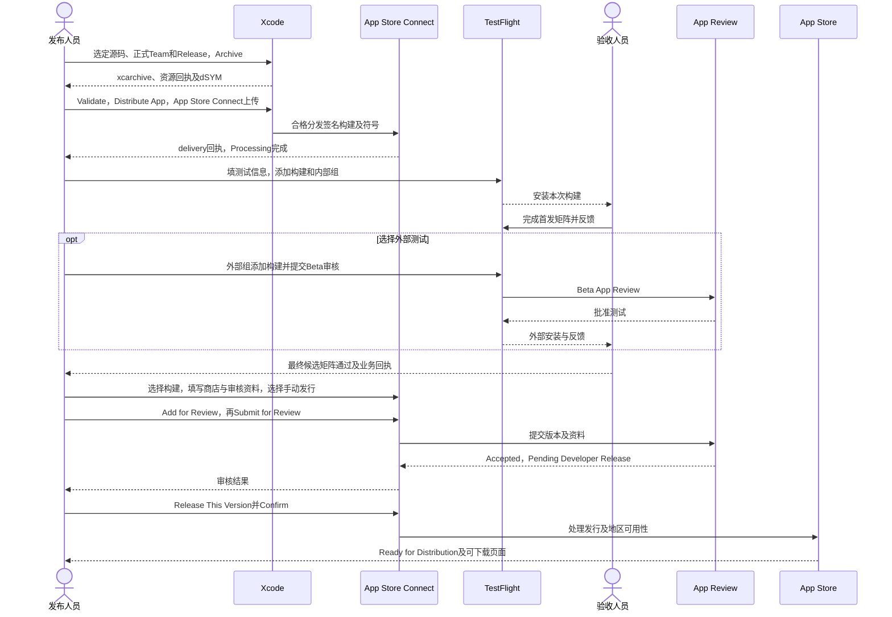
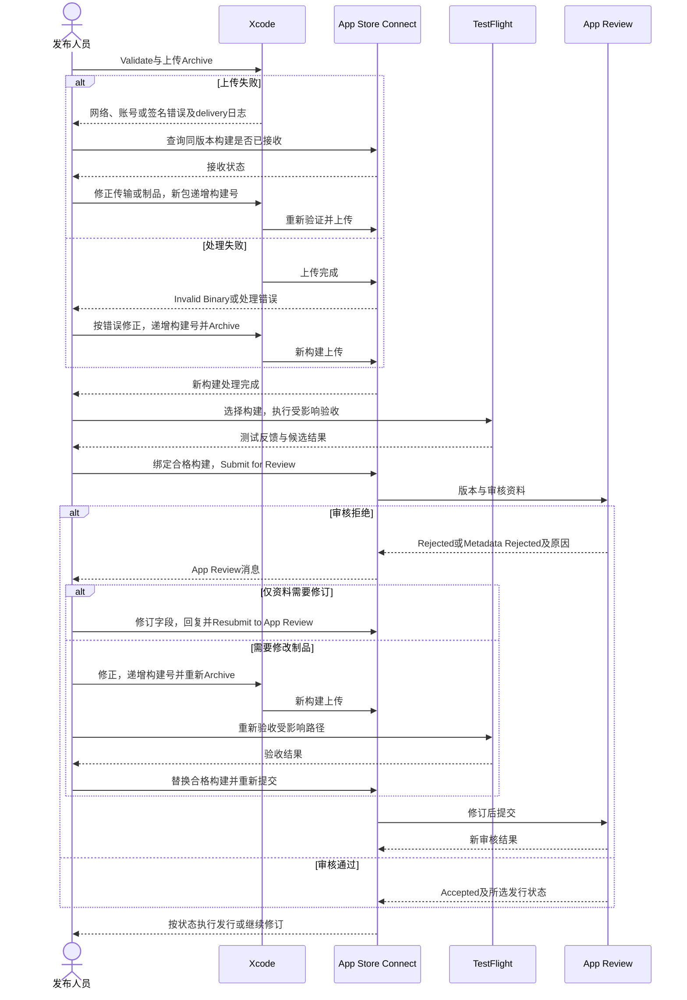
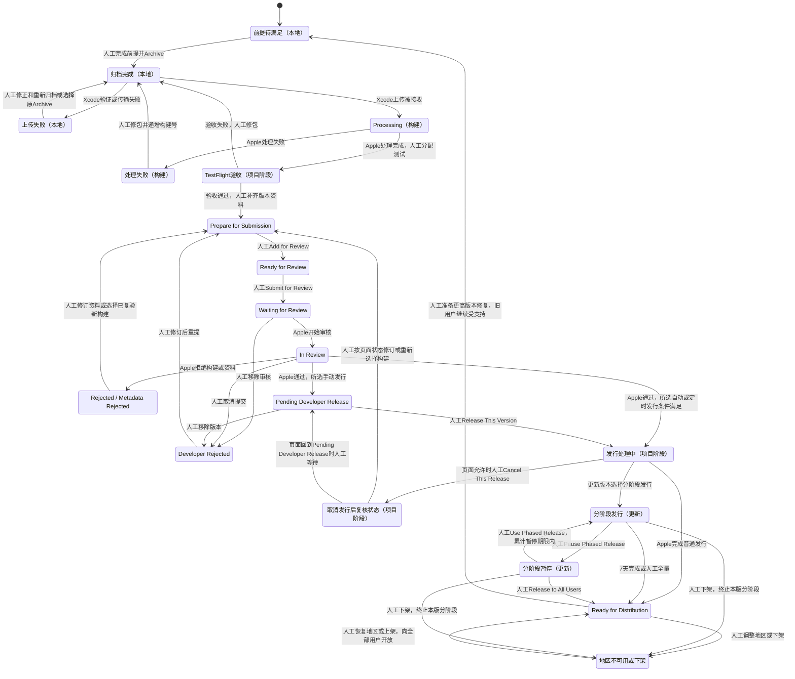

<!-- [Sync] 2026-11-02: 明确内部读者，使用者正文统一归docs/user，采用条件归独立维护表。 -->
<!-- [Input] ink-dream iOS工程、Apple发布要求及发布所需材料。 -->
<!-- [Output] 发布人员从账号准备到商店发行的操作步骤与故障恢复。 -->
<!-- [Pos] ink-dream iOS App Store发布手册；核查、评审和历史回执归执行记录。 -->
<!-- [Sync] 2026-11-02: 按发布任务重整正文，保留操作、前提与恢复入口。 -->

# ink-dream iOS App Store 发布手册（内部）

## 背景与问题

本手册用于将 ink-dream 的 iOS 应用提交至 App Store。应用在设备上的显示名称为 Ink & Memory。

## 目标与边界

发布人员按账号准备、构建归档、上传测试、资料填写、审核和发行的顺序操作。每一步完成后再进入下一步；缺少账号权限、签名、材料或候选版本验证时，先补齐对应前提。

本手册属于内部操作资料。普通使用者阅读[对外使用说明](../user/README.md)；正文来源、网站版本和正式公布条件见[对外文件维护与上架采用](ios-user-documents.md)。

## 发布对象与规则

| 项目 | 操作采用值 |
| --- | --- |
| Xcode入口 | [`frontend/ios/InkMemory.xcworkspace`](../../frontend/ios/InkMemory.xcworkspace) |
| Scheme与应用target | `InkMemory` |
| 归档配置与平台 | `Release`、通用iOS真机目标 |
| Bundle Identifier | `com.inkmemory.mobile`；发布Team须拥有该标识的使用权 |
| 版本与构建号 | `MARKETING_VERSION`、`CURRENT_PROJECT_VERSION`；每次提交核对实际上传号 |
| 最低运行系统 | 按工程和依赖的Deployment Target核对；当前工程基线为iOS 16.4 |
| 设备范围 | iPhone与iPad；测试和截图覆盖工程支持的设备族 |
| 发布顺序 | Release归档 → App Store Connect → TestFlight → App Review → 手动发行 |

Apple自2026-04-28起要求上传的iOS应用采用iOS 26 SDK或更新版本，当前上传文档要求使用Xcode 26或更新版本。归档前核对所选正式Xcode及其macOS要求。[SDK要求](https://developer.apple.com/news/?id=ueeok6yw)、[上传要求](https://developer.apple.com/help/app-store-connect/manage-builds/upload-builds)、[Xcode系统要求](https://developer.apple.com/xcode/system-requirements)，查阅：2026-11-02。

## 一、账号与应用记录准备

### 申请会员

发布Team需要有效的Apple Developer Program会员资格。自行发布时申请个人或组织会员；使用已有组织发布时，由该组织持有人确认发行授权及所需权限。

| 申请方式 | 准备材料 | 操作与入口 | 完成条件 |
| --- | --- | --- | --- |
| 个人 | 启用双重认证的Apple账户、法定姓名、本人联系资料；供应商显示个人法定姓名 | [中文注册页](https://developer.apple.com/cn/programs/enroll/)点击“开始注册”；或在[Apple Developer App](https://apps.apple.com/cn/app/apple-developer/id640199958)进入“账户 → 现在注册”，按提示完成身份验证、协议和付款 | 申请获准，账户页显示正式会员及Team信息 |
| 组织 | 法人实体、法律约束授权、适用的D-U-N-S编号、组织邮箱、官网及联系资料；供应商显示法人实体名称 | 按[组织注册说明](https://developer.apple.com/cn/help/account/membership/program-enrollment)提交材料，经Apple核对后继续协议和付款 | 组织核对与购买完成，持有人和发布人员权限明确 |
| 已有组织团队 | 组织发行授权、本人在该Team中的角色及应用访问范围 | 在[开发者账户](https://developer.apple.com/account/)确认Team；持有人/Admin核对协议并分配相应权限 | 会员和协议有效，应用及签名资源可访问 |

中国大陆Apple Developer App的官方注册页面当前列示每年¥688，采用自动续期订阅；其他地区按结算页面确认当地价格。身份验证、协议接受和付款由账户本人完成。免费App仍需要有效发布会员。[中国大陆注册步骤与费用](https://developer.apple.com/cn/help/account/membership/enrolling-in-the-app/)，查阅：2026-11-02。

网页进入[注册接续页](https://developer.apple.com/enroll/app)后，按页面提示使用Apple Developer App继续；页面提供网页继续选项时可按其引导办理。完成申请后再配置商店分发签名。

### 准备发布权限和应用记录

| 操作位置 | 输入或准备材料 | 具体操作 | 预期结果 | 失败处理 |
| --- | --- | --- | --- | --- |
| [开发者账户](https://developer.apple.com/account/) → 会员资格详细信息 | 发布主体、Team | 核对计划、续订日期、角色和协议待办 | 正式Team有效且归属正确 | 会员失效时办理续订；协议待办交账户持有人处理 |
| [用户和访问](https://appstoreconnect.apple.com/access/users) | 发布人员、目标App | 创建和提审由Account Holder、Admin或App Manager执行；上传可由Developer执行；另核对签名资源权限 | 每项操作均有具备权限的执行人员 | 由持有人/Admin补相应权限；出现Access Unavailable时先核对Team、角色与协议 |
| [证书、标识符和描述文件](https://developer.apple.com/account/resources/) → Identifiers | `com.inkmemory.mobile`、实际capabilities | 查找并复用该Team的Explicit App ID；缺失时由有权人员注册 | 标识、能力与工程一致 | 标识属于其他Team时先核对归属；更换标识前评估回调、签名与升级数据 |
| [App Store Connect](https://appstoreconnect.apple.com/) → Business → Agreements | 主体、收费方式 | 持有人处理最新协议；付费下载或App内购买适用时完成Paid Apps Agreement、税务和银行资料 | 对应协议有效 | 按页面待办补齐材料后继续 |
| [Apps](https://appstoreconnect.apple.com/apps) → `+` → New App | 名称、iOS、主语言、Bundle ID、内部唯一SKU | 先查已有应用记录，缺失时创建；记录Apple ID | 获得匹配Bundle ID的应用记录 | 无标识可选时核对Team与权限；名称冲突按实际可用名称处理 |

[创建App记录](https://developer.apple.com/help/app-store-connect/create-an-app-record/add-a-new-app/)、[App ID注册](https://developer.apple.com/help/account/identifiers/register-an-app-id)、[协议要求](https://developer.apple.com/help/app-store-connect/manage-agreements/sign-and-update-agreements)，查阅：2026-11-02。

## 二、构建前准备

### 发布前检查

| 准备项 | 完成条件 |
| --- | --- |
| 源码和依赖 | 选定提交，记录必要工作区差异；使用现有pnpm、Podfile、Python及iOS依赖锁文件 |
| 构建容量 | 按[构建内存与恢复手册](build-memory-and-recovery.md)确认容量、入口及可恢复制品 |
| 服务与认证 | 审核设备可访问正式HTTPS服务；登录、退出、回调和权限按原配置运行 |
| 包内配置 | 逐项审查最终包；服务端共享秘密、私钥和上传凭证保存在服务端或受控凭证系统。必需凭证依赖尚未处理时，先完成对应工程工作 |
| 分发资源 | 图标、字体、运行库、CLI、插件及依赖的来源、授权和分发义务已核对 |
| 隐私和商店资料 | 按[隐私与权限材料](ios-privacy-and-permissions.md)及[商业与AI材料](ios-commercial-and-ai-materials.md)准备 |
| 候选验证 | 登录、使用、数据保留、权限拒绝及失败恢复在最终候选上有对应结果 |

### 源码、版本与服务配置

| 操作位置 | 输入或准备材料 | 具体操作 | 预期结果 | 失败处理 |
| --- | --- | --- | --- | --- |
| 仓库根目录 | 选定提交、专用工件目录 | 读取`git status --short`与`git rev-parse HEAD`，登记锁文件和需要采用的改动 | 发布输入可追溯 | 保留其他工作，必要时采用独立发布checkout |
| Mac工具链 | 正式Xcode | 检查`xcodebuild -version`、`xcodebuild -showsdks`及实际`DEVELOPER_DIR` | 实际归档工具满足Apple要求 | 先准备兼容工具链再归档 |
| Target → General → Identity | 商店版本、新构建号 | 核对Version、Build、Bundle ID和支持设备；查询已上传构建号 | 版本与App记录一致，构建号可用 | 已成功处理的构建不能覆盖；修包使用新号追踪 |
| 原服务配置及待签名资源 | 已核定HTTPS地址、Client与回调 | 保持`INK_ADMIN_DREAM_BASE_URL`、`INK_ADMIN_DREAM_TRANSPORT_BASE_URL`、`INK_ADMIN_AUTH_ISSUER`、`INK_ADMIN_PRODUCT_API_BASE_URL`及`INK_GATEWAY_BASE_URL`对应正式服务；账户回调与MCP回调分别核对 | 正常认证和服务访问成功 | 按[认证排障指南](mobile-auth-troubleshooting.md)恢复，保留权限和校验 |

手机的`localhost`指向手机自身。包内服务使用手机loopback；物理设备访问外部Admin时使用可达HTTPS入口。源码env与待发布副本分别管理，日志中保留配置键和结果，凭证正文留在受控位置。

### 准备并核对资源

资源准备按[真机安装手册](ios-iphone-install-release.md#资源与配置)执行。已有依赖齐备时复用安装结果。源码变更后依次准备Next、构建和验证来源；同一Next根贯穿准备、构建及Xcode资源阶段。

```bash
export IOS_RELEASE_ROOT="<仓库绝对目录>/frontend/ios/build/app-store-<版本>-<构建号>"
export INK_IOS_NEXT_ROOT="$IOS_RELEASE_ROOT/Next"
python3 frontend/ios/scripts/prepare-next.py
pnpm --dir "$INK_IOS_NEXT_ROOT/build-source" build
python3 frontend/ios/scripts/bundle-next.py --verify-sources
```

| 资源 | 最终归档检查 |
| --- | --- |
| RN/Hermes | 归档执行正常JS打包阶段，入口为`index.native.js`；记录`main.jsbundle`摘要并验证脱离Metro启动 |
| Next | 构建前后通过`--verify-sources`；包内`next/source-receipt.json`、`mobile-manifest.json`及实际`serverEntry`采用同一来源 |
| Python | 包内源码与发布提交匹配，扩展framework来自锁定依赖并具备签名 |
| Node、Claude及ntn | `runtime-adaptation.json`、平台文件和ntn manifest与锁定版本及摘要一致 |
| Guest、插件和字体 | manifest、插件摘要、离线wheels及字体回执完整；许可证和通知随制品保存 |

来源验证失败时重新准备和归档。最终包的配置审查独立执行，覆盖env、JS、Python和静态输出。

## 三、Archive与分发签名

### 签名选择

推荐在Xcode的`Settings → Accounts`登录发布账户，在`InkMemory → Signing & Capabilities`选择正式Team并保留自动签名。Organizer按商店渠道使用云管理分发证书；访问权限由Team管理人员配置。

已有手动流程时，使用同Team的Apple Distribution证书、对应私钥和匹配App ID及capabilities的App Store Connect profile。私钥和密码留在Keychain或受控凭证系统；归档、日志及代码仓库仅保存公开签名元数据。[云管理证书](https://developer.apple.com/help/account/certificates/cloud-managed-certificates/)、[Xcode分发操作](https://developer.apple.com/documentation/xcode/distributing-your-app-for-beta-testing-and-releases)，查阅：2026-11-02。

### 归档操作

| 操作位置 | 输入或准备材料 | 具体操作 | 预期结果 | 失败处理 |
| --- | --- | --- | --- | --- |
| Xcode → Open | `frontend/ios/InkMemory.xcworkspace` | 选择scheme `InkMemory`和通用iOS真机目标 | 应用target可归档 | 回到workspace，核对共享scheme及目标平台 |
| Product → Scheme → Edit Scheme → Archive | 已准备资源、发布版本和签名 | 确认Release及实际资源根；核对图标与符号设置 | 使用本次发布输入 | 资源或来源过期时先重准备 |
| Product → Archive | 正式Team、完整资源 | 执行Archive，等待Organizer显示归档；核对平台、Version、Build及Team | 生成`.xcarchive` | 按具体编译、链接或签名错误处理后重归档 |
| Organizer → Archives | 本次归档 | 在Finder定位归档，检查App、资源、签名和dSYM；按需使用下方命令核对 | 制品与记录一致 | 签名后资源变化时重新归档 |
| 工件保管目录 | Archive、dSYM、来源摘要和日志 | 备份归档及符号，记录路径与二进制UUID；需要导出时选择对应商店导出渠道 | 可追溯且可符号化 | 缺少第三方符号时取得对应符号并记录覆盖范围 |

```bash
export IOS_VERSION="<商店版本>"
export IOS_BUILD="<新构建号>"
export IOS_TEAM_ID="<正式Team ID>"
export IOS_ARCHIVE_PATH="$IOS_RELEASE_ROOT/InkMemory.xcarchive"
xcodebuild \
  -workspace frontend/ios/InkMemory.xcworkspace \
  -scheme InkMemory -configuration Release -sdk iphoneos \
  -destination 'generic/platform=iOS' \
  -archivePath "$IOS_ARCHIVE_PATH" \
  MARKETING_VERSION="$IOS_VERSION" CURRENT_PROJECT_VERSION="$IOS_BUILD" \
  DEVELOPMENT_TEAM="$IOS_TEAM_ID" archive
```

归档默认位置从Organizer的Show in Finder取得；命令行使用`-archivePath`指定位置。上传归档可直接使用Organizer；导出IPA按实际用途选择渠道，开发IPA与商店IPA分别保存。

```bash
export IOS_ARCHIVED_APP="$IOS_ARCHIVE_PATH/Products/Applications/InkMemory.app"
plutil -p "$IOS_ARCHIVED_APP/Info.plist"
codesign --verify --deep --strict "$IOS_ARCHIVED_APP"
codesign -d --entitlements :- "$IOS_ARCHIVED_APP"
dwarfdump --uuid "$IOS_ARCHIVED_APP/InkMemory"
```

最终分发签名核对Team、application-identifier及capabilities，`get-task-allow`应为false。归档可能先用开发签名，分发阶段按所选渠道处理；以最终上传或导出产物判断。符号缺失时检查Release的`DWARF with dSYM File`设置及供应方符号。

## 四、上传与TestFlight

| 操作位置 | 输入或准备材料 | 具体操作 | 预期结果 | 失败处理 |
| --- | --- | --- | --- | --- |
| Organizer → Validate App | 本次Archive、上传角色 | 界面提供独立验证时先验证，并核对分发流程中的验证摘要 | 制品验证通过 | 按ITMS错误修正；警告逐项记录 |
| Distribute App → App Store Connect → Upload | 正式Team、应用记录 | 核对签名、符号和构建号后上传；商店候选选择普通上传渠道 | 获得delivery回执 | `TestFlight Internal Only`仅供内部测试；账号或签名失败按对应错误恢复 |
| App Store Connect → TestFlight / Build Uploads | delivery标识、版本和构建号 | 等待Processing转为Complete，处理Failed及加密待办 | 构建可测试 | 超过24小时仍处理时提交官方工单或联系支持；重传前先查询接收状态 |
| TestFlight → Test Information | 测试说明、反馈邮箱和适用审核账户 | 填写测试步骤、服务条件和已知限制 | 测试人员可按说明操作 | 修复账号访问与服务可达性后继续 |
| Internal Testing → 新建组 → Add Builds | 内部测试人员和本次构建 | 添加构建、填写What to Test并邀请测试 | 可通过TestFlight安装候选 | 核对成员角色及App访问 |
| External Testing → 新建组 | 已有内部组、测试范围和审核资料 | 适用时添加构建并提交Beta审核，获准后邀请外部测试 | 外部人员可安装批准构建 | 按Beta审核消息修正；需修包时上传新构建 |

内部测试最多100名具备访问权的App Store Connect用户，外部最多10,000人，构建有效期90天。外部Beta审核和App Store正式审核分别办理。[内部测试](https://developer.apple.com/help/app-store-connect/test-a-beta-version/add-internal-testers)、[外部测试](https://developer.apple.com/help/app-store-connect/test-a-beta-version/invite-external-testers)、[TestFlight说明](https://developer.apple.com/help/app-store-connect/test-a-beta-version/testflight-overview/)，查阅：2026-11-02。

### 候选版本检查

| 检查范围 | 通过条件 |
| --- | --- |
| 安装与启动 | 脱离Mac/Metro启动，准备完成后页面可操作；失败可见并可恢复 |
| 账户与配置 | 正常登录、授权取消、退出、重新登录和配置读取成功；会话失效反馈明确 |
| 日常使用与历史 | 按首发范围完成一次保存、任务、停止、恢复及重开，结果和历史一致 |
| 外部资源与文件 | 按已承诺范围完成授权、选择、取消、读取、导出及拒绝后的恢复 |
| 数据和兼容 | 升级保留既有内容；网络、前后台和锁屏变化有正确反馈 |
| 商店要求 | 政策、删除入口、共享同意及适用购买流程在提交版本可用 |

逐项记录版本、设备、结果和必要回执。真实任务走正常服务和指定现有账户，执行要求见[本机真实业务测试协议](../../AGENTS.md#本机真实业务测试协议)。有待完成的核心路径时继续测试；受限范围在使用入口、商店描述和审核说明中保持一致。

## 五、商店资料与合规信息

| 操作位置 | 输入或准备材料 | 具体操作 | 预期结果 | 失败处理 |
| --- | --- | --- | --- | --- |
| App Information | 名称、副标题、分类、版权与内容权利 | 按实际发布范围填写本地化信息 | 与应用及发行主体一致 | 名称或权属问题先处理后提交 |
| iOS版本页 | 描述、关键词、截图、支持网址和更新说明 | 使用最终候选截图；iPhone与iPad分别按当前规格准备；支持页无需登录 | 资料完整，页面可公开访问 | 按字段提示修正尺寸、格式和长度 |
| App Privacy | 生效政策URL、数据及合作方清单 | 按[隐私与权限材料](ios-privacy-and-permissions.md)填写 | 披露与实际处理一致 | 接收方、保留或删除规则未明确时先核定 |
| Age Ratings | 内容、联网与控制措施事实 | 逐项完成当前问卷 | 分级与发布范围一致 | 缺少相应控制时先调整范围或补齐 |
| Pricing and Availability / Business | 价格、国家地区、适用许可和DSA信息 | 按[商业与AI材料](ios-commercial-and-ai-materials.md)确定收费与地区；完成适用主体信息 | 所选地区具备发行条件 | 材料缺失地区待条件满足后开放 |
| App Review Information | 审核联系人、账号、操作说明及附件 | 填写普通审核账户和可复现步骤，凭据仅填受限字段 | 审核人员可访问全部提交范围 | 修复账号、授权或服务条件后提交 |

名称、副标题、关键词和截图按Apple当前字段校验填写。[App信息](https://developer.apple.com/help/app-store-connect/reference/app-information/app-information/)、[版本字段](https://developer.apple.com/help/app-store-connect/reference/app-information/platform-version-information)、[截图规格](https://developer.apple.com/help/app-store-connect/reference/app-information/screenshot-specifications/)、[年龄分级](https://developer.apple.com/help/app-store-connect/manage-app-information/set-an-app-age-rating/)、[DSA资料](https://developer.apple.com/help/app-store-connect/manage-compliance-information/manage-european-union-digital-services-act-trader-requirements)，查阅：2026-11-02。

### 适用审核事项

| 事项 | 提交前完成条件 |
| --- | --- |
| 第三方登录与账户删除 | 主账户使用Google等登录时核对4.8等效服务或适用例外；支持注册时提供App内删除发起入口及结果 |
| 数字服务收费 | 明确所选收费方式、地区和适用规则；需要App内购买时完成真实购买、恢复、管理及权益验证 |
| 第三方AI共享与内容处理 | 核定实际接收方及处理规则，落实共享前明确同意、撤回、内容处理和问题反馈 |
| 加密与出口 | 清点系统TLS及Node/Python等依赖的加密用途，按App Encryption Documentation问卷提交适用材料；核定豁免后再设置Info字段 |
| 包内运行资源与工具执行 | 清点公开API、容器访问、代码来源及运行期下载/执行行为；按2.5.2、4.7及分发许可完成适用性核对；有未解决项时先完成必要工程工作 |

审核说明应准确列出版本、审核账户、操作步骤、外部服务条件、适用收费、数据共享及工具执行范围。按实际入口填写，保留原权限控制；源码结构和内部实现仅在解释审核问题所必需时提供。[审核指南](https://developer.apple.com/app-store/review/guidelines/)、[加密材料](https://developer.apple.com/help/app-store-connect/manage-app-information/determine-and-upload-app-encryption-documentation)，查阅：2026-11-02。

## 六、提交审核与正式发布

| 操作位置 | 输入或准备材料 | 具体操作 | 预期结果 | 失败处理 |
| --- | --- | --- | --- | --- |
| Distribution → iOS版本页 → Build | 通过TestFlight矩阵的普通上传构建 | 点击添加构建，选择匹配Version/Build，完成加密信息，保存；逐项核对发布前检查与商店材料 | 版本绑定唯一候选，必填项齐备 | 无构建时核对处理状态、平台、版本和Internal Only标记 |
| 版本页 → App Store Version Release | 发布负责人、发行时间及地区 | 首发推荐`Manually release this version`；可选审核后自动发布，或审核后不早于指定日期发布；保存并记录时区 | 发布方式明确；首发保留人工发行时点 | 日期/地区/价格不一致时在提交前修正；自动模式须确保已具备发行条件 |
| 版本页 → Add for Review；Draft Submissions/App Review | 完整审核资料、构建、适用IAP | 点击Add for Review添加至草稿submission；打开Draft Submissions检查内容，再点击Submit for Review | Ready for Review经提交进入Waiting for Review，Apple开始后In Review | Add for Review后仍需Submit for Review；资料错误按页面具体字段处理 |
| App → App Review | submission、Apple消息与复现材料 | 跟踪状态；在消息线程读取条款与问题，逐项回复事实及复现步骤；需要修包则新构建，经矩阵复验后替换重提 | 所有本次提交项目Accepted，版本进入相应发行状态 | Metadata Rejected按字段修订；Rejected/Unresolved Issues按详情修正并Resubmit to App Review；有依据时按官方渠道申诉 |
| 版本Pending Developer Release → Release This Version | 发行负责人、最终服务/地区/版本核对 | 手动模式点击Release This Version，按Apple确认对话框Confirm；记录操作与时间。自动模式按已选规则等待 | Apple处理后Ready for Distribution，选定地区实际可下载 | 仍处理时查看版本及地区可用性；手动发行后可能需24小时出现；发现问题按下一节处理 |
| 更新版本 → Phased Release for Automatic Updates | 已有线上版本、新版本及观察负责人 | 更新时可选7天分阶段自动更新；观察崩溃和核心业务，必要时选择Pause Phased Release并Save；恢复使用Use Phased Release并Save，或Release to All Users | 自动更新按所选阶段执行，人工下载持续可用 | 首发采用普通发行；分阶段暂停仅控制自动更新扩散，故障修复另提新版本 |

官方流程：[提交App](https://developer.apple.com/help/app-store-connect/manage-submissions-to-app-review/submit-an-app)、[发行选项](https://developer.apple.com/help/app-store-connect/manage-your-apps-availability/select-an-app-store-version-release-option/)、[处理审核问题](https://developer.apple.com/help/app-store-connect/manage-submissions-to-app-review/manage-a-submission-with-unresolved-issues)、[状态定义](https://developer.apple.com/help/app-store-connect/reference/app-information/app-and-submission-statuses/)、[分阶段更新](https://developer.apple.com/help/app-store-connect/update-your-app/release-a-version-update-in-phases/)，查阅：2026-11-02。

## 七、更新、暂停与问题恢复

| 场景/操作位置 | 输入或准备材料 | 具体操作 | 预期结果 | 失败处理及边界 |
| --- | --- | --- | --- | --- |
| 上传失败 / Organizer delivery日志 | 错误码、Archive、Version/Build | 识别网络/账号错误与制品错误。先核对ASC是否已接收；未接收且包未变可重传；Build Uploads为Failed时Apple允许复用构建号；修包后本手册采用递增号记录新制品 | 仅保留明确的有效上传 | 已成功处理的构建不能覆盖；保留每次delivery日志及实际构建号 |
| Build Uploads为Failed、版本Invalid Binary或构建不可用 / TestFlight及邮件 | Apple处理消息、依赖/签名/清单事实 | 按错误修正输入，修包采用新号重新Archive、验证、上传及TestFlight；Failed允许复用号的规则见上一行 | 新构建完成处理并可测试 | Processing超过24小时按官方入口提交工单或联系支持；先凭delivery核对状态，避免盲目重建 |
| Beta或App审核拒绝 / TestFlight、App Review | 条款、截图、复现和修订说明 | 材料问题修订资料；功能/二进制问题修包并完成受影响回归；从原submission处理并重新提交 | 拒审项解决，审核重新开始 | 拒审依据有事实分歧时提供可复现证据并按App Review申诉；禁止隐藏实际能力 |
| 提交前或Ready for Review发现问题 | 草稿submission | 暂不点击Submit for Review，修正构建/资料及矩阵，重新核对草稿 | 版本继续准备，尚未进入审核队列 | 若已进入队列，按下一行移除 |
| Waiting for Review、In Review、Waiting for Export Compliance、Pending Developer Release或Pending Apple Release | 有管理权限人员、问题记录 | 版本页点击`remove this version from review`并Remove；或App Review → submission → Cancel Submission并Confirm | 进入Developer Rejected，修订后重提 | 移除将影响同submission其他项目；重提从审核流程重新开始，按页面当前可用操作执行 |
| 手动发行已点击、尚在发行处理中 | 版本页可见状态及操作 | 若页面显示`Cancel This Release`，及时使用；已经可下载时进入上线故障路径 | Apple允许的处理窗口内取消后续发行 | 该入口随处理阶段变化；禁止承诺任何时点均可取消 |
| 分阶段更新故障 / 版本Phased Release | 线上监测、故障影响 | 选择Pause Phased Release并Save，最多累计暂停30天；恢复选择Use Phased Release并Save；计划全量时Release to All Users。临近累计期限由负责人依据当前页面决定继续方式 | 自动更新按暂停或继续状态运行 | 手动下载仍可用；停止扩散和已安装用户故障分别处理。下架会终止该版本分阶段发行，重新上架后向全部用户开放 |
| 上线后故障 / Pricing and Availability → App Availability | 受影响地区、错误范围、修复负责人 | 必要时调整地区或Remove App From Sale并按Apple确认；同时发布递增版本和构建号的修复包，完成回归和审核 | 减少新下载，修复版本替代故障版本 | 已安装用户仍可能运行旧包；下架不会清除设备数据或撤销已安装包，旧客户端仍需服务兼容 |
| 需紧急修复 / App Review支持 | 故障影响、复现、已提交修复版本 | 提交新版本后按适用条件申请expedited review，提供具体影响 | Apple受理加急请求；按实际结果跟踪 | 加急资格和时间由Apple决定；服务侧恢复只采用已有受控运维流程 |

App Store无法将线上版本直接回退到先前版本；问题修复需新建版本并重新提交。可复用经过修正的旧代码，使用更高版本/构建号并满足当前SDK及审核要求。[新版本规则](https://developer.apple.com/help/app-store-connect/update-your-app/create-a-new-version)、[上传处理状态及Failed复用构建号](https://developer.apple.com/help/app-store-connect/reference/app-uploads/build-upload-statuses)、[移除审核](https://developer.apple.com/help/app-store-connect/manage-submissions-to-app-review/remove-a-submission-from-review)、[地区与下架](https://developer.apple.com/help/app-store-connect/manage-your-apps-availability/manage-availability-for-your-app-on-the-app-store/)、[App Review支持](https://developer.apple.com/app-store/review/)，查阅：2026-11-02。

旧版本兼容和数据保留：Admin/Gateway继续支持仍在使用的客户端协议和账户权限；共享schema服从Admin Drizzle的expand → Dream兼容 → backfill/validate → contract。每次更新保留历史、会话、文件与结算记录；禁止以卸载重装作为常规数据恢复。后端故障按既有运维手册修复，保留API、认证和数据兼容；服务调整无需客户端二进制变化时仍按原授权执行，代码/功能更新通过新包提审。

## 八、发布操作流程图与状态

按以下顺序完成归档、测试、审核和发行。构建、版本、审核提交与地区可用性分别以对应页面结果为准。

### 正常发布时序



### 异常与恢复时序



### 发布状态转换



| 状态对象 | 进入依据 | 下一操作及恢复入口 |
| --- | --- | --- |
| 本地归档/上传 | Xcode归档、验证和delivery结果 | 修正资源/签名/网络，选原归档重传或新构建归档 |
| Processing/构建错误 | Apple构建处理结果 | 等待处理、补加密或修包；成功后分配TestFlight |
| TestFlight验收 | 本项目矩阵及适用Beta审核 | 通过后准备商店提交；失败回到源码/资源修正 |
| Prepare for Submission / Ready for Review | 人工填写资料与Add for Review | Submit for Review实际进入审核队列 |
| Waiting for Review / In Review | Apple收件与开始审核 | 读取消息；允许时移除/取消；拒审按问题修订 |
| Rejected / Metadata Rejected / Developer Rejected | Apple拒审或人工移除 | 修资料或换已验证新构建后重提，审核重新开始 |
| Pending Developer Release / 发行处理中 | Apple通过及人工/自动发行规则 | 人工发行或等待处理；仅在页面支持时取消发行 |
| Ready for Distribution / 分阶段发行/暂停 | Apple完成发行或更新批次状态 | 核对地区可下载与核心业务；更新可暂停自动扩散，已安装故障另行修复 |
| 地区不可用或下架 | 可用性操作完成 | 持续支持已安装客户端，修复版本提审；恢复可用性按当前批准版执行 |

图中“本地”“项目阶段”用于区分本手册管理节点与Apple界面状态；App Store Connect内构建、版本、submission和地区状态分别读取。Beta审核结果与正式审核结果分别登记。


## 历史引用

原有章节的核查资料、评审与回执见[修订前原文](../exec/history/ios-release-documents-before-reader-revision-20261102.md#ios-app-store-releasemd)。

<a id="ink-memory-ios-app-store-上架操作手册"></a>
<a id="当前源码与证据"></a>
<a id="上架前置项及完成条件"></a>
<a id="版本签名和发布记录"></a>
<a id="当前账户与发布主体"></a>
<a id="从中文网站打开具体入口"></a>
<a id="个人或组织会员申请"></a>
<a id="会员生效后的应用准备"></a>
<a id="源码配置与资源"></a>
<a id="正式制品来源核对"></a>
<a id="签名方式和保管"></a>
<a id="归档与留存操作"></a>
<a id="首发候选业务验收矩阵"></a>
<a id="隐私政策文件与p5状态"></a>
<a id="商店资料填写"></a>
<a id="合规适用性与材料"></a>
<a id="pythonnodeclaude与工具执行的审核核对"></a>
<a id="审核说明填写模板"></a>
<a id="九设计评审与交付状态"></a>
<a id="十文档验证"></a>
<a id="首版文档验证"></a>
<a id="会员入口补充验证"></a>
<a id="隐私与权限材料验证"></a>
<a id="p8商业与人工智能材料验证"></a>
