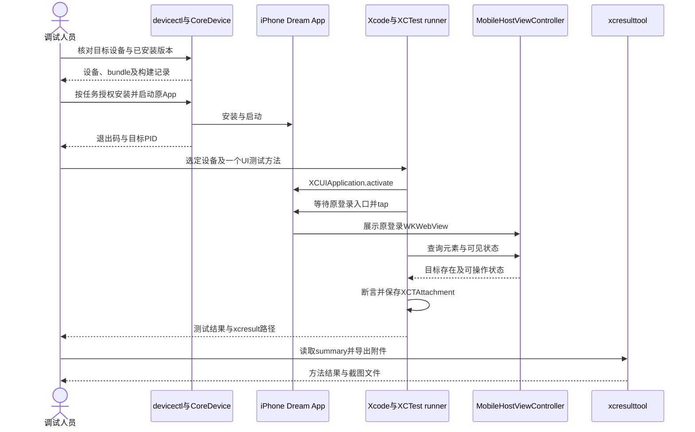
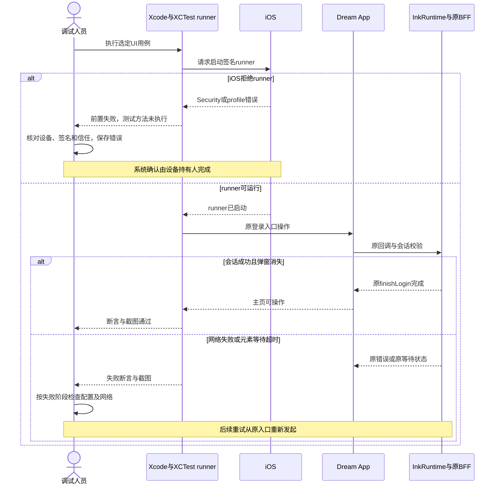
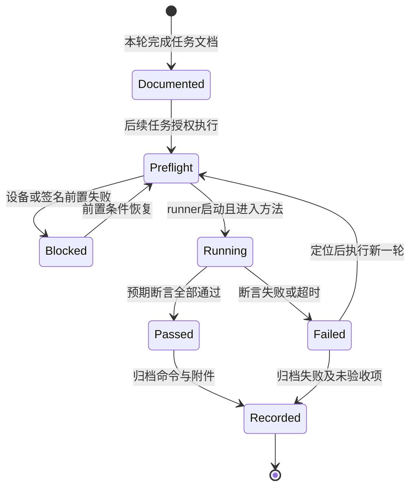

<!-- [Input] 当前iOS宿主、现有XCTest UI runner、Xcode命令帮助及Apple/WebKit官方资料。 -->
<!-- [Output] iPhone设备检查、安装启动、进程附加、网页检查与XCUITest采证操作手册。 -->
<!-- [Pos] Apple开发调试工具独立手册；测试任务归frontend/e2e/ios/tasks。 -->
<!-- [Sync] 2026-11-02: 首次整理，当前交付只包含文档与任务目录整理。 -->

# Apple真机开发调试工具

## 背景与问题

本项目的iPhone调试涉及原生页面、App内Dream运行库、登录用WKWebView及Google系统认证会话。设备连接、进程日志、网页检查和页面操作分别由对应Apple工具完成；每项结果按目标设备、安装版本、测试方法及实际证据登记。

当前目录曾将AppleScript镜像操作作为iOS任务包保存。本轮按用户要求清理`frontend/e2e/ios/tasks/`，该目录仅记录XCUITest E2E任务。原文及文件摘要归[历史快照](../exec/history/ios-debug-tasks-before-xcuitest-20261102.md)。

| 当前代码事实 | 证据 | 对操作的影响 |
| --- | --- | --- |
| 主界面使用React Native | [InkMemoryApp.swift](../../frontend/ios/InkMemory/InkMemoryApp.swift#L48) | 原生元素使用XCUITest查询；网页检查仅作用于Web内容 |
| WKWebView设置`.default()`数据存储，`isInspectable`位于`#if DEBUG` | [MobileHostViewController.swift](../../frontend/ios/InkMemory/MobileHostViewController.swift#L81) | Release包可能无Safari检查目标，当前文档保留该编译边界 |
| Python通过CPython C API初始化，Node由`node_start`在App线程内启动 | [DreamPython.m](../../frontend/ios/InkMemory/DreamPython.m#L94)、[DreamNode.m](../../frontend/ios/InkMemory/DreamNode.m#L26) | LLDB附加设备上的App PID；线程和符号用于定位嵌入式运行库 |
| 账号回调与MCP回调分别配置 | [Info.plist](../../frontend/ios/InkMemory/Info.plist#L35)、[InkAccountLogin.swift](../../frontend/ios/InkMemory/InkAccountLogin.swift#L17) | 使用实际安装制品核对URI和scheme，维持现有Client、PKCE及权限 |
| 独立runner生成脚本默认Simulator、iOS18.0、关闭签名 | [prepare-ui-runner.rb](../../frontend/e2e/ios/prepare-ui-runner.rb#L24) | 真机执行需要对应SDK、有效签名及设备信任；生成完成仅代表工程准备完成 |

问题处理：复用`devicectl`、LLDB、Safari Web Inspector、XCTest和现有runner。独立手册集中工具操作，任务目录保存目标、断言和回执。新增自动化服务、常驻调试端口、App内调试页面及业务接口为0。

## 目标与边界

本手册提供检查设备、安装既有签名App、启动和附加进程、检查WKWebView与回调、通过XCUITest操作真机和保存证据的步骤。本轮只编写文档；安装、签名、测试执行与真实业务操作留待具体调试任务授权后执行。

原[开发安装手册](ios-iphone-install-release.md)维护构建和签名流程，[认证排障指南](mobile-auth-troubleshooting.md)维护认证故障判断，[商店发布手册](ios-app-store-release.md)维护上架流程。本手册引用这些入口，构建参数和发布步骤沿原文维护。

## 概念与规则

| 工具或对象 | 职责与连接方式 | 结果边界 |
| --- | --- | --- |
| Xcode设备窗口、`xcrun devicectl` | CoreDevice管理已配对的真机；USB或已配置的无线连接 | 设备、安装、进程和命令结果；页面点击由XCUITest执行 |
| Xcode Debug、`xcrun lldb` | 选择设备并附加App PID，通过调试服务读取线程、栈和断点 | 附加依赖调试资格；暂停进程会影响计时和网络回调 |
| Safari Web Inspector | 检查设备上允许检查的WKWebView，读取DOM、Console和Network | 原生RN页面、系统认证窗口各有独立执行上下文 |
| XCTest UI runner、XCUIAutomation | 通过无障碍元素查询、点击、手势和断言操作指定App | runner成功启动后，才具备执行测试方法的前提 |
| `.xcresult`、`xcresulttool` | 保存测试状态、错误和截图附件，导出所选任务证据 | 测试方法、断言和截图共同支持UI结论 |

本机核对日期为2026-11-02：Xcode16.4（16F6），devicectl443.24。下方命令依据本机`--help`核对。使用其他Xcode版本时先读取对应命令帮助。`simctl`管理Simulator，真机管理使用`devicectl`。设备ID、App ID、PID、路径和Team从本轮目标及实际制品取得。

## 1. 检查工具和设备

在仓库根目录执行只读检查：

```sh
xcode-select -p
xcodebuild -version
xcrun devicectl --version
xcrun devicectl list devices
```

在Xcode16.4的Window → Devices and Simulators核对目标设备；其他版本按其设备窗口名称操作。USB连接后由设备持有人解锁并确认电脑配对。开发安装需要设备持有人在设置 → 隐私与安全性 → Developer Mode开启并完成重启确认。签名信任、设备密码及Apple账户验证分别由持有人完成。[Apple Developer Mode说明](https://developer.apple.com/documentation/xcode/enabling-developer-mode-on-a-device)规定该设备确认过程。

本轮后续命令使用以下参数，由执行人设置：

| 参数 | 来源 |
| --- | --- |
| `IOS_DEVICE_ID` | 本次设备列表中的CoreDevice ID或UDID |
| `IOS_DEVICE_UDID` | Xcode所选真机的UDID，用于`xcodebuild`的destination |
| `IOS_APP_PATH` | 已签名、目标为iphoneos的`.app`绝对路径；`.ipa`先按开发安装手册取得内部`.app` |
| `IOS_APP_ID` | 该`.app/Info.plist`的`CFBundleIdentifier` |
| `IOS_TASK_OUTPUT` | 本轮独立绝对路径，建议位于`frontend/ios/build/ios-xcuitest-<任务>-<运行号>/`，权限0700 |

```sh
: "${IOS_DEVICE_ID:?设置目标设备ID}"
: "${IOS_APP_PATH:?设置已签名App绝对路径}"
: "${IOS_TASK_OUTPUT:?设置本轮私有输出绝对路径}"
umask 077
mkdir -p "$IOS_TASK_OUTPUT"
IOS_APP_ID=$(/usr/libexec/PlistBuddy -c 'Print :CFBundleIdentifier' "$IOS_APP_PATH/Info.plist")
export IOS_APP_ID
xcrun devicectl device info lockState --device "$IOS_DEVICE_ID" \
  --json-output "$IOS_TASK_OUTPUT/lock-state.json"
xcrun devicectl device info apps --device "$IOS_DEVICE_ID" --bundle-id "$IOS_APP_ID" \
  --json-output "$IOS_TASK_OUTPUT/apps-before.json"
```

输出目录应为本轮新建或明确属于本轮的目录，既有运行回执继续保留。机器可读结果读取`--json-output`文件；展示日志只保留目标App字段。记录App版本、构建号和代码提交，安装前后核对同一个bundle ID。

## 2. 安装App与启动进程

仅在具体任务授权安装后执行：

```sh
codesign --verify --deep --strict "$IOS_APP_PATH"
xcrun devicectl device install app --device "$IOS_DEVICE_ID" "$IOS_APP_PATH" \
  --json-output "$IOS_TASK_OUTPUT/install.json"
xcrun devicectl device info apps --device "$IOS_DEVICE_ID" --bundle-id "$IOS_APP_ID" \
  --json-output "$IOS_TASK_OUTPUT/apps-after.json"
xcrun devicectl device process launch --device "$IOS_DEVICE_ID" "$IOS_APP_ID" \
  --json-output "$IOS_TASK_OUTPUT/launch.json"
```

同bundle覆盖安装沿用原数据容器，安装后核对实际版本及数据保留情况。此流程执行卸载、清空会话和重置数据库的次数为0。已有业务运行时优先附加当前进程；`--terminate-existing`只用于明确授权的冷启动测试。

需要从新启动捕获标准流时，单独执行`devicectl device process launch --console`并保存私有日志。App已运行时，该选项无法重新连接其标准流。devicectl可转发收到的信号给App；停止观察器前确认其信号语义及在途任务，按工具帮助处理，保留原App业务状态。

本地`codesign`校验与设备允许运行分别登记。设备出现Security、profile、Developer Mode或信任拒绝时，先记录设备错误和目标，不修改账户权限、不重置App数据。

## 3. 附加Dream所在App进程

从本次`launch.json`读取App PID。若App已在运行，在Xcode设备工具中定位同bundle的进程，或将下方进程结果保存至私有目录，仅选取目标App记录：

```sh
xcrun devicectl device info processes --device "$IOS_DEVICE_ID" --quiet \
  --json-output "$IOS_TASK_OUTPUT/processes.json"
xcrun lldb
```

在LLDB内替换本次设备ID和PID：

```text
(lldb) device select <本次设备ID>
(lldb) device process attach -p <本次App-PID>
(lldb) thread list
(lldb) thread backtrace -c 8
(lldb) process detach
(lldb) quit
```

Xcode图形入口为选择目标设备后，Debug → Attach to Process，选取相同App进程。附加需要开发签名、有效profile及对应调试entitlement；普通App能启动与调试器可附加分别核对。分发包的附加限制沿Apple签名规则处理，后续需要时使用既有开发构建流程。

Python、Node及兼容运行库的定位在该App进程线程与符号中进行。Mac上的Python/Node PID属于其他运行位置。符号、dSYM和制品应匹配；仅记录目标调用栈和固定错误类别，读取完整env、会话、Cookie及业务正文的次数为0。附加会暂停进程，暂停期间出现的超时需单列调试影响；结束使用`process detach`，再复核App运行与业务状态。

## 4. 检查WKWebView

1. iPhone设置中找到Safari → 高级 → Web Inspector并开启；较新系统可在设置 → Apps → Safari中找到相同选项。
2. Mac Safari设置 → 高级，显示网页开发功能。保持设备解锁及已配对连接。
3. 在Dream打开原登录页或需要检查的局部Web页面。Mac Safari的Develop菜单选择目标iPhone，再选择对应页面。
4. 使用Elements核对布局，Console读取当前错误，Network按接口路径核对状态和时序。原生RN主页用XCUITest检查。

WebKit从iOS16.4提供`isInspectable`，应用按实例决定可检查性；[官方说明](https://webkit.org/blog/13936/enabling-the-inspection-of-web-content-in-apps/)允许应用显式开启。当前源码只在DEBUG开启，Release包无目标时先记录编译配置。当前任务不增加Release检查开关。

账号系统会话由`ASWebAuthenticationSession`管理；其页面与App自有WKWebView分别选择。Google域名跳转、Admin域名页面与本地BFF页面应按阶段识别。检查面板可展示认证数据，归档时只摘录接口路径、状态、阶段及固定错误码，完整查询串、表单正文和敏感截图保留在私有输出或排除采集。

## 5. 核对账号回调配置

只读核对待安装包中的公开配置：

```sh
/usr/libexec/PlistBuddy -c 'Print :InkAccountOAuthCallbackURI' "$IOS_APP_PATH/Info.plist"
/usr/libexec/PlistBuddy -c 'Print :CFBundleURLTypes' "$IOS_APP_PATH/Info.plist"
/usr/libexec/PlistBuddy -c 'Print :InkMcpOAuthCallbackURI' "$IOS_APP_PATH/Info.plist"
```

| 阶段 | 核对内容 | 成功证据 |
| --- | --- | --- |
| 原网页登录 | 登录按钮、原表单和原`/auth/start` | 用户到达原认证流程 |
| Google系统会话 | 原Admin授权地址、既有Client及S256交易 | 原Google身份验证后进入Admin回调 |
| App回调配置 | 包内账号URI、已登记scheme、BFF投影及Admin同Client登记精确匹配 | 宿主接受对应回调，排除其他operation回调 |
| 本地BFF | 原`/auth/callback`及会话读取 | 原Cookie和会话校验完成 |
| 页面结束 | `InkRuntime.finishLogin`关闭登录页 | 弹窗消失，原主页可操作 |

`InkMcpOAuthCallbackURI`继续服务原MCP operation。账号配置核对保持正常网页登录、PKCE、Cookie/CSRF、原用户及权限；执行凭据导出、授权码重放和业务接口修改的次数为0。错误按[认证排障指南](mobile-auth-troubleshooting.md#google登录后停在认证服务登录页)核对实际阶段；Google token端点GET404只登记网络连通。

## 6. 使用XCUITest点击、读取状态与截图

### 复用入口和真机条件

现有Swift测试放在`frontend/e2e/ios/`，任务文档放在[tasks](../../frontend/e2e/ios/tasks/README.md)。原生测试使用`XCUIApplication(bundleIdentifier:)`定位明确App，`waitForExistence`等待目标，再检查`isHittable`并调用`tap`或原生滚动。现有[DeckScrollUITests](../../frontend/e2e/ios/DeckScrollUITests.swift#L12)提供保留已运行实例的`activate()`及截图示例。[Apple说明](https://developer.apple.com/documentation/xcuiautomation/xcuiapplication/launch())规定`launch()`会终止已运行实例；`activate()`用于继续现有页面。

`prepare-ui-runner.rb`仅接受其同目录的Swift源文件。需要准备独立工程时，复用既有CocoaPods Ruby环境，并提供尚不存在的绝对输出目录：

```sh
: "${IOS_RUNNER_DIR:?设置独立且尚不存在的runner目录}"
ruby frontend/e2e/ios/prepare-ui-runner.rb "$IOS_RUNNER_DIR" DeckScrollUITests.swift
```

该命令的默认产物用于Simulator。真机任务使用已有真机runner，或在生成工程的Xcode配置中选择iphoneos、开发Team、有效签名和profile；App与runner均需设备允许执行。生成的runner使用独立bundle ID，现有生产工程保持。缺少`xcodeproj`时记录准备前置失败，本轮不安装依赖。

Scheme → Test → Arguments中为**测试进程**设置选中测试实际读取的变量，例如Deck用`INK_IOS_UI_TARGET_BUNDLE_ID`。其他规格按其源码读取；Notion、写作fixture的参数和目标保持隔离。runner环境变量与App业务env各有原有归属，不用变量切换业务状态机。

明确真机工程、scheme、设备及一个方法后，后续执行人可采用：

```sh
: "${IOS_UI_PROJECT_PATH:?设置已配置真机签名的runner工程}"
: "${IOS_UI_SCHEME:?设置该工程已有UI测试scheme}"
: "${IOS_TEST_SELECTOR:?设置Target/Class/method}"
: "${IOS_DEVICE_UDID:?设置Xcode识别的真机UDID}"
xcodebuild build-for-testing -project "$IOS_UI_PROJECT_PATH" -scheme "$IOS_UI_SCHEME" \
  -destination "platform=iOS,id=$IOS_DEVICE_UDID" -derivedDataPath "$IOS_TASK_OUTPUT/DerivedData"
xcodebuild test-without-building -project "$IOS_UI_PROJECT_PATH" -scheme "$IOS_UI_SCHEME" \
  -destination "platform=iOS,id=$IOS_DEVICE_UDID" -derivedDataPath "$IOS_TASK_OUTPUT/DerivedData" \
  -only-testing:"$IOS_TEST_SELECTOR" -parallel-testing-enabled NO \
  -resultBundlePath "$IOS_TASK_OUTPUT/result.xcresult"
```

本机`devicectl`设备ID与`xcodebuild`destination ID可能采用不同标识；两个参数分别从实际工具读取，运行前按Xcode所选目标核对。命令为后续操作模板，本轮执行次数为0。已有兼容且对应本次源码的runner构建可直接使用`test-without-building`，构建前执行原[容量检查](build-memory-and-recovery.md)，避免重复编译。

### 读取与采证

读取指定元素的`exists`、`isHittable`、`frame`及`app.state`，按步骤断言。全量`debugDescription`可能包含身份与正文，仅在具体问题需要时写入私有附件。任意系统弹窗、第三方认证页或不可访问元素应按实际查询结果记录，失败时保留截图与元素等待信息。

现有测试的截图保存方式：

```swift
let image = XCTAttachment(screenshot: app.screenshot())
image.name = "task-step-result"
image.lifetime = .keepAlways
add(image)
```

此片段说明现有API，仓库测试源保持。本轮新增测试代码为0。附件与对应断言保存在`.xcresult`；[Apple附件说明](https://developer.apple.com/documentation/xctest/adding-attachments-to-tests-activities-and-issues)定义其保存方式。后续提取：

```sh
xcrun xcresulttool get test-results summary --path "$IOS_TASK_OUTPUT/result.xcresult" \
  > "$IOS_TASK_OUTPUT/summary.json"
xcrun xcresulttool export attachments --path "$IOS_TASK_OUTPUT/result.xcresult" \
  --output-path "$IOS_TASK_OUTPUT/attachments"
```

记录实际命令、退出码、方法是否进入、断言结果与截图文件名。runner被系统拒绝时，UI用例登记“前置失败，方法未执行”。构建成功、进程启动、点击命令、UI断言、真实业务和发布按各自证据填写。截图与xcresult保留私有目录，Git任务文档只保存脱敏摘要。

## 7. 操作时序与生命周期

下图为后续执行流程；本轮设备执行为0。参与模块均为现有工具或实现。







| 实例 | 创建与结束 | 处理规则 |
| --- | --- | --- |
| CoreDevice连接 | 配对及设备连接时建立，断线后重新发现 | 每轮核对设备身份，保留失败记录 |
| Dream App及嵌入式Python/Node | App进程启动后由原运行库管理；App退出结束 | runner与LLDB保持各自生命周期，业务状态沿原实现 |
| LLDB会话 | 附加时创建，detach后释放调试控制 | 记录暂停影响，退出后复核App存续 |
| 登录WKWebView及系统认证会话 | 原登录入口创建，原finishLogin或取消结束 | 页面关闭和会话有效分别断言 |
| XCTest runner | 本次测试启动，测试结束或启动失败后退出 | 不将runner存续当作App后端状态 |
| xcresult及附件 | 每轮独立路径生成，执行后按记录留存 | 仅清理本轮明确生成的可删除文件 |

## 8. 设计评审与本轮交付

| 评审项 | 发现与处理 | 结论及剩余依赖 |
| --- | --- | --- |
| 设备、安装及启动 | 复用现有devicectl与安装手册 | 文档已覆盖；实际执行按任务授权 |
| Dream附加与网页检查 | 区分App PID、嵌入式运行库、WKWebView和RN | 文档已覆盖；实际包调试资格与DEBUG条件现场核对 |
| 页面操作与证据 | 复用XCTest查询、原生手势、XCTAttachment及xcresulttool | 文档已覆盖；真机runner需签名和信任 |
| 任务目录 | 旧内容归档校验后删除；现行目录仅保存XCUITest任务文档 | 已整理；既有Swift测试及生产工程保持 |
| 实现范围 | 用户本轮明确限制代码修改，通用“实现代码”项转为后续执行说明 | 新增代码、接口、依赖及服务均为0 |
| 验收语义 | 用户Google复验、历史UI回执及本轮文档交付分别登记 | 本轮无设备操作或真实业务调用 |

评审结论：通过，适用于本轮工具操作文档与任务目录整理。后续真机执行依赖具体任务范围、可用设备、签名和系统信任；执行结果按实际断言登记。

## 官方资料与查阅日期

查阅日期：2026-11-02。本机命令细节以所选Xcode的`--help`为准。

- [Xcode命令行工具](https://developer.apple.com/documentation/xcode/xcode-command-line-tool-reference)：Xcode内置工具入口。
- [Web Inspector启用步骤](https://webkit.org/web-inspector/enabling-web-inspector/)：设备Safari设置、配对及Develop菜单。
- [XCUIAutomation](https://developer.apple.com/documentation/xcuiautomation)：UI元素查询、操作、应用状态和截图。
- [XCUIApplication](https://developer.apple.com/documentation/xcuiautomation/xcuiapplication)：指定应用、激活、启动和状态。

## 本轮文档验证

日期：2026-11-02。验证范围为本文、XCUITest任务文档、历史归档及相关索引。脚本和完整回执位于Git忽略的`frontend/ios/build/ios-debug-docs-20261102/`。

| 实际命令或检查 | 退出码 | 关键结果 |
| --- | --- | --- |
| `xcodebuild -version`、`xcrun devicectl --version`及所用命令的帮助读取 | 0 | 核对本机Xcode16.4、devicectl443.24及工具参数 |
| `git diff --check --`后接本轮文档路径 | 0 | 已跟踪的本轮文档变更无空白错误 |
| `python3 frontend/ios/build/ios-debug-docs-20261102/validate-docs.py` | 0 | 新增5份文档的24处本地引用及6处索引引用有效；旧归档10份文件SHA256匹配；任务目录仅3份Markdown；父目录Swift/Ruby/Python测试源无diff |
| `node frontend/ios/build/ios-debug-docs-20261102/validate-mermaid.mjs` | 1 | 两份时序图已解析；Node缺少DOM，状态图检查遇到`DOMPurify.addHook`错误 |
| `node frontend/ios/build/ios-debug-docs-20261102/validate-mermaid-chrome.mjs` | 0 | 复用已安装Chrome及本地Mermaid，两个时序图和一个状态图均解析通过；临时profile已删除 |

Chrome仅使用`about:blank`解析本地文档图示，产品页面、设备和外网访问均为0。回执为`validation-receipt.json`；本轮文档检查完成，XCUITest执行、真机安装、进程附加、登录及真实业务验收均未开展。
