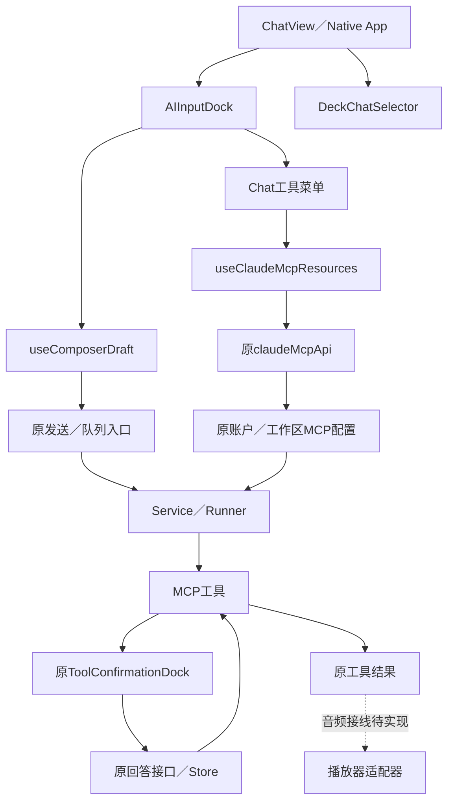
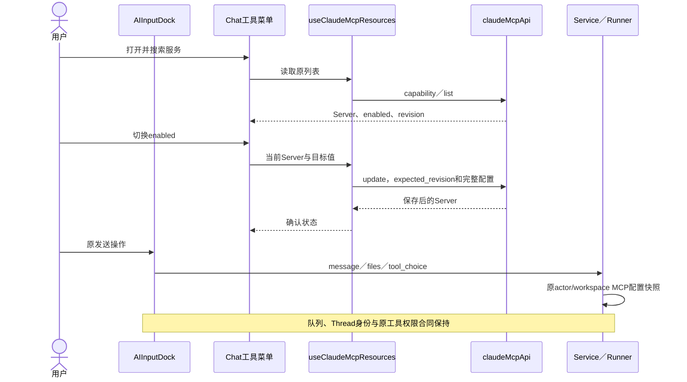
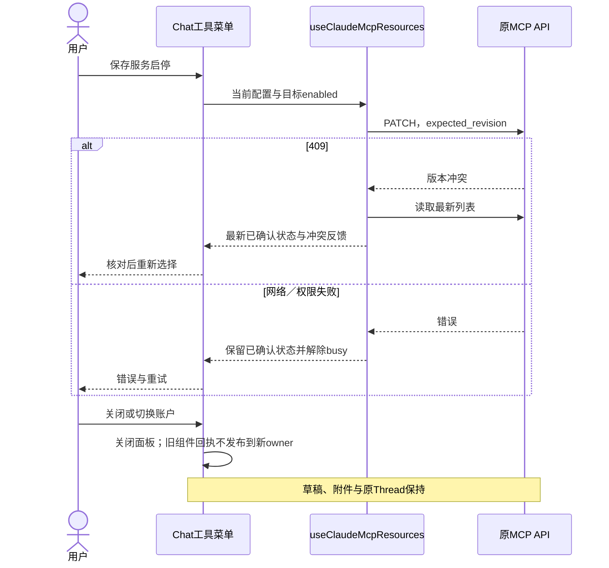

<!-- [Input] Agent入口替换与模型组件迁移前现行稿。 -->
<!-- [Output] 修订前原文与全部图示保留。 -->
<!-- [Pos] 历史设计；现行规则由同目录专项稿所有。 -->

# Agent与模型组件迁移前原文

````markdown
<!-- [Input] Chat专项交互稿、现有AIInputDock／DeckChatSelector与MCP API。 -->
<!-- [Output] 双端组件职责、接口、提交语义、失败恢复与接入图。 -->
<!-- [Pos] Chat工具输入栏开发设计；权限策略与原生播放器由各专项维护。 -->
<!-- [Sync] 2026-11-13: 独立定义Chat组件开发合同，保留原Thread及队列协议。 -->

# Chat Agent与工具输入栏：开发设计

产品规则、桌面／窄屏骨架及用户时序见[Chat专项设计](../../prd/chat/agent-tool-composer.md)。远程连接管理见[资源前端接线](mcp-tool-management-frontend.md)，音频问答和媒体结果见[音频前端接线](../multi-platform/mobile-clock-audio-frontend.md)。

## 模块与所有权

| 模块 | 输入与职责 | 输出 |
| --- | --- | --- |
| `ChatView`／Native App | 原Deck目录、所选Agent、Thread与发送协调 | 沿原入口提交消息；保留原Thread、Claude会话与队列 |
| `DeckChatSelector`（Web／Native） | 目录、selectedAgentId、onChange；搜索和选中展示 | 原`{deckId, agentId}`；无选择返回undefined |
| `AIInputDock`／`useComposerDraft` | 草稿、附件、权限模式与原发送／停止回调 | 原`onSendMessage(message, files, toolChoice)` |
| Chat工具菜单（新增组件） | 当前工具模式、原MCP API及平台管理导航 | 更新模式、保存服务enabled或打开原资源页面 |
| `useClaudeMcpResources` | 原capability、列表与操作API | Server状态；按revision更新enabled；失败／冲突恢复 |
| Service／Runner | 原actor/workspace配置快照 | 当前turn冻结的远程MCP配置；原工具权限判定 |
| 音频MCP／问答组件 | 显式启用的平台工具与媒体参数 | AskUserQuestion；回答匹配后返回播放请求或declined |
| 播放器适配器（未实现） | 同一调用的播放请求及本机媒体资源 | 实际准备／播放状态，再更新系统控件 |

Agent、MCP、UI组件分别拥有执行决策、工具协议、呈现与用户输入。前端组件通过原工具确认入口提交回答，原MCP处理器返回结果；播放器按结果执行本机媒体操作。

## 参考与选型

已读取Better Chatbot的`ChatBot → PromptInput → ToolSelectDropdown`调用链，采用输入正文与底部工具行、Agent图标及选中反馈、服务分组和搜索。现行`MarkdownInputEditor`、`useComposerDraft`、`DeckChatSelector`及MCP API继续承担原职责。接入层沿现有DTO，避免引入外部项目的会话store、认证、API和服务端执行协议。

两个方案中，整体移植外部ChatBot会覆盖原Thread恢复、队列和权限通道；选定的组件重构复用原调用边界。工作流、工具预设及多Agent控制退出本轮。

## 工作流与工具预设的源码核对

| 核对项 | 代码事实 | 本轮处理 |
| --- | --- | --- |
| 参考项目工作流 | `tool-select/index.tsx`渲染`WorkflowToolSelector`，以独立工作流目录和`onSelectWorkflow`选择 | 只采用交互结构；当前Chat没有对应目录和发送处理 |
| 参考项目预设 | `ToolPresets`保存`allowedMcpServers`与`allowedAppDefaultToolkit`的命名组合 | 当前仓库未发现toolPresets状态、CRUD或应用预设入口 |
| 当前Chat请求 | [buildClaudeChatRequest](../../../frontend/app/_dream/lib/claude-chat-request.ts)固定生成空`allowedMcpServers`与`allowedAppDefaultToolkit`，消息走原Claude入口 | 这些兼容字段不构成已接入的可选工具预设协议；本轮保持原请求 |
| 当前工作流 | [storyWorkspaceApi](../../../frontend/app/_dream/api/storyWorkspaceApi.ts)的`WorkflowRun`携带运行、Plugin及执行状态；原Chat元数据记录workflowRunId来源 | Dream执行业务按原入口维护；Chat工具菜单不增加工作流选项 |
| 当前选择能力 | `DeckChatSelector`与`useComposerSkills`提供Agent、原Skill入口，`useComposerDraft`维护调用模式 | 复用这些已接入能力并增加原MCP管理入口 |

本轮范围基于源码核对收敛。参考[WorkflowToolSelector](https://github.com/keinsaasforever/better-chatbot/blob/main/apps/web/src/components/tool-select/workflow-tool-selector.tsx)与[ToolPresets](https://github.com/keinsaasforever/better-chatbot/blob/main/apps/web/src/components/tool-select/tool-presets.tsx)已分别读取，外部store与目录服务保持原项目所有。

## 接口与时序语义

1. Agent：目录继续由原caller读取；`onChange`只修改原页面选择，正文和附件保持。历史对话使用原信息栏归属，工具菜单不重建Thread。
2. 工具模式：`ToolChoice`沿现有`auto/manual/none`协议，当前UI保留原自动／手动选项；`im_full_access_enabled`沿原全访问展示。AskUserQuestion回答仍通过原通道提交。
3. 远程服务：`getClaudeMcpCapability`与`listClaudeMcpServers`按需读取；面板搜索使用返回的名称。启停调用`updateClaudeMcpServer(server, changes)`，携带原`expected_revision`和完整配置，仅改变`enabled`。缺少可更新配置的来源显示管理入口。
4. 范围：服务开关为原账户／工作区的持久配置，后续turn读取快照；前端不向Chat请求发送远程Server配置或新server白名单。运行中的turn保持原快照。
5. 平台工具：`ClaudeAgentRequestBody.tools`默认空，固定type为`mobile_clock_audio`。App播放器能力及选择接线完成后才可显式携带；当前缺少原生播放器回执，UI保持禁用。
6. 音频：固定MCP名为`mcp__mobile_clock_audio__ask_user`，Low-Sensitivity。工具PreToolUse仍等待AskUserQuestion答案，原Store按调用ID匹配。`playback_requested`到达后再交接播放器；单凭提交答案不展示已播放。
7. 发送：保留原草稿清空／失败还原、附件上传阻塞、正在执行时排队、无草稿时Stop和stopPending。菜单操作不调用send或cancel。

## 组件接入拓扑



## 正常开发时序



## 异常与恢复



## 状态与验证

工具面板采用产品稿的`Draft/Tools/Loading/Saving/Error`状态图。远程配置的default为原创建默认启用，desired为目标enabled，effective为保存后的状态及后续turn各自取得的快照，revision为原Server.revision。凭据与工具权限沿原服务保存；前端无新增数据库字段。

技术验证覆盖真实组件的搜索、开关API请求与expected_revision、409恢复、失败重试、关闭后草稿保持、发送／停止与窄屏边界。Native完成类型验证后单列触摸／键盘与真机验收。音频播放器、系统组件、后台计算和真实MCP连接／模型验收按专项记录，文档与隔离UI用例分别留存结果。

````
