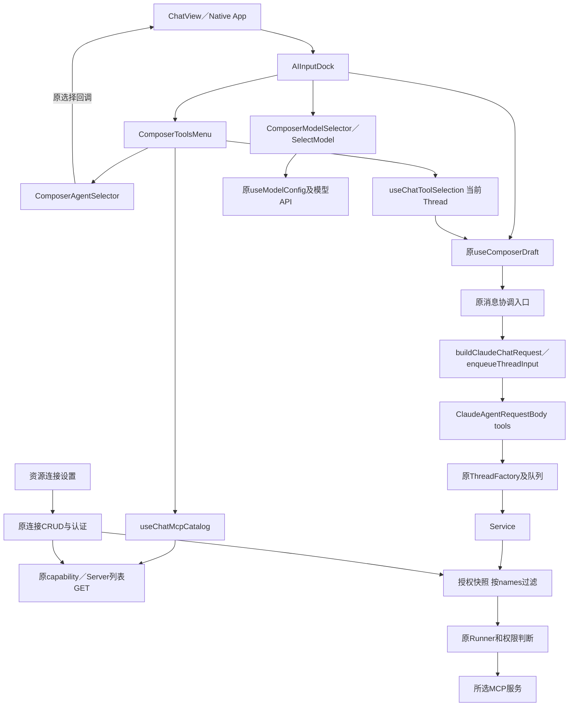
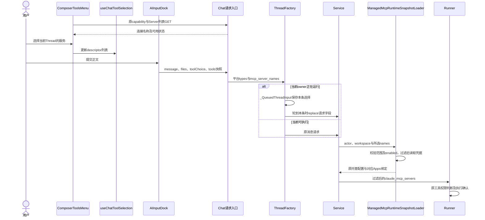
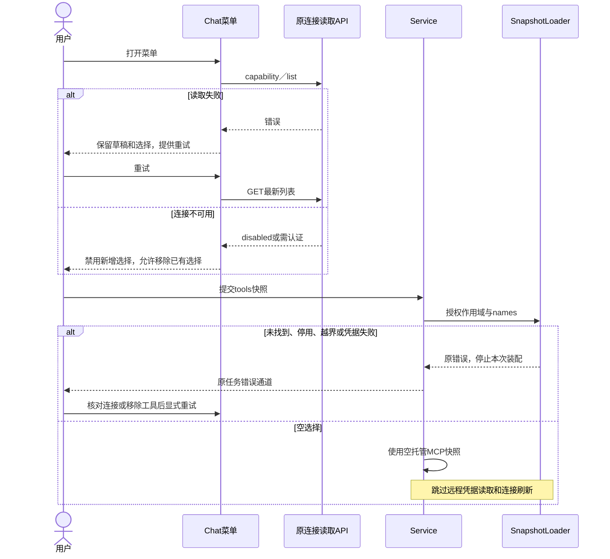
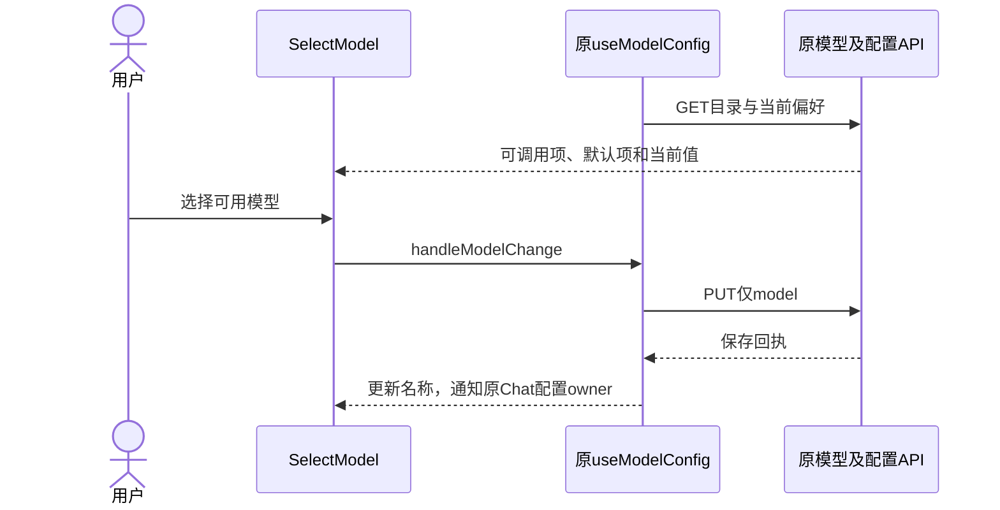
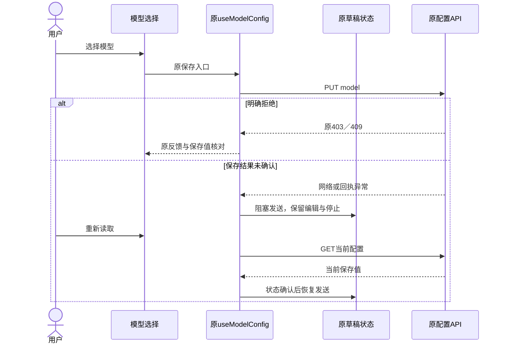

<!-- [Input] Chat产品交互、原Agent和模型数据、托管连接目录及逐条tools请求。 -->
<!-- [Output] 分组菜单接线、Thread选择、DTO、快照加载、队列及时序合同。 -->
<!-- [Pos] Chat开发设计；连接CRUD、权限分类及音频播放器各有独立所有者。 -->
<!-- [Sync] 2026-11-13: 限定菜单UI字体与滚动；删除独立资源导航，保留设置路由及Native管理intent。 -->
<!-- [Sync] 2026-11-13: MCP选择进入tools；Chat读取连接目录，Thread和消息分别持有选择快照。 -->

# Chat Agent、工具与模型输入栏：开发设计

产品规则与桌面／窄屏骨架见[产品稿](../../prd/chat/agent-tool-composer.md)。资源CRUD见[连接管理](mcp-tool-management-frontend.md)，音频见[平台接线](../multi-platform/mobile-clock-audio-frontend.md)。

## 模块与接入关系

| 模块 | 所有权与输入输出 |
| --- | --- |
| `ChatView`／Native App | 原Deck／Agent目录和回调；Thread创建、原发送入口 |
| `ComposerToolsMenu`／`ComposerAgentSelector` | 一个当前Agent触发器；桌面侧向级联，窄屏／Native同面板进入和返回；采集工具选择 |
| `useChatMcpCatalog` | 仅调用capability与Server列表读取接口；Web fetch／Native clientFetch沿原认证边界 |
| `useChatToolSelection` | 当前页面进程中的Thread ID → descriptor列表；新对话草稿独立；关闭菜单后保留 |
| `AIInputDock` | 原草稿、附件和toolChoice；发送时传入第4参数`tools` |
| `buildClaudeChatRequest`／`enqueueThreadInput` | 普通发送和排队均序列化当条消息的`tools` |
| `ClaudeAgentRequestBody`／`request_tools.py` | 固定type与严格字段校验；平台与托管MCP选择分别投影 |
| `ThreadFactory` | 每个`_QueuedThreadInput`保存独立选择；后续请求通过replace取得该条字段 |
| `Service`／`ManagedMcpRuntimeSnapshotLoader` | actor/workspace授权与可用连接校验；在凭据读取和discovery前按所选name过滤 |
| `Runner` | 注入Service已过滤的远程MCP配置；原工具权限和确认流程继续执行 |
| `ClaudeMcpResourceSection` | 设置页的连接CRUD、认证、enabled和revision；独立于Chat工具选择 |
| `ComposerModelSelector`／`SelectModel` | 现有IM模型目录、配置保存、回执核对与恢复 |

Agent决定工具调用，MCP执行工具协议，组件负责呈现和用户输入。音频MCP通过AskUserQuestion取得播放／不播放答案；播放器适配器的实际媒体操作按音频专项接入。

## 参考源码与方案收敛

[Better Chatbot源码及MIT声明](../../../frontend/third-party/better-chatbot/README.md)保留Agent、ToolSelect和SelectModel快照。AgentSelector使用DropdownMenuSub／SubContent，McpServerSelector通过选择状态向Chat输入工具范围。本次复用IM原始Agent目录、连接目录和发送合同，并采用分组菜单、侧向子菜单及开关交互。

连接管理开关与Thread选择拥有独立字段和生命周期。选定的方案在Chat请求携带后端托管连接名称；客户端发送的内容限于类型和名称。现行实现按整个服务选择其工具，单个服务内部逐工具筛选退出本次实现。工作流和工具预设缺少当前Chat目录及执行合同，菜单只呈现已接入项。

## 中文呈现与导航接线

Web入口与Portal菜单使用现有`--font-family-ui`，局部菜单正文为14px／22px行高，标题16px／24px，辅助文字12px／20px；正文400、标题600、分组500。`ComposerToolsMenu.css/SelectModel.css`固定勾选、图标、箭头、开关及推荐标记的占位，长名称按各区域截断或换行。`AIInputDock.css`限制当前Agent与模型的最小宽度，四项操作同排收缩；正文编辑器与全局字体分别由原组件维护。

`ComposerPopover.sidePanelWidth`为级联预留视口空间；左右均不足时调整主菜单位置。Agent子菜单按受限高度定位，父面板style变更后重新测量位置；组件卸载取消动画帧、观察器和resize监听。初始焦点仍在可见DOM提交后设置，Left收起与Right重新展开均核对父子菜单分列。

Native菜单使用原生`Text/TextInput`的界面字体及对应行高，内容区域继续使用原`InkLabel`。开关保留44px操作范围与独立轨道，服务和Agent名称可截断。Web／RNW的字体文件由正常App样式加载；RNW验证采用显式iOS平台与配色边界，真机字体与系统键盘单列验收。

`StoryWorkspaceSidebar`移除独立资源按钮，资源深链以“设置”为当前栏目。`MORE_NAVIGATION_ITEMS`保留五项；`MoreNavigator.native`将内部`resources`意图映射到原Settings，并沿`resourceRequestNonce/onResources`回调进入资源页。`/story-workspace/settings/resources`、Settings连接CRUD及认证接口保持。

## 请求接口

普通消息`POST /api/claude-agent`与排队`POST /api/claude-agent/threads/{thread_id}/inputs`均使用：

```json
{
  "id": "thread-example",
  "message": {"id": "message-example", "role": "user", "parts": [{"type": "text", "text": "用户正文"}]},
  "toolChoice": "auto",
  "tools": [{"type": "mcp", "server_name": "research"}]
}
```

| 字段 | 合同 |
| --- | --- |
| `tools` | 默认`[]`；逐条消息显式提交；空列表关闭远程MCP和可选平台工具 |
| `{type:"mcp", server_name}` | server_name沿现有managed server_key格式；后端按actor和workspace查找当前已启用连接；额外配置字段由严格schema拒绝 |
| `{type:"mobile_clock_audio"}` | 原固定平台工具type；当前前端播放器能力未就绪，菜单保持禁用 |
| `toolChoice` | 原auto/manual/none；none取得空工具范围；原full-access与AskUserQuestion规则保持 |
| `allowedMcpServers`／`allowedAppDefaultToolkit` | 历史兼容字段继续传空；当前有效选择统一使用`tools` |

客户端不提交连接地址、凭据、env、命令或工具schema。托管连接配置由原管理接口取得。重复type或name按原顺序去重。每个MCP描述符选中一个服务的工具集合；工具本身继续接受原权限判断。

后端将平台type传至`ClaudeAgentRunRequest.tools`；MCP names传至`mcp_server_names`。公开Chat及队列入口总是产生显式tuple，缺省为`()`。内部服务端任务的`None`表示由其授权快照选择服务，调度任务保持原服务端范围。浏览器DTO无该内部字段。

## 选择状态与提交快照

`useChatToolSelection`的Map仅保留当前前端进程的Thread选择。新对话草稿初始为空，首次创建Thread后由`rememberThreadTools`绑定到返回ID。A/B对话分别读取各自条目；Web页面重载或App进程重启后默认空，跨设备偏好同步退出本次范围。

default=`[]`；desired=当前Thread菜单选择；effective=某条消息提交时复制的descriptor列表；revision使用现有message ID和queue sequence识别提交，无新增配置版本字段及数据库schema。进行中任务和队列条目均保留已捕获的选择。

Web新对话通过`queuedTools`保留首次提交选择，后续菜单改动只更新Thread偏好。普通消息沿`chatUserMessageIngress`在Editor持久化等待前固定当条选择；请求构造读取pending快照。Native `send/submitMessage`在异步准备前复制选择。重试身份包含该条工具范围。重连路径只观察原执行。

## 接入拓扑



## 正常时序



## 异常与恢复



状态转换由[产品稿](../../prd/chat/agent-tool-composer.md#状态转换)维护，菜单选择不经过连接PATCH／保存中状态。设置页自己的enabled/revision冲突仍沿原CRUD处理。

## 模型与现有发送合同

模型组件继续迁移参考SelectModel的搜索、分组、当前勾选、禁用项及桌面Popover／窄屏Sheet。`useModelConfig`读取原`GET /api/gateway/models`和`GET /api/system-config`，保存仍为`PUT /api/system-config`的单一`model`字段。保存未确认时沿原draft disabled阻塞发送，编辑和Stop保持；403／409及重新读取沿原hook恢复。

Web正常入口由ChatView装配：新对话使用原Agent目录，已有Thread限制在原卡片结构范围，`deckId/voiceId`与原选择回调保持。Native使用原目录、transport和场景active。离开Chat关闭浮层；返回时按原模型owner重新读取已保存偏好。

### 模型正常时序



### 模型异常时序



## 验证与历史

技术验证需覆盖零Chat配置PATCH、空选择、A/B对话隔离、首条绑定、队列逐条选择、actor/workspace校验及凭据读取前过滤。界面检查覆盖悬停与键盘级联、窄屏、明暗主题、原草稿／停止及模型保存。Native浏览器渲染、真机、真实账户／模型／MCP和发布分别登记。

[本轮执行记录](../../exec/chat-thread-tools-20261113.md)维护回执；[修订前原文及图示](chat-agent-tool-composer-before-thread-tools-20261113.md)和[更早Agent／模型稿](chat-agent-tool-composer-before-agent-model-20261113.md)保留历史。

中文菜单与导航修订的命令和截图见[本轮执行记录](../../exec/chat-composer-zh-navigation-20261113.md)。

独立提交与合并前验证见[集成回执](../../exec/chat-agent-tools-pr-20261113.md)。
