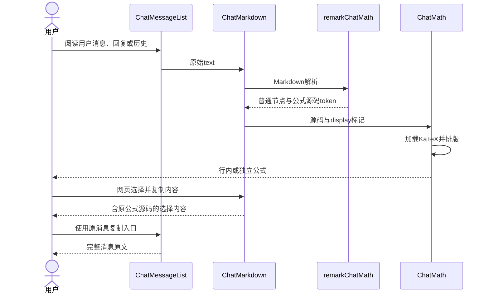
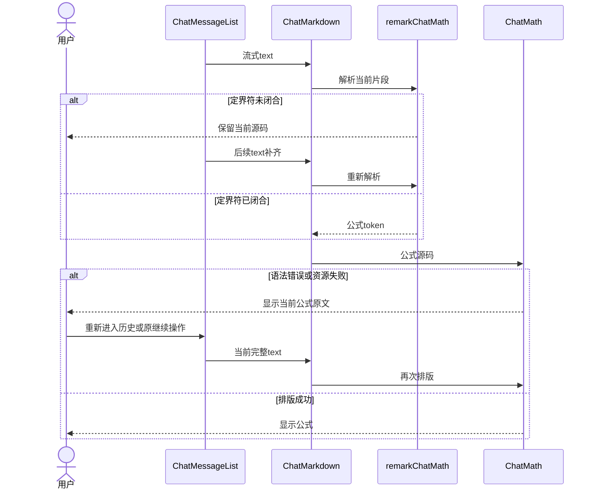
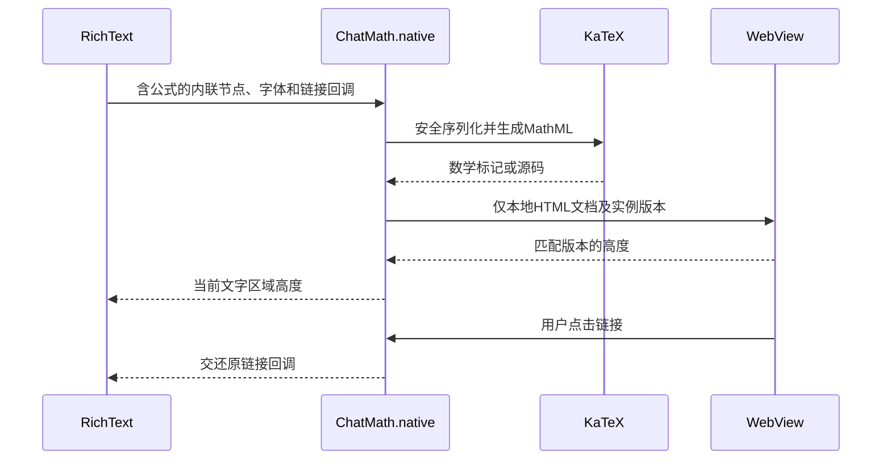
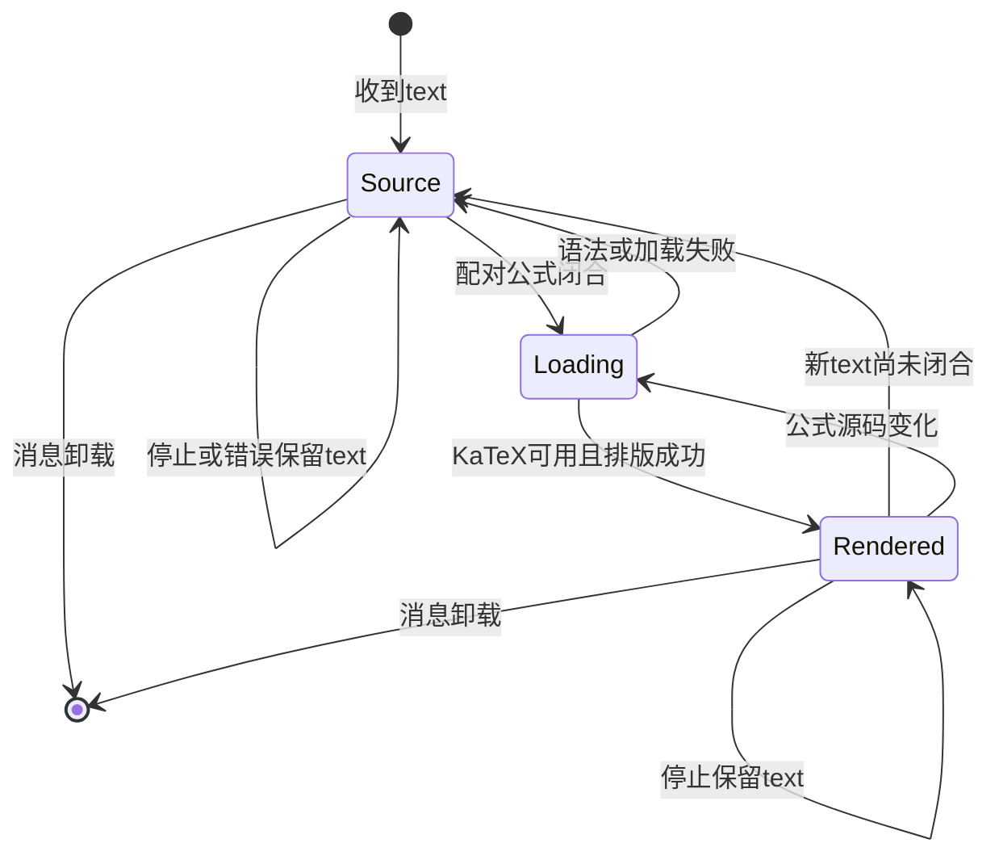

<!-- [Input] Chat公式PRD、生产ChatMarkdown调用链、Codex Round52参考及原始资源。 -->
<!-- [Output] 公式识别、排版、选择复制、平台适配、异常恢复和验证矩阵。 -->
<!-- [Pos] 对话消息数学公式正式交互设计与方案评审。 -->
<!-- [Sync] 2026-11-08: 完成发现、范围定义、方案自审与实现；合同11项、Chrome8项及原有回归14项通过，静态最终回执见下文。 -->
# 对话数学公式交互与实现

## 背景与问题

需求及页面骨架归[产品需求](../../prd/chat/math-messages.md)。本轮判断为公式解析与排版能力缺失。`ChatMarkdown.tsx`和`ChatMarkdown.native.tsx`均使用`react-markdown + remark-gfm`，当前无公式插件。锁文件已有Mermaid间接依赖`katex@0.16.47`，消息正文尚未引用该能力。

### 发现证据

参考根目录：`/Users/dmeck/project/Codex-Original-Functionality-Round52-Delivery`。以下路径均相对该目录。

| 需求点 | 当前行为 | 参考行为 | 证据位置 | 建议处理 |
| --- | --- | --- | --- | --- |
| 原始范围 | 需求标题“支持数学公式显示” | 无补充验收规则 | PRD中的Notion链接；2026-11-08读取 | 聚焦消息显示 |
| 解析 | GFM及Mermaid，公式按文字解析 | `HT`识别`\[...\]`及`$$...$$`；`UT`识别同一行`\(...\)` | `work/semantic-recovery-restart/work/staging/typescript-syntax-baseline/webview/assets/app-server-manager-signals-BOGyjFm3.ts`，`VT/HT/UT` | 显式配对定界符；单`$`保持文字 |
| 排版与错误 | 无公式组件 | `wt`调用KaTeX，`displayMode`跟随token，`strict:ignore`、`throwOnError:false` | 同资源目录`markdown-CrzXVJOX.ts`，`Kn → wt` | 复用KaTeX，异常保留完整源码 |
| 选择复制 | 系统默认选择；整条复制使用原文 | `Xn → Zn → Oe → Ne`去除视觉重复层并还原LaTeX，选区触及公式时扩展到完整公式 | 同资源目录`markdown-CrzXVJOX.ts`，`je/Ne/Zn` | 网页补充公式选择投影，保留整条复制 |
| 源码恢复 | 消息保存完整Markdown | 恢复源码包含行内`\(...\)`和独立`\[...\]` | 同上`Y/De/Ne`；恢复模块`cycle-0178-document-shell-runtime.tsx:223` | 本项目复制保留输入定界符 |
| 专属操作 | 既有消息复制和Mermaid操作 | 数学token渲染函数直接返回span，局部函数未增加公式按钮 | 同上`wt` | 沿用消息操作 |
| 长公式与主题 | 原消息颜色及局部代码横滚 | 资源包含KaTeX HTML/MathML及样式；当前客户端布局待确认 | `resources/renderer/original-ui/load-order.json`与原始样式 | 使用本项目主题和局部横滚约束 |
| 生产接入资格 | Web和Native分别有实际入口 | README标记语义重建与完整度限制；恢复模块用span与data属性描述数学token；实际入口加载`CodexApplicationShell`，`ThreadView`将message.text直接放入p | `README.md:3`、`src/entries/application-renderer.tsx`、`src/renderer/app-shell/codex-application-shell.tsx:152`、恢复模块`cycle-0211-react-surfaces.ts:302` | 原始资源提供行为证据，恢复模块与生产接入分别记录 |

参考调用关系为原始资源中的Markdown token解析→`Kn`数学token分派→`wt`排版，选择复制由Markdown容器监听。恢复模块中的数学分支仅返回文字与data属性；参考交付程序实际消息入口使用p中的普通文字，数学资源缺少该入口接入。2026-11-08调用当前客户端观察工具`cua.getApp("Codex")`，工具以`Computer Use is not allowed to use the app 'com.openai.codex' for safety reasons`拒绝访问。当前客户端的交互资格为待确认，行为对齐证据限本地参考资源。`.tex`文件编译、文件预览和消息公式具有独立调用链，退出本项范围。

### 当前调用链

- Web：`ChatMessageList → UserMessagePart / AssistMessagePart → ChatMarkdown`，流式和历史均向同一组件传入原文；`ReasoningPart`及`PlanPanel`同样复用它。桌面和窄屏使用同一个Web组件。
- Native：`ChatMessageList.native → ChatMarkdown.native`，用户、助手、过程及历史沿同一Markdown入口。正文段落由`RichText`组织，代码和表格使用局部横滚。
- 原复制：`UserMessagePart`、`AssistMessagePart`及Native消息操作把完整text交给现有`useCopy`。滚动仍由原消息列表负责。
- URL：保持`defaultUrlTransform`、exact `workspace://`及资源归属校验。HTML文本继续按原Markdown边界处理。

## 目标与边界

共用显式数学token识别和KaTeX加载；保持原Markdown解析、原文、传输、存储、工具与消息状态。后端、Agent、MCP及数据库无新增工作项。原生适配仅承载含公式的文字区域，原生消息、代码、图片、表格结构与消息操作保留现有所有者。

### 方案比较与选定依据

| 方案 | 依赖及兼容性 | 维护与交互影响 | 结论 |
| --- | --- | --- | --- |
| 全局字符串替换为HTML | 需要额外绕过代码、转义和URL；改变Markdown安全边界 | 易破坏代码示例与流式文本 | 排除 |
| micromark扩展 + KaTeX | 复用react-markdown内部解析扩展；KaTeX采用锁文件已有版本并声明直接依赖 | 三种显式配对写法；无新增用户操作 | 选定 |
| MathJax及整条消息WebView | 新增渲染运行时；迁移Native整条消息及资源操作 | 扩大依赖、滚动和平台交互范围 | 排除 |

数学识别在Markdown tokenizer中进行，代码、链接目标及转义仍由Markdown语法所有。扩展沿[micromark数学文本token结构](https://github.com/micromark/micromark-extension-math/blob/main/dev/lib/math-text.js)组织容器、定界符、正文及换行事件，保留现有解析器的逐行分块。已闭合token生成带源码的span；未闭合token显示源码。独立公式在文字流中采用块状布局。跨空白段落的公式遵循Markdown段落边界。

## 概念与规则

### 职责与安全

- `remarkChatMath`：在原Markdown解析器中识别配对语法，保留源码与display标记。
- `ChatMath`：按需加载KaTeX，生成HTML和MathML，`trust:false`，严格限制HTML插入来源为KaTeX生成结果。解析失败和模块加载失败显示转义后的原文；成功结果包含可访问数学语义。
- `ChatMarkdown`：沿原code/pre/Mermaid和Workspace路由渲染span；网页选择复制将数学视觉层还原为原文。
- `ChatMarkdown.native`的`RichText`：发现当前文字区域含数学token时，采用`ChatMath.native`的局部HTML/MathML文档。普通段落继续原生Text。
- `ChatMath.native`：仅序列化允许的文字内联元素，转义所有文本及属性；KaTeX采用MathML输出，使用WebKit数学排版，避免引入字体下载和新页面路由。文档禁止网络、图片、任意脚本内容及自行导航；链接交还现有回调。文档高度通过实例身份与源码版本匹配后更新。
- 原生文档滚动关闭，超宽数学区域通过文档内部横滚；纵向阅读继续由外层消息列表处理。主题、字号、行高及文字颜色来自现有调用参数。`ChatMessageList.native`传入用户气泡或助手区域的背景色，局部HTML与WebView同步底色，保留深色主题的文字对比。

布局数值依据：独立公式的`0.9em`间距沿用`styles/markdown.css`的段落节奏；公式上下`0.2em`留白用于容纳分式及上下标的字形高度。Native默认字号`15.2`、行高`26.6`及代码比例`0.92`沿用当前`ChatMarkdown.native`。MathML字号`1.21em`对应KaTeX样式的公式字号比例；以上数值只定义排版。KaTeX字体随包内CSS交付，字体加载失败沿浏览器字体回退；本轮资源故障注入覆盖数学脚本模块，字体与CSS故障未单独注入。

### 状态与恢复

| 条件 | 内容与反馈 | 恢复 |
| --- | --- | --- |
| 开头定界符已到达，结尾未到达 | 当前片段以原文显示 | 新text补齐后重新解析 |
| 定界符闭合，渲染模块加载中 | 显示原文 | 模块可用后就地排版 |
| 排版成功 | 正文公式 | text或主题更新沿原组件生命周期 |
| 语法错误 | 只在该公式显示原文 | 后续正确text重新排版 |
| 模块加载失败 | 原文；其他消息继续阅读和复制 | 重新挂载时重试模块加载 |
| Native文档故障 | 当前文字区域回退原文 | 重新进入或正文更新后重建局部文档 |
| 停止或请求失败 | 保留最后text的已排版和原文部分；显示原消息状态 | 原继续/重试入口所有 |
| 历史重新进入 | 保存的原文交给同一渲染入口 | 无新增业务状态 |

### 正常业务时序

### 异常与恢复时序

### Native文字区域时序

### 状态转换

## 实现前自审

2026-11-08评审结论：通过，按上述最小方案实施。原始需求支持消息直接阅读；三种写法和选择复制具有原始资源证据；安全转义、失败源码及横滚来自现有消息兼容约束。选定方案复用消息组件、Markdown解析器、KaTeX间接依赖和消息操作。删除公式工具栏、源码切换、计算、编辑、确认和独立弹窗工作项。Native局部文档用于现有平台文字排版，限定于含公式区域；新业务接口、Agent和MCP无参与。

## 影响范围与验证矩阵

修改范围为Chat共享渲染、数学token、数学视图、选择复制、Native消息背景参数及对应文档、依赖和技术测试。`ThreadImageCard`的PNG导出渲染保持其现有职责；原生物理设备、重建安装和真实模型验收单独记录。

| 验收项 | 生产入口与验证方法 | 当前状态 |
| --- | --- | --- |
| 三种写法、混排、多个公式 | 实际ChatMarkdown、用户与助手组件浏览器技术验证 | 合同11/11、Chrome8/8通过 |
| 金额、转义、代码和链接边界 | 实际tokenizer与浏览器渲染 | 合同及Chrome通过 |
| 流式、停止、失败及重进 | 原消息组件text更新和重新挂载 | 显示状态技术验证通过；停止API和真实历史业务链路沿原实现，未调用模型 |
| 桌面/窄屏、浅色/深色、长公式 | 已安装Chrome布局及局部滚动断言 | 1100×800、390×800及浅/深色通过，页面无横向溢出 |
| 复制、选择、Mermaid回归 | 实际消息操作及选区事件，原Mermaid测试 | Chrome复制断言及既有回归14/14通过；系统剪贴板由fixture替代 |
| Native数学段落、安全链接和高度 | RNW局部WebView技术适配与协议断言 | MathML、选择复制、失效ID、失败源码、换行、标题/任务/表格通过；局部文档通过iframe传输适配验证 |
| 类型、定向lint、Markdown清单/引用、Mermaid语法 | 专用测试代理命令回执 | Web/Native类型、定向lint、Markdown清单/引用均退出0；4张Mermaid通过；Native消息列表保留1条原有Hook依赖warning |
| iPhone/WebKit、真实账户/模型和发布 | 本轮未执行 | 未验收 |

技术验证覆盖生产组件和公开生产渲染入口。截图与模拟数据用于技术验证，结果按执行回执更新。

### 2026-11-08 执行回执

执行者为`luna_test_runner`，工作目录为仓库`frontend/`。已安装Chrome的首次启动检查退出0，仓库前置脚本退出0；本轮Vite使用明确命名的临时缓存与临时端口，退出后关闭自有server和浏览器。正常Dream/Admin/Gateway、数据库、账户和模型无写入。

| 命令 | 退出码 | 关键结果 |
| --- | --- | --- |
| `corepack pnpm exec playwright test e2e/chat-math-contract.spec.ts --workers=1 --reporter=line --output /tmp/ink-chat-math-20261108-c/contracts` | 0 | 11 passed，24.5s；包括全部流式前缀及跨行公式 |
| `corepack pnpm exec playwright test e2e/chat-math.spec.ts --workers=1 --reporter=line --output /tmp/ink-chat-math-20261108-e/browser` | 0 | 8 passed，41.9s；包括4张Mermaid语法检查与Native主题背景断言 |
| `corepack pnpm exec playwright test e2e/chat-math.spec.ts -g 'native paragraphs' --workers=1 --reporter=line --output /tmp/ink-chat-math-20261108-d/native-paragraphs` | 0 | 1 passed；最终换行与局部文档选择复制复核 |
| `corepack pnpm exec playwright test e2e/mermaid-document.spec.ts e2e/native-messages.spec.ts --config e2e/web-rnw-regression.config.ts --workers=1 --reporter=line --output /tmp/ink-chat-math-20261108-d/regression` | 0 | 14 passed；原消息阅读及Mermaid回归 |
| `corepack pnpm exec playwright test e2e/native-messages.spec.ts --config e2e/web-rnw-regression.config.ts --workers=1 --reporter=line --output /tmp/ink-chat-math-20261108-e/native-regression` | 0 | 8 passed，16.3s；最终Native背景参数修改后的原消息回归 |
| `corepack pnpm exec tsc --noEmit --pretty false` | 0 | Web类型检查通过 |
| `corepack pnpm native:typecheck` | 0 | Native类型检查通过 |
| `corepack pnpm exec eslint app/_dream/components/chat/ChatMarkdown.tsx app/_dream/components/chat/ChatMarkdown.native.tsx app/_dream/components/chat/ChatMessageList.native.tsx app/_dream/components/chat/ChatMath.tsx app/_dream/components/chat/ChatMath.native.tsx app/_dream/components/chat/remarkChatMath.ts app/_dream/components/chat/chatMathRender.ts app/_dream/components/chat/chatMathSelection.ts e2e/chat-math-contract.spec.ts e2e/chat-math.harness.tsx e2e/chat-math.spec.ts` | 0 | 0 errors；1条原有Hook依赖warning |
| `python3 frontend/output/playwright/chat-math/check-docs.py`，仓库根目录执行 | 0 | 新文档引用、目录清单及文档用语通过 |
| `git diff --check` | 0 | 工作区差异格式检查通过 |

中间回执保留的修正项：首轮跨行token触发解析错误，最终容器、定界符、正文及换行事件合同通过；长公式原先按运算符换行，最终KaTeX视觉层使用局部横滚；原生主题fixture曾落入默认拒绝写入边界，最终接回既有iOS Settings适配器及独立平台fixture。截图复核发现Native局部文档的白色底色，最终由消息背景参数同步HTML和WebView底色，并增加背景一致性断言。中间合同运行包含超时与中止回执，最终11项合同具有完整退出0记录。

截图位于`frontend/output/playwright/chat-math/`，包含`1100-light.png`、`1100-dark.png`、`390-light.png`、`390-dark.png`。目录属于忽略的技术输出。完整发布构建、iPhone安装包、物理设备/WebKit、真实账户和真实模型验收未执行；当前Codex客户端观察受到上述工具访问限制。正式发布和已安装App的采用状态各自保留验证资格。
