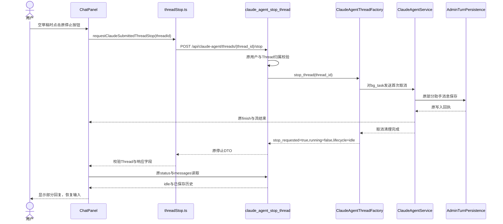
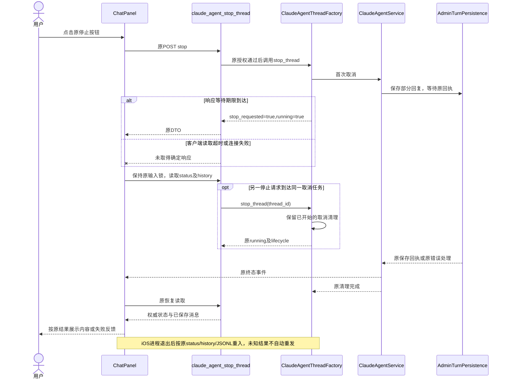
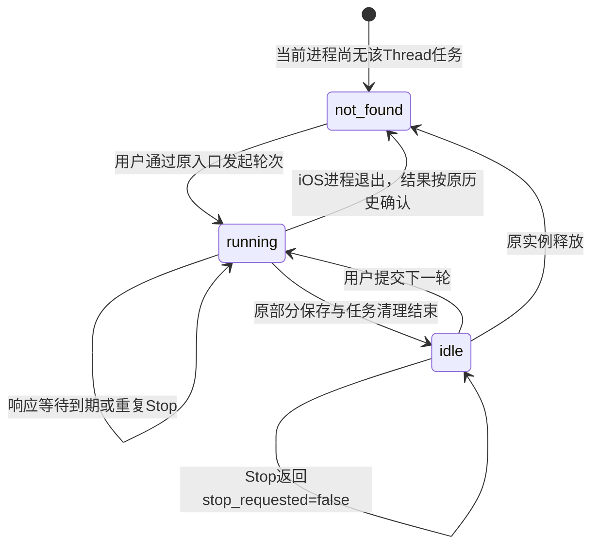

<!-- [Input] 原Chat停止入口、ThreadFactory、Service持久化和iOS独立执行验收。 -->
<!-- [Output] 当前停止操作、取消等待、部分回复保存、失败恢复与验收合同。 -->
<!-- [Pos] Chat与Dream共用停止交互设计；页面骨架由Chat排队输入PRD维护。 -->
<!-- [Sync] 2026-10-25: Stop响应等待与任务清理独立，重复请求保留已开始的取消清理。 -->

# Claude Agent 停止交互

## 背景与问题

Chat与Dream沿用同一Thread运行、流式展示、停止及历史恢复。原设计要求停止后保存已生成内容。`ClaudeAgentService.execute_session()`在取消时调用`_persist_partial_assistant()`，随后发送原finish及关闭事件流。慢保存期间，原`stop_thread()`的等待期限会对同一任务再次发送取消，清理可能提前结束。

本次沿原接口修正取消等待，保留原前端交互、身份校验、持久化、终态及恢复。此前完整原文保留于[历史稿](history/claude-agent-stop-interaction-before-bounded-wait-20261025.md)。页面骨架与运行中输入规则见[Chat排队输入PRD](../../prd/chat/queued-input.md)。

## 目标与边界

用户可停止当前主轮次，查看已保存的部分回复，继续使用同一会话。普通断流、切页与网络中断继续沿原重连语义执行。停止请求与当前Thread归属校验、业务权限和模型权限保持。

运行任务归当前`ClaudeAgentThreadFactory`实例所有。iOS中该实例位于应用进程；原服务器部署继续由原实例执行。跨Worker定位、持久取消表、宿主补存、离线数据库及新增业务状态均无本次工作项。Mac relay、Admin认证及资源策略配置保持各自原职责。

## 概念与规则

| 对象 | 当前规则 |
| --- | --- |
| 输入区 | 空草稿且主轮次运行时显示原停止按钮；有草稿时按原排队输入入口发送 |
| 停止请求 | `ChatPanel.handleStop()`调用`requestClaudeSubmittedThreadStop()`；等待期间沿原输入锁和按钮状态处理 |
| 接口 | `POST /api/claude-agent/threads/{thread_id}/stop`校验当前用户与Thread归属，转交原Factory |
| 取消 | 对运行任务发送首次取消请求；已处于取消流程的同一任务继续完成原清理 |
| 响应等待 | 原`INK_AGENT_STOP_WAIT_S`仅约束停止响应等待；`asyncio.shield()`保留正在执行的原任务清理 |
| 响应字段 | 原`ok/thread_id/stop_requested/running/lifecycle`保持；期限到达且任务仍运行时返回`running=true` |
| 部分回复 | Service继续通过原AdminTurnPersistence保存`is_partial=true/turnStatus=cancelled`；随后发送原finish，Factory清理并转为idle |
| 客户端恢复 | 受理、超时、非2xx及畸形响应均沿原status/history恢复；原响应与权威读取共同决定输入恢复 |
| 会话 | 停止当前轮次保留Thread和Claude Session；普通断流只解除订阅 |

原默认等待值为3秒，原客户端请求期限为10秒，均为技术配置事实。本次保持原值，用户任务与产品规则不增加时间限制。

### 正常业务时序

### 异常与恢复时序

### 状态转换

下图使用原Factory状态。停止受理和响应等待均沿running状态处理；页面反馈由原停止请求状态与恢复读取决定。

## 源码与影响范围

| 模块 | 当前处理 |
| --- | --- |
| [ChatPanel](../../../frontend/app/_dream/components/chat/ChatPanel.tsx) | 原handleStop、recoverAfterStop与权威历史恢复；本次业务代码保持 |
| [threadStop](../../../frontend/app/_dream/components/chat/threadStop.ts) | 原请求去重、10秒期限、CSRF与DTO校验；本次保持 |
| [原Stop路由](../../../backend/routers/claude_agent.py) | 原get_current_user与Thread归属校验；本次保持 |
| [ThreadFactory](../../../backend/claude_agent/thread_factory.py) | `bg_task.cancelling()`保留首次取消；有界等待使用shield，期限到达返回原快照 |
| [Service](../../../backend/claude_agent/service.py) | 原部分助手写入、finish及取消异常继续传递；本次保持 |
| [Factory测试](../../../backend/tests/test_claude_agent_thread_factory.py) | 受控慢清理、重复Stop、单一终态及取消期间错误 |

修复适用于使用该Factory的iOS、Web与原服务器路径。原admission顺序、lease、队列、SDK控制、权限及会话恢复合同保持。

## 设计评审与验收

复用原取消任务、原响应字段与原持久化。等待期限与清理分别完成，原running状态已覆盖慢清理，无新增状态或配置。正常与异常图复用真实模块和原接口。

| 验收项 | 预期结果 | 验证方式与前提 |
| --- | --- | --- |
| 正常停止 | 原DTO受理、原部分回复保存、单一finish、输入恢复 | 原账户页面执行并核对正常业务记录 |
| 保存慢于响应等待 | 返回原running=true，清理继续，完成后idle | Factory受控gate技术回归；真实业务单独核对 |
| 重复Stop | 同一任务取消清理完整，部分保存不被追加取消打断 | Factory并发与重复请求技术回归 |
| 取消期间异常 | 原错误反馈与单一终态保留 | Factory及Service既有隔离回归 |
| 请求超时 | 原输入锁、status/history恢复及未知结果处理 | 原前端隔离回归与真实网络复验 |
| 普通断流与重开 | 原任务、已保存消息和Session按现有能力恢复 | 原重连回归；iOS重新进入单独验收 |

2026-10-25的慢清理复现已取得失败回执；修复后143项回归与19项子用例通过。独立Simulator首段回复停止验收退出0，取得原Stop受理DTO、页面终态、正常部分助手is_partialtrue/turnStatuscancelled与现有取消结算，原Session字节前缀保持。普通重开已恢复同一部分回复，物理iPhone资格继续待验收；对应证据以[移动执行记录](../../exec/mobile-app-design-review-20261024.md#2026-10-25-首段回复停止自动化验收)的对应回执核定，隔离测试通过不推进真实业务验收。
