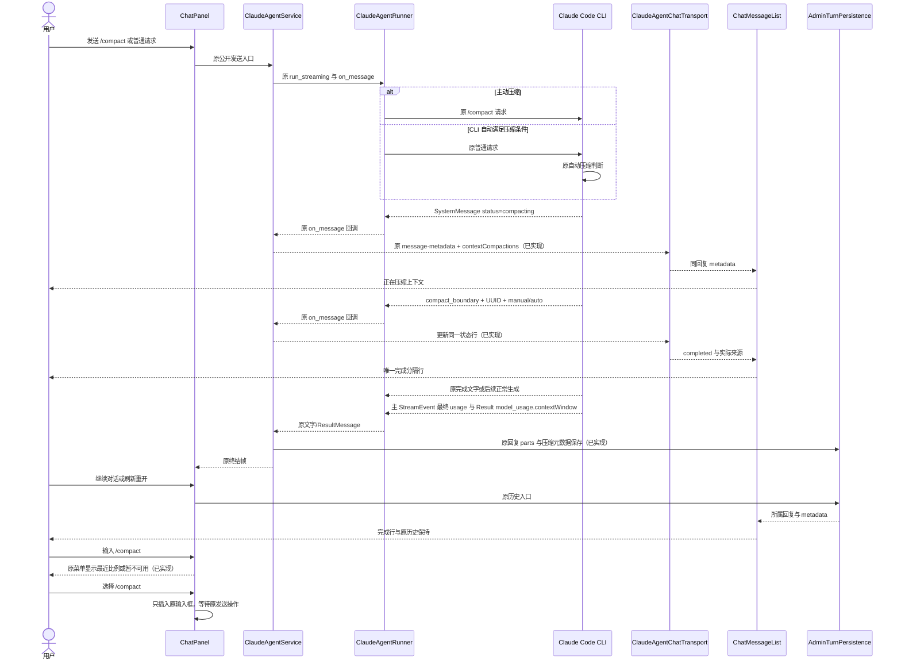
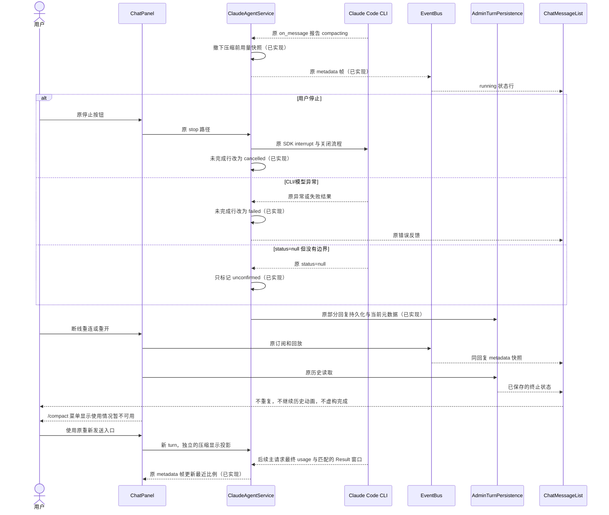
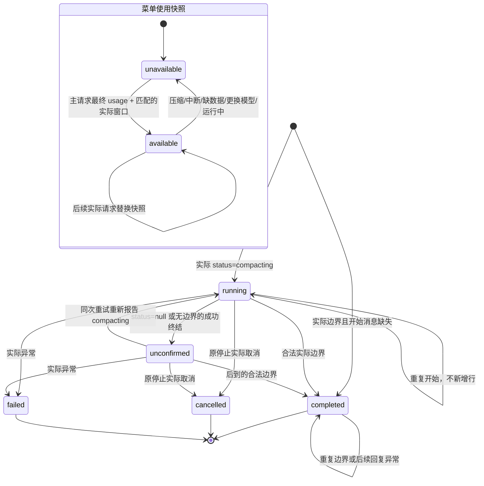

<!-- [Input] Chat PRD、现有 on_message/SSE/消息保存链和两种参考源码。 -->
<!-- [Output] 压缩状态投影、交互、异常恢复、业务图和验证矩阵。 -->
<!-- [Pos] 上下文压缩正式交互设计；不拥有 CLI 压缩算法或数据库 Schema。 -->
<!-- [Sync] 2026-10-12: 补充 /compact 使用比例的源码口径、失效规则和菜单交互；菜单真实用量9%和技术验证通过；整体压缩验收仍进行中。 -->
<!-- [Sync] 2026-10-13: 压缩状态和使用比例均已实现；完整真实验收因正常上游持续失败阻塞，具体未通过条件见执行记录。 -->
<!-- [Sync] 2026-10-13: 正常Admin重启后手动完成、刷新和后续对话真实通过；只剩实际自动压缩验收缺口，原失败证据保留。 -->
# 上下文压缩交互设计

## 背景与问题

产品规则与桌面/窄屏骨架见 [PRD](../../prd/chat/context-compaction.md)。改动前，`ClaudeAgentRunner.run_streaming` 已调用原始 `on_message`，但 `ClaudeAgentService._persist_sdk_session_from_message` 只消费 `SystemMessage(init)`，SDK `status` 和 `compact_boundary` 未进入 Chat 状态。本轮通过 `_observe_sdk_message` 保留原 init 保存并增加状态投影。手动完成文字已由前一图片专项沿现有文字回调保存，本次不重做这条链路。

## 目标与边界

只增加已观察 SDK 消息的显示投影，复用既有 `message-metadata`、服务端回复持久化和前端消息渲染。不改变 Runner、ThreadFactory、资源算法、SDK 选项、压缩阈值、turn/resume/cancel 或现有文字/工具/图片协议，不新增 API、数据库字段、Runtime 发布或后台调度器。

## 概念与规则

### 源码依据与架构差异

| 层 | Claude / Dream 当前依据 | Codex 参考依据 | 选定映射 |
|---|---|---|---|
| 开始 | Claude `src/services/compact/compact.ts`、`src/commands/compact/compact.ts` 调用 `setSDKStatus('compacting')`；公开 schema 仅携带 status | 原资产 `app-server-manager-signals-BOGyjFm3.ts` 有手动请求的 pending item，原生 item 带 source | Dream 开始文案通用；不伪造开始来源 |
| 成功 | `src/entrypoints/sdk/coreSchemas.ts::SDKCompactBoundaryMessageSchema`：UUID、`trigger=manual/auto`；`QueryEngine.ts` 输出边界 | 原资产投影 `contextCompaction` 为 `context-compaction`，带 completed/source | 只有真实边界确认完成和来源 |
| 展示 | Dream 使用每个 turn 的一个 assistant `UIMessage` | `local-conversation-thread-CRSaT3IN.ts` 的 `ry/iy` 使用独立分隔行：Compacting context / Context compacted；自动文案独立 | 在所属回复末尾复用分隔行语义，不复制原生 item 状态机 |
| 过程分组 | Dream 历史工具过程可折叠，final-first 行保留 metadata | 恢复模块 `cycle-0301-agent-render-groups.ts`、`cycle-0305-tool-activity-grouping.ts` 将 context-compaction 保留为独立内容 | 状态行放在折叠过程外，从同回复 metadata 恢复 |

Claude 参考根：`/Users/dmeck/project/claude-code-sourcemap/restored-src`。Codex 原资产根：`/Users/dmeck/project/Codex-Original-Functionality-Round52-Delivery/work/semantic-recovery-restart/work/staging/typescript-syntax-baseline/webview/assets`。恢复模块来自同项目 `work/semantic-recovery-restart/src/renderer/recovered/agent-05`。原资产的 `ry` 位于 `localConversation.contextManuallyCompacted` 周围，明确区分进行中/完成和手动/自动文案；这属于源码对照，不能称为本轮当前客户端像素验收。

### 方案比较与评审结论

比较了三种方案：根据 Token/时间猜测提示，新增全局状态通道和状态查询接口，复用 turn 内消息元数据。第一种缺少真实事件依据；第二种增加同步和持久化所有权；第三种能沿已有回放和保存路径完成本次目的，因此选定第三种。

评审修订：不向 `parts` 增加新类型，避免改变已发布的最终正文与折叠过程规则；不把 `status=null` 或外层成功当作压缩成功；不从未收到来源的开始事件推断自动压缩；不根据普通 `Compacted` 正文隐藏消息。开始/失败只有压缩行没有正文时，允许通过既有 JSON DTO 保存空 parts 和实际元数据；Admin 当前 `chatThreadDto.ts` 已允许此形状，不需 Schema 变更。

### /compact 菜单使用比例（已实现）

新增需求来自用户提供的 Codex 指令菜单截图。发现阶段核对原 `AIInputDock` 的 Skill listbox，以及 Claude `StatusLine.tsx`、`utils/tokens.ts::getCurrentUsage`、`utils/context.ts::calculateContextPercentages`。源码使用最近一次实际 assistant usage 的三项输入值之和，分母由 `getContextWindowForModel` 解析；SDK 0.2.145 已公开 assistant usage 和 ResultMessage.model_usage.contextWindow。现有 Dream Result usage 为累计用量，公开模型目录的 contextWindow 也不代表最终 CLI 有效窗口，二者不用于本提示。

定义：提示帮助用户决定是否手动压缩；不改变压缩算法或资源配置。比较了浏览器按正文估算、服务端复制 CLI 窗口解析和消费实际 SDK 字段三种方案。前两项分别缺少准确用量、重复模型能力规则；选定第三项。窗口或匹配信息缺失时明确不可用，不按模型 ID 猜测默认窗口，不用 Admin 配置改阈值以制造验收。

新增 `ContextUsageTracker` 优先消费主对话公开 StreamEvent 的 message_start、message_delta 和 message_stop，只合并同一请求的输入字段，message_stop 后使用最终值；没有流式用量时才消费非 synthetic AssistantMessage.usage。ResultMessage.model_usage 中与该实际模型完全匹配的 contextWindow 提供窗口；按最近请求替换输入值，不取 result 累计 Token。当前 OpenAI/Responses Gateway 在末尾 message_delta 才报告输入，assistant 文字块可能更早发出零值，所以不能用文字块的初始零值覆盖最终流式用量。Gateway 仅作为只读源码依据，不修改该仓库。ResultMessage 出错、合法压缩状态/边界或原 turn 中断使快照失效，后续真实 assistant/request 可建立新快照；原终结后封闭投影。显示元数据为 `contextUsage={status:'available', model:<服务端选中别名>, inputTokens, contextWindow}` 或 `{status:'unavailable'}`，模型别名仅用于防止浏览器模型更换后显示旧比例。原 metadata 帧、回复保存、PublicChatMetadataDto、transport 与 reconnect reducer 共同传递此闭合字段。

`ChatPanel` 仅从消息列表末尾的所属 assistant 回复取快照；末尾为尚未取得回复的新 user 输入时不可用，不向更早回复回退。运行中或当前选中模型不一致时同样不可用。`AIInputDock` 复用原 listbox 加内置 `/compact`，保留原 Skill 菜单与键盘选中/关闭行为，Workspace Mode 关闭仍提供内置命令。有效比例以最近输入/窗口四舍五入、限制展示范围为 0–100%，小型进度环为装饰，不增加触发阈值。选择仅插入原文本，发送仍调用原入口。

### 模块与输入输出（压缩状态和使用比例已实现）

正常Admin重启后已观察真实手动完成边界、刷新保留和压缩后普通回复；菜单按该后续请求的实际27631/950000显示3%。实际自动边界仍未发生，不能用手动成功或技术注入回执替代自动压缩验收。当前状态和原始证据见[执行记录](../../exec/context-compaction-20261012.md)。

- `context_compaction.py::ContextCompactionTracker`：每个服务端 turn 一份显示投影。输入为公开 SDK 的 subtype/data，输出为不可变复制的行列表。对合法边界 UUID 去重，重复开始不创建新行，已有完成行不回滚。
- `ClaudeAgentService`：现有 `on_message` 继续先处理 init 持久化，再投影 status/boundary；使用原 `message-metadata` 帧发送 `contextCompactions`。成功、错误或取消持久化时保存同一列表。取消/错误只收敛当前未完成行。
- `claude-agent-transport.ts`：严格解码新增元数据后交给现有 AI SDK message metadata；有压缩元数据时启动所属 assistant 消息，使无正文的压缩期间也可渲染。普通初始 metadata 行为保持。
- `claude-agent-sse-utils.ts`：重连继续由原 `applyBackendEventToMessages` 归并，复用同一显示字段解码；不复制状态机或增加重连入口。
- `PublicChatMetadataDto`：所属 Thread 的原历史接口仅投影闭合的 id/state/trigger 与符合手动边界条件的完成文字字段；其他字段不外传。`filterClaudeThreadVisibleMessages` 保留合法压缩元数据的空正文 assistant，普通空消息仍隐藏。
- `ChatMessageList`、`ContextCompactionMarker`：从同回复 metadata 渲染独立状态行，位于回复末尾及历史过程折叠之外。若当前正在显示压缩，通用 Thinking 提示不重复显示。动画只用于当前真实运行中的回复。
- `compactCompletionText`：仅从公开 SDK 的单个 `<synthetic>`、符合现有 Compacted 文字合同的真实 assistant 消息记录，且已有手动完成边界才使用。数据库原正文不变；页面只隐藏与该服务端字段完全相等的旧完成文字。普通模型正文、旧历史、失败均不走此规则。

元数据行形状：`{id, state, trigger}`；`state` 为 `running/completed/cancelled/failed/unconfirmed`，`trigger` 为 `manual/auto/null`。id 来自该压缩首次收到的实际 SDK 状态 UUID；缺少开始消息时使用实际边界 UUID，用于同回复内更新；它不是业务配置。只有边界能写入 completed 和正式来源。原 turn 正常终结、异常或实际取消时关闭该显示投影，后到的旧回调不能再新增压缩行或改变已保存的终态；不影响 CLI 或原 EventBus 的关闭职责。

| 输入 | 行状态与反馈 | 后续处理 |
|---|---|---|
| SDK compacting | running，正在压缩上下文 | 同一次重复状态刷新原行 |
| SDK status=null，未见边界 | unconfirmed，未确认上下文压缩完成 | 保留该行身份，允许后续真实边界更新 |
| 合法 compact_boundary | completed，手动/自动完成文案 | 固定完成事实；重复 UUID 忽略 |
| SDK/服务端异常，当前未完成 | failed，压缩未完成 | 沿原错误与重试入口 |
| 原停止入口取消，当前未完成 | cancelled，压缩已取消 | 沿原停止与重新发送入口 |
| 正常 turn 结束，仍无边界 | unconfirmed | 不声明成功，不继续动画 |
| 已完成之后回复发生错误 | 已有 completed 保留 | 原回复错误独立显示 |

## 正常业务时序

## 异常与恢复时序

## 状态转换

## 影响范围与验证

影响服务端回调投影、现有元数据帧、回复元数据保存、Chat 状态行和双语文案。Admin schema、Gateway、原 Runtime、资源策略、正文/工具 parser 和既有最终正文索引不在修改范围。

技术矩阵：公开 SDK 消息经实际 service/transport 处理；普通回复、手动/自动边界、重复、null、取消、异常、无正文部分保存、后续普通回复、元数据回放及最终正文兼容；公开浏览器入口验证刷新、切换、桌面/窄屏和历史折叠。真实验收另行记录正常本机现有账户/Thread 的手动、实际自动压缩、取消和后续对话，不以注入事件替代。命令、退出码、跳过项和原始失败记录归 [执行记录](../../exec/context-compaction-20261012.md)。
