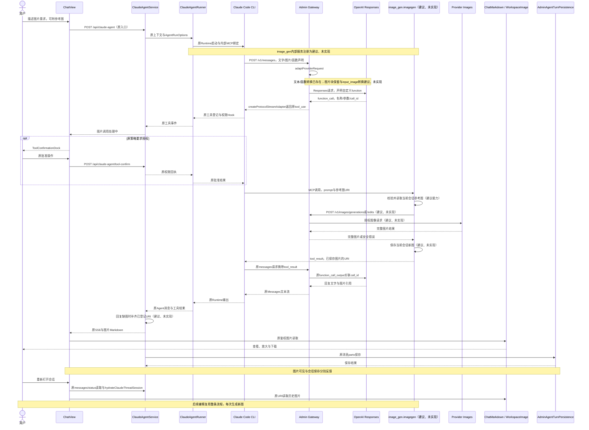
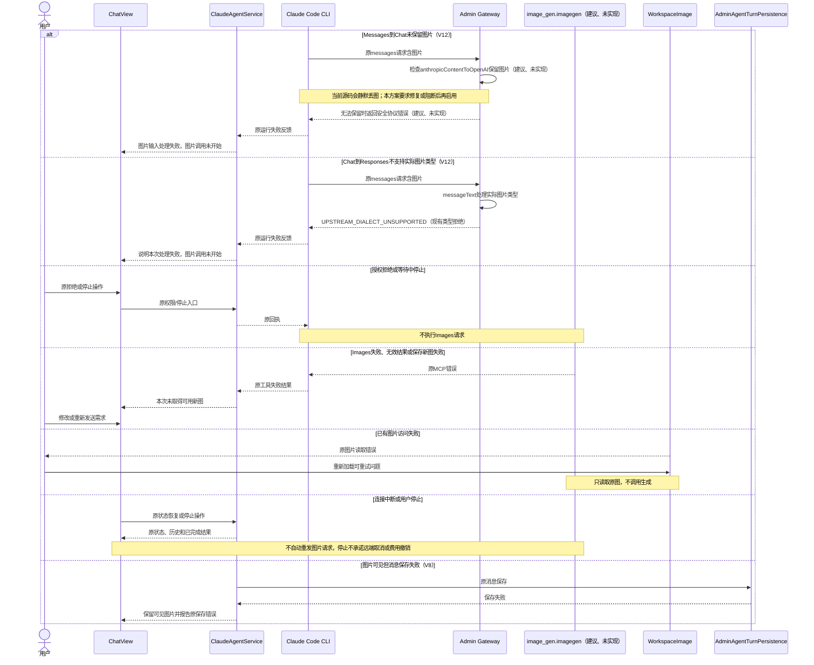
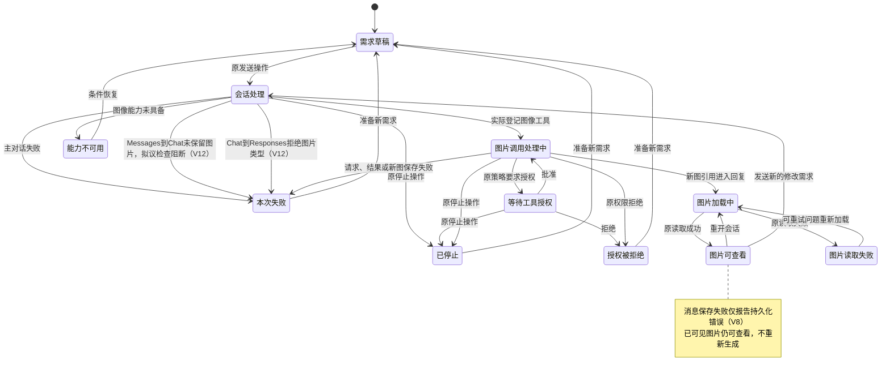

<!-- [Input] 用户指定Gateway Responses主对话与独立Images工具；当前Claude/Admin/Codex源码和Chat PRD。 -->
<!-- [Output] 用户目的、功能边界、选定双链路、正常/恢复/状态图与验收要求。 -->
<!-- [Pos] Chat图片正式设计；PRD拥有页面骨架，实施说明拥有报文、权限和文件合同。 -->
<!-- [Sync] 2026-10-09: 选定双链路；独立评审后分开两层图片转换失败，保存失败只改变持久化反馈；全部新增图像能力仍待实施。 -->

# 聊天图片生成与编辑：正式交互设计

**目的：让用户在同一段对话里得到图片、继续修改，并在重开会话后接着使用。** 需求、参考图和结果都留在现有聊天中，查看和下载沿用原图片查看器。

本次同时明确接入方向：保留Claude Code作为Agent执行器，主对话经Admin Gateway使用Responses；图片生成与编辑由内部`image_gen.imagegen`工具经Gateway调用Images。Claude Code是执行器名称，不代表主对话必须使用Claude模型。新图像工具及相关适配尚未实现。

[PRD](../../prd/chat/image-generation.md)定义产品范围与页面骨架，[实施说明](image-generation-implementation-notes.md)定义程序合同。本轮改写前的完整原文与三幅图见[前稿](image-generation-interaction-design-20261009-gateway-history.md)，调查、取舍和检查见[本轮记录](../../exec/image-gateway-redesign-20261009.md)。

## 1. 背景与问题

用户要完成的是围绕图片持续交流：描述想要的画面、拿已有图片继续修改、看到结果，之后还能找到并使用。IM已有聊天、附件、工具反馈、图片查看和历史基础，需要补齐生成执行与可持续使用的结果。

源码给出的依据是：Claude Code发送Messages报文并执行工具；Admin已有把Messages转换为Responses的入口；指定Codex CLI的图像工具实际调用独立Images接口。[G1–G8及K1–K19](image-generation-implementation-notes.md)。这支持选定方案，不证明当前IM已可生成图片或当前安装Codex App已验收。

本轮核实了一个此前没有说清的缺口：Admin的第一层转换会丢掉Anthropic图片块，Responses输入转换也未支持图片；内置`image_generation`的声明与图片结果亦未接通。因此“可以通过Gateway适配”成立，“现有报文已经完整兼容图像”不成立。具体源码与修订要求归实施说明，不作为用户操作说明。

## 2. 目标与任务边界

完整体验是：**提出需求 → 得到图片 → 查看下载 → 继续修改 → 重开后继续使用。** 过程、授权、失败和停止均有准确反馈。

本次覆盖文字生成、当前会话参考图编辑、处理反馈、查看下载、会话保存与相关恢复。编辑获得新图，原图保留。交付为调查、现行PRD和正式设计，不包含新功能实现、部署或真实模型验收。

独立创作页面、画布与局部涂抹、图片管理中心、批量制作、跨会话图片引用、实时预览和后台生成不在范围。用户沿用原模型与附件入口，不选择HTTP接口，不在前端填写图像Key。

## 3. 概念与方案取舍

- **Agent执行器**组织对话、调用工具和恢复会话；**主对话模型**理解需求、看图和决定是否调用工具；**图像模型**完成生成与编辑。三者职责不同。
- **参考图**是本次要使用的已有图片；**结果图**是本次生成的新图片。
- **重新加载**读取已有图片；**再次生成**是新的需求，可能产生新的费用。
- **下载**保存到用户设备；**会话保存**保留对话及图片引用。图片可见与会话已保存分别反馈。

| 候选 | 与目的的关系 | 决定 |
|---|---|---|
| 主对话Gateway Responses，图像工具独立调用Images | 复用CLI工具执行及已有对话转换，图片结果进入同一聊天；需要图片输入适配与独立图像能力。 | **采用，建议未实现的部分见实施说明。** |
| 在主对话Responses中启用内置image_generation | 可以适配，但要补平台工具声明、图片结果转换和媒体回传；当前Gateway没有这条完整通路。 | 保留为对比方案，本次不实施。 |
| 把CLI改成直接发送Responses | 改动CLI请求和流消费，不能直接补齐IM文件及展示。 | 本次不采用，不替换既有Runtime主循环。 |

主对话与图片执行都经Admin Gateway授权和路由。选定Responses Provider沿用服务器模型选择；不能把普通OpenAI Provider的Chat路由当作已支持Responses，也不伪装Codex认证。首期只实现独立Images图像执行，不建立双接口fallback或两套用户流程。

## 4. 功能描述与使用流程

| 功能 | 用户获得的能力 |
|---|---|
| 图片生成 | 在原输入框描述画面，在聊天回复中获得图片。 |
| 图片编辑 | 提供当前会话的参考图和修改要求，获得新图，保留原图。 |
| 处理反馈 | 了解需求处理、图片调用、授权、完成、失败和停止的情况。 |
| 查看与下载 | 直接查看结果，在原查看器中放大、缩放或下载。 |
| 保存与历史使用 | 重开会话后找到图片，继续提出修改要求。 |
| 失败与恢复 | 看清问题，重新加载已有图或重新发送需求。 |

1. 用户在原输入框描述需求，参考图来自原附件入口或当前会话；对象不明确时只确认要修改哪张图。
2. Agent理解需求，需要生成或编辑时调用图像工具。过程区显示“生成图片”或“编辑图片”，授权使用原授权区。
3. 完成图片直接出现在回复中；用户打开原查看器查看、下载或关闭，关闭后回到原阅读位置和焦点。
4. 对话和图片引用按原方式保存。继续修改产生新图，保留已有图片。
5. 用户重新打开会话，查看已有图片，并继续使用同一入口交流。

不新增图片栏目或生成确认弹窗。消息区独立滚动，输入区固定在原位置；窄屏保留查看、下载、关闭与停止操作。桌面、窄屏、栏目切换和查看弹层关系直接写在[PRD正文](../../prd/chat/image-generation.md)。操作支持键盘，图片有简短说明，反馈不只依靠颜色。

## 5. 正常业务时序

图中现有名称按源码；新增图像工具、Images入口及图片报文适配明确为“建议、未实现”。主对话的Responses路由仅对实际选定且支持该协议的Provider成立。

## 6. 状态、反馈与恢复

| 状态及触发 | 负责模块与结果 | 可见反馈、操作与退出 |
|---|---|---|
| 需求草稿 | ChatView保留输入及附件 | 编辑、发送；发送后进入原会话处理。 |
| 会话处理 | CLI经Gateway请求选定主模型 | 原对话反馈；可停止；工具实际登记后进入图片调用。 |
| 能力不可用 | 原能力/设置检查，或尚无已发布图像入口 | 说明当前不可用及已知原因；用户调整已有设置或稍后发送。 |
| 图片调用处理中 | 原Hook与内部工具处理参数及请求 | 原工具区显示动作；可停止；有授权要求时进入原授权区。 |
| 等待工具授权 | 原Runner与ToolConfirmationDock | 批准、拒绝或停止；批准继续，拒绝或停止不请求Images。 |
| 授权被拒绝 | 原权限检查或用户拒绝 | 原拒绝反馈；本次不请求Images，可准备新的需求。 |
| 本次失败 | 主对话适配、Images调用、结果解析或新图保存错误 | 说明失败环节，保留已发送需求和已有图；修改或重新发送。 |
| 图片加载中/可查看 | WorkspaceImage读取已保存URI | 原加载反馈；成功后可放大、下载、继续修改。 |
| 图片读取失败 | 原文件访问错误 | 可重试问题重新加载；设置、权限或文件问题沿用原处理。 |
| 会话保存失败反馈（V8） | AdminAgentTurnPersistence保存消息失败 | 报告原保存错误；图片可见状态保持，文件保留；不自动重发或新增图片保存状态机。 |
| 已停止 | 原停止与partial保存 | 原停止反馈，已完成图保留；可发起新需求。 |

图片适配失败发生在工具调用前，不伪造“图像工具失败”。连接与会话保存沿用原反馈：断线恢复原状态和历史；图片已显示但消息保存失败时保留可见结果、报告保存错误。两者都不自动重新生成，不引入图片后台任务状态。

状态描述一次需求；后续编辑有自己的状态，原图持续可查看。主模型未调用图像工具时继续原文本对话，不制造图片状态。会话保存反馈与图片可见状态独立；V8保存失败不切换到图片生成失败，不增加一套保存重试或后台状态。详细调用身份、原接口、输入输出和退出条件归[实施说明](image-generation-implementation-notes.md)。

## 7. 职责、关联与历史

前端提供原发送、附件、授权、停止和图片查看。Dream组织原Runtime、内部图像工具、当前Thread文件及回复引用。CLI消费Messages兼容流并执行MCP工具。Admin负责模型选择、协议转换、图像请求授权和计费；Provider执行主对话或图像请求。

工具调用、生成文件与回复属于同一Thread和真实toolCallId；图片引用进入原消息parts，文件留在Thread文件目录。图片URI可以在重开后重新读取和用作编辑参考。新图不覆盖原图，文件访问仍每次校验账户与Thread权限。关联与安全规则由实施说明维护，不靠模型自报身份。

## 8. 影响范围与验收

最小补充为：保留图片块的Gateway转换、内部图像工具、Admin Images授权接入、安全保存新图、必要的工具名称和回复引用衔接。复用原Runner、Thread、SSE、授权、取消、恢复、文件读取与持久化，不增加图片任务系统、控制通道、环境分支或数据库表。实际Schema需求仍由Admin Drizzle唯一管理。

| 用户场景 | 验收结果 | 追踪 |
|---|---|---|
| 文字生成 | 原聊天获得真实图片，处理反馈准确 | V2、V11、V12 |
| 上传图片并编辑 | 主模型读到实际参考图，工具编辑对象正确，原图保留 | V4、V6、V12 |
| 查看下载 | 原查看器、键盘、桌面和窄屏操作可用 | V3 |
| 授权与停止 | 批准后执行；拒绝或等待中停止不请求Images | V6a、V7 |
| 保存、重开、继续修改 | 对话与图片可恢复，后续调用关联正确 | V4、V8 |
| 失败与恢复 | 主适配、图像请求、解析、文件与消息错误准确；恢复不重发 | V5、V6、V7、V8、V12 |
| 原文本、工具与媒体 | 受影响既有功能保持可用 | V9、V12 |

实施顺序：确认Provider和Admin能力 → 补齐主对话图片适配并接入独立Images工具 → 完整技术链验证 → 指定真实账户与模型的正常业务验收。V12现在指主对话Responses兼容验证；前稿的内置图像候选验证留在历史。

本轮只做源码调查、设计评审、文档检查和现有适配器的确定性核查。未实现图片功能，未做真实模型或当前安装App验收。
