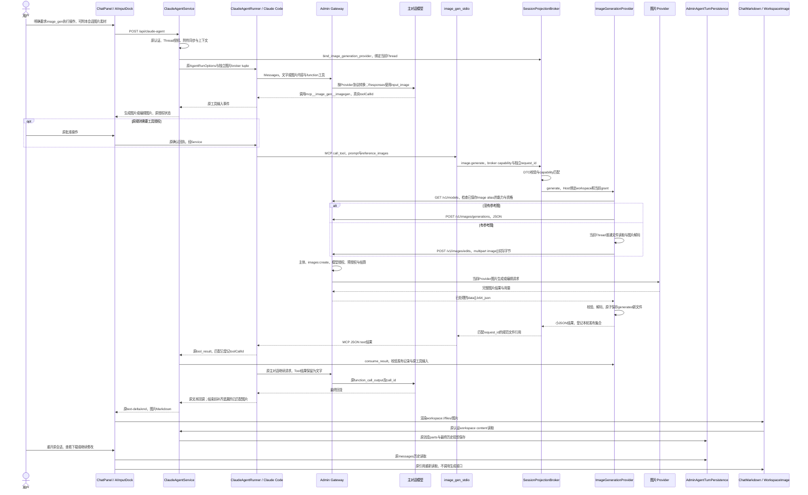
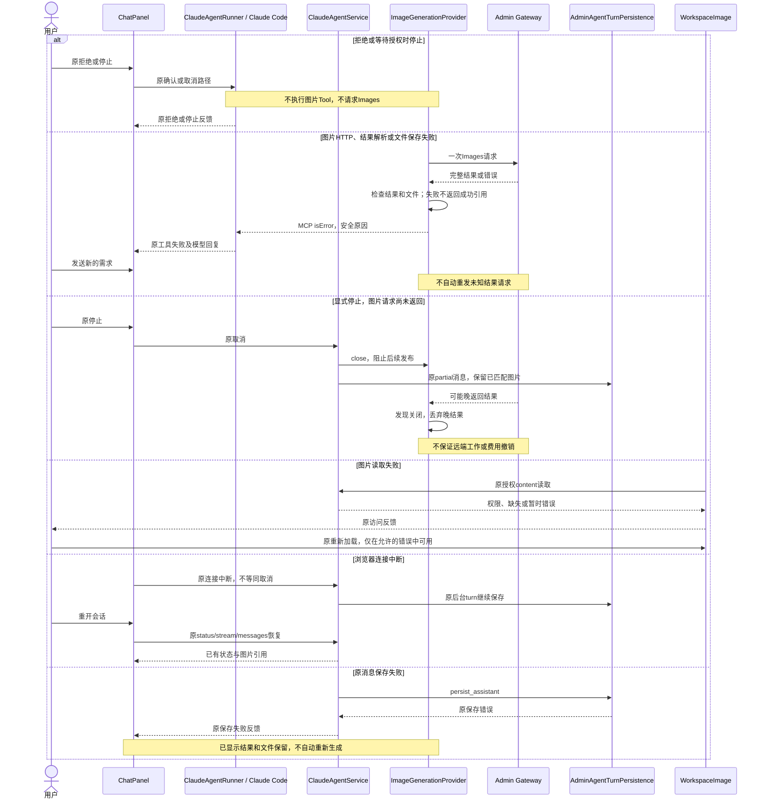
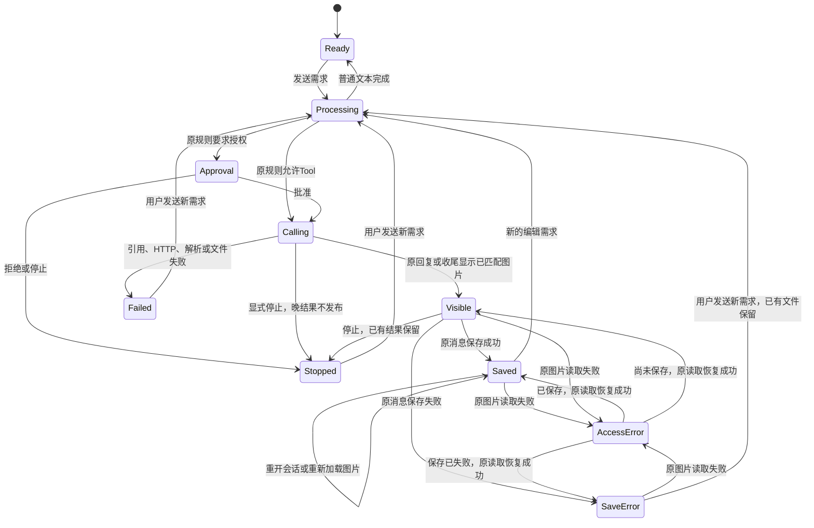

<!-- [Sync] 2026-10-11: round29 两条正常本机图片链路、展示稳定及历史恢复实际通过；unknown usage、原路由与技术故障验证边界单列。 -->
<!-- [Sync] 2026-10-10: 同步独立Image选择和明确调用分工；原稿逐字保留，两条源码路径接通，真实验收尚未完成。 -->
<!-- [Input] 聊天图片业务目的、Codex源码调研、Admin Images合同与本轮IM实现。 -->
<!-- [Output] 产品范围、正常/恢复/状态图、模块职责及验收矩阵。 -->
<!-- [Pos] 聊天图片生成与编辑现行正式设计；PRD拥有页面骨架。 -->
<!-- [Sync] 2026-10-10: 经独立评审进入实施，源码与隔离验证/真实验收分别记录。 -->
# 聊天图片生成与编辑：正式交互设计

当前计量修订以[模型分工专项设计](image-model-call-division.md)的round30为准：Gateway严格读取本次Responses顶层报告Token，沿平台模型价格与原账本结算；完整上游图片费用另记未知。历史round29固定Unknown是实现缺口，不证明Provider未返回usage，旧三条未保留原计数，不能推算或用新调用补账。独立Images分项合同保持。新版本已在正常本机采用，用户取消后的真实重验进行中。

当前状态（2026-10-11 round29）：2026-10-11 round29：两条图片链路已在指定现有账户、本机正常 Dream/Admin/Gateway/PostgreSQL 上完成实际生成、编辑、查看、下载、后续引用及历史重开；草图实际绘制并完成理解和内置编辑，显式 image_gen 在支持内置图片的 AI 下仍仅执行所选 Image 模型。闪烁修复后同图持续39秒稳定，后续真实SSE更新保持原Blob。最终AI恢复 gpt-6.1-sol，Image保留 codex-gpt-image-2；原多来源路由保持不可调用，用户自行选择已核实的非路由AI后才能执行内置图片。内置交付成功，但完整图片用量未报告，保留 RESPONSES_IMAGE_USAGE_UNKNOWN，不能称实际费用已知。故障注入与37项既有跳过的边界见执行记录；独立复核与文档、图示检查已通过；真实故障、跳过和未知用量的边界保持单列。 初次实施和恢复时的未验收文字属于历史阶段，完整原文与索引保留，最新证据见专项执行记录。

**目的：让用户在同一段对话中获得图片、继续修改、查看下载，并在重新打开会话后继续使用。**

[产品需求](../../prd/chat/image-generation.md)说明功能与页面骨架；[实施说明](image-generation-implementation-notes.md)说明具体接口和认证；[本轮执行与验证](../../exec/image-tool-implementation-20261010.md)说明实际交付状态。改写前[完整原稿](image-generation-interaction-design-20261010-implementation-history.md)保留。源码已接入不等于正常服务已部署或真实模型已验收。

本稿的模型用途与调用入口以[专项模型分工设计](image-model-call-division.md)为准；[此次分工修订前原文](image-generation-interaction-design-20261010-model-division-history.md)完整保留。普通图片需求不再默认交给独立工具；主对话内置能力不支持或当前不可调用时明确反馈，不能切换到Images。只有明确要求使用image_gen执行操作时，才使用用户保存的Image模型。上传与草图本身不发起操作。

## 背景与问题

原聊天已有附件、工具过程、工作区图片查看器和历史消息。缺少把文字需求或参考图变成图片的内部工具。用户需要完成一段连续对话，不需要了解图片服务的HTTP接口。

## 目标与边界

覆盖文字生成、当前会话图片编辑、调用反馈、查看下载、保存重开和相应失败恢复。编辑产生新图，原图保留。沿用现有模型选择、附件、授权和停止操作。

本次不增加创作页面、画布、涂抹蒙版、图片管理中心、批量制作、实时预览、后台图片任务或跨会话引用。输入框的“绘制草图”是独立附件功能，不负责调用图片服务。图片交付包含代码与隔离技术验证；正常服务修复激活及文字真实验收见末尾恢复修订，图片真实模型验收尚未执行。

## 概念与规则

- 用户在原输入框描述需求；上传图与原会话图片都可作为参考。
- 图片直接出现在回复中，沿用原查看、缩放、下载与关闭。
- 授权沿用现有工具授权规则，不增加图片专用确认弹窗。
- 停止后，已收到完成回执的图片仍保留；不承诺撤回上游工作或费用。
- 重新加载读取已有文件；再次发送需求才产生新调用和可能的新费用。
- 会话保存与图片可见分别反馈，图片出现不代表消息已保存。
- 图片工具用于已开启工作区且具有图片权限的会话，不自动改变设置。

## 方案结论与证据

采用主对话与图片执行两条链路：Claude Code保持原执行器，主对话经Admin按实际Provider协议转发；内部`image_gen.imagegen`经Admin Images生成或编辑。CLI注册名为`mcp__image_gen__imagegen`。普通图片操作由专项内置分支强制相应`image_generation`；显式image_gen分支不声明内置工具。

| 结论 | 源码证据与状态 |
|---|---|
| Codex独立Images工具执行可作为本方案参考 | [Codex CLI完整链路](codex-cli-image-generation-chain.md)的K1–K19包含真实符号、路径、行号；当前安装App对应版本和UI未观察，不把历史代码当当前界面证据。 |
| Claude Code提供通用MCP执行与工具回调，不能只换Key得到内置图像协议 | [源码对比](codex-image-generation-call-comparison.md)记录Messages调用与工具schema；本轮复用原Runner，不重写CLI。 |
| 内部工具已接入原stdio composition | [agent_runner.py](../../../backend/libs/claude_agent_kit/server/agent_runner.py:3809)，`image_generation_broker_env`；[image_gen_stdio.py](../../../backend/libs/claude_agent_kit/server/image_gen_stdio.py:13)，`create_image_gen_server`。源码已实现。 |
| 生成和编辑复用Admin公开Images | [images.py](../../../backend/services/admin_gateway/images.py:108)，`ImageGenerationProvider.generate`；Admin [image-handler.ts](/Users/dmeck/project/ink-admin-memory/app/lib/gateway/image-handler.ts:391) `handleImageGeneration`391 / `handleImageEdit`419。源码已实现，运行实例能力待正常验收。 |
| 上传图片和Read图片结果均保留视觉输入 | Admin [protocol-adapters.ts](/Users/dmeck/project/ink-admin-memory/app/lib/gateway/protocol-adapters.ts:41) `anthropicContentToOpenAI`；[responses-adapter.ts](/Users/dmeck/project/ink-admin-memory/app/lib/gateway/responses-adapter.ts:61) `responseContent`61 / `responseInput`77；转换为`input_image`，保留call_id；imagegen结果仍为小JSON文字。源码已修订。 |
| 图片展示、下载和历史使用复用原组件 | [ChatMarkdown.tsx](../../../frontend/app/_dream/components/chat/ChatMarkdown.tsx:61) `ChatMarkdown`；[WorkspaceFileReference.tsx](../../../frontend/app/_dream/components/chat/WorkspaceFileReference.tsx:234) `WorkspaceImage`；`AdminAgentTurnPersistence.persist_assistant`；[service.py](../../../backend/claude_agent/service.py:3021) `_complete_image_results`。源码已接入。 |

[OpenAI视觉输入文档](https://developers.openai.com/api/docs/guides/images-vision?api-mode=responses)说明图片输入；[Function calling文档](https://developers.openai.com/api/docs/guides/function-calling)说明工具输出可含图片。图片输入与图像生成是两个功能。本轮已接通内置结果的源码桥接，实际协议观察与真实验收边界见专项执行记录。

## 功能描述与用户流程

| 功能 | 用户获得的能力 |
|---|---|
| 生成图片 | 描述画面，在当前回复中得到图片。 |
| 编辑图片 | 指定当前会话图片与修改要求，得到新图，继续查看原图。 |
| 处理反馈 | 在原过程区看到生成或编辑动作、等待授权、进行中、完成或失败。 |
| 查看下载 | 打开原查看器放大、缩放、下载，关闭后回到聊天。 |
| 历史继续使用 | 重开原会话，查看图片，并继续提出修改要求。 |
| 失败恢复 | 查看失败原因，重新加载已有图或发送新需求。 |

用户明确要求image_gen执行生成或编辑时，Agent使用独立图片工具。讨论工具名称或仅上传素材继续原文字对话。普通图片操作只走可调用的主对话内置能力；相应能力不可调用时说明原因和恢复操作。调用完成后显示图片，按原消息方式保存。后续修改是当前会话中的新需求，不覆盖旧图片。

## 显式Images子流程正常业务时序

图中名称均为当前源码模块；图表示实现流程，不表示真实模型验收已通过。Responses分支仅适用于实际选择的Responses Provider。

## 状态与反馈

| 状态 / 触发 | 执行与输出 | 用户反馈与退出 |
|---|---|---|
| 需求处理中 / 用户发送 | 原发送、上下文与模型请求 | 原聊天反馈；进入调用或原文本完成。 |
| 等待授权 / 原策略要求 | Runner与ToolConfirmationStore | 原批准、拒绝、停止；批准后执行。 |
| 图片调用中 / Tool开始 | stdio→broker→Host→Admin Images | 原工具进行中；收到成功或isError。 |
| 图片可见 / 原回复或turn收尾补齐已匹配的图片 | Service在原文本结束或收尾时补齐、WorkspaceImage读取 | 图片显示，可查看下载；保存独立进行。 |
| 会话已保存 / Admin消息写入成功 | 原parts与history_final_text | 重开原会话继续使用。 |
| Tool失败 / HTTP、解析、引用或文件失败 | 原MCP isError，安全说明 | 原失败反馈；用户可发送新需求。 |
| 图片访问失败 / 原content不可用 | 原权限或文件错误 | 原查看器反馈，允许时重新加载。 |
| 停止 / 用户原停止操作 | 原取消和部分消息保存，Host关闭发布 | 已匹配完成图片保留；晚结果不新增。 |
| 消息保存失败 / 原Admin保存错误 | 原保存错误路径 | 保留可见图片和文件，不声称已保存。 |

进度只说明进行中，不编造百分比，也不增加流式图片预览。

## 异常与恢复时序

## 业务状态转换

状态描述用户这一段需求。图片访问反馈独立于保存结果，恢复读取后仍保留此前的保存状态。连接中断沿用原恢复行为，不另建图片状态机。会话保存失败与图片访问失败不等同生成失败。

## 职责、关联与历史

前端负责原输入、附件、授权、工具过程、图片查看下载与恢复；不接收Provider Key或OAuth bearer。Claude Code负责原模型请求、MCP调用与主对话继续执行。Host负责当前grant、目录选择、参考图读取、Images调用、解码与文件发布。Admin负责主体和scope、模型授权、Provider配置、预授权、结算、消息持久化及所有权。

上传附件经原workspace sync获得规范路径，Router将其映射为同Thread `workspace://files/`引用，ContextBuilder在图片块旁提供此引用。工具不接受actor、thread、模型、绝对路径或凭证参数。相同URI在另一Thread只解析该Thread的文件，不获得原Thread权限。

SDK toolCallId用于原调用/消息关联；broker request_id用于独立Host调用；Gateway Idempotency-Key由服务器turn与request_id生成。三者不要求相等。Service必须匹配本轮登记的内部工具名、原工具输入和Host实际发布结果，才能补齐图片。其他工具输出同kind、冲突名称、未知调用或重复结果均不授予图片归属。

会话只保存原工具消息和规范图片引用，不保存base64、服务器路径或凭证。图片文件存于原持久Thread工作区。后端每次读取沿用认证、Thread所有权、Workspace Mode与路径检查；不增加图片数据库表。停止保留已匹配结果；发布后尚未取得Tool完成回执的文件仍留在工作区，但不被伪装成已完成聊天结果。

## 影响范围、兼容性与验收矩阵

| 场景 | 实现边界 | 验证与边界 |
|---|---|---|
| 生成→显示→保存→重开→编辑 | Host、stdio、Service、原文件与消息 | 新`test_image_generation_tool.py`完整隔离旅程；真实模型未验收。 |
| 上传图片与模型视觉输入 | 原Router/ContextBuilder；Admin两个适配器 | 原上下文回归、新`image-conversation-adapter.test.ts`；普通用户实际视觉质量未验收。 |
| MCP发现与调用 | 原Runner composition及stdio入口 | 实际stdio MCP initialize/tools/list/call_tool；主模型选择工具未真实验收。 |
| 授权、目录与兼容 | generic delegation新hash、images scope、新旧catalog | 原授权/目录/Runner回归；冻结Story/scheduled合同不修改。 |
| 非法引用、符号链接、损坏图片与容量 | 原严格读取、Host解码与描述符发布 | 新否定场景；失败无文件成功回执、无自动重发。 |
| 停止、partial、重复或伪造结果 | 原取消，Host close与结果consume | 新晚结果/已完成结果保留/调用关联测试。 |
| 图片查看、缩放、下载、窄屏和恢复 | 原WorkspaceImage/共享查看器 | 本轮本机Chrome原完整图片/报告回归。 |
| 原文本、工具、媒体消息 | 不扩展SSE/消息Schema；没有图片结果时保留原message-final全文 | 原Service/Runner/Workspace及Admin协议回归；多段纯文字turn检查原全文和parts。 |
| 正常服务联调与真实账户/模型 | 原生产入口与正常Admin数据库 | 本次恢复验证当前会话原文字模型回复OK与历史重开；图片真实模型和计费未验收，详见恢复记录。 |

实施顺序为合同与授权、Tool执行与文件、消息展示与历史、受影响回归及真实验收。本轮图片实现不新增Schema或数据库能力；正常服务修复激活另见恢复记录。图片运行实例须具备已发布Admin Images能力、正确delegation合同、授权范围、图片模型及持久工作区。多图模型且没有明确默认时配置 `INK_IMAGE_MODEL_ALIAS`。

独立设计评审已确认可实施；图片历史final、多段纯文字兼容和停止后的迟到完成回执问题已修订，并通过本轮完整技术回归。最终回执见执行记录，真实账户与模型验收仍单独列明。没有新增独立服务、控制通道、画布或图像数据库，新增能力均对应现有聊天中的图片目的。

## 正常服务恢复修订

文本目录继续遵守Gateway原allowance-only资格，不追加独立Images订阅条件。模型选择409发生在执行前，客户端显示设置恢复说明，用户自行选择后再发送；不自动换模型。生成文件位于Thread `files/generated/`；`workspace://files/generated/a.png`对应公开文件参数`files/generated/a.png`。上传附件同样以`workspace://`加服务器返回的`files/...`构造引用。预览、历史与编辑均读取相同文件，不降低权限或路径校验。

本次完整HTTP隔离E2E和正常文字发送结果见[恢复记录](../../exec/image-service-recovery-20261010.md)。图片真实模型、实际CLI自主选择该工具和上游计费仍未验收，现有状态图不代表这些项目已通过。

## 本轮内置接入修订

两种模型、真实Provider调用身份、原事务互斥、CLI raw图片结果、历史重开和失败恢复以[专项正式设计](image-model-call-division.md)为准。原下文的Images时序保留为该子流程，不能替代专项完整时序。历史图片通过“添加到当前消息”走原上传路径成为当前素材，添加不发起推理。Host注册条件现为原工作区、Gateway Runtime与精确图片合同就绪；Images实际调用另要求images:create，native使用原messages:create资格。
