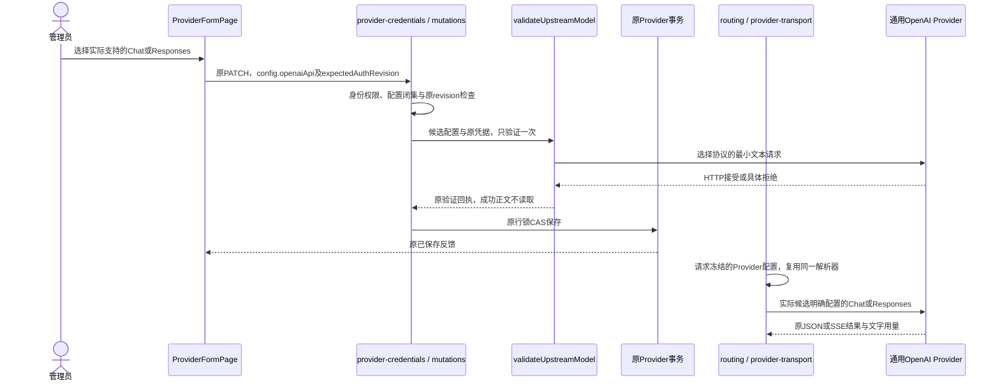
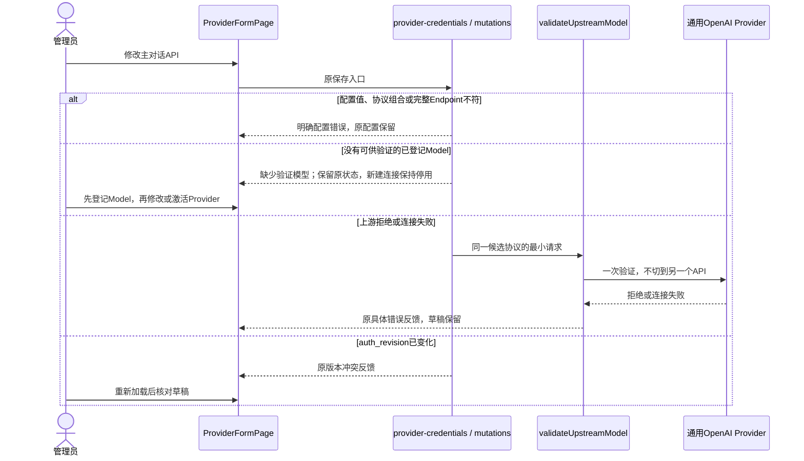
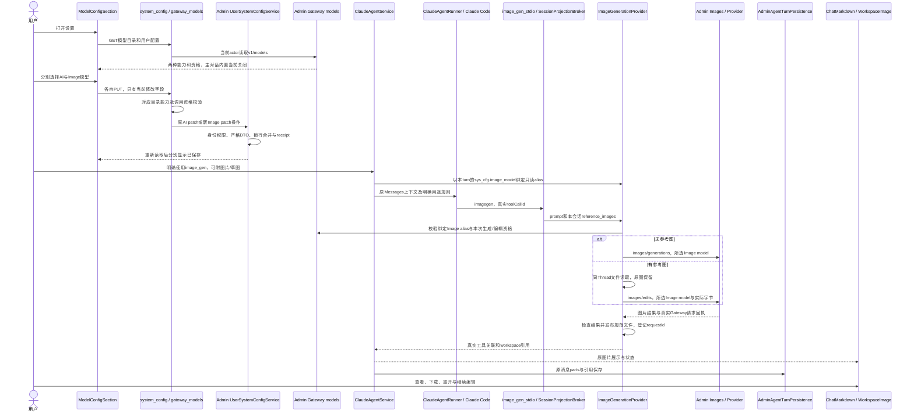
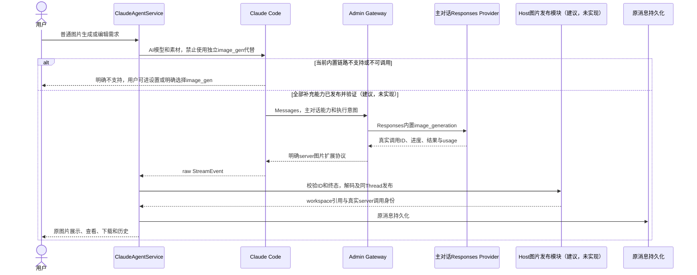
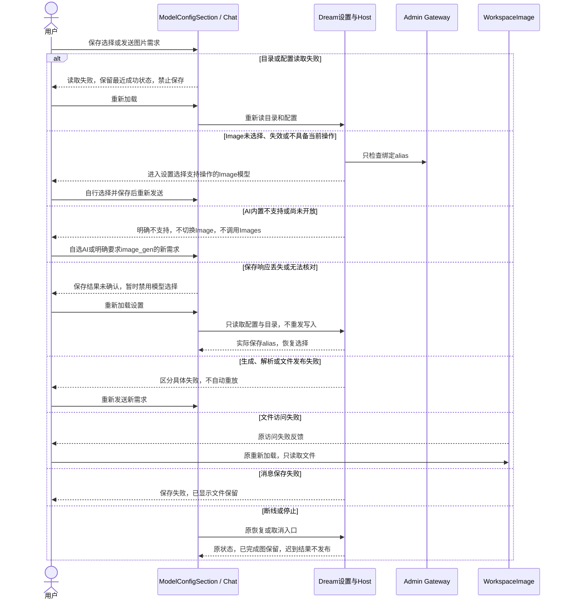
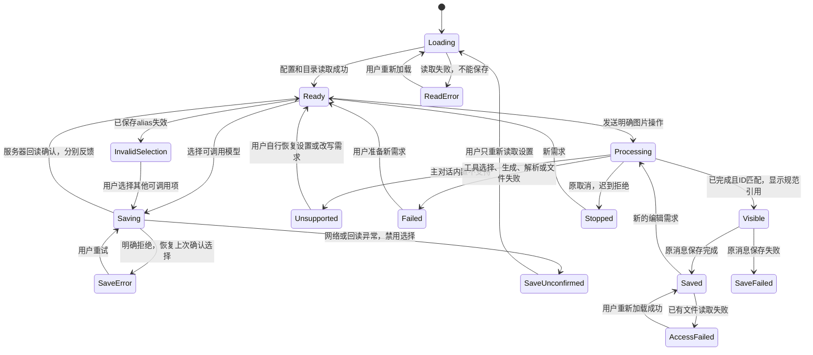
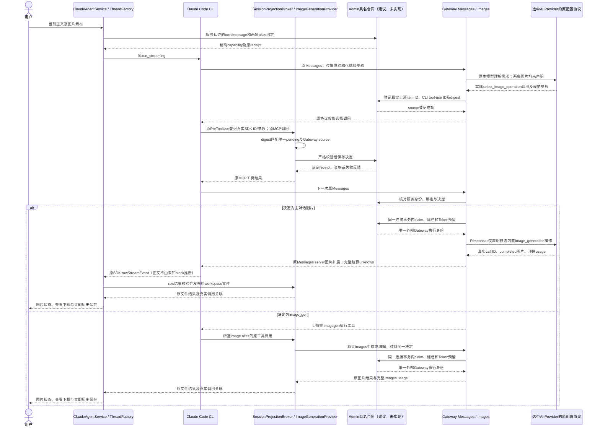
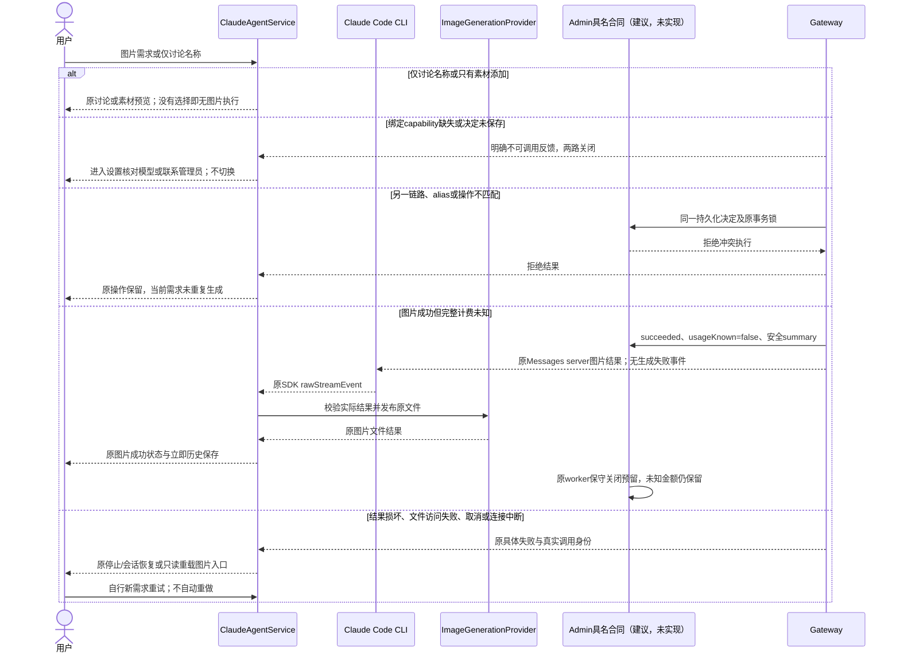
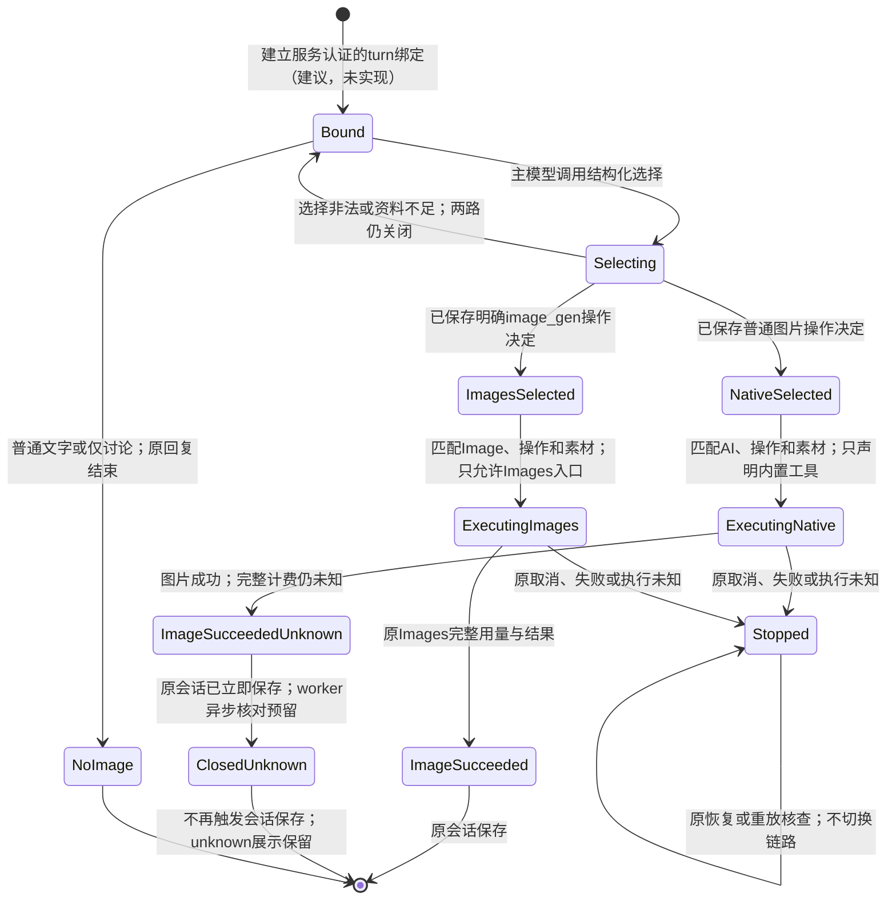

<!-- [Input] 专项PRD、实际CLI/Gateway协议、现有目录/设置/Images/消息/文件模块。 -->
<!-- [Output] 模块分工、正常/异常/状态图、严格合同、失败恢复及验收边界。 -->
<!-- [Pos] 主对话图片与独立Image模型选择现行正式设计。 -->
<!-- [Sync] 2026-10-10: 已独立评审，选择与目录子范围可实施；主对话内置成功路径明确未实现。 -->
# 图片模型选择与调用分工：正式设计

## 背景与问题

[专项PRD](../../prd/chat/image-model-call-division.md)规定用户用途与页面骨架。[执行记录](../../exec/image-model-call-division-20261010.md)提供路径、符号及调查依据。现有Claude Code发送Messages，Gateway仅对特定Provider转换为Responses；图片视觉输入已经支持，内置图片工具声明、事件、结果、历史身份与计费尚未闭合。

## 目标与边界

复用ModelConfigSection、GatewayModelCatalogClient、system-config BFF和Admin原偏好存储，增加Image独立选择并准确公开四种能力。复用ImageGenerationProvider、image_gen_stdio、SessionProjectionBroker、ClaudeAgentService、ChatMarkdown/WorkspaceImage与原持久化。

当前主对话内置能力严格关闭；不使用已有Images勾选替代，不在Gateway偷偷注入内置工具。主对话内置成功时序属于目标，明确标注建议、未实现。模型语义选择需要真实模型验收，提示词与fakeSDK不能证明全部自然语言意图正确。

## 概念与规则

### 配置所有权

| 项 | default | desired | effective | revision与转换 |
|---|---|---|---|---|
| AI模型 | Admin原可调用default_model_alias | 已保存model | 原公开发送入口重新校验的AI alias | 沿用既有偏好合同，无独立revision字段；保存事务串行合并，不新增版本状态机。 |
| Image模型 | 无默认，未选择 | 已保存image_model | 工具执行时同alias且当前Images能力/资格通过 | 严格新写操作和原事务/receipt；只影响之后的工具调用，turn建立后选择冻结；不从AI、env或单个候选推导。 |
| 主对话内置能力 | 关闭 | 当前无可配置能力声明 | responses_image各项false | 必須真实结果协议、文件历史、计费与验收齐备才可新增发布能力；没有任意环境开关。 |

Admin `capabilities.image_generation/image_edit`保持Images语义。`endpoint_availability.images`继续返回generation/edit/configured/entitled/callable。追加`endpoint_availability.responses_image`同结构表达主对话链路的生成、编辑、配置、资格和可调用事实；当前generation/edit/configured/callable为false，entitled沿用Messages当前资格，不增加订阅策略。当前没有上游已支持的未经验证声明，也没有主对话能力勾选。Admin标签说明Images用途。

发布顺序为先Dream接受旧/新endpoint键集合，再Admin公开新字段；旧Dream会拒绝新结构，不能同时部署而略过这个兼容步骤。Dream解析新旧catalog，旧字段缺失只表示未开放主对话图片，不从Images推导。浏览器DTO追加可选images与responsesImage结构；Images-only模型用于imageModels，不进入AI models。后端BFF不暴露reserve/Runtime/env/凭证。严格校验callable必须同时具备configured/entitled和至少一项能力；generation/edit必须与Images能力一致。旧目录继续可供文字发送。

Admin的`modelSupportsConversation`和Dream的`GatewayModel.is_conversation_model`统一分类：原文字能力且未关闭chat继续兼容；带Images能力但未明确声明chat的模型不能成为主对话候选或默认，也不能保存为AI模型或在实际Messages/Chat入口调用。新Image表单默认chat:false。字段缺省的旧目录仍兼容，存在但为null、空对象或错误类型的responses_image则拒绝，不能当作缺省值放行。

### 保存与执行

原十字段`user-system-config.patch`的descriptor/hash不变；新合同单独导出并在dreamOperations尾部追加，保持全部既有operation前缀原样；Handler合并合同查询，Service按实际操作选择DTO。追加严格`user-system-config.patch-image-model`，输入只有合法非空alias `image_model`，OAuth dream:write派生actor，不接受模型凭证、用户ID、路径或任意键。复用原schema capability、Python JSON codec、行锁合并与write receipt。Dream保存前按当前Images目录资格校验，Admin仅负责偏好持久化，实际Images入口重复校验；旧Admin缺操作时fail closed，不以旧patch或本地存储回退。

保存必须有新读取配置中的对应alias确认；HTTP成功但响应不完整、值不一致或网络中断均提示结果未确认，UI恢复上次确认选项并禁用模型选择，提供明确重新读取入口。重新读取成功后显示实际保存值，恢复选择，不自动重发写入。原始写回执使用`image_model_patch_receipt`及Admin原始receipt服务，以新operation/request_id查找原结果，不重新应用配置；明确403/409仍按资格变化重新加载目录。

Service本turn读到sys_cfg.image_model后，在ImageGenerationProvider构造时绑定只读alias；工具执行中修改设置只影响下一次turn。工具从服务器读取的sys_cfg绑定Image alias；调用前只校验这个alias与当前操作，不重新选default。未选择/失效/配置缺失/缺生成或编辑能力返回稳定错误，不发Images HTTP。主对话prompt及工具description说明：普通图片需求不能走image_gen；明确执行才调用，名称讨论与素材添加不调用。当前没有可执行内置工具，因此不会双路执行；未来同时开放时仍须有服务端互斥与真实模型验证，不能仅靠prompt宣称保证。

### 不可用原因与恢复映射

| 判断输入 | 反馈 | 用户恢复 |
|---|---|---|
| 无image_model | 未选择Image模型 | 设置选择并保存后重新发送 |
| alias不在当前目录 | 已保存Image模型失效 | 保留旧选择，重新选可调用项 |
| 当前操作generation/edit=false | 该模型不支持本次生成/编辑 | 选择有对应标记的Image模型 |
| images.configured=false | 图片模型配置未就绪 | 联系管理员或选择其他模型 |
| images.entitled=false | 当前图片调用资格不足 | 查看订阅或选择有资格模型 |
| 原availability为permission_denied/allowance_exhausted等 | 原安全权限/额度反馈 | 处理权限/额度后自行重试 |
| 目录/配置读取失败 | 读取失败，保留最近成功状态 | 重新加载；失败期间禁用保存 |
| 保存响应丢失、解析失败或回读不一致 | 保存结果未确认，保留上次确认选项 | 重新读取设置核对；不自动重发 |
| 本turn无workspace或images:create | 图片工具当前不可用 | 开启原工作区或处理原图片权限后重新发送 |

保存Image选择不等于当前turn已有工具；Service仍只在已有workspace和原images:create授权满足时绑定，不修改工作区关闭、Runner或授权语义。缺工具时主对话说明相应恢复条件。工作区关闭的视觉输入仍为既有缺口，不伪造素材已送模型。

### 未来主对话内置最小补充（建议，未实现）

1. 根据经发布的主对话能力、Provider真实Responses方言和当前执行意图构建内置工具声明；显式image_gen请求必须抑制内置工具，讨论名称不触发任何图片操作。不得用名称正则替代上下文意图。
2. Gateway解析真实image_generation_call id/status/result及进度/终态，JSON与SSE必须一致；不能把它伪造为待本地执行的tool_use。
3. 候选兼容协议是同一个assistant message.id中的server_tool_use和带tool_use_id的图片结果块。初次不含普通最终文本的隔离报文，两轮ResultMessage为error_during_execution，原失败记录保留；补齐普通文本及终态后，本轮安装的真实CLI首次和resume都返回success/is_error=false/end_turn，历史保留调用与图片块，收到两次`/v1/messages?beta=true`且没有本地Images调用。这只验证CLI接受这组隔离协议，不证明真实Responses转换、SDK raw结果发布或图片计费。后三项及真实模型、取消/重放仍未完成，不能开放。
4. Dream在raw事件边界检查类型、ID与终态，把图片字节交原Host解码/目录身份/取消边界发布；公开事件与会话只含规范workspace引用和真实server调用身份。SDK Assistant未知块丢弃问题须处理，不能冒用advisor。
5. 主对话图片预授权、文本与图片用量和价格分别可核验，正文/base64不得进入普通请求报文日志。未满足已有精确schema/capability时关闭，不能runtime补建。

### 主对话上游协议配置前提（源码已实现，本轮验证进行中）

普通OpenAI连接需要管理员明确选择实际上游提供的Chat或Responses协议，不能从凭据、host、Provider名称或型号推断。复用现有Provider表单与`Provider.config.openaiApi`，值为`chat`或`responses`；旧配置缺省为Chat。Anthropic及托管产品不接受这个覆盖：Anthropic保持Messages，Codex/xAI保持产品登记的Responses，Copilot保持Chat。该配置只决定同一AI模型的主对话转发协议，不选择Image模型，不启用内置图片能力，不影响独立Images入口。

| 所有权 | default | desired | effective | revision及恢复 |
|---|---|---|---|---|
| 通用OpenAI主对话API | 缺省Chat | 管理员Provider草稿中的openaiApi | 停用创建时保存配置；激活或敏感更新经原credential-sensitive验证后用于执行，各候选配置在请求路由快照中固定 | 沿用auth_revision/expectedAuthRevision与原CAS；协议变化先做同一协议的一次最小验证，失败保留旧配置，冲突保留草稿并重新读当前版本。 |

`provider-endpoint.ts`共用解析配置和固定API路径，供Admin验证与Gateway transport使用；配置值或协议组合错误直接拒绝。管理员填写完整API路径与选择不符时明确报配置错误，不追加另一套路径或隐式换协议。上游SSRF/HTTPS/host/topology检查保持原边界，托管资源地址仍由产品登记所有。

`protocol-adapters.ts`和`stream-adapters.ts`按这个服务器配置使用既有Responses文字、function与视觉输入转换，`routing.ts`把实际候选冻结的Provider配置传到转换器；`proxy-handler.ts`按实际选中候选的同一快照读取Responses JSON/SSE终态。保持原显式Provider路由策略：允许前置HTTP拒绝后的原候选failover，每个候选使用它自身明确配置的方言；不因报文失败猜另一个API，accepted或执行未知之后不切换。普通OpenAI Responses的store=false，继续使用完整请求历史，不新建远程会话；缺少流Content-Type仍拒绝，只有既有Codex允许无Header的产品SSE。Responses图片结果继续明确拒绝，不能把协议验证成功当作图片能力开放。

配置前提已按独立评审修订后实施；验证回执见专项执行记录。非敏感预检查之后若另一管理员已切换API，原行锁内再次比较本次与当前有效API，拒绝旧草稿写回并返回原版本冲突；不在事务中发起新验证。首次Luna检查的测试fixture和身份断言问题已修订，仍须本轮全部新回执确认。混合Responses图片计费另有明确缺口：现有0078物理字段及response_summary可复用候选不等于已经发布的内置图片合同；主模型和图片工具价格、实际用量、缓存依据、预授权和worker恢复必须分别处理，不能用图片预算、像素或0猜费用。

## 正常业务时序

上传或草图添加发生在发送前的原素材流程，不会进入H/I。原工具授权由既有规则决定，没有图片专属确认。

## 异常与恢复时序

## 状态转换

状态图复用原执行状态，设置保存、图片完成、消息保存与图片访问不是同一事实。连接中断沿用原恢复，不视为取消，不另建图片任务。

## 身份、文件与持久化

imagegen沿用SDK toolCallId、broker requestId、Gateway Idempotency-Key，另从实际HTTP响应`x-request-id`读取gatewayRequestId；它们分别表达不同调用事实。新执行必须获得符合Gateway请求ID合同的req_标识后才能解码与发布；缺少或格式错误反馈IMAGE_GATEWAY_RESPONSE_INVALID，用户凭Gateway记录核对，不自动重发。ImageGenerationResult的可选gatewayRequestId兼容旧v1历史，新执行返回并随原工具output保存。只接受本轮原工具输入和Host登记结果匹配后才能补齐图片，修改Gateway ID的工具结果不能通过登记匹配；不由模型文字或同kind JSON授予文件归属。Image选择是服务器配置，不进入工具参数，不接受actor/thread/absolute path/key。

文件在规范Thread workspace的files/generated内；图片URI为workspace://files/...。访问继续认证、所有权和路径检查；原图不覆盖、符号链接拒绝、取消后晚结果拒绝。消息持久化只保存规范引用与真实工具parts，不保存base64、Provider原文或凭证。内置链路必须另存真实server ID与上游request ID关联，当前未实现，不能套用imagegen的本地toolCallId声称同一个身份。

## 验收矩阵与发布边界

| 需求 | 实现与验证目标 | 状态边界 |
|---|---|---|
| 两项用途与独立保存 | 目录/BFF、设置可见操作、Admin新严格操作和回读 | 本轮源码已实现；隔离回执见执行记录；旧Admin缺操作fail closed，不需Schema。 |
| 四种能力准确标记 | endpoint images和responses_image，不按名称猜 | 当前内置全关闭；可用能力标记需完整执行实现。 |
| 普通需求、显式工具和讨论 | prompt/Tool说明、零自动回退；真实模型意图 | 规则已写入上下文与工具说明，真实模型语义尚未验收。 |
| Images生成/编辑与保存重开 | 原Host/broker/Service/文件/持久化、公开HTTP旅程 | 重跑完整隔离技术验证，真实数据库另列。 |
| 草图添加与实际发送 | 原可见画布和PNG上传、视觉输入/编辑同一文件 | 重跑可见Chrome；关闭工作区视觉缺口保持如实说明。 |
| 主对话Responses生成/编辑成功 | 声明、事件、结果、ID、文件/历史、图片计费 | 建议，未实现，完整专项目标不能完成。 |
| 各类失败、连接、取消与兼容 | 原完整回归及新增选择错误 | 技术验证与正常服务验收分别记录。 |
| 真实业务链路 | 指定现有账户/实体/模型，正常四服务/PostgreSQL/Admin可查 | 当前输入缺失；不询问、不用隔离回执代替。 |

独立评审结论和最终实现/验证状态见执行记录；本稿不将未来成功时序当成已实现或已验收。

### 内置结果与身份前提（源码已实现，执行入口未接入）

[parseResponsesImageResult](/Users/dmeck/project/ink-admin-memory/app/lib/gateway/responses-image-protocol.ts:37)复用独立Images原完整解码器，校验完成态、真实Response/call/HTTP/Gateway身份、输出数量、可选action、格式及规范base64；只返回实际图片与不含正文的安全summary，顶层Token/扩展model字段不能成为图片usage或引擎身份。它尚未接公共入口，不证明认证、source或执行claim已完成。Luna本轮4文件/35合同测试与Admin类型检查均exit0，独立代码评审未发现P1/P2。

Gateway Runtime认证投影同时保留delegation核实的service、auth subject、canonical user、Thread/Run及purpose为immutable `runtimeIdentity`，不传出bearer或token hash，不接受浏览器turn header作为授权；fixed-key/OAuth原投影不变。它是后续绑定的身份输入，尚未发放native执行权限。原Responses适配器仍拒绝未获支持的图片结果，公开Responses图片资格仍关闭。

### 内置图片语义选择与结算增量（实际评审稿，建议，未实现）

普通文字回复或仅讨论图片工具时继续原对话，无图片调用。需要执行图片操作时，所选AI模型先在原CLI工具循环中给出结构化选择：普通需求选择主对话生成或编辑，明确要求image_gen选择独立工具生成或编辑；缺少必要素材或不明确时反馈需要补充的信息。本步骤是模型理解后的实际决定，不按名称正则或上传动作推断，也不是第一条图片请求先到先得。

建议复用`image_gen_stdio`、`SessionProjectionBroker`与Host侧`ImageGenerationProvider`增加内部`select_image_operation`工具（建议，未实现）。首次主对话请求的图片部分只声明这个选择步骤，其他普通工具继续原流程；Gateway不向Provider声明任何图片执行能力；Gateway在解析真实上游选择结果后、向CLI投影前登记上游output-item ID、CLI实际tool-use ID（Responses优先call_id）、规范参数digest及Gateway请求ID；这两个ID分别保存。原PreToolUse hook仅使用SDK实际tool_use_id及实际参数向本turn私有Host登记待执行项，缺少真实ID时拒绝，不使用fallback UUID授权。CLI现有MCP client发送`_meta["claudecode/toolUseId"]`；stdio从原`server.request_context.meta`读取真实ID，不接受工具arguments自报ID授权。Host按绑定、该ID及规范参数digest精确匹配PreToolUse待执行项，再与Gateway source登记匹配；缺meta、伪造、不唯一或未登记均拒绝。broker UUID仍是独立传输身份。Host接收时必须匹配该调用，不能接受任意broker请求自报route。收到合法、持久化决定后，下次原Messages循环只声明获选链路。未知或缺少决定、模型/素材不满足时继续关闭两条执行入口；直接越过选择调用imagegen也失败。步骤可用现有生成状态表示“准备图片”，不展示内部协议或额外确认。

绑定由原Service在`persist_user`后、原`run_streaming`前建立，保留已认证的用户、Thread、普通Chat的null Run、当前用户messageId、Factory实际turnId、选择的AI与Image alias及素材引用。Gateway保留原delegation核实的service/thread/run身份，并以服务所有的绑定核对本次请求；现有未认证的turn hash只能关联，不能独自授权。建议复用原Admin具名operation/receipt的JSONB持久化：bind、source登记、SDK登记与selection决定、execution claim、result关联各自为新增具名、不可变receipt；通过原记录推导状态，不更新原receipt。所有同turn操作采用同一事务锁，唯一决定和执行claim禁止用不同request/body幂等key绕过。Gateway执行claim、原request建档与额度预留必须在同一个真实PostgreSQL事务、同一PoolClient中完成，固定account→turn→幂等/receipt锁顺序；不能把独立Dream Drizzle事务当同一原子操作。复用原数据库凭证/能力检查和原认证，新增helper以同一连接追加原receipt形状，不新增表或控制Runner的HTTP通道；新合同与capability需先由Admin发布。缺少它时Dream停止该功能，不用最近全局migration head判断。

选择、主对话Gateway与Images Gateway均读取同一决定；以现有PostgreSQL事务锁核对并记录执行身份，跨进程有效。Images请求须匹配保存的Image alias和本次操作；内置请求须匹配保存的AI alias、已发布Responses生成/编辑能力和本次操作。已开始的操作不因设置后来变化而换模型。每个turn决定仅允许一个对外执行claim，匹配实际Gateway request ID；相同链路改body/幂等key也不能重复执行。执行后后续Messages不再声明内置图片工具，原执行结果只读恢复。另一链路或修改已开始决定均拒绝，没有自动回退、重发或双路调用。选择工具、调用ID、Gateway request ID和最终文件关联分别保存，不冒用broker或幂等ID；正常、失败和worker终态写入都须保留原summary关联，不能被既有整份summary覆盖丢失。

官方公开的`image_generation_call`有id/result/status/type与少量结果属性，没有逐调用图片usage或返回图片模型身份；顶层ResponseUsage不能用于完整重建图片费用。依据[官方图片指南](https://developers.openai.com/api/docs/guides/image-generation#cost-and-latency)与[官方图片输出schema](https://developers.openai.com/api/reference/typescript/__sdk_schema?declaration=%28resource%29+responses+%3E+%28model%29+response_output_item+%3E+%28schema%29+%3E+%28variant%29+14&selected=%28resource%29+responses)，内置图片成功且图片计费依据缺失时，业务结果成功交付、整条请求完整结算保持unknown；不将图像预算、尺寸、顶层Token或Image选择的价格写成实际图片费用。

建议最小扩展原`finalizeUnknownUsage`和`markGatewayRequestSettlementFailed`允许succeeded/HTTP200及安全summary，保持`usageKnown:false`，首次最小范围仅允许原token_allowance且现金预留为0的调用资格；其他coverage明确不可调用，不假定原worker支持现金结算。AI的服务配置必须提供内置图片输入/输出每图Token预算及操作图片数量边界，预算配置为正安全整数，素材/输出数量及各分项为非负安全整数，纯文字生成的素材数量与输入图片分项允许0；输入素材数量×输入预算、输出数量×输出预算与主对话估算合计均执行精确加乘及安全整数检查，预留总数必须为正；任何缺失或溢出均不可调用。预算只用于预留，不是产品配额或实际usage，也不来自用户Image选择。worker仅沿用原token-only保守预留核对，不能重做Provider。尚未Provider dispatch的资格/claim/预算失败按原拒绝或释放处理，不写usageUnknown保守扣预留。保存真实主模型价格快照，缺少依据的图片价格保持null。安全summary仅含真实Response/call/HTTP/Gateway身份、状态、格式、字节数和hash、未知原因，明确区分配置图片型号与上游未返回型号；不保存base64、prompt、revised_prompt或原始event。该请求及图片结果的通用payload捕获关闭。Product和Admin汇总/筛选在worker结案后仍保持unknown，数据库占位0不得展示成实际免费。

该增量尚未实施；下列状态图为决定建立、冻结、执行及结束的待实施合同，不暗示现在已经开放。没有真实图片计费回执、指定账户或模型观察，现有0078 Images合同也不能等同新的主对话合同。

以上均为待实施稿；新模型需求建立新turn，不在已执行的决定中隐式重选。

### 当前素材的原文件与CLI报文关联（增量设计，尚待完整验收）

上传、草图，以及用户从历史将图片添加到当前消息，均以当前附件参与操作。Host先使用原workspace文件读取边界检查URI、目录身份、文件类型和原字节摘要；服务绑定只保存URI/原文件摘要/附件顺序。Claude Code可重编码或缩放图片，Gateway收到的wire字节因此另有摘要。首次Messages在图片执行关闭时核对当前附件顺序及对应服务生成的URI文本，保存仅包含URI、wire sha256、格式、大小的不可变normalized receipt；不保存图片或正文。后续内置编辑只接受已选URI的相同wire字节，Responses输入只携带这些素材。两种摘要不互相替代。

仅在正文提到历史URI，或模型Read返回一张没有当前绑定关系的图片，不构成新增素材授权。无法建立当前素材关联时，回复明确说明需要将该图片添加到当前消息；用户可从历史图片操作入口添加后重新发送。此恢复没有确认弹窗、图片调用或自动换路。内置生成结果仍保留实际Response/Gateway/call身份；原文件保留，编辑生成新文件。
### 当前消息素材的实际报文边界（2026-10-10 增量，接入中）

Host 在用户消息持久化之后，以保存的 message ID 和服务端 turn key 为 payload 首个文本块添加 `[Ink image materials: <turn_key> <message_id>]`。经过实际 CLI 规范化后，Gateway 只允许该完整首块，或 API 首个 user 消息中一个符合 pinned CLI `prependUserContext` 固定头尾外壳的文本前缀后紧接该完整标记；未知前缀、多个前缀或嵌入正文均拒绝。标记只定位服务端绑定，不单独授予操作权限，不从 tool_result、Read 输出或历史引用寻找素材。随后连续消费绑定数量的 image 与紧邻的 `Reference image for editing: <uri>` 文本对；顺序、重复、缺少标签、插入其他块或额外图片均拒绝。素材之后只接受正文或 CLI 尺寸说明文本；没有素材时仍保留标记及原正文，不能让标记成为消息唯一末块。

首次准备请求在原 account→turn 事务锁内保存 URI、CLI 实际报文图片的 SHA-256、MIME 和字节数；后续请求核对同一集合，异值拒绝。Host 的原文件摘要用于文件读取绑定，Gateway 的摘要用于 CLI resize 之后的报文核对，两者不要求相等。该顺序关联不是 CLI 图片转换的密码学证明；本轮实际 CLI resize 探测须单独提供证据。原生执行剔除转换后历史中的全部图片及内部选择调用，只将本次选择的已核对图片与操作说明加入 Responses 用户输入；未选素材不传入原生图片工具。

缺少标记、绑定或首次核对事实时，两种执行路由均保持关闭，反馈要求重新添加图片并发送新消息；不靠正文路径补充授权，也不重发未知结果的请求。历史图片通过可见“添加到当前消息”进入同一附件流程后，才成为新消息素材。这里的内部摘要事实复用原 receipt 结构，没有新表或数据库权限。

### 接入后兼容修订：历史图片与 GIF

原生结果保留实际 `server_tool_use.id` 与 `image_generation_tool_result.tool_use_id`。Gateway 在后续 Responses 对话中严格配对同一 assistant 消息的图片调用和结果，投影为官方 `image_generation_call` 输入，保留真实 id、完成状态与结果数据；不生成待本地执行的 function 调用。切换至普通 Chat/Anthropic 模型时，以历史图片视觉输入及真实调用标识说明保留可理解内容。该只读历史不授权新图片操作；编辑仍要求用户将图片添加到当前消息。native 专用请求删除历史图片，仅传入本轮获选素材。

原有 GIF 看图继续可用：Host 校验原文件并绑定，Gateway 校验 CLI 实际 wire 格式及摘要。CLI 已转成 PNG/JPEG/WebP 时按实际格式参与操作；仍为 GIF 时，仅保留普通理解。图片操作失败明确提示添加 PNG/JPEG/WebP，不自动转换工具或模型。Images 编辑只接受原接口允许的格式，原图保留。以上为当前实现合同，完整可见和真实模型验收仍须分别取得回执。

主对话原生操作在 selector 回执前，由 `ImageGenerationProvider.select` 回读公开目录并核对本轮固定 AI alias 的对应操作与当前调用资格。不可用时返回可操作的 MCP 错误，主模型仍能完成解释性回复；不写入 native selection、不发生成请求、不强迫 CLI 下一请求进入不能调用的 Responses 分支。Gateway 实际执行仍再次核对配置和原子 claim，不能把目录预检查当执行授权。全局 prompt 已改为调用可用 selector，并对缺少 selector/资格失败明确解释；移除了“集成永远没有原生能力”的过时说明。

已校验的原生历史与本轮素材仅在估算投影中去除编码，并复用服务器 `GATEWAY_IMAGE_INPUT_TOKEN_ESTIMATE`。实际请求数据不变，文字、工具字符串、资源 admission 顺序和真实用量不变。损坏历史在 reservation/上游前返回添加图片到新消息的明确反馈，不能映射为上游模型故障。
