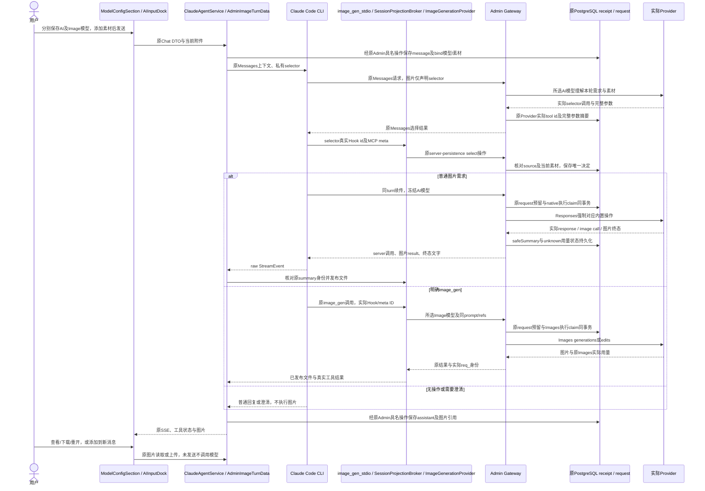
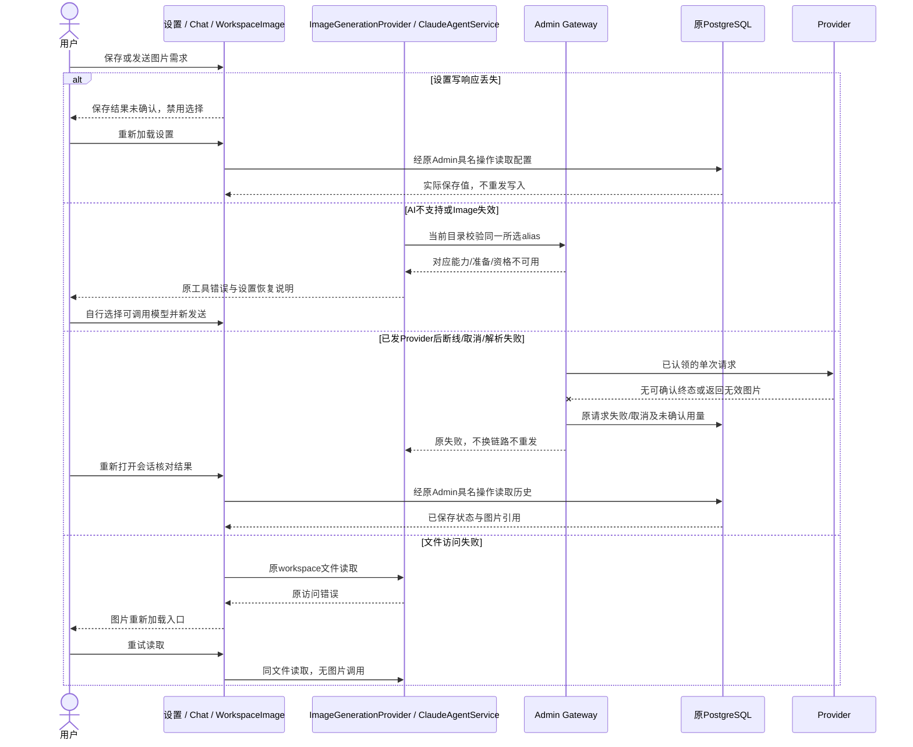
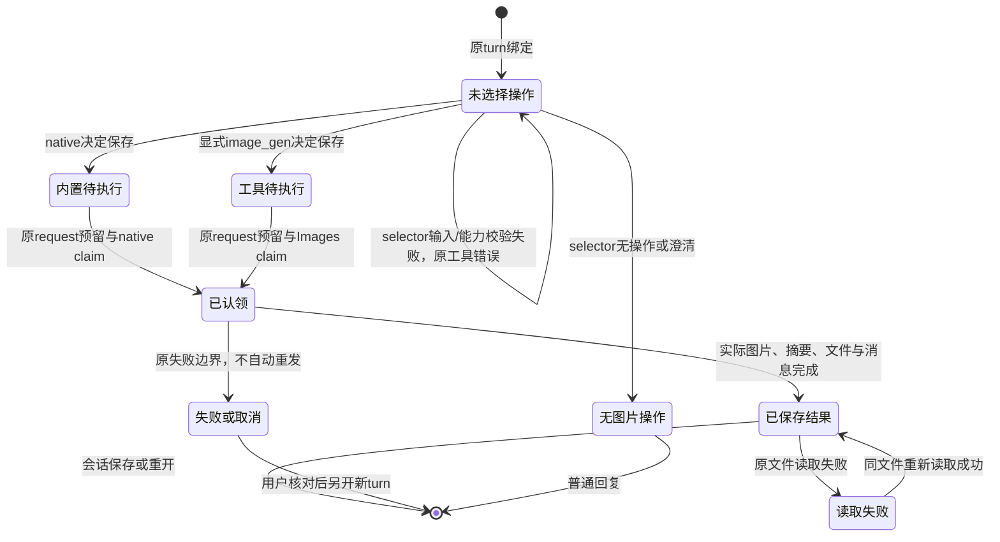
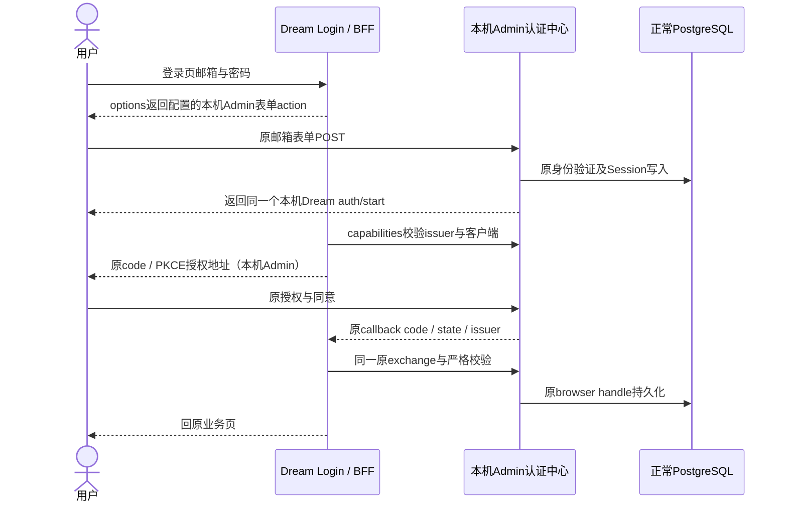
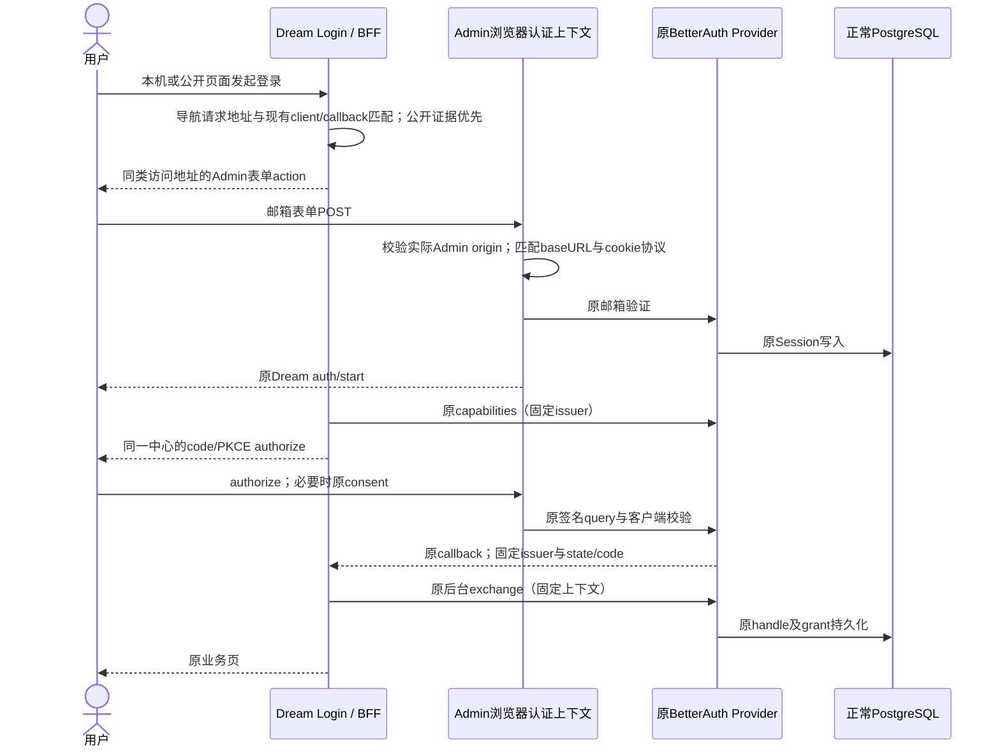
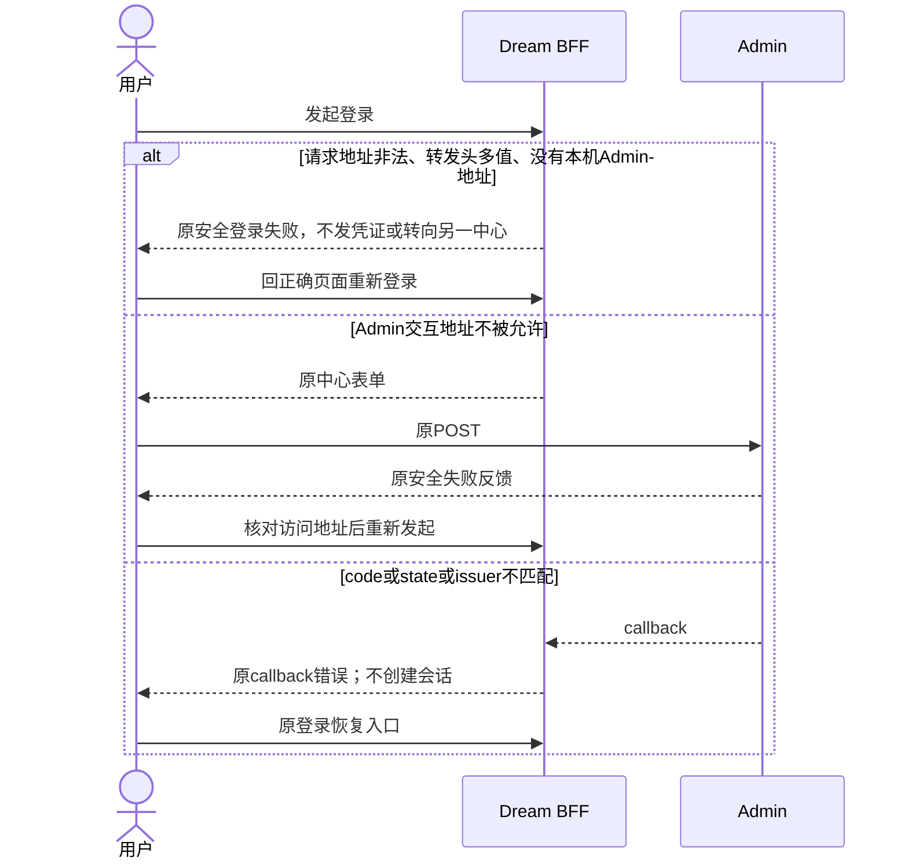
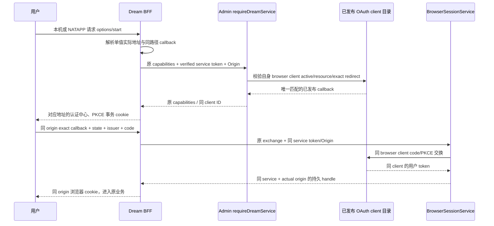
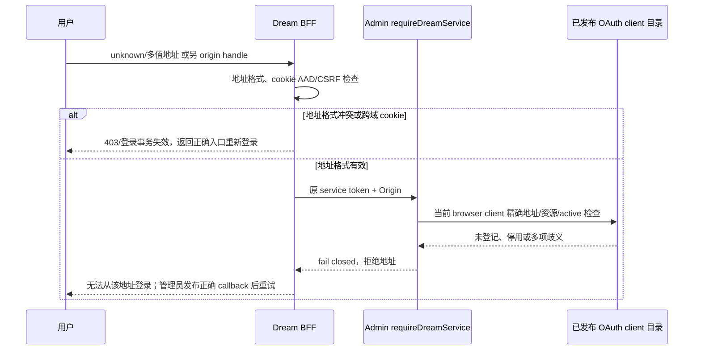
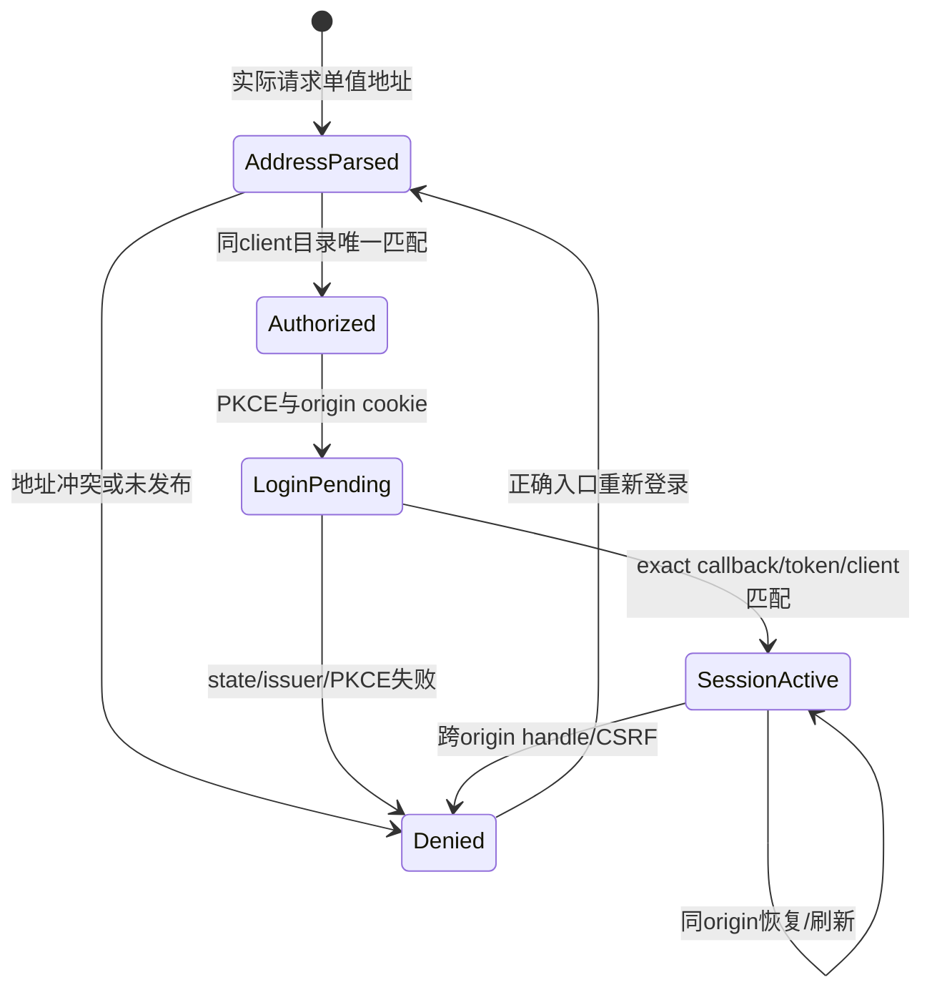

<!-- [Input] 专项PRD、实际CLI报文、Admin精确合同与现有模型/消息/文件模块。 -->
<!-- [Output] 两项模型选择、互斥执行、正常/恢复/状态图与验收边界。 -->
<!-- [Pos] Chat图片业务现行正式设计；完整历史与逐轮回执独立保留。 -->
<!-- [Sync] 2026-10-11: distinguish actual Dream OAuth client-scope failure from Admin operator login evidence; keep schema readiness independent. -->
<!-- [Sync] 2026-10-10: 接通原Messages入口到Responses内置结果及显式Images工具，当前状态以fresh执行回执为准。 -->
# 图片模型选择与调用分工：正式设计

## 背景与问题

[专项PRD](../../prd/chat/image-model-call-division.md)规定用户目的、用途、恢复操作和桌面/窄屏骨架。Claude Code实际向Gateway发送Messages；主对话的Responses转换由Gateway承担，不能把共享地址、API Key或OpenAI名称当成内置工具兼容证明。[执行记录](../../exec/image-model-call-division-20261010.md)区分源码、实际CLI观察、隔离技术验证与真实业务验收。

本轮已经实现两种调用的服务器分工、真实调用身份、结果解码、文件与消息关联。代码接通不等于正常服务已发布或真实模型已验收。旧设计保留于[内置接入复审前完整原文](image-model-call-division-20261010-before-native-review-history.md)，旧时序、接口和测量方法未删除。

## 目标与边界

AI模型负责主对话理解与回复，普通图片需求使用其Responses内置图片能力。Image模型只负责用户明确要求image_gen时的独立Images调用。上传、草图、添加历史图片只是当前消息素材。每个turn最多选择一种图片操作；服务器拒绝跨链路或重复执行，不能仅靠提示词保证互斥。

复用ModelConfigSection、原模型目录、偏好与write receipt、Claude Code、原MCP stdio/broker、ImageGenerationProvider、原消息持久化和WorkspaceImage。未增加创作页面、确认弹窗、后台队列、控制通道或Dream数据库DDL。原Runner/ThreadFactory生命周期、admission判断顺序、资源算法、lease、SSE公开类型、恢复与取消状态机保持；新增的私有Hook和raw内容桥接只负责图片身份与结果。

## 概念与规则

### 配置与公开能力

| 配置 | default | desired | effective | revision与生效 |
|---|---|---|---|---|
| AI模型 | Admin可调用default_model_alias | 用户保存model | 公开发送入口校验并冻结的同一alias | 原偏好合同，无新增revision；本turn冻结，后续turn采用新选择。 |
| Image模型 | 未选择 | 用户保存image_model | 原工具校验同alias的对应Images能力与资格 | 原事务/receipt，无新增revision；本turn冻结，不从AI、env或单个候选推导。 |
| 通用OpenAI主对话API | Chat | Provider.config.openaiApi为chat或responses | 原credential-sensitive验证及CAS后的Provider快照 | 沿用auth_revision/expectedAuthRevision；失败保留旧配置，冲突保留草稿并重新读取。 |
| 图片执行合同 | 缺失则不可执行 | Admin发布dream.image-turn.v1精确version/hash | 原Gateway连接的数据库capability与实际角色权限同时满足 | Admin前向migration 0080登记；不能依赖Drizzle最新head、自动建表或另建高权限pool。 |

Admin模型能力分别为`responses_image_generation`、`responses_image_edit`、`image_generation`、`image_edit`。前两项表示主对话内置生成/编辑，后两项保持独立Images语义。Admin对应四项勾选标签不得混淆用途。

`endpoint_availability.responses_image`和`endpoint_availability.images`均公开generation/edit/configured/entitled/callable。能力表示已发布的操作；configured表示协议、Provider、预算、合同及所需执行准备；entitled表示当前端点资格；callable同时满足准备、资格与对应原可调用条件。主对话native要求generic OpenAI、明确Responses、chat/tools、有效输入/输出预算、无路由策略以及精确合同/原角色权限。它不借用独立图片价格或Images资格。Images保留原Provider、图片价格、预算及独立资格。文字目录沿用原allowance-only资格。

目录先由Dream兼容新旧endpoint键，再由Admin公开新字段。旧目录缺responses_image仅表示未声明主对话图片；显式null或错误结构拒绝。Images-only模型不进入AI选择、默认或Messages/Chat准入；原文字模型兼容。BFF不向浏览器公开reserve、凭证或Runtime配置，AI标记只取responsesImage，Image标记只取images。

两项保存自动生效并回读确认。Image写操作尾部追加`user-system-config.patch-image-model`，原十字段patch及已发布descriptor/hash保持完整原样。网络中断、解析失败或回读不一致提示结果未确认并禁用选择，只重新读取配置，不重发未知写入。失效alias仍显示，用户自主重新选择；不自动回退。

### 操作选择与执行资格

新增私有MCP selector `mcp__image_gen__select_image_operation`由主对话结合上下文给出六种决定：无操作、需要澄清、主对话生成、主对话编辑、显式工具生成、显式工具编辑。精确工具名以源码常量为准；它不出现在用户界面，也不在浏览器做关键词匹配。Prompt说明普通需求与明确工具执行的区别；提及、引用或询问image_gen不能当作执行意图。真实模型的语义准确性仍需真实验收。

Gateway在选择前只提供selector，在显式工具选择后只允许原image_gen，在主对话选择后强制对应内置image_generation；执行认领后两种图片工具均不可再次执行，普通工具保持原行为。它保留上游原始tool ID和完整参数摘要，Host私有PreToolUse记录真实ID/参数，stdio `_meta.claudecode/toolUseId`必须对应同一次Hook，Admin再次匹配原Provider source与参数摘要。不能用broker UUID或事后补默认字段代替真实调用身份。

服务端将本turn、已保存用户message、AI/Image alias、当前素材URI与原文件SHA绑定到同一精确合同。current-material marker只允许当前直接user frame的严格位置，接受实际CLI首轮固定日期前缀；历史、Read、tool_result或转义文本不能成为本轮编辑素材。原文件SHA与CLI resize后的视觉字节SHA分别保存，不要求相等。编辑必须显式引用本消息已添加素材的子集；历史图片先点“添加到当前消息”，走原上传入口后才可以编辑。

Host在保存native决定前检查选中AI模型的当前对应能力/资格。不支持时MCP返回可操作错误，让主对话给出恢复说明；不会先保存不可执行决定而使每次续传都失败。Gateway执行时再次校验，准备/资格变化不能绕过原失败边界。缺capability时不注册新的图片执行路径，普通文字仍走原入口。缺dream schema USAGE时权限检测返回未就绪，而非让整个模型目录报42501。

GIF保留既有视觉理解。独立Images编辑只接受原PNG/JPEG/WebP；当前wire素材仍为GIF时主对话编辑也要求用户另加这些格式，不自动转码或改工具。CLI已把素材转换为支持的视觉格式时记录实际wire摘要并按该格式执行。

## 模块、输入输出和持久化

| 模块 | 输入、判断与输出 |
|---|---|
| ClaudeAgentService / AdminImageTurnData | 原已保存message及当前素材，renewing server-persistence grant绑定相同用户/thread/run；bind/select/result-read使用原receipt服务。未知提交只恢复同一receipt，其他图片写入暂停，普通文字保存不阻塞。 |
| ClaudeAgentRunner / image_gen_stdio / broker | 原实际PreToolUse与MCP meta，完整参数严格校验；selector和生成各自匹配实际source id；不接受浏览器模型、凭证或路径覆盖。 |
| imageTurnService / image-turn-receipts | 原同用户thread/message校验、完整参数SHA、当前素材集合；原锁顺序account→turn→idempotency；append-only facts/audit使用同一事务。 |
| prepare / beginGatewayRequest | 身份、模型、原预授权与预算顺序保持；实际request预留与单次image execution claim在同一原事务提交，其他idempotency竞争者明确拒绝；同idempotency读原请求。 |
| responses-image-proxy | 已冻结AI Provider、当前编辑素材、所选prompt；强制内置对应action，parallel=false、max_tool_calls=1，无路由/托管凭据重试；JSON/SSE严格终态转换。 |
| image-handler / ImageGenerationProvider.generate | 所选Image alias、真实selection/source IDs、同prompt/refs/operation与原文件hash；调用原Images生成JSON或编辑multipart；不调用内置图片。 |
| ClaudeAgentService raw bridge / publish_native | 真server_tool_use及image_generation_tool_result，与同用户原safeSummary的req_/resp_/ig_和输出序号匹配；严格bytes/MIME/hash与目录身份后沿原文件发布。 |
| ChatMarkdown / WorkspaceImage | 规范workspace引用；原图片加载、查看、下载、重试及添加到当前消息；Blob沿原上传链形成新素材，不自动发送。 |

Gateway仅为本轮native选中操作构造`/v1/responses`内置工具，普通文本/普通tool沿原适配。主对话实际路径为IM→CLI `/v1/messages?beta=true`→Gateway转换→上游Responses；独立路径为IM→CLI→image_gen.imagegen→原Host→Gateway Images。CLI本身不直接发送Responses。

native结果保留实际response id、image_generation_call id、outputIndex、operation、真实Provider HTTP请求ID（有则保存）、图片格式/长度/SHA及用量状态。不可从AI模型alias猜内部image model，不把缺失用量当零，不套用独立Images价格。当前新调用沿用原token_allowance资格与现金预留0；原worker按预留保守核对，预留预算不是实际图片用量或金额，结案后仍保留完整费用未确认。原request payload capture关闭；图片正文/base64/提示词不进入安全summary。结果摘要与原unknown-usage transition成功持久化后才向CLI输出；没有实际transition、写入失败或已取消均不发布成功图片。

CLI接收同一assistant中的server_tool_use和图片result及普通终态文字，本地只执行tool_use，不把server操作当本地工具。SDK raw StreamEvent补齐未知图片块；公开ToolEventPayload标记providerExecuted，复用原工具状态。图片结果保存规范文件引用与真实调用身份，旧v1缺可选身份字段仍可恢复，旧tool payload不伪造新身份。

重开CLI历史时，同一assistant内真实server id/result必须配对、单图严格解码，转换为Responses官方`image_generation_call`输入。保持文字/图片先后顺序；切换为Chat或Anthropic时转换为只读视觉输入，不虚构function call；Anthropic count_tokens复用同一已校验视觉投影，不发送扩展图片块。损坏历史在原预留前返回400及“将图片文件添加到新消息后再发送”的恢复说明。token估算仅在已验证native历史/已绑定当前素材时去除encoded字节估算，沿用原视觉预算；普通工具字符串和未验证请求的保守估算保持。

## 正常业务时序

## 异常与恢复时序

## 状态转换与恢复

状态图描述图片认领事实，不新增Run/Thread/SSE状态机。同turn不能从内置待执行换到工具待执行或反向；已认领不能再声明第二次图片执行。未知select提交由原receipt恢复同一input，不能以新id自动重写。

| 失败 | 用户反馈和恢复 |
|---|---|
| 所选AI缺相应能力/当前不可调用 | 明确未执行；设置选择具有对应可调用标记的AI后新发送，或自行选择Image并新提出显式image_gen需求。无候选时直说没有可选能力。 |
| Image未选择/失效/缺对应能力 | 保留保存名称；设置选择支持本次操作且可调用的Image后新发送。 |
| 配置未就绪/合同或角色权限不足 | 服务端未开放本次操作；联系管理员或选择其他可调用模型；普通文字入口保留。 |
| 素材缺失/非当前消息/GIF编辑不支持 | 添加对应PNG/JPEG/WebP到当前消息后重发；原图保留。 |
| source ID/参数/refs不匹配、重复执行 | 当前图片操作拒绝，不换链路；重新打开会话核对后另发需求。 |
| 上游失败、结果解析失败、safeSummary/用量持久化失败 | 原失败反馈，不发布未核验图片，不自动重做；核对历史后用户决定新发送。 |
| 文件发布/消息保存失败 | 原失败状态，不宣称已完整保存；核对会话和文件后再决定重发。 |
| 文件读取失败 | 原重新加载图片，仅重读文件；不产生新请求/结算。 |
| 断线或取消 | 原恢复/停止语义；已发请求保留未确认用量，已完成结果保留；取消后不再发布新结果。 |
| 损坏native历史 | 在预授权前明确400；将可访问图片添加为新消息素材，或新会话继续文字。 |

## 验收矩阵与发布边界

| 场景 | 实现与需要的本轮证据 |
|---|---|
| Admin四项能力→models→AI/Image标记 | 四项勾选与两端点字段已实现；目录/配置/发布/角色技术合同与可见Admin、设置浏览器分别验证。 |
| 两项保存→刷新→分别生效 | 原偏好/严格新patch/回读与两项冻结已实现；可见保存、失效、未知提交恢复及独立调用模型验证。 |
| 普通生成/上传编辑→原图→后续引用/重开 | 强制Responses、严格JSON/SSE、raw结果、原文件与历史已实现；Provider-free公开旅程、实际CLI协议与模型调用验收要分开。 |
| 显式image_gen生成/编辑→无内置重复 | 实际source/Hook/meta匹配及原DB同事务claim已实现；真实CLI/MCP隔离probe、竞争/rollback、浏览器公开旅程验证。 |
| 添加→草图→发送→理解/编辑 | 复用原草图与附件/视觉输入；可见操作验证，不把fake SDK回复当成真实理解。 |
| 不支持/失效/解析/文件访问/连接/取消/重试 | 同alias门禁、稳定错误、原receipt恢复和停止已实现；本轮失败注入与可见恢复证据。 |
| 原文字/普通Tool/媒体/历史 | 原生产入口保持；变更后的兼容检查与历史转换/估算合同，不能沿用旧轮绿色结果。 |
| 正常本机真实业务验收 | 使用指定现有账户及正常Dream/Admin/Gateway/PostgreSQL，从账户页面核对已有实体和可调用模型；账户已提供，实际Dream邮箱入口返回OAuth invalid_scope回调，尚未建立本机会话；capability独立缺失，未执行真实图片调用。 |

历史观察：正常Runtime 0.1.10在2400px视觉输入probe中缺sharp原生包，尚未发送Gateway请求；随后私有同字节CLI修复验证只证明技术行为。当前Runtime 0.1.11已从同一源SHA完成四平台资格、五包生产发布和公开字节检查；本机精确安装、默认resolver/native检查及正常后端新进程身份均通过。已发布CLI通过公开SDK在fake Gateway下观察2400px新会话与同session resume：两次Messages请求、2000px wire图片、server工具结果均成功；该结果仍不是真实模型生成。详情见[0.1.11发布接入回执](../../deploy/runtime-0.1.11-image-native-and-dream-adoption.md)、[Runtime现行设计](/Users/dmeck/project/ink-claude-code-dream/docs/design/single-source-release-and-dream-adoption.md)与[执行记录](../../exec/image-model-call-division-20261010.md)。正常服务缺少精确image-turn capability，Dream登录另在OAuth客户端scope校验失败；未向正常库执行DDL或grant。隔离DB只证明技术合同，发布须遵循expand→Dream兼容→验证→contract，完整真实验收未完成时目标保持未完成。

认证证据范围：Admin管理表单只检查`admin_users`，其密码拒绝不表示Dream用户凭据无效。round24从正常Dream页面配置的邮箱表单实际提交后返回本机`/auth/callback`，错误为`invalid_scope` / `The following scopes are invalid: images:create`，BFF返回`BFF_OAUTH_CALLBACK_INVALID`；未建立本机用户会话。公开及内部transport的OpenID metadata均声明支持该scope；已安装OAuth Provider的authorize模块先按该客户端的`client.scopes`校验请求scope，再处理resource和用户Session，因此不能据此认定密码已通过、provider不支持图片或Schema导致认证错误。建议、未执行的恢复是由现有Admin OAuth客户端目录发布流程核对并同步该配置客户端的scope，再从原Dream入口重新登录；不得按Schema缺失删scope、修改表单action、绕过权限或切换认证环境。Schema发布及图片执行资格仍单独验收。

## 图片过程反馈复审修订（2026-10-11）

图片卡片工具栏的“添加到当前消息”使用完整文字入口，桌面和窄屏都按文字实际宽度显示在一行；文件名在空间不足时省略，预览和下载保持原图标入口。添加入口只创建当前素材，不发送、不触发图片调用。不能直接使用固定图标宽度的按钮样式导致正文逐字换行。

两类图片过程沿用原工具行显示生成/编辑和完成、失败、进行中；成功协议JSON、调用ID和Provider执行字段只保存在内部。实时errorText中的结构化错误只取message；纯文本及历史对象message展示恢复正文。原生providerExecuted图片已经由Provider执行，不产生本地待确认入口；显式image_gen继续原确认策略，标题使用生成/编辑名称。当前turn仍在执行的未完成图片显示“进行中”，确认结束的ID集合不作为执行结束依据；取消或已结束会话中未收到结果的图片显示“未完成”。后端停止与历史保存语义保持。worker恢复实际用量的settlementResolution保留，不被通用已知用量标记覆盖。

可靠用量恢复写入时，数据库旧摘要及 worker 传回摘要中的 unknownReason、resolvedAt 均清除，再保存 usageKnown:true 和对应实际结算结果。图片关联身份保留；完整用量仍未知的成功结果不进入此写入路径。

## 已放弃的静态配置建议（2026-10-11历史原文）

用户要求本机登录进入本机认证中心。通过现有配置，Admin的`BETTER_AUTH_URL`、Dream前后端的`INK_ADMIN_DREAM_BASE_URL`及`INK_ADMIN_AUTH_ISSUER`应共同指向本机Admin；服务端transport继续使用其已配置地址。resource、client/callback、secret、PKCE、issuer/JWKS校验及数据库身份不改变规则。配置一致后，原`createBffHandlers.options/start`自然生成本机表单与授权地址，不新增URL重写、认证代理或环境分支。此为正常运行配置修订，不是隔离fixture；图片结果验收仍待实际登录后的完整旅程。

失败时沿原登录反馈和同一callback恢复；不跳到其他中心作为回退。公开中心520/522观察及初始错配保留执行记录；图片链路未派发时不计为模型失败。两条图片调用时序和状态机保持原稿。

## 现行修订：实际请求地址决定浏览器认证中心（2026-10-11，评审修订后的实施合同）

本机访问与NATAPP公开访问复用同一生产路径。用户从本机页面发起登录，应进入本机Admin；从公开页面发起应进入公开Admin。仍使用已发布的同一个身份、资源与客户端合同。不能以改静态issuer、改环境名、改浏览器测试action或遇错误自动切中心解决。上节静态配置建议从未实施，由本节取代；公开520/522不作为实施短正文修复的依据。

**模块与输入输出**：Dream BFF在`BffLoginBoundary`增加导航专用的canonical请求地址检查：先检查完整且单值的forwarded host/proto，其结果必须精确等于现有Dream callback的origin；没有forwarded时，Host必须精确匹配该origin，或无Host的直接request URL精确匹配。存在缺项、多值、不同origin或未知Host时拒绝，不回落到归一化内网URL。已登记的公开forwarded证据优先于内网request URL；其他API的原origin/CSRF及恢复规则保持。通过后从该客户端origin判断本机访问。公开请求继续使用`AdminBffClient.origin`；本机请求仅在既有`transportOrigin`也为loopback时，复用其scheme/port和该canonical客户端loopback hostname构造本机Admin地址。选择只用于浏览器表单、authorize及device导航；后台transport、客户端secret、callback、resource与稳定issuer不变，不把Next归一化后的内网URL误当公网浏览器地址。新增只读请求地址方法和browser导航方法尚待实施，不增加配置键或端点。中心选择来自请求；已登记client/service/callback合同仍是调用资格边界。当前本机合同只覆盖localhost:5173，127.0.0.1别名或未由此service登记的公网页面在options阶段就拒绝，恢复到对应已登记页面。公开部署既有public service/callback配置在相同代码中按精确公开请求选择公开中心；本轮不声明同一个仅登记local callback的BFF可完成另一个public callback，也不扩大客户端目录。

Admin浏览器入口和官方Provider的交互请求（邮箱登录、authorize、consent、会话、end-session及Google返回）使用同一经过校验的实际Admin请求origin建立短期认证上下文：公开转发头只能对应原已允许的公开中心；loopback地址必须在现有允许origin中且与实际Admin loopback监听端口、协议匹配；拒绝未知、多值或非法地址。`createAdminAuth`的浏览器上下文同时按该origin设置baseURL和Secure cookie。JWT issuer、resource、keys与签名query校验保持固定；token/refresh、JWKS、metadata、userinfo、撤销等后端协议继续原固定上下文，避免改变OpenID token audience。不对请求地址执行新的远程fetch，不使任意Host成为重定向目标。

状态沿用“未登录→原登录事务→中心身份Session→原授权→Dream会话”；中心身份Session不等于Dream会话，也不等于图片请求。任何阶段失败不调用模型、不切换中心或新建账户。验收追加：同Admin静态配置下，已有local client/callback的本机action/authorize保持本机，已有public client/callback的公开forwarded请求保持公开；未登记别名或跨client origin在提交凭证前拒绝，未知Host/多值拒绝；固定issuer/token audience与PKCE严格；正常现有账户登录→真实图片矩阵。旧公开失败和已放弃建议保留历史，不能当作当前采用。

### 同一实例 NATAPP 请求地址补充（2026-10-11，建议、未实现，待独立评审）

背景与问题：当前一份BFF只持有单个服务身份，但同一正常实例由本机与NATAPP边缘访问。只改变Admin URL会留下callback/cookie与session不匹配；不能根据Host把本机身份替换为公开身份。

目标与边界：保留原confidential service ID和原Browser OAuth client ID，由实际地址选择同一client已发布的exact callback。复用同一Dream应用已登记的callback集合；不新增service代理权限、数据库结构、业务scope或配置开关。Admin受控目录发布新增当前client允许的callback，是明确的OAuth地址授权；它不授权另一个client或后台服务。所有目录候选由已有Dream服务登记产生，不猜hostname、不拼未经发布的callback。发布使用原OAuth catalog的定向browser-redirects模式：同一受控事务锁住目标已存在Browser client，检查resource、links及所有非redirect合同未漂移，拒绝删除原允许地址；只更新redirectUris和其updatedAt，回读全部目标行核对其余字段未变，secret/uri/scopes/PKCE/DPoP/device/service/resource/links均不写。原完整publisher的desired也采用同一已登记callback集合，后续完整发布不会收窄本次地址。定向入口只属于现有发布CLI，不增加运行时HTTP或控制通道。

概念与规则：Admin目录default与desired是本Dream应用原已登记callback集合；现有publisher没有独立revision字段，以原受控发布回执及目录fingerprint记录本次采用版本；实际Provider active目录为effective。请求Origin只能选该实际client有效目录中唯一匹配的精确origin与callback path；双方完整callback派生固定使用当前原callback pathname，只替换为选定origin；该完整URI必须同时精确命中原Dream目录登记与当前client实际redirectUris，0项、多项或不同pathname均在options前拒绝。actual service identity/background scopes不变。BFF解析代理完整单值地址（优先于内网URL），生成同origin的host-only cookie、AAD、exact callback与CSRF；原capabilities授权检查必须在options给出密码/Google action前通过。原Admin服务认证在收到Origin时验证当前自身browser client的已发布redirect/resource/active事实，然后只替换本次browser origin/callback，原principal/delegation/Gateway client检查不扩张。无Origin的backend/worker使用原合同。

模块输入输出：OAuth目录publisher从现有Dream应用服务登记取exact callbacks并写原client目录；serviceIdentity消费verified confidential token、标准Origin头、同client实际发布目录，输出同service身份的选定browser地址；BrowserSessionService/Repository沿原origin字段与encrypted bundle保存/解析，不新增字段；Dream BFF逐请求boundary贯穿auth/API/Apps，AdminBffClient保留原token cache/transport，选定Origin是不可变的请求实例上下文，共享transport owner不写入当前origin；两个origin并发请求互不覆盖。所有密码、token仍只进入原Admin，浏览器不获得服务secret。

兼容及验收：原local service/client与local记录保持；backend无Origin、主体与Runtime delegation路径保持。测试矩阵包括同BFF两地址options→start→callback→session→API、cookie互拒、代理优先级、unknown/disabled/unpublished/ambiguous、资源不符、callback pathname不一致、两origin并发不污染、原server issuer/refresh/PKCE。受控目录发布和源实现/隔离测试/真实NATAPP验收必须分别记事实；当前方案尚未实施，不能写成已交付。

同client源码独立评审修订（2026-10-11）：Browser API和Apps只在当前origin的handle cookie存在时使用逐请求地址及Admin发布目录校验；当前cookie即使无效也优先，不能降级为native Bearer。无当前cookie的native Bearer继续使用原canonical BFF origin合同，不新增Admin查询或改变Python token验证。未知origin的native请求仍拒绝。当前BFF只支持原Bearer token，实际自身client的dpopBoundAccessTokens及resource的dpopBoundAccessTokensRequired必须明确为false；runtime目录查询与定向callback发布前置都只读检查，不支持或缺失状态拒绝，不写这些字段、不放宽JWT的cnf拒绝。独立评审另发现CLI union返回类型推断和测试DTO引用错误；仅修调用类型与测试真实DTO，保留初次失败回执。

恢复报文实测补充（2026-10-11，诊断设计已独立评审、源码待验证）：正常既有Thread采用新Gateway后首条纯文字在素材检查返回409 IMAGE_MATERIALS_MISMATCH；正常绑定与实际SDK JSONL的marker完全相等、素材数0。新隔离实际CLI0.1.11两turn协议与生产currentImageMaterials却成功，不能把JSONL或隔离fixture当成正常wire。最小下一步在原素材校验失败处记录固定检查阶段及非正文计数，用正常同账户公开发送重现并核实实际分支。诊断不记录marker、用户/会话身份、文本、URI、base64、prompt或credential，不返回这些诊断给页面，不放宽原校验或改变图片/预留/结算/Runner行为；没有HTTP/debug控制通道。取得正常分支证据后才设计解析修订。当前普通文字恢复尚未验收，不能声称新Gateway已通过业务兼容。

独立诊断设计评审无新增P1/P2：reason采用封闭枚举、统计采用逐项数值字段白名单；不把body、binding或Error传入logger。原私有日志写入为best-effort，sink异常仍抛原409，成功不增加逐请求日志。当前七处失败出口的素材与历史判断保持，诊断源码尚待技术资格及正常实际请求证据。
