<!-- [Sync] 2026-10-12: round33 normal Admin visible gate closed for seven real requests; prior failures and unknown cancellation usage remain; final review and Git delivery are separate. -->
<!-- [Sync] 2026-10-12: round30 官方报告用量修订、六项真实图片结算与重开、独立复核修订和精确发布回执；历史及未验收范围保留。 -->
<!-- [Input] 专项PRD、实际CLI报文、Admin精确合同与现有模型/消息/文件模块。 -->
<!-- [Output] 两项模型选择、互斥执行、正常/恢复/状态图与验收边界。 -->
<!-- [Pos] Chat图片业务现行正式设计；完整历史与逐轮回执独立保留。 -->
<!-- [Sync] 2026-10-11: round29 两条正常本机图片链路、展示稳定及历史恢复实际通过；unknown usage、原路由与技术故障验证边界单列。 -->
<!-- [Sync] 2026-10-10: 接通原Messages入口到Responses内置结果及显式Images工具，当前状态以fresh执行回执为准。 -->
# 图片模型选择与调用分工：正式设计

当前计量以正文round30修订为准：顶层有效报告Token沿原账本结算；平台单价按现有价格中心（含 models.dev 同步、审核与发布）取得。上游实际账单属于未公开黑盒，不在本专项验收范围。round29固定Unknown与旧三条错误归因保留为历史事实，不代表上游没有报告usage。

## 背景与问题

[专项PRD](../../prd/chat/image-model-call-division.md)规定用户目的、用途、恢复操作和桌面/窄屏骨架。Claude Code实际向Gateway发送Messages；主对话的Responses转换由Gateway承担，不能把共享地址、API Key或OpenAI名称当成内置工具兼容证明。[执行记录](../../exec/image-model-call-division-20261010.md)区分源码、实际CLI观察、隔离技术验证与真实业务验收。

本轮已经实现两种调用的服务器分工、真实调用身份、结果解码、文件与消息关联。代码接通不等于正常服务已发布或真实模型已验收。旧设计保留于[内置接入复审前完整原文](image-model-call-division-20261010-before-native-review-history.md)，旧时序、接口和测量方法未删除。

## 目标与边界

AI模型负责主对话理解与回复，普通图片需求使用其Responses内置图片能力。Image模型只负责用户明确要求image_gen时的独立Images调用。上传、草图、添加历史图片只是当前消息素材。每个turn最多选择一种图片操作；服务器拒绝跨链路或重复执行，不能仅靠提示词保证互斥。

复用ModelConfigSection、原模型目录、偏好与write receipt、Claude Code、原MCP stdio/broker、ImageGenerationProvider、原消息持久化和WorkspaceImage。未增加创作页面、确认弹窗、后台队列、控制通道或Dream数据库DDL。原Runner/ThreadFactory生命周期、admission判断顺序、资源算法、lease、SSE公开类型、恢复与取消状态机保持；新增的私有Hook和raw内容桥接只负责图片身份与结果。

## 概念与规则

### Codex 上游内置图片核实（核实规则与实际结论分开）

核实前 Codex Provider 只公开已有 Responses 文字/函数转换与独立 Images 资源；该阶段不能凭 `image_gen.imagegen` 广告或结果解析结构认定 hosted `image_generation` 已支持。round29已通过实际固定请求核实当前两个Provider的完整生成结果，并分别发布所需能力；现有非路由模型的真实主对话生成和编辑已另行完成。正常账户 Images 资格的开通也不开放主对话 native。先通过现有 Admin 模型卡片新增“核实 Responses 图片生成”操作，沿原 `POST /api/admin/models/{id}/validate`；无 body 保持原文字验证，严格可选 `validationKind=responses_image_generation` 仅选择服务器固定的一次生成核实。它不接受任意请求正文、endpoint、Header、素材路径或模型替换，也不自动写能力勾选。

复用原 Origin、models.write、loadModel、Provider-owned 凭据及模型 Header；仅 Codex 或明确 generic OpenAI Responses 连接可执行。原模型验证请求 deadline 保持；图片核实使用 Provider 已有 timeout 与 Images 原有 response byte/image decode 限制。Codex 请求沿原 adapter 固定 stream/store/include，声明一个 `image_generation`，使用字符串 `tool_choice=auto`；不添加尚未证明支持的action/choice对象/max_tool_calls字段。提示固定为单张简单图，只有完整 completed、一个真实 image_generation_call、完整可解码字节才能报告本次生成核实成功；SSE的ID与output_index必须一一匹配并与terminal一致，完整解码后仍未超时，真实response/call ID不能回显Provider凭据。最多一次 dispatch，不重试、不转 Images；Header缺失的Codex SSE沿既有兼容条件读取。复用原 Responses state/有界读取/图片解码，将公共解析原语抽取为无Gateway绑定的结果解析与原Gateway身份summary包装，不能给验证结果伪造Gateway request。

返回与审计只保存 validationKind、HTTP/状态/耗时和实际 response/call ID、字节数/SHA等安全摘要，不保存提示或图片正文。失败保留原模型发布状态，显示服务器固定失败分类与恢复说明，以及闭集安全code/type；不返回Provider自由文本message/detail/text或原始解码异常；200但无完整图片属于核实失败，不当能力支持。该 Admin 验证不是 Dream 图片 E2E，也不证明编辑；真实成功后才能基于实际形状评审最小 Codex native bridge、单独发布生成/编辑能力和执行正常Chat验收。若拒绝，只记录该模型/当前Provider/请求形状的事实，不宣称所有Codex版本都不支持。

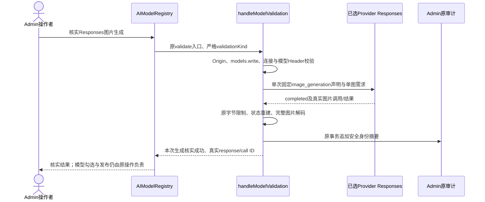

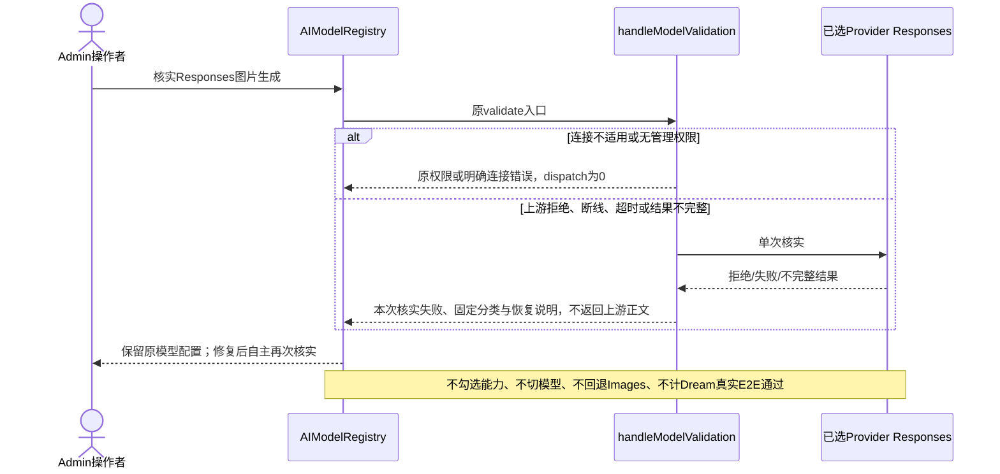

验收增量：默认文字验证行为不变；严格kind拒绝额外payload；原权限/Origin/托管Header/无Secret审计成立；2xx空/文字/无terminal/多图/损坏图片失败；合法JSON/SSE单图完整核实成功；超限/超时取消资源；正常本机可见操作获得实际Codex结果后再决定native最小处理范围。此增量无需Schema、Runtime、Runner或资源策略变化。

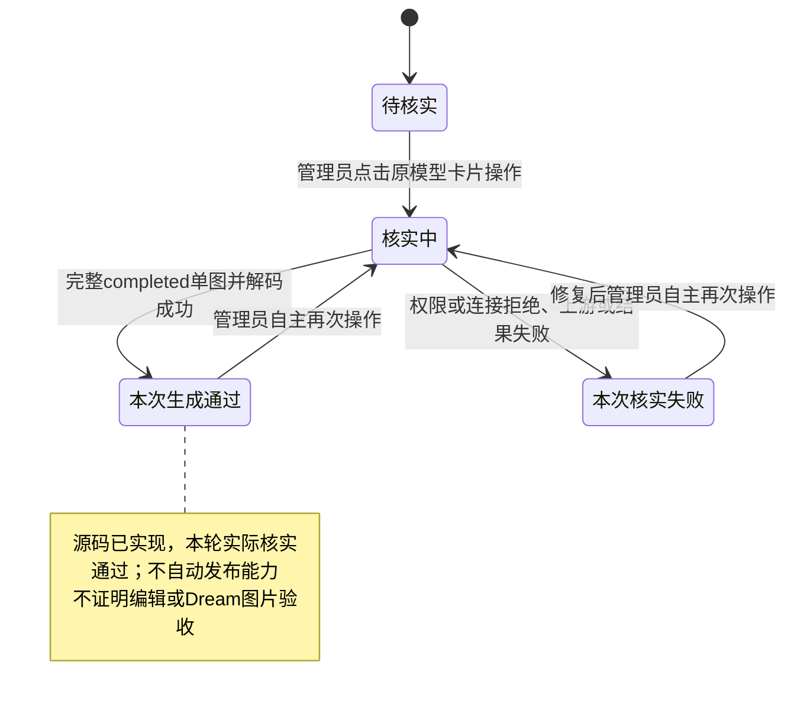

### 配置与公开能力

| 配置 | default | desired | effective | revision与生效 |
|---|---|---|---|---|
| AI模型 | Admin可调用default_model_alias | 用户保存model | 公开发送入口校验并冻结的同一alias | 原偏好合同，无新增revision；本turn冻结，后续turn采用新选择。 |
| Image模型 | 未选择 | 用户保存image_model | 原工具校验同alias的对应Images能力与资格 | 原事务/receipt，无新增revision；本turn冻结，不从AI、env或单个候选推导。 |
| 通用OpenAI主对话API | Chat | Provider.config.openaiApi为chat或responses | 原credential-sensitive验证及CAS后的Provider快照 | 沿用auth_revision/expectedAuthRevision；失败保留旧配置，冲突保留草稿并重新读取。 |
| 图片执行合同 | 缺失则不可执行 | Admin发布dream.image-turn.v1精确version/hash | 原Gateway连接的数据库capability与实际角色权限同时满足 | Admin前向migration 0080登记；不能依赖Drizzle最新head、自动建表或另建高权限pool。 |

Admin模型能力分别为`responses_image_generation`、`responses_image_edit`、`image_generation`、`image_edit`。前两项表示主对话内置生成/编辑，后两项保持独立Images语义。Admin对应四项勾选标签不得混淆用途。

`endpoint_availability.responses_image`和`endpoint_availability.images`均公开generation/edit/configured/entitled/callable。能力表示已发布的操作；configured表示协议、Provider、预算、合同及所需执行准备；entitled表示当前端点资格；callable同时满足准备、资格与对应原可调用条件。主对话native要求Codex managed Responses或generic OpenAI明确Responses、chat/tools、有效输入/输出预算、无路由策略以及精确合同/原角色权限。它不借用独立图片价格或Images资格。Images保留原Provider、图片价格、预算及独立资格。文字目录沿用原allowance-only资格。

目录先由Dream兼容新旧endpoint键，再由Admin公开新字段。旧目录缺responses_image仅表示未声明主对话图片；显式null或错误结构拒绝。Images-only模型不进入AI选择、默认或Messages/Chat准入；原文字模型兼容。BFF不向浏览器公开reserve、凭证或Runtime配置，AI标记只取responsesImage，Image标记只取images。

两项保存自动生效并回读确认。Image写操作尾部追加`user-system-config.patch-image-model`，原十字段patch及已发布descriptor/hash保持完整原样。网络中断、解析失败或回读不一致提示结果未确认并禁用选择，只重新读取配置，不重发未知写入。失效alias仍显示，用户自主重新选择；不自动回退。

### 操作选择与执行资格

新增私有MCP selector `mcp__image_gen__select_image_operation`由主对话结合上下文给出六种决定：无操作、需要澄清、主对话生成、主对话编辑、显式工具生成、显式工具编辑。精确工具名以源码常量为准；它不出现在用户界面，也不在浏览器做关键词匹配。Prompt说明普通需求与明确工具执行的区别；提及、引用或询问image_gen不能当作执行意图。真实模型的语义准确性仍需真实验收。

Gateway在选择前只提供selector，在显式工具选择后只允许原image_gen，在主对话选择后只声明内置image_generation（generic强制对应操作；Codex沿已核实auto）；执行认领后两种图片工具均不可再次执行，普通工具保持原行为。它保留上游原始tool ID和完整参数摘要，Host私有PreToolUse记录真实ID/参数，stdio `_meta.claudecode/toolUseId`必须对应同一次Hook，Admin再次匹配原Provider source与参数摘要。不能用broker UUID或事后补默认字段代替真实调用身份。

服务端将本turn、已保存用户message、AI/Image alias、当前素材URI与原文件SHA绑定到同一精确合同。current-material marker要求唯一直接user frame中的完整独立text block；CLI合并恢复前缀不授权本轮素材，marker之后才按原绑定数量检查image/label pairs。历史、Read、嵌套tool_result或拼接文本不能成为本轮编辑素材。原文件SHA与CLI resize后的视觉字节SHA分别保存，不要求相等。编辑必须显式引用本消息已添加素材的子集；历史图片先点“添加到当前消息”，走原上传入口后才可以编辑。

Host在保存native决定前检查选中AI模型的当前对应能力/资格。不支持时MCP返回可操作错误，让主对话给出恢复说明；不会先保存不可执行决定而使每次续传都失败。Gateway执行时再次校验，准备/资格变化不能绕过原失败边界。缺capability时不注册新的图片执行路径，普通文字仍走原入口。缺dream schema USAGE时权限检测返回未就绪，而非让整个模型目录报42501。

GIF保留既有视觉理解。独立Images编辑只接受原PNG/JPEG/WebP；当前wire素材仍为GIF时主对话编辑也要求用户另加这些格式，不自动转码或改工具。CLI已把素材转换为支持的视觉格式时记录实际wire摘要并按该格式执行。

## 模块、输入输出和持久化

| 模块 | 输入、判断与输出 |
|---|---|
| ClaudeAgentService / AdminImageTurnData | 原已保存message及当前素材，renewing server-persistence grant绑定相同用户/thread/run；bind/select/result-read使用原receipt服务。未知提交只恢复同一receipt，其他图片写入暂停，普通文字保存不阻塞。 |
| ClaudeAgentRunner / image_gen_stdio / broker | 原实际PreToolUse与MCP meta，完整参数严格校验；selector和生成各自匹配实际source id；不接受浏览器模型、凭证或路径覆盖。 |
| imageTurnService / image-turn-receipts | 原同用户thread/message校验、完整参数SHA、当前素材集合；原锁顺序account→turn→idempotency；append-only facts/audit使用同一事务。 |
| prepare / beginGatewayRequest | 身份、模型、原预授权与预算顺序保持；实际request预留与单次image execution claim在同一原事务提交，其他idempotency竞争者明确拒绝；同idempotency读原请求。 |
| responses-image-proxy | 已冻结AI Provider、当前编辑素材、所选prompt；generic强制对应action/max_tool_calls；Codex只用已核实image_generation/auto与原stream/store/include。两者parallel=false、单请求单图、无路由/凭据重试；JSON/SSE真实ID和严格终态转换。 |
| image-handler / ImageGenerationProvider.generate | 所选Image alias、真实selection/source IDs、同prompt/refs/operation与原文件hash；调用原Images生成JSON或编辑multipart；不调用内置图片。 |
| ClaudeAgentService raw bridge / publish_native | 真server_tool_use及image_generation_tool_result，与同用户原safeSummary的req_/resp_/ig_和输出序号匹配；严格bytes/MIME/hash与目录身份后沿原文件发布。 |
| ChatMarkdown / WorkspaceImage | 规范workspace引用；原图片加载、查看、下载、重试及添加到当前消息；Blob沿原上传链形成新素材，不自动发送。 |

Gateway仅为本轮native选中操作构造上游Responses内置工具（generic使用配置的`/v1/responses`；Codex使用原managed `/backend-api/codex/responses`），普通文本/普通tool沿原适配。主对话实际路径为IM→CLI `/v1/messages?beta=true`→Gateway转换→上游Responses；独立路径为IM→CLI→image_gen.imagegen→原Host→Gateway Images。CLI本身不直接发送Responses。

native结果保留实际response id、image_generation_call id、outputIndex、operation、真实Provider HTTP请求ID（有则保存）、图片格式/长度/SHA及用量状态。不可从AI模型alias猜内部image model，不把缺失用量当零，不套用独立Images价格。当前新调用沿用原token_allowance资格与现金预留0。有效的顶层报告用量进入原Known结算，结算暂时失败保留actual_usage_pending供原worker恢复；缺失或无效计数进入原Unknown核对，预留预算不代表实际图片用量或金额。完整上游图片费用未报告时仍未确认。原request payload capture关闭；图片正文/base64/提示词不进入安全summary。有效报告计数须在结果摘要持久化且Known结算成功后才向CLI输出成功图片；Known结算失败保留actual_usage_pending并返回原错误，由原worker恢复结算，不发布新成功图片。缺失或无效计数仅在原Unknown transition与结果摘要成功持久化后沿原图片交付；没有实际transition、写入失败或已取消均不发布成功图片。

CLI接收同一assistant中的server_tool_use和图片result及普通终态文字，本地只执行tool_use，不把server操作当本地工具。SDK raw StreamEvent补齐未知图片块；公开ToolEventPayload标记providerExecuted，复用原工具状态。图片结果保存规范文件引用与真实调用身份，旧v1缺可选身份字段仍可恢复，旧tool payload不伪造新身份。

重开CLI历史时，同一assistant内真实server id/result必须配对、单图严格解码，转换为Responses官方`image_generation_call`输入。保持文字/图片先后顺序；切换为Chat或Anthropic时转换为只读视觉输入，不虚构function call；Anthropic count_tokens复用同一已校验视觉投影，不发送扩展图片块。损坏历史在原预留前返回400及“将图片文件添加到新消息后再发送”的恢复说明。token估算仅在已验证native历史/已绑定当前素材时去除encoded字节估算，沿用原视觉预算；普通工具字符串和未验证请求的保守估算保持。

## 正常业务时序

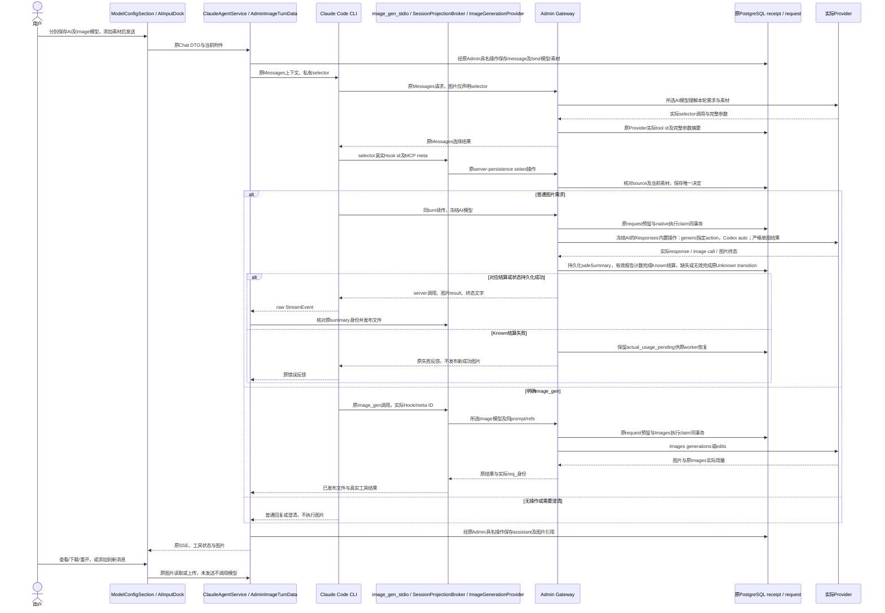

## 异常与恢复时序

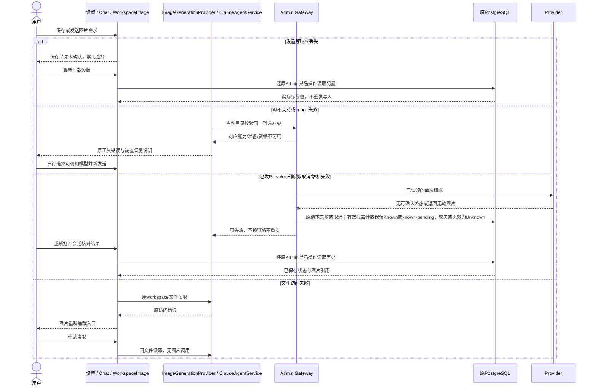

## 状态转换与恢复

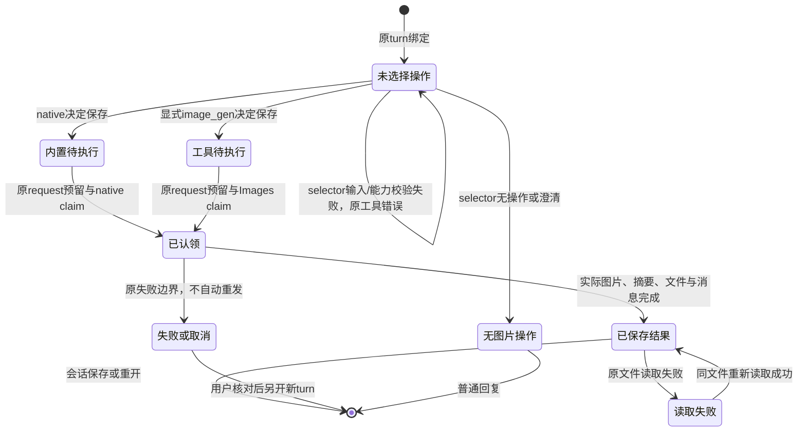

状态图描述图片认领事实，不新增Run/Thread/SSE状态机。同turn不能从内置待执行换到工具待执行或反向；已认领不能再声明第二次图片执行。未知select提交由原receipt恢复同一input，不能以新id自动重写。

| 失败 | 用户反馈和恢复 |
|---|---|
| 所选AI缺相应能力/当前不可调用 | 明确未执行；设置选择具有对应可调用标记的AI后新发送，或自行选择Image并新提出显式image_gen需求。无候选时直说没有可选能力。 |
| Image未选择/失效/缺对应能力 | 保留保存名称；设置选择支持本次操作且可调用的Image后新发送。 |
| 配置未就绪/合同或角色权限不足 | 服务端未开放本次操作；联系管理员或选择其他可调用模型；普通文字入口保留。 |
| 素材缺失/非当前消息/GIF编辑不支持 | 添加对应PNG/JPEG/WebP到当前消息后重发；原图保留。 |
| source ID/参数/refs不匹配、重复执行 | 当前图片操作拒绝，不换链路；重新打开会话核对后另发需求。 |
| 上游失败、结果解析失败、safeSummary/用量持久化失败 | 原失败反馈，不发布未核验图片，不自动重做；核对历史后用户决定新发送。 |
| 文件发布/消息保存失败 | 原失败状态，不宣称已完整保存；核对会话和文件后再决定重发。 |
| 文件读取失败 | 原重新加载图片，仅重读文件；不产生新请求/结算。 |
| 断线或取消 | 原恢复/停止语义；已收到有效报告计数则保留Known或known-pending，缺失或无效计数保留Unknown，已完成结果保留；取消后不再发布新结果。 |
| 损坏native历史 | 在预授权前明确400；将可访问图片添加为新消息素材，或新会话继续文字。 |

## 验收矩阵与发布边界

| 场景 | 实现与需要的本轮证据 |
|---|---|
| Admin四项能力→models→AI/Image标记 | 四项勾选与两端点字段已实现；目录/配置/发布/角色技术合同与可见Admin、设置浏览器分别验证。 |
| 两项保存→刷新→分别生效 | 原偏好/严格新patch/回读与两项冻结已实现；可见保存、失效、未知提交恢复及独立调用模型验证。 |
| 普通生成/上传编辑→原图→后续引用/重开 | 冻结AI的Responses方言（generic指定action、Codex auto）、严格单图JSON/SSE、raw结果、原文件与历史已实现；Provider-free公开旅程、实际CLI协议与模型调用验收要分开。 |
| 显式image_gen生成/编辑→无内置重复 | 实际source/Hook/meta匹配及原DB同事务claim已实现；真实CLI/MCP隔离probe、竞争/rollback、浏览器公开旅程验证。 |
| 添加→草图→发送→理解/编辑 | 复用原草图与附件/视觉输入；可见操作验证，不把fake SDK回复当成真实理解。 |
| 不支持/失效/解析/文件访问/连接/取消/重试 | 同alias门禁、稳定错误、原receipt恢复和停止已实现；本轮失败注入与可见恢复证据。 |
| 原文字/普通Tool/媒体/历史 | 原生产入口保持；变更后的兼容检查与历史转换/估算合同，不能沿用旧轮绿色结果。 |
| 正常本机真实业务验收 | 2026-10-11 round29：两条图片链路已在指定现有账户、本机正常 Dream/Admin/Gateway/PostgreSQL 上完成实际生成、编辑、查看、下载、后续引用及历史重开；草图实际绘制并完成理解和内置编辑，显式 image_gen 在支持内置图片的 AI 下仍仅执行所选 Image 模型。闪烁修复后同图持续39秒稳定，后续真实SSE更新保持原Blob。最终AI恢复 gpt-6.1-sol，Image保留 codex-gpt-image-2；原多来源路由保持不可调用，用户自行选择已核实的非路由AI后才能执行内置图片。内置交付成功，但完整图片用量未报告，保留 RESPONSES_IMAGE_USAGE_UNKNOWN，不能称实际费用已知。故障注入与37项既有跳过的边界见执行记录；独立复核与文档、图示检查已通过；真实故障、跳过和未知用量的边界保持单列。 |

历史观察：正常Runtime 0.1.10在2400px视觉输入probe中缺sharp原生包，尚未发送Gateway请求；随后私有同字节CLI修复验证只证明技术行为。当前Runtime 0.1.11已从同一源SHA完成四平台资格、五包生产发布和公开字节检查；本机精确安装、默认resolver/native检查及正常后端新进程身份均通过。已发布CLI通过公开SDK在fake Gateway下观察2400px新会话与同session resume：两次Messages请求、2000px wire图片、server工具结果均成功；该结果仍不是真实模型生成。详情见[0.1.11发布接入回执](../../deploy/runtime-0.1.11-image-native-and-dream-adoption.md)、[Runtime现行设计](/Users/dmeck/project/ink-claude-code-dream/docs/design/single-source-release-and-dream-adoption.md)与[执行记录](../../exec/image-model-call-division-20261010.md)。历史round24缺少精确image-turn capability且Dream登录scope校验失败；round26已按用户授权通过Admin migration/OAuth目录受控发布，正常本机代码及精确合同回读ready=true。隔离DB只证明技术合同，发布须遵循expand→Dream兼容→验证→contract，完整真实验收未完成时目标保持未完成。

认证证据范围：Admin管理表单只检查`admin_users`，其密码拒绝不表示Dream用户凭据无效。round24从正常Dream页面配置的邮箱表单实际提交后返回本机`/auth/callback`，错误为`invalid_scope` / `The following scopes are invalid: images:create`，BFF返回`BFF_OAUTH_CALLBACK_INVALID`；未建立本机用户会话。公开及内部transport的OpenID metadata均声明支持该scope；已安装OAuth Provider的authorize模块先按该客户端的`client.scopes`校验请求scope，再处理resource和用户Session，因此不能据此认定密码已通过、provider不支持图片或Schema导致认证错误。该恢复已于round26由现有Admin OAuth目录发布流程同步实际client scope并从原本机Dream入口重新登录；历史round24事实不能作为当前阻塞。不得按Schema缺失删scope、修改表单action、绕过权限或切换认证环境。Schema发布及图片执行资格仍单独验收。

## 图片过程反馈复审修订（2026-10-11）

图片卡片工具栏的“添加到当前消息”使用完整文字入口，桌面和窄屏都按文字实际宽度显示在一行；文件名在空间不足时省略，预览和下载保持原图标入口。添加入口只创建当前素材，不发送、不触发图片调用。不能直接使用固定图标宽度的按钮样式导致正文逐字换行。

两类图片过程沿用原工具行显示生成/编辑和完成、失败、进行中；成功协议JSON、调用ID和Provider执行字段只保存在内部。实时errorText中的结构化错误只取message；纯文本及历史对象message展示恢复正文。原生providerExecuted图片已经由Provider执行，不产生本地待确认入口；显式image_gen继续原确认策略，标题使用生成/编辑名称。当前turn仍在执行的未完成图片显示“进行中”，确认结束的ID集合不作为执行结束依据；取消或已结束会话中未收到结果的图片显示“未完成”。后端停止与历史保存语义保持。worker恢复实际用量的settlementResolution保留，不被通用已知用量标记覆盖。

可靠用量恢复写入时，数据库旧摘要及 worker 传回摘要中的 unknownReason、resolvedAt 均清除，再保存 usageKnown:true 和对应实际结算结果。图片关联身份保留；完整用量仍未知的成功结果不进入此写入路径。

## 已放弃的静态配置建议（2026-10-11历史原文）

用户要求本机登录进入本机认证中心。通过现有配置，Admin的`BETTER_AUTH_URL`、Dream前后端的`INK_ADMIN_DREAM_BASE_URL`及`INK_ADMIN_AUTH_ISSUER`应共同指向本机Admin；服务端transport继续使用其已配置地址。resource、client/callback、secret、PKCE、issuer/JWKS校验及数据库身份不改变规则。配置一致后，原`createBffHandlers.options/start`自然生成本机表单与授权地址，不新增URL重写、认证代理或环境分支。此为正常运行配置修订，不是隔离fixture；图片结果验收仍待实际登录后的完整旅程。

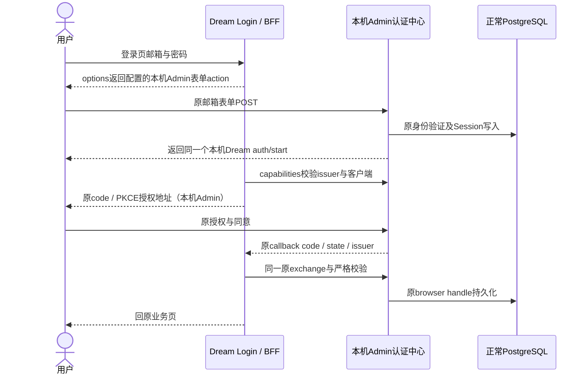

失败时沿原登录反馈和同一callback恢复；不跳到其他中心作为回退。公开中心520/522观察及初始错配保留执行记录；图片链路未派发时不计为模型失败。两条图片调用时序和状态机保持原稿。

## 首轮请求地址方案历史（2026-10-11，已由下文同实例设计取代）

本机访问与NATAPP公开访问复用同一生产路径。用户从本机页面发起登录，应进入本机Admin；从公开页面发起应进入公开Admin。仍使用已发布的同一个身份、资源与客户端合同。不能以改静态issuer、改环境名、改浏览器测试action或遇错误自动切中心解决。上节静态配置建议从未实施，由本节取代；公开520/522不作为实施短正文修复的依据。

**模块与输入输出**：Dream BFF在`BffLoginBoundary`增加导航专用的canonical请求地址检查：先检查完整且单值的forwarded host/proto，其结果必须精确等于现有Dream callback的origin；没有forwarded时，Host必须精确匹配该origin，或无Host的直接request URL精确匹配。存在缺项、多值、不同origin或未知Host时拒绝，不回落到归一化内网URL。已登记的公开forwarded证据优先于内网request URL；其他API的原origin/CSRF及恢复规则保持。通过后从该客户端origin判断本机访问。公开请求继续使用`AdminBffClient.origin`；本机请求仅在既有`transportOrigin`也为loopback时，复用其scheme/port和该canonical客户端loopback hostname构造本机Admin地址。选择只用于浏览器表单、authorize及device导航；后台transport、客户端secret、callback、resource与稳定issuer不变，不把Next归一化后的内网URL误当公网浏览器地址。新增只读请求地址方法和browser导航方法尚待实施，不增加配置键或端点。中心选择来自请求；已登记client/service/callback合同仍是调用资格边界。当前本机合同只覆盖localhost:5173，127.0.0.1别名或未由此service登记的公网页面在options阶段就拒绝，恢复到对应已登记页面。公开部署既有public service/callback配置在相同代码中按精确公开请求选择公开中心；本轮不声明同一个仅登记local callback的BFF可完成另一个public callback，也不扩大客户端目录。

Admin浏览器入口和官方Provider的交互请求（邮箱登录、authorize、consent、会话、end-session及Google返回）使用同一经过校验的实际Admin请求origin建立短期认证上下文：公开转发头只能对应原已允许的公开中心；loopback地址必须在现有允许origin中且与实际Admin loopback监听端口、协议匹配；拒绝未知、多值或非法地址。`createAdminAuth`的浏览器上下文同时按该origin设置baseURL和Secure cookie。JWT issuer、resource、keys与签名query校验保持固定；token/refresh、JWKS、metadata、userinfo、撤销等后端协议继续原固定上下文，避免改变OpenID token audience。不对请求地址执行新的远程fetch，不使任意Host成为重定向目标。

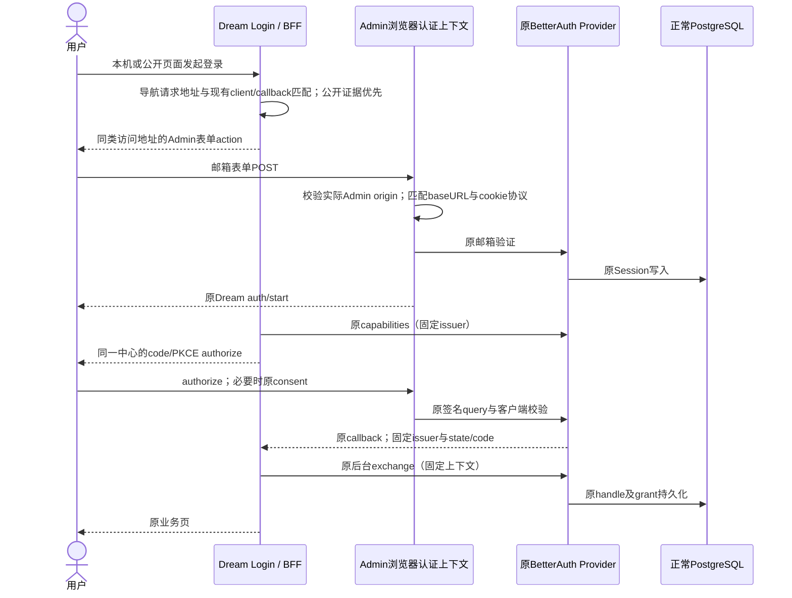

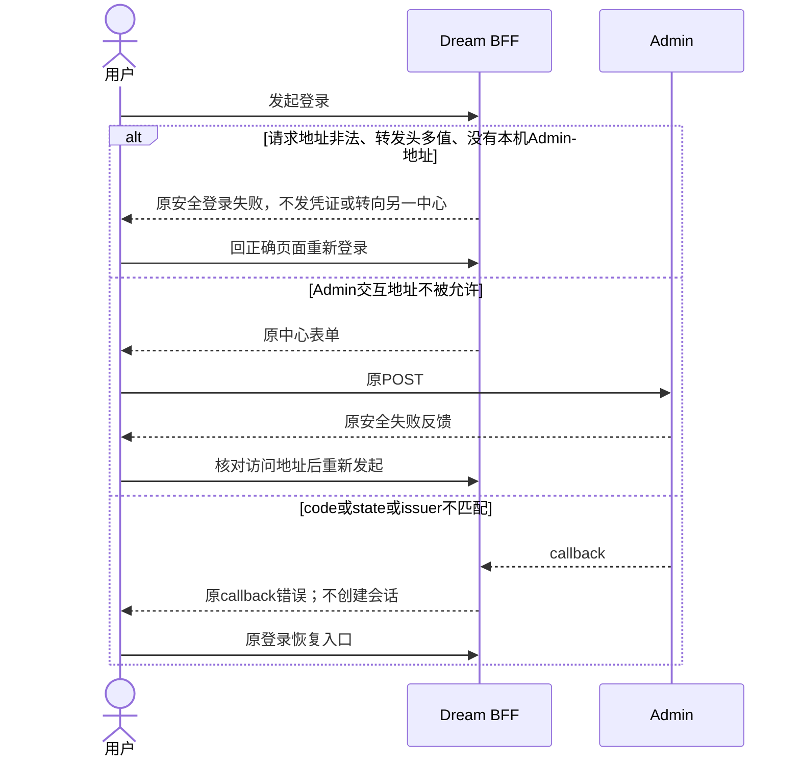

状态沿用“未登录→原登录事务→中心身份Session→原授权→Dream会话”；中心身份Session不等于Dream会话，也不等于图片请求。任何阶段失败不调用模型、不切换中心或新建账户。验收追加：同Admin静态配置下，已有local client/callback的本机action/authorize保持本机，已有public client/callback的公开forwarded请求保持公开；未登记别名或跨client origin在提交凭证前拒绝，未知Host/多值拒绝；固定issuer/token audience与PKCE严格；正常现有账户登录→真实图片矩阵。旧公开失败和已放弃建议保留历史，不能当作当前采用。


### 同一实例 NATAPP 请求地址补充（2026-10-11，已实现、发布采用；公网登录待验收）

背景与问题：当前一份BFF只持有单个服务身份，但同一正常实例由本机与NATAPP边缘访问。只改变Admin URL会留下callback/cookie与session不匹配；不能根据Host把本机身份替换为公开身份。

目标与边界：保留原confidential service ID和原Browser OAuth client ID，由实际地址选择同一client已发布的exact callback。复用同一Dream应用已登记的callback集合；不新增service代理权限、数据库结构、业务scope或配置开关。Admin受控目录发布新增当前client允许的callback，是明确的OAuth地址授权；它不授权另一个client或后台服务。所有目录候选由已有Dream服务登记产生，不猜hostname、不拼未经发布的callback。发布使用原OAuth catalog的定向browser-redirects模式：同一受控事务锁住目标已存在Browser client，检查resource、links及所有非redirect合同未漂移，拒绝删除原允许地址；只更新redirectUris和其updatedAt，回读全部目标行核对其余字段未变，secret/uri/scopes/PKCE/DPoP/device/service/resource/links均不写。原完整publisher的desired也采用同一已登记callback集合，后续完整发布不会收窄本次地址。定向入口只属于现有发布CLI，不增加运行时HTTP或控制通道。

概念与规则：Admin目录default与desired是本Dream应用原已登记callback集合；现有publisher没有独立revision字段，以原受控发布回执及目录fingerprint记录本次采用版本；实际Provider active目录为effective。请求Origin只能选该实际client有效目录中唯一匹配的精确origin与callback path；双方完整callback派生固定使用当前原callback pathname，只替换为选定origin；该完整URI必须同时精确命中原Dream目录登记与当前client实际redirectUris，0项、多项或不同pathname均在options前拒绝。actual service identity/background scopes不变。BFF解析代理完整单值地址（优先于内网URL），生成同origin的host-only cookie、AAD、exact callback与CSRF；原capabilities授权检查必须在options给出密码/Google action前通过。原Admin服务认证在收到Origin时验证当前自身browser client的已发布redirect/resource/active事实，然后只替换本次browser origin/callback，原principal/delegation/Gateway client检查不扩张。无Origin的backend/worker使用原合同。

模块输入输出：OAuth目录publisher从现有Dream应用服务登记取exact callbacks并写原client目录；serviceIdentity消费verified confidential token、标准Origin头、同client实际发布目录，输出同service身份的选定browser地址；BrowserSessionService/Repository沿原origin字段与encrypted bundle保存/解析，不新增字段；Dream BFF逐请求boundary贯穿auth/API/Apps，AdminBffClient保留原token cache/transport，选定Origin是不可变的请求实例上下文，共享transport owner不写入当前origin；两个origin并发请求互不覆盖。所有密码、token仍只进入原Admin，浏览器不获得服务secret。

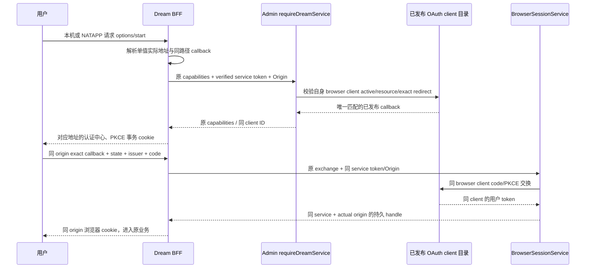

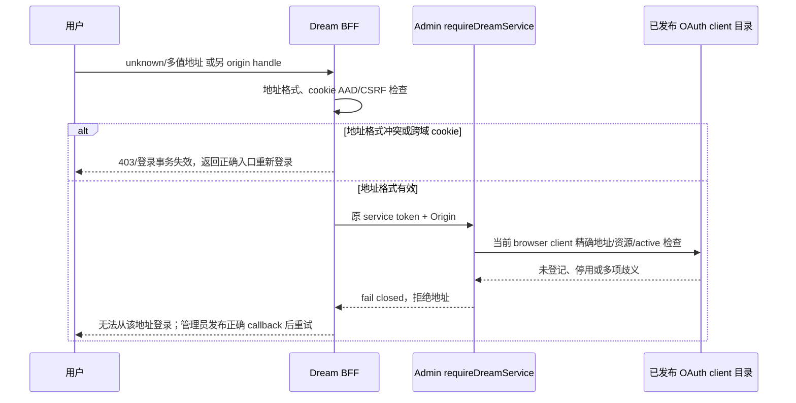

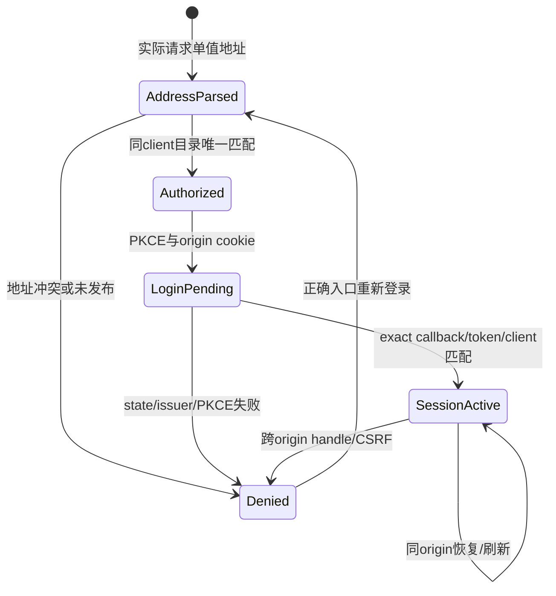

兼容及验收：原local service/client与local记录保持；backend无Origin、主体与Runtime delegation路径保持。测试矩阵包括同BFF两地址options→start→callback→session→API、cookie互拒、代理优先级、unknown/disabled/unpublished/ambiguous、资源不符、callback pathname不一致、两origin并发不污染、原server issuer/refresh/PKCE。受控目录发布和源实现/隔离测试/真实NATAPP验收必须分别记事实；本轮源码已独立复审、技术资格通过、原callback定向发布并由正常实例采用；正常/auth/options本机返回localhost:3000、公网返回原公开Admin均200。公网Chrome脚本502/HTTP2错误发生在可见登录表单前，不能据此声明公网完整登录通过。


同client源码独立评审修订（2026-10-11）：Browser API和Apps只在当前origin的handle cookie存在时使用逐请求地址及Admin发布目录校验；当前cookie即使无效也优先，不能降级为native Bearer。无当前cookie的native Bearer继续使用原canonical BFF origin合同，不新增Admin查询或改变Python token验证。未知origin的native请求仍拒绝。当前BFF只支持原Bearer token，实际自身client的dpopBoundAccessTokens及resource的dpopBoundAccessTokensRequired必须明确为false；runtime目录查询与定向callback发布前置都只读检查，不支持或缺失状态拒绝，不写这些字段、不放宽JWT的cnf拒绝。独立评审另发现CLI union返回类型推断和测试DTO引用错误；仅修调用类型与测试真实DTO，保留初次失败回执。


恢复报文实测历史（2026-10-11，以下为诊断前状态，已由后续回执更新）：正常既有Thread采用新Gateway后首条纯文字在素材检查返回409 IMAGE_MATERIALS_MISMATCH；正常绑定与实际SDK JSONL的marker完全相等、素材数0。新隔离实际CLI0.1.11两turn协议与生产currentImageMaterials却成功，不能把JSONL或隔离fixture当成正常wire。最小下一步在原素材校验失败处记录固定检查阶段及非正文计数，用正常同账户公开发送重现并核实实际分支。诊断不记录marker、用户/会话身份、文本、URI、base64、prompt或credential，不返回这些诊断给页面，不放宽原校验或改变图片/预留/结算/Runner行为；没有HTTP/debug控制通道。取得正常分支证据后才设计解析修订。当前普通文字恢复尚未验收，不能声称新Gateway已通过业务兼容。

独立诊断设计评审无新增P1/P2：reason采用封闭枚举、统计采用逐项数值字段白名单；不把body、binding或Error传入logger。原私有日志写入为best-effort，sink异常仍抛原409，成功不增加逐请求日志。当前七处失败出口的素材与历史判断保持，诊断源码尚待技术资格及正常实际请求证据。

[本机采用状态同步前完整原文](image-model-call-division-20261011-before-normal-adoption-status-history.md)保存当前状态修订前稿及其正常、异常与恢复图。原四项能力和两条图片结果图保持；最新真实失败和实际限制仅由执行回执更新。


### 失败后恢复合并素材边界修订（2026-10-11，独立评审、技术资格及正常文字恢复通过）

背景与问题：正常同账户既有Thread在诊断Gateway中重发纯文字，实际固定stage为marker-position-and-binding；messages11、array11、string0、当前marker出现1、material0、marked1、block9、validator markerIndex=-1。这是当前重发的wire诊断，不能推出首条失败根因。安装版CLI源码在移除synthetic API error后会合并前次未完成的user和新user，并把新marker完整独立块留在旧块之后；现行index0/首frame指定context后index1不能承接该恢复。

目标与边界：沿原Claude Code恢复和同一生产Messages入口定位当前素材，避免让一次素材拒绝使后续纯文字都无法恢复；不清会话、不删除错误或历史、不替换Runtime、不改Runner/resume/cancel/SSE，不绕过capability/四项模型资格或image claim。

概念与规则：保留原body范围当前完整marker只出现一次、唯一直接user frame、server binding与角色身份检查。当前marker必须为该frame中的一个**完整且唯一的text block**；位置按该完整块的实际索引确定。marker之前属于CLI恢复前缀，不授权为本次图片素材；只有marker之后紧邻的server binding数量image/exact URI-label pairs进入规范化摘要和selected操作，pair之后仍只允许既有文本，重复/嵌套/拼接marker、错URI、多余图片、tool_result及解码/大小/类型错误继续拒绝。

模块与持久化：currentImageMaterials只改变当前完整块定位，输出仍为原绑定URI的images/normalized；nativeImageConversationBody继续剥离所有历史图片及function envelope，只补当前selection子集。普通对话原历史理解保持。不得把历史前缀图片加入normalize或image inputs，不增加数据库查询/字段/操作、资格或日志身份。诊断再明确完整marker块数量、含marker块索引均为固定数值，仍无正文/身份。

正常与恢复时序沿原图：前次失败→用户原重新加载/发送→CLI原恢复合并→Gateway完整当前marker→原strict pair/能力/执行claim→原反馈；找不到完整唯一块仍原409，用户重新加载或新消息。恢复不隐式重做前次图片。验收追加fixture真实CLI“失败后恢复”观察、合并前缀含旧图不授权、嵌套/拼接/重复marker继续拒绝、生成/编辑互斥与原文字/工具回归；再正常采用后同账户既有Thread发文字和草图实际理解。源码与隔离成功不能替代正常验收。

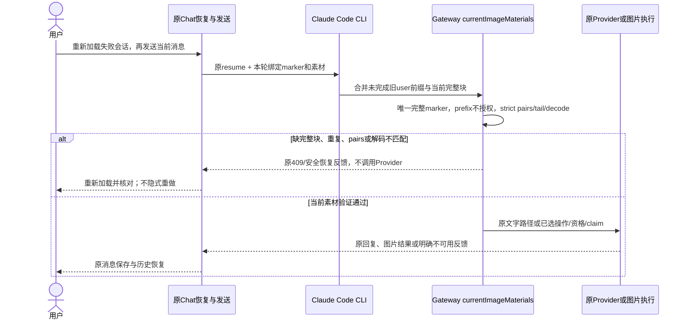

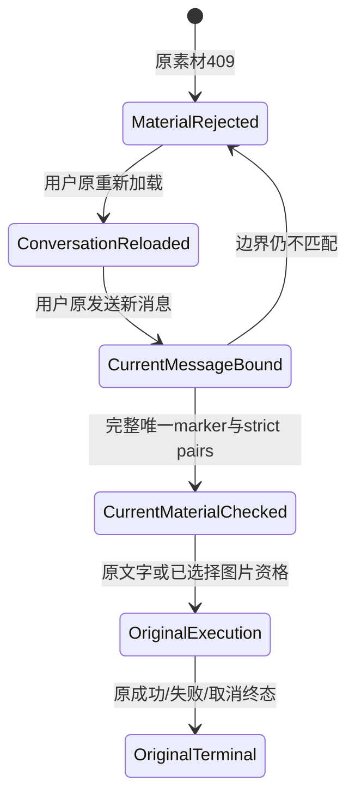

该图只说明素材边界与原用户恢复入口；未新增Runner或Thread状态，源码已实施且独立复审无P1/P2；本轮聚焦31项、全Admin2456项及源码快照build均成功，r6产物正常采用后同账户既有Thread恢复文字成功。图片成功结果仍受真实模型资格限制。

独立设计评审无P1/P2；tool_result拒绝指当前素材pair、tail或marker嵌套，CLI恢复前缀中的旧tool_result可保留为原历史，不产生本次素材授权。完整唯一marker定位与绑定URI、紧邻pairs、当前wire摘要及selection子集共同约束；prefix不加入normalize/native input。正文已同步当前严格边界，取消旧固定index含义。


round27/28及round29首次Images返回时的阶段历史：2026-10-11 验收范围更新：用户指定后续只使用本机正常Dream、Admin、Gateway与PostgreSQL完成真实业务验收；公网登录和传输测试不再作为本专项门禁。客户端请求地址决定认证导航的产品规则保持。本机已完成素材与普通对话流程；round27/28当时只读核对Responses图片生成/编辑能力声明均为0、该账户Images资格不足。round29已按正常Admin订阅流程开通现有Free v7，公开Images生成/编辑可调用；首个真实生成已返回图片，但展示闪烁须修复。主对话native仍未开放，完整两链图片编辑、文件与历史验收待执行，不以技术夹具代替。具体命令与证据见[执行记录](../../exec/image-model-call-division-20261010.md)。


### round29 图片展示稳定性修订（源码已实现，正常真实查看/下载/重开通过）

用户截图与同账户真实生成结果均显示图片卡片反复在加载与空白框之间切换。ChatPanel 的添加素材回调必须按当前 Thread 保持函数身份；普通聊天刷新不重建 ChatMarkdown 的图片 renderer，因此不卸载正在加载或已打开的 WorkspaceImage。切换 Thread 仍更新所属 Thread 并清空当前素材；原 abort、文件权限、Blob 回收、失败重试、查看、下载保持。验收持续父组件刷新时同一图片请求不反复发送、缩略图可见且查看器保持；切换 Thread 不复用旧身份。隔离与真实验收分别记录，不据 DOM 解码瞬间宣布稳定展示通过。

### round29 Codex 内置链路增量（r3阶段资格，保留历史）

正常 Admin 已观察原 gpt-6.1-sol 的 hosted Responses 内置图片生成成功：实际完整图片和 Response/call 身份已校验。依据仅覆盖 `{type:image_generation}`、`tool_choice:auto`，并不覆盖公开 OpenAI API 的 action、强制工具对象或 max_tool_calls。该连接实际端点是 managed Codex Responses，不能称为 `/v1/responses`。

最小执行差异由原 Provider adapter 决定：原通用 OpenAI Responses 继续原强制生成/编辑声明；Codex 复用已核实的工具声明与 auto、原 stream=true/store=false/include，输入仍由当前消息素材、选择操作和冻结 AI 模型构造，只有一个内置图片工具，无 image_gen/function 工具。Gateway 单次发送、最多接收一个完整 image_generation_call；多个、缺失、ID 不一致或无图片仍明确失败，不回退或自动重试。edit 使用当前已选参考图片与修改要求，返回 action 如存在必须匹配 edit；无 action 时保留 null，实际语义须由真实编辑验收确认，不伪造。

三个已有门同时接受 Codex：Admin 保存能力配置、models endpoint 配置就绪、Messages native 执行；均还要求模型明确声明对应 Responses 生成/编辑、chat/tools、非动态路由和原输入/输出预留。不因 adapter=codex 给所有模型开启图片标记；Images 能力保持独立。完整用量未报告继续 usage_unknown，仅图片展示成功与计费已知分开。现有正常/异常/状态图保持原模块与分工，新验收矩阵追加 Codex 报文、三门一致、真实主对话生成/编辑/草图/后续引用及不重复 Images。

独立评审修订（2项P2）：原Codex成功流可以省略Content-Type，native结果入口须复用既有Codex+有body+缺Header的SSE判定，其他Provider仍严格。移除未核实max_tool_calls后仍由结果边界强制单call：观察added和done的真实call ID与Provider output_index双向唯一，terminal不得重复且每个已观察身份须匹配最终结果；CLI content index保持原本独立投影。只有完整单图且全部身份一致才保存成功；多调用、缺图或错配明确失败，不能吞掉额外调用。此修订局限原native图片解析，不更改一般SSE、Runner、resume/cancel或transport。

源码复审追加P2：Codex合法done-only图片call已通过Provider ID/index检查后，若后续断线或terminal失败，原fallback摘要不能只读added投影Map。失败摘要改用已校验的Provider calls，保留真实调用身份；不改unknown结算、执行次数或取消状态。增加done-only失败身份回归。


round29正常目录实证：原gpt-6.1-sol的既有route effective非空，revision2、ordered、allowFallbacks=false；即使实际Provider生成核实通过和能力声明为true，responses_image.configured/callable仍为false。该行为符合本稿原no-route执行门，不忽略路由、不自动更改路由/模型。正常Admin已有非路由Codex GPT6.1Sol模型，只有其原核实及公开能力/配置/资格通过，用户可在AI列表选择它再发送；不自动转用独立Image。r3阶段source资格123focused、2499full/37skip及build均exit0，同源产物已正常采用，不能据此提前声明该备用模型真实验收通过。


### round29 默认 Provider 快照边界修订（r5最终资格、正常采用与实际验收完成）

`resolveBillableModel` 即使没有有效路由也提供 `routing` 快照；其 `default` 策略、`allowFallbacks=false`、snapshot 与 execution 均只有一个候选、excluded 为空，候选 Provider 和 upstreamModel 与 resolved 实体一致，表示原默认 Provider，并非多来源路由。native admission 必须识别此原形状；对象存在本身不能判定不可用。`ordered`、`weighted`、fallback、多个候选或身份不一致仍拒绝。目录 SQL effective IS NULL 与这个执行条件一致；不删除 resolver snapshot，不改默认文本路由、预留、SSE或重试。不匹配仍反馈选择可调用 AI 后重新发送。已补真实resolver形状的11项Provider-free回归，r5最终资格构建、正常采用和主对话真实验收均完成；原旧fixture和核实按钮不代替这些回执。

## round29 当前验收与执行资格

2026-10-11 round29：两条图片链路已在指定现有账户、本机正常 Dream/Admin/Gateway/PostgreSQL 上完成实际生成、编辑、查看、下载、后续引用及历史重开；草图实际绘制并完成理解和内置编辑，显式 image_gen 在支持内置图片的 AI 下仍仅执行所选 Image 模型。闪烁修复后同图持续39秒稳定，后续真实SSE更新保持原Blob。最终AI恢复 gpt-6.1-sol，Image保留 codex-gpt-image-2；原多来源路由保持不可调用，用户自行选择已核实的非路由AI后才能执行内置图片。内置交付成功，但完整图片用量未报告，保留 RESPONSES_IMAGE_USAGE_UNKNOWN，不能称实际费用已知。故障注入与37项既有跳过的边界见执行记录；独立复核与文档、图示检查已通过；真实故障、跳过和未知用量的边界保持单列。

最终r5新增真实resolver形状的11项回归；134项聚焦、2510项全Admin测试、tsc、定向lint及源码副本build均exit0。全套保留18文件37测试原跳过，不计通过。正常采用Build `Y-FUvVlfmQX52_mp077xs`。默认单Provider快照允许执行，多来源ordered/weighted/fallback/身份不一致仍拒绝。主对话真正上游是managed Codex `/backend-api/codex/responses`；generic才是`/v1/responses`，Claude Code本身仍发`/v1/messages`。

## round30 官方计量修订（独立设计/源码评审通过，本机已采用，正向真实重验完成，限制见末节）

### 背景与问题、目标与边界

此前 summary 的 usageKnown:false 是程序固定值，不是上游原 usage 缺失的观察。三条 round29 历史记录仅证明图片交付和结算失败。官方 [image-generation 成本说明](https://developers.openai.com/api/docs/guides/image-generation#cost-and-latency)要求读取 response.usage，同时指出 Responses 有主模型与图片生成费用、图片缓存计数不在输出中。官方 [ResponseUsage](https://github.com/openai/openai-python/blob/main/src/openai/types/responses/response_usage.py)公开 input_tokens、output_tokens、total_tokens、输入 cached_tokens/cache_write_tokens 与输出 reasoning_tokens；[ImageGenerationCall](https://github.com/openai/openai-python/blob/main/src/openai/types/responses/response_output_item.py)没有单独 engine、usage 或费用字段。不能从它的字段缺失推断顶层 usage 缺失，也不能凭图片尺寸算出真实计数。

### 概念与规则、模块与持久化

responses-image-protocol.ts 解析完整顶层 usage，要求非负安全整数、input+output=total、cached+cache_write<=input、reasoning<=output；明细只用于校验/缓存价格，不重复相加。cache_write_tokens 在兼容旧 Responses 协议时未提供按0处理；cached_tokens 与 totals 不接受缺失、字符串或数值矛盾。得到 TokenUsage 或 missing/invalid 状态。图片数据和原调用身份仍沿原解析/持久化路径。

responses-image-proxy.ts 对有效 usage 调用原 finalizeKnownUsage，按原 AI 模型 Admin 平台价格快照结算请求报告的 Token，要求完整订阅 Token 消费；Gateway 摘要 billingScope=responses_reported_tokens、imageBillingDetailsKnown=false，表示完整图片服务费用/缓存仍未核实。Gateway usageKnown:true 仅代表本次已报告请求计数，不宣称真实 upstream USD 或图片分项完整。平台基础金额仍为平台定价计算值，不能在界面称上游账单。未报告或无效 usage 走原 finalizeUnknownUsage，保存准确原因，不捏造0。

独立评审修订：服务器固定摘要还记录 requireFullTokenAllowanceCapture=true；原 settlement-worker 仅对 billingScope=responses_reported_tokens 且该标记为 true 的记录保持完整 Token 消费要求，不改变一般文字恢复。native 在收到 terminal 后、取消检查和图片解码前独立解析可靠 usage；失败路径只要解析成功（包括合法全0）就直接调用 finalizeKnownUsage，不依赖 hasBillableTokens>0。结算尝试前标记已进入结算，避免 catch 二次覆盖 actual_usage_pending。

Admin 详情通过该固定 scope 识别 native 图片请求，继续关闭原 payload 揭示入口；已报告计数/平台定价与完整上游图片费用分别说明。

Admin usage-dashboard 对固定 responses_reported_tokens 的记录按 input+output 汇总，Provider/Model/趋势均不重复加缓存；其他旧记录统计保持原规则。服务端沿原响应增加 tokens 小计，趋势优先使用它，兼容旧响应时沿原回退。四类明细仍分别展示，金额算法不改。

image-turn.result 的严格 DTO、描述/hash和原摘要不变，继续表达完整图片明细未知；Gateway 保存新增的只含整数/固定状态的计量摘要。不会往其 receipt 注入扩展字段，也不覆写旧 receipt。Admin 请求详情复用当前 response_summary 说明已结算范围与图片成本未知。无 Schema、依赖、环境分支、配置或新控制入口。

解析后的用量也用于 CLI 反馈，避免结算与 CLI 各自解析。结算异常已有可靠用量时只保留 actual_usage_pending，原 worker 可以恢复；不得被随后的通用失败处理覆盖成未知，也不得再次调用 Provider。取消/图像解析失败遵循原时序和失败反馈；已收到的可靠 usage 保留供相应失败结算。三条旧记录的CLI终端日志精确关联实际input/output，可恢复总163709 Token；原proxy未透传缓存分项且原snapshot价格不同，因此缓存与金额仍不能恢复，不以新记录代填、按尺寸猜测或批量 conservative_capture 改成实际结算。

### 正常业务时序（本轮实现，正常与故障验证分开）

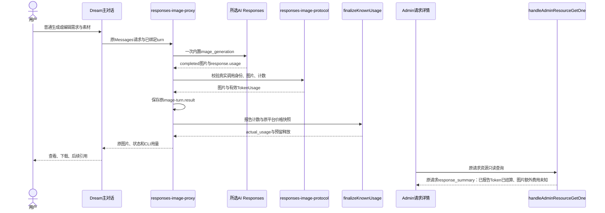

### 异常与恢复时序（本轮实现，正常与故障验证分开）

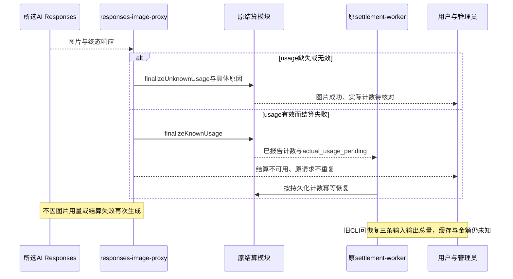

### 状态转换（本轮实现，正常与故障验证分开）

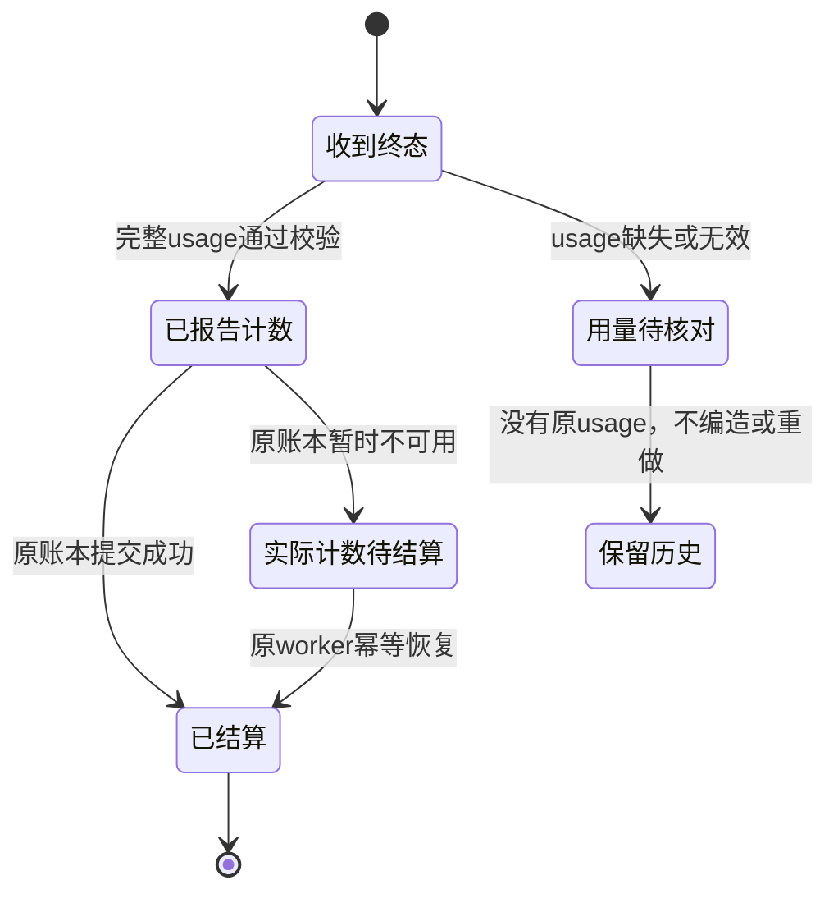

### 影响与验收矩阵

| 范围 | 必需验证 |
|---|---|
| JSON/SSE生成与编辑 | 顶层usage进入账本，单路/原图片身份不变，CLI一致；真实本机操作 |
| 缓存/推理 | cached从inclusive input扣除定价，reasoning包含在output中，不重复扣Token |
| 缺失/无效/溢出 | 明确原因与unknown，图片仍按原成功交付边界；隔离技术验证 |
| 结算失败/取消/解析失败 | 保存有效计数、不覆盖、不重做；隔离确定性验证 |
| DTO/Schema/历史 | 原265 registry/150 prefix、hash及receipt不变；旧图片重开 |
| 独立Images/文字 | 保持原解析/定价与调用；技术回归与本机显式Images对照 |
| 三条旧记录 | 正常CLI与账本只读核对；输入输出可恢复、缓存与金额未知，原预留保持 |

round30源码复核补充：复用已有imageCalls识别没有新scope的历史native详情，旧数据不写入；新native终态前失败也带固定scope。SSE失败/取消终态在共享adapter抛错前严格提取usage，已收到可靠报告不被后续缺失/非法终态覆盖；共享文字/SSE协议保持。Usage详情同样说明报告Token与完整图费用范围。源码已修订且通过本轮Luna资格，正常Admin构建f8mB8n-99X-VQt2y_HiNk已受控采用；新真实业务以用户取消后重新验收的回执为准。

## 原生图片历史的摘要兼容（Runtime0.1.12已发布并正常采用；2026-10-11）

### 背景与问题、目标与边界

取消后的五项真实图片操作已交付并结算；随后引用失败，CLI 报告请求超过20MB。实际请求字节未捕获，不能宣称已经测量累计大小。原 Runtime `src/services/compact/compact.ts::stripImagesFromMessages` 在 fallback 摘要时只清理 user 图片/文档和普通 tool_result 内媒体，assistant 原生图片结果仍含 Base64。正常入口一次 `/compact` 及重发均未观察成功，记录保留。

目标是让原会话摘要流程识别这种已实现的图片结果。复用 `compat/dream-runtime/policy.ts` 纯函数与 `source-transforms.ts` 的原文件 SHA/单一 marker 构建变换；禁止改原始 src/provenance、Gateway 接收限制、Runner、线程、通用 SSE、取消/恢复、模型和路由。

### 概念与规则、模块输入输出

原 `stripImagesFromMessages` 只在摘要请求构建时调用新增兼容函数。输入为原 assistant Message；没有内置图片块时返回同一个对象。包含 `image_generation_tool_result` 或对应 `server_tool_use(name=image_generation)` 时，为摘要副本生成 text 标记，保留真实 call ID / gateway_request_id / response_id，移除二进制 content 与原生工具协议块；正常文本及普通工具不变。不能留下孤立 server_tool_use 或伪造含 text 的原生图片 DTO。该副本只提交原摘要 API；原 messages、transcript、Dream 历史、image-turn receipt、图片文件及账本均不修改。失配历史不修复原记录，摘要标记说明结果数据省略。

原 cached-prefix 路径、失败后 fallback、工具权限、abortController 与 compact boundary 保存合同保持。若累计文本本身仍超限，沿原错误反馈，不保证任意长会话均可压缩。成功摘要只改变后续上下文；用户从原图片卡片重新添加需要理解或编辑的文件。重复整理不重放已经执行的图片请求；摘要本身是新的文字模型请求，按现有 Token 规则正常结算。

独立评审 P2 修订：`processSlashCommand.tsx` 的 local compact 分支已创建当前真实 `userMessage`，但原 mod.call 只取得旧 history。构建变换仅对具有当前素材标识的 compact 用 immutable context 副本保存该输入（module Symbol 内存字段，不增加 HTTP/env/控制入口），不追加或改写 context.messages。`streamCompactSummary` 复用该输入的 preceding marker/material blocks，将它们加在原 summaryRequest 的摘要正文前；两种原摘要路径使用同一请求。fallback 先对历史调用 stripImagesFromMessages 再追加本轮摘要请求，因此当前素材不丢失，历史二进制不会继续累积。Gateway 仍按真实 turn_key/message_id/素材顺序、图像解码和绑定校验；没有放宽校验，旧标识不能替代当前标识。原 boundary 的最后 UUID、summaryRequest UUID、command userMessage 创建及成功持久化保持。没有素材标识或非 compact 的命令返回原 context；自动摘要不取得手动 compact 的临时输入。

独立评审第二项 P2 修订：实际 compact 的完成 stdout 目前以 SDK user replay 输出，Dream 只处理其中工具结果，忽略该文字；仅 idle 不够作为成功反馈。只在原 QueryEngine 的 local no-query 成功分支、原 transcript/flush 完成后、原 result success 输出前检查本次 messagesFromUserInput：同时出现实际 compact_boundary 和非空 local-command-stdout 时，复用原 `localCommandOutputToSDKAssistantMessage` 投影一次实际完成文字，进入已有 Dream assistant text/保存路径。没有 boundary、失败 stderr、取消或普通无文本 success 不产生该反馈。保留原 SDK user replay、result/session ID及 transcript；不改 Dream Runner、SSE、恢复和取消状态机。实际输出与 result success 均须在技术和正常业务回执中观察，不能只检查文字出现。

源码复审 P2 修订：SessionMemory compact 可在 messagesToKeep 中保留旧 stdout，因此不能把返回数组里的 stdout 全部当作当前输出。QueryEngine 在原 this.mutableMessages.push 之前，用原历史 UUID 集合排除已存在的 boundary/stdout，计算本次新 boundary 加唯一新 stdout 候选；仍只在原 transcript/flush 成功后投影。不删除历史，不选择任意最新文字，不给旧内存对象加永久标记。增加保留旧stdout与新stdout并存、仅旧stdout/旧boundary不产生反馈的回归。

实际制品核实修订（待独立复审）：原 src 的 compact supportsNonInteractive=true，但已发布 Runtime 构建的 `scripts/build-core-prune.ts::transformHeadlessCommands` 将 COMMANDS 和 builtInCommandNames 都置空，原命令没有注册。旧输入 `/compact` 因此未进入 compact；不得把这次普通请求超限称为已执行压缩。恢复入口只在既有 hash-bound headless-commands 变换保留原 compact import、COMMANDS=[compact] 和其 built-in 名称；其他内置命令、TUI、remote过滤和普通动态 Skills 保持。原 profile 的 session.transcript-resume source assertion 增加原 compact index/command，要求实际构建可达；原源码字节、Gateway限制和Runner等语义仍不变。验收以实际摘要请求和 compact_boundary/result 为准，原 src 及单元字符串检查不能代替已发布CLI支持。

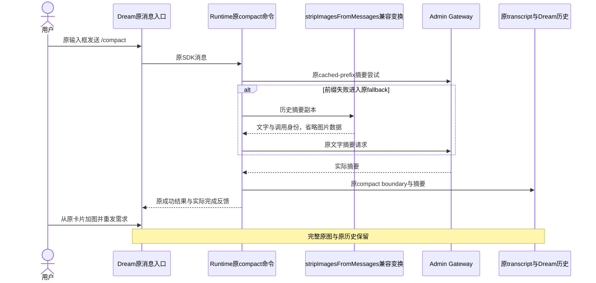

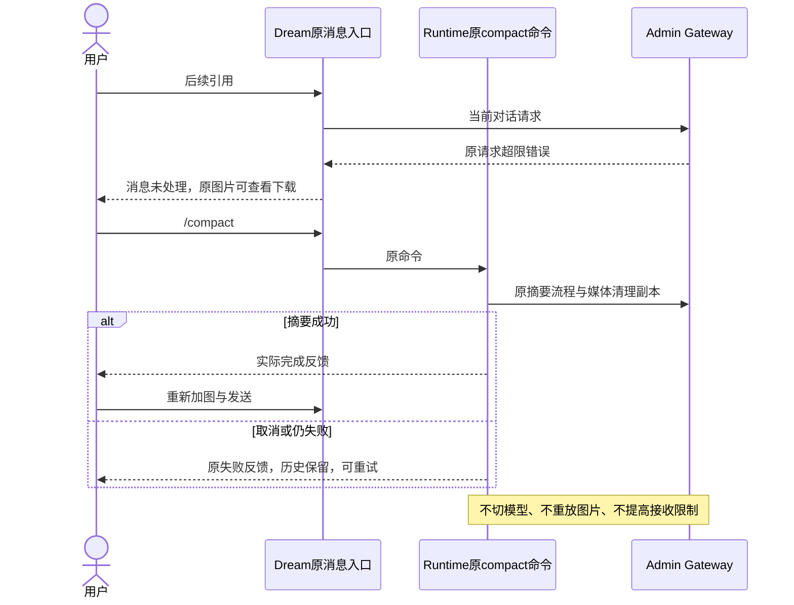

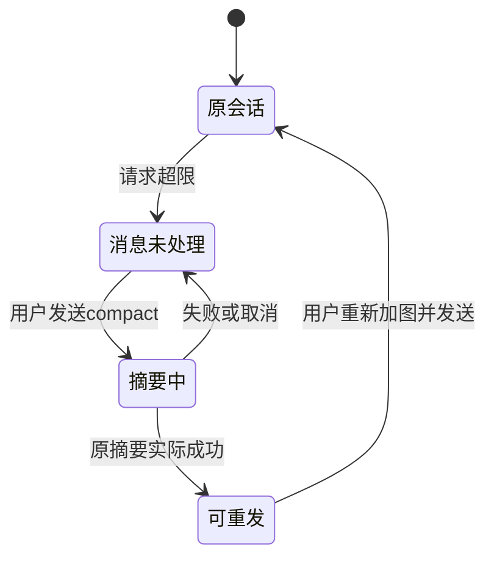

验收新增：精确原文件 SHA 与唯一变换/未变 src；摘要副本不含原生二进制和孤立协议块，调用身份仍在、普通工具不变、输入对象不变；实际新 CLI/SDK 通过公开 `/compact` 整理含大图历史并继续同 session，取消沿原入口；新版本四平台资格及公开制品/正常 resolver 独立核对；同正常账户/会话真实 compact 成功、后续引用与完整两链重验、原图/历史/稳定性保持。隔离 fixture 仅为技术验证。尚未执行或成功观察的条目均为待验证。

历史开发记录（当时独立评审通过、候选实现；当前Runtime0.1.12已经发布采用）：原compact摘要成功后，headless依赖的chalk.dim在完成文案处失败。限定方案在原commands/compact/compact.ts精确SHA构建变换中，单次将完成文案ANSI包装改为同一原文字；SDK既有mapper本来去ANSI，用户完成语义不变。摘要/输出Token预算/boundary/权限/取消流程均不改，不修全局依赖。验收须实际boundary、clean Compacted assistant和同session success，不以外层success或已解包XML标签代替完成。

## Responses 已报告用量的 pending 恢复补充（已实现、技术资格和正常采用完成）

直接native结算按官方包含缓存的input总量处理。外层Claude Messages创建记录的历史input_token_semantics=fresh不代表上游Responses计数语义。仅服务器固定billingScope=responses_reported_tokens且requireFullTokenAllowanceCapture=true的已知用量行，在原resolveKnownGatewayUsageOnClient恢复时选total_including_cache；同一条件维持原完整额度捕获要求。原source字段/表结构、普通文字与Images协议、权限/幂等/事务/轮询均保持。原三条usageKnown=false仍不能进入该恢复门，不按CLI默认cache0写回。验收：fresh+cache>0的native known-pending提交inclusive语义并只捕获input+output；其余scope继续原语义和原资格失败反馈。

## 原CLI compact完成文字的消费兼容（源码已实现、技术资格和正常采用完成）

背景与问题：Runtime0.1.12已公开发布并正常采用，原Thread实际manual compact_boundary与旧图片hash核对通过；Chat未出现完成文字。原SDK mapper给出完整`AssistantMessage`，model为`<synthetic>`，文字从原local-command-stdout去标签得到`Compacted`，没有对应StreamEvent。此前Runner在partial模式下跳过完整文字，因此第一次可见完成反馈未通过；当前严格消费修订已实现并正常采用，第二次同会话真实完成文字唯一可见。独立责任复核见round30/runtime12-compact-ui-review.md。

目标与边界、概念与规则：在原`_process_message`的TextBlock消费中，仅model严格等于`<synthetic>`且去首尾空白后的文字严格等于`Compacted`或以`Compacted `（含空格）开头及其原完成附注的消息，走既有文字累积与on_text_delta；不按用户提到compact或普通模型正文判定。正常网络模型完整AssistantMessage继续由原StreamEvent文字投影，以免重复；其他synthetic消息不在此例外中。输入为公开SDK结构化消息；输出为原文字callback，由现有service/SSE、消息保存和历史模块处理，不增加事件协议、配置、控制通道或状态机。取消/摘要失败没有原completed文本，不产生该完成提示。

正常图中“CLI完成文字→Dream文字/保存”在此修订实现前仍未通过；实现后须用同账户、同Thread实际自定义compact、可见唯一完成文字、原boundary/图片保持与刷新重开验证，技术SDK-only fixture不能替代此验证。验收同时覆盖普通文字delta加完整snapshot只展示一次、普通模型写Compacted也不走例外、其他synthetic错误仍沿原错误处理。

```mermaid
sequenceDiagram
    participant U as 用户
    participant C as ChatPanel
    participant R as ClaudeAgentRunner
    participant CLI as Claude Code Runtime
    participant S as ClaudeAgentService
    U->>C: 发送 /compact 与摘要要求
    C->>CLI: 现有公开消息入口与当前素材
    CLI->>CLI: 原摘要请求与manual compact_boundary持久化
    CLI->>R: 原SDK完整synthetic AssistantMessage
    Note over R: 严格完成文字例外已实现；其他snapshot保持去重
    R->>R: 严格核对synthetic model与原完成文字
    R->>S: 既有文字callback
    S->>C: 既有SSE和消息保存
    C-->>U: 唯一完成文字与后续可继续发送（本轮已观察）
```

失败与恢复仍使用此前异常图：取消/失败保持原反馈与旧图片/历史，不将空success视作compact完成；执行根不调用图片重放。真实已知限制与最终状态在专项执行记录更新。


2026-10-11当前真实compact回执：第二次15:38:28→15:40:39UTC，manual boundary `0d9cfe85-8ba7-4e55-ab1e-858527afa4ca`，原9条native图片hash保持、15张UI图片保持、唯一Compacted可见，后续真实草图编辑成功。首次未显示提示的失败原文保留；最终刷新重开已保存唯一提示，完整Images生成/编辑、本次6张新图重复下载SHA与原文件一致。

## round30 阶段真实验收（历史；当前round31见末节，2026-10-12）

本节取代此前阶段记录中的“进行中”当前状态；原失败、harness修订和历史原文仍保留。Runtime0.1.12/SDK0.2.145已公开精确安装并正常采用。主执行者在用户指定现有账户、既有Thread、本机正常Dream/Admin/Gateway/PostgreSQL上实际可见操作完成五项生成/编辑及不支持模型后的手动恢复，没有替代Provider、账号、账本或存储。原AI gpt-6.1-sol已恢复并刷新确认，Image codex-gpt-image-2保持；本轮未重新保存已经选中的唯一Image候选，不将check同值说成一次新写入。

| 本轮真实操作 | Gateway request | capture Token | 结果 |
|---|---|---:|---|
| 主对话生成 | `req_b7bd0c9692a94dc7ba326bd47512294d` | 13911 | HTTP200/succeeded/settled；查看/下载/重开字节相同 |
| 上传素材主对话编辑 | `req_9994e9b84b32494d8589863a64433351` | 17581 | HTTP200/succeeded/settled；查看/下载/重开字节相同 |
| 实际草图主对话编辑 | `req_72e5392a4a6148a9a657329095b38853` | 14191 | HTTP200/succeeded/settled；查看/下载/重开字节相同 |
| 明确image_gen生成 | `req_626271420cdc405793936f72741d3b7f` | 567 | HTTP200/succeeded/settled；查看/下载/重开字节相同 |
| 明确image_gen编辑 | `req_b1617773ac2c4f6db8b25240760b3086` | 2102 | HTTP200/succeeded/settled；查看/下载/重开字节相同 |
| 手动更换AI后的重试 | `req_5045b53386d14af39c24f1844f66d233` | 29605 | HTTP200/succeeded/settled；查看/下载/重开字节相同 |

主流程五项共48,352 Token，额外恢复29,605；每个实际图片turn仅一条execution，原选择、CLI调用ID、Gateway和native真实response/imageCall身份核对一致。独立Images使用所选图片模型；普通需求没有改走Images。素材仅添加时idle，没有图片执行；上传的原生成图保留，后续引用正确识别紫圆和橙三角，草图由实际鼠标绘制后添加并发送。普通文字OK、仅解释工具名、一次Bash真实结果、运行后的停止与重试都已观察，没有新增图片。

最终刷新重开19张图片（原13+新6），6张新图逐个通过可见查看器下载，SHA-256与首次下载完全相同；唯一Compacted完成文字在历史中保留。持续6091个250ms样本未发现原图节点卸载/Blob变化/已完成图退回加载，覆盖两次实际compact、新图片SSE和后续文字；初始13图中有1个尚未加载，不能扩写为全部图片任意时刻已经decode。

正常Admin原Dmeck SUPER_ADMIN Chrome会话中已逐项看到六次图片请求的reserve/capture/release；native详情显示Responses报告Token与完整图片费用未知，Images详情显示真实text/image分项、模型与200终态，payload始终关闭。普通Dream密码在冷Admin浏览器被拒绝的记录保留，当前可见验收已由原真实会话解除，没有改变认证、权限或创建账户。

尚未真实制造的自然上游坏结果、文件访问故障、连接中断和图片Provider执行中取消仍只由隔离技术合同验证。发送后尚未实际running时第一次Stop仅断开连接、Agent随后仍执行；确认running后的同一turn停止成功。该竞态未扩大为本专项Runner/SSE/取消重构，不能称所有取消时点均通过。新标准usage结算不表示完整上游图片USD已知；旧三条缺缓存分项、reported合计163709和预留861420保持，未估算补结。

证据：[正常业务关联回执](/tmp/im-image-model-split-20261010/validation-round30/runtime12-final-business-correlations.json)、[最终重开哈希](/tmp/im-image-model-split-20261010/validation-round30/real-runtime12-final-reopen-hashes.json)、[实际Admin流水](/tmp/im-image-model-split-20261010/validation-round30/admin-runtime12-visible-token-ledger.json)、[正常服务精确采用](/tmp/im-image-model-split-20261010/validation-round30/compact-consumer-normal-backend-adoption.json)。文档/图示检查及最后Git交付状态由执行记录单列，不用业务成功替代必需交付。


## round31 启动阶段停止与图片执行中取消（已评审、已实现与正常采用；round33补齐后台复核）

背景：round30观察到发送POST尚未被Factory登记时，原Stop返回idle；页面把该瞬时idle当成发送已经结束并断开读取，随后同一POST仍启动。用户已授权修复这个具体竞态。保持原Stop接口、Factory任务所有权、SSE类型、资源策略与图片互斥规则，不增加schema、控制通道或替代执行路径。

用户按停止后，当前消息持续显示停止处理，发送和重试等待这次提交与服务器停止结果得到确认；不能仅凭受理前idle解锁。受理后仍沿原Stop取消同一主任务。明确提交失败且未启动时恢复现有失败反馈；连接结果未知时，当次提交仍可能晚到；单独status idle不能证明它不会启动。threadStop保留unknown停止意图并锁定重试，继续核对/停止；只有原同流生产终态、明确HTTP拒绝，或本次任务停止得到确认才能解锁，不自动重新生成。同一浏览器页面内离开再返回不丢失已经发出的停止意图；整页刷新或关闭浏览器会销毁前端内存，只能使用原服务器status/history恢复，不承诺未受理停止意图跨浏览器生命周期持久化。完成后的重试属于新发送，不继承旧停止意图；已完成原图保留，取消后不得发布晚到的新图。

最小模块责任：ClaudeAgentChatTransport为当次POST登记不可变提交身份（thread、message）；保持首个实际生产SSE事件、HTTP拒绝与读取失败的区别，响应headers不算任务受理。threadStop在模块内持有当次闭包ticket与Stop Promise，并让重挂载的ChatPanel订阅未结算停止意图；useChat卸载只退订，不会自动abort该原POST，transport继续观察。threadStop复用原请求并把停止意图绑定这次提交；首次idle且提交未定时等待该次生产事件或明确失败，再核对/停止，不使后续提交继承。ChatPanel仅在这些事实得到确认后关闭本地reader，并从原history/status恢复。ImageGenerationProvider继续以close与发布锁阻止取消后的文件和结果发布；供应商是否继续计算不作为平台停止完成证明，也不查实际账单。

```mermaid
sequenceDiagram
  actor User as 用户
  participant Chat as ChatPanel
  participant Transport as ClaudeAgentChatTransport
  participant Stop as threadStop
  participant Factory as ClaudeAgentThreadFactory
  User->>Chat: 发送图片需求
  Chat->>Transport: 原POST及当次message ID
  Transport->>Factory: 原公开入口
  User->>Chat: 停止
  Chat->>Stop: 原Stop并绑定当次提交
  Stop->>Factory: 原线程stop
  alt POST尚未受理且返回idle
    Factory-->>Stop: stop_requested=false,running=false
    Stop->>Transport: 等待同一次提交的受理或明确失败
    Factory-->>Transport: 原生产SSE事件
    Transport-->>Stop: 当次提交已受理
    Stop->>Factory: 再次原Stop
  end
  Factory-->>Stop: 停止回执
  Stop-->>Chat: 可以恢复核对
  Chat->>Factory: 原status与history
  Chat-->>User: 取消结果、恢复输入与自主重试
```

```mermaid
sequenceDiagram
  actor User as 用户
  participant Chat as ChatPanel
  participant Transport as ClaudeAgentChatTransport
  participant Stop as threadStop
  participant Factory as ClaudeAgentThreadFactory
  User->>Chat: 发送后立即停止
  Chat->>Stop: 绑定当次提交的停止意图
  Stop->>Factory: 原Stop
  Factory-->>Stop: 暂时idle
  alt 原POST明确拒绝
    Transport-->>Stop: HTTP失败，未受理
    Stop-->>Chat: 使用原失败反馈与历史恢复
  else 连接结果未知或停止失败
    Transport-->>Stop: 读取失败或停止回执未知
    Stop-->>Chat: 保留当次unknown意图，idle不得解锁
    Chat->>Factory: 原status/history核对
  end
  User->>Chat: 重开原会话
  Chat->>Factory: 原恢复
  Chat-->>User: 当前执行与取消状态
  User->>Chat: 取消结束后重试
  Chat->>Transport: 新message、新提交身份
  Note over Transport,Stop: 旧停止意图不能作用于新提交
```

```mermaid
stateDiagram-v2
  [*] --> 提交中
  提交中 --> 执行中: 首个实际生产事件
  提交中 --> 等待停止受理: 用户停止且服务器暂时idle
  等待停止受理 --> 停止处理中: 同次提交已受理
  等待停止受理 --> 恢复核对: 明确提交失败
  执行中 --> 停止处理中: 用户停止
  停止处理中 --> 恢复核对: 原Stop回执
  停止处理中 --> 恢复核对: 回执未知
  恢复核对 --> 停止处理中: 同次任务仍运行且停止待确认
  恢复核对 --> 可重试: 同次提交结束且历史确认idle
  可重试 --> 提交中: 用户重新发送，新身份
```

验收矩阵：技术验证覆盖首Stop早于POST受理、headers不算受理、明确拒绝、网络未知、停止请求跨卸载、旧意图不影响新提交；正常本机真实验证覆盖两条图片链路执行中取消、原会话重开、可见重试、单次新执行、结果查看/下载/保存和Admin正常记录。自然供应商坏结果等故障注入仍单独列技术验证，不伪造真实事故。上游实际账单明确排除；不能据此把缺失用量补成0或改历史账本。本轮设计已独立评审并实现；技术与本机真实操作的覆盖、失败和剩余限制以round31执行记录为准，后台可见复核已由round33实际补齐；独立终审和最终Git交付以执行记录为准。

### round31 Images HTTP取消所有权补充（已评审、已实现）

已核实Host默认同步requests在等待headers时不响应turn取消。close现有锁虽能禁止晚到文件发布，却不能及时关闭该连接；取消to_thread也不会停止线程。最小修订在同一个ImageGenerationProvider中使用既有httpx依赖的AsyncClient：同步broker调用仍从原入口进入，私有事件循环/Task只属于当次Provider HTTP请求，close先持锁封闭出版，再调用该loop的线程安全cancel，关闭原HTTP socket；不增加外部控制接口、环境分支或新执行通道。注入transport仅用于原隔离技术fixture。读取仍有原timeout、响应字节限制，取消不得重试HTTP。

Admin原Images接口继续从原Request.signal获得socket断开；成功body解析完成后，必须再检查signal，再使用已报告的有效用量按cancelled结算，不发送成功图片响应。已完成结算后才到达的取消不能回滚原成功账本；Host close仍禁止随后文件发布。无报告用量继续原unknown语义，不伪造零用量。该细化不改变schema、价格来源、实际供应商账单边界或模型互斥。

独立评审修订：活动loop/task登记、closed检查和close封闭共用原锁；已closed不得dispatch。close只取消持有的当次Task；HTTP协程finally关闭stream/client，worker finally仅删除自己的登记并关闭自有loop，不取消后续请求。Admin保存严格parsed usage（包括合法全0）；decode后取消沿known cancelled结算，结算前一次性标识，结算await后再查signal并阻止200，已结算事实不回滚。


### round31 原生取消传播修订（已评审、已实现；round33补齐后台复核）

Factory继续取消原bg_task；Runner必须在循环体取消或异常时关闭本次SDK异步iterator。SimpleClaudeAgentSDKClient在取消或iterator主动关闭时，趁当前client仍绑定，调用现有SDK interrupt，再退出原SDK context执行disconnect；正常完成不额外interrupt。取消清理由adapter本次独立Task按顺序发送interrupt并退出同一个原SDK context，消费等待阶段再次到达的取消直到该Task收束；复用SDK既有控制和关闭超时，不增加常量、不改Factory停止等待。interrupt失败记录诊断且仍执行原disconnect、保留原取消异常，不转为成功、不重发图片。原后台idle与取消terminal规则不变，文件发布继续关闭；Gateway只能按实际收到的断开与已公开usage结算，不能按页面已停止伪造cancelled。

```mermaid
sequenceDiagram
    participant U as 用户
    participant F as ThreadFactory
    participant R as ClaudeAgentRunner
    participant S as SimpleClaudeAgentSDKClient
    participant C as Claude Code CLI
    participant G as Admin Gateway
    U->>F: 原Stop入口
    F->>R: cancel原bg_task
    R->>S: 关闭本次query iterator
    S->>C: 现有SDK interrupt
    C->>G: 中断正在运行的Messages请求
    G->>G: 按实际abort与已公开usage保存结果
    S->>S: 原SDK context disconnect
    R-->>F: 原取消异常
    F-->>U: 原取消终态与历史恢复
```


本轮交付状态：Runner通过原AsyncExitStack只为提供callable aclose的当次query注册关闭回调，普通AsyncIterator兼容；adapter的同client/context清理Task处理二次取消。独立复核无剩余限定P1/P2，四套技术合同297 passed/1 skipped。正常服务采用后，Responses和Images各一次实际执行中取消均到达Gateway并记录CLIENT_CANCELLED，重开无晚到图片，两条主动重试均实际生成、查看、下载；取消未收到usage的记录仍为settlement_failed/conservative_estimated_capture_pending，不把它或供应商账单未知写成零用量。round33已恢复原正常Admin管理会话，可见打开七次请求详情并分别筛选Token流水；五成功已结算且reserve=capture+release，两取消usage未知仅保留reserve，不修改原账本。原后台阻塞已解除，独立最终审查、必需验证与Git交付以执行记录为准。上述修订前的候选与失败证据保留在执行记录和独立评审回执中。
