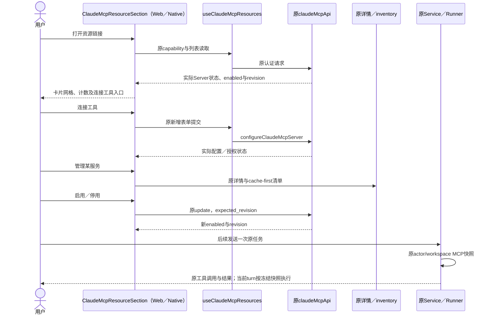
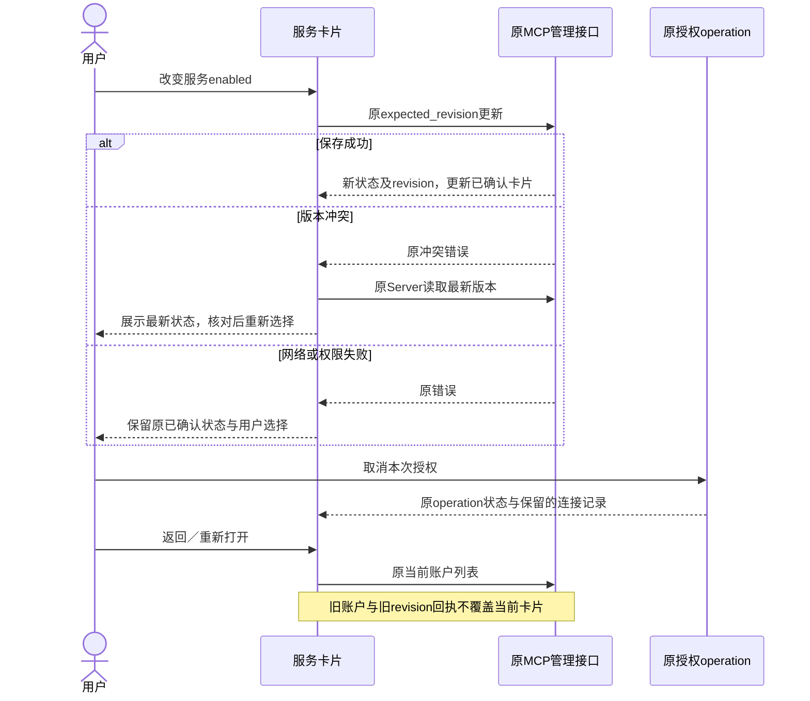
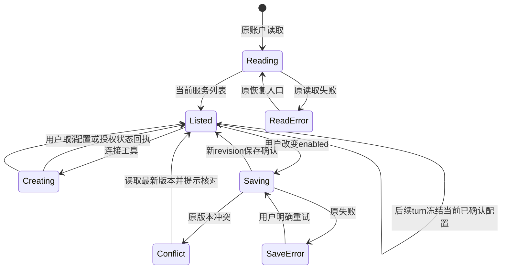

<!-- [Sync] 2026-11-13: 资源管理经设置进入，保留原深链与内部intent。 -->
<!-- [Sync] 2026-11-13: Chat工具按当前Thread和逐条消息选择；资源设置只管理连接及认证。 -->
<!-- [Input] 原MCP管理API及双端列表、设置内资源管理导航。 -->
<!-- [Output] 资源管理卡片、保存接口与加载时序。 -->
<!-- [Pos] 资源连接前端开发设计；Chat工具交互由Chat专项维护。 -->
<!-- [Sync] 2026-11-13: 从音频前端稿拆出完整MCP管理章节与三图，更新工作台入口。 -->

# 资源连接管理前端接线

Chat输入栏与工具菜单见[Chat专项](../../prd/chat/agent-tool-composer.md)。本稿维护连接生命周期。

### 需求来源与范围修订

[Notion新增ui交互](https://app.notion.com/p/40b30b7547c380cd9930c384ab35023c#41530b7547c380f48038c931c30580b8)指定两端采用连接工具入口、已连接卡片网格、状态及断开操作。原图已核对，卡片属于MCP服务连接管理。[产品规则与两端骨架](../../prd/resource-connections/mcp-tool-management.md)维护页面；[补充前原文与三图](../multi-platform/history/mobile-clock-audio-frontend-before-mcp-management-20261112.md)保留。

工作台通过设置进入原资源页面及两个连续区域；原Notion/飞书连接器保持原owner。独立侧栏及更多菜单资源入口已移除，原资源路由与Chat内部管理intent继续调用Settings所有者。MCP网格、快捷启停已写入双端组件，技术验证见本轮执行记录。设备音频选择与原生播放接线保持未实现，Chat工具菜单展示能力状态。

### 三条状态链

| 状态链 | 所有者与输入 | 输出及边界 |
| --- | --- | --- |
| 远程MCP管理 | 原ClaudeMcpResourceSection／useClaudeMcpResources；capability与Server列表 | 当前配置、认证、enabled与revision；列表不逐卡discovery |
| 当次Agent加载 | 原Service的actor/workspace快照与原Runner | Chat请求提供tools中的MCP names；后端校验actor/workspace及enabled，过滤后读取凭据，冻结当前turn的claude_mcp_servers |
| 设备音频选择 | 当前Thread选择状态及原Native能力事实 | 默认空；显式选择且能力就绪时在发送/排队携带mobile_clock_audio；Web不发送该type |

`ClaudeAgentRequestBody.tools`携带固定平台type或`{type: "mcp", server_name}`。Chat菜单只读取连接目录，将当前Thread的选择随消息提交；原管理API负责配置、认证和连接启停。客户端字段限于类型和托管名称，URL、env、凭据及schema由后端配置所有。公共MCP与Editor基线按原配置保留。

原MCP Apps使用策略继续控制工具结果内的App能力，`ClaudeMcpAppSettings`的default/desired/effective/revision沿原合同。音频设备选择使用当前Thread的状态，零新增数据库schema；这两类状态独立。

### 界面与源码接入

| 模块 | 当前源码与建议改动 |
| --- | --- |
| 原资源入口 | [Settings PRD](../../prd/Settings.md)的兼容资源链接页；原ConnectorSettingsSection保留远程/本地连续结构 |
| 服务卡片 | [Web列表](../../../frontend/app/_dream/components/claude-mcp/ClaudeMcpResourceSection.tsx)与[Native列表](../../../frontend/app/_dream/components/claude-mcp/ClaudeMcpResourceSection.native.tsx)改为同一信息结构的卡片；沿原主题与各端布局 |
| 数据与认证操作 | [useClaudeMcpResources](../../../frontend/app/_dream/hooks/useClaudeMcpResources.ts)继续管理列表、原新增、授权operation、取消、退出及移除；不建立第二个连接store |
| 详情与工具清单 | 原ClaudeMcpServerDetailPage与[useClaudeMcpServer](../../../frontend/app/_dream/hooks/useClaudeMcpServer.ts)保持自动cache-first inventory与原策略保存；列表不增加批量探测 |
| 请求边界 | [claudeMcpApi](../../../frontend/app/_dream/api/claudeMcpApi.ts)及Native注入transport保持原session/CSRF与DTO；新增卡片只调用原公开边界 |
| 设备工具卡 | Chat菜单接入App音频能力状态；默认关闭，能力未就绪禁用，Web展示仅App可用 |
| Agent/问答/播放器 | 见[音频接线](../multi-platform/mobile-clock-audio-frontend.md)；启用工具只改变可见性，AskUserQuestion和实际媒体状态分别处理 |

列表图标优先使用已有安全展示数据，缺图显示原通用工具图标；计数由当前列表计算。截图中的Gmail/GitHub等应用不成为静态连接记录或额外集成依赖。

### 接口与并发

- `getClaudeMcpCapability / listClaudeMcpServers`保留原页面读取；连接不支持时显示原能力反馈。当前列表状态来自后端记录，陈旧信息保留最近状态，零“配置存在即已连接”推断。
- “连接工具”沿`configureClaudeMcpServer`及原新增弹窗。成功后更新列表，授权采用原start/cancel/operation；认证方式由服务端判定，客户端不选择凭据策略。
- 卡片启停复用`updateClaudeMcpServer(server, changes)`。当前helper提交完整配置及expected_revision，changes取当前回执中的配置，仅改变enabled；缺少id/revision/可编辑配置时回详情，不能猜测默认字段。
- 保存中保留当前已确认状态并展示操作进度。409读取原Server最新revision，提示核对后重新选择；失败不更新已确认enabled。旧owner、旧revision及旧请求回调不覆盖新卡片。
- 停用保留配置和认证，下一turn快照排除该服务。退出认证调用原logout；移除按原removable和确认执行。当前running turn保持原快照，原Stop单独处理。
- 详情inventory沿原cache-first请求，重建和失败恢复沿原操作。禁止通过列表轮询或客户端“重新加载所有MCP”形成额外远端调用。

### 默认、期望、实际与版本

| 状态 | 远程服务 | 设备音频工具（建议） |
| --- | --- | --- |
| default | 原CreateServerRequest.enabled缺省true，revision取实际配置回执 | tools为空，设备选择关闭 |
| desired | 当前用户待保存的enabled | 当前Thread的待提交选择 |
| effective | 后端已保存状态及当前turn冻结快照各自维护；缺少turn回执时只展示已启用 | Native能力可用、当次选择和tool_choice共同决定本次可提供工具；不从选择推断播放器已可用 |
| revision | Server.revision、credential_revision由原后端维护 | 本地选择代次与原提交身份绑定，仅用于快照/迟到事件校验，不增加公开DTO字段 |

设备工具选择在当前前端进程中按Thread保留；页面重载或进程重启回到关闭，能力失效时限制新增选择。发送和排队在原提交边界捕获选择快照；之后修改选择只影响后续提交。前端显示“已启用”并保留对应连接／授权状态，设备卡显示“已选择”；缺少当前turn MCP加载回执时，不宣称本轮加载成功。

### 平台与未完成边界

Web和App共享服务管理含义及原API；Native继续注入现有transport和外链授权入口。传输方式依据原capability和经核对的本地执行能力呈现；当前DTO缺少某项端侧执行资格时列为接入前置，不能因Web支持stdio就允许App执行任意本地命令。

[Notion未完成功能边界](https://app.notion.com/p/40b30b7547c380cd9930c384ab35023c#41530b7547c380f48038c931c30580b8)中Web分发Bridge、多Agent生命周期、IDENTITY/USER/HEARTBEAT仅记录为后续研究。当前页面不提供设备发现、跨端调度或心跳启停，不把MCP服务卡创建等同于创建Agent。

### 正常管理与加载时序

### 失败与恢复时序

### 配置与运行状态转换

### 评审与实施顺序

两端列表与管理入口负责卡片及保存反馈；Chat负责当前Thread选择及逐条提交，音频问答媒体呈现与原生播放器按独立专项接入。远程MCP继续采用原actor/workspace认证和权限合同，Chat按本条消息选择过滤加载。新UI、当次选择与实际MCP加载分别验证；当前文档检查不形成真实连接或播放验收。

## 2026-11-13 实施边界

Chat输入栏、Agent入口、工具菜单、资源卡片和工作台导航的源码接线及本轮技术验证见[执行记录](../../exec/chat-tools-frontend-20261113.md)。Chat工具选择及请求接线由[Thread范围修正记录](../../exec/chat-thread-tools-20261113.md)维护；音频媒体预览、原生播放器及真实播放保持未实现／未验收。

设置资源入口与Native管理意图的本轮回执见[执行记录](../../exec/chat-composer-zh-navigation-20261113.md)。
