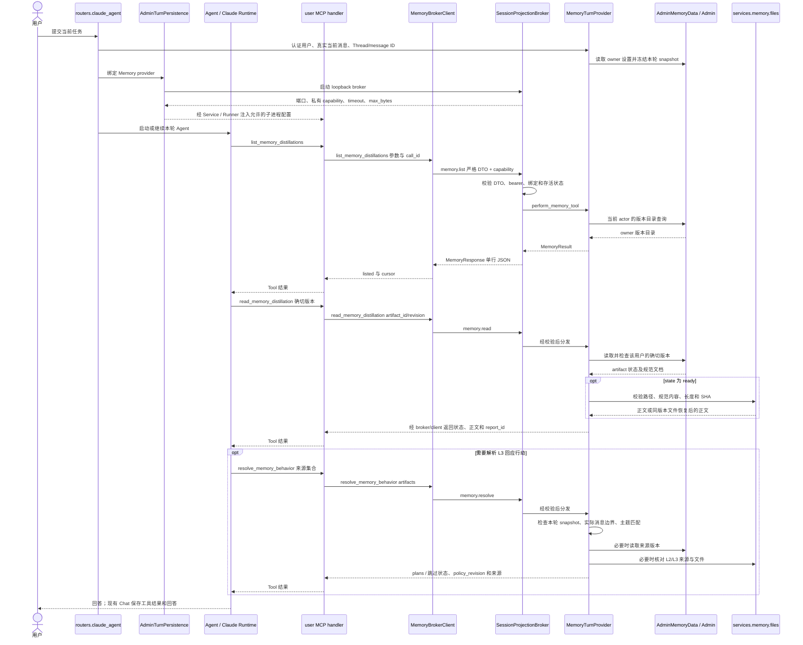
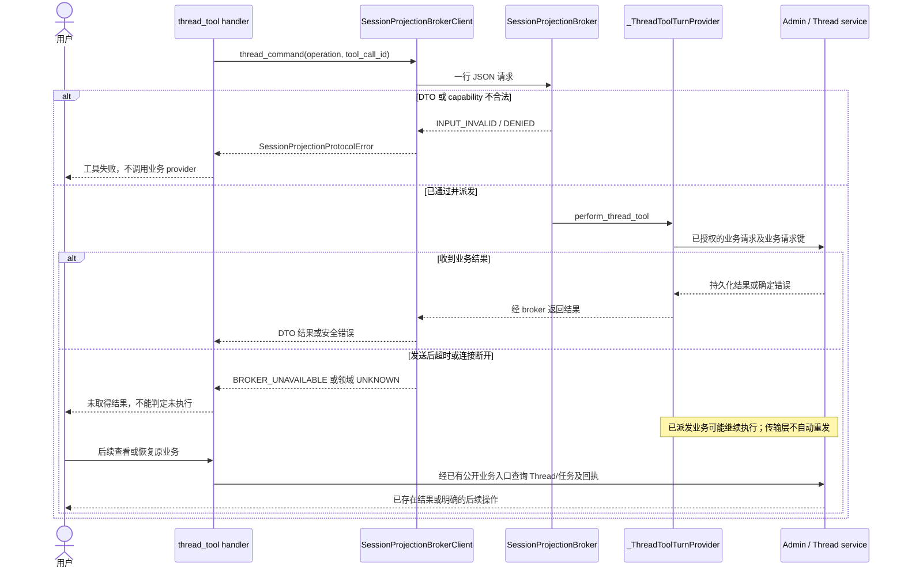
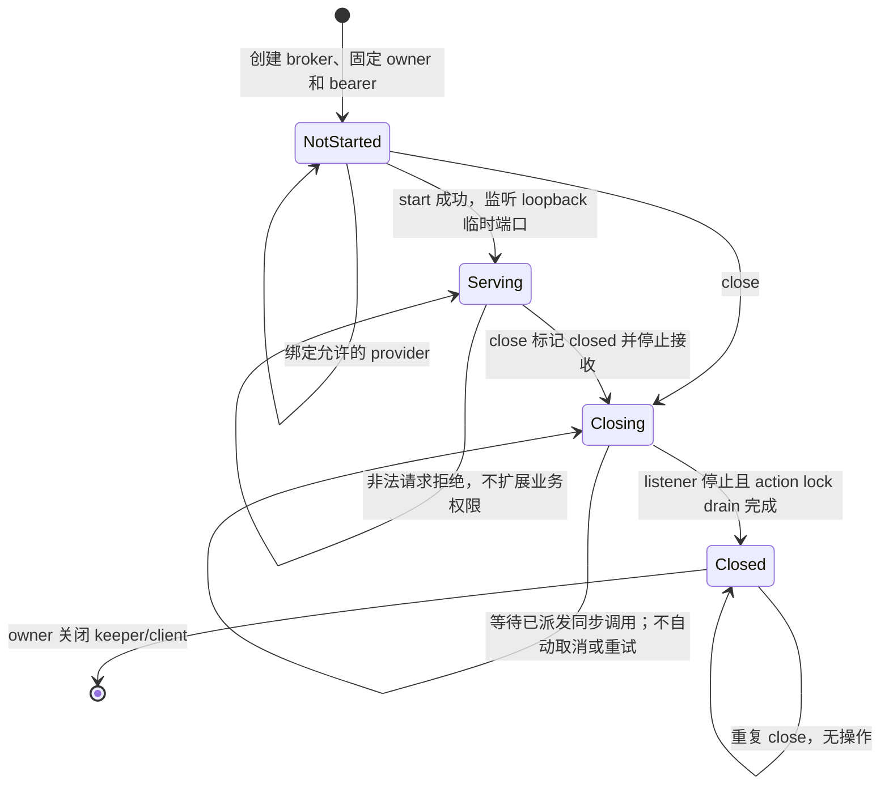

<!-- [Input] backend/libs/claude_agent_kit/server/session_projection_protocol.py、reflection_memory_tool.py、各工具调用点，以及 backend/services/admin_data/session_projection_broker.py 和 turn/Reflections owner。 -->
<!-- [Output] 私有 broker 的职责、传输协议、权限边界、Memory 复用、完整消费者和恢复合同。 -->
<!-- [Pos] Claude Agent 私有 broker 现行实现设计；业务规则仍由各领域设计与服务所有。 -->
<!-- [Sync] 2026-10-18: 直接定义传输协议的编码、分帧与消息结构，删除与其他协议的对比表述。 -->
<!-- [Sync] 2026-10-15: 依据当前源码集中说明 SessionProjectionBrokerClient 与 MemoryBrokerClient，不修改功能或权限。 -->

# SessionProjectionBrokerClient 与 MemoryBrokerClient 设计

状态：现行源码说明。核对日期：2026-10-15。本轮只整理设计文档，不新增客户端、工具、页面、数据库结构或运行权限；下列已实现行为来自本轮代码阅读，不代表本轮执行了功能或真实模型验收。

## 1. 背景与问题

`SessionProjectionBrokerClient` 最初服务 Session 检索，当前已被 Thread、定时任务、Story Workspace、图片和 Reflections Memory 复用。原有说明分散在日记检索、Thread 和 Memory 设计中，类名已不足以表达全部用途，也容易混淆“私有通道访问凭证”和“业务权限”。

本轮核对了类定义、所有生产调用点、Host 分发、两种 owner 和现有测试源码。要补齐的是一份能够解释当前调用关系与边界的独立合同。比较继续分散说明、另造通用客户端和集中记录现有实现后，选择集中记录，并从既有设计链接到本文；不为文档整理重命名类、重构协议或建立平行传输层。

## 2. 目标与边界

- 说明谁创建 broker、谁持有凭证、客户端传什么、Host 如何校验及执行。
- 列清直接调用者、间接工具入口、业务副作用和不同的恢复方式。
- 解释 `MemoryBrokerClient` 复用的具体方法，以及仍由 Memory 自己负责的合同。
- 区分已实现行为、已知实现限制与后续检查项。本文不改变各业务的选择、执行或权限规则，不把 broker 暴露为模型可直接调用的通用 Tool。

日记、Thread、图片和 L2/L3 的业务交互继续由[日记检索](session-labels-and-retrieval.md)、[Thread Tools](task-session-tools.md)、[等待子任务](task-session-completion-handoff.md)、[图片实现合同](image-generation-implementation-notes.md)及 [Memory 设计](../memory/reflections-agent-memory-interaction-design.md)所有。

## 3. 概念与职责

| 对象 | 执行位置和职责 | 不承担的职责 |
| --- | --- | --- |
| 模型可见 Tool / MCP handler | 子进程；提供工具 schema，将模型参数转换为该业务的请求，展示结果 | 不自行选择 actor、Admin 凭证或数据库连接 |
| `SessionProjectionBrokerClient` | 子进程中的同步 Python 客户端；校验服务端注入配置，发送一次 loopback 请求，检查响应帧；另带三个已有业务方法 | 不实现 MCP stdio 协议，不执行 Admin HTTP，不直接访问数据库，不决定业务权限 |
| `MemoryBrokerClient` | 继承上项传输能力，新增 Memory 请求和响应 DTO 适配 | 不执行蒸馏、主题转换、设置保存或当前消息选择 |
| `SessionProjectionBroker` | Dream Host 内的本机 TCP 服务；检查请求 DTO 和 bearer capability，按闭集 operation 分发到已绑定 provider，限制帧大小并管理关闭 | 不接受任意 operation、SQL、Admin URL、凭证或可执行函数 |
| owner / provider | Host；绑定当前用户、Thread、Run 或分析快照，检查操作范围，调用 Admin/领域服务或返回冻结投影 | 不接受子进程替换自身身份绑定 |
| Admin | 业务身份、资源归属、operation/schema capability、共享数据库及持久回执的权威边界 | broker bearer 不能代替这些检查 |

源码入口：[客户端与公共 DTO](../../../backend/libs/claude_agent_kit/server/session_projection_protocol.py)、[Host broker](../../../backend/services/admin_data/session_projection_broker.py)、[普通 turn owner](../../../backend/services/admin_data/turn_persistence.py)。

请求字段 `capability` 定义为当前 broker 的随机 bearer 凭证，用于校验调用方对该通道的访问。Admin schema capability 定义业务合同的版本与摘要，用于业务操作的准入检查。

## 4. 组成、启动与配置

普通 Chat 路径先创建 `AdminTurnPersistence`，固定 `_resolution` 中的 actor、Thread 与 Run，绑定 Memory/Thread provider，再由 owner 的 `start()` 启动 grant keeper 和 broker。随后 `ClaudeAgentService.assemble_context` 从 `session_projection_child_env()` 取得服务端配置，`agent_runner` 将允许的字段投影到相关 stdio 子进程。

`SessionProjectionBroker` 用 `secrets.token_urlsafe(32)` 生成 256-bit bearer，监听 `127.0.0.1:0`，由系统分配可用端口；不是固定业务端口，也没有公开 HTTP 路由。`MemoryTurnProvider` 和 Thread provider 在 broker 启动前绑定；图片 provider 有单独的绑定时机，可在 broker 已启动、图片 CLI 尚未启动时绑定。

| 服务端注入字段 | 用途和校验 |
| --- | --- |
| `INK_SESSION_BROKER_HOST` | 必须为当前协议常量 `127.0.0.1` |
| `INK_SESSION_BROKER_PORT` | 当前已启动 listener 的端口；整数 `1..65535` |
| `INK_SESSION_BROKER_CAPABILITY` | 43 字符 URL-safe bearer；不进入模型工具参数或文档示例 |
| `INK_SESSION_BROKER_TIMEOUT_SECONDS` | 正有限数；连接和普通 socket 读取边界 |
| `INK_SESSION_BROKER_MAX_BYTES` | 正整数；请求和响应帧的有限字节上限，包含结尾换行 |

这些是传输配置与技术校验，不是产品条数或正文配额。默认配置及覆盖由 [SessionProjectionBrokerSettings](../../../backend/services/admin_data/session_projection_broker.py) 和各 composition root 提供；普通 turn 的响应预算沿用服务端 Admin 配置。图片子进程的 timeout 由 `ClaudeAgentService` 按图片 provider timeout 加余量投影，不能假定所有子进程的 timeout 相同。

`from_env()` 只读取上表五项，返回 `cls(...)`，所以对子类调用它会构造 `MemoryBrokerClient`。构造阶段没有网络请求；不合法配置抛 `SESSION_BROKER_CONFIGURATION_INVALID`。

### 4.1 子进程环境边界

- user MCP 使用 Python `-I` bootstrap，在导入 MCP 包前清理继承环境；只保留 broker 五项及 `INK_AGENT_SESSION_RETRIEVAL_MODE`、`INK_AGENT_SESSION_FUZZY_MIN_SCORE`。入口 `user_mcp_stdio.py` 再执行同一白名单。Admin/Gateway 凭证不传入该子进程。
- `service.py` 将这些键作为 server-owned 值处理，用户 env 不能覆盖。broker capability 在进程配置中使用，不是模型选择的参数。
- Story Workspace stdio 另有服务端绑定的 actor/Thread/Run/message 与工作区上下文；不能将 user MCP 的精确环境清单泛化到所有子进程。
- 图片 stdio 复用 user MCP 的配置构造方式，使用相同 broker 通道；图片业务授权和 Gateway 凭证保留在 Host。

依据：[Service 注入](../../../backend/claude_agent/service.py)、[Runner 子进程配置](../../../backend/libs/claude_agent_kit/server/agent_runner.py)、[user MCP 环境清理](../../../backend/libs/claude_agent_kit/server/user_mcp_stdio.py)。

## 5. 传输协议（wire protocol）

传输协议定义通信双方交换消息时遵守的字节编码、消息分帧、字段结构、交互顺序和错误表示。本文的私有 broker 通过 TCP 传输 UTF-8 编码的 JSON，每条消息以换行字节 `0x0A` 结束；每条连接承载一次请求和一次响应。

### 5.1 一次连接、一次请求、一次响应

`_round_trip(request, request_id, read_timeout_seconds=None)` 每次创建一条 TCP 连接：

1. DTO 序列化为 UTF-8 JSON，追加换行字节 `0x0A` 后发送。
2. Host 读取一行，按 `max_bytes + 1` 检查空输入、超长或缺少结尾换行。
3. Host 解析业务 DTO，检查 capability，以 `hmac.compare_digest` 比较当前 bearer，再调用绑定 provider。
4. Host 编码结果并检查响应上限。超限整体返回 `SESSION_BROKER_RESPONSE_TOO_LARGE`，不截断正文或返回部分成功；错误帧本身仍超限时返回空字节。
5. 客户端读取一行并检查长度和换行，移除结尾换行，将字节交给具体业务响应解析器。

`_round_trip` 返回去除结尾换行的响应字节，业务客户端方法负责按响应 DTO 解析 `result` 并判断业务结果。每次调用只发送一次请求，重试和结果恢复由具体业务流程处理。请求大小上限由 Host 检查。`status_code` 是错误 DTO 中的整数状态码，与 `code`、`request_id` 一起表示本次操作的错误。Host 尚未读完请求便发生 socket timeout 时不保证结构化回包，见 §12。

### 5.2 请求族与响应族

| 请求族 | 请求字段及资源选择参数 | 响应及客户端方法 |
| --- | --- | --- |
| Session | 无 `operation` 字段；`capability`、`request_id`、`start_date`、`end_date`、`include_text`；真实日期且起止有序 | `SessionProjectionResponseDTO` → `SessionProjectionResultDTO.sessions`；`list_sessions()` |
| 当前 Run | `operation="workflow-run.current"`；仅 capability/request_id，没有 Run、workspace、actor 或 Thread selector | `WorkflowRunProjectionResponseDTO` → 当前 `WorkflowRun`；`current_workflow_run()` |
| Thread / Schedule | `operation` 限于 `thread.create/list/read/send/wait`、`schedule.create`；`tool_call_id` 与各操作排他参数 | `ThreadToolCommandResponseDTO` → `ThreadToolCommandResultDTO`；`thread_command()` |
| Memory | `operation` 限于 `memory.list/read/resolve`；各操作字段见 §7 | `MemoryResponse` → `MemoryResult`；子类 `command()` |
| 图片 | `image.generate` 或 `image.select`；prompt、受限引用和实际调用身份，使用各自 DTO | `request_image()` / `request_image_selection()` 复用 `_round_trip`；不经过父类三个业务方法 |

Thread/Schedule 六种请求均带 `capability`、`request_id`、`operation`、`tool_call_id`；业务字段按下表排他使用，其余字段保持 null：

| operation | 非空业务字段与默认处理 |
| --- | --- |
| `thread.create` | 必填非空 `prompt`；`title` 可省略，提供时非空 |
| `thread.list` | 可选非空 `query` 和 `limit`；DTO 的 limit 为 1..100 或 null，具体默认由业务 handler/provider 决定 |
| `thread.read` | 必填 `thread_id`；可选 `message_limit`，范围 1..100 或 null |
| `thread.send` | 必填 `thread_id` 和非空 `prompt` |
| `thread.wait` | 必填 `targets`，1..8 个不同 thread_id，可附 after_cursor；`timeout_ms` 为 0..120000 或 null，null 的 client 等待预算按 120000ms 计算 |
| `schedule.create` | 必填非空 `title`、`prompt` 和 `schedule_rule`；当前请求 DTO 仅接受 once/daily/interval 的闭集字段，hourly/weekly 差异见 §12 |

图片生成请求 `ImageGenerationRequest` 带 `prompt`、`reference_images`、`source_call_id`；选择请求在 `ImageSelectionRequest.arguments` 中带操作、prompt 和引用，外层另带实际调用 ID。引用限定为 `workspace://files/...`；当前选中模型、actor、Gateway token 均不从请求中接收。原始 SDK `source_call_id` 与 user MCP 派生的 `tool_call_id` 不是同一种调用身份，不能互换。

公共 `_StrictDTO` 禁止额外字段、类型隐式转换和 NaN/Infinity，并冻结实例、隐藏校验错误输入。Memory 和图片定义各自的严格 DTO，并非继承公共 `_StrictDTO` 的全部配置。未知 operation 不会透传；它最终不能通过对应的闭集请求校验。

Thread 业务确实允许目标 `thread_id` 和 `targets`，Memory 允许 artifact ID/revision。因此，“禁止身份注入”不能表述为“所有请求没有资源 selector”：允许的目标由业务 schema 明确列出，归属继续由 Host/Admin 检查。

### 5.3 响应、关联与幂等

公共及 Memory 响应的成功形状为 `ok=true`、非空 `result`、空 `error`；失败为 `ok=false`、空 `result`、非空 `error`。错误 DTO 只有 `code`、`status_code`、可选 `request_id`，不含统一 `outcome_unknown` 字段。图片响应使用自己的 envelope 校验。

公共和 Memory 的成功响应通过一条连接中的单次请求与响应建立关联，成功 envelope 不包含 `request_id`。错误响应携带的 ID 被转交，缺失时使用本地 ID。图片生成由 `request_image()` 比对 `ImageGenerationResult.requestId`；图片选择由 `request_image_selection()` 校验成功 envelope 的字段集合和结果对象类型。

`request_id` 用于一次请求的追踪与下游调用，不是通用幂等键：Thread 方法每次生成新的 UUID，并独立携带实际 MCP `tool_call_id`；Memory 直接使用 MCP request identity 派生的 `call_id`。Thread 创建、定时任务和图片的业务幂等/结果恢复由各领域服务决定。

## 6. 权限边界

| 边界 | 当前执行检查 | 不能据此推导的权限 |
| --- | --- | --- |
| 模型 → Tool | 注册 schema、handler 字段白名单、[Claude-Agent Permission Policy](claude-agent-permission-policy.md) 的 PreToolUse 决策 | 描述中的“只读”、low-sensitivity 或工具名称不授予业务访问范围 |
| 子进程 → broker | 固定 loopback、有限帧、严格 DTO、当前随机 bearer、已绑定 provider | bearer 不是 OAuth token、Admin schema capability 或每 Tool 的细粒度 allowlist |
| broker → provider | 请求族匹配；未绑定/已关闭时拒绝；Host 保留当前 owner | 子进程不能切换 actor、借未绑定工具扩展能力或直连数据库 |
| provider → Admin / 来源 | 当前用户或 turn/section grant、operation/schema capability、资源归属和来源范围 | broker bearer 不代替这些检查；Thread 目标/Memory artifact 必须按各自业务授权 |
| Host 文件操作 | Memory 文件按服务端根目录、合法 artifact/revision、来源合同和 SHA 校验；Story/图片有各自文件边界 | 不授予模型任意 Host 文件路径或扩大原生 `Read`/workspace allowlist |

同一 broker 的各 operation 共用 bearer，没有为 Memory、Thread、Story、图片划分独立 transport capability；也不在 TCP 请求中携带一次 PreToolUse 批准凭据。正常调用顺序会先经过工具权限流程，但 bearer 泄漏后的边界主要依靠 loopback、存活期、DTO、provider 绑定和下游业务校验，不能将其声称为逐工具隔离或完整子进程沙箱。bearer 必须按进程私有凭证处理，不写入模型上下文或日志。

### 6.1 两种 owner

| owner | 来源和已绑定能力 | 关闭顺序 |
| --- | --- | --- |
| `AdminTurnPersistence` | 当前认证 actor/Thread/Run；Session 使用 current renewed grant 查询 Admin；当前 Run 按 bound context 获取并核对 workspace、created_by、source Thread、plugin/binding/snapshot/lock；Thread/Memory/图片由当前 turn 另外绑定 | 先停 broker 和 drain，再关闭 owner 写入、grant keeper 和 HTTP client |
| `AdminReflectionSectionPersistence` | `ReflectionSnapshotSessionProjectionProvider` 只返回 launch snapshot 中冻结的 Session，按请求日期和 include_text 投影；没有绑定 Run、Thread、Memory、图片 provider | 先停 broker，再关闭 keeper 并撤销 section authority |

因此，Reflections 的 Session 读取不等于再次查询用户全量实时日记；Notion-only 分析也不会因共享客户端而取得其他来源。工具已注册不代表当前 owner 绑定了对应能力。

依据：[Reflections owner](../../../backend/services/admin_data/reflection_section_persistence.py)、[冻结快照 provider](../../../backend/services/admin_data/reflection_task_runtime.py)。

## 7. MemoryBrokerClient 如何复用

定义位于 [reflection_memory_tool.py:72](../../../backend/libs/claude_agent_kit/server/reflection_memory_tool.py#L72)。当前采用继承，没有新增端口、listener、Admin token、数据库连接或独立 Memory broker。

| 复用内容 | 子类具体行为 |
| --- | --- |
| 构造校验、`from_env()` | 读取相同五项配置；父类 `return cls(...)` 构造子类 |
| `_capability` | `command()` 将当前 bearer 放入 `MemoryRequest`，不是模型参数 |
| `_round_trip()` | 复用相同 TCP、帧上限和超时处理 |
| `_raise_remote_error()` | 把失败 envelope 中的安全错误字段转换成 `SessionProjectionProtocolError` |
| Memory 自己负责 | `MemoryRequest` 排他字段、`MemoryResponse`、`MemoryResult` 解析、三个 Tool 的公开 schema 与结果展示 |

它**不调用**父类的 `list_sessions()`、`current_workflow_run()` 或 `thread_command()`；继承的是传输与配置复用，Memory 语义仍由自己的 DTO、Host provider 和 Admin operation 定义。

### 7.1 三个入口和内部字段

| 模型可见入口 | `command()` 的内部操作 | 输入及结果 |
| --- | --- | --- |
| `list_memory_distillations` | `memory.list` | `limit` 可省略，当前默认 20、schema 范围 1..100；`before` 可省略或为 null，下一页原样使用 `next_cursor`。返回 `listed`、版本目录、完成状态和 cursor |
| `read_memory_distillation` | `memory.read` | 必填 `artifact_id` + `revision`；返回该版本状态、report_id、来源文档和 SHA；只有 ready 读取正文 |
| `resolve_memory_behavior` | `memory.resolve` | 必填 `artifacts:[{artifact_id,revision}]`，可为空；返回 `resolved/disabled/no_match/explicit_boundary/unavailable`、policy_revision、plans 与来源引用 |

公开参数不含 owner、actor、Thread、当前消息、自由文件路径、Admin token 或自选策略。当前 artifact/revision 等数值边界来自 DTO/schema，是协议约束，不额外定义产品门槛。

`mcp_server.py` 从真实 MCP request identity 派生 `call_id`；handler 排除额外参数后，调用 `MemoryBrokerClient.from_env(...).command(...)`。Host broker 校验 `MemoryRequest` 与 bearer，再调用已绑定的 `MemoryTurnProvider.perform_memory_tool()`；Host 还要求返回对象类型为 `MemoryResult`。

### 7.2 Host 执行与文件边界

`routers.claude_agent._claude_agent_stream_impl` 用当前认证用户、实际本轮消息、Thread/message ID 构造 provider。provider 固定 owner 和 `BehaviorPolicySnapshot`，OAuth 刷新只接受同一 canonical owner；这些值都不来自模型 Memory 参数。

- list/read 通过 `AdminMemoryData` 检查精确 operation/schema capability，以当前用户 token 调用 Admin；归属在 Admin 业务边界检查。
- read 取得 Admin 校验后的版本，再由 `services.memory.files.read()` 验证规范文档、服务端路径、普通文件、字节长度、UTF-8 和 SHA。磁盘文件缺失时可从 Admin 保存的同一规范正文重发文件；这是文件恢复，不修改记忆内容或版本。该读取不扩大 Agent workspace。
- resolve 先检查设置快照、当前任务边界和总开关，再匹配实际当前消息；只采用当前转换版本且 L2/L3 均 ready 的主题，读取并核对确切来源。无匹配、多主题不能确定或用户明确拒绝时不提供主题行动。
- 同一轮相同来源集合可复用内存中的解析结果；设置保存不会替换该轮快照，新轮次重新读取。resolve 不触发分析、蒸馏、设置保存或模型调用。`resolved` 仅表示返回了允许行动，不证明 Agent 已采用或产生心理效果。

依据：[MemoryTurnProvider](../../../backend/services/memory/behavior.py)、[Admin Memory DTO 客户端](../../../backend/services/admin_data/memory_data.py)、[文件检查与恢复](../../../backend/services/memory/files.py)。

## 8. 其他使用位置与完整调用清单

以下是本轮检索到的生产调用。非 Memory 直接使用该类的模块有五个：`sessions_tool.py`、`thread_tool.py`、`story_workspace_tool.py`、`image_gen_stdio.py`、`image_generation_protocol.py`；另有一个 Memory 子类模块。表中的 Tool 名称是业务入口，不意味着私有 operation 被单独注册为 Tool。

| 业务 / 入口 | 客户端使用与内部操作 | Host 执行与副作用 |
| --- | --- | --- |
| `mcp__user__get_sessions_range` | `sessions_tool.handle_get_sessions_range()` → `list_sessions()`；无 operation 字段 | 当前 turn 的 Session provider → Admin `session.list`，或 Reflections 冻结 snapshot provider；子进程再做标签/字符模糊匹配和结果排序，无业务内容写入 |
| `mcp__user__create_thread` | `handle_thread_tool()` → `thread_command(thread.create)` | `_ThreadToolTurnProvider` → 已授权 Thread 创建和执行流程；可持久化并开始模型任务 |
| `mcp__user__list_threads` | `thread_command(thread.list)` | 同一 provider 读取当前用户可见 Thread |
| `mcp__user__read_thread` | `thread_command(thread.read)` | 同一 provider 校验目标并读取消息 |
| `mcp__user__send_message_to_thread` | `thread_command(thread.send)` | 同一 provider 校验目标并持久化输入、进入现有执行/队列流程 |
| `mcp__user__wait_threads` | `thread_command(thread.wait)` | 同一 provider 等待目标完成、attention、输入或超时；不自动给其他 Thread 发消息 |
| `mcp__user__create_scheduled_task` | `thread_command(schedule.create)` | 同一 provider → Admin 定时定义和来源绑定；后续按现有调度执行，broker 不实现 scheduler |
| `mcp__story_workspace__write_dream_run` | `story_workspace_tool._with_authoritative_context()` → `current_workflow_run()` → `workflow-run.current` | broker 只读取当前绑定 Run；子进程 `StoryWorkspaceDreamFileWriter.write_run()` 按 revision CAS 写 `.dream` 文件，不推进 WorkflowRun 状态机；Tool 整体有文件写入 |
| `mcp__story_workspace__write_dream_stage` | 同上，读取当前 Run | 子进程 `write_stage()` 校验阶段/schema/provenance 并 CAS 写文件；失败为 `DREAM_WRITE_REJECTED`；不因复用读取客户端成为只读 Tool |
| `mcp__image_gen__imagegen` | `image_gen_stdio` 创建 client → `request_image()` → `_round_trip(image.generate)` | `ImageGenerationProvider.generate()` 校验已选模型、引用、images scope 和一次性调用授权，再调用 Gateway Images 并发布文件；可调用真实模型与结算 |
| `mcp__image_gen__select_image_operation` | 同一 client → `request_image_selection()` → `_round_trip(image.select)` | `ImageGenerationProvider.select()` 保存本 turn 的图片操作选择，不生成图片；必须匹配 PreToolUse 已授权的原始 SDK `source_call_id` 和参数 |
| 三个 Memory Tools | `MemoryBrokerClient.command(memory.list/read/resolve)` | §7 的绑定 provider；不更改记忆内容或设置，可恢复丢失的规范文件 |

共 14 个模型可见入口：1 个 Session、6 个 Thread/Schedule、2 个 Story、2 个图片、3 个 Memory。它们复用同一种 broker 实现；某一 turn 是否可用，取决于其 owner 实际绑定的 provider。user MCP 注册其中 10 个，Story 和图片各自注册两个。

`mcp__memory__recall_shared_stories`、Editor MCP 和 Necklace MCP 使用各自路径，不使用这个客户端；近期 Session prompt 的 Host 直接投影也不等于调用子进程客户端。测试中的 `from_env()`/Mock 是验证消费者，不能算新增产品入口。

源码索引：[Session handler](../../../backend/libs/claude_agent_kit/server/sessions_tool.py)、[Thread handler](../../../backend/libs/claude_agent_kit/server/thread_tool.py)、[Story Workspace handler](../../../backend/libs/claude_agent_kit/server/story_workspace_tool.py)、[Story 文件 writer](../../../backend/services/story_workspace/dream_file_service.py)、[图片 stdio](../../../backend/libs/claude_agent_kit/server/image_gen_stdio.py)、[图片协议](../../../backend/libs/claude_agent_kit/server/image_generation_protocol.py)、[图片 Host provider](../../../backend/services/admin_gateway/images.py)、[Thread Host provider 与绑定](../../../backend/routers/claude_agent.py)、[user MCP 注册](../../../backend/libs/claude_agent_kit/server/mcp_server.py)。

## 9. 正常业务时序：Memory 列表、读取与回应策略

图中的跨层返回表示逐层编码/解析，不是 Admin 直接向子进程发送凭证。分析和文件生成的持久化属于原 MemoryWorker/报告链；本次 Tools 读取其结果，现有 Chat 过程保存工具结果。

## 10. 失败、结果未知与恢复

| 情况 | 当前反馈 / 行为 | 恢复边界 |
| --- | --- | --- |
| 环境缺失或非法 | `SESSION_BROKER_CONFIGURATION_INVALID` | 修复服务端绑定或启动新 turn；不回退数据库或其他账户 |
| DTO 非法、未知 operation、超长或已读到缺少结尾换行的请求帧 | `SESSION_BROKER_INPUT_INVALID`；具体 child 方法也可先返回领域输入错误。等待未读完帧时发生 socket timeout 不保证结构化错误 | 修正真实参数，不放宽 schema |
| bearer 不符 | `SESSION_BROKER_DENIED` / 401 | 不调用 provider，不重试猜测 bearer |
| 对应 provider 未绑定 | `MEMORY_TOOL_UNAVAILABLE`、`THREAD_TOOL_UNAVAILABLE`、`IMAGE_TOOL_UNAVAILABLE` 或 `STORY_WORKSPACE_PROJECTION_DENIED` | 只在对应业务 owner 中调用；注册同名 Tool 不代表可用 |
| 连接失败、socket 超时、listener 已关闭 | `SESSION_BROKER_UNAVAILABLE` | 未拿到回执不证明 provider 没执行；有效新 turn 中重建 client，不复用旧端口/capability |
| 响应缺换行、为空或超长 | child `SESSION_BROKER_RESPONSE_INVALID`；Host 可返回 `SESSION_BROKER_RESPONSE_TOO_LARGE` | 调整合法来源范围/服务端有限容量后读取；不把缺失正文当空结果 |
| Memory 可预期 ProtocolError | handler 返回 `status=unavailable` 与 `error_code` | Agent 不能据此编造记忆或主题行动 |
| Memory 设置失败、关闭或不适用 | `unavailable/disabled/no_match/explicit_boundary`、无 plans | 继续当前任务；不使用旧启用快照替代失败设置 |
| Memory 文件缺失 / 损坏 | 缺失时按规范内容恢复；损坏、链接、来源不一致拒绝，转 `MEMORY_FILE_UNAVAILABLE` 等领域错误 | 不从模型自由生成替代文件，不修改已保存正文 |
| Thread/Schedule 请求已发送但结果未知 | provider 可返回 `THREAD_TOOL_STATE_UNKNOWN`；wait 的独立等待超时为 `THREAD_WAIT_STATE_UNKNOWN` | 查询已有业务状态并遵循该领域原请求键/回执；不要用新调用身份盲目再创建 |
| 图片已提交但响应丢失 | 可收到 `IMAGE_TURN_OUTCOME_UNKNOWN`、`IMAGE_REQUEST_OUTCOME_UNKNOWN` 或底层错误；broker 本身无统一重试或取消协议 | 按图片 provider、Gateway request、文件及 Chat 原流程核对，不能因 socket 失败再次生成并重复结算 |

客户端没有通用 retry、幂等账本或跨 turn 恢复 token。Session/Memory 读取可在有效 owner 中重新读取；Memory resolve 的新 turn 会重新取得当前消息和设置。Thread 创建和 Schedule 在业务层按来源消息与实际 `tool_call_id` 构造请求键，MCP 重开后换一个 call ID 不能视为同一次业务重试。socket 超时不会自动中断已派发的同步 provider；写入/模型执行可能仍继续。

图中的“查询回执”由现有领域入口承担，不表示 `SessionProjectionBrokerClient` 新增 receipt 方法；Memory 读失败也不需要新增写入确认弹窗。

## 11. 生命周期与并发

以下是从 `_server`、`_closed` 和 dispatch 锁推导的说明状态，不是新增数据库状态或配置项。

| 状态 | 程序条件 / 行为 |
| --- | --- |
| 未启动 | `_server is None`、未 closed；可绑定 Memory/Thread provider，不能取 child_env |
| 服务中 | listener 已启动、未 closed；`start()` 重复调用不另建 listener |
| 关闭中 | `_closed=True`；停止新派发、关闭 image provider、shutdown listener，等待既有同步派发结束 |
| 已关闭 | listener 停止且 drain 完成；`close()` 可重复调用；不能重新 start，需要新 owner/broker |

Session、当前 Run、Thread/Schedule 和 Memory 的 provider 派发共用 `_action_lock`，因此 `thread.wait` 可阻塞同一 broker 的其他这些请求。图片派发不持有该锁，不能将 broker 描述成所有调用完全并行。`thread.wait` 仅延长本次 client 读取等待：`timeout_ms / 1000 + 基础 timeout`；连接建立仍使用基础 timeout，其他请求不继承这次扩展。

`close()` 不强杀同步 provider，也没有统一关闭 deadline；普通 owner 在 broker drain 后才关闭 grant keeper/client，避免已经派发的调用使用被提前关闭的依赖。图片 provider 的取消和迟到发布保护由图片域处理，不能推广成全部操作的通用取消协议。

## 12. 当前限制与后续检查

这些是本轮源码核对发现，未在本轮修复，也不以文档检查宣称通过：

1. 名称与范围：父类已带多个领域方法，Memory 子类与图片 helper 直接复用 `_capability`、`_round_trip` 等内部成员。当前可复用，但不是独立稳定的公开 SDK 接口；未来调整须同时核对所有消费者，不能只按 Session 搜索。
2. Memory 异常归一不完整：`MemoryBrokerClient.command()` 直接校验 `MemoryResponse`，不像父类三个业务方法那样把响应校验异常归一为 `SessionProjectionProtocolError`。handler 只捕获后者；坏 Memory 响应可进入 MCP 通用工具异常路径，不能保证所有失败都显示 `status=unavailable`。
3. 成功响应关联能力存在差异：公共/Memory envelope 无 request_id 回显，图片生成单独检查 requestId；不宣称统一端到端 ID 校验。
4. 共享 bearer 与派发锁：不是按 Tool 的最小 capability，也不是所有领域独立并发；长 wait 和 close 的等待限制见 §6、§11。
5. Schedule 合同存在既有差异：Tool schema 和 Host provider 支持 hourly/weekly，但 `ThreadToolCommandRequestDTO.validate_command()` 当前只接受 once/daily/interval；hourly/weekly 会先在 child DTO 失败。需单独对齐合同和回归，不能因已注册 schema 就声称该链路可用。
6. `request_id` 与 `tool_call_id` 不是一种身份；现有错误 envelope 没有统一结果未知字段，安全恢复必须依据具体错误与领域回执。
7. Host handler 的 `readline()` 没有统一捕获 socket 读取异常；等待未完整请求发生超时时，可能关闭连接而没有结构化错误回包。客户端仍按连接/响应错误处理，不能保证每次拒绝都得到错误 envelope。

本轮没有引入修复这些问题的额外配置、工具、确认或存储。若后续实施，按[工具规则](../../rules/claude-agent-tools.md)保持 workflow 说明、Tool description 和权限定义各自的边界。

## 13. 验证依据与验收矩阵

本轮只制定/核对下表合同并执行文档检查。测试文件在本轮被读取或定位，**没有运行这些功能测试，也没有开展真实模型验收**。

| 验收对象 | 应观察结果 | 现有测试/源码依据 |
| --- | --- | --- |
| bearer、环境及 owner | 仅本机配置；错误 capability 不到 provider；已关闭/未绑定明确失败 | [test_session_projection_broker.py](../../../backend/tests/test_session_projection_broker.py) 的 env、capability、unbound、closed cases |
| 输入与响应 | 拒绝额外身份/SQL/凭证、无效 DTO、超长/不完整帧；不返回部分正文 | 同文件 request/response corruption cases |
| Run 与 Reflections 来源 | 当前 Run 不由模型指定；冻结 snapshot 不能扩大日期外或其他来源范围 | 同文件 Run cases；[快照日期和正文投影测试](../../../backend/tests/test_admin_reflection_task_data.py#L386)、[test_reflections_agent.py](../../../backend/tests/test_reflections_agent.py)、[test_story_workspace_tool_admin_projection.py](../../../backend/tests/test_story_workspace_tool_admin_projection.py) |
| Session 检索 | Admin 容量与 broker 容量一致；完整正文传输后检索；失败不回退数据库 | [test_sessions_tool.py](../../../backend/tests/test_sessions_tool.py) |
| Thread / Schedule / wait | 目标归属、实际 call ID、排他参数及 wait 单次 timeout；结果未知不盲目重建 | [test_thread_tool.py](../../../backend/tests/test_thread_tool.py)、broker tests 与 Host provider |
| Memory 正常及恢复 | 同一 broker list→read→resolve；当前 owner/text 不可被模型替换；文件缺失恢复同一字节，损坏拒绝 | [test_memory_chain.py](../../../backend/tests/test_memory_chain.py) |
| 图片复用 | 请求身份、模型/引用校验、业务结果、文件发布与取消按图片域处理 | [test_image_generation_tool.py](../../../backend/tests/test_image_generation_tool.py)、[test_image_chat_public_journey.py](../../../backend/tests/test_image_chat_public_journey.py) |
| 生命周期 | 停止新请求、既有派发 drain、keeper/client 后关闭；未假定强制取消 | broker close/drain cases 与 turn owner close |

除表中测试外，[图片测试 fixture](../../../backend/tests/_image_turn_fixtures.py) 间接包装 `request_image()`。全仓调用检索未发现 checked-in scripts 中额外的生产客户端入口；测试 Mock、临时验证脚本和 Host 对协议常量/DTO 的导入不计为新的模型可见 Tool。

文档检查覆盖本文和受影响索引的 Markdown 清单、本地引用、文件头与 Mermaid 语法；具体执行命令及结果随本轮交付报告。现行代码限制保留在 §12，测试位置本身不是通过证明。
