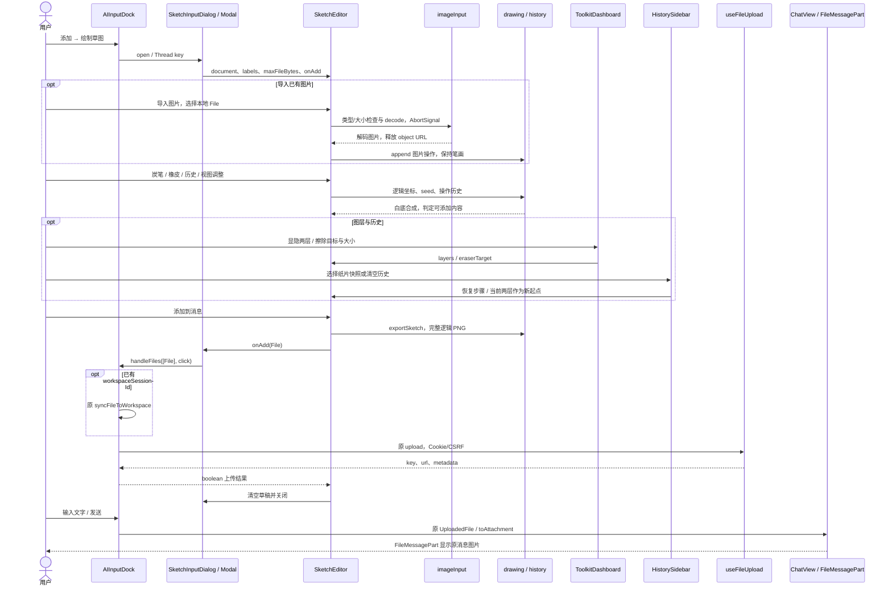
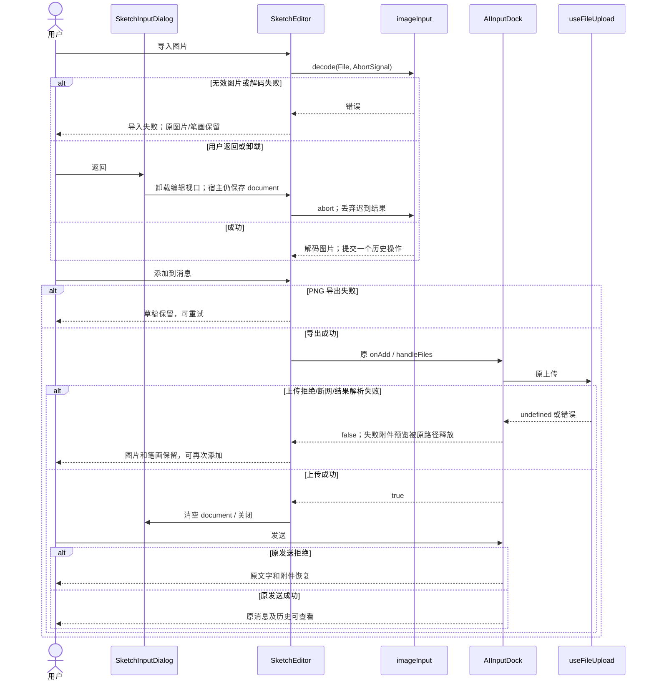
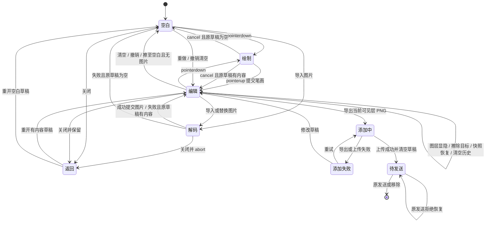

<!-- [Sync] 2026-10-13: align the source component shell, layer controls and history after user correction. -->
<!-- [Input] Current sketch-input PRD, readonly CharcoalNarrative source, Modal and original upload/send APIs. -->
<!-- [Output] One package boundary, normal/recovery sequences, editor states and acceptance mapping. -->
<!-- [Pos] Current Chat image/sketch formal interaction design. -->
<!-- [Sync] 2026-10-13: select modular component package with deterministic charcoal and image composition. -->

# 图片与草图输入交互设计

## 背景与问题

Chat 已有本地草图和上传通路，需要复用指定组件的绘图能力并形成独立包。来源目录不是上传服务，也不是已工作的 AI 生图入口。业务规则和页面骨架见 [PRD](../../prd/chat/sketch-input.md)，旧设计保留于 [历史原文](sketch-input-interaction-v1-20261009.md)。

## 目标与边界

一个 `@ink-dream/sketch-input` pnpm workspace package，公开 `SketchEditor`、受控 `SketchDocument` 和 PNG 输出；不依赖应用 store、Modal、i18n、认证或 API。内部模块为 drawing、history、imageInput、SketchEditor、CharcoalToolbar、ToolkitDashboard 和 HistorySidebar。界面保留来源的纸张纹理、双层画布、左上标识、右上玻璃工具栏/工具箱、左侧纸片历史和自定义绘图光标；宿主 Modal 只承担覆盖、关闭和焦点。宿主仍拥有关闭、草稿、文案、现有文件大小限制、授权上传及消息 DTO。本轮不更改 backend、Admin、Gateway、数据库或 CLI。

## 概念与规则

`SketchDocument` 保存操作数组与 cursor。笔画保存工具、尺寸、points 和 seed；图片操作保存已解码图片，清空操作同时移除图片和笔画。渲染重放操作，先合成图片底层，再将透明笔画层覆盖在白底上；橡皮使用 `destination-out`，目标默认 `sketch`，用户选择 `render` 时擦底图层。两层分别拥有 visible/opacity，当前工具目标被隐藏时不接受绘制；导出合成当前可见层。图像按 contain 放入固定逻辑画布，沿用原草图 PNG 比例与尺寸。源 `CanvasManager` 的颗粒分布和 `CharcoalScene` 的分层合成被复用；源 Math.random 重绘改为 seed 重放，防止撤销后变样。视图 transform 只影响显示；pointer 依据变换后的 boundingClientRect 映射回逻辑坐标。原始 PNG 导出不含 zoom/pan。

导入仅解码本地 File，禁止组件 fetch 上传或模型服务。类型/大小或解码失败不提交历史操作。图片 object URL 在成功、失败、取消后释放，返回/卸载 abort 当前解码并使旧结果无效。图层和橡皮目标由 ToolkitDashboard 显式控制；导入新图片只替换底图。HistorySidebar 保留纸片缩略图和步骤恢复，清空历史将当前两层像素保存为新的本地起点，不丢弃当前内容。打开历史将焦点移至关闭按钮，关闭、Escape 或恢复步骤将焦点返回历史入口，Escape 此时仅关闭历史抽屉。宿主通过 key 将草稿限定于当前 Thread。

## Double Diamond 与范围评审

发现已有生产上传/草图；定义问题为组件模块化及图片描画。整套来源应用会引入叙事、年代、全局 store 与模拟生成；只搬旧草图不能满足指定来源复用。收敛为一个包的本地编辑器，宿主薄适配。选用炭笔/透明擦除/坐标与分层合成，保留现有历史、PNG 和反馈；缩放/移动只服务编辑，保留原图层工具箱和纸片快照历史，排除作品库和 AI 占位。第一版旧表单UI没有满足迁移目标，按用户纠正完整保留原画布外观和布局；第一版文档另见 [版本2原文](sketch-input-package-v2-20261013.md)。所有工具均服务一张待发送图片，无新路由、schema、配额或确认。详细源码判断及输入缺口见 [执行记录](../../exec/sketch-package-20261013.md)。以下包接口为本轮选定实现，实施/验证状态以执行记录为准。

## 正常业务时序

## 异常与恢复时序

## 状态与转换

| 状态 | 输入 / 判断 / 输出 | 可见反馈与恢复 |
| --- | --- | --- |
| 空白 | 无图片且无可见笔画 | 可画或导入；不能添加 |
| 编辑 | document 含图片或可见笔画 | 可修改、历史、视图、返回、添加 |
| 绘制 | 单一 pointer capture | 禁止历史/添加；pointercancel 丢弃未完成笔画 |
| 解码 | imageInput 的本轮 AbortSignal | 禁止编辑/添加；返回取消；失败回原草稿 |
| 导出/上传 | saving callback 与原 onAdd | 显示正在添加，阻止重复添加和关闭 |
| 添加失败 | 导出异常或 onAdd=false | 错误提示；document 不清空，可重试 |
| 待发送 | 原 UploadedFile 已上传 | 原预览、移除、发送；失败恢复 |
| 返回 | 宿主关闭 Modal | document 保留，重开重放；Thread 改变不复用 |

## 模块、影响与验收

| 模块 | 输入 / 输出及边界 | 验收 |
| --- | --- | --- |
| drawing | actions → 图片/笔画两层 → 单个白底 Canvas → PNG；seed 固定、透明擦除、图片 contain | 真实 pointer、像素重放一致、导出内容/尺寸、默认只擦笔画及显式擦底图、视图不改变导出 |
| history | document + action → 新 cursor 分支 | 导入/替换/清空/撤销重做、新操作结束 redo |
| imageInput | 本地 File / maxFileBytes / AbortSignal → 解码图片或错误 | 取消、损坏图、无效类型/大小、URL 释放、旧请求无效 |
| SketchEditor / CharcoalToolbar | document/labels/callbacks → 原纸张/悬浮工具 UI 与 File | 原视觉结构、工具/视图、返回、PNG、失败恢复、键盘/触摸/布局 |
| ToolkitDashboard | layers / eraserTarget / size → 显示或编辑目标 | 两层显隐、笔画/底图擦除、隐藏目标禁画、导出与可见层一致 |
| HistorySidebar | 操作与纸片缩略图 → cursor 或新起点 | 步骤恢复、分支替换、清空历史保留两层、抽屉焦点与滚动 |
| SketchInputDialog | Modal / i18n / Thread-owned draft → 原 onAdd | 焦点/滚动、草稿保留、忙态关闭保护、Thread 隔离 |
| AIInputDock / useFileUpload | 原上传/发送 DTO 与授权 | 真实上传回执/下游图片、失败恢复、旧选择/粘贴/拖拽，slash/Send/Stop 回归 |

包声明使用 `workspace:*` 和 React peer dependency，Next 消费 TS source 并显式 transpile。仅一个锁文件，不添加生产 Vite 根。原 `sketchDrawing.ts` 删除以结束双重实现；共享 Modal、file hooks、transport、后端和数据库不改。视觉输入/模型处理沿用原 Workspace 边界。当前生产模型路径见 [图片设计](image-generation-interaction-design.md)。组件技术验证不调用模型；正常账户的上传、发送和模型调用数量另记于执行记录，不由组件测试推断模型效果。
