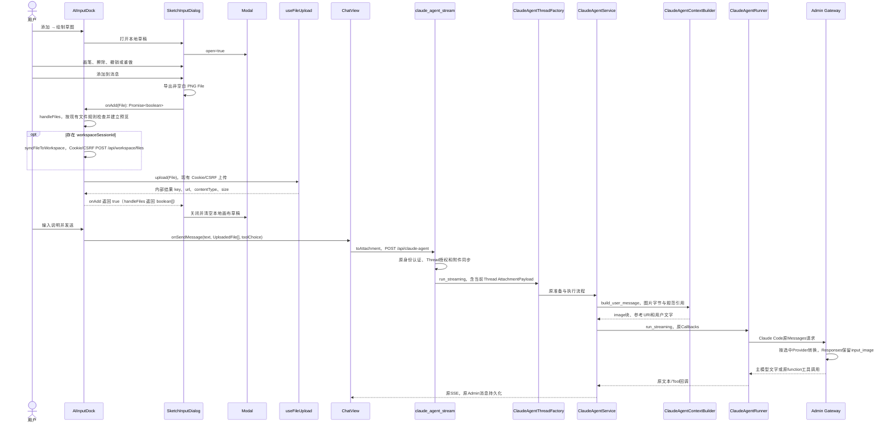
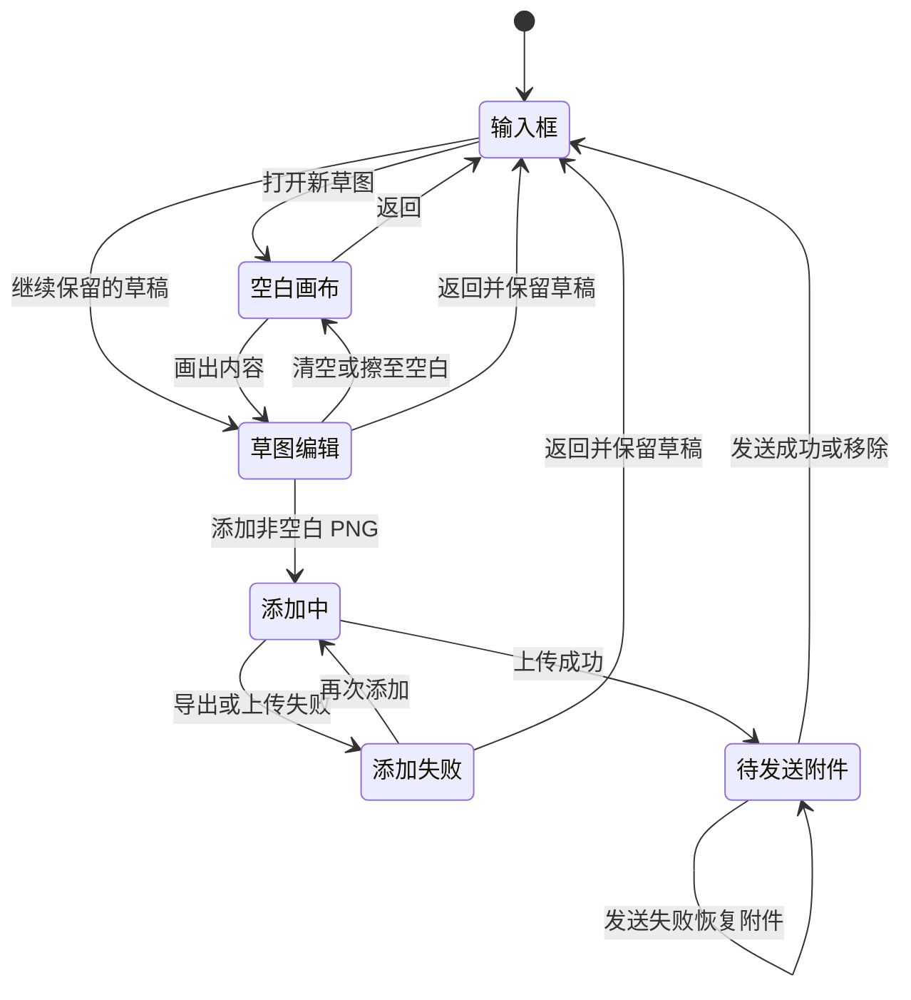
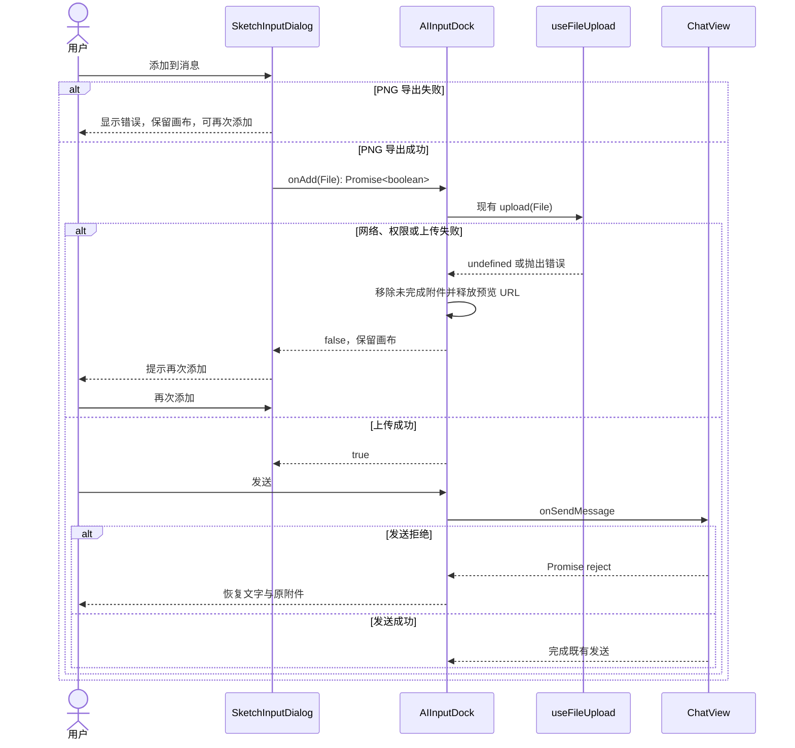

<!-- [Input] Chat sketch-input PRD, installed Codex composer source, Modal and attachment pipeline. -->
<!-- [Output] Scoped sketch interactions, sequence/state diagrams and implementation acceptance. -->
<!-- [Pos] Chat sketch input formal interaction design. -->
<!-- [Sync] 2026-10-09: approved design implemented; isolated technical checks passed, real-business release gate remains separate. -->
<!-- [Sync] 2026-10-10: trace main-conversation image boundary and link fresh combined delivery receipts. -->

# 绘制草图输入交互设计

## 背景、目标与边界

让用户在 Chat 中画出想法，再把草图作为图片发送。业务功能以[PRD](../../prd/chat/sketch-input.md)为准。画布不负责 AI 生成或编辑图片，也不调用 Responses、Images 或 Gateway。

## 双钻石结论与证据

发现：现有图片上传解决“已有文件”，缺少“现场手绘”。当前安装包的 `Clt` 注册 Sketch 菜单，`xlt` 打开画布，`ylt` 将 PNG 送入 `addImageAttachment`。收敛问题：缺少的是图片输入方式，不是新的图像模型通道。

发展：比较独立画板、AI 绘图按钮和输入框内的草图弹窗。交付选择：复用输入框、Modal 和上传路径，只补画笔、橡皮与操作历史。取消时保留本地草稿，避免新增丢弃确认。完成后进入既有附件流程。

| 结论 | 证据与证据类型 |
| --- | --- |
| Codex 提供手绘输入，完成后作为图片附件 | 安装包 `/Applications/ChatGPT.app/Contents/Resources/app.asar`，`openai-codex-electron 26.1007.21159`，`webview/assets/app-primary-5433e23a397e.js:64` 的 `Clt/xlt/ylt`；`composer-state-ab087c986c03.js:1` 的 `createSketchComposerState` 导出 PNG File 并交给上传适配器。安装包静态源码已确认；当前界面因 Computer Use 限制未实测。原文件与 SHA 在本机忽略目录 `frontend/output/codex-sketch-source-20261009/source-manifest.json`，不作为仓库依赖。 |
| IM 可以复用现有上传与消息 DTO | `frontend/app/_dream/components/chat/AIInputDock.tsx:333/385/475` 的 `uploadFileToStorage/handleFiles/handleSend`；同目录 `AIInputDock.helpers.ts:40` 的 `toAttachment`；`ChatView.tsx:935/951` 的 `startThreadWithQueuedSend` 与附件转换。源码已实现。 |
| 弹窗、焦点和图片历史无需另写框架 | `frontend/app/_dream/components/chat/Modal.tsx:61` 的 `Modal`；同目录 `FileMessagePart.tsx:32` 的 `FileMessagePart`；`threadSessionHydration.ts:179/335` 的 `fetchClaudeThreadMessages/hydrateClaudeThreadSession`。源码已实现；本次不修改历史协议。 |
| 新画布采用白底黑线与本地操作历史 | `frontend/app/_dream/components/chat/SketchInputDialog.tsx:22/81` 的 `SketchInputDialog/add`，同目录 `sketchDrawing.ts:29/42/52` 的 `renderSketch/sketchHasInk/exportSketch`：本轮源码已实现，验证见执行记录。 |

## 正常流程与页面状态

`AIInputDock` 的添加按钮展开两个选项。选择草图后由 `SketchInputDialog` 复用 `Modal` 打开画布。默认画笔；橡皮为局部擦除。每次完整笔画、擦除、清空构成一次可撤销操作。关闭后保留此输入框中的草稿，完成添加后清空画布草稿。

导出读取实际可见画布像素，白底 PNG；通过 RGB 是否存在小于 255 的值判断非白墨迹，不以 PNG 文件大小或 alpha 判空。擦完、撤销或清空后重算。空白或仍在绘制时禁用添加。导出/上传期间避免重复操作。上传失败显示错误并保留笔画；再次添加重新执行现有上传。上传成功关闭弹窗，附件继续提供预览和移除。用户发送时仍由 `handleSend` 交给 `ChatView`。本次不增加已添加附件的笔画编辑，也不持久化矢量文档。

图中发送后的图片输入链路以原 Workspace Mode 已启用为条件。`claude_agent_stream` 仅在已有工作区同步成功后构造 `AttachmentPayload`；关闭工作区时仍可添加并发送附件，但不会构造 PNG 视觉输入，也不会注册图片生成工具。本轮保持该运行边界，不以创建画布开启工作区。下面的主模型输入不是 Responses 内置 `image_generation`。

| 状态 | 触发 / 执行模块 / 输入输出 | 可见反馈与操作 | 退出 |
| --- | --- | --- | --- |
| 输入框 | `AIInputDock` 接收文字、普通附件 | 添加菜单、发送/停止保持原行为 | 打开草图 |
| 空白画布 | `SketchInputDialog` 初次打开或清空 | 可画、返回；不能添加 | 绘制出可见像素 |
| 草图编辑 | pointer 输入更新笔画 | 可擦除、撤销、重做、清空、返回、添加 | 返回或添加 |
| 添加中 | PNG File 交给 `handleFiles` | “正在添加”，禁止重复添加与修改；暂不关闭 | 上传成功或失败 |
| 添加失败 | 导出失败或上传无结果 | 草稿保留，错误与再次添加 | 用户重试或返回 |
| 待发送附件 | storageKey 进入现有 `UploadedFile` | 预览、移除、文字与发送 | 发送、删除 |

## 异常与恢复

添加只是上传并放入待发送附件，消息持久化发生在用户发送后。无生成进度、模型取消或 Tool 解析状态。关闭画布仅返回输入框；上传中的关闭请求暂不生效，避免在完成后重复添加。图片访问失败沿用现有图片消息反馈；重新载入会话只恢复已发送 PNG，不恢复笔画。上传和 Workspace 保存不是跨服务事务，上传失败后可能已有 Workspace 文件，本次不改变既有文件清理语义。

## 职责、关联与持久化

- `SketchInputDialog`：pointer capture、笔画历史、Canvas 重绘、非空白检查、PNG 导出及添加反馈。画布坐标使用固定逻辑画布并按当前显示尺寸映射，窄屏不会改变原图比例。
- `AIInputDock`：菜单、文件大小检查、唯一附件 ID、blob 预览、上传与发送失败恢复。`onAdd(File): Promise<boolean>` 仅返回本次上传是否成功；附件内容仍由原 `UploadedFile` 管理。`handleFiles(FileList | File[]): Promise<boolean[]>` 返回逐个上传结果，过滤失败的输入返回 false，供草图等待；普通文件调用保持原行为。
- `useFileUpload`：沿用当前存储配置、Cookie 会话和 CSRF headers；不得在草图组件保存凭证或增加认证捷径。
- 后端：沿用现有上传接口的身份认证、文件检查和文件访问授权；本次不新建路由。`backend/routers/workspace.py:490` 的 `upload_workspace_files` 经现有用户认证处理上传；`backend/libs/claude_agent_kit/server/workspace_file_sync.py:322` 的 `save_buffer_to_workspace_files` 校验 MIME/大小、整理文件名、选择未占用路径、写文件并返回 hash/时间。画布不代替服务器检查，也不自选覆盖路径。
- `ChatView/toAttachment`：保留现有 name/type/size/storageKey/url/workspacePath DTO；图片通过现有消息关联持久化，不增加 Tool call ID 或新的媒体协议。
- Runtime/Gateway/Admin：画布模块不发模型请求。主对话已在[图片功能实施](image-generation-interaction-design.md)中修订 Gateway 图片转换：`anthropicContentToOpenAI` 保留用户图片与 Read 的图片结果，`responseContent/responseInput` 输出 `input_image` 并保留工具 `call_id`；`image_gen.imagegen` 的小 JSON 结果继续作为文字，不改成内置 `image_generation`。源码与隔离协议测试证明转换行为，真实模型理解仍未验收。

主对话的实际关联由 `backend/routers/claude_agent.py` 的 `claude_agent_stream` 在附件同步后提供 `AttachmentPayload.id`，`backend/claude_agent/context_builder.py` 的 `build_user_message` 在图片块旁放入同 Thread `workspace://files/` URI。后续图片工具读取同 URI 的原文件字节；编辑生成新图片，原草图保留。具体执行与恢复见[图片正式设计](image-generation-interaction-design.md)。新增隔离连接测试 `test_uploaded_png_visual_input_and_edit_reference_use_same_file` 使用实际文件保存、ContextBuilder 和 broker，检查视觉块、规范引用与 multipart 编辑输入指向同一 PNG；它没有执行真实 CLI 推理或正常数据库操作。

## 影响与兼容性

画布实现影响输入框添加按钮、画布和文件上传完成回执；画布内粘贴/拖入文件不会触发底层输入框上传；上传文件保留菜单入口，粘贴、拖拽、外部 openFileDialogSignal、文本发送、slash 菜单、消息队列、Stop 及历史恢复协议不变。Workspace Mode 关闭时草图仍可上传，不启用 Workspace。主对话和图片工具的后端及 Gateway 变更归图片功能的影响评估，本轮不再改它们的执行语义，也无 Schema、SDK 或 Runtime 版本变更。

## 验收矩阵与实施顺序

| 需求 | 设计 | 实现 | 验证 |
| --- | --- | --- | --- |
| 手画并修改输入图片 | 画布编辑状态、PRD 双屏骨架 | `SketchInputDialog`、`sketchDrawing` | `frontend/e2e/sketch-input.spec.ts` 的操作历史、触摸、判空与 PNG 解码旅程 |
| 返回后继续，失败可重试 | 正常图、异常图与添加失败状态 | 弹窗本地 actions/cursor 与 onAdd boolean 回执 | 关闭重开、导出失败、403/断网/结果解析失败后重试 |
| 图片加入现有消息 | 待发送附件状态、职责与关联 | `AIInputDock.handleFiles/handleSend`、`toAttachment` | 上传进度、附件移除、文字/图片 DTO、发送拒绝恢复、旧文件选择 |
| 保持现有输入功能 | 影响与兼容性 | 原文本/slash/Send/Stop 路径 | `AIInputDockSlashMenuRegression.test.ts`，本轮重新执行 |
| 主对话图片与继续编辑 | 发送后视觉块、URI与独立图片工具 | 原Router/ContextBuilder、Admin图片适配、内部imagegen | PNG保存→视觉块/引用→实际broker编辑；Admin转换回归；已启用工作区的技术边界 |
| 真实会话保存和图片理解 | 既有历史及模型通路边界 | 原Admin持久化入口与选中模型 | 未执行真实业务/模型验收，不用前端 fixture 代替 |

| 验收 | 检查范围 | 类型 |
| --- | --- | --- |
| 画布完整操作 | 打开、画、局部擦除、撤销、重做、清空恢复、空白、关闭继续 | 隔离 Chrome，挂载生产组件 |
| 添加与恢复 | PNG MIME/非空像素、上传进度、失败保留/重试、仅一次附件 | 隔离 Chrome + HTTP 边界注入 |
| 发送 | `toAttachment` DTO、文字/图片发送、失败恢复、移除、旧文件入口 | 隔离 Chrome，真实输入组件 |
| 兼容性 | 当前 slash/Send/Stop 回归，英文中文、窄屏、深色、Tab/Escape | 确定性/隔离 Chrome |
| 文档 | Markdown 清单、引用、三类 Mermaid 图与状态/实现一致性 | 文档检查 |
| 真实业务 | 正常账户的发送、文件授权、数据库历史重开、真实模型理解 | 不由前端 harness 代替；本轮不执行 |

原画布设计的独立评审、实现与 2026-10-09 回执保留在[原执行记录](../../exec/sketch-input-implementation-20261009.md)。本轮重新核对实际源码并修订主对话边界，新增同文件连接测试；完整新命令、图示渲染与未验证部分见[合并交付记录](../../exec/chat-image-sketch-delivery-20261010.md)。原回执不代替本轮验证，真实业务验收未执行。
