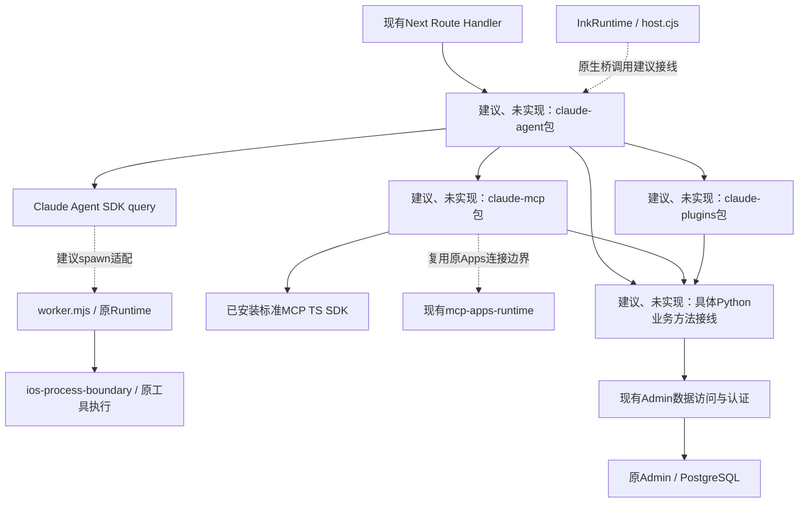
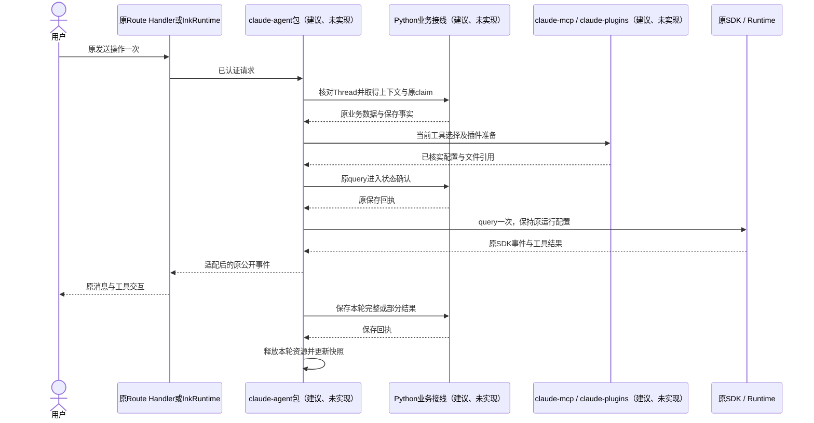
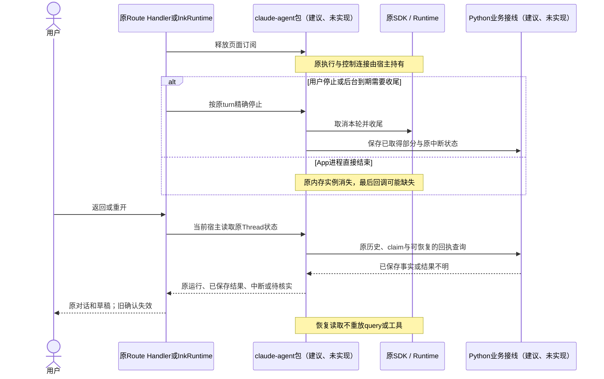
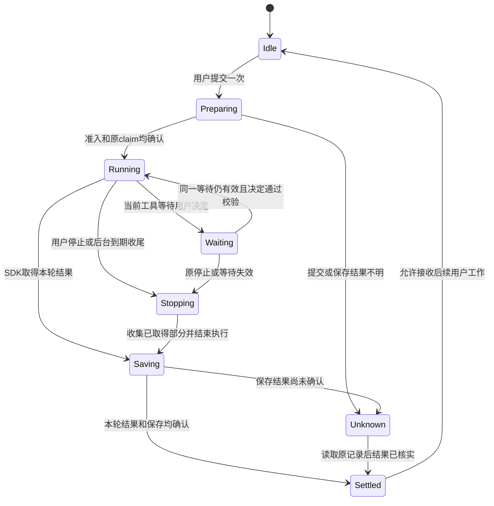

<!-- [Input] AGENTS.md、三个Claude入口及其直接依赖、claude-agent-next-kit本地源码、既有iOS生命周期方案。 -->
<!-- [Output] frontend/packages中Agent、MCP、插件模块的拆分方案、迁移顺序、功能清单和人日估算。 -->
<!-- [Pos] 路线二实施范围的现行技术设计；远端Admin协议保留在Python业务边界，全部迁移代码待实现。 -->
<!-- [Sync] 2026-11-15: 按用户明确的三个路由收敛迁移目标，复用TS demo架构及现有workspace，交付方案与估算。 -->

# Claude Agent、MCP与插件的TS模块化迁移

## 背景与问题

用户选择路线二，并将迁移目标明确为以下三个入口及实现其功能所需的直接依赖：

- [backend/routers/claude_agent.py](../../../backend/routers/claude_agent.py)
- [backend/routers/claude_mcp.py](../../../backend/routers/claude_mcp.py)
- [backend/routers/claude_plugins.py](../../../backend/routers/claude_plugins.py)

TS实现参考本地`/Users/dmeck/project/claude-agent-next-kit`，模块落在`frontend/packages`。其他Python业务、远端Admin/Gateway/PostgreSQL保留。前台、后台许可、挂起和进程重开沿[已确定的iOS合同](../multi-platform/mobile-background-execution-technical.md#2026-11-15-ios第一阶段宿主与恢复合同)。本轮只交付方案、文档与迁移估算，业务代码、依赖、进程、提交及部署保持原状。

当前IM为`develop / 000f3e8c`，demo为`feat/claude-agent-kit / 53dc2c4`，两个仓库均有既有未提交内容。现有源码核对完成后，目标收敛为三个TS业务模块；采用demo中的SDK驱动及消息处理基础，生产权限与恢复行为按当前IM保留。

## 目标与边界

1. 三个入口的请求处理、Agent执行、MCP连接行为及插件本地安装行为由TS模块承担。
2. App内编排与工具执行继续在手机运行，模型位置沿当前配置。Web与App调用同一套包内业务函数，宿主负责平台差异。
3. Python保留其余业务、Admin数据访问及现有认证/授权凭据管理。TS Agent代码只消费具体业务结果和受控运行配置。
4. TS代码按业务职责组织。每个包使用具体函数与数据类型，复用官方SDK和已有实现。
5. 本次无页面改版；现有URL、公开请求/响应、消息parts和交互入口保持兼容。产品状态与骨架继续由[现行交互稿](../multi-platform/mobile-recovery-interaction.md#2026-11-15-ios第一阶段任务交互)及[移动PRD](../../prd/mobile-app/mobile-app.md#ios第一阶段任务恢复补充2026-11-15)所有。

完整迁移的完成条件为：三个入口的实际执行责任进入TS，页面调用到达包内实现，原Python入口退出对应执行路径。仅移动声明文件、复制路由名或把全部请求再代理给原三个Python路由，交付状态仍为接线准备。

## 概念与规则

### 包结构与依赖方向

[现有workspace](../../../frontend/pnpm-workspace.yaml)已经包含`packages/*`，可以直接增加以下三个业务包。目录及导出均为建议、未实现：

```text
frontend/packages/
  claude-agent/       @ink-dream/claude-agent
    src/             Agent运行、上下文、消息事件、权限、队列与恢复
  claude-mcp/         @ink-dream/claude-mcp
    src/             连接管理、发现、OAuth与当前turn的MCP配置
  claude-plugins/     @ink-dream/claude-plugins
    src/             插件目录、安装操作、制品校验与运行目录准备
  mcp-apps-runtime/   现有包，继续承载MCP Apps运行与展示边界
```

`claude-agent`调用`claude-mcp`取得当前用户实际选中的连接配置，调用`claude-plugins`取得已校验的插件文件与运行参数。后两个包保持独立，避免反向引用Agent执行实例。文件按具体职责拆分，入口文件只导出模块函数；不为每个函数建立同名Service、Repository、Manager及Factory。

每个新包分别导出`/contracts`与`/node`。`/contracts`仅包含公开请求、事件和结果类型及必要校验；`/node`包含SDK、文件、网络和执行代码。React/RN界面经原请求或原生桥调用；Hermes不导入Node实现。Node模块使用普通Node依赖，Next的`Request/Response`适配与`server-only`约束留在App接入文件，iOS的Node Worker可复用业务模块。

`mcp-apps-runtime`已有Node连接与资源能力，迁移时复用适用部分。`claude-mcp`维护连接配置、发现和授权；MCP Apps的资源呈现与调用策略继续由原包负责。两者通过具体连接数据接线，避免重复维护同一连接状态。

### 当前职责与目标模块

| 当前范围 | TS归属 | 必须保留的功能与依赖 |
| --- | --- | --- |
| claude_agent入口 | claude-agent | 发送、流式事件、Thread/消息/分页与过程读取、重连、停止、确认、输入队列/引导/侧任务、子任务与结果协同、技能/计划/待办及定时任务入口 |
| Factory / Service / Runner直接执行责任 | claude-agent | 单Thread执行所有权、上下文组合、SDK会话映射、工具权限、模型配置投影、资源准入、保存与结果核对；其他Python业务发起的Agent工作通过同一TS执行边界接入 |
| claude_mcp入口与claude_mcp实际服务 | claude-mcp | 用户/工作区连接CRUD、发现与取消、工具/资源/提示词清单、OAuth开始/回调/取消/刷新/退出、App设置和运行配置投影 |
| claude_plugins入口与services/claude_plugin直接依赖 | claude-plugins | marketplace与安装记录、异步安装及操作查询、卸载、Deck绑定、来源解析、下载/摘要/目录校验、CLI兼容和工作区准备 |
| AdminChatData、AdminTurnPersistence等数据与授权访问 | Python业务边界 | 现有用户归属、授权续期、消息/claim/receipt、配置与业务数据；对TS提供固定业务方法 |
| 日记、Notion、回顾、记忆、写作等领域实现 | 原Python业务 | 保留其领域逻辑及数据入口；相关Agent上下文和工具通过受权结果或标准MCP接入 |

定时任务在App挂起期间的启动条件继续沿原系统能力，迁移不引入新的常驻调度承诺。Python插件或业务工具可以继续使用其解释器；主Agent执行责任由TS持有。

### OperationCapabilityDTO的处理

源码中的[OperationCapabilityDTO](../../../backend/services/admin_data/models.py)及[DomainOperation/AdminDataClient](../../../backend/services/admin_data/client.py)主要承担Dream与Admin之间的操作声明、版本/hash匹配、认证和回执访问。这些定义位于数据访问层，具体业务适配文件引用它们；TS Agent核心无需复制这套声明。

迁移采用以下边界：

- 现有Python Admin访问模块继续处理其版本、schema capability、身份、权限和写入回执。
- TS与Python之间使用明确的业务方法，例如读取对话、准备本轮业务上下文、声明输入、保存结果、读取回执、读取连接记录及保存插件操作进度；参数只表达相应业务对象与行为。
- 三个TS包不逐项声明Admin operation名称、版本/hash及其注册表，也不接收调用方指定的任意operation。
- 入口校验、工具参数校验、资源归属、原请求ID与结果不明保护继续执行。共享数据库schema和capability仍由Admin发布。
- 本轮只收敛新TS模块的依赖。现有Python/Admin协议清理属于独立工作范围，迁移完成不等于该协议已经删除。

Python接入文件只调用既有业务/数据函数。TS内通过包级接入函数取得结果，禁止重建一套远端操作注册框架。现有三个Python路由包含执行逻辑，不能直接作为迁移后的全部下游；需要把保留的数据/授权职责从当前处理流程中拆出。

### Agent运行方式

包内保留一份进程级Agent实例和按Thread关联的执行状态。公开操作对应实际需要：发送、订阅、停止、确认、读取快照与释放。发送确认接收后，执行由宿主持有；订阅返回的释放函数只移除页面观察。

单次处理路径为：核对Thread与输入身份 → 读取业务上下文 → 检查资源并准备原workspace/transcript → 取得原claim与query进入回执 → 调用SDK → 转换事件及处理工具 → 保存完整或部分结果 → 释放本轮资源。当前业务的准入顺序、比较规则和lease语义保持原样。

SDK使用官方`query`与现有自定义spawn扩展点。demo中仅转发SDK的`SimpleClaudeAgentSDKClient`、同职责接口和构造工厂按实际需要合并；保留经过适配的流式消息处理。原生宿主直接观察这一执行实例，页面和后台许可分别附着同一turn。

运行拓扑中的新模块与接线均为建议、未实现：



### demo复用与必要重写

| 内容 | 处理 |
| --- | --- |
| Runner消息处理、文本/思考/工具事件、usage、用户消息转换 | 复用适用函数，按IM公开事件和parts对齐 |
| SDK query、resume和JSONL读取 | 复用基础；业务Thread与SDK session分别映射，补IM claim/transcript合同 |
| 确认回调和AskUserQuestion答案回填 | 复用交互基础；保留IM当前turn、用户归属、输入校验和重复决定约束 |
| demo请求abort直接取消Agent | 改为宿主持有执行、页面独立订阅 |
| demo确认Map和onFinish保存 | 补生命周期与明确保存回执；进程重开后的旧等待失效 |
| demo销售数据库、客户/待办业务、runtime建表 | 保留在demo，TS迁移采用现有IM业务数据接口 |
| MCP管理与插件安装 | demo当前缺少IM等价实现，需要按现有功能重新实现；已有mcp-apps-runtime和标准SDK可复用 |

有一个需要显式计入的接入缺口：[ios_mcp.py](../../../backend/mobile_runtime/ios_mcp.py)当前把部分Python工具服务器转换为Python SDK内存实例。TS SDK无法直接消费这些Python对象。迁移时将具体Python业务工具暴露为标准MCP连接或TS工具handler调用具体Python业务方法，保持现有工具名称、输入和权限。不能把Python配置对象直接复制到TS后宣称工具已对齐。

### 正常处理时序

下图为建议、未实现的包间调用，现有公开请求和保存合同继续采用。



### 中断与恢复时序



### 执行状态投影

下图为建议、未实现的内存执行与页面反馈投影。原Admin消息、队列及claim状态继续按现有合同保存，新增数据库枚举为零。



进程终止会销毁整个内存投影；新进程重新读取原记录，按已知事实显示结果。`Unknown`中的恢复操作只读取，禁止重新进入原query或重复执行工具。

## 迁移顺序与工作量

口径为一名熟悉现有代码的资深工程师，包含实现、接线、功能对齐和必要验证。三个入口的完整迁移约**49–79人日，规划按50–80人日**。本轮只做设计，估算未形成实施承诺。

| 工作包 | 人日 | 交付依据 |
| --- | ---: | --- |
| 现有workspace接入与demo整理 | 3–5 | 三包导出、Node/界面依赖边界、筛选可复用函数，避免复制销售应用与多余包装 |
| Agent功能迁移 | 14–22 | 执行所有权/事件/会话5–7，上下文/权限/资源3–5，队列/任务/技能/计划等入口3–5，保存与恢复3–5 |
| MCP模块 | 8–12 | 连接与配置2–3，标准SDK发现/取消2–3，OAuth与凭据3–4，Apps接线1–2 |
| 插件模块 | 6–10 | 目录及绑定1–2，安装操作与回执2–3，制品/CLI/运行目录3–5 |
| Python业务接线 | 5–8 | 抽离三个路由中的保留数据/授权职责，复用原Admin访问；Agent不再依赖原Python执行层 |
| iOS宿主与后台接入 | 7–12 | 现有Node Worker的SDK spawn、MCP跨语言接入、精确turn许可、挂起与重开核对 |
| 集成及必要回归 | 6–10 | 三个公开入口、原账户/权限/队列/工具、安装操作、Web/RN接线及真机生命周期；按原业务分别验收 |

按每周五个工作日，完整范围约10–16周。前文较宽的68–114人日估算保留其原范围；本次按用户指定三个入口、Python数据边界保留及TS层简化重新估算。两份总量互不相加。

### 可以先交付的最小闭环

约**12–18人日，包含在完整总量中**：现有workspace内建三包边界，先完成Agent发送、流式、停止、同一Thread/会话、基础确认与已保存结果核对，接入一次现有iOS SDK/Worker启动路径。先覆盖页面断连独立、原任务精确停止和重开只读核对，再扩展功能。

此时MCP复杂OAuth、完整插件安装、队列/侧任务/定时等能力可以仍处于迁移中，逐项标注可用范围；最小闭环不作为三个入口完整迁移完成。开发顺序为：Agent最小闭环 → MCP与插件 → 剩余入口功能 → 完整iOS许可/恢复及相邻回归。后台架构及恢复约束从第一步生效，资源精简和音频均不作为前置。

### 主要不确定项

- SDK 0.2.20已有自定义spawn扩展点，现有iOS Runtime控制协议的集成兼容性尚未运行验证；需要一个无模型握手验证该事实。
- Python SDK内存MCP实例的跨语言接线、OAuth凭据封装格式与现有Apps策略会影响MCP及iOS工作包。
- 插件安装涉及平台命令、摘要和目录权限；TS保留现有校验并复用原guest工具边界，不能按桌面Node默认spawn估算iOS可用性。
- 某些业务回执或新接线字段需要Admin随动时，先核对已发布capability，保持fail closed；额外数据库变更和远端协议重构需单独估算。

## 简化评审与完成标准

| 处理 | 选定规则 |
| --- | --- |
| 保留 | 单一执行实例、Thread/SDK会话区分、权限、原claim与receipt、工具副作用不明保护、平台宿主边界 |
| 简化 | 参考demo的SDK调用及消息处理，合并纯转发wrapper；采用三个业务包及薄Route Handler |
| 延后 | Python/Admin协议整体清理、非目标业务迁移、启动资源精简、音频生态 |
| 删除 | 在TS重复逐项OperationCapabilityDTO、通用操作注册框架、同职责多层Manager、独立恢复数据库及新的常驻服务 |

完成验收按三个入口的现有功能逐项追踪，检查调用实际进入TS实现、同一任务只有一个执行者、保存与恢复正确、原业务权限保持。iOS后台执行仍受系统许可约束。必要验证分为隔离合同、原入口集成与物理设备业务，真实模型调用需当次授权。

本轮文档检查由限定验证runner执行，主Agent复核回执：

| 命令 | 退出码 | 结果 |
| --- | ---: | --- |
| `python3 /tmp/ink-ts-agent-plan-doccheck-20261115/inventory-links-check.py` | 0 | 5份文档、136个引用/锚点有效，头部/清单/新增用语检查通过；工作包合计49–79，规划50–80，最小版本12–18为总范围子集 |
| `node /tmp/ink-ts-agent-plan-doccheck-20261115/mermaid-browser-check.mjs` | 0 | 本机已有Chrome加载本地Mermaid，4幅图解析及渲染全部通过，浏览器已关闭 |

完整回执为`/tmp/ink-ts-agent-plan-doccheck-20261115/receipt.md`。检查只覆盖设计结构、路径及图示；本轮未安装依赖、运行业务服务、调用模型、修改业务代码或提交部署。
