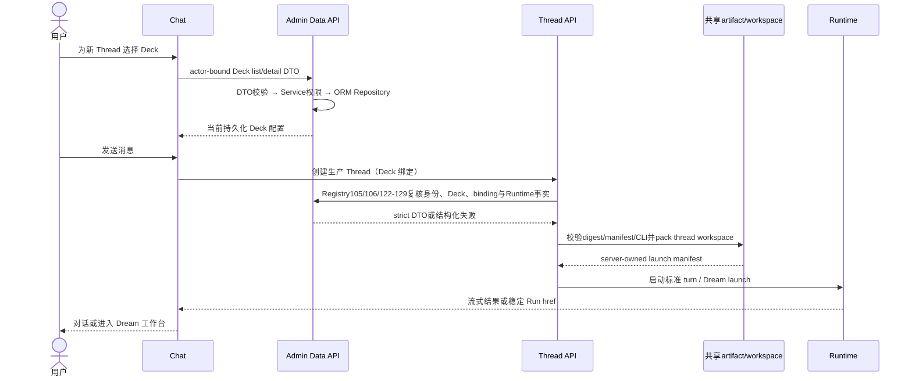
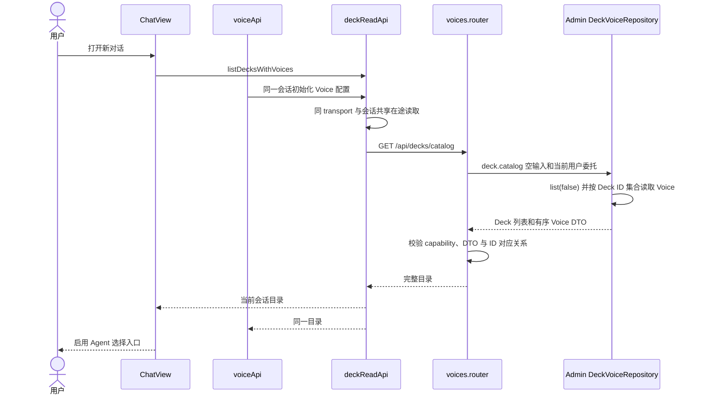
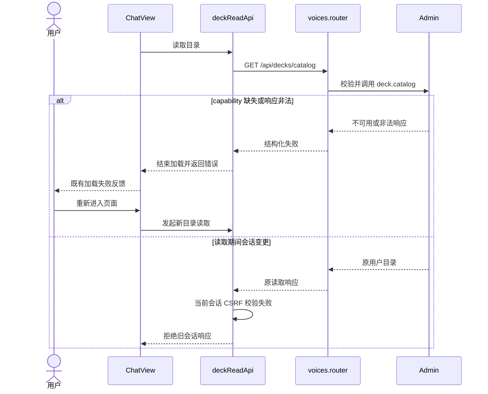
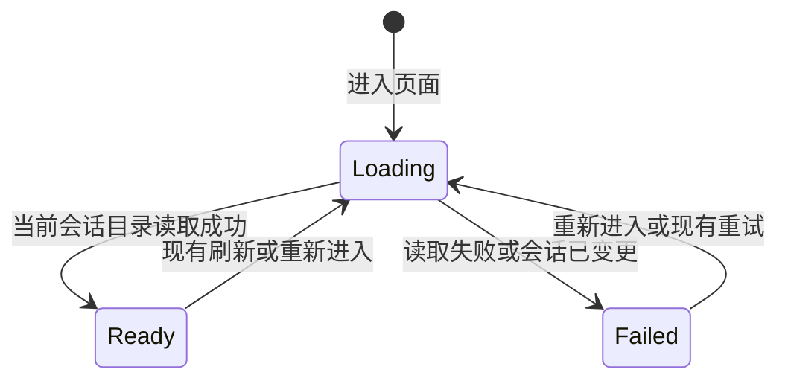

<!-- [Sync] 2026-10-28: 完整目录聚合、单次请求、会话去重及失败恢复。 -->
<!-- [Input] Current Admin Registry105/106/122-129 Deck DTO contracts and Dream Runtime boundaries. -->
<!-- [Output] Dream/Chat Deck consumption, failure and ownership behavior. -->
<!-- [Pos] Current Deck consumption design; Admin owns data access, Dream owns product/Runtime/files. -->
<!-- [Sync] 2026-09-16: retire duplicate Dream binding SQL services and make DTO/ORM ownership explicit. -->
# Dream / Chat 的 Deck 消费边界

> 状态：有效；更新于 2026-09-16。Deck 管理与版本设计：
> [`README.md`](./README.md)。

## 1. 目标

Dream 首页负责恢复已有 Dream，Chat 是选择 Deck 并开始新工作的生产入口。Deck 管理只负责
轻量元数据与启用状态，不把运行时 Agent、Prompt、Memory、插件或市场能力搬进详情页。

## 2. 页面层级

### Chat

- 保留现有 Thread history、输入、停止、重连和错误恢复。
- 新 Thread 可在发送前选择当前有权限且启用的 Deck。
- 历史 Thread 继续使用创建时绑定的 Deck 事实；版本 capability 发布后才显示版本号和显式升级。
- URL 中的 Deck ID 只是选择意图，服务端仍需复核权限和可用性。

### Dream 首页

1. **进行中的 Dream**：来自 actor-scoped re-entry API，默认显示三条，可展开/收起。
2. **我的 Dream**：只显示业务存在的初始/进行中状态，整行使用服务端 `run.href` 重入。

社区 Deck、公开列表、安装、发布和市场状态已从本页移除；相关需求延期至
[`../deck-register/`](../deck-register/)。页面不再维护独立 goal/agent 创建表单。

## 3. 状态

| 状态 | 行为 |
|---|---|
| 进行中加载 | 显示恢复状态，不伪造固定卡片 |
| 进行中为空 | 引导用户前往 Chat 选择 Deck |
| 我的 Dream 为空 | 显示诚实空状态，不恢复旧创建表单 |
| 加载失败 | 保留重试入口，不能用空数组掩盖失败 |
| Run 无权限/不存在 | 不泄露内容，返回可访问的 Dream 首页 |
| 历史 Thread Deck 版本未知 | 不显示版本或升级入口，不用 `agent_type_revision` 代替 Deck revision |
| 市场暂缓 | 无社区、发布、安装、市场占位和网络请求 |

## 4. 生产流程

历史 Thread 的版本检测和显式升级完整流程见
[`thread-version-upgrade.md`](./thread-version-upgrade.md)。在 Admin Drizzle 发布
aggregate revision、immutable snapshot、Thread 绑定和原子升级 capability 之前，该流程必须
fail closed。

## 5. 服务端职责与失败边界

- Admin Registry105/106/122-129 接收经验证的 OAuth 用户委托，执行 DTO 校验、业务 Service、权限过滤、typed ORM Repository 与 CAS/UOW；Dream 不提交任意用户 ID，也不持有 PostgreSQL 回退。
- Dream `DeckChatContextAssembler` 只应用 enabled/ready、selected Voice、prompt、截断和 provenance 规则。Agent-type 本地验证只检查 Admin 选定的共享 artifact、manifest 与当前 Claude CLI。
- 插件文件由 Dream 按服务器共享根配置打包进既有 Thread workspace，Runtime 从 server-owned launch manifest 使用 `--plugin-dir`；本次边界不改变 SSE、turn/resume/cancel 或共享文件权限。
- capability 缺失、Admin 不可用、身份/Deck/Workspace 不匹配、revision 冲突、selection 拒绝或本地制品验证失败时，在 Runtime 启动前返回既有结构化错误；禁止转为 Dream SQL 查询或静默退化。
- 旧 `BindingService`、`SelectionValidationService`、`CompatibilityService` 与 `services/deck/runtime_context.py` 已不属于生产实现。纯 capability 交集算法继续由 Dream 复用，数据库状态和兼容性事实由 Admin 提供。

## 6. 响应式与无障碍

- `StoryWorkspaceLayout` 主内容区是唯一纵向滚动 owner。
- 进行中列表不建立第二个纵向滚动容器；窄屏保持相同数据和顺序。
- “查看更多/收起”使用 `aria-expanded` 和 `aria-controls`。
- 整行重入链接可由键盘激活并保留可见焦点。
- 加载与错误状态使用可读文字和 live/alert 语义，不只依赖颜色。

## 7. 验收

1. Dream 首页只有“进行中的 Dream”和“我的 Dream”，无社区 Deck 或安装入口。
2. 进行中默认最多三条，展开/收起不改变数据顺序。
3. Run 使用真实稳定标识和 `run.href` 重入，同一 Thread 继续原上下文。
4. 新 Thread 在 Chat 选择 Deck；历史 Thread 不自动切换版本。
5. 桌面、窄屏、低高度视口均可滚动到最后一条记录且无页面级横向溢出。
6. 权限、删除、加载和运行失败均 fail closed。
7. 生产路由不导入旧 binding/selection/compatibility SQL 服务；Admin 失败不会回退 Dream 数据库。

## 8. 对应实现

- `frontend/app/_dream/views/story-workspace/StoryWorkspaceDreamLaunch.tsx`
- `frontend/app/_dream/views/story-workspace/StoryWorkspaceDreamPage.css`
- `frontend/app/_dream/views/story-workspace/__tests__/StoryWorkspaceDreamLaunchLayout.test.ts`
- `frontend/app/_dream/views/story-workspace/__tests__/StoryWorkspaceDreamReentryLayout.test.ts`
- `frontend/e2e/chat-dream-agent-refactor.spec.ts`
- `backend/services/admin_data/deck_chat_context_data.py`
- `backend/services/admin_data/deck_plugin_binding_data.py`
- `backend/services/deck/chat_context.py`
- `backend/services/deck/agent_type_runtime.py`

## 9. Deck / Agent 目录读取

### 背景与问题

Chat 选择器和全局 Voice 配置曾分别读取 Deck 列表，再逐项读取全部 Deck 详情。N 个 Deck 对应每个调用方 1 + N 次浏览器请求，选择器等待全部详情返回。

### 目标与边界

`GET /api/decks/catalog` 一次返回当前用户可访问的 Deck 列表与其有序 `voices`。该接口复用 Admin 的用户列表可见性、顺序、策略字段及原 Voice 字段；数据库 schema、选择规则、Thread 创建和 Runtime 行为保持现行合同。会话事件订阅、系统配置和存储策略分别由其现有模块读取。

### 概念与规则

- Admin `deck.catalog` 接受空输入，使用认证主体确定用户，要求 `dream:read` 与现有 Deck schema capability。操作描述追加到 Registry 尾部，已有操作描述和 hash 保持。
- `DeckVoiceRepository.catalog` 复用 `list(false)`，按返回的 Deck ID 集合一次查询全部 Voice；空列表直接返回。列表策略装饰继续由现有 `list` 负责。
- Dream `AdminDeckListData.catalog` 校验精确 operation capability、严格 DTO、Deck ID 唯一性、Voice ID 唯一性和 `voice.deck_id` 对应关系，再执行原 Memory 字段转换。
- `listDecksWithVoices` 为 Chat、全局 Voice 初始化、Deck 管理、Reflections 和原生启动提供同一传输。相同 transport 与当前会话 CSRF 的在途读取共享 Promise；成功或失败后释放，下一次显式读取获取新数据。会话变更后拒绝旧响应。
- 成功读取对应一次浏览器目录请求与一次 Admin 领域读取。Admin 共享传输层保留现有只读恢复规则：网络超时后使用相同 request ID 再尝试一次，第二次使用现有较短超时；领域消费者继续读取完整目录。
- 页面加载期间保持既有禁用和加载文案；成功后按现有 enabled 规则展示。失败沿现有错误反馈结束加载；重新进入、刷新或现有重试入口发起完整目录读取。
- 发布顺序为 Admin 发布 `deck.catalog` → Dream 后端与前端更新。缺少 operation capability 时 Dream 返回结构化不可用响应。

验收：选择器的目录加载发起一次完整读取；相同会话并发调用共享该请求；读取过程无逐项 Deck 详情请求；空目录保留空状态；失败结束加载且新读取可恢复；技术测试回执与正常账户验收分别记录。

## 10. 技术验证记录（2026-10-29）

以下回执属于受控 HTTP / Provider-free 技术验证。

| 工作目录 | 命令 | 退出码与关键输出 |
| --- | --- | --- |
| Dream `backend/` | `./.venv/bin/python -m pytest -q tests/test_admin_deck_list_routes.py tests/test_admin_deck_detail_routes.py` | 0；73 passed |
| Admin 根目录 | `pnpm exec vitest run app/lib/dream/deckCatalog.test.ts app/lib/dream/deckVoiceDto.test.ts app/lib/dream/deckVoiceRepository.test.ts app/lib/dream/deckVoiceService.test.ts app/lib/dream/deckPluginBindingRegistration.test.ts --reporter=default` | 0；5 files / 32 passed |
| Dream `frontend/` 与 Admin 根目录 | `pnpm exec tsc --noEmit --incremental false --pretty false` | 各 0；无诊断 |
| Dream `frontend/` | `pnpm exec playwright test --config=e2e/web-rnw-regression.config.ts e2e/deck-catalog.spec.ts e2e/native-chat-setup.spec.ts e2e/chat-dream-agent-refactor.spec.ts e2e/chat-first-deck-defaults.spec.ts --reporter=line --workers=1` | 首轮退出 1；13 passed，1 项旧 fixture 的导航取消读取预期失败；修订后按下行复核通过 |
| Dream `frontend/` | `pnpm exec playwright test --config=e2e/web-rnw-regression.config.ts e2e/chat-first-deck-defaults.spec.ts --reporter=line --workers=1` | 最终定向执行 0；1 passed |
| 两仓受影响源文件与测试 | 定向 `pnpm exec eslint` 与 `git diff --check` | 各 0 |

目录传输测试验证 Chat、StrictMode 重建和 Voice 初始化并发调用只产生一次 `/api/decks/catalog`。原生启动读取集合为 `/api/decks/catalog` 与 `/api/system-config`。完整 Chat 页面在选择器可操作前的逐项 Deck 详情 GET 数量为 0。Deck 页面测试对取消的认证与连接读取要求同路径后续读取成功。

受影响 Markdown 的相对引用检查未发现缺失路径；Chrome 中的 Mermaid 解析覆盖本文三个 `sequenceDiagram` 和一个 `stateDiagram-v2`，应用错误为 0。Admin 原 292 项操作描述经完整对照保持，目录操作追加为第 293 项。本轮保留现有只读传输短超时恢复规则，未执行数据库迁移、真实模型调用或远程部署。
