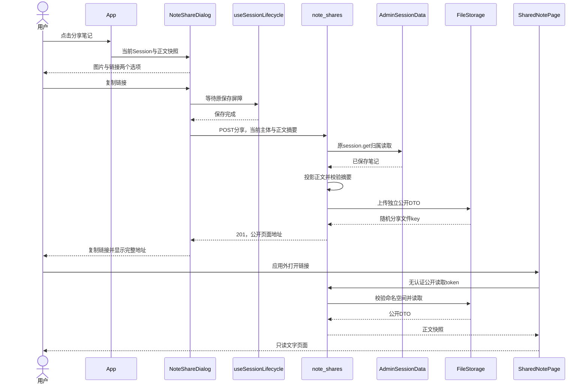
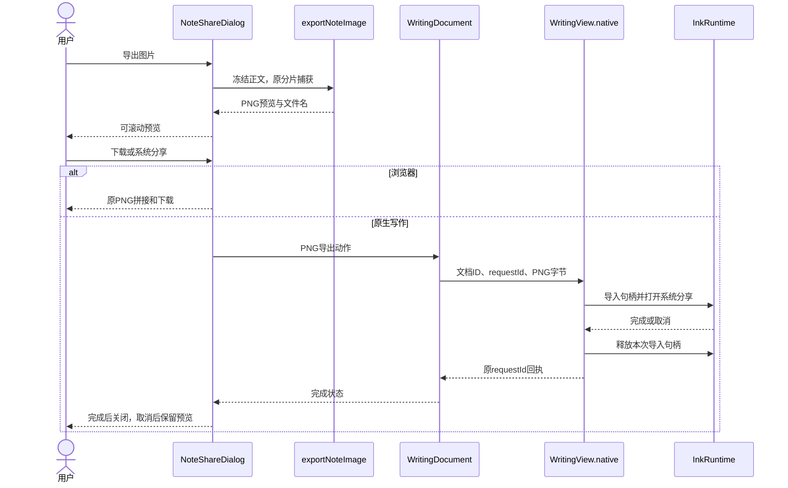
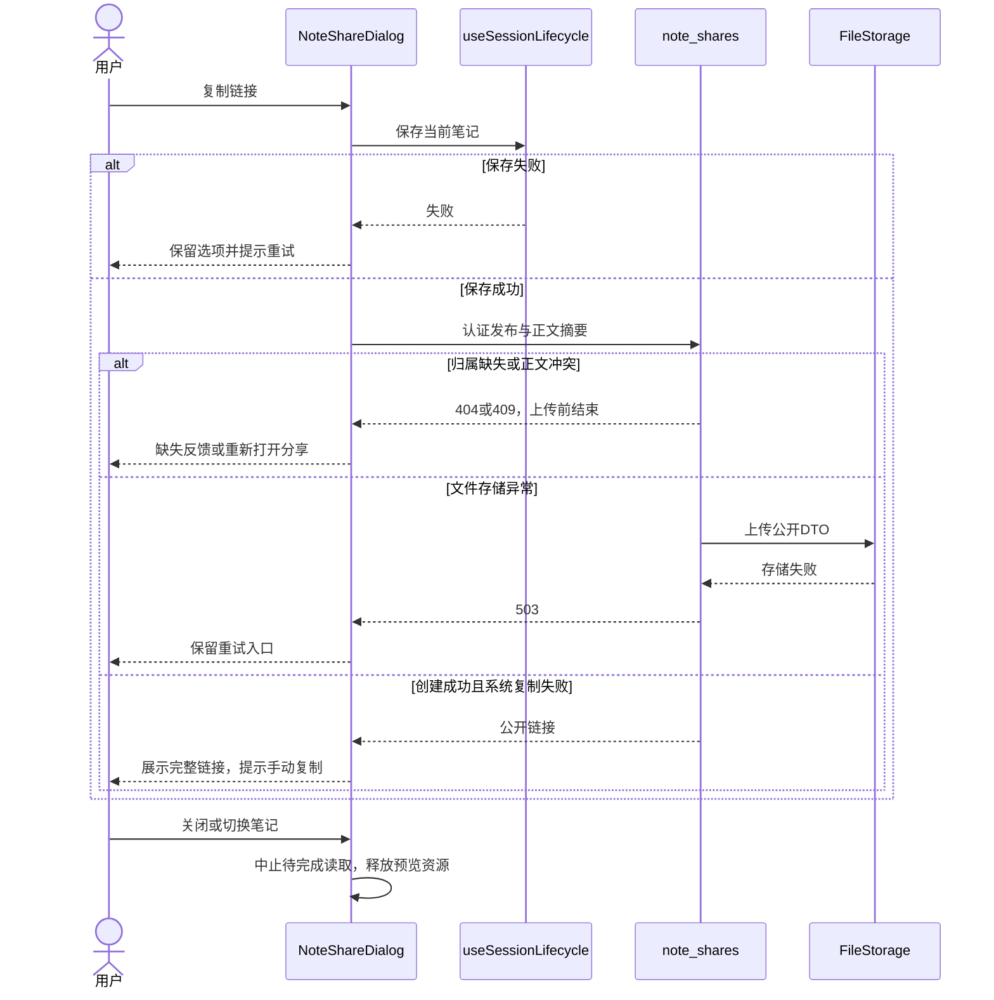
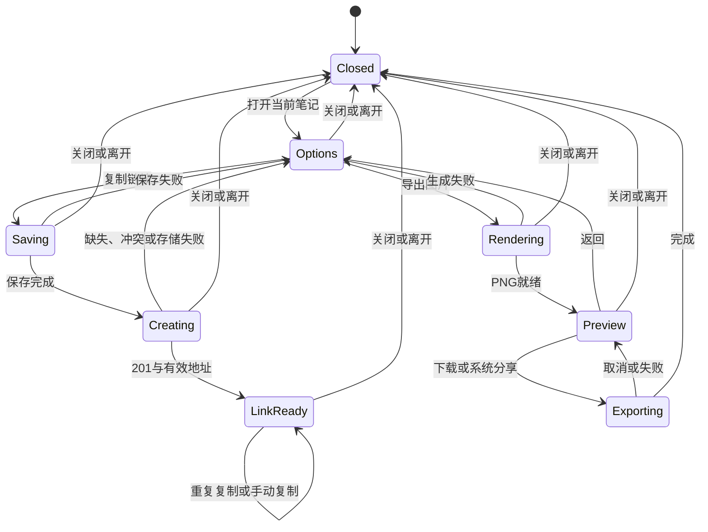

> 历史版本：统一数据库分享改造前的完整原文。现行稿见[note-sharing](note-sharing.md)。

<!-- [Input] 笔记分享产品规则、EditorState、已发布Admin Session DTO和FileStorage接口。 -->
<!-- [Output] 正文投影、认证边界、快照文件协议、正常/异常时序及状态转换。 -->
<!-- [Pos] 笔记分享正式设计；源码实现与验证状态分别登记。 -->
<!-- [Sync] 2026-11-12: 采用已有Session归属读取与文件存储命名空间。 -->
<!-- [Sync] 2026-11-12: 关联外部链接管理设计，保留当前文件快照读取协议，管理接入待实现。 -->
# 笔记分享设计

## 背景与问题

[产品需求](../../prd/notes/sharing.md)定义图片与公开链接两个操作。
现有 `EditorEngine` 以 `TextCell` 保存正文；`WidgetCell` 和 `WritingSuggestionCell` 保存独立交互内容。
现有 `ChatShareDialog`、PNG分片捕获、PNG拼接与平台文件分享承担图片交付。
聊天的复制链接入口当前为占位项。

发现与定义依据为用户需求、上述生产实现、[编辑器现行设计](overview.md)、[写作建议设计](../writing-manual-suggestions.md)及[文件存储设计](../file-storage/README.md)。

## 目标与边界

复用当前 Writing 页面、保存屏障、Admin `session.get`、文件存储和图片捕获。
分享正文由 `cell.type == "text"` 的有序内容组成。账户、Session ID、Thread、工具输出、工作区路径和完整 EditorState 退出公开DTO与图片。
公开读取使用独立的 Next 页面；认证写入继续使用原同源 BFF、CSRF、Admin OAuth 及归属校验。

### 方案选择

| 方案 | 判断依据 |
| --- | --- |
| 浏览器地址携带全部正文 | 长笔记扩大地址长度，内容复制与渠道兼容受地址容量影响。 |
| 新建共享数据库表 | 当前需求为不可变文本文件，新增关系表、migration和capability产生额外发布依赖。 |
| 复用 FileStorage 保存正文快照 | 已有local/S3上传和读取接口；通过服务端固定命名空间约束公开读取。采用此方案。 |

新增能力限于文件用途命名空间、笔记发布路由、公开阅读页与已有平台分享接线。
Admin继续唯一管理原笔记与Schema；Dream消费已发布的 `session.get` capability。

## 概念与规则

### 数据与身份

`NoteSnapshot = {title: string, created_at: string | null, paragraphs: string[]}`。
`title`取正文第一条非空行的前100个Unicode字符，用于标题展示；正文完整保留。
图片中的日期来自选定EditorState，公开快照日期来自Admin Session。

`NoteShareSource.sessionId`只在认证发布和本地操作归属中使用。
`content_sha256`为UTF-8编码的 `paragraphs.join("\n\n")` 的SHA-256；服务端重新投影已保存正文并比较摘要。
该摘要用于并发内容校验。认证与归属校验由原Admin边界完成。

| 接口 | 处理 |
| --- | --- |
| `POST /api/sessions/{session_id}/share` | 请求体只接受`content_sha256`。原认证边界要求`dream:write`；Admin按当前主体读取笔记，空/缺失/内容冲突分别返回400/404/409。上传成功返回201及`path`、可选绝对`url`。 |
| `GET /api/public/note-shares/{token}` | token解码后必须精确匹配当前固定分享命名空间和随机文件名；读取严格公开DTO。文件缺失或格式异常返回404，存储异常返回503。 |
| `/share/notes/{token}` | Next服务端通过配置的Python内部origin读取公开DTO；fetch使用`no-store`、超时和禁止重定向，不传递浏览器Cookie或Authorization。页面独立于账户应用壳。 |

### 文件、配置与发布

1. `UploadOptions.namespace`仅允许服务端指定`note-shares`；普通上传与签名上传使用原命名空间。
2. 文件key为`{FILE_STORAGE_PREFIX}/note-shares/{uuid_hex}-note.json`，内容只包含公开DTO。
3. token为文件key的无填充Base64url。公开路由验证字符、规范编码、配置前缀、命名空间与随机文件名；请求参数无法指定其他文件key。
4. `INK_PUBLIC_SITE_URL`、`INK_PUBLIC_BASE_URL`按该顺序提供公开页面origin，协议为HTTP(S)，路径为根；配置缺失时Web沿当前页面origin组成链接。
5. 原生本地文档要求公开应用origin；公开页面部署与发布服务必须读取同一分享文件存储。端侧独立local目录需要由同一可达服务承接公开读取，或采用已配置的共享S3存储。
6. `FILE_STORAGE_TYPE`、`FILE_STORAGE_PREFIX`及local目录/S3桶沿原文件存储配置。更换存储或前缀时，运维负责保留已有分享文件与读取路径。
7. 快照独立保存，原笔记修改或删除后继续存在。当前公开读取依赖分享文件的保存状态；归属目录、单条主动失效与逐次状态校验见[外部链接管理交互设计](../sharing/external-links.md)，代码待接入。期限策略由后续产品需求定义。
8. API响应及公开页面采用禁止缓存和禁止索引配置；页面设置`no-referrer`。正文由React文字节点渲染，HTML和脚本保持文字。
9. 关闭弹层后中止待完成HTTP、释放预览URL；正在进行的单片图像捕获完成后释放结果。原笔记、模型调用和业务服务继续由原模块管理。

### 前端和平台所有权

`App`冻结当前笔记正文并挂载`NoteShareDialog`。`noteShareApi`先等待保存，再提交摘要。
同一次弹层重复复制复用已创建URL；复制失败保留可选中URL。
`NoteContent`为公开页面和图片共用的无权限文字呈现。
`exportNoteImage`复用`capturePartBlobs`的分片、字体与回退流程；下载复用原PNG拼接。

`WritingDocument`通过`WritingShareRequest`发送明确的copy或images动作。
`WritingView.native`先匹配文档ID与当前可见状态，再调用`performNoteShare`。
系统`copyText`、`importSketch`、`exportFiles`沿既有实现执行；请求回执只返回completed/cancelled/failed。
文件句柄由Native持有并在完成后释放，PNG字节传输维持当前原生分享协议的边界。

## 正常业务时序

## 异常与恢复时序

## 状态转换

验证入口与结果：[实现记录](../../exec/note-sharing-20261112.md)。
