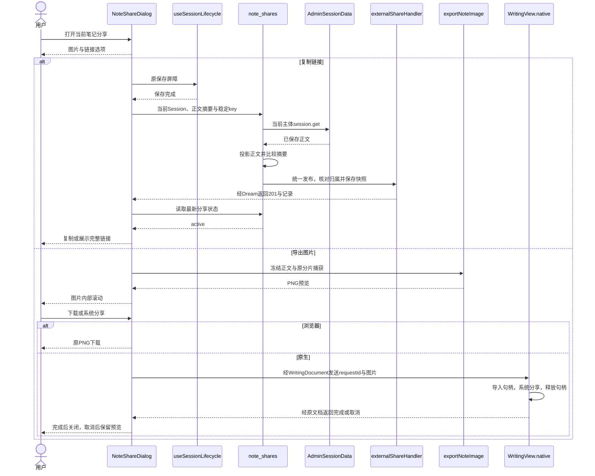
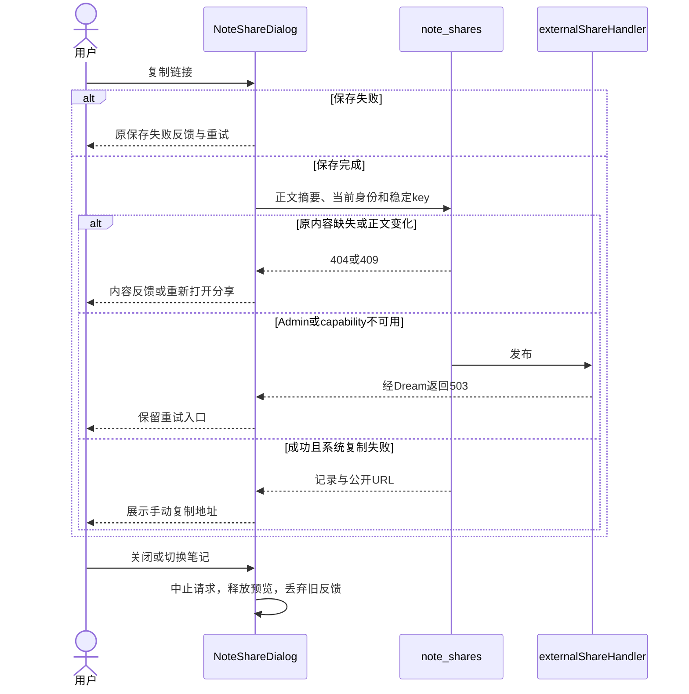
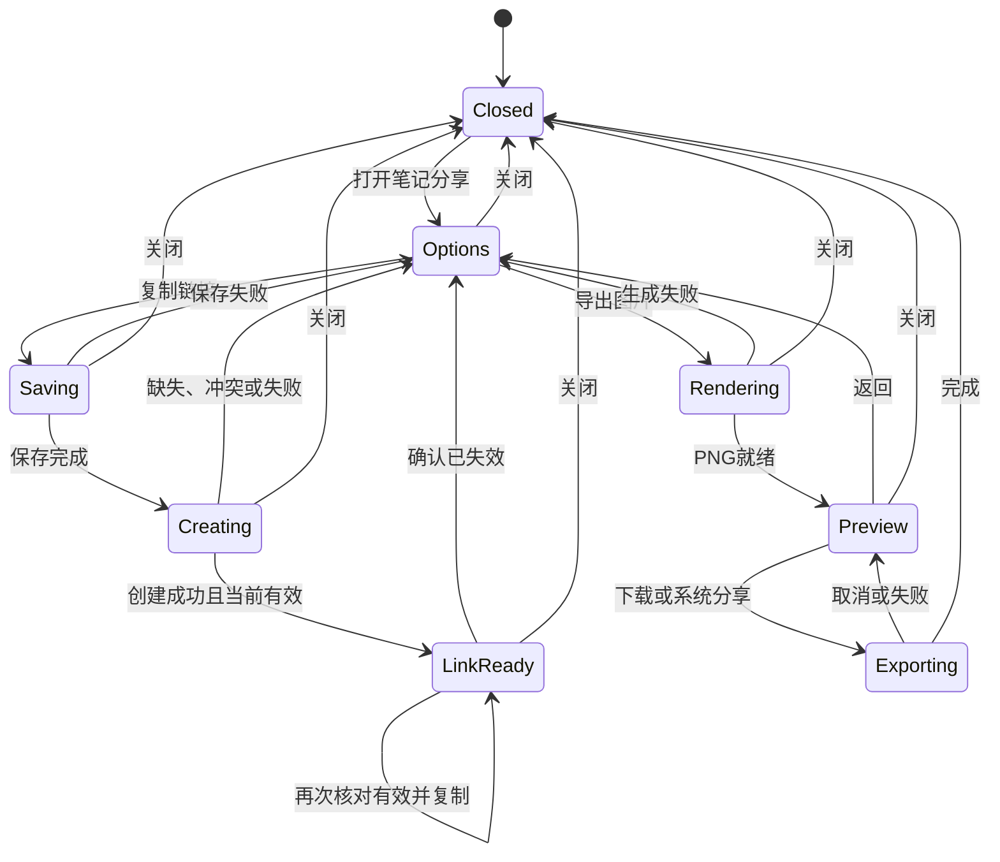

<!-- [Input] 笔记分享PRD、EditorState、Admin Session及统一external-share合同。 -->
<!-- [Output] 笔记正文投影、保存核对、平台所有权、业务时序和状态。 -->
<!-- [Pos] 笔记分享正式设计；统一链接持久化由分享业务设计所有。 -->
<!-- [Sync] 2026-11-12: 替换文件发布，接入Admin快照、归属和逐次状态校验。 -->
<!-- [Sync] 2026-11-12: 登记Admin正常Schema采用与主Agent技术检查；真实账户和设备验收单列。 -->
# 笔记分享设计

## 背景与问题

[笔记需求](../../prd/notes/sharing.md)提供图片与链接选项。`EditorEngine`以TextCell保存正文，WidgetCell和WritingSuggestionCell保存交互内容。原文件方案缺少集中失效，并受端侧local目录约束，原文保存在[历史稿](note-sharing-before-unified-sharing-20261112.md)。

## 目标与边界

复用原Writing页面、保存屏障、Admin session.get和图片捕获。链接采用[统一分享设计](../sharing/external-links.md)定义的Admin快照、独立公开页面和设置管理。

| 方案 | 判断 |
| --- | --- |
| 本地文件快照 | 端侧与公开服务需共享文件，主动失效需增加状态目录。 |
| 公开原Session | 编辑和删除会改变已有分享。 |
| Admin独立快照 | 统一AI与笔记的归属、状态、公开读取和跨端访问。采用此方案。 |

## 概念与规则

1. `projectNote`仅投影有序TextCell。图片与链接保留完整正文、换行与表情；交互单元、账户和完整EditorState退出公开内容。
2. 标题取正文首条非空行前100个Unicode字符。图片日期沿选定EditorState，公开日期沿已保存Admin Session。
3. `NoteShareDialog`冻结原内容。复制先等待原保存屏障，`noteShareApi`提交`content_sha256 + request_key`。摘要为UTF-8 `paragraphs.join("\n\n")`的SHA-256。
4. `note_shares.py`按当前OAuth读取原Session，空/缺失/正文变化分别返回400/404/409。统一Admin操作事务内再次检查源归属，保存`{kind:'note',title,created_at,paragraphs}`并返回201及`share/path/url`。
5. `useShareLink`复用本次创建回执，每次复制再读取当前状态。失效时清除旧创建回执，下一次点击创建新链接；旧地址保持失效。系统复制失败提供可选中URL。
6. `NoteContent`作为公开文字与PNG的无权限呈现叶子。图片沿`exportNoteImage`、原分片捕获与PNG拼接。`WritingDocument`发出copy/images动作，`WritingView.native`校验文档ID、可见性与requestId，系统复制和文件分享沿原接口。
7. Native拥有导入文件句柄，完成/取消/失败后释放本轮句柄。取消系统分享保留预览。关闭或切换来源后中止HTTP并丢弃旧反馈，预览URL由原图片owner释放。
8. 公开阅读为`/share/[token]`和`GET /api/public/shares/{token}`；归属、逐次状态校验、公开origin及旧文件token关闭沿统一设计。公开读取返回已创建快照，原笔记编辑或删除后快照保留。

## 正常业务时序

## 异常与恢复时序

## 状态转换

源码与验证分别见[原图片分享记录](../../exec/note-sharing-20261112.md)和[统一分享改造记录](../../exec/external-share-refactor-20261112.md)。Admin正常数据库已完成0087与精确能力登记，后台制品采用与线上只读检查通过；用户要求部署并验证后，本次技术检查由主Agent执行，luna-test-stage保持暂停。服务采用与真实账户/设备验收分别登记。
