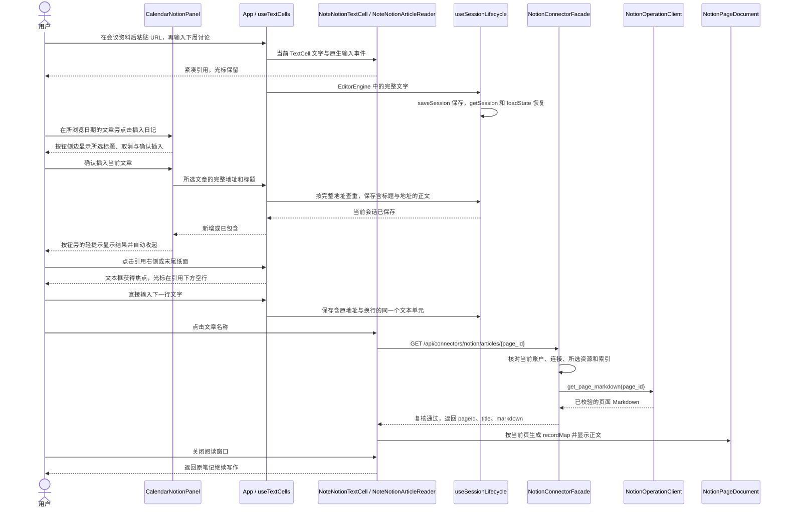
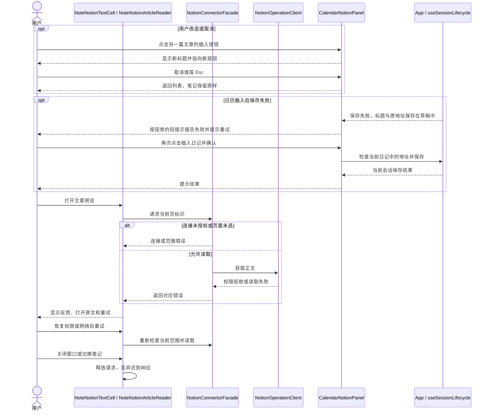
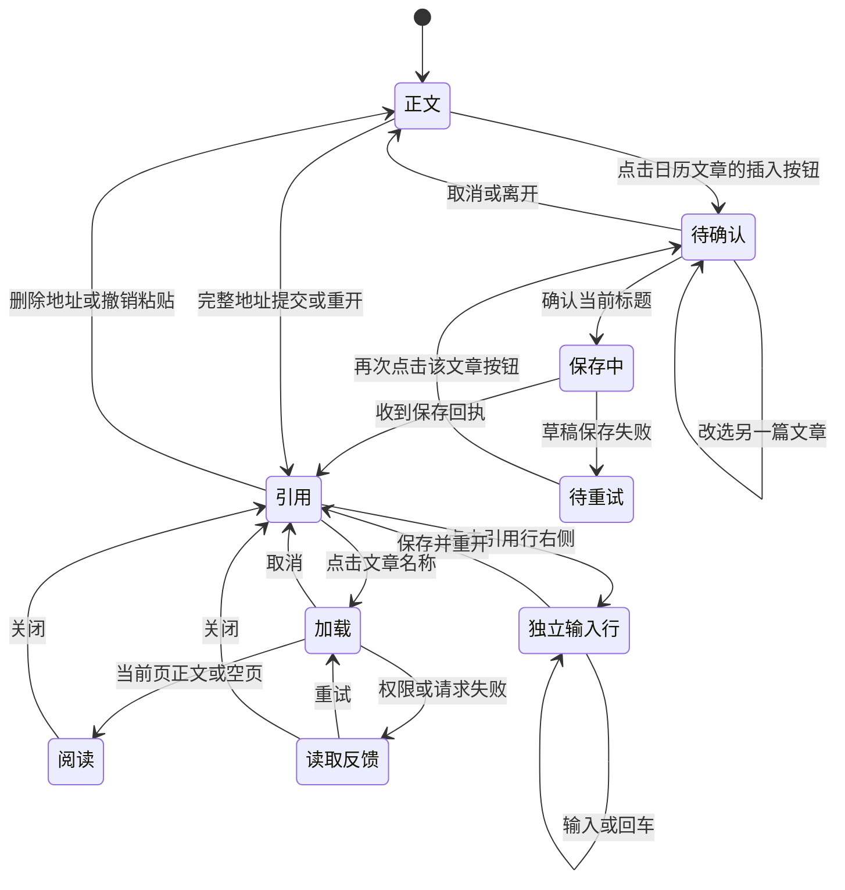

<!-- [Sync] 2026-11-25: 评审日历文章的保存格式、实际接口校验与重开恢复。 -->
<!-- [Sync] 2026-11-25: 更新日历双向改选、确认、取消与标题恢复的交互图。 -->
<!-- [Sync] 2026-11-25: 日历插入的保存进度和结果由共享 Toast 呈现。 -->
<!-- [Input] 笔记需求、编辑器会话、Notion连接器当前资源范围和共享阅读器。 -->
<!-- [Output] 链接识别、纸面续写与阅读时序、权限边界、方案选择和验收映射。 -->
<!-- [Pos] 编辑器会话业务的正式交互设计。 -->
# 笔记中的 Notion 文章引用

## 背景与问题

用户在写作纸面输入“会议资料”，粘贴带区块锚点的文章地址，再输入“下周讨论”。改造前，Writing 的 textarea 接受原生粘贴、选择、撤销和输入法事件。[useTextCells](../../../frontend/app/_dream/hooks/useTextCells.ts) 将文字更新到本地镜像和 EditorEngine。[useSessionLifecycle](../../../frontend/app/_dream/hooks/useSessionLifecycle.ts) 使用 saveSession 保存 editor_state.cells，listSessions 与 getSession 取回正文后由 loadState 恢复。Dream 的[会话路由](../../../backend/routers/sessions.py)通过 [AdminSessionData](../../../backend/services/admin_data/session_data.py) 将 editor_state 交给 Admin，Admin 按当前账户将 JSON 序列化到 PostgreSQL 的 user_sessions.editor_state_json。原路径能保留地址，缺少文章识别、打开操作和按页面读取正文的入口。[会话设计](overview.md)

[需求原文](https://app.notion.com/p/40b30b7547c380cd9930c384ab35023c#42130b7547c3800aad38daaa6f003a8a)在父页标题下指定 notebook-lines、External Object Instance 和 react-notion-x。[卡片修订](codex://threads/01a1ea40-441d-7f30-9553-fbbd7c83518c)要求紧凑、无大边框。[现有预览设计](../workspace/notion-workspace-preview.md)的 Read 已有页面标识、标题及 Markdown。笔记只有 URL。当前 Calendar 的 safe_url 按服务器 INK_NOTION_ALLOWED_URL_HOSTS 校验上游返回的 HTTPS 目的地主机，其输出为可打开的原地址。Calendar 的文档列表提供元数据。Thread 的 Read 依赖已绑定的 Thread 工作区，笔记写作无需创建 Thread。

## 目标与边界

识别地址、按原顺序展示引用、保留编辑器原生操作与已保存文字。用户点击阅读时，Dream 以当前登录身份及活动 Notion 连接读取已选页面或已选数据库索引内的页面。页面正文只供当前阅读窗口使用。视觉复用文档图标语义、无边框布局和共享阅读窗口。Chat 下载、工具详情、后台同步、导入、数据库字段和模型调用均无对应笔记任务。[产品需求与桌面、窄屏骨架](../../prd/notes/notion-article-links.md)

## 概念与规则

1. 支持 HTTPS 的 notion.so、www.notion.so、app.notion.com、notion.site 和 Notion Sites 子域的页面链接。路径末段为紧凑或连字符形式的页面 UUID，可带标题前缀。支持 /p/ 和工作空间路径。查询参数随原文打开。有效的 p 页面参数指向数据库视图中打开的页面，v 指视图。区块片段属于原文章的定位信息。笔记阅读器根据 Markdown 生成展示区块，打开原文负责精确定位。[Notion 区块链接说明](https://www.notion.com/help/create-links-and-backlinks#link-to-a-block)
2. URL 区间来自原字符串。普通网址、含用户信息或非标准端口的地址、缺少页面编号的地址和相似域名保持文本。单独一行与句中地址用相同规则。页面编号或区块编号后可直接续写中文。其他查询值可包含文字，用空格、换行或中文标点标出引用与后文的边界。域名和 URL 形状只决定本地展示，服务端只接收页标识。
3. NoteNotionTextCell 以正文换行符生成行及对应的源文本区间。静读时每一行独立排版，行内保留前后文字和紧凑引用。点击引用行空白会在紧邻的空行挂载独立 textarea；后方已有文字时先插入空行，其他行保留原次序。输入行将变化按区间写回 TextCell.content，输入法提交完整正文。普通写作和链接原文编辑继续使用现有整段文本框，“另起一行”及末尾纸面提供文末续写。
4. 每次打开预览重新请求。服务端解析当前用户的活动连接、核对认证与凭据、读取已接受索引并与现行资源选择求交集，命中后调用 get_page_markdown。返回前复核连接、选择、凭据和索引版本。前端校验响应页标识与字段类型，用 notionRecordMapAdapter 转换为 ExtendedRecordMap，再交给 NotionPageDocument。读取空正文显示空页反馈。[官方用法与样式](https://github.com/NotionX/react-notion-x#usage)
5. 关闭或切换笔记释放当前请求及正文。关闭阅读窗口恢复先前文本选区。刚重开的笔记尚无编辑位置时，光标落在所读引用的末尾。原文始终打开笔记中的完整 URL。受限时显示连接、权限或所选范围提示，暂时失败可重试。阅读反馈与笔记保存互相独立。

### 实现前评审

| 方案 | 对编辑、撤销和持久化的影响 | 评审结论 |
| --- | --- | --- |
| 从 TextCell.content 派生引用 | 整段或独立行文本框将输入写回同一正文，原生撤销恢复当前文本框的编辑，已有保存签名与旧数据继续适用 | 采用。展示只需要来源区间，文章内容按需读取 |
| 保存新的结构化单元 | 中间粘贴要拆分前后文本，撤销要合并，需改动单元联合类型、分享和持久化消费者 | 日历标题和完整地址共同保存在文本单元正文；插入、删除和恢复均可通过原有单元完成 |

评审保留本地自动识别，正文读取由用户点击文章名称触发。原始地址已包含区块锚点，单元拆分或地址规范化写回都会影响编辑。共享适配器和阅读组件可以直接使用。现有公开接口缺少按页面标识读取授权正文的能力，需增加一个只读入口。每处引用独立对应原文区间，正文和窗口状态均不进入会话。评审时新增接口标记为“建议、未实现”。现行源码已接入 NotebookLines、NoteNotionTextCell、NoteNotionArticleReader 和只读接口，图中列出当前模块。验证范围见[执行记录](../../exec/note-notion-articles-20261124.md)。

早期版本向整段文本框插入换行，编辑时原地址展开，阅读卡片和编辑位置随之移动。现行方案由 articleLines 按源文本产生独立行，聚焦的续写行在引用和后文之间占据自己的空间。普通纸色、文字换行和引用内容决定高度。相同的 TextCell 同时支持旧会话、保存、分享与重开。

在日历点击“插入日记”时，CalendarNotionPanel 同时记录当前列表、文章页标识、标题、完整地址和触发按钮。确认提示位于按钮侧边，保留其他行的点击区域。选另一篇即替换整组信息。取消、Esc、点击外部或离开栏目会结束待确认状态。提示随日历滚动定位。

点击“确认插入”后，App 核对当前编辑会话。EditorEngine.insertNotionArticle 在各文本单元中按完整地址查询引用。命中时复用原文；新增时以 Markdown 命名链接把标题与完整地址写到当前日记末尾。TextCell 提交 id、type、content。此前被接口拒绝的草稿保有独立标题字段，载入草稿或重试保存时将这些标题转写为正文链接。缺少日历原地址时由有效页面标识构造原文地址。保存成功后提示显示对应文章名，失败时保留草稿，重试时再次核对当前地址。旧笔记和直接粘贴的 URL 继续按原地址推导名称。

### 正常业务时序

### 异常与恢复

### 状态转换

验收按[产品场景](../../prd/notes/notion-article-links.md#验收)逐项执行。写作验证从 /story-workspace/writing 进入。服务器检查独立覆盖未选资源及读取期间撤销。桌面与窄屏浏览器、真实账户及设备的适用范围按实际回执登记。
