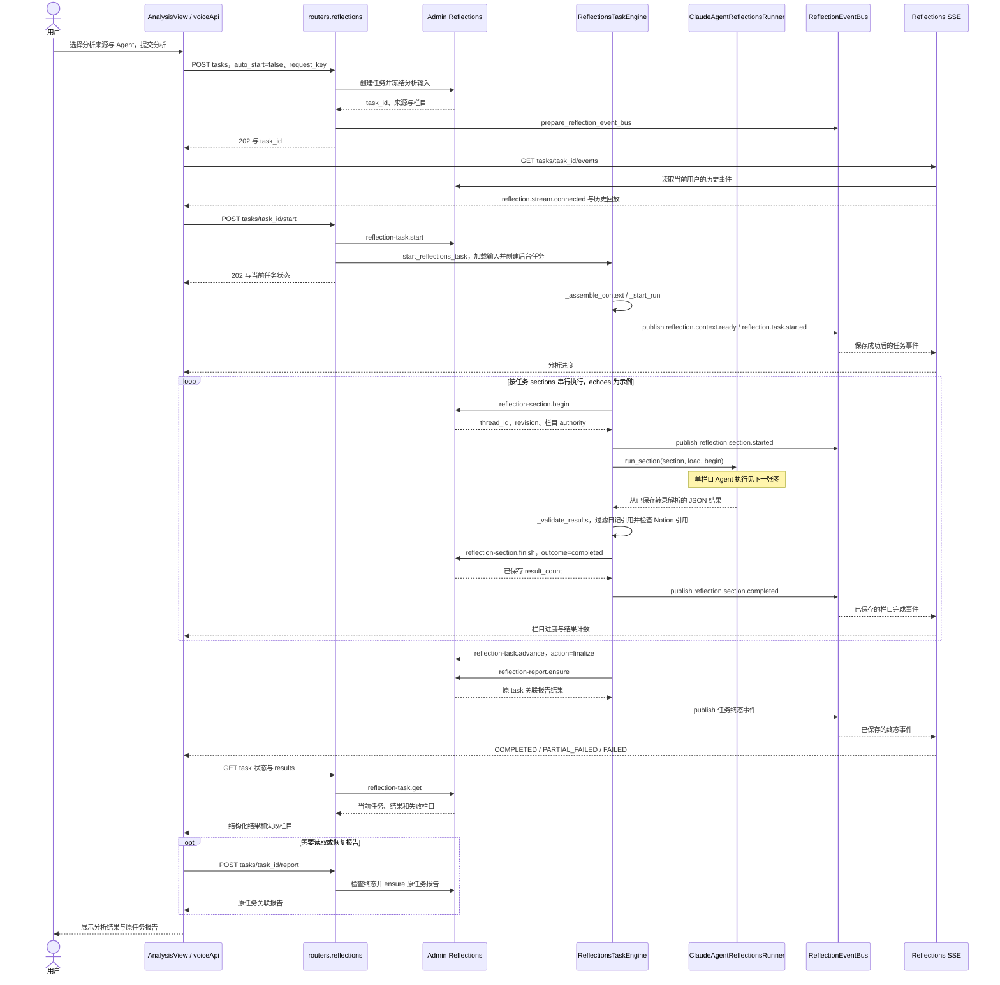
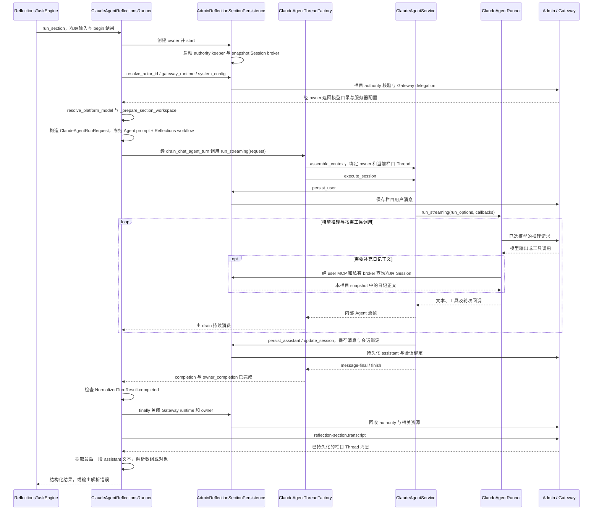
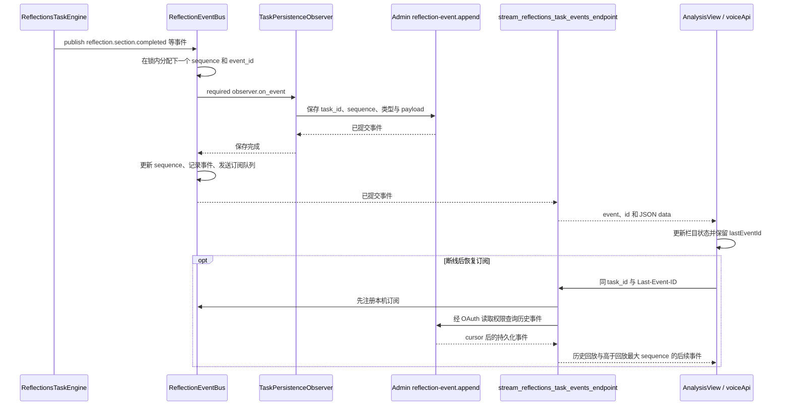
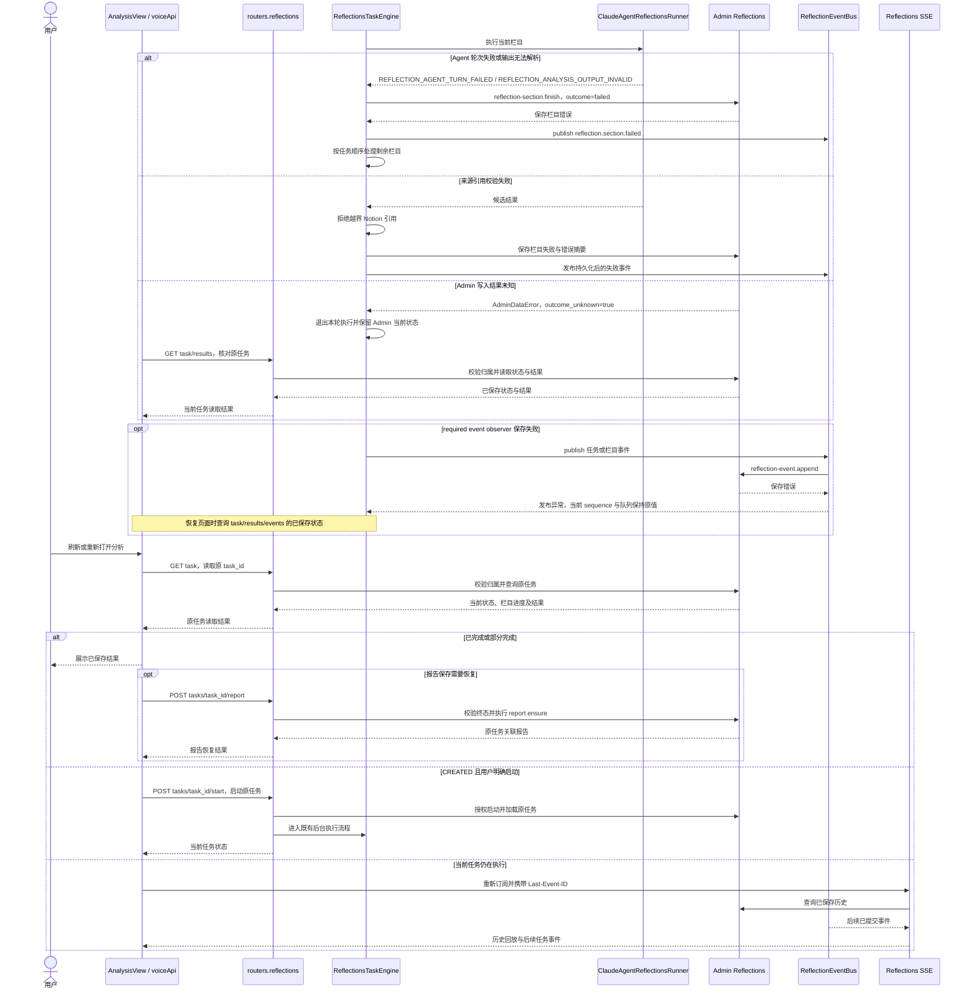
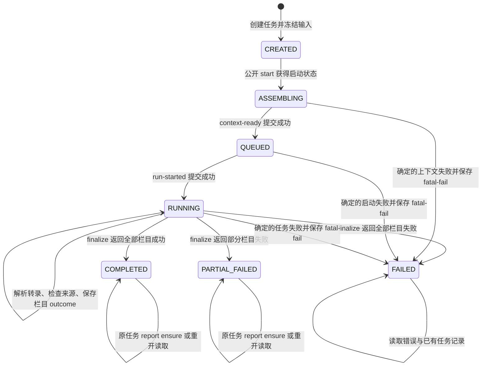

<!-- [Input] backend/routers/reflections.py、backend/reflections_agent.py、Claude Agent ThreadFactory/Service、Admin section persistence 与前端 voiceApi.ts。 -->
<!-- [Output] Reflections 任务启动、Agent 执行、转录解析、结果持久化、事件发布及恢复时序。 -->
<!-- [Pos] Reflections Agent 执行现行技术设计；产品入口与来源选择归内容选择 PRD/交互稿。 -->
<!-- [Sync] 2026-10-23: 展开 Task API→Engine→Runner→ThreadFactory/Service 及 Engine→EventBus→SSE，保留完整修订前稿。 -->

# Reflections Agent 执行与业务交互设计

## 背景与问题

[模块时序索引 6.1](../sequence-diagrams.md#61-回响分析analyze-echoes) 原图将执行阶段合并为 `TaskAPI→Agent` 和 `Agent→Stream`。当前源码包含后台任务、独立栏目 Thread、授权续期、Agent 内部流消费、转录解析、来源校验、结果保存和任务事件发布，需要分别说明各步骤的执行条件与输出。

本轮读取了指定任务[“扩展回归分析资源选择”](codex://threads/01a13319-aaf3-77b2-be92-932bec20c04a)的历史记录，并核对当前源码。历史记录用于定位 Notion 冻结输入与 Deck/Agent 选择；本文的执行合同依据本轮读取的代码。本文修订范围为后台执行说明、历史保存和文档验证；后台执行模块及运行权限沿用当前源码。当天再次分析弹窗的组件调整和交互规则由[分析内容交互稿](reflections-analysis-content-design.md)持有。

采用既有交互稿承载执行细节，在模块索引展开关键调用并链接本文。[修订前完整原文](reflections-agent-interaction-design-pre-execution-detail-20261023-history.md)保留原方案、持久化草案及图示文本。当前实现以 Admin PostgreSQL operation/DTO、Dream 执行模块和下列时序为准。

## 目标与边界

- 展示任务创建、订阅、启动、栏目执行、报告生成及结果读取的实际顺序。
- 展示单个栏目从授权建立到模型执行、转录解析和资源清理的完整调用链。
- 定义任务事件与 Agent 内部事件的生产模块、持久化位置和消费方。
- 覆盖确定失败、结果未知、事件保存失败、断线恢复和终态报告恢复。

产品目标、来源选择与页面骨架见[分析内容 PRD](../../prd/memory/reflections-analysis-content-prd.md)和[内容选择交互稿](reflections-analysis-content-design.md)。L2 蒸馏与 L3 回应流程见[记忆交互稿](reflections-agent-memory-interaction-design.md)。本文使用当前接口名称，新增接口数量为零。

## 概念与规则

### 执行模块

| 模块 | 输入、职责与输出 |
| --- | --- |
| `AnalysisView` / `voiceApi.runReflectionsTask` | 提交分析来源、栏目与语言；持有 task_id 和 lastEventId；读取任务与结果并打开报告 |
| `routers.reflections` | OAuth 身份与任务归属检查；创建冻结输入；公开 start/get/results/events/report 接口；准备任务 EventBus 并启动后台执行 |
| `start_reflections_task` / `ReflectionsTaskEngine` | 按 task_id 管理本机执行锁和后台 asyncio task；加载冻结输入，串行执行各栏目，保存结果与任务终态 |
| `ClaudeAgentReflectionsRunner.run_section` | 建立栏目授权和持久化 owner；准备提示文件；构造 `ClaudeAgentRunRequest`；等待 Agent 轮次完成；读取转录并解析最后一段 assistant 文本 |
| `AdminReflectionSectionPersistence` | 绑定 task/section/thread，维护栏目 authority、消息写入与私有 Session broker；提供 Gateway delegation；关闭时回收 broker、keeper 和 authority |
| `ClaudeAgentThreadFactory` / `ClaudeAgentService` | 执行统一 admission、上下文组装、Runner 生命周期、工具回调和消息持久化；提供轮次 completion 与 Factory owner_completion |
| `ClaudeAgentRunner` / Gateway | 按服务器选定模型执行推理和工具调用；Gateway 按当前 delegation 处理模型请求 |
| `ReflectionEventBus` / `TaskPersistenceObserver` | 分配任务事件 sequence，先调用 Admin 保存事件，再更新本机序号并发送给订阅者 |
| Reflections SSE endpoint | 校验任务读取权限；回放 Admin 历史事件；按 sequence 输出后续已保存事件 |
| Admin Reflections operations | 保存 task、section、Thread 消息、结构化 result、event 和 task 关联报告；检查业务权限、revision 与持久化回执 |

### 执行归属与输入

- 分析请求的 `analysis_content` 保存来源选择；Admin 创建事务冻结选定日记、Notion 正文和解析后的 Agent system prompt。Deck 提供 Agent 分组，执行选择使用成对的 `deck_id`、`agent_id`。
- `ReflectionsTaskEngine._assemble_context()` 加载冻结分析内容并准备任务工作区。没有可分析的日记正文且没有冻结 Notion 页面时，返回 `REFLECTION_NO_ANALYZABLE_INPUT`。
- 每个栏目通过 `reflection-section.begin` 取得其 thread_id、revision 与 authority。Runner 使用 `resume=False` 构造该栏目 Agent 轮次。
- 模型由 `resolve_platform_model()` 读取栏目 owner 的服务器配置和 Gateway catalog 后选择。选定 Agent 的 prompt 在 Reflections 系统提示前拼接；模型运行参数由选定模型提供。
- 前端提交的 `language` 经后端规范化后写入输入快照；栏目工作区的 `MEMORY_ANSWER_PROMPT.md` 追加该语言的输出要求，title、description、evidence 使用该语言，JSON 字段名保持既有合同。
- 日记检索通过本栏目的 snapshot Session provider 返回冻结范围；Notion 正文从 `analysis_content` 注入本次提示。私有 broker 的配置及权限见[独立设计](../claude-agent/session-projection-broker-design.md)。

### 两组事件

| 事件 | 生产与消费 | 保存与展示 |
| --- | --- | --- |
| Agent 内部事件 | ThreadFactory/Service/Runner 产生，`drain_chat_agent_turn()` 消费当前 Agent 流并等待 completion 和 owner_completion | Service 通过栏目 persistence 保存用户和 assistant 消息；栏目转录供 Runner 解析；分析 Chat 保留相关消息 |
| `reflection.*` 任务事件 | Engine 在 context、task、section 状态节点调用 `ReflectionEventBus.publish()` | `TaskPersistenceObserver` 先写 Admin event；SSE 回放并输出任务事件，页面据此更新状态 |

`ClaudeAgentReflectionsRunner` 的调用参数中没有向 Reflections EventBus 转发模型 token 的 `on_event`。任务 SSE 输出任务与栏目状态、结果计数和错误摘要；Agent 生成期间可持续执行模型或工具调用，页面在下一任务事件到达时更新栏目进度。

## 正常业务时序

### 1. 任务启动与栏目执行

前端在收到连接事件后调用一次 start；SSE 建立过程包含既有宽限与轮询恢复。单栏目请求使用 `sections=["echoes"]`，当前统一入口可提交多个栏目。具体页面步骤和反馈由内容选择交互稿所有。

### 2. 单分区 Agent 执行

Runner 等待轮次 completion 和 Factory owner_completion 后处理结果。`REFLECTION_AGENT_TURN_FAILED` 表示轮次未满足完成条件；`REFLECTION_ANALYSIS_OUTPUT_INVALID` 表示转录的最终文本解析失败。owner 的清理逻辑由 `finally` 执行，转录读取通过后台 Reflections worker 身份完成。

`_validate_results()` 将日记引用限制到 launch snapshot，逐项检查 `related_notion_page_ids` 的冻结页面范围；缺少有效来源的条目被跳过。有效结果转换为 `ReflectionInsightInputDTO`，Notion 标题与 URL 写入 evidence。`reflection-section.finish` 返回后，Engine 才发布栏目完成事件。有效空数组可完成为零条结果；报告生成遵循 `reflection-report.ensure` 的原业务规则。

### 3. 任务事件保存与页面消费

任务事件保存成功后，本机 sequence 和订阅队列才推进。每次订阅先取得已有 bus 的 token，再读取 Admin 历史，SSE 以回放最大 sequence 过滤后续队列。浏览器取消订阅时释放 token，后台任务保留执行归属。

## 异常与恢复时序

确定的栏目失败会保存错误并继续其余栏目，最终状态由 Admin finalize 结果确定。`outcome_unknown=true` 传播到 Engine 后，本轮执行结束；恢复依据 Admin 当前状态和原业务回执。终态再次进入 Engine 只执行报告恢复分支。浏览器重开使用同一 task_id；进程重启后的生产者恢复取决于既有任务启动入口和 Admin 栏目状态，页面订阅负责读取事件。

## 状态转换

以上状态名称来自持久化 task DTO。Agent 内部流帧由 Agent 生命周期管理；任务状态由 Admin `advance`/`finish` 结果更新。结果未知时保持已保存状态，后续读取核实结果。

## 接口、权限与恢复规则

| 边界 | 当前合同 |
| --- | --- |
| create/start/get/results/events/report | OAuth 当前用户与任务归属校验；扩展来源按精确 analysis-content capability 准入 |
| worker-load / advance / begin / finish / append / transcript / report.ensure | Admin Reflections 后台 operation；任务与栏目范围由服务端 DTO/authority 检查 |
| Agent 消息和模型请求 | 栏目 authority 绑定 Thread；Gateway runtime 使用限定用途 delegation；RTA 留在 Host |
| EventBus 事件 | required observer 保存成功后分发；可选 observer 的失败按已有异常隔离处理 |
| report.ensure | Engine 在 finalize 后调用；前端通过原 task_id 的 report 入口恢复关联报告 |

源码使用 `POST /api/reflections/tasks/{task_id}/report` 恢复任务报告。6.1 的执行链统一采用该入口与后台 `reflection-report.ensure`。结果字段为统一的 title、description、related_session_ids、evidence、confidence 等 DTO 字段，业务栏目由 section 标识。

## 验收矩阵与本轮检查范围

| 检查项 | 功能验收标准 / 源码依据 |
| --- | --- |
| 执行调度 | start 校验归属并创建后台任务；同 task 本机锁避免重复并发；`ReflectionsTaskEngine.run` 管理执行阶段 |
| Agent 执行 | Runner 建立栏目 owner、选定模型并调用统一 ThreadFactory/Service；等待两项 completion，转录解析与完成判断分别执行 |
| 消息及来源 | 用户/assistant 消息通过栏目 owner 保存；只处理冻结来源，越界 Notion 引用导致栏目失败 |
| 任务事件 | `TaskPersistenceObserver` 先保存；保存失败时 sequence 与队列保持原值；SSE 回放与本机队列按 sequence 去重 |
| 失败及恢复 | 栏目确定失败继续处理其他栏目；未知写入通过原任务查询核实；重开读取结果和事件，终态恢复关联报告 |
| 图文一致 | 6.1 索引和本文使用相同的 Engine/Runner/Factory/Service/EventBus 职责与当前接口名 |

现有测试参考：[Engine、事件与权限](../../../backend/tests/test_reflections_agent.py)、[来源冻结及栏目执行](../../../backend/tests/test_reflection_analysis_content.py)、[快照与 Admin 操作](../../../backend/tests/test_admin_reflection_task_data.py)。本轮执行文档引用、历史字节、用词、Mermaid 解析/渲染及相邻图示保存检查；功能测试和真实模型验收属于后续执行范围。

## 源码索引

- [任务与 SSE 路由](../../../backend/routers/reflections.py#L503)：start、results、report、events。
- [Engine 与 Runner](../../../backend/reflections_agent.py#L456)：栏目执行、请求构造、转录解析、结果校验和事件发布。
- [统一流消费](../../../backend/services/story_workspace/dream_lifecycle_observer.py#L108)：drain 与轮次完成判断。
- [ThreadFactory](../../../backend/claude_agent/thread_factory.py#L352)与 [Service](../../../backend/claude_agent/service.py#L2520)：Agent 生命周期、消息持久化和内部流。
- [栏目 persistence](../../../backend/services/admin_data/reflection_section_persistence.py#L194)：authority、消息、Gateway 与资源清理。
- [前端任务客户端](../../../frontend/app/_dream/api/voiceApi.ts#L828)与 [AnalysisView](../../../frontend/app/_dream/components/AnalysisView.tsx#L842)：订阅、启动、恢复及报告打开。
