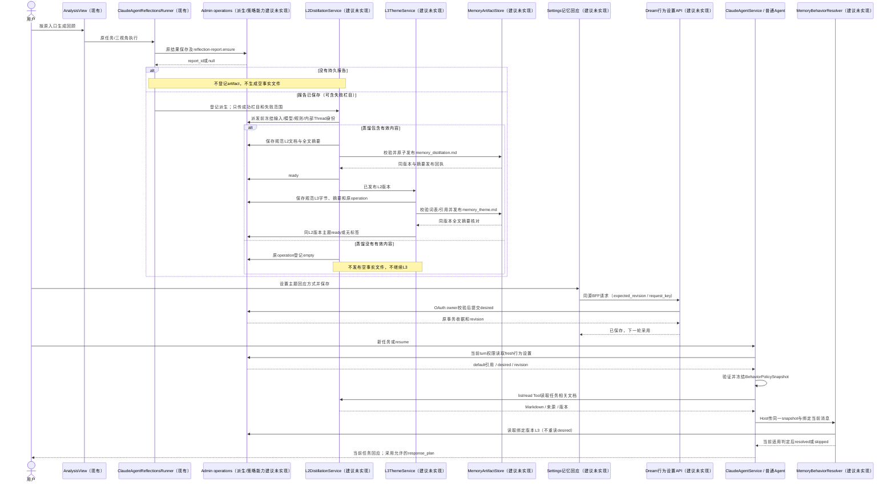
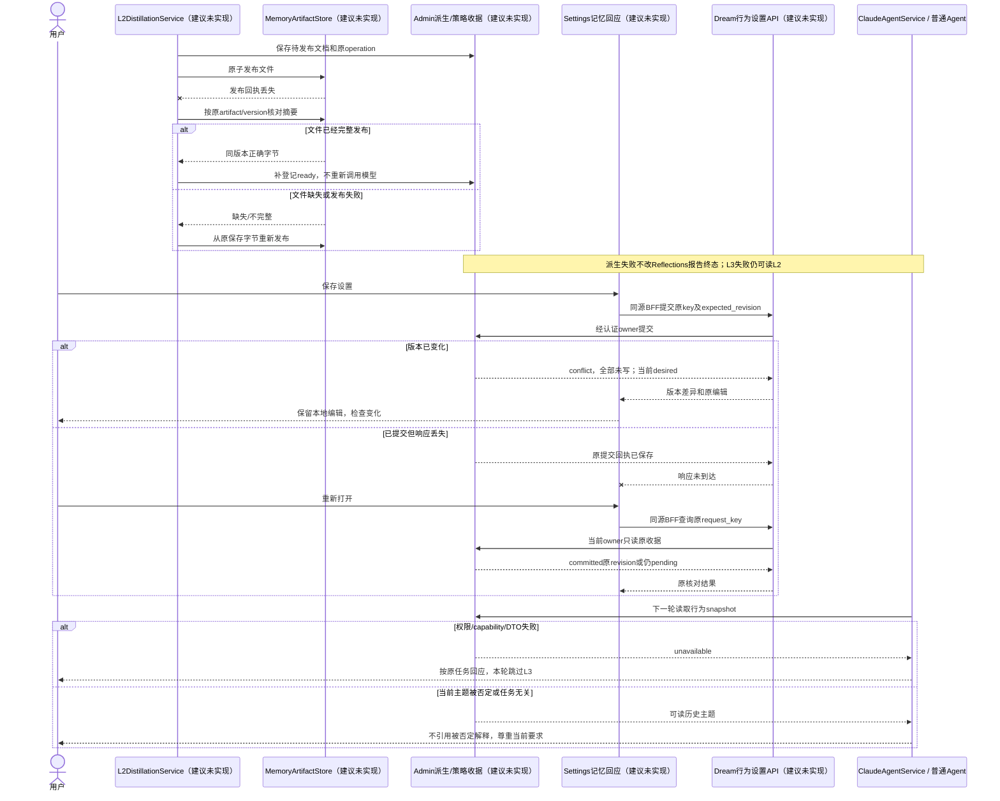
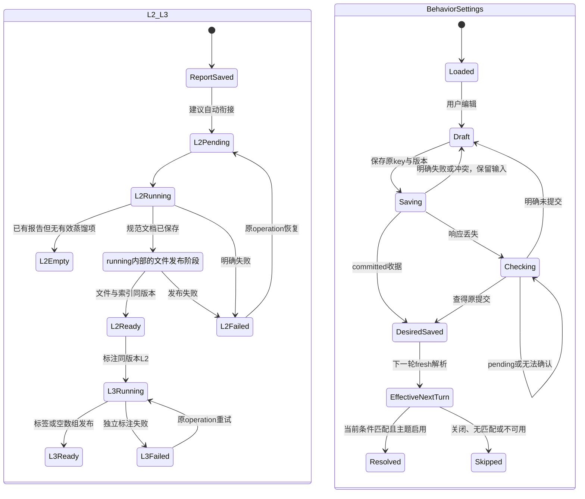

<!-- [Input] 用户2026-10-15纠正、现行Reflections/Settings/Agent实现、Notion L2与L3词表/策略资料。 -->
<!-- [Output] Reflections到memory_distillation.md、L3主题及策略执行器、读取Tools和唯一行为设置页面。 -->
<!-- [Pos] Memory正式设计；新增模块/接口/文件生成均为建议未实现。 -->
<!-- [Sync] 2026-10-15: 重写为L2→L3处理方案，不修改Reflections页面；前稿逐字归档。 -->
# Reflections 的 L2 蒸馏与 L3 行为设计

## 1. 背景与问题

本次修订以用户纠正为准：Reflections是用户主动触发的L2回顾；真实缺口是把每次`traits`、`echoes`、`patterns`结果转换成`memory_distillation.md`，给Agent读取，再由L2生成L3主题及回应策略。需要设计的页面是L3行为设置，而不是报告提取或记忆列表。

现有分析、报告、历史阅读与程序性workspace继续复用。当前不存在L2派生文件合同、L3主题结构/执行器及配置。旧四Tool和报告内选择保存方案已撤回，[完整旧稿](reflections-agent-memory-interaction-design-pre-l2-l3-20261015-history.md)仅作历史。[本轮判断记录](../../exec/reflections-l2-l3-design-review-20261015.md)给出当前证据和少量方案比较。

## 2. 目标与边界

链路为：原始来源→Reflections保存报告→每报告L2文档→同版本L3主题→当前对话适用判断→按用户设置回应。L2/L3属于该用户的回顾派生内容，保留观察范围，不将推断变成永久事实。

本轮只修改文档。下文新增服务、文件生成、Tools和配置均**建议、未实现**。不改现有Reflections、报告、时间轴、Deck编辑器页面，不新增候选确认、事实库CRUD、心理诊断、计数触发或自动回顾调度。页面只增加Settings中的个人行为设置。[产品PRD](../../prd/memory/reflections-agent-memory-prd.md)拥有该页面规则与骨架。

## 3. 概念与规则

| 阶段 | 本次具体含义 |
| --- | --- |
| L1 | 原始用户信息及其来源；现有日记和冻结Notion输入继续沿原合同，本次不另建事实提取入口 |
| L2 | 用户主动回顾；三个视角生成报告，再整理成带范围、来源和例外的memory_distillation.md，供后续检索读取 |
| L3标注 | 读取一份已发布L2文档，在具体片段上标注主题/细分标签，写对应memory_theme.md；不是当前心理诊断 |
| L3执行 | 结合当前用户表达、任务、相关L2/L3与本轮策略snapshot，判断是否采用具体回应方式 |
| L3设置 | 当前用户选择是否启用及各主题怎样回应；不修改标签定义、来源正文、Agent人设或工具许可 |

[原三层架构](https://app.notion.com/p/2b630b7547c3801e9991c517d94a1e2e)明确L2蒸馏文件→L3主题文件；[设备方案](https://app.notion.com/p/29c30b7547c380d3aec4cafc97f97df5)的Memory_dis模板包含事件摘要、情感基调、关键人物/实体、后续任务、核心诉求。本次采用这些实际输出，不用“社会层/特质层/深层情感”的内容分层替代处理阶段。

## 4. L2：每次回顾如何成为memory_distillation.md

### 4.1 转换起点及少量方案比较

已存在的`reflection-report.ensure`为同一任务保证一份报告；没有持久结果/成功栏目时不生成报告。Dream的`_ensure_report`目前丢弃返回的report_id，接入转换需取得该标识。转换只发生在报告保存得到确认之后，不消费SSE片段或首页拼合的最新三栏目。

| 方案 | 选择 |
| --- | --- |
| 跨报告覆盖一个同名文件 | 来源和并发覆盖无法准确恢复，排除 |
| 每份保存报告一个独立文档 | 选择；对齐每次回顾，目录中固定文件名memory_distillation.md |
| 另增人工提取/确认页面 | 与本次入口要求不符，排除；后台衔接即可 |
| Agent任意写Thread文件 | 不能跨Thread定位、限制归属或恢复，排除 |

建议`L2DistillationService`自动登记转换，输入为当前用户的保存报告及其固定摘要校验值、转换规则revision。服务端读取三栏结果，执行一次有界语义整理，再以确定性模板生成Markdown。只规范化标题和来源而不需要语义整理时，可以不调用模型；模式由发布的转换规则确定，不能因部署环境切换业务。

额外的蒸馏模型调用明确属于新步骤，不宣称现有报告已经是蒸馏文件；复用生产`ClaudeAgentRunRequest`/`ClaudeAgentThreadFactory`和服务端模型选择。worker只能读取绑定输入并输出结构结果，不能写用户设置。限制与重试来自执行配置，不继承原资料三次/五次重复。

### 4.2 三模式转换矩阵

| 报告视角 | 转换内容与去向 | 必须保留/不能补造 |
| --- | --- | --- |
| echoes / 重复回响 | 事件与主题摘要、情感基调、仍未解决的诉求 | 反复出现的情境、来源期间；不能凭主题名字制造新的事件或隐藏动机 |
| traits / 性格折射 | 行为与表达倾向，用户自我描述与模型推断分别标记 | 矛盾、例外、条件、confidence；不把描述变为确定的人格/诊断 |
| patterns / 行为轨迹 | 行为条件与节奏、已知应对方式；明确提到的任务/意图可进后续任务 | 何时出现/何时不出现；不能把建议改成用户承诺、把规律改为工具指令 |
| 跨视角重复 | 同一主题可合为一项描述，来源列表保留各视角/条目 | 派生次数不是独立证据次数；不以重复报告提高置信 |
| 人物/实体、后续任务、核心诉求 | 只填报告明确提供且可定位的内容；无材料的节不制造占位事实 | 不从“可能需要…”推断已经存在的人物关系或已安排任务 |

七类记忆检索是旧资料的业务组织方法：用户习惯、情绪/心理状态、重要事件、偏好/兴趣、关系/信任、工作/压力、陪伴行为指令。本次使用其整理思路，不要求七类都填满，也不建立七个文件或页面。

### 4.3 文件结构与实例

每份报告固定一个artifact_id，发布revision由Admin递增分配，初次为1。自动衔接以owner+report_id+report_digest+conversion_revision绑定同一generation_key/operation，普通retry复用该key。规则/输入变化产生新operation；同输入明确重新生成须另给稳定regeneration_key，相同重放仍只产生一个新版本。首期不新增用户重生成按钮或Agent写Tool，明确重生成属于授权后台operation。旧版本仍可读取，目录由服务器配置根/owner/资源标识派生，Tool不接任意路径。

下面是虚构示例。`body_sha256`只计算正文，不包含自身；frontmatter和正文一次序列化为同一文件，不使用晚到的sidecar修补版本。

```markdown
---
schema_version: 1
artifact_id: distillation-example
revision: 1
report_id: "9007199254740993"
task_id: null
report_digest: "服务端计算的报告摘要校验值"
conversion_revision: "已发布转换规则版本"
completed_sections: [echoes, traits, patterns]
failed_sections: []
observation_period: "本报告来源覆盖期间"
body_sha256: "服务端计算的正文SHA-256"
---
# 记忆蒸馏摘要
## 事件与主题摘要
### l2-item-01
最近回顾记录反复涉及项目协作受阻。
性质：报告观察；条件：协作任务；来源：echoes/result-example-01。
## 情感基调
### l2-item-02
部分记录表达时间不足和推进受阻，不能据此判断此刻状态。
性质：报告推断；来源：echoes、patterns对应条目。
## 行为与表达倾向
### l2-item-03
在这些记录中，用户倾向先明确目标再讨论实现；存在适用条件。
性质：报告推断；来源：traits/result-example-03。
## 核心诉求
### l2-item-04
用户明确提到希望协作中先对齐当前目标。
性质：报告记载的用户表达；来源：patterns/result-example-04。
## 证据与来源
各项对应report_id、section、result_id或旧报告位置+内容校验值。
```

人物/实体、后续任务等有证据时才增加相应节。每个`l2_item_id`的正文、信息性质、观察时间、条件、原条目和相关来源共同保存。历史报告Notion只有报告级摘要时标为报告级；不能解析evidence中的URL冒充精确条目引用。

转换以报告为材料，默认不重新抓原始Notion或实时日记。故“报告记载的用户表达”仍不是已重新核对的原始事实；若未来核对原文，需有独立授权与版本证据。原始来源变化不反改已经发布的历史报告/L2版本。

### 4.4 持久化、发布与恢复

建议Admin保存artifact索引、转换状态、来源绑定、版本和规范UTF-8文档字节；索引另外保存document_sha256、byte_length及预期frontmatter字段。全文摘要只存索引，避免自引用；read同时核验全文字节、正文body_sha256和元数据与索引一致，不能只查正文忽略来源/版本被改。Dream的MemoryArtifactStore发布同一字节为真实memory_distillation.md，复用现有文件根及严格检查，独立于Thread程序性目录。

数据库和文件系统不假装一个原子事务：先保存待发布文档和操作标识→在受控目录写临时普通文件并校验→原子rename到版本目录→复核字节摘要→Admin登记ready。中断由原operation核对文件并补登记；丢文件可从已保存规范字节重新发布，不重新调用模型。只有两者版本/摘要对应才可读；半文件、符号链接、路径越界或摘要错误停止读取。

转换状态为pending/running/ready/empty/failed；publishing是running中的文件发布阶段，不是另一持久终态。没有report_id时不登记虚构artifact；已有报告但蒸馏无有效项时operation=empty，不生成空事实文件。部分失败只转换成功栏目并记录failed_sections。L2失败独立于原Reflections终态。

模型派发前持久冻结报告输入字节/摘要、执行模式、具体模型ID/必要参数、conversion_revision、generation_key和内部Thread/turn绑定。模型结果未知先读原执行结果或保持待核对，不能重新选模型/输入重跑同一attempt。明确失败才新attempt；文件发布恢复仅用已保存字节。

报告保存与派生登记之间退出的缺口由后台恢复扫描关闭：Admin发布专用派生来源发现operation，按归属/有限批次游标扫描已保存报告缺失的artifact绑定，幂等补登记。同版本报告重复发现复用原generation_key，不从文件目录猜owner，也不把其他用户报告授予某Agent。正常ensure回调只是快速触发，恢复同时处理未登记报告和已有operation，不新增通用任务平台。

## 5. L2→L3：主题标签方案

### 5.1 采用的原词表与调整

词表来自[情绪主题标签体系详细定义](https://app.notion.com/p/2b230b7547c380a7b0e2c4d0db258273)；维度来自[主题判断核心定义与触发逻辑指南](https://app.notion.com/p/2b230b7547c380ad8d07ea227fee69e0)。四主题/十六Tag ID沿原文保留，当前主题名称不是traits/echoes/patterns的直接映射。

| 主题 | 原文判断维度 | Tag ID及原意 |
| --- | --- | --- |
| THEME_FRUSTRATION | 阻碍/缺失；悲伤/无力；内部感受或外部阻力 | TAG_FRS_WORK_BLOCK 工作受阻；TAG_FRS_WORK_ISO 职场支持缺失；TAG_FRS_EMO_DISCONN 生活连接缺失；TAG_FRS_EMO_VENT 负面情绪表达 |
| THEME_DEFENSE | 秩序/隔离；中性/冷淡；原文解释为回避情感或强调逻辑 | TAG_DEF_WORK_ORDER 秩序对抗失控；TAG_DEF_EMO_DETACH 情感抽离；TAG_DEF_EMO_RATIONAL 理论化解释感受；TAG_DEF_GEN_DENIAL 拒绝深入话题 |
| THEME_PRESSURE | 目标/时间；焦虑/紧绷；外部要求或自我鞭策 | TAG_PRE_WORK_TIME 时间不足；TAG_PRE_WORK_MUST 成败后果焦虑；TAG_PRE_EMO_COMP 比较焦虑；TAG_PRE_EMO_SELF 自我苛责 |
| THEME_VALUE | 意义/热爱；希望/坚持；内在追求或连接 | TAG_VAL_WORK_MEANING 职业意义；TAG_VAL_EMO_LOVE 兴趣/生活向往；TAG_VAL_GEN_CONN 珍视连接；TAG_VAL_GEN_AFFIRM 自我/他人肯定 |

本次调整：防御相关解释保持推断；工程讨论要求架构/流程不因词匹配归为防御。`TAG_DEF_GEN_DENIAL`只记录明确话题边界，不推导隐藏情感，也不能触发继续深挖。拒绝话题始终优先，无论L3是否开启。其他原标签只在相应用户语境有具体证据时生成，词表关键词只是定位提示。

### 5.2 标注输出和无标签结果

建议`L3ThemeService`读取已发布L2版本，执行有界结构化标注，服务端校验词表和片段引用，发布对应`memory_theme.md`。L2可以先ready，L3失败不让L2失效；同L2摘要+taxonomy_revision复用标注operation。无标签是完成结果`[]`，不是失败，不凑齐四主题。

文件为YAML元数据加JSON代码块，避免把Markdown扩展名中的裸JSON、元数据和版本混在一起。原六字段采用一条记录一个单数`TriggeringTagId`；混合主题输出多条记录，不合成新标签。

```json
{
  "source_distillation_id":"distillation-example",
  "source_revision":1,
  "source_body_sha256":"对应L2正文摘要",
  "taxonomy_revision":"发布的四主题词表版本",
  "records":[{
    "theme_record_id":"theme-example",
    "THEME":"THEME_PRESSURE",
    "Focus":"时间",
    "Polarity":"紧绷",
    "Attribution":null,
    "TriggeringConditions":"报告中的项目期限与时间不足表达",
    "TriggeringTagId":"TAG_PRE_WORK_TIME",
    "source_item_ids":["l2-item-02"],
    "source_excerpt":"部分记录表达时间不足和推进受阻",
    "evidence_kind":"inference",
    "observation_period":"报告来源期间"
  }]
}
```

不充分的Attribution等维度留null，不补心理原因；THEME与Tag组合不合法、引用片段不属于此L2版本、或必要证据缺失时整份不发布并记录可恢复错误。因用户明确拒绝而产生的边界记录标`evidence_kind=explicit_boundary`，只允许尊重边界的行为。标签与L2使用相同规范字节保存/安全文件发布协议，无新的确认页面。

## 6. L3策略执行器

### 6.1 输入、判定和实际输出

建议`MemoryBehaviorResolver`的输入为Host绑定的当前用户消息/任务上下文、经权限读取的相关L2及同版本L3、服务器解析的`BehaviorPolicySnapshot`、既有Agent表达背景。模型和浏览器不能提交owner、effective或批准标志。

处理顺序：

1. 校验当前turn身份与策略snapshot；全局/主题关闭则跳过，关闭时不调用主题分类模型。
2. 核对相关L2/L3版本和来源；只取与当前任务相关且未被当前用户否定的内容，不把目录全部注入。
3. 针对当前表达执行结构化适用判断，允许无命中；可调用配置内的判定模型，复用生产执行模块。派发使用独立内部Thread/turn并关联当前解析operation，不能重入正在执行的源Thread形成锁等待。具体模型/输入在派发前冻结；副作用不藏在文件read Tool中。
4. 校验当前引文属于真实当前用户消息；排除引用、角色台词、否定、规范用语、只有日期/技术故障而无情绪表达等情况。
5. 先尊重当前明确任务和话题边界，再确定主题回应。混合主题保留多个候选，但只选与当前诉求相符的一种回应计划；无法判定则跳过，不默认心理追问。
6. 用允许的行为目录及本轮effective生成response_plan，交给当前Agent采用。主题数据不能当可执行提示词，计划不能覆盖用户指令、系统安全或工具权限。

输出状态为resolved/skipped/unavailable，包含策略revision、选中行为、当前证据引用、L2/L3来源、skip_reason。resolved只说明已解析计划；回执只记录plan_delivered及关联turn终态，不因回应完成便标used/applied。实际采纳与效果属于后续验收。源turn Stop沿既有取消合同，不把用户取消当可忽略的L3故障继续回应。

artifact集合按ID/revision去重排序；同一父turn的所有集合共享持久判定调用预算，预算由服务器执行配置提供。相同输入重放原解析回执；预算耗尽不再调用模型。任何判定派发仍未知时，换集合也不得新派发，返回原核对状态/unavailable，防止模型反复更换输入绕过调用限制。

### 6.2 触发、排除、响应矩阵

| 主题 | 当前必要条件 | 排除 | 本次建议行为 |
| --- | --- | --- | --- |
| 挫折 | 用户当前表达具体受阻、孤独、委屈或无力，相关回顾提供同情境背景 | 普通Bug报告、引用他人感受、否定情绪、已结束历史 | acknowledge_then_help：简短承认具体困难后继续任务；help_only：直接帮助；ask_support_type：诉求含糊时询问所需支持 |
| 压力 | 当前同时有目标/期限背景和焦虑/紧迫表达 | 规范里的“必须”、只有日期、过去期限、任务已取消 | prioritize_actions：明确优先级/下一步；acknowledge_then_help；ask_support_type。不能自动强制暂停或转移话题 |
| 防御 | 当前情感情境有抽离/理论化材料，仅作为候选解释 | 技术流程要求、平静表达、单纯偏好数据、用户否定该解释 | respect_distance：尊重距离和当前要求；help_only；ask_support_type。明确拒绝话题不需要命中防御标签便立即停止 |
| 价值 | 当前明确表达热爱、意义、坚持或珍视某关系，历史仍适用 | 客套/反讽/模板、否定、归属为他人 | connect_goal_to_choice：结合明确目标支持当前选择；acknowledge_only：具体简短回应；help_only。无必然成功/唯一关系承诺 |

不同模式都可贡献同主题，`echoes`不是挫折、`traits`不是防御、`patterns`不是压力的固定映射。L3必须从L2具体内容判断，而不是按分析模式查表贴标签。

### 6.3 反馈与相邻回归

用户说“不是这个意思”时停止使用本次解释；说“不想聊”时停止话题；说“直接给步骤”时按当前要求回应，不再重复询问。这些消息本来已由Chat持久保存，resolver的当前turn回执可记录被否定的resolution/来源关系，以当前Thread为范围排除，明确允许后才解除；不把拒绝再计为防御加强。

该反馈不自动修改全局desired、不重写历史L2/L3，不创建永久心理事实。长期回应偏好由唯一行为设置页保存；这里不新增反馈Tool或确认弹窗。设置页关掉策略后，普通任务帮助和尊重拒绝仍遵守既有Agent合同。

## 7. Agent Tools与接口

### 7.1 最小组合比较

已有`get_sessions_range`读原始日记，不能读派生文件；原生Read仅当前workspace，不能扩大成用户全目录。一个发现+正文Tool会使列表返回过多内容，推荐两个L2只读Tool。L3执行另用一个业务Tool明确其当前判定副作用；不按三分析模式或十六标签拆Tool。

以下三个工具均为**建议新增、未实现**，注册到现有user MCP、私有broker和精确allowlist。L2转换和L3标注由后台自动衔接，没有额外“保存记忆”Tool；设置修改只走认证页面。

| 项目 | list_memory_distillations | read_memory_distillation | resolve_memory_behavior |
| --- | --- | --- | --- |
| 使用者/目的 | 普通Agent找到任务相关回顾文档 | 普通Agent读指定文档并引用 | 普通Agent为当前任务取得可采用的回应计划 |
| 时机 | 用户问过去回顾、需要个人背景 | 目录确定来源后、L3前 | 有相关主题上下文且本轮允许使用时 |
| 输入 | 可选report_id、日期/栏目、cursor、配置内limit；默认当前用户 | artifact_id或report_id二选一，可选精确revision；默认最新ready版本 | 相关distillation_id/revision列表；无owner、自由prompt或任意消息正文；当前turn/message由Host绑定 |
| 输出 | 文档ID/版本、报告日期、成功/缺失栏目、摘要、转换状态和next_cursor，无全文 | 完整memory_distillation.md字符串、解析元数据、来源及字节校验；不存在/生成中/失败分别返回 | resolved/skipped/unavailable、response_plan、当前证据、L2/L3引用、策略revision/原因 |
| 读写影响 | 只读目录，不发起分析/生成文件 | 只读文件，不隐式生成、标注或写配置 | 可能调用当前适用判定模型；记录本轮解析/反馈回执，不改L2/L3或desired |
| 权限 | 当前owner的报告派生索引 | owner+report/artifact/version绑定，严格文件根/类型/大小/摘要检查 | actor/Thread、当前消息、effective与所有artifact归属；只读取同版本L3 |
| 重试/失败 | stable cursor，只读可重试；capability缺失明确失败 | pending、not_found、failed、integrity_error区分，不切换别份文件；缺文件由后台修复 | 集合归一化，同父turn共享持久预算/未知派发门禁；同输入复用回执；普通Chat不因L3故障中断，但仍尊重用户Stop |
| 用户介入 | 来源不明确时选择任务范围，不弹统一确认 | 通常不需要；来源不足说明限制 | 不确定/被否定时跳过；只有用户当前诉求含糊且其选择允许时问支持方式 |

示例：Agent先`list_memory_distillations({report_id:"9007199254740993"})`，再`read_memory_distillation({artifact_id:"distillation-example",revision:1})`，得到对应Markdown，而不是`Read('/别的Thread/memory/...')`。若用户当前只要求重构流程，resolve应返回`skipped/no_current_emotional_signal`；若明确表达期限焦虑并要求安排工作，得到`prioritize_actions`，不能给隐藏动机诊断。

不暴露L3标签写入、用户策略写入、任意文件路径、原始数据库查询、心理诊断或自动发送外部消息的工具。三个工具均不能开启用户关闭的主题；L3策略不是新的权限层。

建议HTTP/operations：L2目录/文件读取、L3解析、个人行为配置read/save/receipt及Runtime resolve，最终由Admin严格DTO发布。接口命名可采用`GET /api/memory/distillations`、`GET /api/memory/distillations/{artifact_id}`、`GET/PUT /api/memory/behavior-settings`、原request_key收据读取，均**未实现**；不冻结完整OpenAPI，也不把任意JSON设置当完成合同。

## 8. L3行为设置及生效合同

唯一入口复用`StoryWorkspaceSettingsPage`，增加“记忆回应”section（建议`/story-workspace/settings/behavior`），复用`SettingsSection`与移动外壳。设置属于当前用户；Deck/Agent prompt仅提供表达背景，不存个人L2/L3或策略，也不能开启关闭的主题。

| 值 | 定义 |
| --- | --- |
| default | 服务端versioned行为目录/默认设置；总开关false，四主题enabled=true，默认动作分别acknowledge_then_help、prioritize_actions、respect_distance、connect_goal_to_choice |
| draft | 用户本页未保存编辑；恢复默认只改变draft，不立即保存 |
| desired | Admin owner记录的enabled、四主题enabled/action与desired_revision；strict enum，不接自由可执行prompt |
| effective | 下一轮Service经授权读取并验证default+desired，生成独立server-owned BehaviorPolicySnapshot，冻结owner/Thread/Agent及来源revision；不包含待推断的当前情绪 |
| resolved行为 | resolver结合effective与当前消息/可用主题决定本轮response_plan；标签是否命中不改变effective本身 |

保存使用expected_revision+request_key，整份配置原子写入。第一次key固定原Admin request_id与指纹，重开/新call_id不换绑定；未知时读原receipt，pending/absent/查询失败不能判未提交。冲突全不写，保留本地draft并取服务端新版本；已确定未提交才重试。用户界面只显示“未保存 / 已保存，下一次回应使用 / 正在核对 / 保存失败 / 设置已更新”，不展示内部字段。

每轮包括resume重新取得fresh配置；Admin返回default目录引用及desired/revision，ClaudeAgentService验证并本地生成/冻结snapshot，Host将同一snapshot透传resolver。resolver只读取绑定L3内容，不再次读取desired，运行中保存不能改变本轮策略。采用独立每轮上下文块避免system_prompt缓存残留；不修改Runner/ThreadFactory/取消/资源算法、Runtime env或.claude-tmp协议。

确定无用户覆盖时采用已发布default。capability、权限或DTO读取失败时本轮不启用L3个性化，不能沿旧启用配置继续；普通Chat仍按原路径运行。UI读取失败保留已读值且禁止用假默认覆盖；save提交不宣称当前turn已经applied。

### 8.1 桌面骨架

```text
┌ 现有Settings导航 ─┬ 记忆回应 ─────────────────────────────┐
│ 原其他栏目         │ 主题辅助回应 [总开关]                 │
│ [记忆回应]         │ 保存后下一次回应使用                    │
│                    │ [✓]挫折 [简短回应再帮助             ▾] │
│                    │ [✓]压力 [明确优先级和下一步         ▾] │
│                    │ [✓]防御 [尊重距离与当前要求         ▾] │
│                    │ [✓]价值 [结合目标帮助当前选择       ▾] │
│                    │ 此内容区域纵向滚动                     │
│                    │ 草稿/失败/核对/冲突反馈                │
│                    │ [恢复默认] [保存设置]（保持可达）      │
└────────────────────┴────────────────────────────────────────┘
无新的报告区域、L2候选弹窗或标签编辑器。
```

### 8.2 窄屏骨架

```text
┌ 原移动设置导航 > 记忆回应 ┐
│ 主题辅助回应       [开关]│
│ [✓]挫折 / 全宽方式选择   │
│ [✓]压力 / 全宽方式选择   │
│ [✓]防御 / 全宽方式选择   │
│ [✓]价值 / 全宽方式选择   │
│ 单一内容区域纵向滚动      │
│ 保存/核对/冲突反馈        │
│ [恢复默认] [保存设置]    │
└─────────────────────────┘
保留原底部导航和安全区；选择控件与保存区互不遮挡。
```

## 9. 正常、异常与状态图

所有新模块的图中名称均标为建议未实现；现有Reflections/Chat模块沿源码命名。







模型派发未知和文件发布未知不同：前者核对原Thread/turn、停止自动重跑；后者可从已保存同版本字节恢复文件，不需要模型。图中原operation恢复不能暗示外部模型恰好执行一次。

## 10. 最小持久化和实施依赖

Admin唯一拥有派生索引/版本/规范文档字节、后台operation/claim、主题来源及个人策略revision/receipt。可以复用现有报告、用户配置存储和事务收据模式，不先建通用事实库CRUD；是否新增表/字段由Admin Drizzle提交前向migration和精确capability。Dream仅消费strict DTO，缺能力停止对应派生/个性化，禁止直连SQL、runtime DDL或文件fallback假装ready。

文件根/容量/模型调用与恢复限制来源于现有配置或新发布的显式配置，不按deployment环境名称分支。后台worker权限与普通Agent当前turn权限分开；原Reflections section authority不能直接获得所有个人记忆或策略写入权。

实施顺序：Admin派生/配置合同及能力→L2转换和安全文件发布→L3标注/版本检查→两个L2读取Tool与一个resolver→独立每轮snapshot→唯一Settings section→隔离技术旅程→另行授权的真实账户/模型验收。

## 11. 验收矩阵（本轮仅制定）

| 场景 | 预期 | 后续证据 |
| --- | --- | --- |
| 每份保存回顾 | 同报告三视角合为独立memory_distillation.md，报告UI不变 | report/artifact/文件与正常入口 |
| 部分失败/无报告 | 只处理成功栏目；无报告不造空事实，原状态不变 | 原任务、派生状态 |
| 跨视角/跨报告 | 单次去重保留来源/例外；多报告不互相覆盖 | 两份文件/索引/来源 |
| 转换重试/并发/重开 | 同指纹同版本；派发未知不重跑，ready不丢失 | 原operation/Thread/文件摘要 |
| 文件发布中断 | 从保存字节核对并补登记/重新发布，半文件不读 | 故障注入技术合同 |
| Agent完整L2读取 | list发现→read精确版本→当前任务引用，无任意路径 | Tool/broker/owner及返回Markdown |
| L3标注 | 四主题十六Tag词表、同版本片段来源、null维度和[]结果合法 | 结构/出处/无标签 |
| L3失败/版本错配 | L2仍可读；错配不作为本轮策略依据 | 独立状态和skip_reason |
| 当前触发/排除 | 普通架构要求、日期、引述、否定不误判；历史标签不等于当前情绪 | 模型评测与业务样例 |
| 混合主题/反馈 | 按当前诉求选择；拒绝停止、否定不循环强化 | 本轮解析回执与后续回应 |
| Settings首次/关闭/开启 | 默认关闭；主题选择保留；保存影响下一轮，运行中不变 | 页面desired/effective对照 |
| 保存失败/未知/冲突 | 保留draft；原收据核对；冲突全不写，旧key不换绑 | 原revision/receipt |
| resume与缓存 | fresh snapshot采用最新revision，不沿旧启用值 | 两轮服务记录 |
| 权限/配置故障 | foreign artifact/策略拒绝；L3不可用不阻断普通Chat、不启用旧值 | 权限/能力技术合同 |
| 唯一页面/窄屏 | 只有Settings变化；滚动/焦点/保存可达，无候选页面 | 桌面/窄屏旅程 |
| 相邻回归 | 原分析、{deckId,agentId}、报告ensure/历史/SSE/取消和资源策略不变 | 原完整生产入口合同 |

本轮文档检查和流程推演不是上述功能验收。标签准确性、当前表达判断、去重/压缩质量、回应是否合适、Admin能力发布与正常数据运行仍需后续验证。资料附件未读取的部分不冒充已证实规则；本次词表和触发方案已有正文依据。
