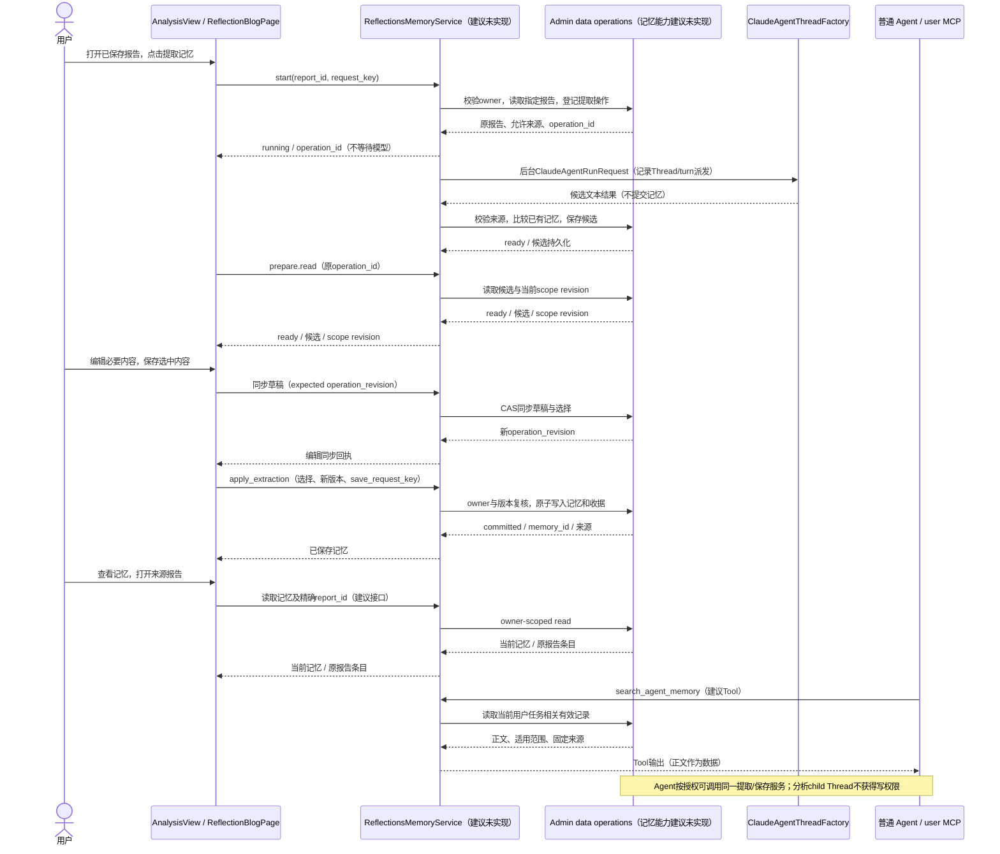
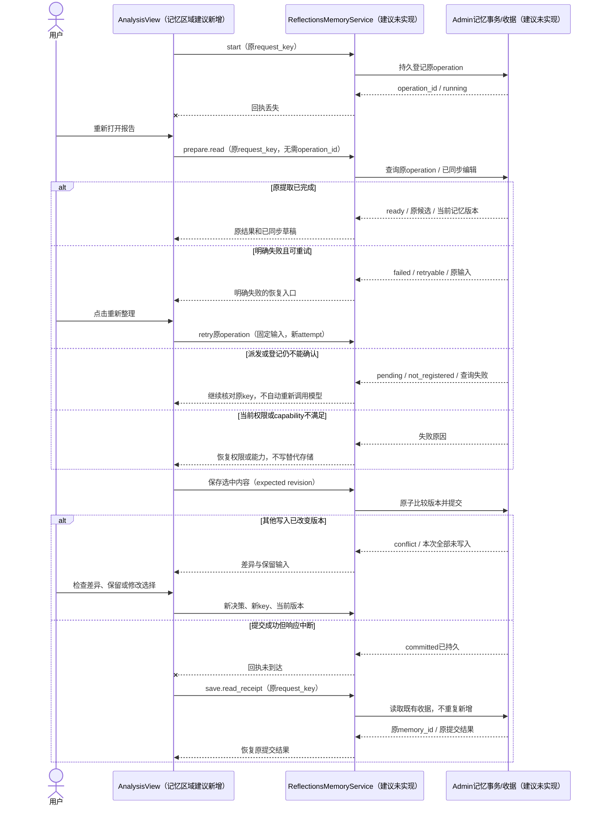
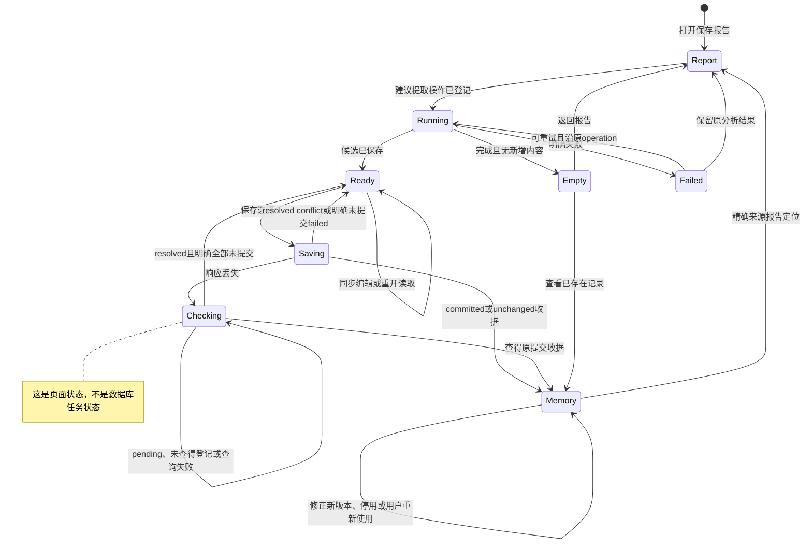

<!-- [Input] 指定 Notion 正文、本轮源码证据、Memory PRD 和 Admin 唯一持久化合同。 -->
<!-- [Output] 选定方案、完整交互、Agent Tools、业务图、最小实施依赖和验收矩阵。 -->
<!-- [Pos] Reflections 到 Agent Memory 的正式交互设计；建议接口均未实现。 -->
<!-- [Sync] 2026-10-14: 核对现有三模式、程序性记忆和工具权限后形成设计，保留历史文件。 -->
# Reflections 到 Agent Memory：交互设计

## 1. 背景与问题

推荐从已有报告提取记忆，在原报告阅读面完成查看、编辑与保存，再在同一回顾分析页面查看和修正已保存记忆。Agent 使用同一业务服务按任务调用，第一版不让分析任务直接写入长期记忆。

当前已实现三模式分析、冻结输入、任务与报告保存、历史阅读；当前未实现正式的跨会话用户记忆记录及读写 Tools。`memory/` 是程序性执行资源，`voices.memory_workspace_config` 是可随 Deck 复制的 Agent 配置，Mem0 Tool 是未完成检索的兼容存根，三者都不能承接私人事实。证据、少量方案比较和修订后评审见[本轮判断记录](../../exec/reflections-agent-memory-design-review-20261014.md)。

## 2. 目标与边界

目标是让报告中有用的信息进入后续 Agent 任务，并能回答“这条信息从哪里来、适用于什么时候、如何纠正”。用户记忆属于认证用户，分析 Agent 和 Deck 只记录执行来源，不指定私人信息的所有者。

本方案是后续实现依据，所有新增服务、接口、Tools 和持久记录均为**建议、未实现**。本轮不修改功能代码、数据库、真实记忆，不调用模型，不合并或发布。[产品 PRD](../../prd/memory/reflections-agent-memory-prd.md)拥有入口规则和骨架；本稿直接包含相同页面关系、业务图与验收。

第一版不做多报告批量事务、每 Agent 独立事实库、全量记忆自动注入、心理干预引擎、完整情绪标签流水线、向量/图库或新通用任务平台。不添加固定“出现几次就记住”的规则。

## 3. 概念与规则

### 3.1 对象与转换关系

| 对象 | 执行模块、输入输出及约束 |
| --- | --- |
| 原始日记/笔记 | 已有 Session 和 Notion 来源。日记执行时经任务范围 broker 获取；Notion 正文在提交任务时冻结。标题与来源摘要不能代替正文核对 |
| 分析任务 | 已有 `ClaudeAgentReflectionsRunner` 执行三栏目工作流；Admin 保存任务状态、栏目结果、事件与报告，Dream 保留 Agent 执行、文件及 SSE |
| 分析报告 | 已有 `ReflectionBlogPage` 消费保存后的 JSON。分析观察、解释和低置信度结果可以留在报告，不要求都成为记忆 |
| 记忆提取记录 | 建议由 `ReflectionsMemoryService` 读取指定报告及允许来源，整理候选、检查已有记忆并持久保存结果；它不是另一份分析报告，也不重复三栏目分析 |
| 持久记忆 | 建议由 Admin 拥有记录和版本，Dream 使用严格 DTO。正文、陈述性质、观察时间、适用条件、来源和有效状态共同决定后续使用 |
| 运行时使用 | 建议 `search_agent_memory` 在当前任务中召回相关有效记录，返回引用和限制；候选、停用记录和旧版本默认不进入 Agent 回应 |

原始内容 → 已保存报告 → 有范围的候选 → 明确保存的记忆 → 当前任务相关召回。记忆不会反向改写报告，也不会把报告结论重新当作原始事实增加“独立证据”次数。

### 3.2 三层资料的准确采用

资料二实际是[《0602沟通内容》](https://app.notion.com/p/29a30b7547c3808b8d49f801bdce65d4)，同时索引了两种三层定义。必须分别说明，不把同一个 L1/L2/L3 名称当成同一数据模型。

**内容分层**来自[《三层记忆体系策略主题如何与角色行为连接讨论》第二、三、六节](https://app.notion.com/p/2ae30b7547c380aab75bf70d7860b077)：

| 原文层级与意图 | 与当前实现对应 | 本次采用、调整或暂不采用 |
| --- | --- | --- |
| Level 1 社会层：性别、教育、职业、社会关系等外显信息，形成可分类画像 | 日记可以包含这些信息；三模式不是社会属性抽取器；尚无持久用户画像 | 采用明确个人事实可被记住的能力；不强制采集性别/教育或新建画像表单，不把原文“与 EVA 的关系”等示例作为 IM 字段 |
| Level 2 特质层：情感基调、自我认知、个性化倾向等相对稳定内容 | `traits` 接近其中的倾向推断，`echoes`/`patterns` 也能提供情境材料；现有 confidence 不证明稳定性 | 采用带条件的自我描述和观察；用户表达与模型推断分开，不将推断晋升为确定性人格档案 |
| Level 3 深层情感主题：挫折、压力、价值、防御，动态且主观，用于陪伴与上下文生成 | 三模式可能涉及这些主题，但结果 DTO 没有四主题、细分标签及回应映射 | 采用“在相关任务中按证据回应”的目的；情绪假设保留报告或经用户选择保存为情境观察，暂不建立主题分类/计数/自动干预系统 |

**处理阶段**来自[《三层记忆系统架构与情绪标注》](https://app.notion.com/p/2b630b7547c3801e9991c517d94a1e2e)及资料二“L1/L2工程图 / L3工程图”：

| 原文阶段、实际输入输出 | 当前对应 | 本次收敛 |
| --- | --- | --- |
| L1 事实提取：单会话上下文 → 用户 `facts`；按消息角色区分用户与助手信息 | `get_sessions_range` 可读用户日记；没有 Mem0 正式入库 | 采用来源角色与直接证据检查，候选记录事实/事件；不把分析 Agent 的描述视作用户说过的话 |
| L2 检索与蒸馏：L1 事实/情景 → 七类检索后的摘要，含事件、情感基调、人物/实体、后续任务；文件 `memory_distillation.md` | Reflections 已做跨来源整理但不是这个流水线；当前程序性 workspace 不保存正式蒸馏库 | 复用“为任务压缩信息、保留条件”的方法；报告是提取上下文，记忆正文是可召回的短描述；七类不是必须填满的 schema，不再生成平行摘要文件 |
| L3 情绪主题标注：L2 摘要 → THEME、Focus、Polarity、Attribution、TriggeringConditions、TriggeringTagId 等结构，文件 `memory_theme.md` | 现有三个分析栏目没有这份结构或策略执行器 | 暂不实现完整标签阶段。现有分析已能提供观察；没有采用依据时不补标签。保留触发条件、观察范围、信息性质这些有直接使用价值的字段 |

原文还有三次顶层任务、五次细分任务及“3次提醒/5次进入主题”示例，这些是旧工作流或待讨论策略，不能转为当前产品门槛。原文 `TriggeringTagId` 与另一处 `TriggeringTagIds` 也不一致，本次不创设兼容字段。

资料三[《设备的个人记忆系统前期沟通方案》](https://app.notion.com/p/29c30b7547c380d3aec4cafc97f97df5)的有效部分是：用户事实和 Agent 人设分开、记忆通过动态上下文使用、检索/蒸馏/回答/更新应有明确流程。需要调整的是：其旧设备/IP、Mem0、MQ、Kode 文件流水线和提示词示例不构成 IM 实现合同。其后续记录也明确“先记住，再解释；先结构化，再上理论”。

[主题回应策略 MVP](https://app.notion.com/p/2b530b7547c3807a869ded024184f7b6)提供了角色化范例，但“强制打断、无视逻辑、把防御当成生病”等处理不适合作为 IM 的通用自动动作。第一版只让当前 Agent 看见有来源的描述及用户表达的偏好，由既有 Agent prompt 服务当前任务，不把心理标签改写成更高优先级指令。

### 3.3 进入记忆的条件与自动执行边界

| 信息 | 去向与处理 |
| --- | --- |
| 用户原文明确说出的偏好、职业事件、计划 | 原始引用和归属核对成功、无冲突、仍有适用范围时可成为事实候选；用户已要求记住这类普通信息时 Agent 可以直接保存，不再逐条确认 |
| 报告整理的多条事件摘要 | 可保存为限时/限情境摘要，不能把每个总结句当作直接引语；保留报告及原始来源条件 |
| 跨情境习惯或应对规律 | 以 `observation` 保存“在某范围和条件下出现什么”，先展示给用户选择；不以 confidence=high 自动转为事实 |
| 性格、防御机制、情绪归因 | 仍是 `inference`，默认留在报告；用户希望记录时保留推断措辞、时间范围与例外，不能自动生成诊断或永久标签 |
| 已存在的相同内容 | 正文与来源均已存在则 `unchanged`；存在新来源则保持可选择的候选，经保存返回 `source_added`，不创建第二条正文 |
| 旧偏好与新偏好不一致 | 不默认覆盖；用户选择替换、保留或按不同条件并列，保存为新版本 |
| 不可定位来源、猜测他人心理、凭据等正文 | 不成为自动候选；说明具体原因。用户自行改写的内容记为用户补充，不能伪称原报告有证据 |

页面“提取记忆”只整理候选，用户的“保存选中内容”已经是必要选择。Agent 的自动写入只适用于当前用户已授权的记忆用途和已有 Tool 权限；“帮我分析”不等于“记住全部结论”。不新增自然语言授权分类器。没有明确保存意图时 Agent 返回候选及查看入口，等待用户给出范围。

敏感的身份、健康等信息即使有原文，也不因“反思分析”自动扩大为跨任务使用；需要用户明确要求记住该信息的用途。冲突、推断、来源不足或更改用途时采用现有对话中的选择/编辑，不增加统一确认向导。工具运行环境本身要求批准时仍遵循现行确认协议，不能由记忆业务绕开。

## 4. 用户交互与页面骨架

### 4.1 入口和流程

主入口在已保存报告的操作区，文案“提取记忆”。读取这个 `report_id` 的成功栏目，不使用首页拼合的“各栏目最新内容”作为一份来源报告。历史和最新报告共用 `ReflectionBlogPage`。分析完成后回到同一报告阅读面，不在任务执行中插入记忆确认或写入。

提取区域在现有下方全宽详情主体内展开，保留上方左封面/日期/统计、右栏目/标题列表，以及原底部播放器；从详情进入时记录所选条目、详情滚动和播放状态，退出时恢复。栏目切换不改变这次提取范围或丢失草稿。默认提取整份报告，展示包含栏目，第一版不增加时间范围、Agent、模型或记忆目标选择器。报告只有部分栏目时明确实际范围。

每条候选展示简短正文、性质、适用条件/时间、可核对的来源、与已有记忆的关系。允许就地编辑正文与范围；来源 ID、旧版本和服务端判定依据不可由客户端替换。直接事实默认选中，推断和冲突不默认选中。完全重复项只展示现有记忆；有新来源的重复项显示“补充本报告来源”，可勾选，仍走一次保存事务。

“Agent 记忆”入口在 `AnalysisView` 和报告操作区，切换同一业务页的列表/详情。空状态引导回报告，不创建示例资料；已有记录显示有效正文及来源，可搜索、编辑、不再使用。首期不做独立路由站点，报告深链接仅为原页面增加精确 `reportId` 定位。

### 4.2 桌面骨架

```text
AnalysisView：原回顾分析布局 + [Agent 记忆]入口
┌ 返回 / 报告标题 / 日期             [提取记忆] [Agent 记忆] ┐
├ 原左封面/日期/统计 ─┬ 原右栏目及标题列表 ─────────────────┤
│ 保持原区域滚动       │ [重复回响] [性格折射] [行为轨迹]    │
│                     │ 标题列表独立滚动                    │
├ 原下方全宽详情主体 ↔ 记忆提取区域 ───────────────────────┤
│ 范围、进度、恢复；候选正文/来源/编辑/冲突对比独立滚动     │
│ 选择框 / 补充来源 / [保存选中内容]（区域底部可达）        │
├ 原底部播放器：不改变位置，保留当前条目的播放状态 ─────────┤
└──────────────────────────────────────────────────────────┘
无提取弹窗；只切换下方主体，退出恢复原栏目、条目与详情滚动。

同页 Agent 记忆视图
┌ [返回原报告或回顾分析] [查看已停用] [搜索记忆…]           ┐
├ 列表：独立滚动 ─────┬ 详情：独立滚动 ─────────────────────┤
│ 有效记忆/搜索结果    │ 正文 / 性质 / 范围 / 来源报告      │
│                     │ [打开指定报告条目] [编辑] [不再使用]│
│                     │ 编辑字段与[保存修改]；停用[重新使用] │
└─────────────────────┴────────────────────────────────────┘
```

### 4.3 窄屏骨架

```text
┌ [返回] 报告标题 [操作菜单：提取记忆 / Agent记忆] ┐
│ 原紧凑封面/统计；原栏目图标与数量按钮              │
│ 原标题列表独立滚动                               │
│ 下方详情主体切换为提取区域                        │
│ 候选逐条展示；冲突原文与新文上下排列              │
│ 正文和编辑区域单列纵向滚动                       │
│ [保存选中内容]，保留移动导航和键盘安全区           │
│ 原底部播放器，保留当前播放状态                    │
└─────────────────────────────────────────────────┘

┌ [返回] Agent 记忆 [搜索] [查看已停用]           ┐
│ 单列列表 → 同视图详情 [返回列表]                │
│ 正文 / 范围 / 来源 / 编辑 / 不再使用            │
│ [打开来源报告] [保存修改]；停用[重新使用]        │
└────────────────────────────────────────────────┘
没有嵌套弹窗；关闭详情恢复列表搜索、滚动和触发焦点。
```

### 4.4 完整边界和修正

单份报告同一候选集合可跨三模式合并，保留各自来源；不同报告分别操作，已有记忆负责跨报告去重。原报告失败栏目不补空候选，已保存的成功栏目仍可用。

保存选择是一笔原子事务：新增、修订和来源合并全部提交或全部不提交。一个冲突尚未处理时可先取消勾选，不要求先解决所有冲突。出现并发版本变化则整笔不写，保留选择和正文，展示实际变化后重试；不新增“部分保存”状态。

记忆详情编辑保存新版本；“不再使用”是可逆停用，无确认弹窗。同一列表“查看已停用”读取管理范围，详情“重新使用”沿版本比较和原子收据恢复有效状态，不新增页面。被用户否定的旧候选来源保留抑制记录，日后相同来源不能自动恢复它；真正新证据先展示。普通 Agent 的任务召回只读有效记录，停用读取和恢复仅用于用户明确修正任务。记忆修改不改变旧报告及原日记。

## 5. Agent Tools

### 5.1 从任务推导最小集合

Agent 的任务包括：在用户问“这些回顾里有什么值得记住”时找报告；在已确定报告时整理候选；在用户要求记住或修正时写入；在后续规划、写作和沟通任务中召回相关信息。四种任务分别有不同副作用，因此保留四个清楚的业务 Tools。

| 可行方式 | 判断 |
| --- | --- |
| 直接复用 `get_sessions_range` | 可补原文，不读报告、不保存记忆；不能独立完成目标 |
| 用 Thread Tools 让另一个 Agent 发消息并写工作区文件 | 复用执行编排，却缺持久记忆归属、去重、来源、版本与收据；不能冒充业务保存 |
| 每分析模式新增提取 Tool | 输入输出相同且模式只是来源栏目，重复接口；排除 |
| 一个 Tool 包含报告读、分析、提取、检索、保存、停用 | 权限和副作用混合，schema 与失败语义不统一；排除 |
| 四个业务 Tool，共用报告/提取/记忆服务 | 选择。同一实体的 list/read 或 start/read/retry 使用判别参数，写入独立，界面与 Agent 共用规则 |

下列名称均为**建议新增、未实现**，在 Runtime 中将注册为 `mcp__user__<名称>`；第一版不增加新的 MCP Server。输入中的业务对象 ID 是字符串，`user_id`、凭据、源 Thread、源消息和传输调用 ID 由 Host 绑定，不由模型提交。

### 5.2 `get_reflection_reports`

| 项目 | 合同 |
| --- | --- |
| 名称与状态 | `get_reflection_reports`，建议新增；复用现有 history 读取，新增按 report_id 的 owner read |
| 使用者与目的 | 普通 Chat/Dream Agent 查找用户已保存的 Reflections 报告，或核对某条记忆的来源 |
| 调用时机 | 用户询问历史分析；提取前尚未指定报告；记忆引用需要解释时 |
| 输入 | `mode=history|read`；history可传现有cursor和服务端配置内limit，不新增过滤配置；read必填report_id。默认当前用户全部已保存模式，不能接受任意owner |
| 输出 | history 返回简要列表、字符串 report_id/task_id、真实 analysis_created_at、栏目及 next_cursor；read 返回完整保存结果、条目身份、来源摘要、failed_sections 和精确原页定位。来源完整程度明确区分 |
| 读写影响 | 只读；不发起分析，不写记忆，不从来源网页自动补正文 |
| 权限 | Host broker 绑定当前用户与 Thread；Admin 复核报告归属。跨用户 ID 返回不可访问，不泄露标题或是否存在 |
| 重试与失败 | 可重复只读；capability 缺失不退回不完整列表。指定 report_id 不可访问时不能跳到“最新报告”冒充来源 |
| 用户介入 | 多份报告与任务关系不清时让用户选择；明确来源 ID 时直接读取，不增加确认 |

### 5.3 `prepare_reflection_memory`

| 项目 | 合同 |
| --- | --- |
| 名称与状态 | `prepare_reflection_memory`，建议新增；针对一个持久提取记录使用 `action=start|read|retry` |
| 使用者与目的 | 普通 Agent 按用户任务提取候选；页面使用同一服务完成报告内整理 |
| 调用时机 | 已确定保存报告和任务用途；read 用于进度/未知结果恢复；retry 仅在明确失败且可重试时 |
| 输入 | start 必填 `report_id`、`request_key`，可选 `sections`（默认报告已成功栏目）；read 在 `operation_id` 与原 `request_key` 两种查询中二选一，不执行模型；retry 必填 operation_id 与最后看到的操作版本。目标固定为当前用户个人记忆 |
| 输出 | operation_id、operation_revision、status=`running|ready|empty|failed`、候选 ID/正文/性质/范围/固定来源、重复与冲突对比、memory_scope_revision、报告摘要和原页定位；read 未找到原 key 返回 lookup_status=not_registered（不是提取终态），可按相同 key/参数重新发送 start；失败返回 error_code/retryable |
| 读写影响 | start 可能调用一次提取模型并持久保存提取记录和候选；不新建分析报告、不改变有效记忆。read 不调用模型。retry 仅重复原冻结提取任务 |
| 权限 | Admin 校验报告、来源、操作和用户归属；来源读取限定原报告已有 ID。提取 worker 仅获这一操作所需读取权限，没有记忆提交 Tool；不能复用 Reflections section authority 扩权 |
| 重试与失败 | 同owner+业务key+指纹返回原operation。首次绑定服务器request_id，后来call_id改变只增加恢复查询记录，不换原绑定。首次响应丢失按key read，已有ID时按ID read；not_registered只表示尚未查得登记，同key/参数再送也须receipt-first，不能转成失败或启动第二次模型。明确failed才新attempt；派发结果未知不自动重跑 |
| 用户介入 | 自动整理候选；没有保存授权时展示给用户。推断、冲突、来源不足和更改用途需具体选择；不是全部条目一律确认 |

### 5.4 `save_agent_memory`

| 项目 | 合同 |
| --- | --- |
| 名称与状态 | `save_agent_memory`，建议新增；记忆写入及其收据恢复，`action=apply_extraction|revise|deactivate|reactivate|read_receipt` 使用互斥 DTO，不增加第五个Tool |
| 使用者与目的 | 用户页面、用户明确要求记住或修正信息时的普通 Agent；既不属于分析 child Thread，也不属于 Deck 编辑 |
| 调用时机 | 候选已 ready 且已给出允许保存的选择；或用户正在纠正现有记录 |
| 输入 | 写动作必填 request_key、expected_memory_scope_revision。apply_extraction：operation_id、operation_revision、candidate_id决策；revise：memory_id、expected_record_revision、正文/范围；deactivate/reactivate：memory_id、expected_record_revision。read_receipt 仅原 request_key，不再次校验旧revision来遮蔽既有结果 |
| 输出 | 写入为 `committed|unchanged|conflict|failed`、receipt、scope revision；逐条created/revised/source_added/unchanged/deactivated/reactivated及ID/版本/来源。failed只表示已确定全部未提交。read_receipt为lookup_status=resolved|pending|not_registered，resolved附原终态；通信中断不能伪造committed或failed |
| 读写影响 | Admin 原子事务更新有效记忆和不可覆盖的版本/来源；read_receipt 只读。全部不调用模型，不改报告/日记/system_prompt；deactivate后不再召回，reactivate后恢复 |
| 权限 | Host 身份、当前 Tool 权限、Admin owner 和 candidate/source 绑定复核；模型不能设置 user_id、伪造人工确认、改来源或触碰其他记忆。用户页面选择由经过认证的请求记录；Agent 的事实自动保存保留 Tool 调用来源，不冒充人工确认 |
| 重试与失败 | 首次绑定owner+业务key+指纹→原Admin request_id/源调用；后来call_id变化也复用原绑定，receipt-first先于旧revision校验。超时用read_receipt；pending/not_registered/查询失败都保持未知，同key恢复不会变更原参数或绕过在途登记。只有resolved且明确全部未提交后可用新key重试；conflict刷新后提交新决策，DB失败不得fallback |
| 用户介入 | 页面点击保存不二次确认；有授权的普通直接事实可自动提交。推断与冲突需用户选择，用户修正由认证页面或明确的用户消息关联，不允许模型填写 `confirmed=true` 自行解除限制 |

apply_extraction 的每条决策只允许 `save`、`add_source`、`keep_existing`、`replace_existing`、`separate_context`，以及用户可编辑的正文/范围。add_source只合并服务端已比对的同正文/同条件记录来源，返回source_added并推进版本，不能指定任意目标。被替换目标也须来自服务端对比。无原文支持的编辑只能保留推断或用户补充性质，不伪造直接证据。

revise/deactivate/reactivate 不重新提取报告。第一版推断/冲突/敏感用途的具体选择由认证提取页面提交，绑定operation_revision、候选/决策摘要和实际提交身份；Agent遇到这些分支返回该页面入口。缺少具体选择绑定则拒绝override，源message_id本身不证明用户批准。既有Tool确认只能批准实际工具调用，不能把模型参数变成人工选择；不新增自然语言授权分类器或确认服务。

### 5.5 `search_agent_memory`

| 项目 | 合同 |
| --- | --- |
| 名称与状态 | `search_agent_memory`，建议新增；同一记忆实体支持 `mode=search|read` |
| 使用者与目的 | 普通 Agent 针对当前规划、沟通、写作或复盘任务检索有效个人记忆，或读取明确记录并解释来源 |
| 调用时机 | 当前任务会因已知用户偏好、相关历史或已有约定而改变处理；不在每轮闲聊强制调用 |
| 输入 | search 的query，可选时间/条件/cursor；页面浏览可空query，Agent提供任务相关query。默认status=active；status=inactive只用于用户明确管理任务和页面“查看已停用”。read必填memory_id。limit来自配置，owner固定 |
| 输出 | 正文、kind=`user_statement|observation|inference`、适用范围、有效版本、来源引用、memory_scope_revision 和下一游标；read 可返回自身版本历史供用户回查，旧版本明确不是当前事实 |
| 读写影响 | 只读记忆记录；普通召回仅有效，明确管理读取可含停用；不保存用户提问、不重新分析、不执行正文中的指令 |
| 权限 | broker与Admin双层owner校验，始终排除未提交候选；普通召回排除停用，管理读取返回inactive/use_for_response=false。应用层不能扩用户范围 |
| 重试与失败 | 可重复读取；库不可用明确返回记忆读取失败，Agent 不宣称“没有相关记忆”，不退回 Mem0 存根或猜测 |
| 用户介入 | 普通读取无需确认；返回过时/冲突信息时说明范围并允许纠正，确需新增信息时回到保存规则 |

第一版可用 Admin 现有 PostgreSQL 的文本检索能力及字段筛选实现检索；是否需要全文索引由数据量和实现验证决定。没有实际召回评测前不承诺语义匹配，不引入向量存储。

### 5.6 分析模式映射

| 当前模式 | 可提取信息 | 目标层或用途 | 所需 Tool |
| --- | --- | --- | --- |
| echoes / 重复回响 | 反复关注的事件、未解决诉求、用户明确表达的价值/偏好；情绪归因保留推断 | 内容 Level 1 的明确事实或 Level 2/3 的有限观察；处理阶段采用 L1 证据核对与 L2 摘要方法，不自动执行 L3 标注 | 共用 get_reflection_reports → prepare_reflection_memory → save_agent_memory；后续 search_agent_memory |
| traits / 性格折射 | 情境中的选择倾向、自我描述、相矛盾的例外；不提取永久人格结论 | 内容 Level 2；带范围的 observation/inference；当任务涉及协作方式时召回 | 同一组合，sections 可为 traits；不是独立 traits Tool |
| patterns / 行为轨迹 | 作息、工作/创作节奏、压力下行为及有效应对条件 | 事件事实与 Level 2 情境规律，用于规划和复盘；不是程序性执行指令 | 同一组合，sections 可为 patterns；保存的应对描述不能覆盖 Agent 系统规则 |
| 自定义 prompt 的三栏目结果 | 只采用实际保存且 schema 合法、有可定位依据的内容 | 按信息性质决定，不根据自定义标题猜测记忆层 | 仍用相同组合；来源不足则提示人工处理 |

### 5.7 业务示例（标识均为示例，不对应真实业务数据）

```json
{
  "tool": "prepare_reflection_memory",
  "input": {"action":"start","report_id":"9007199254740993","request_key":"extract-example"},
  "output": {
    "operation_id":"extract-op-example","status":"ready","operation_revision":1,
    "memory_scope_revision":12,
    "candidates":[
      {"candidate_id":"candidate-example","text":"在本次回顾涉及的协作记录中，用户表示希望先确认任务目标，再讨论实现细节。",
       "kind":"user_statement","relationship":"new","requires_user_choice":false,
       "scope":{"period":"报告来源时间范围","context":"任务协作"},
       "sources":[{"report_id":"9007199254740993","section":"patterns","result_id":"result-example"}]}
    ]
  }
}
```

这个输出只表示候选已经保存。用户此前要求“把我明确表达的协作偏好记住”且原文核对成功时，Agent 可以提交；用户只要求分析时应展示候选。

```json
{
  "tool":"save_agent_memory",
  "input":{"action":"apply_extraction","request_key":"save-example",
    "operation_id":"extract-op-example","operation_revision":1,
    "expected_memory_scope_revision":12,
    "decisions":[{"candidate_id":"candidate-example","decision":"save"}]},
  "output":{"status":"committed","memory_scope_revision":13,
    "results":[{"candidate_id":"candidate-example","outcome":"created",
      "memory_id":"memory-example","record_revision":1,
      "source":{"report_id":"9007199254740993","section":"patterns","result_id":"result-example"}}]}
}
```

“计划时不要假定晚上一定高效；只有过去两周有此观察”属于带范围 observation。检索示例为 `search_agent_memory({mode:"search", query:"安排创作时段时需要考虑的偏好和条件"})`，不能返回“用户是夜间型人格”。用户后来改为“最近更适合上午”，使用 revise 新版本；若原 save 已提交但回执丢失，重放原 key 返回同一 memory_id，不产生第二条。

### 5.8 暂不暴露

不暴露原始 SQL、任意文件写入、设置记忆 owner、批量删除用户历史、写 Agent prompt、四情绪主题分类器或每模式分析 Tool。第一版 Agent 对已有报告主动提取；没有可用报告时返回现有分析页面入口。若后续明确需要 Agent 主动启动新的收费分析，另设计与 `POST /api/reflections/tasks` 相同的冻结范围、Agent 选择、授权与任务恢复合同，不能用 `create_thread` 模拟报告任务，也不把新的模型副作用藏在 read/prepare 中。

## 6. 状态、持久化与技术衔接

### 6.1 最小数据合同（均建议，未实现）

| 持久信息 | 必需字段与理由 |
| --- | --- |
| 记忆记录及版本 | owner、memory_id、record_revision、有效/停用、正文、kind、适用范围/观察时间、created/updated time。旧版本和用户停用理由供修正回查，不向 Agent 默认召回 |
| 固定来源 | report_id、task_id（存在时）、section、result_id；旧报告没有 result_id 时使用保存报告中的条目位置+内容摘要校验值，不凭 title 匹配。另存相关 session_id、报告级 Notion 摘要及可核对的条目引用，区分精度 |
| 提取记录 | owner、operation_id、参数指纹、报告内容摘要校验值、运行版本/attempt、候选 JSON、已同步编辑/选择、状态与错误、结果收据。用于离开页面、进程重启和未知结果恢复 |
| 并发与收据 | user memory scope revision、逐记录 revision、request_key 与参数指纹、调用/用户选择来源及最终结果；实现事务内串行比较和重复请求重放 |

这些是逻辑职责，不要求各字段都建独立表。Admin 可结合既有 mutation receipts 实现收据；记忆版本与来源可用规范 JSON/子表，最终 Drizzle 设计不得牺牲 owner、版本比较和固定来源。无需扩充 Reflections task 状态、替换 report 或创建三个存储系统。

共享结构必须先在 **Admin Drizzle** 提交前向 migration 和明确 capability（建议命名 `dream.agent-memory.v1`，实际发布名由 Admin 合同确定），并发布严格 DTO/业务 operations。Dream 不依赖 Admin 全局最新 head、不写 runtime DDL、不新增 Alembic、不接直连 SQL。缺 capability 则停止记忆操作，原 Reflections 能力保持原合同。

按 report_id 精确读取可新增 Admin `analysis-report.get` operation（建议），复用原表，仍要先发布 operation capability。普通公共 HTTP 的建议对应为 GET `/api/reports/{report_id}`、POST `/api/agent-memory/extractions`、GET `/api/agent-memory/extractions/{operation_id}`、POST 原操作 retry/草稿同步、GET `/api/agent-memory`、POST `/api/agent-memory/mutations`。这些不是现有接口；本稿不冻结完整 OpenAPI。

### 6.2 来源精度与信息变化

当前 `ReflectionResult` 的 id 为可选，历史报告不一定有 result_id；新记录必须按上表固定原始条目身份，报告内容变动时不得将位置错误匹配到新条目。原报告精确读取失败时显示不可查看，不改指向最近报告。

现有 Notion 条目级 `related_notion_page_ids` 校验后仅追加进 evidence，没有结构化保存。第一版最低保证“原报告及原条目”；报告级页面集合标为“本报告的来源”，不能解析 evidence URL 伪造逐条来源。要将报告内容自动保存为直接用户事实，提取服务必须使用仍可授权核对的原文和版本；不具备该读取合同的旧报告只能产出 observation/inference 或待用户补充，不自动认定原文。

对于日记当前正文与报告分析时版本不同、Notion 连接失效或任务冻结正文的读取权限无法取得，返回具体 evidence_status，保留报告历史依据，不把当前正文当作分析当时的原文。精确源正文读取是实施前需收敛的 Admin 操作范围，不能借 worker-load 绕过当前用户权限。

正文完全相同的候选在同一 scope/kind 下可以确定性去重；文本相似仅给出对比建议，不凭相似度阈值自动覆盖。不同观察期间和情境可以并存。真正冲突、已变化或用户否定时保存新版本/停用决定，不删旧报告；未来召回只读当前有效版本。

### 6.3 状态与恢复

| 服务端状态/客户端情况 | 行为 |
| --- | --- |
| running | 已持久登记原提取操作，有限后台执行；离开页面不取消。进程重启使用原 operation/claim 恢复，不产生第二份模型任务 |
| ready | 候选已持久保存，可读、同步编辑和提交；重开读取原候选，比较当前记忆 revision |
| empty | 提取确实完成且无候选，或正文与来源均已存在；有新增来源的重复项仍ready，供选择add_source，不新增正文 |
| failed | 已记录明确失败与 retryable；可重试时在原 operation 上产生新 attempt，不重复分析报告 |
| 保存 committed / unchanged | 原子写入结果收据已存在；显示真实 memory_id、revision，原候选继续可回查 |
| 保存 conflict / failed | 已确定本次全部未提交；conflict刷新差异、保留编辑，重新选择后提交新决策；可恢复failed查明原因后重试 |
| 请求结果未知 | 仅是客户端未得到结论。原key读取收据；pending、not_registered和查询失败仍未知，不证明未提交，不生成新key试探。明确resolved未提交才解除核对状态 |

浏览器只保存当前用户的 operation_id/request_key、report_id 和返回位置，不持有后台授权或完整敏感正文。未取得operation_id时prepare.read可按原key查询；保存未知使用save.read_receipt。编辑草稿和选择按operation_revision同步；有回执的编辑可以重开恢复，未同步输入清楚标记。用户切换不能恢复另一用户操作。

草稿同步和apply_extraction都比较operation_revision，任一不匹配全部不写，返回当前服务端草稿/版本，保留本地输入供用户合并；记忆写入另外比较scope和record版本。草稿同步推进operation_revision，新提交必须采用已同步后的版本，不允许旧页面覆盖另一页面的编辑。

提取候选已ready后无需等待某个Agent会话继续存活。后台复用`ClaudeAgentRunRequest`/`ClaudeAgentThreadFactory`及服务端模型选择，结果经服务校验后由Admin保存；operation必须持久关联执行Thread/turn与派发记录。进程重启先核对原派发结果，不能保证外部模型恰好执行一次；结果未知停止自动重跑，恢复明确失败时才控制新attempt和调用上限。worker只读限定输入，普通Agent经自己的broker调用保存。召回正文作为数据，不替换system_prompt或授予权限。

### 6.4 正常业务时序



### 6.5 异常与恢复时序



### 6.6 状态转换图



## 7. 功能验收矩阵（本轮仅制定，未执行）

| 场景 | 预期结果 | 需要的后续证据 |
| --- | --- | --- |
| 首次单份报告 | 提取→必要编辑→一次保存→记忆详情→精确原报告条目；无多余确认 | 公开页面及 API、Admin记录和收据 |
| 已有记忆及三模式 | 单次内合并相同内容来源，现有记录无重复；正文性质不因模式改变 | records/revisions/sources 对照 |
| 无结果 | []或没有可保存内容有明确完成反馈，不显示成功新增或空保存向导 | 页面与operation empty |
| 全部重复 | 正文/来源全重复为empty；有新来源仍ready，选择add_source返回source_added且无新正文 | before/after记录与收据 |
| 内容冲突或已经变化 | 新旧正文、范围、时间和来源可比较；保留/替换/不同条件均有明确结果 | UI选择及新版本 |
| 性格/情绪推断 | 不自动变事实；未选择留报告，保存后仍含推断措辞与范围 | candidate kind与召回正文 |
| 日记/Notion来源精度 | 未结构保存的条目引用不伪造；无法核对原文不自动保存为用户直接事实 | evidence_status与来源定位 |
| 部分分析失败 | 仅使用成功已保存栏目，指出缺失；提取失败不改变分析任务终态 | 原task/report与新operation |
| 提取失败与进程恢复 | 明确失败沿原operation重试；未知时查原记录，恢复不创建第二模型任务 | attempts/claim与调用数 |
| 保存响应丢失 | 原key恢复同一memory_id；不能出现第二条记忆 | durable receipt及重复请求 |
| 并发保存/编辑 | 草稿CAS及apply均比较operation_revision；scope/record冲突也全部不写，返回现有草稿并保留本地输入 | 两页面/调用事务和版本比较 |
| 保存后重开/账户切换 | 正常记忆和已同步草稿恢复；未同步有提示，其他账户不可恢复 | 公开重开/鉴权记录 |
| 修正、停用与恢复 | 新版本供召回；查看已停用→详情重新使用可逆；原推断不自动复活，原报告保留 | 版本、管理读取、抑制决定、后续召回 |
| Agent完整链路 | read→prepare→按授权save→未来任务search；Tool结果与页面可见记录一致 | 真实Tools/public入口及Admin证据 |
| 权限与Tool副作用 | foreign report/memory/source、伪造确认、任意owner、分析child写入均拒绝 | 隔离权限合同测试及真实配置核对 |
| 存储能力缺失 | 记忆操作停止；不写workspace/Voice fallback；原分析仍走同一生产路径 | capability故障注入技术验证 |
| 桌面/窄屏/键盘 | 选择、编辑、来源、保存可达；正确滚动/焦点恢复，输入不被移动导航遮挡 | 页面几何、键盘和窄屏旅程 |
| 相邻回归 | 原分析内容选择、{deckId,agentId}、原任务/SSE/报告ensure、最近三份和时间轴、Analyze Chat最新栏目跳转仍遵守各自合同 | 原完整旅程与新增精确reportId旅程分开 |

技术验证应使用隔离数据库和公开生产入口；真实业务/模型验收需用户指定正常账户与已有实体，写入正常 Admin 可查询记录。文档解析和流程推演不能代替上述证据。

## 8. 最小实施范围、依赖与待验证

实施顺序：Admin 记忆/版本/提取回执与 owner operations、精确报告读取及 capability → Dream DTO/服务和 Host broker/Tool注册 → 原报告内提取与同页记忆详情 → 有界技术合同和完整页面旅程 → 另行授权的真实模型验收。前置缺失时不实施假保存。

必须在实施合同阶段收敛：冻结日记/Notion原文的owner-scoped读取与版本证据；认证页面具体选择的绑定DTO；持久Thread/turn派发与claim恢复、未知结果不重跑和模型调用上限；来源校验、去重及实际检索质量。产品决定已明确，待收敛的是严格接口、事务和执行证据，不要求新增页面或理论层级。

资料附件、未知 bookmark 和图像没有被当作已核对规则；Notion 主文的设计意图足以支持本方案，但不能证明完整心理标签、具体提示词或工程已落地。正常数据库部署与 Tools 运行均未验证。本次正式评审结论与实际文档检查结果归[评审记录](../../exec/reflections-agent-memory-design-review-20261014.md)。
