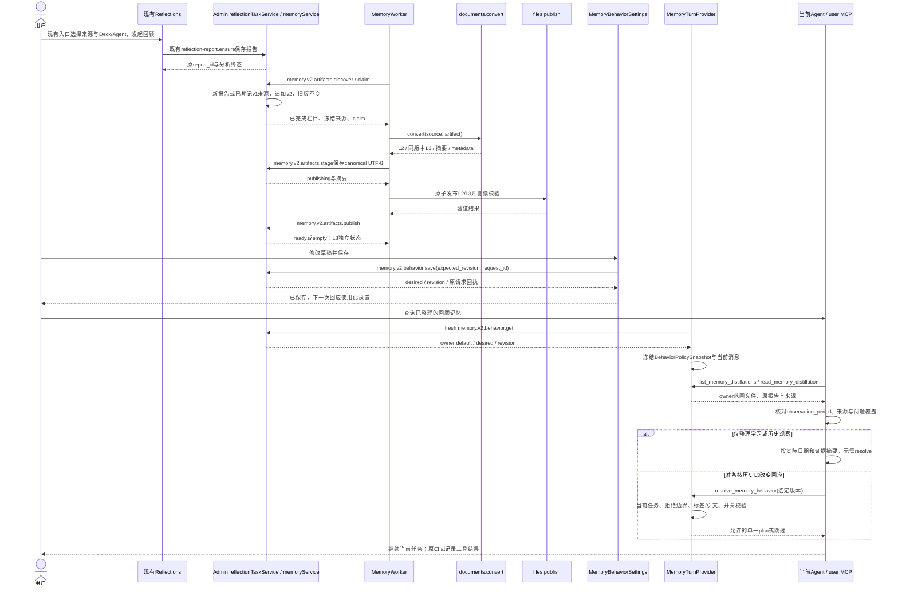
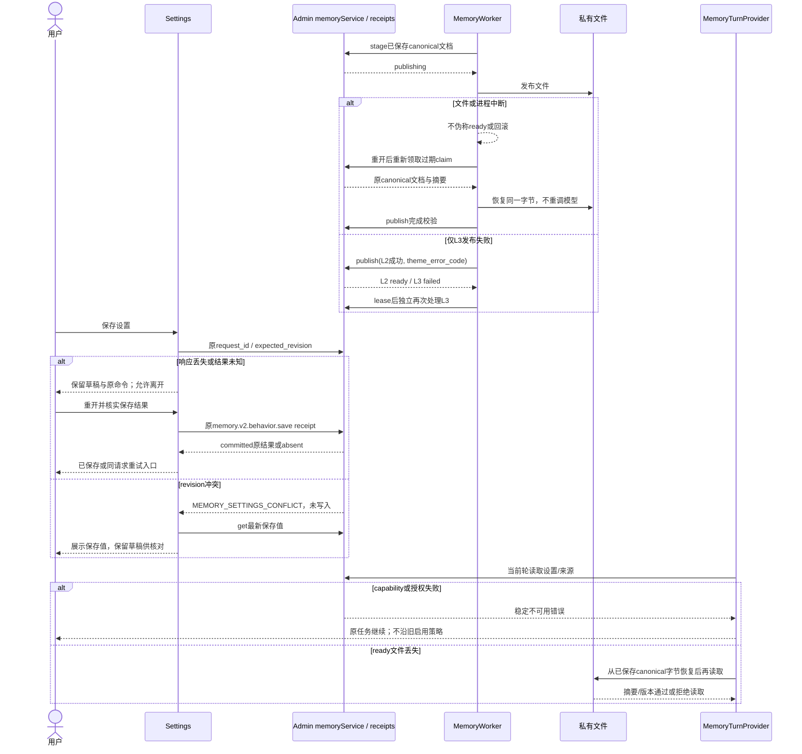
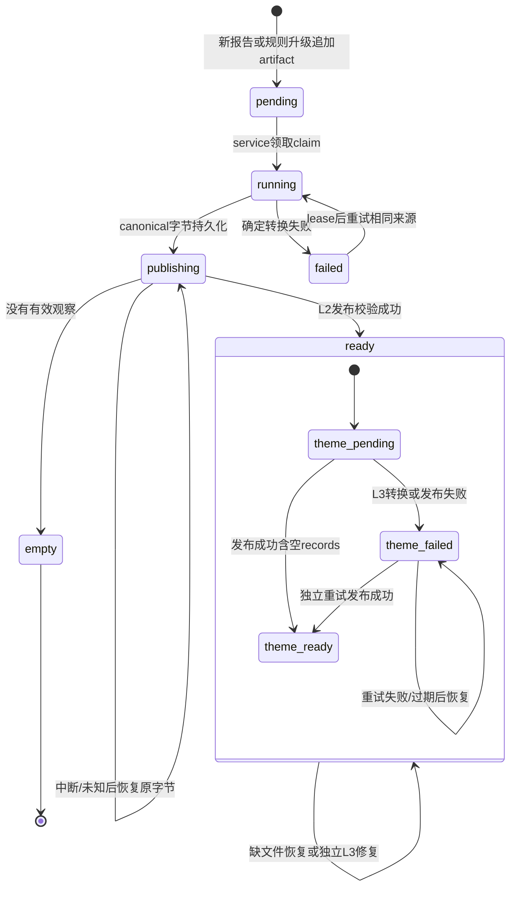

<!-- [Input] 已批准的L2/L3设计、Notion正文证据、Dream/Admin分支源码。 -->
<!-- [Output] 实现合同、页面骨架、业务时序/状态图、Tools及验收矩阵。 -->
<!-- [Pos] Memory现行正式稿；实现、正常采用与真实验收覆盖分别记录。 -->
<!-- [Sync] 2026-10-15: link standalone MemoryBrokerClient reuse, wire/permission boundaries and shared consumers. -->
<!-- [Sync] 2026-10-15: 使用指引仅保留三个Tools的概念与调用，Tool描述仅定位；此前自然问法验收属于前版。 -->
<!-- [Sync] 2026-10-15: 同步正常0082/0083启用及真实链路覆盖；当前任务拒绝句法独立于冻结源规则，历史原文保留。 -->
<!-- [Sync] 2026-10-15: 追加v2分类和同源派生，保留v1字节/内部协议；非空真实验收见执行记录。 -->
<!-- [Sync] 2026-10-15: 个人学习/变化回顾先L2，原文补缺与显式Notion来源例外；自然问法和恢复对话验收独立记录。 -->
# Reflections L2 蒸馏与 L3 记忆回应交互设计

## 背景与问题

现有 Reflections 分析已实现；缺口是让保存的 echoes、traits、patterns 信息跨 Thread 被读取，并在用户允许且当前任务相关时影响回应。采用报告保存后的自动转换，不重复设计报告发起、SSE、历史或 Deck 执行选择。

发现、定义和方案比较见[设计判断](../../exec/reflections-l2-l3-design-review-20261015.md)：放弃报告内人工提取、统一覆盖文件、按模式增加 Tool 和新事实库；选择每报告独立文件、三个业务 Tools、一个行为设置栏目。选择固定来源整理与复合表达规则，利用已有模型报告，不新增隐藏模型调用。隐含表达覆盖有限，不能把规则匹配称为语义模型或心理效果验证。

## 目标与边界

本分支已实现下述模块；正常Admin已应用0082/0083及0084/0085，存储与 `dream.memory.classification.v2` 精确capability均可用，Dream已采用。真实报告54原18条L2观察正文保持不变，v2追加1条有精确来源的L3；真实Agent读取新版本后返回resolved，默认respect_distance与保存后下一轮help_only分别采用revision1/2，实际可见回答符合允许动作；七轮历史重开一致。验收后恢复原desired为revision3。独立Admin管理页面登录复核仍未完成；正常数据库请求/结算已核对。Dream仍精确检查capability/operation摘要，缺失时只关闭记忆域。实际命令与回执见[实现记录](../../exec/reflections-l2-l3-implementation-20261015.md)。

[批准的实现前版本](reflections-agent-memory-interaction-design-pre-implementation-20261015-history.md)和[更早历史稿](reflections-agent-memory-interaction-design-pre-l2-l3-20261015-history.md)完整保留。仅新增 Settings“记忆回应”，不改 Reflections/报告/时间轴/Deck 页面，不增加提取确认、诊断、自由策略 prompt 或真实记忆手工写入 Tool。

## 概念与规则

| 原资料定义及意图 | 当前对应与本轮采用 | 调整或暂不采用 |
| --- | --- | --- |
| L1 事实提取与原始信息记录 | 既有日记、提交时冻结的 Notion 输入；本轮保留来源边界 | 不新增 L1事实库，也不把角色设定当用户事实 |
| L2 检索与蒸馏，生成 memory_distillation.md | Reflections 用户主动回顾；MemoryWorker 将报告已完成栏目整理成跨 Thread 持久文档 | 采用来源、范围、例外、任务/诉求不编造的意图。报告未结构化人物/任务等字段时不另推断，首版保留分析观察及证据 |
| L3 主题结构与按情境回应，生成 memory_theme.md | 固定四主题/十六标签与原六字段；MemoryTurnProvider 判断当前任务适用性 | 不沿用设备/IP/MQ、固定次数触发、强制转移或完整心理系统；缺少 Polarity、Attribution 证据时为 null |

依据：[0602沟通索引](https://app.notion.com/p/29a30b7547c3808b8d49f801bdce65d4)、[三层架构](https://app.notion.com/p/2b630b7547c3801e9991c517d94a1e2e)、[设备记忆系统正文](https://app.notion.com/p/29c30b7547c380d3aec4cafc97f97df5)、[主题词表](https://app.notion.com/p/2b230b7547c380a7b0e2c4d0db258273)、[维度/触发定义](https://app.notion.com/p/2b230b7547c380ad8d07ea227fee69e0)、[回应策略参考](https://app.notion.com/p/2b530b7547c3807a869ded024184f7b6)。指定问题[父页/锚点](https://app.notion.com/p/3f930b7547c380adb4def30db8c1f2e2#72130b7547c3824495fe01acc06d0ba6)单独区块无正文，父页相关文字已读但存在截断；附件未读取。资料主张、用户纠正和代码状态分别记录，不能以历史讨论证明已发布。

## 执行模块、来源与持久化

`MemoryBrokerClient` 如何继承现有 `SessionProjectionBrokerClient`、三个内部 operation 的协议、Host 绑定及权限边界，见[私有 broker 独立设计](../claude-agent/session-projection-broker-design.md)。该文档说明已有实现，不新增 Memory broker 或工具。

| 模块 | 当前职责 |
| --- | --- |
| 现有 Reflections task engine、`reflection-report.ensure` | 持久化报告；无成功栏目/结果时可能没有 report_id；保持原终态与重试流程 |
| [MemoryWorker](../../../backend/services/memory/worker.py) | 独立 after-report polling；调用 Admin discover/claim/stage/publish/fail。没有报告不创建 artifact；不更改分析任务终态 |
| [documents.py](../../../backend/services/memory/documents.py) | `convert` 整理已有观察、精确重复合并全部来源；`convert_theme` 固定标签匹配；生成 JSON frontmatter 与 Markdown JSON正文并计算摘要 |
| [files.py](../../../backend/services/memory/files.py) | 服务器私有根、UUID/版本路径、非符号链接目录和普通文件校验；临时文件/fsync/rename/复读校验 |
| Admin `memoryService.ts` | 两张表：memory_artifact、memory_behavior_settings；归属、lease fencing、规范 UTF-8、状态、CAS及原请求回执。Drizzle `0082_reflections_memory`发布存储capability，0085追加classification.v2；0083前向补齐既有受限DATA角色两表SELECT/INSERT/UPDATE，fresh ACL计划采用同一权限，无DELETE或其他角色扩权 |
| [MemoryTurnProvider](../../../backend/services/memory/behavior.py) | 绑定 owner/当前消息/Thread；读取 fresh 设置生成 immutable BehaviorPolicySnapshot；返回当前任务的固定回应计划 |
| [reflection_memory_tool.py](../../../backend/libs/claude_agent_kit/server/reflection_memory_tool.py)、现有 user MCP/broker | 三个严格业务工具；子进程只有私有 broker capability，没有 Admin token、owner或数据库凭证 |
| [MemoryBehaviorSettings](../../../frontend/app/_dream/views/story-workspace/MemoryBehaviorSettings.tsx) | 现有 Settings 栏目；draft、保存/核实/同请求重试/冲突处理 |

源文件来自 `analysis_reports` 与实际 COMPLETED 的 `reflection_task_section`；日期来自任务选择范围及报告时间。冻结 report 原始字节摘要、规范来源摘要、完成/失败栏目、report/task ID、已有 diary/Notion/Agent 来源摘要。逐条 session IDs、evidence、confidence 原样保留。已有 Notion 逐条 evidence 仍可能只是文本中的 page ID，不能宣称新增了经过原文逐字验证的结构关联。

每报告独立 `artifact_id/revision/memory_distillation.md` 和 `memory_theme.md`，服务器根由 `MEMORY_ARTIFACT_ROOT` 指定，默认 backend/data/memory-artifacts；不新增 native Read/workspace allow grant。数据库保存规范文档、document_sha256、body_sha256、byte_length、冻结来源及 L3 摘要；文件系统与数据库不假装同一个事务。

发布先保存 canonical bytes 为 publishing，再原子发布并复读校验，最后 ready/empty。未知 stage/publish 结果不伪称回滚，不换来源重新调用模型；过期 claim 由相同 service 恢复。L3 转换/发布失败保持 L2 ready，单独 theme_state=failed，后台再次处理同一来源。转换失败也按配置 lease 间隔重试，避免热循环。

每个artifact首版revision=1；同来源/规则重复发现不新建文件，丢失文件恢复同一版本、同一字节。v2规则发布后，生产Worker为新报告或已经登记v1的报告追加独立v2 artifact；已有报告复用原source_json，L2观察正文body保持原字节，不重新分析日记、不覆写v1文件。未登记的旧报告不回填。用户修正原始来源仍复用现有回顾生成新报告；不新增再生成页面、generation_key或人工任务系统。

## 分析模式、L2信息与 L3 主题

| 模式 | L2适合保留的信息 | 仍属分析报告/推断 | 目标与 Tool |
| --- | --- | --- | --- |
| echoes / 重复回响 | 重复主题、事件/情感线索、明确表述的需要及来源范围 | 频次解释、隐藏原因与分析建议不是个人事实 | L2目录/读取；有合适片段才生成任一L3主题 |
| traits / 性格特质 | 条件性行为/表达观察、例外、confidence、证据 | 人格定论、心理归因和诊断不能升级为长期事实 | 同一 L2 与三 Tool；不单建traits Tool |
| patterns / 行为轨迹 | 条件与节律、已知应对、明确任务/意图原文 | 分析建议不等于用户承诺 | 同一 L2 与三 Tool；不单建patterns Tool |

正文记录的 evidence_kind 为 analysis_inference。直接引用仍是报告提供的引用，不宣称已新增原始日记逐字核验。不同报告不覆盖彼此；重复来源不增加置信度，冲突观察保留范围供当前 Agent 判断。

| 主题 | 固定 Tag ID |
| --- | --- |
| THEME_FRUSTRATION | TAG_FRS_WORK_BLOCK、TAG_FRS_WORK_ISO、TAG_FRS_EMO_DISCONN、TAG_FRS_EMO_VENT |
| THEME_DEFENSE | TAG_DEF_WORK_ORDER、TAG_DEF_EMO_DETACH、TAG_DEF_EMO_RATIONAL、TAG_DEF_GEN_DENIAL |
| THEME_PRESSURE | TAG_PRE_WORK_TIME、TAG_PRE_WORK_MUST、TAG_PRE_EMO_COMP、TAG_PRE_EMO_SELF |
| THEME_VALUE | TAG_VAL_WORK_MEANING、TAG_VAL_EMO_LOVE、TAG_VAL_GEN_CONN、TAG_VAL_GEN_AFFIRM |

单一发布源为 Admin `config/memory-policy-v2.json`，Dream [policy-v2.json](../../../backend/services/memory/policy-v2.json)保持相同字节；当前规则revision为memory-rules-v2。原Admin `memory-policy.json`与Dream [policy.json](../../../backend/services/memory/policy.json)作为v1原字节保留。六字段为THEME、Focus、Polarity、Attribution、TriggeringConditions、TriggeringTagId。追加source_distillation_id/revision/body_sha256、source_item_ids、source_excerpt、evidence_kind、observation_period。本版Focus是原观察标题，缺少维度依据的Polarity/Attribution为null。

v2修正已核对的缺口：明确使用理论/分析替代直接描述感受时，无需第一人称或固定“回避”字样即可匹配TAG_DEF_EMO_RATIONAL，仍要求同句中的理论使用、情感对象和替代行为证据。普通理论阅读、健康边界或技术钻研不归类。喜爱向往/正面肯定按原词表识别，不等同于渴望被爱/认可；拒绝深入按话题阻断定义，当前用户拒绝仍优先作为Thread边界处理。泛化焦虑缺少死线、后果、比较或自我苛责条件时保持无细分Tag。

原九个Admin操作descriptor保持冻结，新增内部`memory.v2.*`九操作承载双版本读取和v2写入，复用同一Service、两表、MCP/broker及三个Agent Tool。前向0085仅发布`dream.memory.classification.v2`，不新建共享结构；缺capability时关闭本域。v1客户端的目录仅返回v1，v2客户端可以读取两版；当前行为策略只采用v2，避免旧标签误义影响当前动作。Settings desired/revision不因规则升级变化，v1/v2保存回执按原operation和request ID分别恢复。

L3引文必须是该L2观察或evidence原有字符串；引用的item必须属于该版本，主题/Tag组合必须合法。无主题生成 records=[]。规则排除规范用语、纯技术内容、引用/虚构/他人、否定/已变化表达，保守范围会漏掉部分混合技术与感受表达，不能用该空结果证明没有情绪。

## 用户入口、页面与后续使用

用户从既有回顾入口发起分析、阅读报告；持久化后后台衔接，用户不用再点提取/保存。首次无 L2 时 Agent 目录为空，不能伪称已经记住。单报告产生一组文件，多报告逐个处理，混合分析模式共享同一来源合同。Agent 调用读取工具后可以展示原观察及 report、日期和来源；再按当前任务判断是否参考。

唯一新增页面在 Settings `/story-workspace/settings/behavior`，详见[PRD](../../prd/memory/reflections-agent-memory-prd.md)。总开关默认关闭、四主题 enabled=true；动作由闭合服务端目录约束。恢复默认只变草稿；保存无需确认弹窗。冲突展示已保存值并保留草稿；未知结果重开后核实原回执或同请求重试。原命令只暂存在当前浏览器会话并按 owner 隔离，未写凭证。

```text
桌面：现有导航/搜索 | 记忆回应（内容区域滚动）
                    | 总开关 + 用途说明
                    | 挫败/防御、压力/价值（两列，启用 + 回应方式）
                    | 必要反馈/冲突的已保存值
                    | 恢复默认 / 保存 / 读取最新设置
                    | 未知结果：核实保存结果 / 重试这次保存
窄屏：现有返回/导航 → 标题 → 总开关 → 四主题纵排 → 反馈 → 按钮自然换行
无新增弹窗；一个内容滚动区域，不横向滚动。
```

返回来源复用现有 Reflections 历史，不创造按 report_id 直达的 URL 合同；按保存的分析时间定位，Notion URL 来自既有来源摘要。用户否认分析或拒绝心理话题，当前 Thread 停止使用历史主题策略；明确重新允许时恢复。反馈只保存在原 Chat 消息中，不改变全局 desired 或历史 L2/L3。其他 Thread 的长期行为偏好由设置页控制。

当前任务边界由 `MemoryTurnProvider._has_explicit_boundary` 在主题读取之前判断；`config.MEMORY_CURRENT_TASK_BOUNDARY_PATTERN` 识别直接拒绝指令中的“解释我的心理”和“情绪分析”等词序，与已发布的否认/拒绝规则组合。Thread历史按消息顺序回放，明确重新允许时清除当前范围；引用翻译例句不作为直接指令。此修复只调整当前用户指令的解释，不重写冻结 `policy.json`、历史L2/L3、主题版本或全局设置。

## Agent任务与最小 Tools

比较：已有 get_sessions_range 提供原始日记范围，workspace Read 只适合当前 Thread，已有 Thread Tools 操作对话。它们不能跨 Thread 安全定位 report派生版本，也没有当前任务策略快照。采用已有 user MCP、私有 broker、身份和报告能力，新增两个读取工具与一个策略工具。三分析模式作为源数据，不做模式数量对应工具数量；不暴露数据库 CRUD、L3写入、设置写入、诊断或自由文件路径。

### 三个工具的概念和使用

L2蒸馏包含从Reflections报告整理的观察、来源和观察时段；L3主题用于判断这些观察可对应的回应行动。观察保留分析推断性质。

`list_memory_distillations`提供目录、版本和完成状态；首页省略before或传null，翻页原样传next_cursor。同报告不同版本不作为独立观察。`read_memory_distillation`用目录返回的artifact_id/revision读取选定ready版本，使用时保留来源与observation_period；处理时间不代替观察时段。非ready或不可用结果不能当成已读记忆。`resolve_memory_behavior`只在需要按历史L3主题调整回应时，使用选定版本解析当前任务/设置允许的行动；读取L2不要求先resolve。三个工具不修改记忆或行为设置。

执行位置复用`ClaudeAgentContextBuilder`：同一指引进入system prompt和每轮`<reflections_memory_tools>`，覆盖新Chat、缓存system的resume及Workspace Mode开关。指引只描述这三个工具的基本概念和用法；`MEMORY_TOOL_SPECS`的description只描述各自定位，不添加任务场景、固定来源优先级或其他能力说明。输入schema保留既有参数合同。

| 项目 | list_memory_distillations | read_memory_distillation | resolve_memory_behavior |
| --- | --- | --- | --- |
| 状态/使用者 | 本分支新增；当前 Agent 找相关回顾 | 本分支新增；Agent读选定版本 | 本分支新增；Agent拟参考历史主题回应时 |
| 时机 | 用户询问过去观察、需个人上下文时 | 目录选出相关报告后 | 已有相关L2且准备调整回应前 |
| 输入 | 可选limit默认20（技术分页上限100）；首页before省略/null，翻页仅用上页next_cursor，空/半游标拒绝 | artifact_id、revision必填 | artifacts=[artifact_id,revision]；当前消息/owner/Thread/snapshot由Host绑定 |
| 输出 | status=listed、元数据、完成/失败栏目、next_cursor | 业务状态、文档、摘要、report_id | resolved/disabled/no_match/explicit_boundary/unavailable、policy_revision、至多一个plan、来源项 |
| 读写影响 | 只读业务目录 | 只读业务记忆；文件丢失允许恢复已存规范字节，不分析、不改版本 | 读取同版本L3与本轮snapshot，固定规则判断；不调用模型，不改记忆/设置 |
| 权限 | owner OAuth/服务身份和精确capability | 同左，report/artifact/version归属；文件根/类型/长度/摘要 | 同左；实际消息、Thread、policy由Host固定，模型不能传owner/current_text/effective |
| 重试/失败 | 游标保持PG微秒与ID排序；缺capability为不可用 | pending/empty/failed如实返回；缺文件可恢复，摘要或类型错误拒绝读取 | 同轮来源集规范排序去重；纯规则无额外模型派发，读取预算来自配置；无完整结果不伪称采用 |
| 用户介入 | 无需确认 | 需要纠正时沿来源编辑/重新回顾，保持旧历史 | 明确拒绝优先；混合主题无法选单一动作则继续原任务；长期偏好由设置页保存 |

示例：`read_memory_distillation({artifact_id:"…",revision:1})` 返回 ready、原始观察、confidence与report_id；只有报告不能证明“用户现在焦虑”。`resolve_memory_behavior({artifacts:[{artifact_id:"…",revision:1}]})` 由 Host 绑定“我工作卡住了，很沮丧，帮我整理下一步”，相关历史匹配且开启时返回 acknowledge_then_help；当前是“数据库迁移必须完成，截止周五”则 no_match；当前“不要再分析我的情绪，只给任务方案”则 explicit_boundary。示例标识为占位，不是真实业务回执。

## 配置、策略及状态

| 层 | 所有者与实际行为 |
| --- | --- |
| default | 版本化策略目录；总开关false、四主题true及允许的默认动作 |
| draft | Settings本页草稿；恢复默认不自动提交 |
| desired/revision | Admin按owner保存；expected_revision CAS、原request_id回执；同值不增版本 |
| effective | `routers.claude_agent._claude_agent_stream_impl`绑定 MemoryTurnProvider；fresh owner设置→immutable BehaviorPolicySnapshot，每轮/resume重新解析 |
| resolved | 结合实际当前消息与来源选允许动作；Tool result进入现有Chat过程记录，只能证明计划已返回，不能证明Agent采用或心理效果 |

读取设置/capability/权限/DTO失败时不沿旧启用配置；普通 Chat 继续原路径。运行中保存不改变已有快照。策略不进入 resource-policy、server_runtime_env、Runner权限、admission或.claude-tmp。旧 Mem0 `memory_tool.py` 保持原字节，新 Reflections Tools 位于独立文件。

| 状态 | 进入/恢复 |
| --- | --- |
| pending | 新报告已登记规范来源 |
| running | service领取有效claim；开始固定转换 |
| publishing | canonical UTF-8已保存，文件等待发布/校验；持久化阶段 |
| ready | L2文件发布校验完成；theme_state可独立ready/failed |
| empty | 报告没有有效观察；不生成L2/L3文件 |
| failed | 确定转换失败；按配置lease间隔重试，不影响原报告 |

L3 pending/ready/empty/failed 独立记录；有L2但无主题为ready文件内[]。设置页 loading/draft/saving/saved/unknown/conflict/read_error 状态与反馈一致，确认对话框不存在。

## 正常业务时序



## 异常与恢复时序



## 状态转换



## 功能验收矩阵与实现评审

| 场景 | 功能验收标准 |
| --- | --- |
| 新正常报告与三模式 | 保存后自动生成独立L2，同来源不重复；完成/失败栏目准确；原分析入口/历史/选择合同保持 |
| 单模式、部分成功、无结果 | 只读实际完成栏目；无报告不造artifact；有效报告无观察为empty；L3无标签是[] |
| 重复、冲突、变化 | 合并精确重复且保留所有证据/置信度；不升格为个人事实；当前否定/变化不触发历史策略 |
| 来源、版本、权限 | owner/report/item/片段/摘要一致；跨owner、伪造current_text/effective/path、符号链接、摘要错误被拒绝 |
| 中断、未知、重开 | canonical发布恢复不转换；未知stage不标失败；L3失败L2可读；缺文件同字节恢复 |
| 设置默认/关闭/保存 | 默认关闭且保留主题选择；恢复默认只改草稿；保存CAS与原回执；当前turn不变、下一轮fresh |
| 设置失败/冲突/重开 | 不用假默认覆盖；保留草稿；当前账户原命令可核实/重试；冲突展示最新已保存值 |
| Agent实际使用 | read仅提供历史分析；resolve只返回当前任务允许动作；v1引用不执行v2策略，重新读取v2后可返回非空计划；直接拒绝与明确否认优先、Thread内边界可恢复；Tool回执不单独证明最终采纳 |
| Tools使用指引 | 仅三个工具的概念及使用；list/read版本引用一致，读取L2不要求resolve；共享指引在新/resume及Workspace Mode开关下存在，不增加场景或跨能力调度规则 |
| 桌面/窄屏与键盘 | 现有导航、自然单列、无横向滚动、键盘可操作、无新增确认弹窗 |
| 相邻回归/缺capability | 现有Notion冻结、Deck/Agent选择、Reflections报告/SSE/历史保持；记忆域缺capability关闭，原流程可用 |
| 真实模型链路 | 正常Dream/Admin/Gateway/真实账户及既有实体；报告54的18条L2→v2单条L3→实际Agent读取/非空计划→实际回答→设置变化下一轮生效→七轮重开；新增8请求、合计28请求成功结算；管理页面登录复核仍未完成 |

评审结论：实际入口、用户操作和Agent调用均已收敛；复用报告、来源冻结、身份、MCP/broker、Chat记录与Settings。删去额外页面、确认、计数触发、自由策略、独立语义模型Thread/预算、再生成配置和新反馈Tool。两表+小型后台worker支持规范文件与desired，不另建心理系统。保留必要失败、版本、来源和权限边界。

限制明确：v1样本18条零命中，v2对同一冻结来源识别1条明确理论替代感受，其他17条保留在L2；本轮真实证明该单主题和两种允许动作，不推广为全部十六Tag或心理效果验收。未登记历史报告回填、按report_id的精确UI深链不在首版；原始引用未新增逐字原文核验。正常SQL回执不等于管理页面已登录复核，文档/技术验证不替代真实模型验收。具体剩余事项见实现记录。
