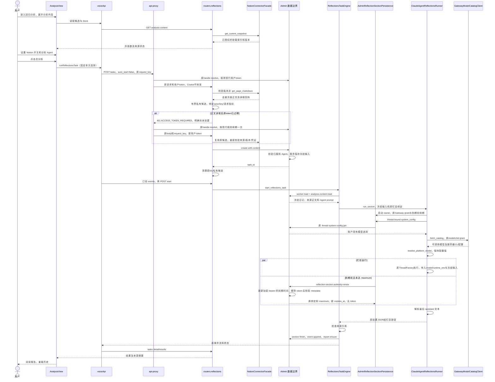
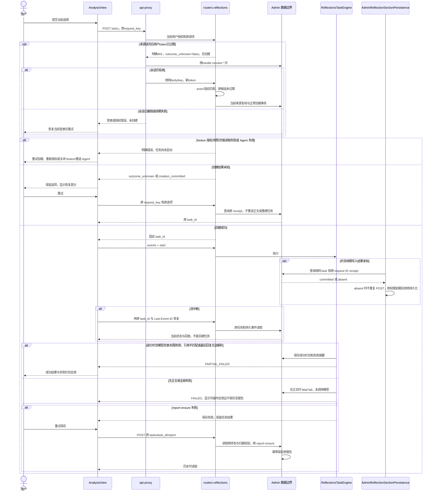
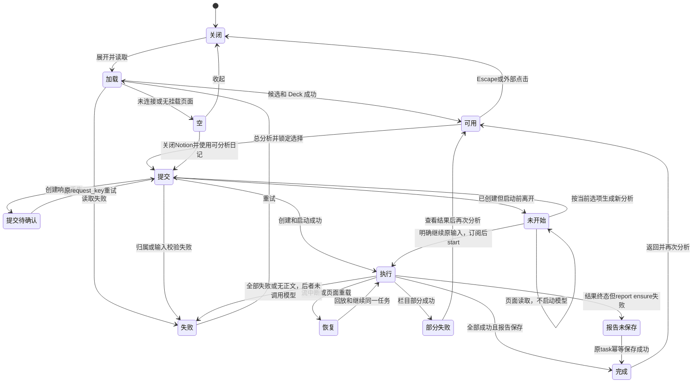

<!-- [Input] 当前 memory PRD、AnalysisView、Reflections task engine 和 Admin Registry99。 -->
<!-- [Output] 请求、冻结输入、交互、异常恢复、业务图和验收映射。 -->
<!-- [Pos] 回归分析内容选择正式交互设计。 -->
<!-- [Sync] 2026-10-13: 选定紧凑展开方案；同步已实现接口和回执恢复边界，验证状态由实施记录持有。 -->
<!-- [Sync] 2026-10-13: 明确稳定RTA的无token续期投影及最后回复解析失败，图示保留原权限和最大寿命。 -->
<!-- [Sync] 2026-10-13: 明确长来源准备与稀疏栏目事件的精确路由传输期限及调用方取消。 -->
<!-- [Sync] 2026-10-13: Reflections dispatcher复用服务器模型选择，透传所选模型的CLI配置快照。 -->
<!-- [Sync] 2026-10-13: 末尾列出冻结引用ID并保持严格拒绝；实际报告53完整验收由本机执行回执持有。 -->
# 回归分析内容选择交互设计

## 背景与问题

现行日记任务已经持久化并支持事件回放。缺口是 Notion 的来源读取和任务输入冻结、分析 Agent 选择及分散入口。历史设计的分区配置、事件合同仍保留；本稿接管新增内容选择和统一入口。

## 目标与边界

采用总按钮旁的紧凑展开面板。相比独立设置页，它保留提交上下文且只需页面内存；相比多步骤配置向导，它不增加步骤或全局配置。复用 `DeckChatSelector` 的分组、搜索、键盘和视口定位，增加可选名称文案，保持 Chat 默认公开值和行为。

Notion 候选只读取现有授权快照索引。提交时调用现有正文读取接口，检查完整范围后冻结读取结果。无需建立同步或新资源平台。Deck 分组 Agent 作为分析视角只选择指令；不注入模型、环境变量、Chat 插件或 Dream 创建故事协议。

## 概念与规则

默认和选择保留、范围、去重、引用及正文版本按 [PRD](../../prd/memory/reflections-analysis-content-prd.md) 执行。Admin 继续拥有 PostgreSQL task/result/event/report，Dream 拥有正文读取、任务执行和工作区文件；浏览器不提交正文、Agent prompt、凭证或主机路径。

现有冻结 DTO 不能增加未知字段。最小前向扩展采用 Admin `reflection_task.analysis_content_json` 可空列和独立追加操作，保留全部 Registry99 旧操作描述及旧任务。新任务在一个事务内创建并保存服务器解析的分析输入；worker 通过新增 service-only 读取恢复同一输入。缺失新增 capability 时拒绝新增选择，默认日记继续旧路径。default 是关闭 Notion/未选 Agent，desired 是下次页面选项，effective 是 Admin 事务提交的任务输入；revision 只沿用 Admin task 状态 revision，索引 snapshot_version 单独表示来源版本。这个字段是任务输入，不新增全局配置或额外版本系统。

### 接口与数据

以下接口已经实现；本机 Admin 已发布 0081 和精确 capability，其他实例启用前仍须确认对应能力。发布与真实验收状态由[本机执行记录](../../exec/reflections-analysis-content-local-release-real-acceptance-20261013.md)持有，接口存在不代表验收通过：

| 边界 | 输入 | 输出/校验 |
| --- | --- | --- |
| GET /api/reflections/analysis-content | 无 | 当前连接器、快照标识、去重页面数和可读状态；无正文 |
| POST /api/reflections/tasks | 原字段 + analysis_content `{include_notion, connector_id?, deck_id?, agent_id?, snapshot_version?}` + request_key? | 归属、Agent enabled、快照/授权稳定、正文读取后才创建任务 |
| POST /api/reflections/tasks/{task_id}/report | 原 task_id，OAuth | 读取/确认原终态任务归属并调用幂等 report ensure；不再调用模型 |
| Admin reflection-task.create-with-content | 原 create + 已解析 Notion 输入、Deck/Agent 标识 | 在事务内重新校验归属并解析 Agent prompt，保存冻结输入，返回原 task DTO |
| Admin reflection-task.analysis-content | task_id，OAuth | 来源摘要、选择、空正文数，无正文和 prompt |
| Admin reflection-task.analysis-content-load | task_id，service-only | 原服务绑定任务的冻结 Notion 正文和 Agent prompt，严格 DTO |

新增私有输入中的 diary_session_ids 为 null 时沿用原全部日记，[] 明确不选择日记，非空集合必须与原 input_snapshot.session_ids 相同；原 Registry99 的空数组含义保持不变。

Notion 页面输入分别保存 page_id、title、url、snapshot_version、read_at、markdown、content_sha256。摘要由服务器对实际正文生成。页面标识不进入 Session list 或 related_session_ids。Agent 输入保存 Deck/Agent ID 与 Admin 解析的 `system_prompt`，公开输出只返回名称和标识。

单次Native Notion CLI读取遵循现有`INK_NOTION_OPERATION_TIMEOUT_SECONDS`配置；超时终止并回收该子进程，返回NOTION_UPSTREAM_TIMEOUT，未完成全部页面时不能创建分析任务。本机采用的实际期限由发布回执记录，不作为产品页面数量或用户配额。

最终输出指令在有效工作流之后追加本次冻结非空pages的准确page_id清单，要求related_notion_page_ids逐字复制并检查成员关系；正文中的链接和近似UUID不能作为引用标识来源。空页ID不在可引用清单。ReflectionsTaskEngine继续拒绝任何不在冻结范围内的标识，不自动纠正或过滤该错误。

### 交互

api-proxy 对精确 `POST /api/reflections/tasks` 使用独立 `headersTimeout=0` dispatcher，允许完整来源准备在返回响应头前结束；对精确 `GET /api/reflections/tasks/{uuid}/events` 使用另一个 `bodyTimeout=0` dispatcher，允许栏目间没有事件时继续等待。两者继续传递调用方 AbortSignal、原认证和无缓冲响应流；其余路由采用原期限，不新增心跳、轮询或自动重提分析。

ClaudeAgentReflectionsRunner在原Gateway grant的`models:list`权限内调用现有GatewayModelCatalogClient，复用resolve_platform_model与thread-bound SystemConfig选择可调用模型。将model_alias及claude_code_runtime_env服务器快照传入ClaudeAgentRunRequest；选中分析Agent只提供指令，不覆盖模型配置。缺少目录、模型或权限时拒绝启动并关闭RTA/Gateway owner。compact/context/max output值沿用模型目录，全局effort继续来自资源策略LKG，不在本功能增加或提高策略值。

执行时，选中 Agent 只提供分析视角；各栏目现有有效 `WORKFLOW.md`（含字段定义和栏目目的）、`MEMORY_ANSWER_PROMPT.md`、语言和引用规则在冻结来源之后再次传给模型。通过现有 `mcp__user__get_sessions_range` 按需读取冻结日记；不能只按metadata判断正文不可用。证据不支持任何insight时返回明确空JSON数组，不生成普通解释或追问。正常 Agent 终态后读取最后一条 assistant 文本；无法解析结果时以 `REFLECTION_ANALYSIS_OUTPUT_INVALID` 标记栏目失败，不回退到中间回复或把普通聊天回复记成零结果完成。明确的空 JSON 数组仍可表示无结果。RTA 续期保持内部 bearer 和原 maximum expiry；Admin 先移除 token 再用现有严格 metadata DTO 校验公开续期返回值，错误事务不提交。

“分析内容”有 aria-expanded 和 aria-controls；打开后焦点保持入口，Tab 进入开关与 Agent 选择。Escape 先关闭 Agent 列表并恢复选择器焦点，再关闭面板并恢复展开入口；外部点击关闭面板。面板使用现有颜色和焦点，宽度受内容视口约束，内部滚动不移动 Agent 弹层。

读取候选和 Deck 时使用请求世代或 effect 清理忽略旧响应；卸载清除请求结果。创建结果尚未确认时，浏览器仅保存 request_key 和原选项，查询原 Admin receipt 恢复相同 task_id；明确失败后清除记录。每次提交立即锁定，保存当时选择，运行期间面板编辑只影响下一次。默认 Agent 加载失败不阻止原分析；已选项无效不可静默清空。 已选 Agent 从候选中消失时显示不可用名称及重选提示；Notion 候选版本变化时保留原选择并提示重新开启，不静默换用新范围。未连接、无快照、空正文、读取失败分别反馈。

### 正常业务时序

### 异常和恢复

### 状态转换

AnalysisView 将 CREATED 作为准备任务：读取时保留 task_id 和原输入，显示明确继续入口，结束页面等待。该入口通过 resumeReflectionsTask 的显式 startPrepared 选项，在 SSE 已订阅后调用原 start 接口。普通加载不传该选项。新生成不复用未启动任务；ASSEMBLING/QUEUED/RUNNING 等已启动状态仍按原 ID 恢复并锁定提交。

Notion正文准备在创建事务之前执行。Next `_http-proxy.ts` 仅对POST /api/reflections/tasks使用专用server-owned Undici dispatcher，不应用默认300秒响应头等待；仍透传原AbortSignal和请求流，保留连接、响应体及Notion单页超时。其他路由保留原传输。代理断开只表示观察中断，浏览器按原request_key查回执，不另建任务。

完成读取的Notion候选只在服务器内存短期保存，键绑定canonical actor、原request_key和完整请求指纹；source context、snapshot metadata、credential identity、正文和read_at保持原值。容量和有效期由明确服务器配置限制，不是产品来源配额；候选不授予权限。每次使用仍执行当前来源/索引/凭证复核和Admin事务归属/SHA/Agent校验，创建提交或确定来源失效后清理。只有Browser任务创建的明确401 ACCESS_TOKEN_REQUIRED、outcome_unknown=false且无creation_committed时，api-proxy才能通过原handle resolve续期一次并重发原body/key；其他路由、native Bearer、未知写入和已提交创建不自动重试。Cookie、refresh token和私有候选不进入浏览器响应或Python授权头；现行access token有效期保持300秒。重载或进程重启不把候选当作持久任务或完成回执。

NotionOperationClient.get_page_markdown复用既有server-owned API版本与remote_error分类；校验page_markdown响应ID、markdown字符串、truncated布尔值和unknown_block_ids数组。按接口返回的UUID补读未知子树并替换对应unknown占位；请求内复用重复子树，拒绝循环、不匹配占位和无法补齐的截断。真实接口可能对link_preview和link_to_page返回以自身ID标记的unknown：此时读取相同ID的`v1/blocks/{id}`，只接受ID匹配、未删除、无子块且结构完整的叶子。link_preview仅含URL；link_to_page仅含原生联合type和对应page_id/database_id/comment_id UUID。将原结构编码为Markdown内的JSON代码块，保留块的全部内容；不访问URL目标或读取被引用实体，不扩大已选页面范围。其他自引用或无法完整读取的块仍拒绝。补读失败原样传递安全状态码，完整后才冻结正文及SHA，仍只保留原分析页面身份。来源读取失败在创建前明确拒绝；页面清除“准备中”并显示错误。不得因此省略无法读取页面或改变授权。

latest 返回的最新任务和最近完成结果可能属于不同任务。只有终态任务且全部 result.task_id 与当前 task_id 匹配，页面才提供该任务报告的保存恢复；历史结果不得绑定到 CREATED 或失败的新任务。

栏目执行复用`drain_chat_agent_turn`及原ChatStreamAdapter/Factory completion分类，等待Factory owner退出后才关闭权限owner。只有正常finish及持久message-final证明完成；error、取消或缺少终态明确进入栏目失败，不能因空transcript标成完成。Reflections的六操作RTA不含图像能力；`AdminAgentTurnPersistence.image_turn_data`默认None，共享Service仅在owner显式提供可用图像数据时初始化图像Provider，现有Chat实现保持原权限/持久化流程。

Reflections显式提供空`ManagedMcpRuntimeSnapshot()`，不触发动态MCP配置加载或额外权限读取；对应`managed_mcp_workspace_scope`初始化为None。其他调用未提供显式快照时，仍由既有loader在原Admin权限内解析workspace scope，不改变该路径。

Admin既有`DREAM_DATA_MAX_BODY_BYTES`限制领域请求体，`DREAM_REFLECTIONS_LAUNCH_SNAPSHOT_MAX_BYTES`限制冻结日记/来源快照；Dream各消费边界仍限制响应字节。发布时需按实际完整输入协调现有服务配置，不把这些技术预算包装成页面数额度。共享HTTP parser只接受request_id匹配的严格错误DTO：413保留原错误码和明确拒绝，outcome_unknown=false，不能转成未知提交；损坏或不匹配响应仍保持原未知写入与receipt保护，不自动重放。

## 需求、设计、实现与测试映射

| 需求 | 设计 | 实现位置 | 必要验证 |
| --- | --- | --- | --- |
| 默认与开关 | 默认仅日记，启用读取固定范围 | AnalysisView / reflections | 默认无 Notion、开关正文隔离 |
| Agent | 分组选择并采用服务器指令 | DeckChatSelector / Admin 内容操作 | 切换、停用、越权和伪造 prompt 拒绝 |
| 固定输入与来源 | 事务保存，service-only 恢复 | Admin 新增列/操作、engine | 选择变化不影响运行；重载原正文 |
| 统一入口 | 去除栏目按钮，保留配置和状态 | SectionControlsRow | 完整页面、配置、历史回归 |
| 可访问性 | 展开语义、焦点、键盘、视口边界 | AnalysisView / 现有 selector | 桌面与窄屏、Escape、外部点击 |
| 完整旅程 | 原任务/事件/报告合同 | voiceApi / engine / Admin | 配置到报告、保存重试、断流和再次分析 |
| Notion 异常 | 不静默缩减范围 | 内容读取 | 未连接、无快照、空正文、失效、失败 |

## 实施状态

接口、Admin 0081 前向扩展和页面已实现；图示不代表验收。新增路径依赖精确的 dream.reflection-analysis-content.v1，未发布时 fail closed。评审和本轮实际证据在 [实施记录](../../exec/reflections-analysis-content-20261013.md)。
