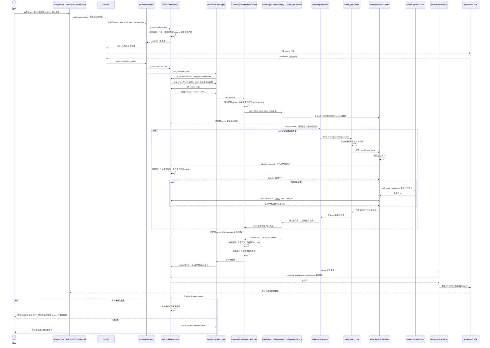
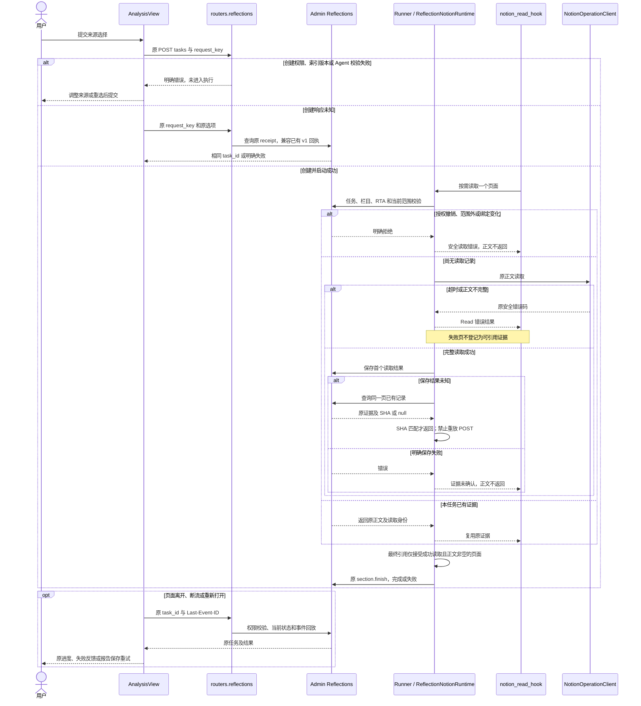
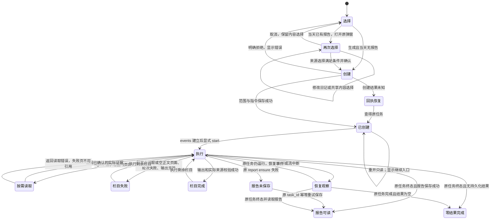

<!-- [Input] 当前 Reflections 页面、任务执行、Notion Read hook 与 Admin 来源合同。 -->
<!-- [Output] 选择、创建、按需读取、证据保存、恢复及业务图。 -->
<!-- [Pos] 回顾分析内容选择现行交互与技术衔接设计。 -->
<!-- [Sync] 2026-10-23: 明确 Dream 共享客户端注册范围及 execute 的本地注册校验。 -->
<!-- [Sync] 2026-10-23: ReflectionBlogPage 复用冻结日记选择与报告统计，补齐来源栏数量和窄屏换行。 -->
<!-- [Sync] 2026-10-23: 创建只保存范围，执行时复用连接器 Read，按实际读取记录报告证据。 -->
# 回顾分析内容选择交互设计

## 背景与问题

`AnalysisView` 提供日记、Notion 和分析 Agent 选择。此前创建请求逐页读取全部挂载正文，完成后返回任务 ID；来源数量较大时，页面长时间停留在准备阶段，单页超时结束整次创建。

Notion 连接器已有索引投影、页面 `Read` 重定向和 `NotionOperationClient.get_page_markdown`。当前实现复用这些模块，创建阶段保存已授权范围，Agent 在栏目执行期间按需读取页面，成功读取后保存实际证据。

## 目标与边界

用户继续使用原生成入口及当天再次分析弹窗。弹窗内直接展示 `ReflectionAnalysisContentControls inline`，和页面共享 `analysisContent`。Deck 提供分组，提交值为成对的 `deck_id`、`agent_id`。

本次新增内容属于 Admin 内部任务范围与证据操作，Agent 继续使用既有 `Read`。栏目、模型选择、RTA、任务状态、消息保存、SSE、报告入口和 L2/L3 工具沿现行合同执行。正常 Chat 的 Notion 连接器路径保持原合同。

发现与定义：全量读取位于 create 返回之前，启动依赖该返回。方案比较：前置全量读取持续占用请求；后台预读全量引入独立准备阶段；现有 Read hook 能按栏目需要读取并形成证据。交付采用现有 Read hook 和任务绑定的 Host 回调，复用现有 JSON 列与事务。

## 概念与规则

| 对象 | 定义与执行模块 |
| --- | --- |
| default | Notion 关闭，Agent 未选择，沿原日记范围分析 |
| desired | `AnalysisView.analysisContent`；页面与再次分析弹窗共享，取消保留，页面卸载或刷新恢复默认 |
| effective | Admin 已保存的日记选择、Notion 元数据快照和 Agent 指令；创建后固定 |
| revision | 任务与栏目继续采用原 revision；Notion 索引通过 `snapshot_version` 标识；本次没有新增全局配置版本 |
| Notion 可读范围 | Admin 从当前账户、连接器、已接受索引及挂载选择解析的元数据快照。索引只含页面标识、标题、链接等元数据 |
| 实际读取证据 | 页面首次成功读取后保存的正文、page_id、标题、URL、SHA-256 和 read_at；空正文保留读取记录，结果引用要求正文非空 |
| 读取入口 | 现有 `Read(.notion/pages/<page_id>.json)`；现有 hook 校验工作区索引，再调用绑定任务的 `ReflectionNotionRuntime.read_page` |
| 恢复 | 同一任务重复读取复用 Admin 已保存页面；每次读取仍执行当前权限和挂载范围校验；原 SSE、结果及报告恢复继续采用 task_id |
| Workspace Mode | 沿现有 Notion Read 的工作区前提；关闭时以 `REFLECTION_NOTION_WORKSPACE_REQUIRED` 拒绝栏目执行，提示在设置中启用 |
| v1 兼容 | `reflections-analysis-content-v1` 继续读取原冻结正文；新增任务采用 `reflections-analysis-content-v2` |

### 页面交互

页面骨架和当天弹窗的桌面、窄屏布局由 [PRD](../../prd/memory/reflections-analysis-content-prd.md) 所有。面板显示“可按需读取 N 个已挂载页面”；该数字表示可读范围。报告的 Notion 来源摘要包含实际读取的非空页面及空正文数量。

`ReflectionBlogPage` 的原来源栏始终展示日记范围。数量优先取 `analysisContent.diary_session_ids.length`，空数组为 0；值为 null 或旧报告缺少来源摘要时使用已保存的 `report.stats.entries`。该数量描述任务选择范围。Notion 摘要沿用 `analysisContent.notion.pages.length`，文案为“Notion · 已读取 N 个页面”；原链接列表和展开操作保持。来源栏使用 flex wrap 与元素最大宽度约束，窄屏按内容换行。生成、历史列表和时间线共用同一阅读组件；刷新后从历史读取同一保存值。

当天已有报告时，`handleAnalyzeAll` 打开原 `ReanalysisConfirmModal`，日记默认全选当前候选，内容选择继承页面值。弹窗打开期间卸载页面同名组件，保留唯一的 `#reflection-analysis-content`。弹窗标题与操作区固定，中间内容区滚动；Agent 列表沿原固定定位选择器。

确认条件为 `selectedIds.length > 0 || analysisContent.include_notion`。确认经 `handleConfirmReanalysis → runAnalyzeAll(selectedIds) → runReflectionsTask` 提交当时选择。取消关闭弹窗并保留本页内容选择，重开重新初始化日记选择。打开选项只读取元数据，确认前不读取页面正文。

创建成功后，前端先订阅 events，再经原 start 接口启动。正文读取发生在执行期间。单页失败通过现有 Read 返回安全错误；失败或未读取页面无法用于结果引用。栏目可以使用成功取得的证据完成分析；零结果、栏目失败和部分成功沿原任务规则展示。

零结果任务保留完成状态和实际读取记录。现行 `reflection-report.ensure` 在持久化结果为空时返回 `report_id=null`、`created=false`，报告列表保持原记录。正文为空的读取计入 `empty_page_count`，结果引用排除该页面。

### 内部合同与存储

公开 `/api/reflections/tasks`、`start`、`events`、`results`、`report` 保持现有路径与请求选项。新增内部操作如下，全部由 Admin 现有统一数据入口承接：

| 操作 | 身份、输入 | 输出与副作用 |
| --- | --- | --- |
| `reflection-task.v2.create-with-content` | OAuth `dream:write`；日记选择、Notion connector_id/snapshot_version、Deck/Agent | 校验归属、当前授权和索引版本；在事务中保存元数据快照及 Agent prompt，返回原 task DTO |
| `reflection-task.v2.analysis-content` | OAuth `dream:read`；task_id | 归属校验后返回来源摘要，去除正文和 prompt |
| `reflection-task.v2.analysis-content-load` | service `reflections:execute`；task_id | 校验任务所属服务，返回该任务范围和已记录证据 |
| `reflection-task.v2.notion-context` | 相同 service；task/section/thread/revision/page 绑定 | 校验当前 RUNNING 任务、栏目及原范围与当前范围交集；返回已记录页面或 null |
| `reflection-task.v2.notion-evidence` | 相同 service、相同绑定和读取结果 | 再次校验权限、页面身份与 SHA；保存首个读取结果，已有记录返回原值 |

五项属于服务间业务操作。Agent 工具清单沿原 Read；这些操作不注册为 Agent Tools。Reflections RTA 的六项原操作保持原值。Host 在每次读取前后核对活跃 RTA，服务身份的来源操作单独校验任务、栏目、Thread 和 revision。

存储复用 `reflection_task.analysis_content_json`，v2 通过 `agent_contract_version` 区分，报告来源摘要保持原公开结构。本次没有新增表、列或 migration。内部操作在 Admin 注册表末尾追加，v1 descriptor 保留。Dream 的 `AdminRequestAuth` 将 `SCOPE_OPERATIONS` 注册到共享 `AdminDataClient`；消费端校验已发布的 `dream.reflection-analysis-content.v1` schema capability 和五个精确操作 descriptor，`execute` 校验本地注册对象与 Admin descriptor。缺失时 fail closed。

`ReflectionNotionRuntime.project` 复用 `NotionSnapshotStore.project_thread` 投影原范围的 `.notion` 索引，清除该栏目 Thread 的 CLI 凭证投影。Agent 子进程只接收索引和 Read 返回值，Host 回调持有读取能力。普通 Chat 继续采用原连接器与凭证投影路径。

首次读取调用 `NotionOperationClient.get_page_markdown`，完整性与未知区块补读继续采用原实现。Host 先保存证据，确认保存结果后返回正文；保存结果未知时查询同页记录核实 SHA，禁止自动重发写入。RTA 关闭、连接撤销、页面移出当前挂载范围或绑定变化均拒绝读取。新增挂载页面留待下一次任务。

### 正常业务时序

Agent 内部流由 drain 消费；Reflections SSE 发送已持久化任务事件。完整执行合同见 [Agent 执行设计](reflections-agent-interaction-design.md)。

### 异常与恢复时序

### 状态转换

## 验收条件与交付边界

| 范围 | 后续功能验收条件 |
| --- | --- |
| 创建 | 选择 Notion 后，create 阶段只访问 Admin 元数据，未调用页面正文接口，沿原订阅/start 路径启动 |
| 选择 | 主页面和同日弹窗共用 Notion/Agent 值，日记范围按原确认提交，取消保留内容选择 |
| 按需读取 | Agent 能读取原索引，并经原 Read hook 读取所需页面；未使用的页面无正文请求 |
| 证据 | 返回正文之前已确认 Admin 保存；正文 SHA、读取时间与报告来源一致；同任务后续栏目复用原记录 |
| 权限 | 越权账户/服务、错误 Thread/revision、范围外页面、撤销授权及未读取引用均拒绝 |
| 异常 | 超时、空正文、保存失败和未知写入有明确结果；未知写入只查原页面记录 |
| 恢复 | 原任务事件、结果、报告重开和保存重试保持原合同；新任务重新记录来源选择 |
| 来源栏 | 具体日记选择优先于报告统计；全量选择与旧报告使用报告统计；仅 Notion 显示 0 篇；刷新重开保留同一范围；Notion 显示已读取数量和原来源链接 |
| 兼容 | v1 原冻结输入、日记默认分析、Chat 连接器和 L2/L3 工具保持原行为 |
| 窄屏 | 弹窗内容滚动、固定操作区、Agent 浮层和键盘路径采用原响应式组件 |

实现及创建 503 修复已加载到本机服务。[测试执行记录](../../exec/reflections-notion-on-demand-validation-20261023.md)分别保存技术回归、隔离集成及正常账户模型回执：报告 56 三栏各 6 条、按需读取 23 个 Notion 页面、历史与刷新重开、37 个正常 Gateway 请求完成结算。日记范围和“已读取”来源文案已补齐；本次展示修订的验证单独追加到执行记录。故障分支与窄屏交互保留各自验证范围。缺少 Admin 新操作时拒绝新路径。本次未新增共享数据库结构，未来结构变更仍由 Admin Drizzle migration 与 capability 前置。

历史原文：[全量读取与同日弹窗版本](reflections-analysis-content-design-pre-notion-on-demand-20261023-history.md)、[同日弹窗补充前稿](reflections-analysis-content-design-pre-reanalysis-content-20261023-history.md)。

源码索引：[创建路由](../../../backend/routers/reflections.py)、[Engine 与 Runner](../../../backend/reflections_agent.py)、[现有 Read hook](../../../backend/libs/claude_agent_kit/server/notion_read_hook.py)、[任务 Host](../../../backend/services/admin_data/reflection_notion_runtime.py)、[Admin 范围与证据服务](../../../../ink-admin-memory/app/lib/dream/reflectionNotionScopeService.ts)。
