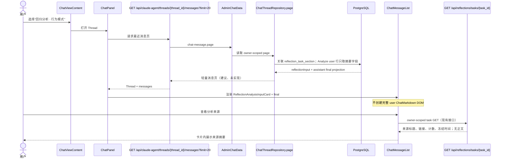
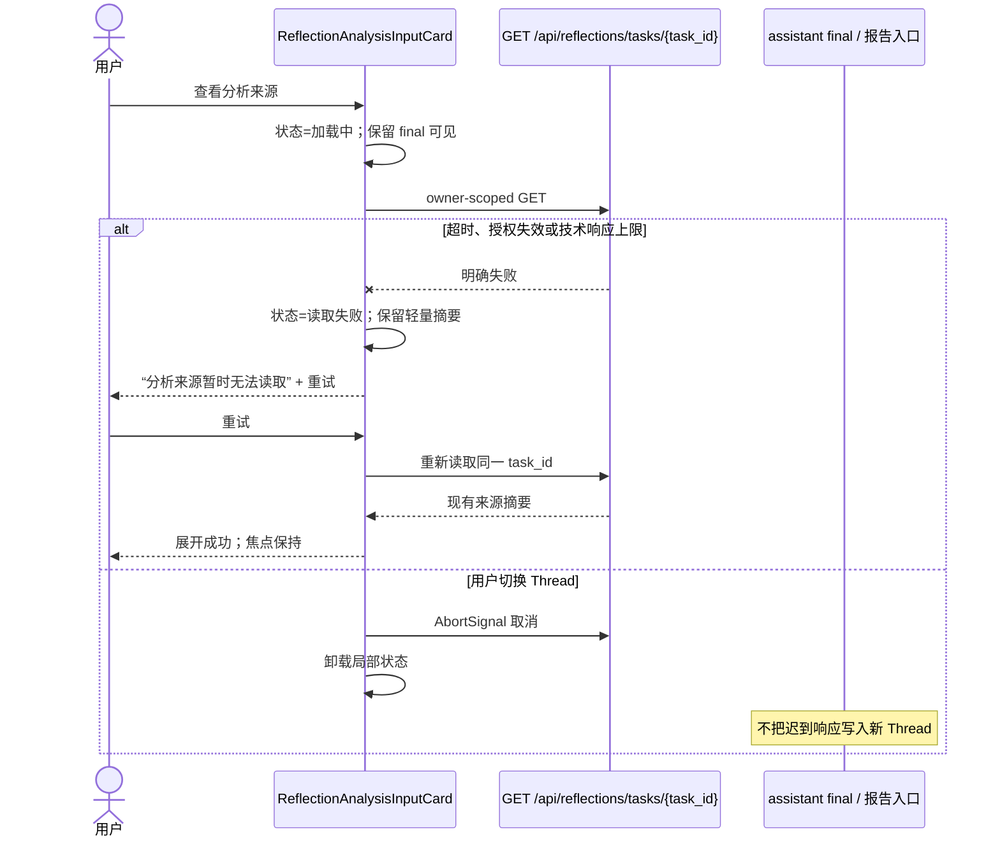
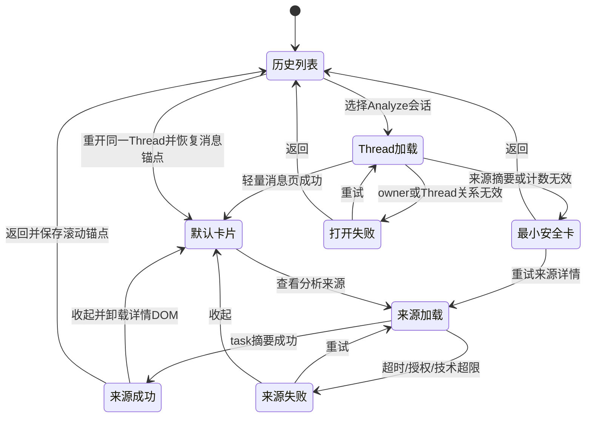

<!-- [Input] Reflections Analyze 创建链路、chat_message 历史合同、目标 Thread 只读数据、历史性能修复与合成浏览器测量。 -->
<!-- [Output] 已被用户否决的大型 Analyze Chat DTO、来源详情和延迟读取方案原文。 -->
<!-- [Pos] memory 历史设计；仅保留 2026-10-13 preview-only 收敛前的完整原文，不作为现行规范。 -->
<!-- [Sync] 2026-10-13: 完成 Double Diamond、三方案比较、正常/异常/状态图与反过度设计复审；功能尚未实现。 -->

# Reflections Analyze 大型 Chat 历史设计（历史稿，已否决）

> 本稿因新增 Chat DTO、来源详情、导航 operation 和卡片状态而被用户否决。现行规则见 `reflections-analyze-chat-history-design.md`；本文件只保留原文及当时证据，不授权实现。

## 1. 背景与问题

Reflections 的 Analyze 会为每个栏目创建一个 Chat Thread，并把冻结日记元数据、冻结 Notion 正文、栏目工作流和输出规则合成为一个 `role=user` 消息交给 Claude Agent。该消息是服务器生成的执行输入，不是用户在 Chat 输入框中键入的普通消息。

目标 Thread `5b606f38-40f4-4177-83af-e16010887dde` 已完成真实业务执行和报告保存，但重新进入 Chat 时，现有历史页把这条服务器执行输入作为普通用户 Markdown 完整返回并渲染。此前的 Chat 历史优化只投影 completed assistant final，未覆盖这条大型 `role=user` 输入。

问题不是标题按钮出现 `<sessions_context>` 这一表象。标题只保存了前 50 个字符；真正的故障边界是历史首屏协议仍携带完整执行输入，并把它送入 `UserMessagePart → ChatMarkdown`。

## 2. 目标与边界

### 2.1 目标

- Analyze 创建的超大 Chat 能从历史列表进入并先显示分析结果。
- 完整冻结输入、报告证据、Agent turn 和历史追溯继续保留。
- 列表和首次详情只传输用户决策所需的轻量投影；浏览器默认不接收日记或 Notion 正文。
- 来源摘要可按需读取；失败不遮挡已经持久化的 Chat final 和 Reflections 报告。
- 普通 Chat、assistant 过程延迟加载、SSE 恢复和完整导出保持现有合同。

### 2.2 非目标

- 不删除、缩减或重新生成 Analyze 输入，不降低分析质量。
- 不修改 immutable task input、Reflections 报告或引用校验。
- 不新增全文内容系统、对象存储、通用消息分页框架或数据库表。
- 不以页面数、字符数或字节数作为产品配额，不增加确认弹窗。
- 本稿不实现代码、migration、发布或真实账户回归。

## 3. 发现与定义

### 3.1 当前完整业务链路

1. `AnalysisView` 通过 `POST /api/reflections/tasks` 提交选择；Admin 保存任务、冻结输入和 `reflection_task_section`。
2. `reflectionTaskRepository.beginSection()` 创建栏目 `chat_thread` 并把 `reflection_task_section.thread_id` 绑定到该 Thread。
3. `ClaudeAgentReflectionsRunner._build_user_message()` 拼接：
   - `_build_sessions_context()` 的冻结日记 ID 与元数据；
   - `_notion_analysis_context()` 的完整冻结 Notion 页面对象与 Markdown；
   - 工作流、回答合同、语言和引用 ID 规则。
4. `_build_claude_agent_run_request()` 将合成结果作为单个 `role=user` text part；现行请求没有 Reflections 专用 message metadata。
5. `persistUserMessageRaw()` 将完整 `parts` 写入 `chat_message`，并用消息文本前缀生成 Thread title。assistant 完成后同时写 canonical parts 和 `history_final_text` 投影。
6. 历史列表 `chat-thread.list` 只读 Thread summary，不携带消息正文；按钮中的 `<sessions_context>` 来自截断标题。
7. 打开 Thread 后，`GET /api/claude-agent/threads/{thread_id}/messages?limit=20` 调用 Admin `chat-message.page`。它只对有效 assistant v1 行使用 final 投影，user 行仍读取和返回完整 `parts`。
8. `threadSessionHydration` 执行浏览器 `response.json()` 并创建 UIMessage；`ChatMessageList` 把 user text 交给 `UserMessagePart`，后者对完整文本调用 `ChatMarkdown`。
9. `ChatPanel` 随后调用 `GET .../turn-navigation`；该路由虽然返回轻量索引，内部仍通过 `chat-message.list` 读取整个 Thread 的 canonical 消息。
10. Reflections 报告重载走任务和报告接口，已经可以从历史卡片恢复；它不依赖 Chat Markdown 首屏渲染。

### 3.2 目标数据的只读证据

| 项目 | 观察值 | 判断 |
| --- | ---: | --- |
| Thread 消息数 | 2 | 分页不能降低这条单消息体积 |
| user `parts` | 2,307,475 bytes | 首屏页仍完整返回 |
| user text | 1,328,354 chars / 2,255,079 bytes | 被当作普通用户 Markdown |
| Notion context JSON | 1,238,779 chars / 2,144,749 bytes | 330 页完整冻结对象 |
| Notion Markdown 合计 | 2,012,436 bytes | 是 user text 的主要体积来源 |
| assistant canonical `parts` | 23,181 bytes | 已有 v1 投影覆盖 |
| assistant history final | 2,302 chars | 首屏无需 assistant 过程正文 |
| Thread title | 50 chars | 只是 `<sessions_context>` 前缀，不是百万字符 DOM 属性 |
| `launch_snapshot_json` | 3,039,499 bytes | immutable task input 独立存在且任务已完成 |
| 当前 Admin 响应上限 | 16 MiB | 2.31 MiB 未命中当前配置上限 |

目标栏目属于 task `b5f0bd88-053b-4a0e-b7f7-2fff7ab64c40` 的 `patterns` section。真实验收记录证明该任务冻结 439 篇日记、330 个非空 Notion 页面和 1 个空页，报告 53 保存并可重载。该事实说明“报告数据损坏”不是本问题的默认解释。

### 3.3 浏览器测量

脱敏合成数据严格对齐目标字符数、UTF-8 字节数和 330 页结构，并复用生产 `UserMessagePart → ChatMarkdown`：

| 视口 | 完整输入 React/Markdown commit | 强制布局 | 轻量摘要 commit / 布局 | 文档高度 |
| --- | ---: | ---: | ---: | ---: |
| 1440×900 | 320.6 ms | 145.3 ms | 0.8 / 0.2 ms | 581,356 px |
| 375×812 | 307.1 ms | 193.9 ms | 0.7 / 0.2 ms | 2,327,646 px |

该隔离基准证明完整输入形成显著主线程和布局成本，但未单独复现页面崩溃。真实页面还包含消息合并、导航索引、报告关联和相邻 UI，因此不能把隔离耗时冒充真实会话“无法打开”的完整复现。

### 3.4 故障分层结论

| 潜在层 | 结论 | 证据 |
| --- | --- | --- |
| 数据库字段大小 | 已排除为当前根因 | PostgreSQL 已完整保存并读回 2.31 MiB user parts；目标任务和报告完成 |
| 数据库分页查询 | 已排除为主要耗时 | 目标只有 2 条消息，索引查询为亚毫秒级；单条正文才是体积来源 |
| Admin/Dream 响应上限 | 已排除为目标 Thread 当前根因 | 正常 Dream 配置为 16 MiB，目标首屏约 2.31 MiB；更大的未来行仍可能触发技术边界 |
| Next/网关响应上限 | 未发现当前命中证据 | 该历史 GET 不经模型 Gateway；Next 代理没有已观察到的 2.31 MiB 响应拒绝 |
| 历史列表携带正文 | 列表页已排除；搜索仍有次要问题 | `chat-thread.list` 只读 summary；Admin `search()` 仍读取并解析所有 `message.parts` |
| Thread 详情一次返回大消息 | **已确认** | `chat-message.page` 对 user 行返回 canonical parts |
| JSON 解析 | 次要成本 | 本地解析测量为毫秒级，不能解释主要可见阻塞，但仍增加内存峰值 |
| Markdown/React/布局 | **已确认的主要浏览器成本** | 完整 user text 进入生产 Markdown 组件；合成基准比摘要高数百倍并生成超长页面 |
| title/按钮 DOM 属性 | 已排除为根因 | title 只有 50 字符；应修正文案，但不会承载完整正文 |
| assistant 折叠仍挂载过程 | 已排除 | 0043 final projection 和按 message ID 过程读取已覆盖目标 assistant 行 |
| SSE/结果解析 | 已排除为历史打开根因 | 目标 turn、task、report 均已完成；历史打开走 REST hydration |
| 大消息方案漏覆盖 Analyze | **已确认的协议缺口** | 既有 projection 只适用于 completed assistant；Analyze 执行输入是 server-authored user message |
| 导航索引二次全读 | **已确认的次要因素** | `/turn-navigation` 内部调用 `chat-message.list` 读取 canonical 全历史 |

### 3.5 已确认故障链、次要因素和待验证事实

**已确认故障链与主要处理方向**：历史轻量投影以 assistant completed turn 为边界，未把 Reflections Analyze 的 server-authored user input 识别为可投影执行输入。结果是首屏详情读取、网络传输和 Markdown 渲染完整冻结正文。该协议缺口已经足以要求修复，但合成基准没有单独复现“无法打开”，因此尚不能声称它是目标真实页面失败的唯一完整根因。

**促成因素**：Thread title 从执行输入前缀生成；导航索引进行第二次 canonical 全读；搜索读取所有消息正文；窄屏的超长页面高度放大滚动和布局负担。

**已排除原因**：目标行数据库保存失败、当前 16 MiB Admin 响应上限、百万字符 title 属性、assistant 过程未折叠、Reflections 报告丢失、SSE 未完成。

**尚需验证**：真实页面的 Network/Performance/Memory 轨迹；故障是否还包含浏览器扩展、路由切换或特定 Markdown 内容；超过 16 MiB 的历史行如何明确失败；更多历史 Analyze Thread 是否都具有有效 `reflection_task_section` 关系。

## 4. 概念与规则

### 4.1 持久化所有权

| 数据 | 所有者 | 规则 |
| --- | --- | --- |
| 任务冻结来源 | Admin Reflections task 的 `analysis_content_json` / `launch_snapshot_json` | immutable task input；执行、恢复和报告证据使用 |
| Agent turn 原始输入 | `chat_message.parts` canonical message | 保留 canonical turn input、审计和显式完整导出；不由列表投影替代 |
| 历史首次展示 | `chat-message.page` 派生投影 | 不新增持久副本；只表达来源类型、计数、栏目、Agent、task ID 和时间 |
| 来源详情 | `GET /api/reflections/tasks/{task_id}` 现有公开摘要 | 只返回标题、安全链接、SHA/读取时间等现有摘要，不返回正文 |
| 分析结果 | assistant `history_final_text` 和 Reflections report | 复用现行 final projection 与报告合同 |

### 4.2 Analyze 输入识别

- 新旧数据都不按文本前缀、message metadata 或字节阈值决定权限与投影。Admin 只以现有 `reflection_task_section.thread_id` 关系识别 section Thread，并只把该 Thread 按 `(created_at,id)` 排序的首条 user message视为 Analyze 执行输入；task ID、section 和来源摘要均从权威 task/section 行派生。
- 不新增持久 `metadata.kind`。它会重复既有关系并引入不一致状态；浏览器也不需要新的写入字段。
- 同一 Thread 后续由用户发送的消息仍是普通 Chat 消息，完整遵循现有分页、搜索、重试和导航规则。
- 投影生成失败时 fail closed：不得把一个缺少 task 关系的普通 user message伪装成 Analyze 摘要。

### 4.3 历史列表与标题

- `chat-thread.list/get` 对有关联的 Reflections section Thread 返回严格、只读的 `reflectionOrigin`：task ID、section 和创建时间。该字段为**建议、未实现**；不在 Admin 数据层固化界面语言。
- `ChatViewContent` 使用 `reflectionOrigin` 在当前语言下生成 `回归分析 · {栏目} · {日期}`，按钮文本与 `title` 属性都只使用该业务标题，不出现 prompt XML、日记标题或 Notion 正文。
- canonical title 不回填、不删除；旧数据凭权威关系立即得到正确显示。
- 普通 Chat 标题合同保持不变。

### 4.4 Thread 详情

- `chat-message.page` 对已识别的 Analyze 输入不选择完整 `parts` TOAST；返回一个轻量 `reflectionInput` 投影和空正文占位，结果 assistant 继续使用 v1 final projection。
- `PublicChatMetadataDto` 只增加严格、只读的 `reflectionInput`：`taskId`、`section`、日记数量、Notion 页面数量、空页数量、Agent 名称、冻结时间。值由 Admin 权威关系派生，不回显客户端 metadata。该字段为**建议、未实现**。
- `ChatMessageList` 见到该投影时渲染 `ReflectionAnalysisInputCard`，不调用 `UserMessagePart` 或 `ChatMarkdown`。
- 普通 user message、附件、失败/取消 assistant，以及非 Analyze 的 assistant 投影无效行保持原完整合同。权威 section 关系已识别的 Analyze 输入即使摘要生成失败也不得回退完整 canonical user parts，而是返回最小安全卡。
- whole-thread export 仍是用户明确触发的 canonical 读取；它不参与首次打开。Analyze Thread 的 UI 应先提供“查看分析来源”，不把完整导出伪装成普通展开。

### 4.5 来源详情

- 默认只显示计数、栏目、Agent 和时间。
- 点击“查看分析来源”后调用现有 `GET /api/reflections/tasks/{task_id}`；成功后在卡片内显示日记数量及 Notion 标题/安全链接列表。
- 不在 Chat 的来源详情请求中返回或复制冻结正文；正文保持 service-only。需要核对正文时使用现有受权审计/显式完整导出边界，不新增浏览器 raw-content API。
- 收起后卸载来源列表 DOM；当前 Thread 内再次展开可复用本地成功结果，不写全局缓存。

### 4.6 导航、搜索和恢复

- 现有公开 `/turn-navigation` 保留，但内部改用 Admin **建议、未实现**的 `chat-message.navigation` 轻量操作；该操作直接返回 user/assistant preview 和状态，不读取 Analyze canonical input。
- Admin `chat-thread.search` 对 Analyze 首条执行输入只索引业务标题和 assistant final，不解析冻结正文或额外读取来源标题；普通 Chat 搜索不变。
- 刷新、重连和历史重开重新取得轻量 page；活动 turn 的 SSE reducer 不变。
- 来源详情失败只影响卡片详情；Chat final、报告入口、消息滚动和返回历史均可用。
- 切换 Thread 或卸载 Chat 时中止来源请求；迟到响应不得写入新 Thread。

### 4.7 页面状态

| 状态 | 页面内容 | 动作 |
| --- | --- | --- |
| 默认 | 轻量 Analyze 输入卡 + assistant final | 查看分析来源 |
| 来源加载中 | 卡片内 skeleton；final 保持可读 | 可收起或离开 |
| 来源成功 | 计数、标题、安全链接、冻结时间 | 收起；打开安全链接 |
| 技术超限 | 保留轻量卡和 final，不显示“页面数超额” | 显示来源摘要暂不可用；重试 |
| 读取失败 | 保留上次成功详情；无成功值时显示短错误 | 重试 |
| 来源摘要/计数无效 | 返回只含 task、section 和时间的最小安全卡；final 保持可读 | 查看报告；重试来源详情；记录诊断 |
| owner/Thread 关系无效 | 不返回该 Thread 内容 | 404/权限错误；返回历史 |
| Thread 恢复 | 锚点和历史列表滚动位置保持 | 继续阅读，不重新展开正文 |

## 5. 方案比较

| 方案 | 能解决 | 不能解决 | 协议/数据影响 | 兼容、恢复与成本 | 结论 |
| --- | --- | --- | --- | --- | --- |
| A. 只在前端折叠 user Markdown | 减少折叠后的可见高度；可修标题文案 | 无法避免数据库读取、2.31 MiB 响应、JSON 解析；首次 React 仍需先取得正文；导航仍二次全读 | 无后端改动 | 成本低，但只隐藏表象 | 拒绝 |
| B. 复用 section 关系，在现有 Thread/message DTO 返回 Analyze 轻量投影；详情复用 task 摘要 | 同时移除首次 TOAST、网络正文、Markdown DOM和正文泄露；旧 Thread 可识别 | 不优化显式 canonical export；未来无 task 关系的任意超大普通 user message 仍保持原合同 | DTO 增加只读 origin/input 投影；新增一个轻量导航 operation；无 schema、无新存储 | 可按 Admin→Dream→前端顺序发布；失败局部恢复 | **选择** |
| C. 以后只在 Chat 存 task/content 引用，正文独立读取 | 从源头避免 Chat canonical 重复正文 | 不能直接兼容旧 turn；会改变 runner replay、transcript、导出和审计 | 需重写持久化语义，可能新增引用版本/capability和回填 | 恢复复杂、跨仓成本高 | 当前过度设计，拒绝 |

方案 B 是最小且完整的选择：它利用现有 `reflection_task_section.thread_id`、immutable task input、task 摘要接口、assistant final projection 和消息页，不新增数据库结构或全文系统；同时真正阻断首屏正文传输，而不是只修改按钮或 CSS。

## 6. 页面交互

### 6.1 桌面

- 历史项显示业务标题，不显示 XML prompt 前缀。
- 首屏在原 user message 位置显示 Analyze 输入卡；卡片默认不超过两行摘要。
- 来源列表在卡片内展开并随消息列滚动，不创建第二个页面级滚动容器。
- 从来源链接返回或从历史切回同一 Thread 时，恢复选中 Thread、历史列表滚动和消息锚点；展开状态只在当前 ChatPanel 生命周期内保留。

### 6.2 375px 窄屏

- 选中历史项后关闭历史抽屉，焦点移到会话标题；不让抽屉和消息列同时滚动。
- Analyze 输入卡占满消息列可用宽度，指标纵向排列。
- 来源详情纵向展开；收起、失败和重试按钮保持可见。请求结束后焦点返回触发按钮或错误区，不跳到页面顶部。
- 不因正文长度创建横向滚动；正文默认不在 DOM 中。

## 7. 业务图

### 7.1 正常打开大型 Analyze 会话

### 7.2 来源详情读取失败与恢复

### 7.3 页面与消息状态

## 8. 历史修复与本问题差异

| 维度 | 既有 Chat 历史修复 | 当前 Analyze 问题 | 可复用判断 |
| --- | --- | --- | --- |
| 触发入口 | 普通 Chat 历史 | Reflections Analyze worker Thread | 复用同一 ChatPanel/消息页 |
| 大数据位置 | completed assistant reasoning/tool/process | server-authored user text 中的冻结 Notion 正文 | assistant-only 判定不能直接复用 |
| 首屏策略 | keyset 20 条 + assistant final projection | 2 条消息但单条 user 2.31 MiB | 复用分页，不依赖分页解决单行 |
| 延迟详情 | `GET .../messages/{assistant_message_id}/process` | `GET /api/reflections/tasks/{task_id}` 来源摘要 | 复用“列表轻、详情按需”原则，不复用 assistant process endpoint |
| 持久化 | canonical parts + 同行 final projection | canonical input + task frozen content + 派生读投影 | 不新增正文副本 |
| 恢复 | final 常驻，过程失败可重试 | final 常驻，来源摘要失败可重试 | 直接复用局部失败原则 |
| 剩余风险 | 极大 final 仍可重 | 极大普通 user message 仍可重 | 不扩大为通用内容系统 |

历史会话 `01a060ba-8132-7ee3-a640-c831e01653a7` 的 keyset、assistant final projection、按需过程和 DOM 测量可以复用。`01a060bc-27ed-7002-b18f-42ad027056fc` 未提供额外技术回执，不能据此声称已有另一项修复覆盖 Analyze。

## 9. 影响范围

| 场景 | 预期影响 |
| --- | --- |
| 普通 Chat | 无行为变化；普通 user text、附件、发送和重试保持现有合同 |
| Analyze Chat | 首条服务器执行输入改为轻量卡；assistant final 直接可读 |
| Reflections 报告/历史重开 | 任务和报告合同不变；Chat 卡可跳到来源摘要 |
| Notion/日记正文 | 完整冻结和执行不变；默认不进入浏览器历史页 |
| Thread 列表 | 关联 section 的旧/新 Thread 显示业务标题；不回填数据库 |
| Thread 详情 | Analyze 输入投影；普通和异常消息仍按现有 DTO |
| 桌面/窄屏 | 单滚动容器、锚点和焦点规则明确 |
| 刷新/重连 | 重新读取轻量页；SSE、active turn 和 reducer 不变 |
| 大消息/工具消息 | assistant process 继续现有按需接口；不建立通用 raw detail |
| 附件/相邻会话 | 不按 Thread 总体大小截断；普通附件消息不被误投影 |
| 搜索 | Analyze 执行正文不进入默认全文搜索；业务标题和 assistant final 可搜索 |

## 10. 验收矩阵

| 类型 | 场景 | 必须观察到 |
| --- | --- | --- |
| 真实业务 | 既有目标 Thread 重开 | 首屏不返回完整 user parts；final 可读；报告 53 和 task 关系不变 |
| 真实业务 | 新建含全量 Notion 的 Analyze | 三栏目输入和结果仍完整持久化；历史标题为业务标题 |
| 数据 | immutable input 对账 | task frozen SHA/页数、Chat canonical input、报告引用保持一致 |
| 网络 | 首次 `/messages?limit=20` | 响应只含 reflectionInput + assistant final；正文不在 payload |
| 数据库 | `chat-message.page` 查询计划 | Analyze user 行不读取完整 `parts`；索引与 owner 校验保持 |
| 前端 | 桌面首次打开 | 不调用 `ChatMarkdown` 渲染 Analyze 原始输入；滚动锚点稳定 |
| 前端 | 375px 首次打开 | 无横向溢出；只有消息列垂直滚动；焦点顺序正确 |
| 详情 | 来源展开/收起 | 只请求 task 摘要；收起卸载来源列表；再次展开可复用局部成功值 |
| 失败恢复 | task GET 401/404/5xx/超时/技术超限 | final 仍可读；短错误、重试、Abort 与迟到响应隔离 |
| 失败恢复 | 权威 section 关系存在但来源摘要/计数无效 | payload 不含正文；显示 task/section/时间最小安全卡；final 可读 |
| 历史恢复 | 刷新、返回列表、重开 | Thread/列表位置和消息锚点保持；不自动展开正文 |
| 导航 | Analyze 后续普通对话 | 轻量 turn navigation 包含两个 turn，不二次读取冻结正文 |
| 搜索 | 搜索正文片段 | 不命中私有冻结正文；业务标题和 assistant final 正常命中 |
| 相邻回归 | 普通 Chat 大 user message | 不被 Reflections 规则误投影；现有完整历史语义保持 |
| 相邻回归 | assistant tool/process/附件 | v1 final、按需过程、确认、附件和导出保持现有测试通过 |
| 文档 | Markdown/Mermaid/引用 | 清单有效、3 个图可渲染；不得称为功能验收 |

## 11. 反过度设计评审

### 11.1 首轮审查修订

首轮候选曾考虑新增通用 raw-context 详情 API和独立大型内容存储。审查后删除：现有 task 摘要已足够支持用户理解来源，canonical message 和 immutable task input 已满足执行与审计；再建 raw API 或存储层会扩大正文暴露、权限状态和回填范围。

### 11.2 独立评审修订

独立评审首轮结论为“修改后通过”，并要求：不把隔离性能负担写成真实页面失败的唯一根因；删除与权威 section 关系重复的持久 message metadata；摘要异常时返回最小安全卡而不是阻断 final 或回退正文。复审又清除了两处残留的 metadata 实施步骤和 Analyze 投影失败回退歧义。上述修改已经进入故障结论、规则、状态表、状态图、验收和实施范围。

### 11.3 最终检查

- 解决的是首屏读取和渲染完整 Analyze 输入，不是只隐藏按钮文本。
- canonical input、冻结来源、报告和引用均保留。
- 复用 Thread、message page、task GET、assistant final 和现有权限边界。
- 只增加一个 typed read projection 和一个与现有 `/turn-navigation` 对应的数据操作；没有通用分页或内容平台。
- 无确认弹窗、字节阈值、产品页数配额、全局缓存或后台任务。
- 旧数据依赖权威 section 关系，不依赖 XML 前缀或大小猜测。
- 来源读取失败与 Chat final 分离，桌面、窄屏、刷新、搜索和相邻普通 Chat 均有验收项。

**评审结论：通过。**

## 12. 下一阶段精确实施范围

### Admin 仓库

- `app/lib/dream/reflectionTaskRepository.ts`：保持现有 task/thread 事务关系；不再让新 Thread 依赖 prompt 前缀作为展示标题。
- `app/lib/dream/chatThreadRepository.ts`：`chat-thread.list/get/search` 派生 Reflections origin；`chat-message.page` 对目标 user input 使用 SQL 轻量投影；新增 `chat-message.navigation`（建议、未实现）。
- `app/lib/dream/chatThreadDto.ts`：增加严格的 reflection origin/input/navigation DTO；canonical message DTO不变。
- 对应 repository/operation tests：旧行识别、后续普通 user message、owner 边界、无正文读取、搜索排除和投影失败。

### Dream 后端

- `backend/services/admin_data/chat_models.py`、`chat_data.py`：接入 typed projection/navigation operation。
- `backend/routers/claude_agent.py`：公开 reflectionInput；`/turn-navigation` 改用轻量 operation；public metadata 继续显式 allowlist。
- 聚焦测试：目标 DTO 字节量、legacy relation、普通 Chat、full export、401/404/5xx 和 response-limit 失败语义。

### Dream 前端

- `frontend/app/_dream/components/chat/threadSessionHydration.ts`：解析只读 reflectionInput。
- `frontend/app/_dream/components/chat/ChatMessageList.tsx`：在 `UserMessagePart` 前路由到 `ReflectionAnalysisInputCard`。
- 新增同目录 `ReflectionAnalysisInputCard.tsx`：默认/加载/成功/失败/重试、Abort、焦点和局部缓存。
- `frontend/app/_dream/components/chat/ChatView.tsx`：显示派生业务标题并保持历史滚动。
- `frontend/app/_dream/components/chat/chatTurnNavigationModel.ts`：消费原公开路由的轻量结果，接口 URL 不变。
- 使用本机 Chrome 验证目标真实 Thread、普通 Chat、刷新/重连、桌面和 375px；技术合成基准不能替代真实账户验收。

实现顺序应为 Admin DTO/operation → Dream 后端双版本读取 → 前端卡片。若 Admin 新合同未发布，Dream 必须保持现有行为或明确 fail closed，不能伪造已投影成功。
