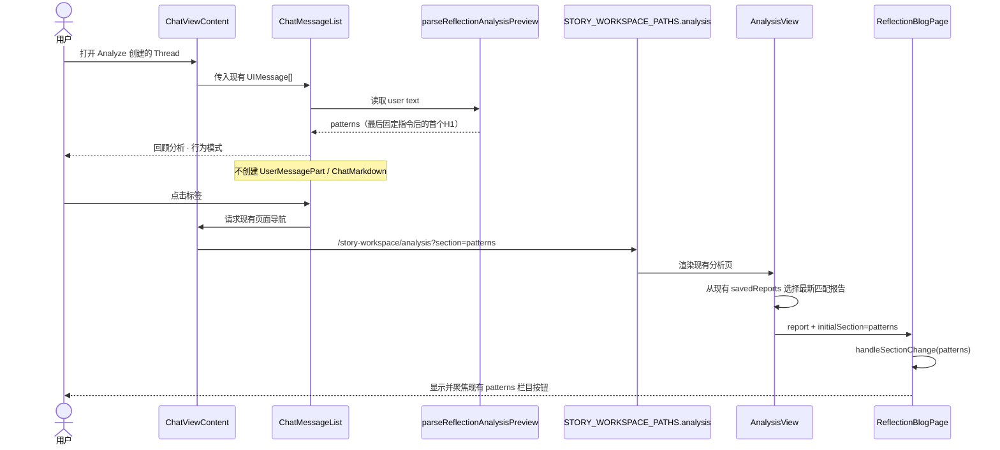
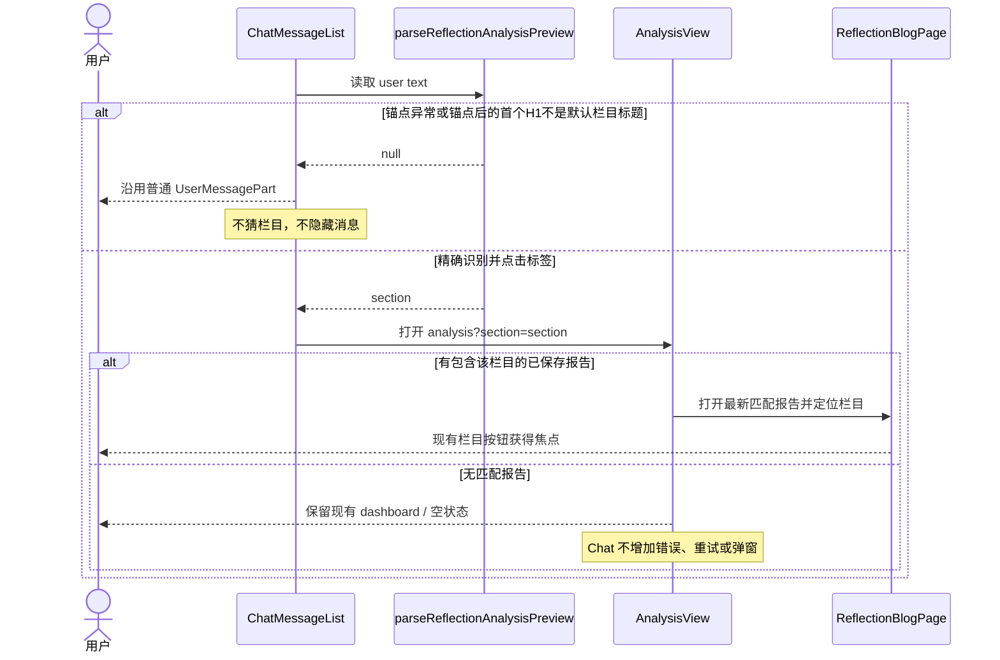
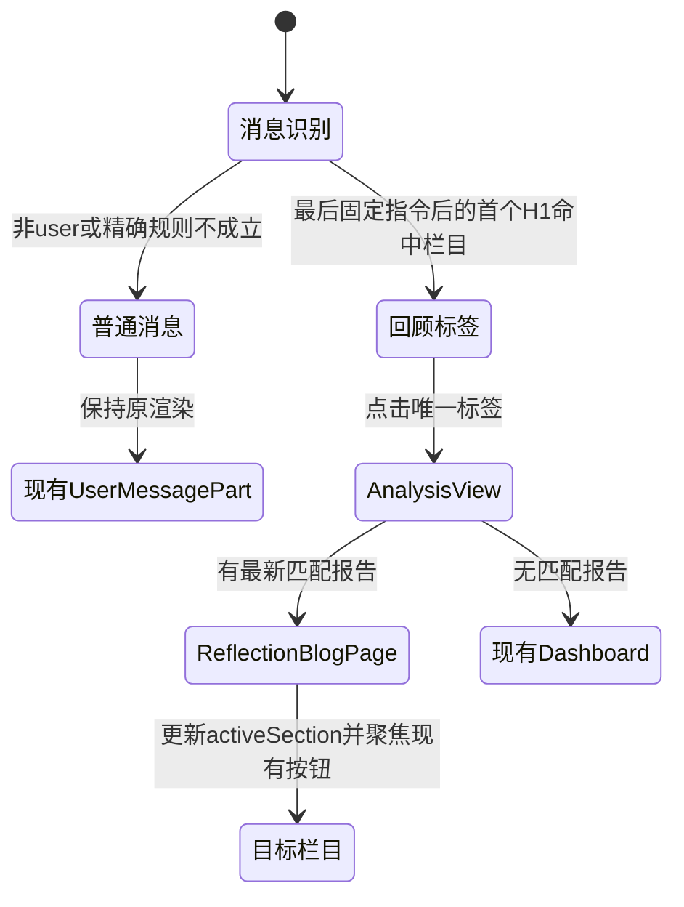

<!-- [Sync] 2026-10-14: saved-report section intent uses creation-time history pages, retaining consumption and focus semantics. -->
<!-- [Input] Reflections Analyze 生成的 user message、现有 Chat 消息渲染、Story Workspace 路由和 ReflectionBlogPage 栏目切换。 -->
<!-- [Output] 不新增 Chat 接口的 Reflections 消息预览标签与现有报告栏目跳转设计。 -->
<!-- [Pos] memory 业务正式设计；拥有 Analyze user message 的前端预览映射、标签导航和相邻回归规则。 -->
<!-- [Sync] 2026-10-14: 按用户反馈删除 DTO、来源详情和卡片状态机，收敛为前端标签与既有 ReflectionBlogPage 导航。 -->
<!-- [Sync] 2026-10-14: 前端预览识别、单标签、现有 AnalysisView 栏目导航及完整相邻回归已经实现。 -->

# Reflections Analyze Chat 预览标签设计

## 1. 背景与问题

Reflections Analyze 会把冻结日记元数据、Notion 正文、栏目工作流和输出规则合成为一个服务器生成的 `role=user` 消息。Chat 历史重开时，现有 `ChatMessageList → UserMessagePart → ChatMarkdown` 把它当作普通用户正文渲染。

目标 Thread `5b606f38-40f4-4177-83af-e16010887dde` 只有 2 条消息，但 user `parts` 为 2,307,475 bytes、text 为 1,328,354 字符；其中 Notion context 为 330 页、2,144,749 bytes。脱敏合成测量显示，完整消息在生产 Markdown 路径上的 React commit 约 307–321 ms，强制布局约 145–194 ms，并形成极高的页面。按钮 `title` 只有 50 字符，不是百万字符正文的承载点。

上一版设计为此引入 Chat DTO、来源详情、导航 operation 和卡片状态机，超过本次产品目标。现行目标只处理预览渲染：把可确认的 Reflections Analyze 消息格式化成一个业务标签，不在 Chat 内增加其他操作。

## 2. 目标与边界

### 2.1 目标

- 对能精确识别栏目的 Reflections Analyze user message，不再挂载原始 `ChatMarkdown` 和空消息气泡。
- 在该用户消息位置上方只显示一个标签按钮：
  - `echoes` → `回顾分析 · 重复回响`
  - `traits` → `回顾分析 · 性格特质`
  - `patterns` → `回顾分析 · 行为模式`
- 点击标签离开 Chat，进入现有 `/story-workspace/analysis`，打开包含对应栏目的最新已保存报告，并定位、聚焦 `ReflectionBlogPage` 的现有栏目按钮。
- 保留完整 `chat_message.parts`、immutable task input、assistant final 和 Reflections 报告，不删除或重写历史数据。

### 2.2 明确不做

- 不新增或修改 Chat/Admin/Dream API、DTO、operation、数据库字段、migration 或持久 metadata。
- 不新增 Chat 来源详情、展开/收起、原文查看、加载、重试、确认弹窗、卡片或第二个入口。
- 不修改 Analyze 创建、Agent turn、SSE、报告保存、消息分页、搜索或导出合同。
- 不用消息字节数、页面数或正文长度判断业务类型，也不把技术大小包装成产品配额。
- 不声称本方案减少数据库读取、HTTP 响应体、`response.json()` 解析或 `/turn-navigation` 的 canonical 读取。
- 本轮只实现上述前端预览与既有页面导航；自动化验证不代表目标真实 Thread 已在用户正常服务中完成手工页面验收。

## 3. 当前链路与故障点

1. `ClaudeAgentReflectionsRunner._build_user_message()` 依次拼接 `<sessions_context>`、`<notion_analysis_context>`、栏目 `WORKFLOW.md`、回答合同和语言/引用规则。
2. `_build_claude_agent_run_request()` 将结果作为单个 user text part；`persistUserMessageRaw()` 完整保存该消息。
3. `GET /api/claude-agent/threads/{thread_id}/messages?limit=20` 仍返回 user canonical `parts`；既有 assistant final projection 不覆盖 user role。
4. `threadSessionHydration` 仍解析完整 JSON；`ChatMessageList` 先用 `parseReflectionAnalysisPreview` 检查 user text，精确命中时渲染单标签，未命中时才沿用 `UserMessagePart → ChatMarkdown`。
5. `ReflectionBlogPage` 已有 `activeSection` 和 `handleSectionChange()`，并以 `echoes`、`traits`、`patterns` 生成栏目按钮；`AnalysisView` 已加载并按时间倒序保存 `savedReports`。
6. Chat 标签通过既有 `pushState + PopStateEvent` 导航到 `/story-workspace/analysis?section=…`；`AnalysisView` 消费一次性 section 并复用 `ReflectionBlogPage` 现有栏目按钮。

当前实现直接处理第 4 步的 Markdown/DOM 渲染。第 3 步的完整消息读取与传输继续存在，是明确接受的剩余风险，不再用新增接口解决。

## 4. 证据分层

### 4.1 已确认

- 目标 user message 完整进入 `UserMessagePart → ChatMarkdown`。
- 目标消息在冻结来源上下文结束后的固定执行指令中包含 `Complete this Reflections analysis in this turn.`，该指令之后的第一个 Markdown 一级标题是默认 patterns 工作流标题 `# Reflections — Behavioral Patterns Workflow`。
- 同样可用的默认精确标题为：
  - `# Reflections — Recurring Themes (Echoes) Workflow`
  - `# Reflections — Character Traits Workflow`
  - `# Reflections — Behavioral Patterns Workflow`
- 目标 task、section 和 report 已完成，数据库能够完整保存与读回该消息；当前 16 MiB Admin 响应上限未被 2.31 MiB 目标消息触发。
- `ReflectionBlogPage` 已有三栏目按钮和本地 `activeSection`，不需要在 Chat 内复制报告内容或栏目 UI。

### 4.2 次要因素

- `/turn-navigation` 内部仍读取 canonical 消息，会造成第二次大正文读取。
- Thread title 取 user message 前缀，所以历史项出现 `<sessions_context>`；它影响可读性，但不是超大 DOM 根因。
- 窄屏换行使超长正文形成更高页面，放大布局和滚动负担。

### 4.3 已排除为目标 Thread 当前根因

- PostgreSQL 字段保存失败。
- 当前 16 MiB Admin 响应上限。
- `title` 属性承载完整正文。
- assistant 过程未折叠。
- Reflections 报告丢失或 SSE 未完成。

### 4.4 尚未验证

- 目标真实页面“无法打开”是否还包含浏览器扩展、路由切换、内存峰值或特定 Markdown 内容因素。
- 自定义 `WORKFLOW.md` 替换默认标题后的旧 Analyze message，现有正文中没有稳定 section ID，不能在本方案中精确分类。
- 只移除 Markdown/DOM 后，完整 payload 的网络与 JSON 解析成本是否仍会在低内存设备上阻止打开。

## 5. 概念与规则

### 5.1 前端预览识别

Chat 前端通过纯函数执行识别，输入仅为当前 user text，输出只可能是 `echoes | traits | patterns | null`。

识别必须同时满足：

1. 在 user text 中查找服务器固定指令 `Complete this Reflections analysis in this turn.` 的最后一次出现；该位置作为冻结来源正文之后的锚点；
2. 只检查锚点之后的第一个 Markdown 一级标题行，不扫描锚点之前的 `<sessions_context>`、`<notion_analysis_context>` 或其他正文；
3. 该第一个一级标题必须完整等于三个默认工作流标题之一；
4. 锚点不存在、锚点之后无法取得第一个一级标题、标题不在枚举中或输入不是 user text 时返回 `null`。

使用最后一次固定指令的原因是冻结 Notion 正文可能原样包含同一句话；若自定义 workflow 又包含该固定指令，最后锚点会移动到自定义内容内部，随后无法以默认 workflow 标题通过校验，结果仍为 `null`。不得在全文任意位置搜索标题，也不得使用 `<sessions_context>`、中文语义关键词、assistant 结果、Thread title、字节阈值或模糊包含来猜栏目。

### 5.2 渲染规则

- 识别结果为 section 时，`ChatMessageList` 在原 user message 的右对齐位置渲染唯一的标签按钮，不创建 `UserMessagePart`、`ChatMarkdown`、复制按钮或空气泡。
- 标签使用现有纸张色和边框 token，小号正文、非胶囊的轻圆角、清晰 hover/focus；不增加图标、计数、副标题或来源摘要。
- 标签是原生 `<button type="button">`，支持 Tab、Enter 和 Space；无障碍名称为 `打开回顾分析：{栏目标题}`。
- 识别结果为 `null` 时完全走现有普通 user message 渲染，不隐藏、截断或改写内容。
- assistant final、tool message、附件、任务来源标记和普通 Chat 不变。

### 5.3 标签导航

- 点击标签复用 `ChatViewContent` 现有 `openDreamRun(href)` 的 `pushState + PopStateEvent` 行为，不在 Chat 内增加第二个导航组件。
- 目标地址为 `/story-workspace/analysis?section={section}`；`section` 只接受 `echoes | traits | patterns`，不是后端接口参数。
- `AnalysisView` 读取这一项前端导航意图，等待现有 `getAnalysisHistory()` 历史读取及原任务状态回读结束后，在 `savedReports` 中选择服务端按实际分析创建时间/id倒序返回且目标数组非空的最新报告；前三份没有目标栏目时沿原末尾游标继续读取更早页，调用现有报告打开逻辑；等待期间不在 Chat 增加加载状态。
- `ReflectionBlogPage` 以目标 section 初始化/更新 `activeSection`，渲染完成后通过既有按钮 ref 聚焦对应栏目；`data-reflection-section` 仅用于定位和测试，不产生新控件。
- 成功打开后清除一次性 `section` 查询，避免用户点击“返回”时自动重开报告。
- 找不到包含该栏目的报告时，停留在 `AnalysisView` 现有 dashboard/空状态；Chat 不显示新的失败提示或重试按钮。

历史读取失败时，AnalysisView 保留未消费的 section 意图和原有报告，显示历史读取失败与重试；重试成功再完成栏目选择。分页和时间字段以 [分析历史设计](reflections-history-design.md) 为准。

### 5.4 历史报告边界

现有 Chat 消息不含 `task_id` 或 `report_id`，所以本方案不能保证跳到生成该旧 Thread 的同一份报告。禁止按时间差、标题或正文相似度猜报告。标签动作的准确语义是：**打开最新已保存报告中的对应栏目**。

若以后产品要求精确回到原报告，需要另行批准稳定的 Thread→task/report 关联；不在本设计中预埋字段、接口或兼容层。

## 6. 方案比较

| 方案 | 能解决 | 不能解决 | 影响与成本 | 结论 |
| --- | --- | --- | --- | --- |
| A. 固定指令锚点 + 首个 H1 精确识别，标签替代 Analyze user Markdown | 移除目标消息的 Markdown、复制按钮、超长 DOM 和页面高度；避免 Notion 正文同名标题误判；提供现有报告栏目入口 | 不减少完整消息读取、传输、JSON 解析；自定义工作流可能无法识别；不能定位旧 Thread 的精确报告 | 只改 Chat 渲染和 AnalysisView 本地导航；无新 API/存储 | **选择** |
| B. 前端按 XML、关键词或大小模糊识别 | 能覆盖更多外观相似消息 | 会隐藏普通或自定义消息，栏目可能跳错；错误无法从现有协议纠正 | 代码少但数据判断不可靠 | 拒绝 |
| C. 新增结构化 metadata/DTO、来源详情和按需正文 | 可准确关联 section/task，并减少网络正文 | 超出“只做预览渲染”；增加接口、状态和跨仓发布 | 成本高，上一版已被用户否决 | 拒绝 |

方案 A 是本轮最小完整方案：它只解决用户要求的预览和栏目跳转，并对无法精确识别的消息保持原行为，不创建新的 Chat 产品面。

## 7. 页面交互与骨架

### 7.1 桌面

```text
┌ Chat 历史 ───────────┬ 当前会话 ────────────────────────────┐
│ <sessions_context>…  │                         [回顾分析 · 行为模式]
│ 普通对话             │                         （不渲染原始 Analyze 气泡）
│                      │ 分析结果 final…                         │
│                      │                                         │
└──────────────────────┴─────────────────────────────────────────┘

点击标签 → /story-workspace/analysis → 最新匹配报告
                                  [重复回响] [性格折射] [行为轨迹]
                                                         ↑ 聚焦
```

标签仍属于该 user message 的视觉位置，靠右显示在 assistant final 之前。页面不出现分析输入卡、来源详情或空白气泡。

### 7.2 375px 窄屏

```text
┌ 当前会话 ─────────────────┐
│       [回顾分析 · 行为模式]│
│       （单行；空间不足整体换行）│
│ 分析结果 final…            │
│                            │
└────────────────────────────┘

点击后进入现有回顾报告页；
目标栏目按钮进入视口并获得键盘焦点。
```

不新增横向滚动或嵌套滚动区。标签文本不截成只有“回顾分析”，以免丢失栏目含义。

## 8. 业务图

### 8.1 正常打开与跳转



### 8.2 无法识别或无法定位时



### 8.3 消息与页面状态



## 9. 影响范围

| 范围 | 设计结果 |
| --- | --- |
| 普通 Chat | 精确规则不成立，完全保持现有渲染和交互 |
| 默认 Reflections Analyze Chat | server-generated user message 显示单个标签，assistant final 保持原样 |
| 自定义工作流 Analyze Chat | 没有稳定 section 标题时不猜，暂时保持现有渲染 |
| Reflections 报告 | 复用现有 savedReports 和 ReflectionBlogPage；不改保存/重载合同 |
| Notion/日记正文 | 持久化与接口响应不变；精确匹配时不进入 Markdown DOM |
| Thread 列表 | 不在本轮修改，`<sessions_context>` 标题问题保留 |
| Thread 详情 | 网络 payload 和 JSON 解析不变，只改变匹配消息的渲染分支 |
| 桌面/窄屏 | 同一个标签控件；窄屏允许整体换行，无新滚动区 |
| 刷新/重连 | Chat 再次从同一文本确定性识别；SSE 和恢复逻辑不变 |
| tool/附件/相邻消息 | 不命中规则，不改变挂载、复制和发送行为 |

## 10. 验收矩阵

| 类型 | 场景 | 必须观察到 |
| --- | --- | --- |
| 目标回归 | Thread `5b606f38-40f4-4177-83af-e16010887dde` | 显示 `回顾分析 · 行为模式`；该 user message 不创建 `ChatMarkdown` 或复制按钮；assistant final 可读 |
| 三栏目 | 三个默认工作流样本 | 分别映射 `echoes`、`traits`、`patterns` 和三条指定中文标签 |
| 误判防护 | `<sessions_context>` 或 Notion 正文含共同短语/默认标题，但固定指令后的首个 H1 不匹配 | 返回 `null`，沿用普通 user message 渲染 |
| 自定义工作流 | 默认标题被替换、无 H1，或自定义内容再次包含固定指令 | 返回 `null`，不猜 section、不显示错误标签 |
| 导航 | 点击三种标签 | 进入现有 analysis 路由；打开最新匹配报告；对应现有栏目按钮可见并获得焦点 |
| 无报告 | 无包含目标 section 的 saved report | 停在现有 dashboard/空状态；Chat 不出现新控件、弹窗或重试 |
| 键盘 | Tab + Enter/Space | 标签可操作；跳转后焦点到目标栏目按钮 |
| 桌面 | 1440×900 | 标签右对齐；无原始 Analyze 气泡；消息列无新增滚动容器 |
| 窄屏 | 375×812 | 无横向溢出；标签整体换行；目标栏目按钮进入视口 |
| 刷新/重连 | 重开同一 Chat、SSE 恢复后查看历史 | 同一文本得到相同标签；active turn/reducer 不变 |
| 相邻回归 | 普通 user Markdown、附件、tool、source marker | 原组件、复制、导航和消息顺序不变 |
| 数据保留 | 检查 task、chat_message、report | canonical input、immutable snapshot 和报告均未删除或改写 |
| 性能边界 | 精确命中的 Analyze message | 不调用 `ChatMarkdown`；同时明确消息响应字节数和 JSON 解析没有下降 |

## 11. 反过度设计评审

本轮已从现行稿删除上一版的 `reflectionOrigin`、`reflectionInput`、`chat-message.navigation`、来源详情、详情加载/失败/重试、卡片、Admin/Dream 变更、数据库读取优化和搜索改造。独立复审发现“全文搜索默认标题”会被 Notion 正文碰撞，现已修订为“最后固定指令锚点后的首个 H1”结构判断。

逐项复核：

- 直接处理用户指定的预览渲染和标签跳转，没有把长按钮文本当作唯一问题。
- 完整输入、报告证据和历史消息仍保留；只是精确命中时不创建大 Markdown DOM。
- 复用 `ChatMessageList`、`ChatViewContent` 现有页面导航、`AnalysisView.savedReports`、`ReflectionBlogPage.activeSection` 和现有栏目按钮。
- Chat 中只有一个标签按钮；没有来源面板、通用内容系统、分页框架、确认弹窗或技术配额。
- 精确报告关联和自定义 prompt 分类因现有消息缺少稳定 ID 而明确列为边界，没有用猜测补齐。
- 可删除的设计状态已全部删除；实现只需要纯函数、一个渲染分支和 AnalysisView 的一次性栏目导航。

**评审结论：通过。**

## 12. 实现落点与后续边界

- `frontend/app/_dream/components/chat/reflectionAnalysisPreview.ts`：实现固定指令锚点和首个 H1 的精确栏目识别。
- `frontend/app/_dream/components/chat/ChatMessageList.tsx`：在 user text 进入 `UserMessagePart` 前识别；命中时保留来源标记并只渲染单标签。
- `frontend/app/_dream/components/chat/ChatView.tsx`、`ChatPanel.tsx`、`TaskSessionSidebar.tsx`：沿现有 Chat 组件链传递既有页面导航回调，不新增 Chat API。
- `frontend/app/_dream/router/storyWorkspacePath.ts`：集中校验三个 section，并构造/消费同一个 Analysis 页面 URL；没有新增 route 或后端接口。
- `frontend/app/_dream/components/AnalysisView.tsx`：等待现有报告读取完成，打开最新匹配 saved report，设置 `activeSection`，聚焦现有栏目按钮并清除一次性 query。
- 同目录纯函数、路由和生产组件浏览器测试覆盖三栏目、锚点碰撞、自定义 prompt、普通消息、来源标记、标签可访问性、超大正文不进入 DOM 及 navigation callback。
- provider-free 完整 Reflections/Chat 旅程覆盖报告读取、section 聚焦、query 消费、浏览器返回/前进、375px、相邻普通 Chat 与恢复流程。目标真实 Thread 的正常服务手工重开、响应字节数、JSON parse 与低内存设备表现仍需另行观察；这些剩余项不通过新增接口在本轮处理。

历史上被否决的 DTO/来源详情方案完整保留在 `reflections-analyze-chat-history-design-pre-preview-only-20261013-history.md`，不得作为现行实现依据。

## 13. 当前验证状态

- TypeScript 与相关 ESLint 已通过；未增加 backend、Chat/Admin/Dream API、DTO、数据库或 migration 文件。
- 纯函数与路由测试 `18 passed`；生产 `ChatMessageList` 本机 Chrome 超大正文测试 `1 passed`。
- 当前源码隔离 Next 服务上的完整 Reflections 流程 `12 passed`，相邻 Chat/Dream 流程 `2 passed`；覆盖报告读取、栏目聚焦、一次性 query、返回/前进、恢复、Slash Skill 选择/发送和 375px。
- 测试为 provider-free 当前源码自动化；没有运行真实模型、写真实业务数据库或在用户正常服务中手工重开目标 Thread。因此只确认实现与自动化合同闭合，不宣称完整 payload、JSON 解析、低内存设备或目标真实页面问题已经全部消失。
