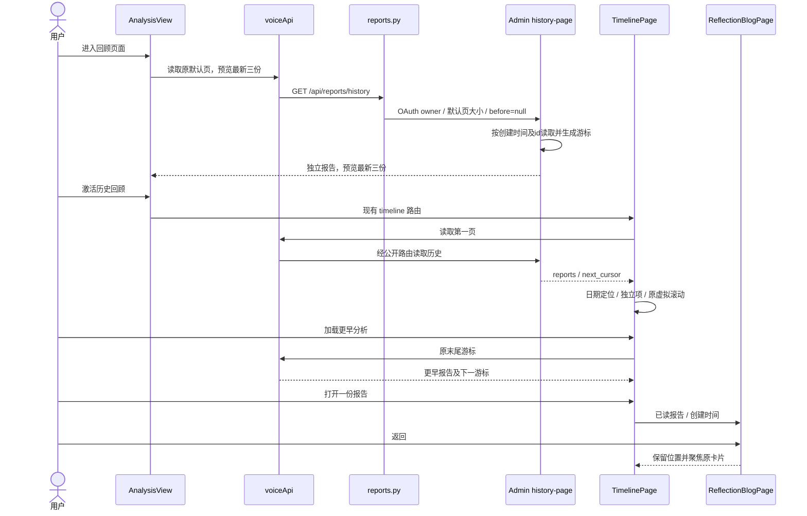
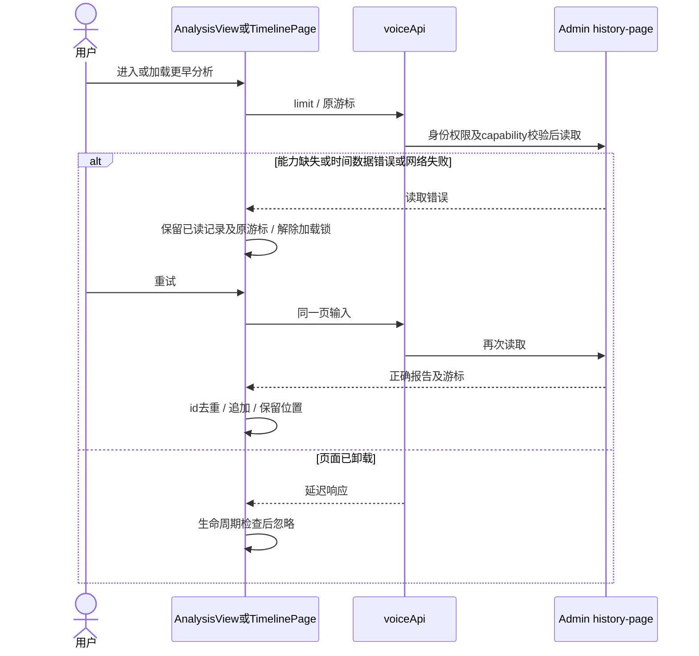
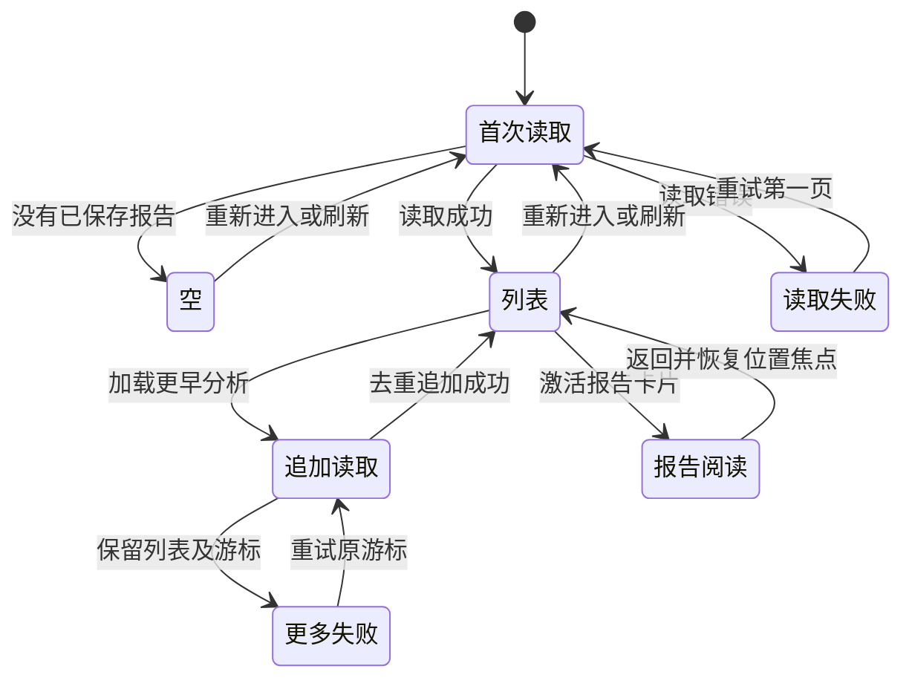

<!-- [Input] 当前分析历史 PRD、AnalysisView、TimelinePage、Admin task/report 和公开 API。 -->
<!-- [Output] 分析创建时间、只读分页、导航、报告阅读和异常恢复的正式交互。 -->
<!-- [Pos] memory 业务分析历史正式设计；历史原文保留。 -->
<!-- [Sync] 2026-10-14: 最小方案经实现前评审后实现；验证回执与部署状态单独记录。 -->
# 分析历史交互设计

## 背景与问题

当前三张卡片来自十份报告和按日合并结果，因此不能准确表示最近三次独立分析。报告保存时间也不能替代 task 创建时间。时间轴现有日记/图片数据流不读取报告，固定高度的日期卡片不能直接塞入数量不受限制的同日报告。

## 目标与边界

复用 AnalysisView 的三张预览、Story Workspace 路由、TimelinePage 虚拟列表和 ReflectionBlogPage 阅读组件。为每份分析增加独立固定高度的时间轴项，不改变日记/图片卡片内部业务。不增加筛选、页面或确认。原始历史设计保留，仅新增现行指引。

## 概念与规则

### 数据和接口

- 已实现、未部署：Admin `analysis-report.history-page`。使用 OAuth `dream:read`、现有 identity/unified/reflection-task-persistence schema capabilities，闭合输入为 limit 和 before，闭合输出为 reports 和 next_cursor。
- 已实现、未部署：Dream `GET /api/reports/history`，转发经过验证的游标和 limit；Admin DTO 中字符串报告 id、报告 JSON、报告创建时间、任务关联和分析创建时间在公开响应中保持含义。
- 任务关联只来自服务端已有外键，并同时校验 task 与 report 的账户归属。关联报告必须使用 task.created_at；无外键旧报告使用分析记录本身的 created_at。任意创建时间缺失不能补成现在。
- 读取顺序为 `(analysis_created_at DESC, id DESC)`，游标使用同一精确数据库时间及字符串 bigint id。服务端多取一行判断 has-more；前端以报告 id 去重，保持既有顺序。旧操作描述与 schema 不修改，不新增 migration。
- 首页和时间轴沿 API 的默认页大小读取（当前默认10），首页仅展示最新三份并保留原栏目结果来源，点击加载更早分析追加。游标在失败时保持原值；重复点击即时锁定。重新进入读取第一页。
- 前端共享历史投影只转换已校验字段，不按日合并报告。数据库的精确顺序优先于 JavaScript 毫秒重排；同日分组只影响时间轴位置。

### 导航、摘要和阅读

历史回顾原生按钮通过现有 `STORY_WORKSPACE_PATHS.timeline` 和 History 导航方式进入 TimelinePage，浏览器返回恢复 Analysis 路由。每份报告展示创建日期/时间、三栏目数量以及第一条有内容结果的标题和简短描述；正文只在原报告阅读组件内展开。

TimelinePage 的时间轴项由原日期项与分析项组合，保持较早在上、最新在下。分析按账户时区确定日期，同日不合并。原虚拟列表尺寸按组合项数量计算；新增较早项后修正滚动位移，保留用户正在看的项。已读报告打开只使用读取到的内容，不调用 report ensure 或创建任务。

CollectionsView 保留时间轴实例，阅读时隐藏列表并复用 ReflectionBlogPage；关闭恢复滚动并聚焦触发卡片。首页报告阅读维持现有本地状态，时间轴刷新也回到列表。Analyze Chat 的 section 一次性意图继续搜索最新含目标栏目报告，必要时沿新分页读取更早记录，保持已有查询消费和栏目聚焦。

### 状态与反馈

| 状态 | 首页 | 时间轴 |
| --- | --- | --- |
| 首次读取 | 历史标题和加载提示 | 原日记加载继续，分析加载提示 |
| 空 | 保留历史入口，暂无分析报告 | 原日记/图片继续展示，暂无分析报告 |
| 成功 | 最近独立报告，预览最新三份 | 分页报告加入原时间轴 |
| 首次失败 | 历史读取失败和重试 | 原数据继续，分析读取失败和重试 |
| 更多失败 | 不适用 | 保留原卡片和游标，重试同页 |
| 阅读 | 现有 ReflectionBlogPage | 同组件；关闭回原位置及卡片焦点 |
| 重新进入/刷新 | 重读数据 | 重读第一页，沿原初始定位规则到最新内容 |

### 正常业务时序

### 异常与恢复时序

### 状态转换

## 影响与验收

| 流程 | 输入与断言 |
| --- | --- |
| 创建到历史 | 原公开 create/subscribe/start/result/report 流程，完成后首页三条及时间轴正确报告 |
| 数量 | 0、1、3、超过3、超过旧容量；同一天多次分析分别可读 |
| 时间 | task.created_at 不同于 report.created_at / updated_at / 分析范围；跨月和账户时区日期边界；同一精确时间以 bigint id 稳定排序 |
| 分页 | 同时刻跨页、游标末尾、重复项去重、首次与更多失败重试、重新进入读取最新 |
| 阅读恢复 | 首页和时间轴打开对应内容；关闭恢复位置焦点；刷新/浏览器返回按现有合同 |
| 相关回归 | 原任务未开始/运行恢复/部分失败/保存重试，Analyze Chat section 预览，时间轴日记/图片 |
| 可访问性 | 桌面和375px、页面无横向溢出、键盘入口/报告卡片、滚动及可访问名称 |
| 边界 | provider-free UI 与领域/API 合同验证单独报告；本轮未指定真实账户或模型，不进行真实验收 |

[PRD](../../prd/memory/reflections-history-prd.md) · [评审与本轮回执](../../exec/reflections-history-20261014.md)

<!-- [Sync] 2026-10-14: close statistics-hydration cancellation in prepared-task UI recovery. -->
回归期间发现日记统计水合可能取消未开始任务的恢复效应并留下加载状态。恢复效应现仅依赖任务恢复输入，报告统计从当前引用读取；服务器确认 CREATED 且没有本次提交或显式启动时恢复空闲，不自动启动任务。正常 create/subscribe/start 状态机不变，使用受控延迟任务查询与先完成统计的旅程回归。

<!-- [Sync] 2026-10-14: verify full narrow report visibility and precise navigation lifecycle. -->
窄屏时间轴每项保留完整卡片高度，创建日期与摘要不被相邻卡片盖住；轴线和装饰圆点不拦截点击。桌面保留原日期卡片间距。
