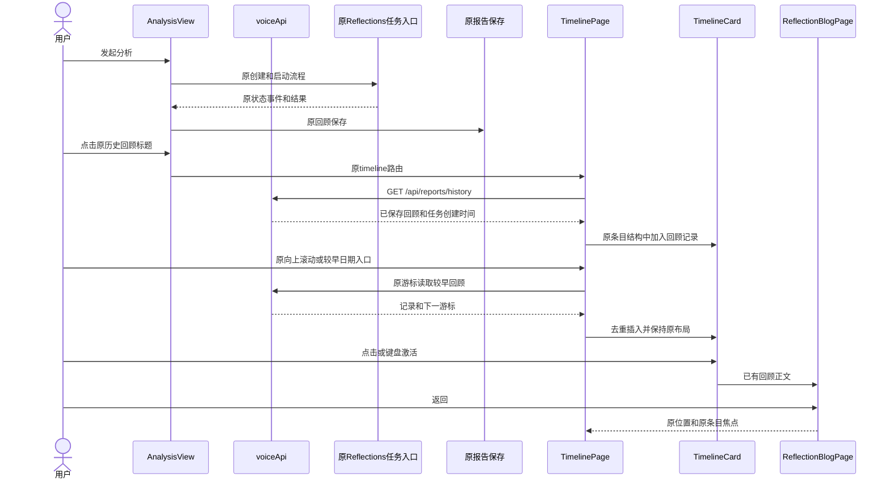
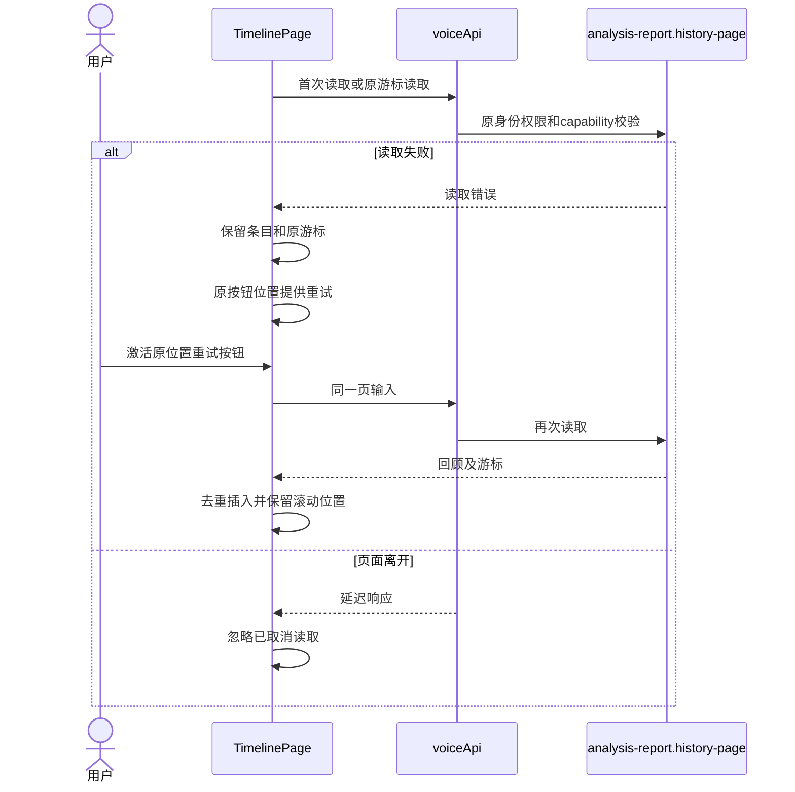
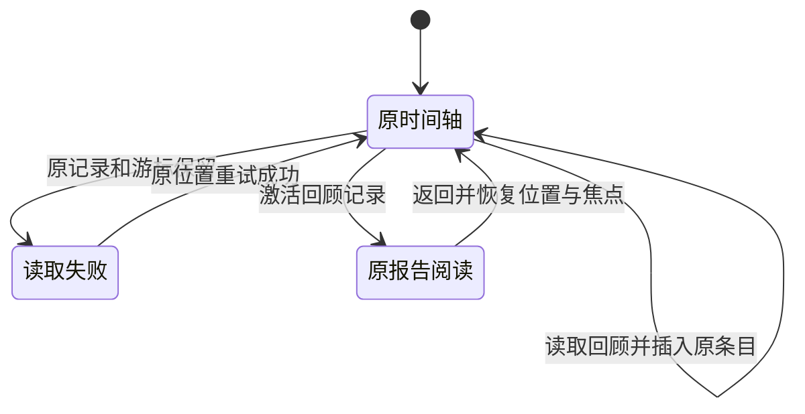

<!-- [Input] 用户布局约束、现行回顾 PRD、TimelineCard 和已有分析报告读取合同。 -->
<!-- [Output] 原时间轴中增加回顾记录的最小交互、时序、状态及验收。 -->
<!-- [Pos] memory 业务现行交互设计；旧布局方案单独保留。 -->
<!-- [Sync] 2026-10-14: 按用户纠正复用原条目，恢复原行距和顶部偏移并删除新历史控制区。 -->
# 分析任务的时间轴回顾交互

## 背景与问题

TimelinePage 已有日期、日记和图片时间轴。此次需求只增加分析任务的回顾记录。上一实现改变了窄屏条目步长和顶部留白，增加独立报告卡片与历史控制区，不符合用户明确的布局约束。

## 目标与边界

原页面布局作为约束保留。AnalysisView 使用原三条历史网格与原标题外观，标题获得导航行为；TimelinePage 在原列表中增加回顾条目，沿用 TimelineCard。阅读组件复用，不新增页面或管理工具。

## 概念与规则

### 最小方案与判断

| 方案 | 判断 |
| --- | --- |
| 独立卡片、历史工具栏、窄屏增大行距 | 改变原页面布局，撤回 |
| 新建回顾管理页或任务状态面板 | 超出此次需求，不采用 |
| 原时间轴新增回顾类型，复用原 TimelineCard 和加载入口 | 采用；只增加记录及必要点击行为 |

已有 GET /api/reports/history 与 Admin analysis-report.history-page 保留为只读数据来源；它们已实现、未发布，不增加新的接口或 schema。本次只调整前端投影与布局。任务关联时间来自已有外键和 task.created_at，服务器以精确创建时间和字符串 id 提供稳定分页顺序，前端不重新用毫秒排序。

每份回顾加入一个原时间轴条目，日期定位使用账户时区。条目正文只显示“历史回顾”，原图块位置显示图标，日期、图片尺寸、字体、背景、左右分布、100px高度和70px步长保持原样。中心线和装饰点不参与点击，原较早日期按钮在原位置保持可点击。没有回顾时原时间轴不增加空态区域。

向上滚动或激活原较早日期按钮时同时读取必要的较早日期和回顾页，继续使用既有游标及去重。历史查询失败时保留已读条目与原游标，在同一个原按钮位置重试，不添加新的反馈面板。失败状态停止自动重试，等待该按钮动作。

点击回顾条目只读取已有回顾正文并复用 ReflectionBlogPage。时间轴保持挂载，返回时恢复滚动位置及原条目焦点。刷新和重新进入重新读取；原日记、图片和分析任务创建/恢复入口不变。

### 正常业务时序

### 异常与恢复时序

### 记录阅读状态

## 影响与验收

| 范围 | 验收 |
| --- | --- |
| 原布局 | 无分析时和有分析时保持原高度、步长、顶部偏移、宽度、左右规则；不出现历史工具栏或新增空态区 |
| 正常流程 | 创建分析→原任务事件→保存回顾→首页三条→原历史标题→时间轴回顾条目→阅读→返回 |
| 记录规则 | 0/1/3/超过3份，同日不同任务独立，重复响应不重复记录，按真实创建时间和账户时区定位 |
| 较早和失败 | 原滚动/较早日期入口读取较早页；失败保留原条目和游标；原位置重试 |
| 相邻业务 | 原栏目结果、任务恢复、部分失败、保存重试、Chat栏目跳转、日记和图片查看不回归 |
| 端侧 | 桌面与375px窄屏保留原布局、无横向溢出，点击与键盘均可用 |
| 证据 | 本轮重新验证并比较布局尺寸；旧版通过回执不替代本次结果；技术验证不作为真实账户/模型验收 |

[现行 PRD](../../prd/memory/reflections-history-prd.md) · [此前方案原文](reflections-history-design-pre-layout-correction-20261014-history.md)。
