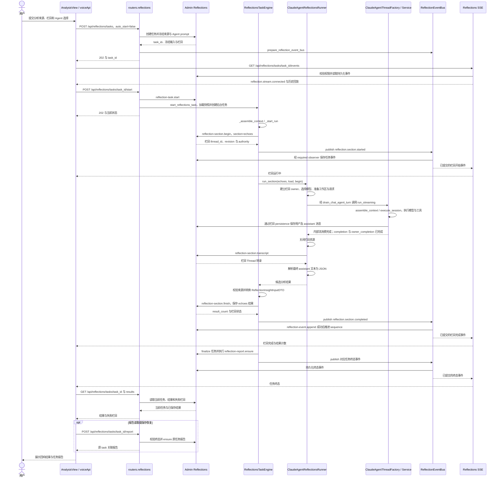

<!-- [Input] 修改前模块时序正文。 -->
<!-- [Output] 全量正文前置读取时期的完整第六节图示。 -->
<!-- [Pos] 历史时序；现行流程见 ../sequence-diagrams.md。 -->
<!-- [Sync] 2026-10-23: 按原文保存第六节，保留执行步骤补全后的图示。 -->

## 6. 深度分析模块

分析任务处理本次选中的日记与冻结 Notion 正文，按 echoes、traits、patterns 保存结构化结果。来源选择、页面入口与骨架见[分析内容交互稿](memory/reflections-analysis-content-design.md)；后台执行、Agent 内部流及任务 SSE 的完整说明见[Reflections Agent 执行设计](memory/reflections-agent-interaction-design.md)。

### 6.1 回响分析（Analyze Echoes）

下图以 `sections=["echoes"]` 展示单栏目执行。当前页面统一入口可提交多个栏目；Deck 提供 Agent 分组，执行选择使用成对的 `deck_id`、`agent_id`。Task API 通过 `start_reflections_task()` 创建后台 Engine，Runner 经 ThreadFactory 执行该栏目 Agent，Engine 按已保存结果发布任务事件。

#### 执行与事件合同

| 阶段 | 执行模块与输出 |
| --- | --- |
| 启动分析 | Task API 校验启动权限并创建后台 Engine；响应包含 task_id 和当前状态 |
| 执行 Agent | `ClaudeAgentReflectionsRunner.run_section()` 经统一 ThreadFactory/Service 执行；`drain_chat_agent_turn()` 消费内部流并等待轮次和 Factory owner 完成 |
| 取得结果 | Runner 从 Admin 栏目转录提取最后一段 assistant 文本，解析 JSON；Engine 校验冻结来源后保存结构化结果 |
| 发布进度 | Engine 调用 `ReflectionEventBus.publish()`；`TaskPersistenceObserver` 保存事件成功后，SSE 输出 `reflection.*` 状态、计数与错误摘要 |
| 打开报告 | Engine finalize 后执行 `reflection-report.ensure`；前端按原 task_id 查询或恢复关联报告 |

Agent 内部流供 Runner 等待执行完成，栏目消息通过 persistence 保存。Reflections SSE 的事件生产方为 Engine/EventBus；栏目生成期间，页面在任务事件到达时更新状态。单栏目执行、事件持久化、异常恢复和状态转换的正文图见[执行设计](memory/reflections-agent-interaction-design.md)。

[修订前 6.1 原图](history/pre-admin-user-preferences-20260915/sequence-diagrams.md#61-回响分析analyze-echoes)完整保留。

### 6.2 特质分析 / 模式分析

`traits`、`patterns` 使用同一 Task API、Engine、Runner、ThreadFactory 和任务事件链。Engine 按任务 sections 顺序串行执行，分别保存各栏目的结果与错误。持久化结果采用统一 DTO 字段 `title`、`description`、`related_session_ids`、`evidence`、`confidence`，栏目归属由 `section` 标识。

---

