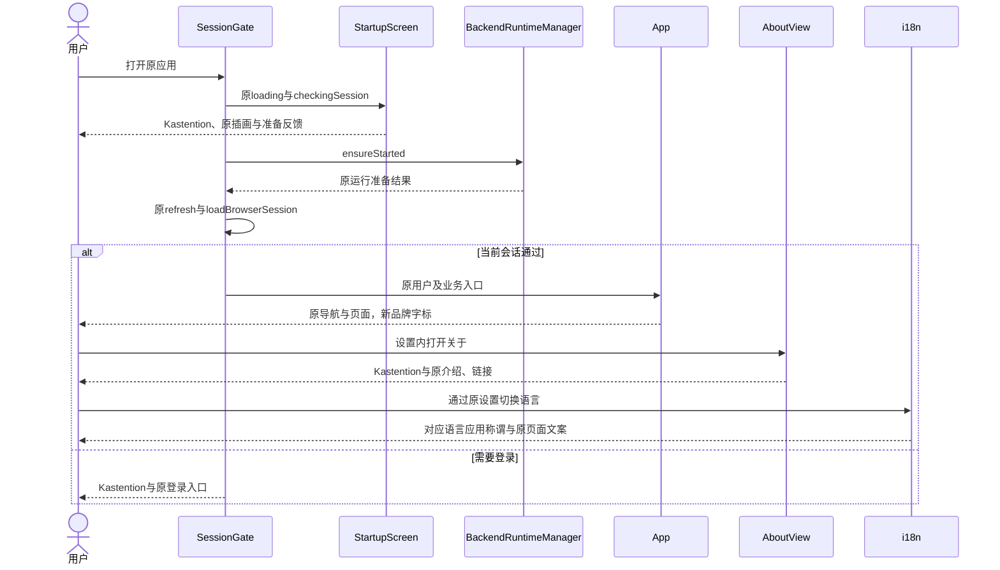
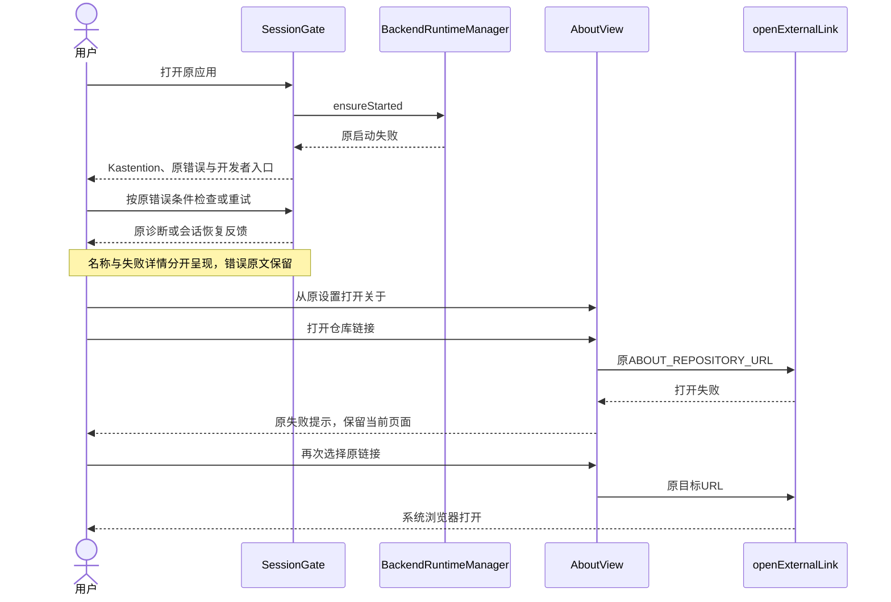

<!-- [Input] 应用名称PRD、现有i18next、SessionGate和Web/Native展示模块。 -->
<!-- [Output] 更名方案评审、展示清单、正常和异常恢复时序与实现对应。 -->
<!-- [Pos] 应用名称正式交互设计；页面骨架归app-brand PRD。 -->
<!-- [Sync] 2026-11-02: 选定共享名称常量及既有本地化资源，保持业务状态。 -->

# 应用名称交互设计

## 背景与问题

当前名称由i18next资源、JSX文本、网页元信息和原生属性分别持有，部分关于标题按字母拆分。更名需要覆盖实际呈现的完整文字。现有账户及运行流程继续服务同一应用。

## 目标与边界

采用Kastention与卡片结构，覆盖[产品需求](../../prd/mobile-app/app-brand.md)列出的展示位置。图标、主题、页面、操作和恢复沿现有合同。登录背景的内嵌名称更新为Kastention，沿原水彩构图与元素，保留原图。中文文案使用原语言选择；默认字标和系统名称使用英文。更名自身无业务状态转换，继续引用[启动交互](mobile-startup-interaction.md)及原页面状态。

## 概念与规则

### 发现、定义与方案评审

| 方案 | 当前依据与影响 | 评审结果 |
| --- | --- | --- |
| 分别修改原文案 | 多个页面含相同名称，后续维护仍需逐处核对 | 原生属性与静态出版物按各自入口修改 |
| 共享名称常量，复用i18next | 现有constants目录承载共享常量；i18next持有英中资源与原回退 | 选定；增加单一纯常量模块，现有组件直接消费 |
| 内部身份迁移 | Bundle ID与回调、私有容器、签名关联；名称展示可独立更新 | 保留原身份；迁移工作量与用户目标无依赖 |

核心问题限定为应用称谓一致性。评审结论：名称拼写明确；原组件与翻译资源可直接复用；更名无账户、回调、缓存、深链接或数据库变更需求。无新增设置、交互状态或确认。历史记录和外部来源按原身份保存。未核验的词源退出正式文案。

### 展示与实现

| 位置 | 当前展示 | 选定处理与反馈 |
| --- | --- | --- |
| StartupScreen、SessionGate、Native App页头 | Ink & Memory | 使用共享英文名称，原等待、错误和登录按钮保持 |
| StoryWorkspaceSidebar、AboutView两端 | 原字标与拆分字母标题 | 完整英文名称；沿原字号、字体、滚动和链接 |
| i18next设置、系统开发者、分享、权限文案 | Ink & Memory / I&M | 英文Kastention，中文卡片结构；原翻译键与工具参数保持 |
| AIInputDock、ChatView、通用技能来源 | Ask Ink & Memory / Ink & Memory | 默认提示与来源替换名称，输入和发送规则保持 |
| ThreadImageCard、exportThreadImage | 分享页脚与ink-memory文件前缀 | 新图片使用Kastention及kastention前缀；原内容与导出路径保持 |
| MCP回调页标题、MCP App iframe标题 | 旧品牌 | 可见标题使用Kastention；协议clientInfo.name保持原值 |
| RootLayout、seo_content | title、OG、JSON-LD、llms.txt | 更新品牌；原URL与爬取规则保持，图片沿更名后的登录背景 |
| 登录背景图 | 内嵌Ink & Memory文字 | 使用kastention-login-banner.png；登录与社交预览共用，原图保留历史 |
| iOS Info.plist、Android Manifest/分享标签 | 旧应用名 | 更新展示属性；包身份和系统资源名称保持 |
| 对外三份使用说明 | ink-dream | 正文与静态HTML同步为Kastention；草案状态和运营资料保持 |
| 现行UI规范 | v3.0及原字标示意 | 发布v3.1名称修订、SVG与源文件包；v3.0 PDF/ZIP保留历史 |

### 正常业务时序

### 异常与恢复时序

### 布局、无障碍与兼容

Kastention按完整单词展示。原字体、页头高度和导航结构保持；发生可测量裁切时只调整对应文字容器。应用无障碍标签同步完整英文名，中文权限提示保留原翻译参数。旧存储键、原数据目录、OAuth回调和事件名继续匹配原消费者；名称修改独立于业务失败。原始错误信息和历史内容保留来源文字。

## 验收矩阵

| 工作项 | 检查 | 通过条件 |
| --- | --- | --- |
| 名称资源 | 两种语言与默认回退 | 英文/中文拼写及原翻译参数一致 |
| 可见入口 | 原生准备/失败/关于、Web侧栏/关于、分享 | 完整名称、原操作入口、无横向溢出 |
| 原生元数据 | plist/XML读取 | 展示名更新；包标识、回调及权限属性保持 |
| 公开发现 | Web元信息与llms生成 | 名称一致，原URL与索引边界保持 |
| 文档出版 | Markdown、Mermaid、PDF与ZIP | 路径可达、图可渲染、19页布局完整、历史文件保留 |
| 设备与发布 | 实际制品采用 | 本轮独立列出，源码和隔离页面结果只覆盖对应技术范围 |
