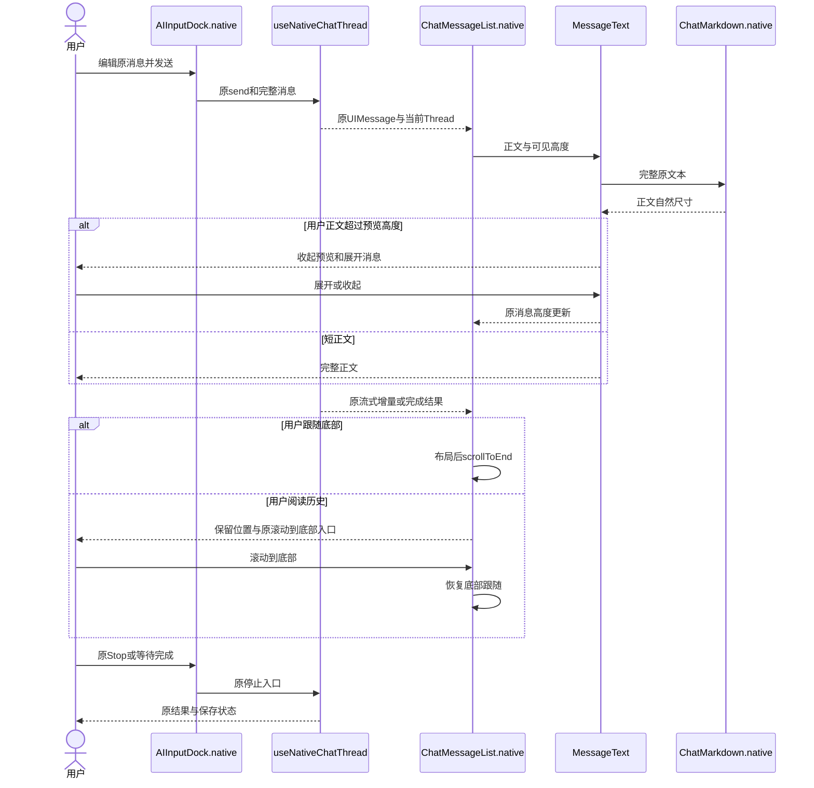
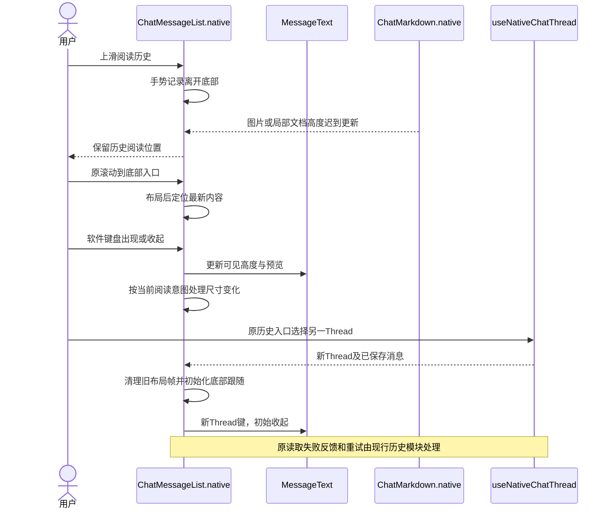
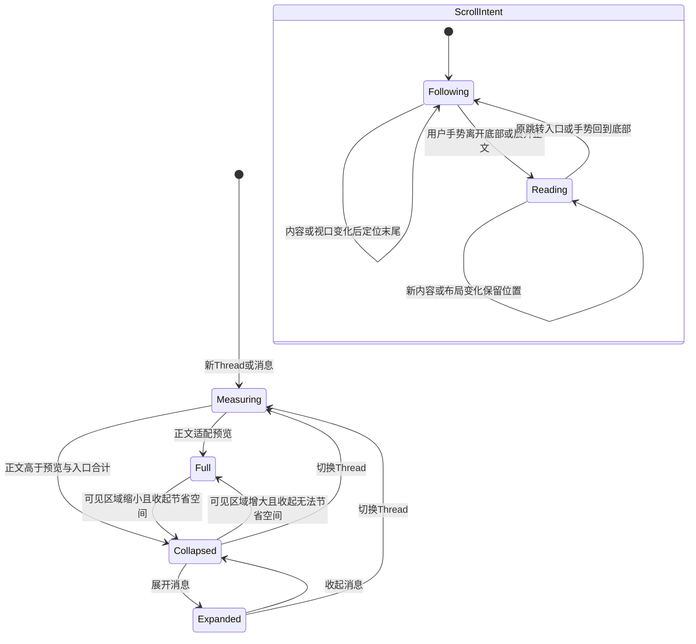

<!-- [Input] APP-06消息阅读PRD、原Native Markdown、消息列表与滚动实现。 -->
<!-- [Output] 消息预览测量、局部横滚、底部跟随的交互和状态合同。 -->
<!-- [Pos] Native Chat消息展示交互；原Web、业务Hook和HTTP协议保持。 -->
# Native对话消息阅读交互

## 背景与问题

原`MessageText`直接展示完整用户正文。`ChatMarkdown.native`代码和表格使用`ScrollView horizontal`；RN默认`flexGrow:1/flexShrink:1`参与父容器尺寸分配，需要核对紧凑内容测量。`ChatMessageList.native`沿滚动事件记录底部距离，布局变化与手势事件可能改变跟随意图。[执行记录](../../exec/app-experience-chat-rendering-20261103.md)区分源码事实、复现及验证。

## 目标与边界

沿`ChatPage.native`、`AIInputDock.native`、`useNativeChatThread`及原消息DTO工作。消息展示层持有预览状态；业务Hook持有提交、运行、Stop、保存与历史。局部Web文档继续承担原输入和Mermaid职责。共享Swift、图标、Admin、数据库及APP-04退出修改范围。

## 概念与规则

`MessageText`读取列表实测可见高度，完整正文使用内层`View.onLayout`测量。完整正文高于预览与44pt展开入口的合计高度时才收起，短屏下的短正文继续显示全文。裁剪外层通过`maxHeight`和`overflow:hidden`控制预览；内层保持自然尺寸，正文继续使用同一个`ChatMarkdown`。气泡最大宽度、现行文字和间距保持。展开入口使用双语文案、`accessibilityState.expanded`与44pt触摸高度。键由原Thread、`messageMergeKey`及正文part确定。

普通代码和表格的横向`ScrollView`显式关闭纵向flex伸缩，内容按顶部对齐，代码`Text`保留原空白与长行。纵向手势由外层消息列表持有。Mermaid继续由原局部文档处理。

消息列表以用户手势更新阅读意图；布局引起的偏移事件更新几何。展开用户正文时进入阅读状态，保持当前可见边界。处于跟随状态时，内容/视口变化后沿原`scrollToEnd`到达末尾；用户主动离开底部后展示原跳转入口。请求调度在下一次布局帧执行，Thread切换或组件卸载清理旧帧。`maintainVisibleContentPosition`继续保护历史读取位置。

## 正常业务时序

## 异常与恢复时序

## 状态转换

## 方案评审与交付

| 评审项 | 判断与选择 | 验证归属 |
| --- | --- | --- |
| 长文本展示 | 使用实测视口和原Markdown裁剪，排除字符截断和固定业务字数 | 原组件测量、全文复制及切换Thread |
| 代码尺寸 | 局部横滚按实际高度布局，保留原生正文和Mermaid局部文档 | Chrome尺寸与Hermes实际触摸 |
| 滚动 | 原列表区分用户手势和布局变化，复用原底部判断与跳转入口 | 流式、键盘、异步高度及历史阅读 |
| 页面规范 | 保留原字号、圆角、间距和输入/栏目关系 | v3.1第6、8、11页及深浅色截图 |
| 范围 | UI层最小修复；复用原业务Hook及公开协议 | provider-free完整旅程；真实模型、真机及发布独立登记 |

方案通过最小范围评审。实现、技术验证、Simulator结果及剩余资格由[独立执行记录](../../exec/app-experience-chat-rendering-20261103.md)维护；PRD页面骨架归[消息阅读PRD](../../prd/chat/message-reading.md)。
