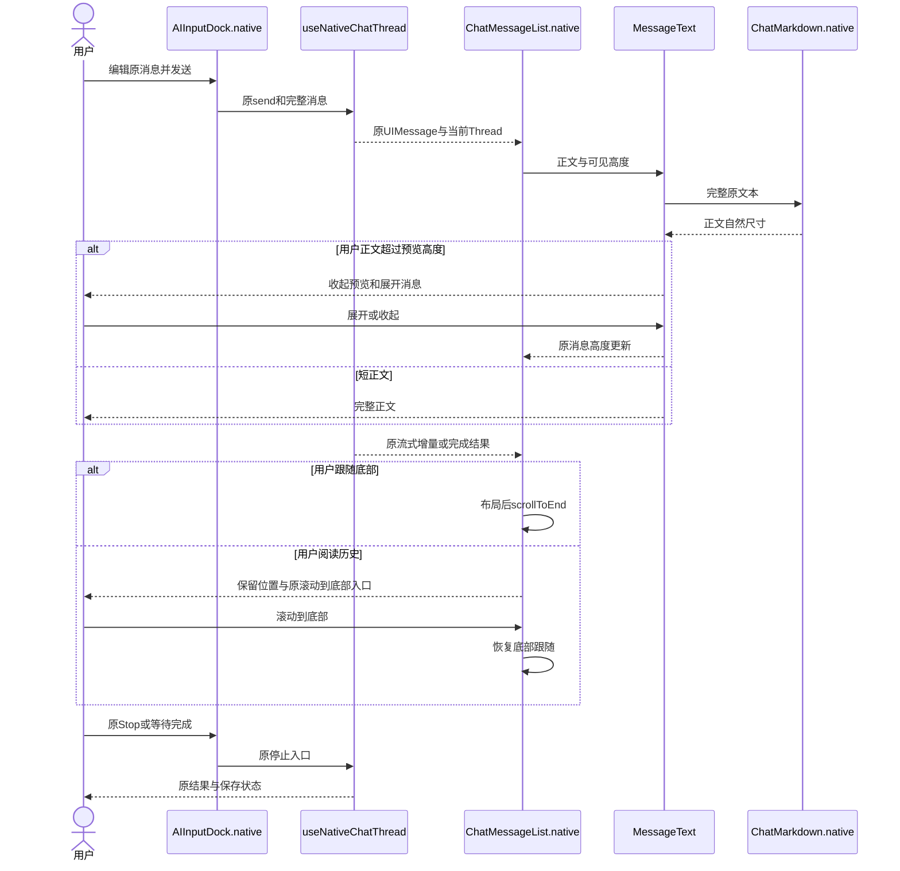
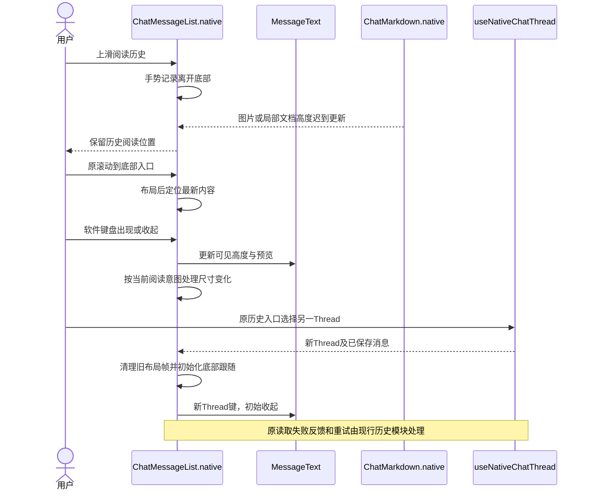
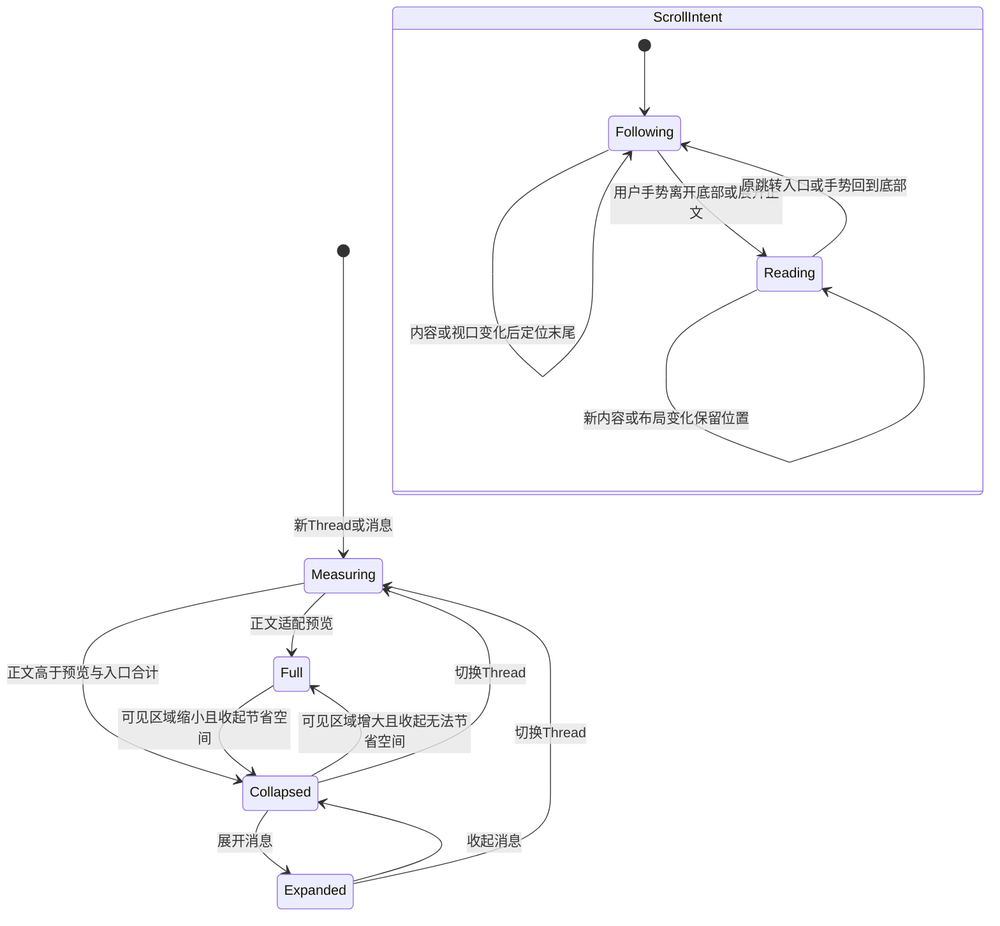
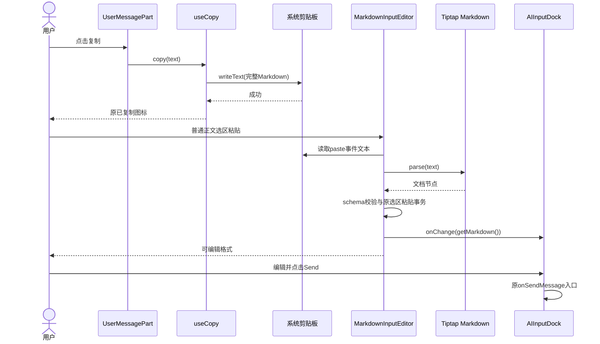
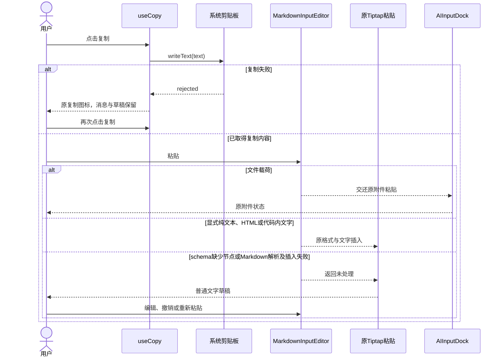
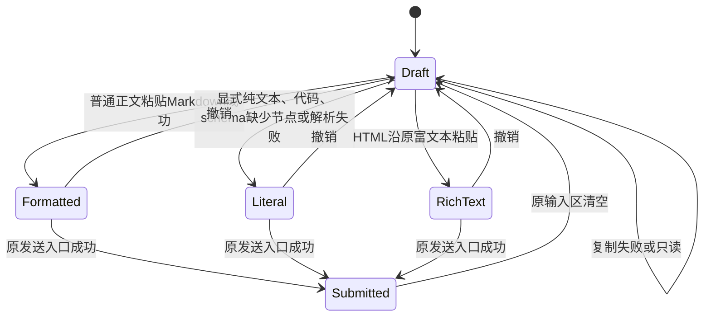

<!-- [Sync] 2026-11-08: 补充共享Markdown输入的剪贴板解析、原插入事务、失败恢复及状态图。 -->
<!-- [Input] 消息阅读PRD、原Native Markdown、消息列表、共享MarkdownInputEditor与复制实现。 -->
<!-- [Output] 消息预览测量、局部横滚、底部跟随及共享输入粘贴的交互和状态合同。 -->
<!-- [Pos] Native Chat消息展示及共享Markdown输入交互；业务Hook和HTTP协议保持。 -->
# Native对话消息阅读交互

## 背景与问题

原`MessageText`直接展示完整用户正文。`ChatMarkdown.native`代码和表格使用`ScrollView horizontal`；RN默认`flexGrow:1/flexShrink:1`参与父容器尺寸分配，需要核对紧凑内容测量。`ChatMessageList.native`沿滚动事件记录底部距离，布局变化与手势事件可能改变跟随意图。[执行记录](../../exec/app-experience-chat-rendering-20261103.md)区分源码事实、复现及验证。

## 目标与边界

沿`ChatPage.native`、`AIInputDock.native`、`useNativeChatThread`及原消息DTO工作。消息展示层持有预览状态；业务Hook持有提交、运行、Stop、保存与历史。局部Web文档继续承担原输入和Mermaid职责。共享Swift、图标、Admin、数据库及APP-04退出修改范围。

## 概念与规则

`MessageText`读取列表实测可见高度，完整正文使用内层`View.onLayout`测量。完整正文高于预览与44pt展开入口的合计高度时才收起，短屏下的短正文继续显示全文。裁剪外层通过`maxHeight`和`overflow:hidden`控制预览；内层保持自然尺寸，正文继续使用同一个`ChatMarkdown`。气泡最大宽度、现行文字和间距保持。展开入口使用双语文案、`accessibilityState.expanded`与44pt触摸高度。键由原Thread、`messageMergeKey`及正文part确定。

普通代码和表格的横向`ScrollView`显式关闭纵向flex伸缩，内容按顶部对齐，代码`Text`保留原空白与长行。纵向手势由外层消息列表持有。Mermaid继续由原局部文档处理。

消息列表以用户手势更新阅读意图；布局引起的偏移事件更新几何。展开用户正文时进入阅读状态，保持当前可见边界。处于跟随状态时，内容/视口变化后沿原`scrollToEnd`到达末尾；用户主动离开底部后展示原跳转入口。请求调度在下一次布局帧执行，Thread切换或组件卸载清理旧帧。`maintainVisibleContentPosition`继续保护历史读取位置。

## 正常业务时序

## 异常与恢复时序

## 状态转换

## 方案评审与交付

| 评审项 | 判断与选择 | 验证归属 |
| --- | --- | --- |
| 长文本展示 | 使用实测视口和原Markdown裁剪，排除字符截断和固定业务字数 | 原组件测量、全文复制及切换Thread |
| 代码尺寸 | 局部横滚按实际高度布局，保留原生正文和Mermaid局部文档 | Chrome尺寸与Hermes实际触摸 |
| 滚动 | 原列表区分用户手势和布局变化，复用原底部判断与跳转入口 | 流式、键盘、异步高度及历史阅读 |
| 页面规范 | 保留原字号、圆角、间距和输入/栏目关系 | v3.1第6、8、11页及深浅色截图 |
| 范围 | UI层最小修复；复用原业务Hook及公开协议 | provider-free完整旅程；真实模型、真机及发布独立登记 |

方案通过最小范围评审。实现、技术验证、Simulator结果及剩余资格由[独立执行记录](../../exec/app-experience-chat-rendering-20261103.md)维护；PRD页面骨架归[消息阅读PRD](../../prd/chat/message-reading.md)。

## 消息复制与输入区粘贴

### 发现与方案选择

`UserMessagePart → useCopy → navigator.clipboard.writeText(text)`已经复制完整Markdown。`MarkdownInputEditor`的初始化与外部草稿回写显式指定`contentType: 'markdown'`；普通剪贴板文本沿Tiptap默认粘贴，格式标记进入文字节点并在`getMarkdown()`中转义。

修复入口选为原编辑器的`editorProps.handlePaste`，复用现有Markdown解析器及ProseMirror粘贴事务。消息复制继续输出原文。排除修改复制载荷、替换整份草稿及新增解析器：这些方案分别扩大剪贴板协议、覆盖选区外内容或重复维护已有语法。`insertContent`采用闭合块插入；段落中间粘贴使用原开放切片和选区替换，保持原段落。

### 调用与边界

1. 编辑器可编辑、剪贴板含文本、文件及HTML载荷为空、当前选择位于普通正文时，由`editor.markdown.parse`解析原文，按原编辑器schema生成并校验文档节点。
2. `Slice.maxOpen(document.content)`生成开放切片；原`replaceSelection`事务插入节点，保留段落中选区外文字和原块结构。`closeHistory`将本次粘贴与之前编辑分组，事务携带原`paste/uiEvent`元数据，触发原`onUpdate → getMarkdown → onChange`。原草稿状态与发送入口接收序列化Markdown，撤销沿Tiptap历史执行。
3. `transformPastedText`记录原ProseMirror的显式纯文本标记，文本内容保持原样。文件粘贴返回原`AIInputDock.handlePaste`附件处理；显式纯文本、HTML、代码块和行内代码沿原Tiptap粘贴。只读编辑器保持原内容。
4. 先用同一marked实例识别table、image和task list item；对应schema节点缺失时交还原文字粘贴，保留整份原文。解析或选区替换抛错时沿同一恢复方式处理。新增处理没有错误弹窗、额外提交或业务接口。
5. Web及`MarkdownInputDocument`共用此组件；Native桥接、文档身份、revision和草稿所有权保持。桌面与窄屏使用同一插入逻辑。
6. `@tiptap/pm`声明为直接依赖，复用锁文件已有版本；ProseMirror schema、切片和历史均来自原Tiptap运行库。

### 正常业务时序

### 异常与恢复时序

### 草稿状态转换

以下状态描述原编辑器的内容变化，运行时沿原草稿与Tiptap历史持有状态。

### 验证归属

`AIInputDockSlashMenuRegression.test.ts`以生产`UserMessagePart`和`AIInputDock`执行系统剪贴板旅程，覆盖1440px、390px、再次复制后的序列化稳定性、选区替换、撤销、显式纯文本、代码原文与HTML，以及表格、图片和任务列表的原文保留。其mock边界仅含原配置、存储能力及Skill目录读取，业务数据库与模型退出验证范围。移动应用设备剪贴板及正式发布需独立取得证据。

本机headless Chrome普通粘贴由系统快捷键触发。显式纯文本使用按住Shift后的受控paste事件和系统剪贴板内容，核对原ProseMirror纯文本解析分支；本机headless Chrome的纯文本快捷键未产生paste事件，系统菜单快捷键资格独立保留。
