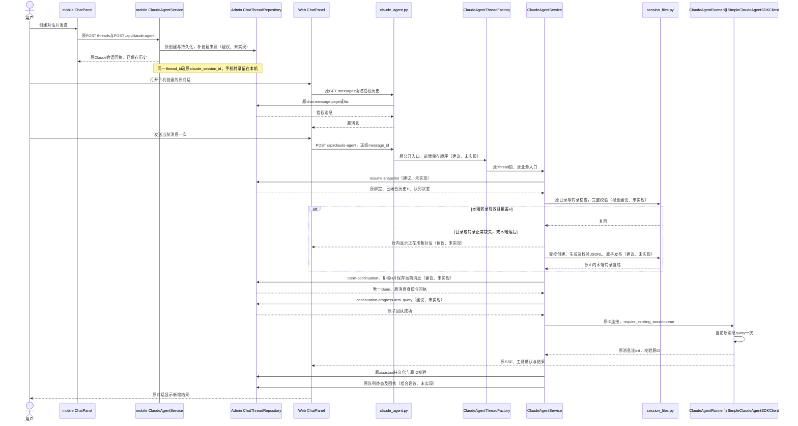
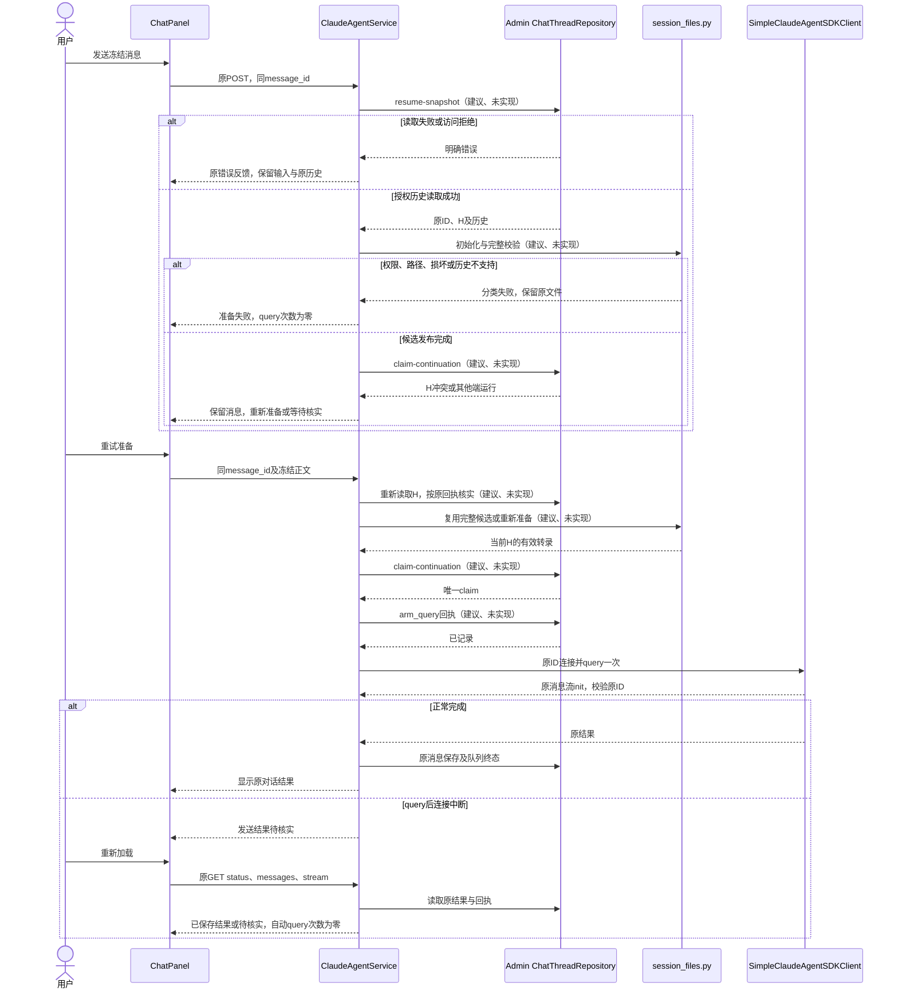
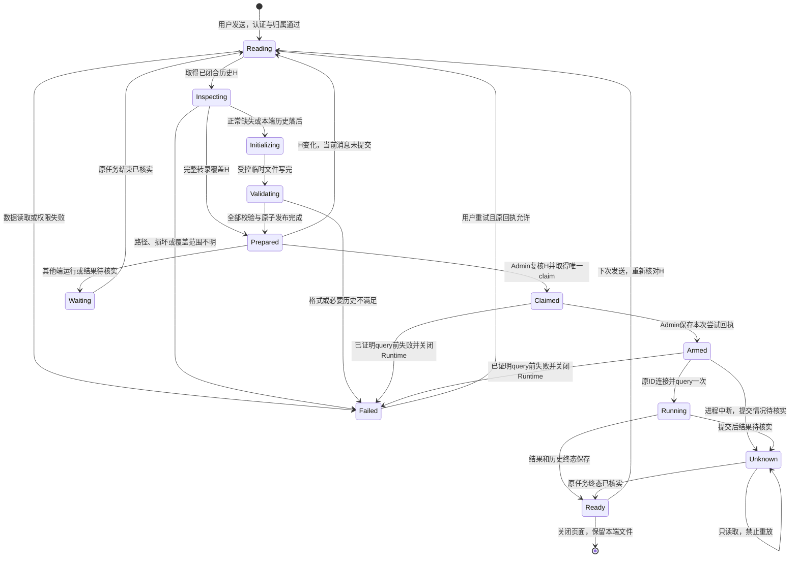
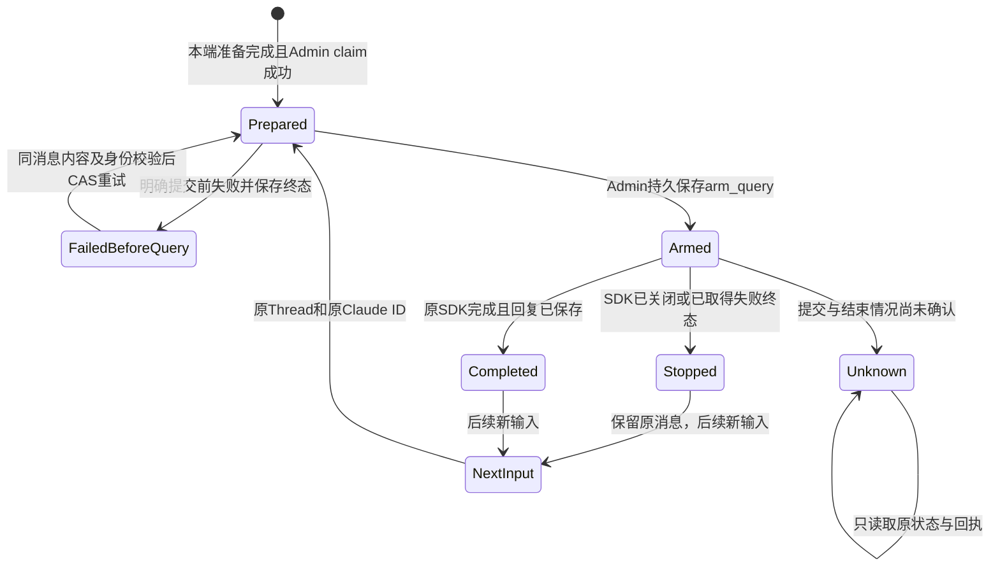

<!-- [Sync] 2026-11-08: Simulator40与本机服务采用，正常模型验收及旧未知队列回执保持待完成。 -->
<!-- [Sync] 2026-11-08: 追加0086及接口正常发布状态，先行设计和源码回执原文保留。 -->
<!-- [Sync] 2026-11-04: 实现同一Thread与Claude会话跨端恢复，发布采用及真实业务验收单列。 -->
<!-- [Input] 双仓库当前恢复与Admin持久化代码、已安装SDK/Runtime及同一会话跨端要求。 -->
<!-- [Output] 根因判断、JSONL协议映射、最小交互方案、失败恢复、评审及后续验收计划。 -->
<!-- [Pos] 正式跨端Chat交互设计；产品规则归docs/prd/chat/cross-platform-continuation.md。 -->
<!-- [Sync] 2026-11-04: 只读源码调查与文档交付；新增行为均为建议、未实现。 -->

# mobile创建的对话在Web继续

> 当前源码状态见文末“2026-11-04代码实现”及[实施记录](../../exec/cross-platform-chat-continuation-20261104.md)。先行设计、源码调查及其当时验证原文保留；发布与设备采用分别登记。

## 背景与问题

### 判断与证据范围

**直接根因为当前端精确项目目录缺少可用于恢复的原会话转录，Service在SDK连接前终止。** 目录创建与转录就绪分别判断；创建工作目录只建立执行容器。Admin消息历史目前未接入JSONL初始化。

本轮开始时Dream与Admin的`git status --short`均为空。调查只读取两仓库和本机已安装Runtime代码，未读取真实对话正文、凭据或实际工作区，未运行SDK、模型、数据库迁移与部署。因此下表确认代码分支；具体出错对话的物理文件状态仍需后续授权验收。

| 核对项 | 当前代码事实与证据 |
| --- | --- |
| 工作目录 | Workspace Mode开启时，`assemble_context`先调用`get_or_create_workspace(state.session_id)`并设置cwd及config home，再检查resume：[service.py:1911–1938](../../../backend/claude_agent/service.py#L1911)。目录创建失败会提前结束；能到达转录缺失分支表示本次代码已通过前置创建。 |
| 最小运行目录 | Mode关闭时只创建Thread runtime根和`.claude-tmp`，保留既有cwd/config选择：[service.py:2036–2057](../../../backend/claude_agent/service.py#L2036)、[workspace.py:557–580](../../../backend/libs/claude_agent_kit/server/workspace.py#L557)。初始化不得借此开启Workspace Mode。 |
| 具体失败检查 | `_thread_record`取得绑定；`locate_resumable_session(candidate_session_id,cwd,config_home)`返回空时抛出`CLAUDE_RESUME_TRANSCRIPT_UNAVAILABLE`：[service.py:2147–2184](../../../backend/claude_agent/service.py#L2147)。这里没有历史读取或JSONL生成分支。 |
| 当前预检强度 | UUID、cwd、config路径、逐层no-follow、普通文件及第一条合格主链记录的`sessionId`校验：[session_files.py:121–200](../../../backend/libs/claude_agent_kit/server/session_files.py#L121)。找到第一条即返回，后续行、父链、工具配对与Runtime反序列化尚未全部验证。 |
| 缺失与故障 | 文件路径不存在或没有合格记录返回空；非法cwd、会话ID不符、非普通文件、读取故障分别抛错。JSON解析、权限及部分符号链接故障当前汇入`CLAUDE_RESUME_STORAGE_UNAVAILABLE`。空文件与只有元数据的文件当前同样返回空，实施时需区分受控中断残留与损坏。 |
| 会话身份 | 已绑定Thread拒绝`resume=false`及不可用合同；Runner设置`require_existing_session`；SDK adapter禁止bound Thread fresh fallback；init返回其他ID失败：[service.py:2155–2165](../../../backend/claude_agent/service.py#L2155)、[service.py:2328–2329](../../../backend/claude_agent/service.py#L2328)、[simple_cas_client.py:119–144](../../../backend/libs/claude_agent_kit/server/simple_cas_client.py#L119)、[service.py:3220–3246](../../../backend/claude_agent/service.py#L3220)。 |
| 当前持久化顺序 | 普通POST在构造RunRequest前已经执行`persist_user`：[claude_agent.py:1479–1526](../../../backend/routers/claude_agent.py#L1479)。恢复失败仍可能留下本次用户记录；新方案必须显式处理这类旧记录。 |
| 历史与来源 | `chat_thread`无创建端字段和通用metadata；`chat_message`保存role、parts、metadata、时间及final投影：[Admin dream.ts:606–665](../../../../ink-admin-memory/packages/db/src/schema/dream.ts#L606)。当前创建DTO仅有deck、voice、title：[chatThreadDto.ts:16–39](../../../../ink-admin-memory/app/lib/dream/chatThreadDto.ts#L16)。设备授权表用于认证，无法代表每个Thread的创建来源。 |
| 历史排序 | 完整消息按`created_at ASC NULLS FIRST,id ASC`读取；分页采用final投影，completed assistant可省略parts：[chatThreadRepository.ts:50–57](../../../../ink-admin-memory/app/lib/dream/chatThreadRepository.ts#L50)、[199–224](../../../../ink-admin-memory/app/lib/dream/chatThreadRepository.ts#L199)。时间与ID排序提供展示全序，无法单独证明跨端因果顺序。 |
| 历史信息损失 | `_sse_events_to_ui_parts`把工具调用和结果合并成一个part，reasoning保留文本；未保留每条原生消息uuid、assistant message.id、父链、thinking签名及完整原生block边界：[service.py:3483–3494](../../../backend/claude_agent/service.py#L3483)、[3960–4036](../../../backend/claude_agent/service.py#L3960)。metadata保存turnId、compaction/context信息和部分终态：[service.py:3281–3294](../../../backend/claude_agent/service.py#L3281)。 |
| 两端运行位置 | iOS设置本机`AGENT_CWD`：[ios.py:145–160](../../../backend/mobile_runtime/ios.py#L145)。共享界面的请求由本机bridge承接：[mobileRuntimeTransport.ts:180–193](../../../frontend/app/_dream/platform/mobileRuntimeTransport.ts#L180)；Web继续现有后端。 |
| 现有并发保护 | Factory持有进程内Thread锁：[thread_factory.py:411–480](../../../backend/claude_agent/thread_factory.py#L411)。Admin队列claim在owner Thread行锁内拒绝另一条dispatching：[chatThreadRepository.ts:248–280](../../../../ink-admin-memory/app/lib/dream/chatThreadRepository.ts#L248)；普通首次POST尚未统一进入该队列。 |

### 已锁定与已安装协议

Dream锁定Python包`ink-claude-dream-agent-sdk==0.2.145`，当前虚拟环境安装版本相同；Runtime常量为`0.1.12`：[pyproject.toml:35](../../../backend/pyproject.toml#L35)、[sdk_env.py:122](../../../backend/libs/claude_agent_kit/server/sdk_env.py#L122)。本机PATH中的`ink-claude-code-dream`解析到已安装`@glide-the/ink-claude-code-dream@0.1.12`。该事实描述本机安装，Web部署及手机包内采用版本需在实施验收时各自核对。

下列路径以本机安装目录为证据，固定到实际bundle，避免用相邻Runtime仓库的同版本源码替代安装证据。定义安装根`R`为：

```text
/Users/dmeck/.nvm/versions/node/v24.13.0/lib/node_modules/@glide-the/ink-claude-code-dream/node_modules/@glide-the/ink-claude-code-dream-darwin-arm64/runtime/lib/core/chunks
```

| 当前安装代码 | 协议事实 |
| --- | --- |
| `R/cli-2grhchx3.js:92871–92882,94568–94604` | 从config home的projects与当前canonical cwd编码目录读取`<claude_session_id>.jsonl`；UUID resume调用`getLastSessionLog`。 |
| `R/cli-8ynxef92.js:3710–3715` | 项目编码替换非ASCII字母数字；长路径采用截断与Bun.hash／Node simpleHash分支。复用Dream现有平台适配，禁止复制新的编码算法。 |
| `R/cli-2grhchx3.js:94422–94470,93770–93790` | JSONL按uuid入Map；用有效timestamp选择最后主链记录，再沿parentUuid回溯；重复uuid覆盖、断链和环可能丢上下文，必须在写入前严格拒绝。 |
| `R/print-r4cddjgt.js:2539–2572,7298` | `loadConversationForResume`读取历史并反序列化，恢复为空会报missing；文件存在和Dream预检通过均无法证明完整恢复成功。 |
| `R/print-r4cddjgt.js:2439–2505,5834` | Runtime过滤未闭合工具及孤立thinking，检测末尾未完成user/tool结果；特定env可自动继续中断轮次。只导入已闭合边界，初始化禁止开启历史自动续跑。 |
| `R/cli-2grhchx3.js:89355–89465,93284` | 原生user包含role/content；合成assistant包含message.id、model、role、type、stop字段、usage/content等；存储另加parentUuid、sessionId、cwd等。合成记录可按协议生成，真实恢复资格待测。 |

[官方Session文档](https://code.claude.com/docs/en/agent-sdk/sessions)说明按ID恢复及对话与工作文件分别持久化。本文JSONL字段与精确目录规则依据上述`0.1.12`安装代码；当前官方最新版的跨目录搜索或外部存储能力保持独立版本边界。

## 目标与边界

同一`thread_id`持续表示业务对话；原`claude_session_id`持续表示Claude会话。Web云端与mobile本地分别持有自己的cwd、config home、JSONL及运行实例。正常缺失先在当前端初始化，再用原ID恢复并提交本次消息。

本轮交付为问题判断、交互设计和评审。代码、依赖、migration执行、部署及真实模型调用均留待后续。工作文件同步、离线数据库、设备注册平台、第二套会话框架和任务执行权的自动跨端接管退出范围。

### 发现、定义与方案选择

发现依据为用户目标、现行[恢复合同](../claude-agent/claude-session-resume-resolution.md)、[持久化设计](../claude-agent/claude-agent-session-persistence.md)、上表源码及安装包。问题收敛为“共享历史具备授权读取，本端Runtime转录缺失”，同时存在来源缺项、历史转换损失和跨进程发送互斥缺口。

| 必要方案 | 判断与选择 |
| --- | --- |
| Admin已保存的完整parts转换JSONL，恢复原ID | **首选候选**。利用现有历史，改动最小；先证明可支持的历史类型、上下文充分性和Runtime实际加载。历史存在信息损失，当前无法给出全量可恢复承诺。 |
| 将原生恢复记录追加保存在既有消息metadata，再初始化本端JSONL | 作为首选验证失败后的明确补充依赖。保持原消息和ID，保存恢复必需的原生block、uuid/父链/顺序，采用版本化字段；历史缺失数据保持待确认。只有实测证明必要的字段才加入，禁止顺带同步工作文件或凭据。 |
| 读取原设备文件、复制完整工作区 | 依赖原设备在线及文件传输，本期排除。 |
| 仅把历史文本放入当前prompt | 无法满足优先验证的原JSONL恢复协议，本期排除。 |
| 每端分配Claude ID或复制Thread | 违反固定业务定义，排除。 |

交付收敛为：**现有恢复入口内增加按需JSONL初始化；Admin补最小来源记录，并复用消息队列与回执承载跨端发送保护。** 首选的数据映射若无法通过资格验证，停止该类历史的跨端提交，补齐必需恢复数据后再验收。

## 概念与规则

### 对象与生命周期

| 对象 | 所有权与生命周期 |
| --- | --- |
| Thread与共享历史 | Admin按原用户持有；创建、删除与现有业务一致。创建来源在创建事务写一次，后续端切换保持。 |
| Claude会话ID | 首轮原SDK回执写入Admin；之后初始化、重开、重试、端切换均保持。`fork_session`关闭，bound Thread的fresh fallback关闭。 |
| 两端工作区 | 各执行端依配置解析`AGENT_CWD/thread_id`及原Mode规则，分别创建和保留；任何客户端cwd都无法选择任意路径。 |
| JSONL | 当前端config home的精确项目路径保存同ID转录；生命周期跨单次请求及运行实例。原端未参与本轮时，其文件与转录保持原状。 |
| Runtime实例 | 由当前端Factory/Runner创建、复用或释放；进程终止只结束本端运行实例。重启后读取同一绑定和持久转录。 |
| 一次发送 | 冻结`message_id`、正文、附件与请求回执身份；准备、claim、query、结算分别记录。同一消息成功提交的query次数至多一次。结果不确定时保留记录并只读取核实。 |
| 准备状态 | 当前端工作区与快照范围内的技术状态；无新业务会话表。JSONL有效且覆盖当前已确认历史时继续复用。 |

### 创建来源：一个字段

建议、未实现：Admin `chat_thread.created_execution_origin`为nullable受约束text，非空集合为`web_cloud/mobile_ios/mobile_android`；NULL表示旧记录或无法确定。字段记录创建执行端类别，本期不采集硬件ID、安装ID或设备名称。

创建端Dream根据其服务器／原生宿主所有的执行拓扑与平台上下文提供值，Admin在原Thread创建事务保存。来源记录属于执行端声明；来源本身无硬件证明能力。禁止从用户prompt、请求cwd、最近发送端或认证设备表推断来源。新增版本化create DTO及操作合同，保留既有冻结descriptor；旧客户端创建写NULL，历史记录不按推测回填。覆盖普通新建及复用相同创建持久化入口的其他业务创建路径。

新增字段由Admin `packages/db/src/schema/dream.ts`与前向Drizzle migration管理，建议capability `dream.chat-thread-origin.v1`，名称尚未发布。先expand并发布capability，再让Dream消费；缺少该能力时新增来源写入失败并保留草稿。Dream无DDL。Admin详情投影展示创建来源，Chat页面保持原布局。OAuth、服务委托、owner过滤及资源校验保持原职责。

选择Thread字段的必要性：首条消息metadata无法覆盖空Thread，也无法稳定表达Thread创建时的来源。消息metadata继续承载既有消息语义及确有必要的恢复数据。

### JSONL字段与历史映射

下表为**拟议映射**。所有输出按`0.1.12`格式版本生成，完整读取器验证通过后才可发布；禁止直接把UI parts逐行写成JSONL。

| JSONL字段／数据 | 来源与生成规则 | 缺口与准入条件 |
| --- | --- | --- |
| `sessionId`、文件名 | Admin授权Thread原`claude_session_id`，每条主链记录及文件名一致 | ID缺失沿首次会话路径；已绑定且非法或合同不兼容明确失败。 |
| `uuid` | 原生metadata存在时使用原值；普通历史可按版本固定的UUIDv5规则，由`thread_id/session_id/message.id/展开序号/角色`生成 | UI message.id与Runtime uuid保持各自用途；生成值只标识本端恢复记录。命名空间和格式版本由服务端适配模块持有，重试稳定。 |
| `parentUuid`、`isSidechain` | 完整展开后的主链首条parent=null，后续指向前一条，`isSidechain=false` | 不按显示分页猜父链；不导入子智能体为主链；有分支或顺序歧义时拒绝。 |
| `type`、`message.role/content` | user正文→user text blocks；assistant正文→assistant text blocks，保持全部明确文本及次序 | final投影只供页面显示，恢复读取完整parts；未知part不能静默丢弃。 |
| `timestamp` | 有效历史时间加确定的展开序号，保证主链严格递增并保留原时间映射 | Runtime按timestamp选末条；同时间或NULL使用已确认因果全序产生逻辑时间。仅按UUID排序无法确认因果时拒绝。 |
| assistant `message.id/type/model/stop_reason/stop_sequence/usage/container/context_management` | 原生记录完整时直接采用；普通文本候选参照Runtime合成assistant结构，model为`<synthetic>`，usage为格式占位零值 | 占位数据只用于读取格式；禁止写入Gateway、账本、真实模型来源或用量统计。工具消息的stop字段需按tool_use结构形成并验证。 |
| `cwd`、版本及存储envelope | 当前端规范化cwd与当前Runtime适配；保留原ID | 原设备路径仅存在历史正文中，无法成为当前文件访问授权。 |
| `tool_use` | `tool-invocation.toolCallId/toolName/input`→assistant block的`id/name/input` | 同ID唯一，工具名与参数完整；`providerExecuted`的宿主操作需要原生记录证明其协议角色。 |
| `tool_result` | 已闭合invocation的output与错误状态→user block的`tool_use_id/content/is_error` | 输出已有字符串可直接映射；结构输出需验证对应原生block，禁止任意转成字符串并宣称等价。每个结果必须有唯一对应调用。 |
| reasoning／thinking | UI reasoning缺少签名；普通文本候选不生成thinking blocks，保留明确用户／助手文本与闭合工具上下文 | 这会缺少原生思考过程，必须验证必要上下文仍充分；要求保留签名或原模型约束的历史需补原生记录，禁止伪造签名。 |
| 图片、附件、MCP资源及压缩记录 | 只使用授权仍有效且当前端可取到的原生内容引用；必要时读取既有上传存储 | UI展示URL、compaction统计和本地路径无法补出二进制、压缩摘要、content replacement或原生block。缺少必要内容明确失败。 |

首批候选验证范围为已完成、顺序明确的纯文本轮次，以及原生数据足够证明配对和顺序的闭合工具轮次。工具part将output合并到调用位置，平行工具和交错输出可能失去原始时序；无法证明的历史进入`HISTORY_UNSUPPORTED`，补存原生记录为实施依赖。完成标记缺失、partial、错误后未闭合工具、排队待发、技术消息与旧恢复失败产生的孤立user均需显式分类；禁止为凑齐交替角色编造回复或自动重放。

**结论：Admin历史具有文本及部分工具信息，当前无法证明足以重建所有可恢复JSONL。** 适配可生成的标识与envelope属于格式数据；正文、工具输入输出、签名、压缩内容及因果关系的缺失无法通过生成标识弥补。

### 历史一致性与最小接口增量

继续复用公开`POST /api/claude-agent`、`GET /api/claude-agent/threads/{thread_id}/messages`、status／stream与原输入区。新增行为位于`ClaudeAgentService`装配恢复位置、`session_files.py`存储适配及现有Admin Chat Repository，新增独立会话服务数量为零。

建议追加三个内部领域操作，均**建议、未实现**；使用Admin既有DTO、owner/委托、事务、操作注册和原request_id回执。它们服务于下列原子边界，公共新页面和恢复HTTP端点数量为零：

| 建议操作 | 最小输入输出与必要性 |
| --- | --- |
| `chat-message.resume-snapshot` | 输入Thread及当前message_id；Admin在一个一致读取事务中取得绑定、合同、完整parts及必要元数据、队列状态，输出有序已闭合历史和`history_digest`。摘要包含绑定及全部被纳入的message身份、原内容和顺序。读取失败返回失败；当前消息、待发队列、未提交结果全部排除。单一事务复用完整查询，避免分页跨事务拼接。 |
| `chat-input.claim-continuation` | 输入同一message_id、冻结parts/metadata、预期绑定及`history_digest`。Admin锁owner Thread，重新检查历史摘要与活动输入，原子复用现有enqueue、消息幂等保存、claim；返回原queue entry、revision、dispatch_turn_id及原请求回执。摘要变化返回冲突并重新准备；已有相同消息只返回状态，已消费消息禁止再次query。 |
| `chat-input.continuation-progress` | 输入精确message/dispatch_turn/revision及`arm_query`或终态结果。复用queue transition和原子操作回执；`arm_query`先持久记录“将尝试query”，成功后当前持有者调用query一次；终态记录准备阶段失败、完成、失败或结果未确认。回执兼作安全重试判定，新增队列框架数量为零。 |

普通发送、运行中队列消费及后台既有发送入口都必须遵守同一Thread活动claim检查，保持现有队列选择、取消、admission与SSE语义。`dispatching`及尚未核实的`state_unknown`均阻止另一端query；现有原始claim只检查dispatching，实施需收紧全部相关入口。进程内锁继续负责本端调度。启用前须完成相关入口升级及原活跃任务排空；Admin在旧的直接用户消息保存入口拒绝绕过continuation claim的已绑定Thread新请求，并让新组合操作复用Repository内部保存方法。旧客户端得到明确的升级／恢复失败反馈并保留输入。普通v1创建读取兼容与执行claim要求分别发布；保留旧写入口无限制启动的部署无法满足本方案并发前提。

`arm_query`回执使用服务器可重建的原请求键，读取与写入绑定同一用户、Thread、message和turn；重放只返回原结果。只有首次取得claim的存活调用者可进入Runner；重复claim、arm或原请求回执只返回原状态，不授予第二次运行权。arm写入响应丢失时先读取核实，原运行者及提交事实无法确认时保持state_unknown。进程在arm前后退出而没有终态证明时进入结果待核实，禁止超时自动接管。已取得关闭Runtime且query从未调用的明确终态回执时，可通过同一message_id在原行上CAS重试、推进revision并保留旧尝试回执；已arm且缺少上述终态证明、或结果未知时，只能读取核实。Admin既有回执表和队列表承载这些事实；实施需验证回执查找及原子性，能力不足时停止并提交明确的Admin前向扩展。

新操作追加版本化descriptor及capability声明，保留已发布合同；其发布及各执行端采用为功能前提。全套必要操作用于共享历史快照、跨端一次claim及不可重放边界，均直接对应本需求。

### 文件初始化、消息保存与提交顺序

1. 原入口认证、Thread owner、Deck／附件与权限检查。打开历史只读取；首次发送冻结内容及message_id，草稿保持。
2. 本端Factory原Thread锁内解析服务端工作区。复用原目录创建、config home和`.claude-tmp=0700`规则；逐层验证路径与符号链接，文件操作继续no-follow。Mode关闭保持原边界。
3. 取得上述Admin一致历史快照H。原端活动或结果未确认时只展示反馈。当前message_id排除；旧版本已保存的同ID孤立user只有在原请求明确未query且正文完全匹配时才可作为当前重试，否则返回结果待核实。
4. 对精确项目的本端JSONL执行完整结构、ID、主链、timestamp、工具配对和内容范围校验。存在且覆盖H的有效记录沿原流程复用；正常缺少目录／文件进入初始化。已存在的有效记录落后于H时，同一次发送先补齐已完成历史，禁止带过期上下文query。
5. 初始化只在本端执行。以owner/thread/session/canonical cwd为范围取得跨进程文件锁；锁覆盖候选发布及本次SDK写入生命周期。锁内重新检查，其他创建者已完成且H一致时直接复用。临时文件以独占创建及0600写在同一受控目录，写完整、flush/fsync，校验后原子发布；目录保持0700。普通工作文件、认证和权限文件保持。
6. 使用伴随清单记录格式版本、绑定、H摘要、记录数、末条uuid及文件摘要；清单仅为本端恢复核对数据。转录与清单分别原子写，启动时按内容摘要核对，禁止仅凭清单声称完成。现有有效转录落后时，保留原字节的受控归档后生成覆盖H的候选；转换不支持时保留原活动文件并失败。当前端已有原生转录缺少清单时先比对授权历史，无法证明覆盖范围时停止并登记兼容缺口。
7. 候选完成后调用`claim-continuation`，重新确认绑定、H及单一执行权，**此事务才保存当前用户消息**。这是相对当前路由提前persist_user的拟议顺序调整；服务现有再次persist保持同ID同正文幂等。其他端更新H时撤销未用候选并重新读取，期间模型调用次数为零。
8. 调用Runner之前先保存`arm_query`回执，将这次执行标记为可能提交；回执失败时禁止进入Runner。Runner以原`claude_session_id`连接，保持`require_existing_session=true`、关闭fork和fresh fallback。初始化验证依据正式Runtime读取协议，真实加载成功的资格由后续测试证明。
9. 原SDK adapter连接成功后调用一次`client.query`。本次新消息只存在于当前prompt，初始化JSONL内当前消息数量为零。现有adapter在query之后消费消息流，Service收到init时才核实原ID；connect控制协议应答与会话init事件分别处理，禁止假定调用者在query前已经收到init。随后继续原SSE、取消、工具确认、成功／partial保存与原ID校验；终态和历史提交完成后才释放活动claim。
10. 运行结束更新本端历史覆盖清单及原队列终态；另一端下次发送重新读取H。若文件已写入而消息事务失败，保留本端数据并返回结果待核实；存在本地独有结果时阻止从旧H重建覆盖。下一次核实完成后才继续。

SDK子进程写入JSONL期间保持文件锁；禁止覆盖运行中的文件。文件锁仅处理同一文件系统的竞争，Admin活动claim处理跨端竞争。中断留下的临时文件只能由本次协议命名并验证身份后清理；已发布文件完整且摘要可核对时补清单并复用，未知空文件、损坏记录与意外目标一律失败。归档记录随原Thread存储保留，删除沿现有Thread策略，本方案不增加自动清理原始文件的任务。

### 失败分类与恢复

| 分类 | 处理与页面反馈 | 重试边界 |
| --- | --- | --- |
| 正常目录／文件缺失 | 进入准备，显示“正在准备对话” | 初始化后继续同次发送。 |
| 数据库／capability／历史读取失败 | 原读取错误；保留草稿与历史 | 重试重新读取；禁止当作空历史。 |
| 未认证／owner拒绝 | 原登录／404边界 | 权限恢复后只读取原对话。 |
| 路径越权／符号链接／权限拒绝 | 分别记录诊断分类，页面复用原错误详情 | 禁止改路径绕过或视为缺失；修复后重试。 |
| 非法JSON、断链、重复ID、ID不符、无法解释的空文件 | 转录损坏／身份冲突 | 保留原文件；禁止覆盖后继续。 |
| 必要历史缺失／结构不支持／工具未闭合 | `HISTORY_UNSUPPORTED`（建议） | 返回原端继续或补齐恢复数据后重试。 |
| H变化／本端文件落后 | 重新读取并准备当前已完成边界 | 新消息尚未query；保持同message_id。 |
| 其他端dispatching／state_unknown | 原任务运行／结果待核实 | 只读取核实；原端完成或停止并结算后继续。 |
| SDK拒绝恢复／返回其他ID | 原恢复失败／ID mismatch | 不改绑；query前明确失败可按证明重试。 |
| arm后断网／取消／进程退出 | 原任务结果待核实 | 保留当前消息与草稿副本，只读取状态和回执；禁止自动query。 |

诊断保留原错误详情和请求关联，不输出正文、凭据和绝对工作区路径到普通用户反馈。错误分类细化为建议实现，现有合并错误码继续保留兼容边界。

## 正常业务时序

图中“建议、未实现”表示本方案增量。现有模块名保持；原持久化调用的新增顺序与原子组合均按建议实现。



## 初始化失败、重试与恢复时序



## 工作区／转录初始化状态



以上状态为建议、未实现的准备及请求阶段投影；运行中的消息、队列状态与停止操作继续采用既有语义。

## 桌面与窄屏反馈骨架

```text
桌面：历史栏 | 原对话标题＋任务入口 | 原工作区栏目
              原消息纵向滚动区      | 本端可用文件独立滚动
              行内准备／失败反馈＋重试或重新加载
              原ChatInputDock：草稿、附件、发送／停止

窄屏：返回／历史 | 原标题 | 工作区切换
       原消息纵向滚动区
       行内准备／失败反馈＋重试或重新加载
       原ChatInputDock：草稿、附件、发送／停止
       工作区沿原栏目进入，返回保留阅读位置与输入
```

无需新增确认弹窗或独立迁移页面。详细文案、输入冻结规则与页面栏目由[Chat PRD](../../prd/chat/cross-platform-continuation.md)所有。历史工具内容只作为数据；初始化不调用工具dispatcher，不恢复旧工具审批、不执行旧消息，不开启中断轮次自动继续。新一轮用户请求产生的工具继续走当前权限与审批。

## 设计评审与直接修订

| 评审项 | 发现 | 处理方式 | 修订结果 | 剩余依赖 |
| --- | --- | --- | --- | --- |
| 同一对话与Claude身份 | 缺失转录分支已拒绝fresh | 保留guard，初始化只用原ID | 全流程保持原thread_id和claude_session_id | Runtime init／result同ID验收 |
| 两端工作区独立 | 本端目录已可创建 | 复用目录、config和Mode | 两份工作区、同一会话身份 | 各目标Runtime目录资格 |
| Admin创建来源 | Thread无对应字段 | 单一nullable来源列与版本化create | 空Thread同样记录，旧记录NULL | Admin前向migration、capability、详情投影 |
| 正常缺失 | 当前直接失败 | 缺失进入按需准备 | 权限／损坏分支保持失败 | 完整分类与文件适配实施 |
| JSONL真实协议 | 首条预检过弱、UI历史有损 | 完整映射与实际Runtime资格门槛 | 删除“写文件即恢复成功”的推断 | 原生读取、上下文与工具测试 |
| 上下文充分性 | final分页会隐藏parts，部分顺序缺失 | 单事务完整快照、类型准入 | 不静默丢弃未知内容 | 必要时补存原生恢复metadata |
| 当前消息重复 | 当前先persist_user，重试风险存在 | 文件准备后原子claim保存，arm前留回执 | 当前消息不进入初始化JSONL | 路由顺序、幂等与中断合同 |
| 历史工具重放 | 未闭合工具及Runtime自动恢复有风险 | 只导入闭合边界，拒绝不支持历史 | 历史工具执行次数保持 | 不执行旧工具的实际回执 |
| init时序 | 现有adapter在query后消费init | 删除query前等待init的假设，arm置于Runner调用前 | 保留原连接与流式回执顺序 | Runtime同ID及前置失败回执验收 |
| 跨端并发 | Factory锁仅在本进程 | 复用Admin队列claim与state_unknown阻断 | 删除新锁服务和通用会话框架 | 所有发送入口接入、回执原子性 |
| 已有有效文件落后 | 仅检查存在会漏掉另一端新消息 | H覆盖校验，受控归档后按需重建 | 本端自有未提交结果阻止覆盖 | 原生转录覆盖比对、归档崩溃恢复 |
| 权限、文件与原端 | 历史路径无法授予当前访问 | 原认证及owner、no-follow和本端文件范围 | 原文件、登录与权限保持 | 文件访问及越权用例 |
| 新增接口必要性 | 快照、claim、query边界需要原子性 | 三个内部操作复用原Repository/队列/回执 | 无新增公开恢复端点、设备平台或会话表 | 操作注册、DTO与capability发布 |

**评审结论：待满足明确前提后通过。** 业务身份、交互与失败处理已收敛；当前Admin历史无法证明覆盖所有原生恢复数据，实际Runtime恢复、共享claim和目标平台采用尚未验收。首选映射验证成功后，只对已证明的历史类型开放；验证失败时补齐必要原生数据，重新评审对应范围。设计完成与功能完成分别记录。

## 后续实施与验收计划

所有项目均未执行。前置技术阶段使用具名可删除目录、隔离数据库及fake provider；真实业务阶段遵守根AGENTS.md，以本机正常Dream/Admin/Gateway/PostgreSQL、用户指定既有账户和原Thread执行。禁止替代账户／影子数据库回执充当真实验收。技术验证由指定Luna runner执行；真实用户、模型和发布操作由后续任务主执行者负责。

| 阶段／前提 | 步骤 | 预期结果与证据 |
| --- | --- | --- |
| T1：固定SDK 0.2.145、Runtime 0.1.12，准备隔离双cwd及fake provider | 经公开生产入口生成文本及闭合工具历史，导出Admin DTO；按映射生成另一cwd JSONL；调用原SDK恢复与一条新消息 | Runtime实际装载指定完整父链，init/result均为原ID，fake provider收到历史和当前prompt各一次；只写JSONL不计通过。 |
| T2：T1通过，iOS Node／Web目标Bun或Node制品各自明确 | 长cwd、Unicode、Mode开／关及跨目录恢复；本端再次发送、进程重开 | 精确目录编码匹配，复用同ID，无fresh，无越权目录，无旧环境标签分支。 |
| T3：历史类型资格 | 验证工具配对、并行／交错工具、MCP输出、reasoning签名、图片与压缩；缺失数据作为负向用例 | 支持类型保留必要上下文；未知类型明确拒绝；初始化历史工具执行次数为零。记录补metadata的最小字段决定。 |
| T4：Admin隔离库及新增操作已实施 | 两端同message并发、不同message并发、H在准备后变化、claim前／后退出、arm前／后退出、响应丢失、消息保存失败 | 只有一个dispatching，未确认阻断，H变化重新准备，query至多一次，原回执可查，重复消息为零；不声明外部工具效果的exactly-once。 |
| T5：隔离文件系统 | 两进程创建、中途退出、临时文件、清单缺失、损坏、符号链接替换、权限拒绝、文件落后及本地独有结果 | 正常缺失可恢复，故障分类明确；旧字节保留，受控原子发布，本地独有结果不被覆盖。 |
| B1：前述技术通过，Admin来源及操作capability发布，两端采用，用户指定真实账户／模型／调用预算 | mobile原入口创建并完成第一轮；Web打开同Thread继续第二轮，再次发送第三轮；返回mobile继续第四轮 | 正常Admin可查四轮、来源、Run／Thread／Gateway／结算；四轮同原Claude ID，前文约定可被后续准确使用，手机文件保持。真实模型成功query预算先限定四次，失败重试需沿当次授权。 |
| B2：真实业务前提同B1 | 使用已授权只读工具历史观察Web准备；核对两端日志、请求、历史与文件范围 | 历史工具未被重新执行；当前消息一次提交，普通文件范围准确；真实工具调用与恢复数据分别计数。 |
| B3：账户与目标端界面可用 | 桌面／窄屏失败、重试、重开、草稿修改和连续发送 | 原消息及未发送内容保持、状态与按钮一致、原文件与权限保持；只读刷新不query。 |

发布依赖按Admin expand→capability→兼容Dream采用推进。发布构建容量、部署和真实业务验收均按后续任务留证；本轮不存在运行恢复或功能完成声明。

## 本轮文档验证

由指定Luna runner执行，范围仅为变更文档清单、引用与源码行号、图示一致性及Mermaid语法。下列临时脚本均在本轮具名目录创建并于检查后清理，目录删除回执为`absent`。

| 实际命令 | 退出码与关键输出 |
| --- | --- |
| `python3 /tmp/ink-cross-platform-doc-validation-20261104-statecheck/doc_validation.py` | 0；7份目标文档、98个本地引用、`link_errors 0`；8项定向一致性全部True；`historical_body_unchanged True`。 |
| `node /tmp/ink-cross-platform-doc-validation-20261104-statecheck/mermaid_validation.mjs` | 0；两幅sequenceDiagram均ok；状态图实际grammar生成25条relation，`state_grammar_parse=ok`；同一parser拒绝缺目标的负向语法。 |
| `git diff --check` | 0；无空白错误。 |
| `git status --short --untracked-files=all` | 0；Dream 变更仍限于既有文档清单，其他Agent新增的iOS文档保持原状。 |
| `git -C /Users/dmeck/project/ink-admin-memory status --short --untracked-files=all` | 0；Admin无改动。 |
| `node --input-type=module -e "import fs from 'node:fs'; fs.rmSync('/tmp/ink-cross-platform-doc-validation-20261104-statecheck',{recursive:true,force:true}); console.log(fs.existsSync('/tmp/ink-cross-platform-doc-validation-20261104-statecheck') ? 'present' : 'absent')"` | 0；临时目录删除回执为`absent`。 |

状态图公共`mermaid.parse`在当前无DOM的Node环境触发`DOMPurify.addHook is not a function`，该命令退出1。后续语法检查调用已安装Mermaid的原状态图parser与lexer，仅在临时DB实例上捕获AST、跳过HTML消毒与extract；grammar、lexer和parser保持原实现。此回执证明状态图语法，DOM消毒、渲染及浏览器展示继续未覆盖。两幅时序图使用公共`mermaid.parse`通过。

检查覆盖新增文件头、相关索引、跨仓库路径与源码行号；剥离新增段落后，原恢复文档与HEAD字节一致。其他Agent新增的iOS文档保持原状。本轮无功能、Runtime恢复、跨端业务、真实模型、数据库变更或部署验收结果。


## 2026-11-04代码实现

### 当前范围与合同

Dream和Admin已形成源码实现。普通发送经原Service先读取授权快照，准备当前工作区，再原子保存并认领当前消息；Runner入口之前记录`arm_query`。原Thread、Claude ID、工作文件、登录及工具确认继续由原模块管理。Web与Native显示原输入区域中的准备状态，失败保留草稿和稳定消息ID。

| 领域 | 当前源码 |
| --- | --- |
| 转录 | [resume_transcript.py](../../../backend/libs/claude_agent_kit/server/resume_transcript.py)：精确项目目录、逐行／主链校验、no-follow锁、受控临时文件、原子发布、原字节归档和history/file摘要。受控中断残留按内容校验恢复。 |
| 执行 | [service.py](../../../backend/claude_agent/service.py)的`execute_session`取得fresh snapshot并复核绑定，初始化排除当前消息；claim后才保存当前用户输入。已提交Dream确认回复复用原Hook恢复，query数量保持零。 |
| Admin领域操作 | [chatContinuationRepository.ts](../../../../ink-admin-memory/app/lib/dream/chatContinuationRepository.ts)、[Chat DTO](../../../../ink-admin-memory/app/lib/dream/chatThreadDto.ts)：`chat-thread.create-with-origin`、`chat-message.resume-snapshot`、`chat-input.claim-continuation`、`chat-input.continuation-progress`。 |
| 持久化与授权 | [continuation_data.py](../../../backend/services/admin_data/continuation_data.py)绑定精确descriptor与物理capability；普通OAuth／原Thread持久化委托、RTA、scheduled authority均保留实体及用途校验。 |
| Schema | Admin [0086](../../../../ink-admin-memory/drizzle/0086_chat_continuation.sql)增加Thread创建来源及queue的`continuation_owner/continuation_phase`；发布`dream.chat-continuation.v1`。原293个operation descriptor保持逐项一致，当前追加至297个。 |

相对先行设计，队列增加两个nullable字段，用于跨端验证原尝试持有者与`prepared/armed`阶段。通用回执按service／subject／operation／request保存；队列上的阶段负责在另一端、另一请求及进程重启后拒绝再次执行。新字段直接承载本次发送保护，新增会话表与设备平台数量保持零。

已确认停止或收到SDK终态失败时，进度保存为原队列`failed`；同一消息保持禁止重发，后续新消息可以继续。尚未确认的提交保持`state_unknown`／活动claim阻断。只有`prepared`且已明确query前失败的原消息可以使用同ID重试，旧尝试回执与revision保留。

新协议已管理轮次使用queue_sequence及dispatch_turn_id确定用户／助手顺序；旧数据保留原时间／ID展示顺序并按实际内容资格校验。当前输入、未提交消息与未知结果不混入待初始化历史。已知停止历史可供当前端原生转录继续；缺少转录时，签名、未闭合工具及必要原生内容仍需满足恢复准入。

### 恢复类型与保护

纯文本完整轮次，以及每个助手轮次具有一条完整调用和字符串结果的闭合工具历史，已进入转换范围。思考过程保留原UI历史；JSONL初始化不生成缺失签名的thinking block。多工具交错、结构化结果缺少原生block、图片内容不可访问、技术消息或partial历史需要补齐恢复数据；转换失败保留原对话与文件。

已有原生转录按完整父链读取，并与Admin可见轮次、工具身份及结果核对；工具结果比较复用原Runner的UI标准化函数，原生结构化block保持原字节。正常已知停止的尾部交给现有Runtime反序列化处理。bound SDK连接显式关闭历史中断输入自动续跑。初始化只构造数据，历史工具dispatcher调用数量为零；当前新消息产生的工具继续原审批。

### 已停止与未知结果的状态



已知停止状态使用现有原端转录，历史输入自动续跑保持关闭。当前端缺少转录且Admin数据无法表达中断边界时，返回明确恢复失败；原端继续入口及数据保留。

### 发布与验收状态

0086仅在具名可删除的隔离库验证，正常数据库尚未执行。Dream依赖已发布的精确capability；当前正常环境缺少该能力时关闭新增发送路径。上线顺序为Admin前向迁移与capability、操作服务发布、相关Dream执行端采用和原活跃任务排空，再进行指定真实账户及模型验收。旧直接普通消息保存入口在能力发布后拒绝绕过claim的新请求。

源码、技术验证、原生包采用及真实业务验收分别记录于[实施记录](../../exec/cross-platform-chat-continuation-20261104.md)。本节源码状态覆盖先行设计中的对应拟议行为；前文历史图示与原验证记录保持。


### 2026-11-08 发布采用进度

0086与四项续接操作已在正常Admin采用，精确capability可读取。本机Web及Simulator37执行端已采用源码；App与Web沿原独立监听及相同Client的精确回调认证。Google本人验证后进行手机首轮→Web原Thread／原Claude会话续接验收。前文“正常数据库尚未执行”为2026-11-04实施时点记录，当前分层状态以[执行回执](../../exec/cross-platform-chat-continuation-20261104.md#2026-11-08-当前发布读回)为准。


### 2026-11-08 中断与排队恢复修订

现行本端转录校验与锁定Runtime的并行兄弟／tool result补链一致；明确的技能user isMeta说明保留在原JSONL，可见轮次按真实用户输入比较。末尾已确认停止且Admin已保存的纯文本缺口可追加恢复记录，原转录归档，原Thread／Claude ID及工具记录保持。其他已完成正文差异、工具结果差异、未确认停止和损坏数据保持明确失败。

选取排队输入只分配本地请求身份，文件准备阶段保留queued／selected。Service在准备完成后取得原claim、保存arm_query，再调用Runner。准备失败时原pending输入保持；唯一同ID未claim输入可显式重试，Admin再次校验正文及元数据。未知请求结果继续只读核实。现有state图中的Unknown规则保持，历史待核实行无自动接管。

| 评审项 | 发现 | 处理方式 | 修订结果 | 剩余依赖 |
| --- | --- | --- | --- | --- |
| Runtime协议 | 并行结果位于单父链之外，技能说明具有isMeta标识 | 按锁定Runtime补链、保留原记录、对应调用ID比较 | 指定原对话只读候选匹配20调用／20结果 | 正常模型回归 |
| 已停止正文 | Admin保存了CLI尚未落盘的partial文本 | 限末尾已确认停止的纯文本后缀，归档并二次校验 | 原session和原字节保留，fixture验证无重放 | 客户端采用 |
| 排队准备 | 旧Factory在文件准备前claim | Factory保留pending，Service负责唯一正式claim | 同ID未claim准备可重试，未知派发保持阻断 | 正常队列业务回归 |
| 取消反馈 | 已知usage取消曾沿连接错误映射 | 同一取消事实投影CLIENT_CANCELLED／499 | usage、账本、历史记录保持 | Admin采用新制品 |


### 2026-11-08 采用范围与最终评审状态

本机正常Admin采用Mac制品825b942，Web及backend8765采用恢复／队列修订，Simulator40覆盖安装并保留原产品Session和偏好。ECS通过GitHub手动Actions采用01139a3，包含0086、来源／续接接口、精确回调和CLIENT_CANCELLED映射；发布设施回执归[执行记录](../../exec/cross-platform-chat-continuation-20261104.md)。原手机工作区、现有转录及普通文件保持；本轮无文件同步。

技术验证覆盖140项恢复／队列／Factory／Service测试、49项路由测试、已安装Runtime与fake provider同session恢复、当前输入一次及历史工具零执行。上述证据用于协议与实现验证。正常账户的手机首轮→Web原Thread／Claude会话继续尚未执行，真实模型发送0；手机／原Web登录主体不同，独立Safari登录停在Google本人验证。指定历史回归Thread的state_unknown保留，缺少明确终态回执时阻止接管和重放。

| 评审项 | 发现 | 处理方式 | 修订结果 | 剩余依赖 |
| --- | --- | --- | --- | --- |
| 发布和设备采用 | 原设计中的Admin能力与执行端采用前提已完成对应技术阶段 | 保留原数据、原Client、原Thread和原Claude ID | 正常Admin能力可读，Web与Simulator40采用 | 正常同账户模型验收 |
| Runtime上下文 | 已安装Runtime支持已验证映射及本端并行补链 | 缺少必要原始数据的历史保持明确失败 | fake provider协议与工具不重放合同通过 | 真实模型上下文回执；复杂历史仍按支持范围处理 |
| 原对话故障 | 旧unknown行缺少可用于接管的终态回执 | 保留原行、消息与转录，阻断自动重发 | 新流程准备失败保持pending，同ID显式重试合同通过 | 旧尝试回执核实及原对话可见业务复核 |

**最终评审结论：待满足明确前提后通过。** 设计、源码实施与已列技术验证完成；真实跨端模型验收及指定旧unknown行的业务恢复仍有明确依赖。发布检查、Simulator采用、fixture结果与真实业务分别留证。
