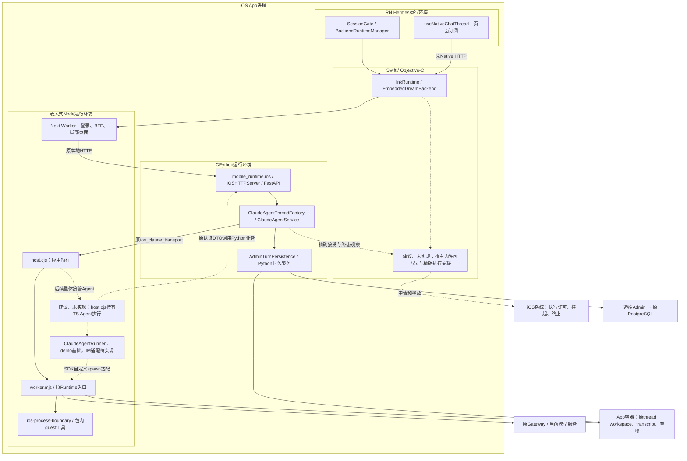

<!-- [Input] 2026-11-15 宿主与恢复合同中的推荐拓扑图。 -->
<!-- [Output] 原系统、宿主、Python 和拟议 TS 执行者关系。 -->
<!-- [Pos] 历史图示，保留当时的技术选择。 -->

# 2026-11-15 iOS 执行拓扑原图

原图包含当时拟议的 TS 接管步骤。2026-11-26 终止该路线，当前调用方向由[宿主与恢复合同](../mobile-background-execution-technical.md#推荐拓扑)维护。

