<!-- [Input] 平台tools与MCP入口纠正前的四份正文。 -->
<!-- [Output] 原媒体批准回执方案及全部图示的历史快照。 -->
<!-- [Pos] 历史追溯；现行工具入口以mobile_clock_audio实现与现行开发稿为准。 -->
<!-- [Sync] 2026-11-04: 保留本轮纠正前原文，围栏内路径按原文件目录解释。 -->

# 平台MCP入口纠正前原稿

以下正文及其相对路径按所列原目录解释。

## docs/design/multi-platform/mobile-recovery-interaction.md

````markdown
<!-- [Sync] 2026-11-04: 明确用户、Agent、媒体与播放器身份；默认v4.2角色，原确认通过后展示播放器。 -->
<!-- [Sync] 2026-11-04: 系统播放器样式与媒体交互归独立组件稿，原系统二值卡标前版任务观察。 -->
<!-- [Sync] 2026-11-04: 屏保采用v3.1整页无框布局，原统一时钟、状态和关闭交互保持。 -->
<!-- [Sync] 2026-11-03: 按用户v4.2参考统一启动角色与屏保时钟，原脸型承载离散指针及发丝。 -->
<!-- [Sync] 2026-11-03: 用户授权实现屏保与二值系统组件，按候选源码更新接线；持续后台计算与音频适配继续暂停。 -->
<!-- [Sync] 2026-11-03: APP-04纳入应用内无操作屏保静态动画和iOS系统组件，共享二值状态；实现保持暂停。 -->
<!-- [Input] 手机本机Agent任务、后台计算优先需求及现有对话和输入恢复规则。 -->
<!-- [Output] iOS与Android后台计算、按需播放、失败反馈和恢复的产品交互。 -->
<!-- [Pos] APP-04产品交互设计；接口、适配器和平台机制归独立开发文档，实施证据归exec。 -->
<!-- [Sync] 2026-11-03: 原混合稿完整归档；产品正文与开发文档分离，明确iOS/Android适配、Web沿原路径。 -->

# 手机本机 Agent 后台计算与恢复交互设计

## 背景与问题

用户在手机前台发起Agent任务后，希望切到其他应用或锁屏时继续计算，任务需要语音输出时再开始播放。Agent及工具调度在手机本机执行；联网模型调用、账户和数据访问沿原业务。

前稿混合了用户操作、平台接口和实施状态，缺少适配器关系及“计算后播放”的完整说明。[前稿原文与六幅图](history/mobile-recovery-mixed-draft-20261103.md)保留。本文定义用户操作与反馈，[开发文档](mobile-background-execution-technical.md)定义平台选择、调用关系、接口和失败处理。

## 目标与边界

首要目标为**用户发起的同一次任务在后台继续计算，需要语音时播放结果**。iOS和Android分别适配各自的系统能力；Web保留现有运行方式，本专项不增加Web后台适配。

系统可能拒绝后台运行、收回执行时间或结束进程。此时保存已经取得的结果，返回应用后核实原任务，保留对话和未发送输入。有限后台时间仅覆盖其允许的执行区间，持续计算目标的满足情况需按实际任务和系统分别验收。

本方案覆盖一次用户任务的后台运行与恢复。跨设备迁移、进程结束后自动续跑、自动重发、长期空闲常驻和新增账户体系退出范围。Agent需要播放时先提供具体媒体确认提示；用户沿原笔记确认交互同意后才展示播放器并准备资源。计算和等待确认期间保留默认v4.2角色；已有播放按原状态保持。

## 概念与规则

### 参与者与显示身份

| 对象 | 职责与用户可见结果 |
| --- | --- |
| 用户 | 发起任务，查看本次媒体信息，决定确认播放或暂不播放 |
| Agent | 在原对话执行任务，整理媒体并提出播放请求；等待原确认结果 |
| 语音／媒体 | 有标题、来源和类型的实际资源，作为播放器的输入 |
| 原确认区域 | 沿本地笔记操作确认方式展示本次媒体、目标和影响，提交用户决定 |
| 原生播放器（建议未实现） | 在本次批准回执核对成功后准备和播放资源，反馈实际播放状态 |
| v4.2角色主体／系统入口 | 常态保持脸型、时钟与原交互；确认提示出现时保留主体，确认后切换到播放器呈现 |

常驻描述默认显示身份。App内沿原前台生命周期交互，iOS系统显示沿系统组件有效期；角色展示和媒体提示均不授予持续后台计算能力。详细视觉归[独立组件设计](../../prd/mobile-app/ios-system-player.md)。

### 平台与用户可见行为

| 平台 | 后台计算 | 系统反馈与恢复 |
| --- | --- | --- |
| iOS | 为前台用户启动的任务申请适用后台执行能力；新系统支持持续处理的任务需提供真实进度并响应取消 | 合格持续任务由系统展示进度和取消；有限时间结束后按实际执行情况显示原结果或待核实状态 |
| Android | 任务由本机运行服务持有；符合系统条件时以可见的前台服务继续计算 | 显示任务通知和返回对话入口；系统停止或服务进程结束后，重新打开核实原记录 |
| Web | 沿用现有执行方式 | 沿用原页面、任务和恢复行为 |

Android本机运行能力仍待接入；iOS后台执行适配与两端按需语音播放均为拟议行为。当前实施状态、依赖和验证结果归[执行记录](../../exec/app-experience-foreground-recovery-20261102.md)。

### 发起与后台计算

1. 用户在现有对话中发送一次任务。发送前的账户、权限、附件和上下文检查沿原业务；任务使用原对话与原消息。
2. 应用在任务开始时申请后台执行能力。用户切到后台无需重复确认，原任务按实际获得的能力继续计算。
3. 后台运行期间保持输入草稿和当前对话。返回应用时读取原任务及结果，运行中的任务继续显示原输出和停止入口。
4. 后台能力申请失败时保留前台任务。用户继续在应用内查看；切到后台后的连续执行受当前系统能力约束。
5. 任务需要用户确认工具操作时保留原确认要求。等待确认期间释放无实际进展的后台运行资源；用户返回并确认后继续原业务。

### 计算、媒体确认与播放

1. Agent先执行原任务，正常画面保持v4.2脸型交互主体。需要播放时整理具体媒体信息，再提出这次播放操作。
2. 原对话确认区域推送媒体标题、来源、类型、已知时长、接收设备及替换／追加影响，提供“暂不播放”和“确认播放”。交互沿用Claude本地笔记确认；独立接收弹窗和第二次批准退出方案。
3. 用户确认且原批准回执核对成功后，才展示播放器并准备本次资源；实际媒体可播后更新播放进度及系统控制。任务发送、工具权限放行、打开系统入口和Agent完成回复均不替代播放确认。
4. 拒绝、超时、Stop或确认失效时保留默认角色／原有播放，本次新增播放器和音频执行次数为零。提交结果未明时先核实原调用，禁止提前播放或重发任务。
5. 计算完成、播放完成分别反馈。播放失败保留已取得的任务结果；计算失败沿原任务错误处理。已确认队列的暂停、继续和定位直接执行；媒体、目标或操作变化需要新的确认。
6. 用户停止等待中的Agent请求时原确认失效；已确认并交付播放器的内容沿独立播放生命周期处理。媒体结束或关闭播放器后回到角色主体。
7. 等待用户时保留原待确认业务状态，释放无实际进展的后台运行资源。系统挂起或结束进程后，重新打开读取原记录，用户明确操作后继续后续业务，旧媒体不自动播放。

### 到期、停止与恢复

| 事件 | 用户反馈与恢复 |
| --- | --- |
| 后台时间到期或系统回收资源 | 尽快结束当前计算并保存可保存的结果；实际结束情况由原任务确认 |
| 用户使用应用内停止 | 沿原停止操作与反馈处理，保留原对话及输入 |
| 用户取消系统持续任务 | 对应计算进入结束处理；结果按实际保存情况展示 |
| 返回前台或短暂遮挡结束 | 核实同一对话和任务，保持草稿；恢复操作只读取 |
| 进程重新打开 | 验证账户后恢复原对话、已保存消息、草稿和已上传附件；未完成上传提示重新选择 |
| 网络失败、结果尚未确认 | 保留输入和原反馈，提供读取重试；原任务自动重发次数为零 |

系统回调可能无法区分用户取消与资源到期；页面展示采用已确认事实。消息读取失败、应用不可见、任务完成和进程结束分别表达。

主对话和侧对话分别恢复自己的草稿。写作关联对话缺少当前写作上下文时保留发送保护，用户经原写作入口准备后继续。切换账户、关闭侧对话和新建对话沿原归属及输入更新规则。

## 正常业务时序

图中后台计算、系统任务展示和按需播放均为建议、未实现；原发送、停止和消息读取继续复用。

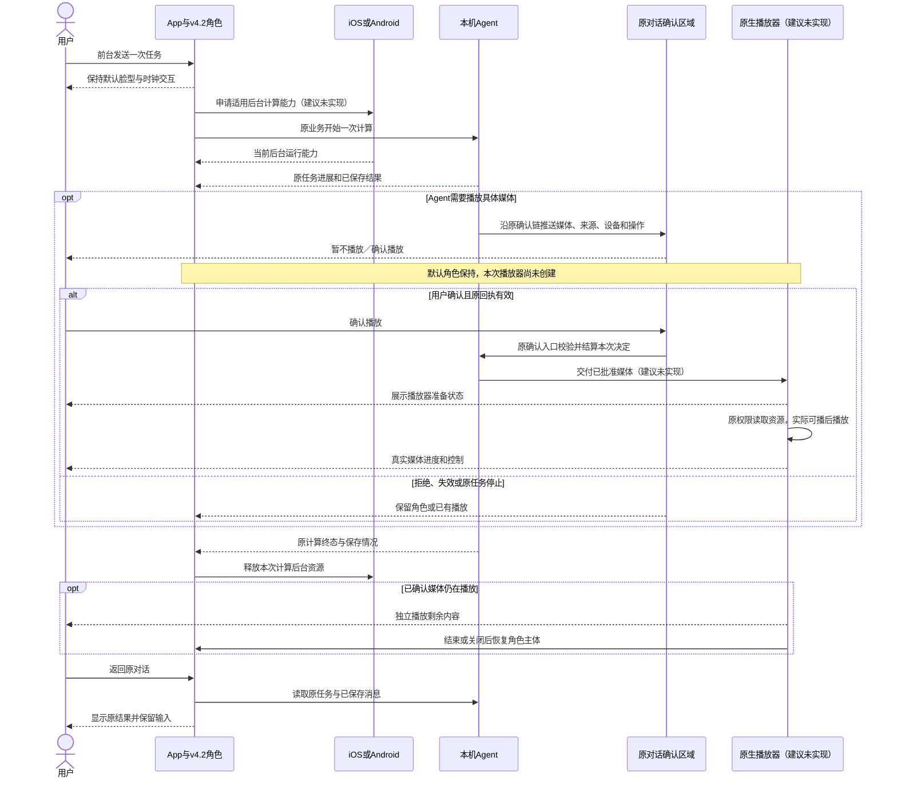

## 异常与恢复时序

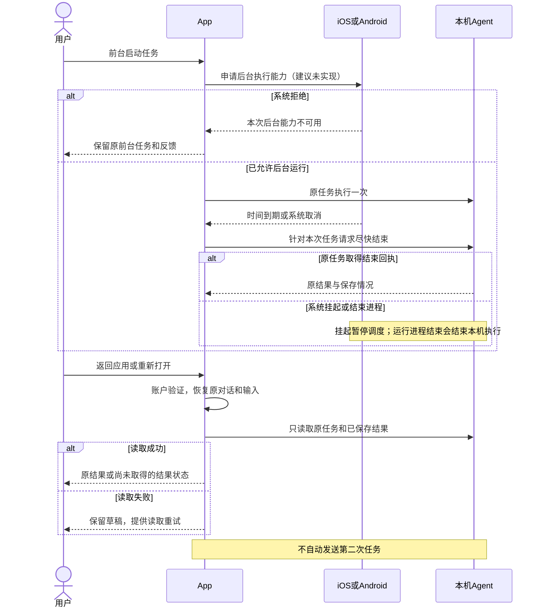

## 用户可见状态

本图表达任务查看过程。播放使用独立的播放、暂停及结束状态；播放状态不决定计算结果。

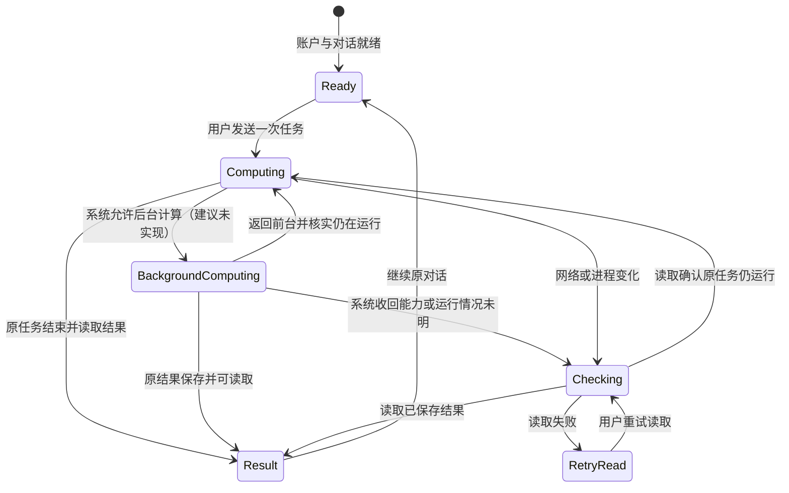

## 验收条件

| 用户场景 | 通过条件 |
| --- | --- |
| 手机本机执行 | 原任务由本机运行库持有，任务执行位置可核实；联网调用仍沿原业务 |
| iOS后台计算 | 按实际系统与任务分别核实持续运行、有限时间、拒绝和到期；仅有有限时间回执时持续计算目标保持待满足 |
| Android后台计算 | 本机运行库就绪，系统通知可见，任务在服务内继续；服务启动失败和进程结束可恢复读取 |
| 默认角色与确认后播放 | 常态保持v4.2角色；Agent先推送媒体提示；用户有效确认后展示播放器，实际可播后播放；拒绝与失效不创建本次播放器 |
| 返回与重开 | 原对话、已保存结果及独立草稿恢复，未完成上传提示重新选择 |
| 停止、确认与迟到结果 | 原停止和工具确认保持；旧任务结果保持原归属，自动重发为零 |
| Web | 沿原路径工作，本专项新增后台适配调用为零 |

页面骨架归[移动应用PRD](../../prd/mobile-app/mobile-app.md#前后台与进程重开恢复2026-11-02)。开发拆解与平台条件归[开发文档](mobile-background-execution-technical.md)，交付进度与证据归[执行记录](../../exec/app-experience-foreground-recovery-20261102.md)。

## 应用内静态动画与系统组件（2026-11-03）

2026-11-04组件修订：系统媒体播放的现行样式与规则归[独立iOS播放器设计](../../prd/mobile-app/ios-system-player.md)。正常状态保持v4.2脸型主体；媒体沿原笔记确认交互取得本次用户决定后，才展示播放器与实际播放控制；下方系统二值卡保留前版任务观察范围，应用内屏保继续沿本节执行。

实施范围：本节屏保、Factory只读观察与iOS Live Activity已形成源码候选。持续后台计算、系统后台适配器和音频播放保持拟议状态；Simulator、真机与发布资格归[执行记录](../../exec/app-experience-foreground-recovery-20261102.md)。

### 背景与问题

用户补充[Notion需求](https://app.notion.com/p/40b30b7547c380cd9930c384ab35023c#40d30b7547c3805aa2e4c01e7f7a492f)：APP-04挂起后，通过通知区域组件查看有无活跃Thread，状态只有“有／无”；App内无操作时出现的静态动画同属本次需求。来源页定义25秒无操作屏保、原页面虚化、点击任意位置关闭，以及Kastention时钟和当日心情表情。

### 目标与边界

交付两处显示：App前台无操作时的屏保静态动画层，以及iOS锁屏／灵动岛Live Activity。两者共享当前账户本机全部Thread的汇总状态，业务值只有“有／无”，视觉沿Kastention素材。屏保点击只关闭并回到原页面，系统组件点击启动App并沿原Chat恢复。后台执行资格继续由前文APP-04方案管理；屏保显示保持App前台及原任务执行。

### 概念与规则

| 对象与事件 | 显示与操作 |
| --- | --- |
| 活跃Thread | 原任务状态仍为running；涵盖主/侧对话及其他本机入口，运行中的等待确认、停止收尾按原状态纳入。任务标题、正文、数量和进度均不进入本卡。 |
| 有 | 已确认当前账户至少一条本机Thread仍运行。多个任务完成其中一条时，只要还有其他活跃任务，保持“有”。 |
| 无 | 已完整确认当前账户在本机的原任务均无运行实例。最后一条结束后，将本轮卡片最终值置为“无”并结束活动；系统决定保留和移除时间。 |
| 挂起及读取失败 | 保留最近确认值，固定栏目“最近确认”说明观测口径。页面离开、读流退出、断网、执行许可到期本身均不将值改为“无”；以原任务实际结束为准。 |
| 首次没有状态或系统展示不可用 | 保持组件未展示；原App入口和任务反馈继续可用。“未展示”归组件生命周期，业务状态集合保持有／无。 |
| 点击、移除及账户变化 | 点击整卡打开App，经原账户校验恢复原Chat；多任务沿原历史入口查看。系统移除组件保持原任务。退出登录或换账户清理旧卡，新账户重新取得快照。 |

### 应用内无操作屏保

1. **出现条件**：已登录业务页面处于前台，连续25秒没有用户操作。触摸、滚动、键盘输入和导航重新计时；SSE、任务进度和配置回执保持计时。键盘／编辑焦点、工具确认、未关闭弹窗、系统选择器及登录流程占用时延后出现，结束后重新计时。
2. **画面**：原页面上方显示Kastention时钟／表情和同一“最近确认，活跃 Thread：有／无”；底层页面虚化、保留挂载、滚动位置和未发送输入。按[v3.1界面规范](../../prd/Kastention-App-UI-Guidelines-v3.1.pdf)第3、5–7页采用整页无框布局：主题画布色铺底，角色与字标居中，状态使用次级文本色，底部独立放置关闭提示。内容组透明，面板边线、圆角底板和阴影为零；原角色笔迹保持。角色尺寸同时适配视口宽高，短视口保留状态与提示间距。屏保没有独立滚动区和任务操作按钮，状态尚未取得时仅省略状态行。
3. **静态画面与动效**：复用现有SVG路径和主题色，时钟采用实际本地时间的三根指针，显示期间每秒更新；当日笔记可确认的开心／悲伤映射到对应表情，其他或缺失值默认开心。心情来自当前账户已有笔记读取，屏保只消费已取得快照；心情与活跃Thread分别投影。减少动态效果开启时展示静态画面，显示内容和关闭方式保持。
4. **关闭**：触摸任意位置统一关闭屏保，消费完整这次手势，回到原页面后重新计时。控件点击在本层同样关闭；后续独立触摸才执行底层按钮。屏保无确认弹窗、无心情写回、无消息提交。
5. **任务和平台切换**：屏保只暂停底层可见UI刷新，原本机运行实例和事件接收保持；系统后台执行仍由原许可控制。App离开前台时取消屏保及自身计时／动画，iOS系统组件按最近确认值继续展示；返回前台显示原业务页面，从用户重新可操作时计时。

屏保与系统卡分别持有展示生命周期；两者共用二值状态口径。系统组件采用静态视觉，应用内秒针动效只在屏保可见且App前台时更新。

首个活跃任务在前台启动时创建本轮活动，进入后台前写入最近确认值。应用获得执行时间期间，值变化时更新；单条text-delta和重复“有”保持当前内容。系统挂起期间保留已发布快照，返回后读取核实并更新或结束旧活动。进程终止后的遗留卡属于此前观测，应用重新打开后核对并清理；持续实时监测在挂起期间的覆盖能力须按平台实测。

### 一体化角色时钟（v4.2，2026-11-03）

依据[离散跳针与发丝原型](../../prd/Kastention-一体化时间时钟-v4.2-离散跳针与发丝.html)与[时钟交互规范](../../prd/Kastention-时钟交互规范-v4.2.md)，原始脸型直接作为表盘。启动页和屏保共同使用`StartupArtwork`；屏保层负责虚化、Thread状态和关闭，角色、指针、发丝与嘴部由同一组件呈现。旧外圈圆盘与中央小脸组合退出当前呈现。

- 启动页传入`happy`模式及原可见性；屏保传入`clock`模式及已确认的当日心情。组件支持`clock/happy/sad`三种显示模式；嘴部跟随显示输入。屏保整层点击关闭、用户输入和原任务规则保持。
- 时针每小时30°、分针每分钟6°、秒针每秒6°，各自静止等待所属时间边界；单次跳格按原型停留、起动、跃迁、回弹、归位，持续355／300／240ms。
- 三条原始发丝使用预声明路径，每个连续整秒摆动520ms并归位；开心、悲伤和时钟模式共用。减少动态效果时直接定位指针并关闭路径形变，时间继续更新。
- 后台与隐藏时停止计时和动画，返回直接同步真实时间；遗漏时间段保持无补播。主题与原路径保持统一，原型十二时位图形作为当前宿主的装饰刻度。原型中的概念说明页和演示模式按钮仍归研究原型，当前宿主继续原导航与关闭操作。

### 正常业务时序（屏保与组件候选接线）

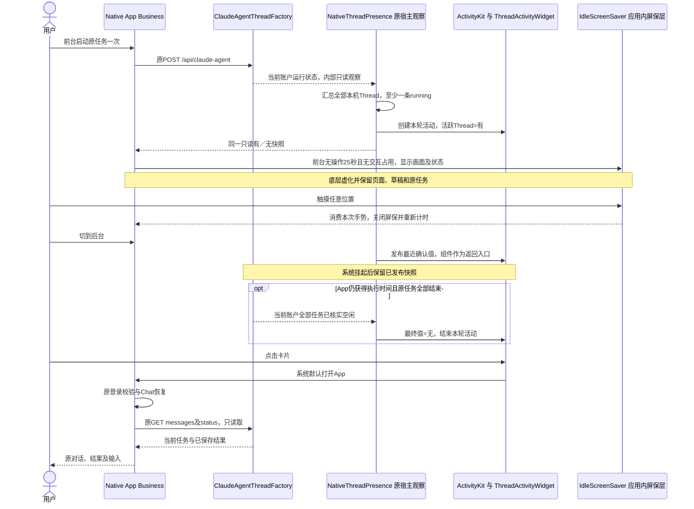

### 异常与恢复时序

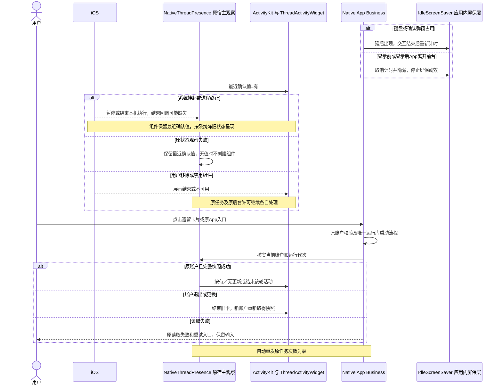

### 状态转换

应用内屏保的显示生命周期独立于Thread二值及系统挂起状态：

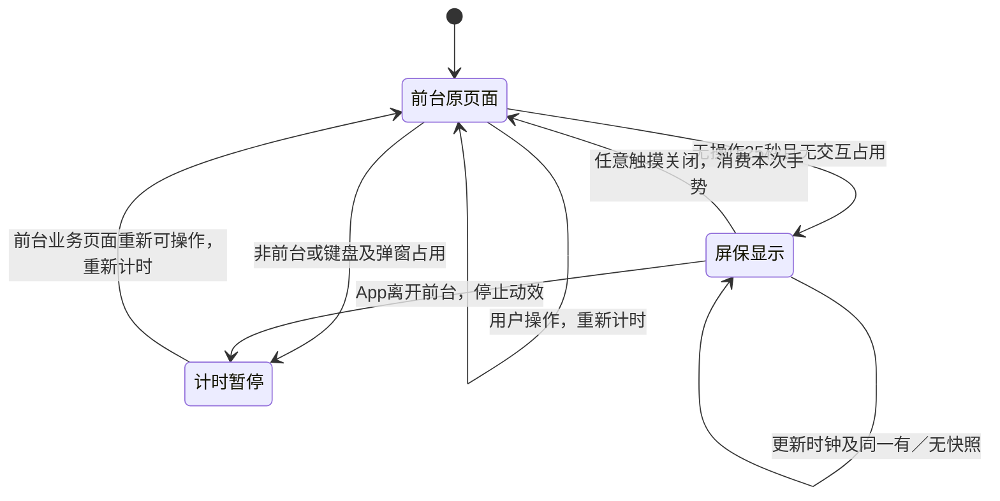

系统卡片的业务状态保持二值，组件未展示归生命周期：

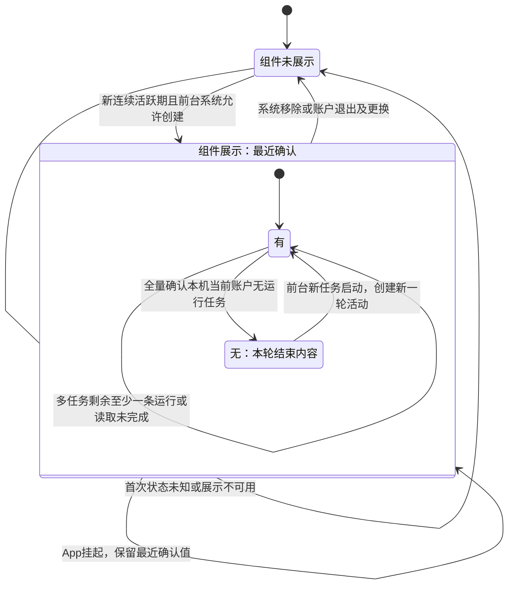

### 验收与评审

| 场景 | 预期结果 | 验证方式与前提 |
| --- | --- | --- |
| 一条／多条运行任务 | 只有一张汇总卡、值为有；完成其中一条保持有，最后一条确认结束为无 | 后续隔离原状态回执合同及真机Live Activity；当前账户和本机运行库已就绪 |
| APP-04系统挂起、断网或关闭页面读取 | 保留最近确认值，组件自身不发业务请求或重新启动后端 | 后续真机系统行为与日志对照；本机Thread只读观察已接线 |
| 权限确认／停止收尾 | 值按原running状态；停止或批准次数保持原值 | 后续原完整对话旅程；具备相应普通任务及工具权限 |
| 进程重开与点击卡片 | 正常登录及原任务只读核实，遗留卡更新或结束，无自动重发 | 后续真机正常账户旅程；允许保留本轮运行记录 |
| 换账户、首次读取失败、旧代次迟到 | 旧卡结束；新账户没有快照时未展示；旧回执不能覆盖新卡 | 后续隔离身份与运行代次合同，无跨账户正文展示 |
| 禁用、移除、系统到期 | 原App可用，原任务保持既有执行规则 | 后续真机Live Activities系统设置及移除路径 |
| 前台25秒无操作、触摸及阅读滚动 | 到期显示屏保；实际操作重新计时；底层位置和输入保留，任务增量不重置计时 | 后续受控clock与原RN页面旅程，覆盖原生页面及局部Web文档 |
| 关闭屏保、键盘及确认弹窗 | 首次触摸只关闭、无底层点击；键盘／弹窗存在时延后，原工具权限保持 | 后续真机完整输入、附件、工具确认和返回旅程 |
| 动画、心情与应用切换 | 静态画面／时钟和既有主题一致；缺少已读心情默认开心；离开前台后屏保秒级刷新为零 | 后续浅／深色、减少动态效果及性能采样，屏保无额外业务读取 |

评审采用同一Bool、应用内单层显示、系统单卡和原宿主只读观察。新增独立业务页面、任务平台、推送服务、离线数据库和任务控制按钮为零。虚化和时钟／表情渲染由实际平台资格验证，原启动画面的存在只证明可复用素材。屏保、账户聚合观察与Widget目标已有源码候选，Simulator限定方法和截图已有回执；系统活跃卡、真机和真实模型资格按执行记录单独登记。后台计算适配及音频保持拟议状态。

````

## docs/prd/mobile-app/ios-system-player.md

````markdown
<!-- [Input] 用户本轮身份/确认/常驻角色纠正、原笔记确认交互与v4.2脸型原型。 -->
<!-- [Output] 默认角色、媒体确认提示和确认后播放器的独立产品与交互规则。 -->
<!-- [Pos] iOS角色与播放器产品稿；技术接口归ios-system-player-technical，新增接线建议未实现。 -->
<!-- [Sync] 2026-11-04: 统一为Agent提出媒体请求、用户确认、原生播放器执行；移除本机自动播放分支。 -->

# iOS 角色与确认后播放器设计

## 背景与问题

[需求背景](https://app.notion.com/p/40b30b7547c380cd9930c384ab35023c#db930b7547c383b0917501d0ea510ed0)将Kastention时钟、系统入口、Agent媒体整理及播放联系在一起。用户本轮明确正常交互顺序：默认保留v4.2脸型交互主体；Agent需要播放时推送媒体确认提示；用户确认后才展示播放器。

本稿直接定义参与者、确认内容、显示切换和完整时序。[修订前原文与图示](../../design/multi-platform/history/ios-player-before-confirmation-20261104.md)保留；[开发合同](../../design/multi-platform/ios-system-player-technical.md)负责确认身份、接口和原生执行接线。

## 目标与边界

常态显示[原v4.2脸型组件](../Kastention-一体化时间时钟-v4.2-离散跳针与发丝.html)。它承载原时钟／开心／悲伤形态及原主题。媒体播放是用户确认后进入的另一种呈现，媒体结束或用户关闭播放器后回到角色主体。

所有Agent发起的新播放请求都需要本次媒体确认，覆盖本机和远端来源。用户已发送任务、Agent已生成结果、模型已取得工具权限均不替代该确认。已确认队列中的用户暂停、继续、定位和上下项沿原播放器操作。

“常驻”定义默认角色入口与呈现模式。App内按原前台生命周期显示和交互；iOS系统区域按允许的组件生命周期展示，系统结束显示时保留App内入口。角色展示不授予后台计算许可，不使用静音音频或循环创建活动延长显示。新增确认适配与播放器仍为建议、未实现；本轮只修改设计文档与离线演示。

## 概念与规则

### 身份定义

| 对象 | 业务身份与职责 |
| --- | --- |
| 用户 | 任务发起者及本次播放的确认者；查看具体媒体和接收设备后决定是否播放 |
| Agent | 原对话中的任务执行者；整理媒体并提出播放请求，等待用户决定，再报告执行结果 |
| 语音／媒体内容 | 待播放资源，包含实际标题、来源、类型和已知时长；音频内容由播放器消费 |
| 媒体确认提示 | 复用本地笔记操作的确认交互：预览内容与操作、确认或拒绝、取得真实回执后继续 |
| 原生播放器 | 执行已确认媒体的准备、播放、暂停和定位；持有实际播放状态 |
| v4.2角色／iOS系统组件 | 默认显示角色入口；确认前提供返回原对话的入口，确认后按实际播放器状态显示媒体控制 |

Agent与原生播放器各自承担任务编排和音频执行。语音内容作为媒体资源传递，用户始终是确认决定的来源。

### 三种呈现与切换

| 呈现 | 内容与操作 | 播放器状态 |
| --- | --- | --- |
| 默认角色 | 原脸型、蓝色发丝、三根时钟指针、十二时位；App内沿原模式交互，系统点击沿原入口返回App | 不显示媒体标题、进度、播放控制；不建立播放会话 |
| 等待确认 | 原对话确认区域显示媒体预览和按钮；系统入口保持角色，可提示有待确认操作 | 保持原播放状态，本次新播放器尚未创建；打开提示只定位原确认 |
| 用户确认后 | 先展示播放器准备状态，再按真实缓冲／播放／暂停／失败更新 | 批准回执核对成功后创建；实际可播后才发布系统媒体信息和可用控制 |

如果用户已有一段播放，新请求等待确认时保持现有内容。用户确认后的替换／追加范围以提示中的操作说明为准；同一请求只执行一次。确认被拒绝、超时、取消或失效时维持或恢复原角色／原播放，新的音频执行次数为零。

### 媒体确认提示

沿用Claude本地笔记的操作确认方式：提示出现在原对话中，预览拟执行操作，用户点击确认／拒绝后继续原调用。展示形式复用原确认区域；独立模态弹窗、第二次接收确认和播放器内的另一套审批流程退出方案。

确认提示包含：

- 发起的Agent与原对话，说明“Agent请求播放以下媒体”。
- 媒体标题、原来源、音频／视频类型、列表与已知时长；未知时长明确省略数字。
- 接收设备，当前内容将被替换或追加的实际影响。
- “暂不播放”和“确认播放”；语义对应原拒绝／同意操作。

用户选择“确认播放”后等待原确认回执。点击成功的本地反馈不能直接显示播放器；回执未明时保留待核实状态。重复点击使用原确认身份核实，不重发任务。媒体列表、目标或播放操作发生变化时创建新的待确认请求。

App通知中心和系统入口只帮助用户回到原对话的这条提示。点击封面、选择设备、打开App、Agent回复已准备好均不表示确认。远端接收端也需取得对应用户的本次确认，送达、确认和实际播放分别反馈。

### 视觉样式与页面骨架

[交互样式预览](ios-system-player/preview.html)默认打开角色模式。可演示Agent请求、确认／拒绝、确认后准备、播放／暂停及结束返回。媒体和确认回执均为虚构示例，演示不连接原服务。

默认角色：


媒体确认提示：


确认后的播放器沿时钟封面样式：[浅色](ios-system-player/player-light.png)、[深色](ios-system-player/player-dark.png)。角色路径、蓝色发丝、三针和十二时位复用原素材；系统封面采用静态图形，原前台时钟动效保持。系统控制位置、材质和字体由iOS决定。颜色沿[v3.1规范](ui-guidelines/README.md#03-色彩与主题)。

桌面评审参照（Web业务保持原路径）：

```text
┌ 默认角色 ──────────────┬ 原对话确认区域 ───────────────┐
│ v4.2脸型／时钟         │ Agent请求播放                 │
│ 原模式交互             │ 媒体、来源、类型、接收设备     │
│                        │ 列表（独立滚动）              │
│ 确认前保持原主体       │ [暂不播放] [确认播放]         │
└────────────────────────┴────────────┬─────────────────┘
                                  原确认回执成功
                                       ↓
                             确认后播放器／准备中
```

窄屏正常与确认：

```text
正常：                         Agent需要播放：
┌ 原系统／App入口 ──────┐      ┌ 原对话 ─────────────────┐
│                      │      │ 原消息区（滚动）        │
│    v4.2脸型主体       │      │ Agent请求播放以下媒体   │
│    原时钟／表情       │      ├ 原确认区域 ─────────────┤
│                      │      │ 标题、来源、类型、时长  │
│ 无播放器控制         │      │ 设备、替换／追加说明    │
└──────────────────────┘      │ [暂不播放] [确认播放]   │
                              └──────────┬──────────────┘
                              回执成功后 ↓
                              时钟封面＋播放器准备状态
                              实际可播后显示媒体进度与控制
```

应用内屏保仍沿整层触摸关闭规则。系统角色入口按系统可用交互返回App，App内再执行原v4.2模式切换；不把系统封面点击映射为播放批准。

### 确认后的播放规则

1. 本次回执核对成功后展示播放器、准备已确认资源。媒体可播后显示实际标题、位置和系统控制；准备期间不显示虚假时长或播放进度。
2. 同一已确认队列中的用户操作可直接暂停、继续、定位、切换。新增媒体或目标改变由Agent重新提出并等待确认。
3. 暂停与Agent任务状态分别表达。用户停止Agent等待中的请求时原确认失效；已批准并交付播放器的媒体按独立播放生命周期处理。
4. 音频结束或用户关闭本次播放器后，清理本次媒体呈现并回到角色模式；iOS最终移除系统媒体卡的时机由系统决定。
5. 资源失败保留已确认条目和实际错误；同范围重试须核对回执仍有效，失效或内容改变时重新确认。进程重开只读取原任务与资源，旧待确认提示先核实，禁止自动播放。
6. 后台计算、等待用户确认和音频播放分别管理。等待用户期间保留原待确认业务状态，释放无实际进展的后台许可；回前台确认后按该次操作申请适用准备时间。

## 正常业务时序

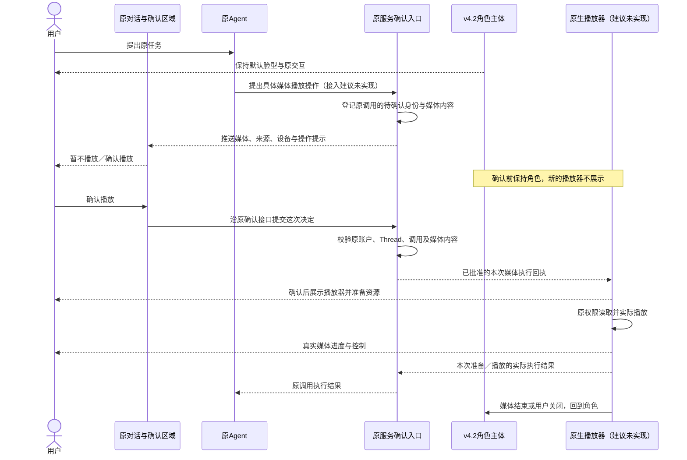

## 拒绝、失效与恢复时序

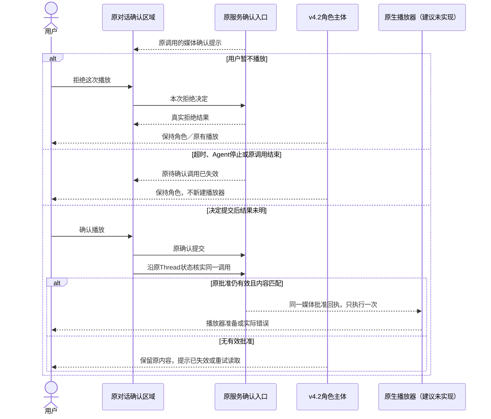

## 呈现状态转换

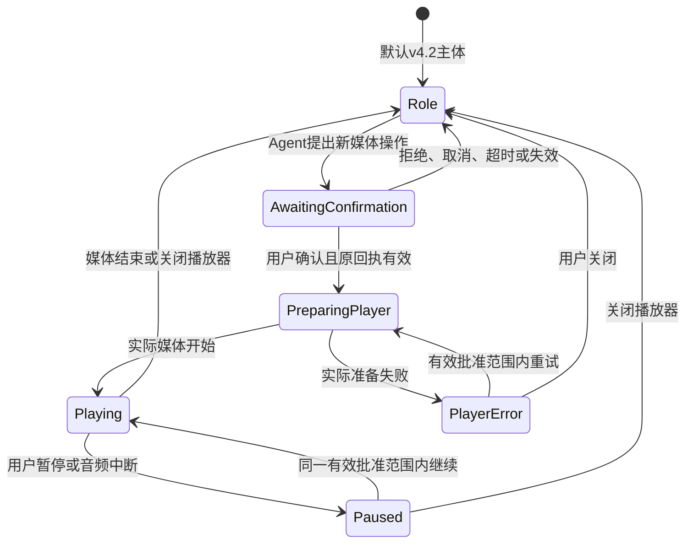

本图表达无既有播放的主流程。已有播放时，新请求确认层独立存在；拒绝不影响原播放，批准后按提示范围替换／追加。

## 验收与依据

| 场景 | 通过条件 |
| --- | --- |
| 正常入口 | 默认角色，无新媒体会话、Now Playing和播放控制 |
| Agent提出播放 | 原对话出现具体媒体提示，角色保持；只提出请求不会展示播放器 |
| 本机／远端来源 | 都需要本次有效确认；工具权限设置或自然语言意图不能代替用户决定 |
| 确认／拒绝 | 有效批准后才展示播放器；拒绝、失效、结果未明均不提前开播 |
| 重复／变更 | 同一请求只执行一次；内容、列表、目标和动作变化重新确认 |
| 退出与恢复 | 默认角色恢复，旧提示按原待确认身份核实，零自动重发与零自动播放 |
| 原业务 | 笔记确认、工具权限、Thread、Stop、账户和原输入保持；屏保关闭行为保持 |

产品规则依据本轮用户纠正、原[笔记与工具确认交互](../../design/claude-agent/claude-agent-tool-confirmation-flow.md)及v4.2原型。实际媒体接入、系统载体和真机呈现另行验收；常驻角色、确认通道和后台许可分别验证。

````

## docs/design/multi-platform/ios-system-player-technical.md

````markdown
<!-- [Sync] 2026-11-04: 默认角色、原服务媒体确认及批准后播放器统一接线，取消explicit_local自动授权分支。 -->
<!-- [Input] iOS播放器产品稿、原Native宿主/会话/文件读取、ActivityKit及后台执行适配合同。 -->
<!-- [Output] 播放器、系统媒体组件和后台适配器的所有权、接入接口、调用时序与恢复合同。 -->
<!-- [Pos] iOS系统播放器独立开发文档；新增类型/接口/字段均建议、未实现，本轮仅文档。 -->
<!-- [Sync] 2026-11-04: 独立定义媒体播放、系统展示和后台许可接入，明确原生持有、并发校验及开发前置。 -->

# iOS 系统播放器开发文档

## 背景与问题

[播放器产品与交互设计](../../prd/mobile-app/ios-system-player.md)已定义默认v4.2角色、原媒体确认提示及确认后的播放控制与终端范围。本文将其映射到原iOS宿主、系统媒体API、现有ActivityKit状态组件及[后台执行适配合同](mobile-background-execution-technical.md)。视觉与用户操作以产品稿为准，本文维护模块、DTO、接口、所有权、失败处理及开发验收。

本文新增`NativeMediaPlayback`、`IOSSystemMediaAdapter`、媒体桥接方法、媒体工作类型及DTO均为**建议、未实现**。后台执行适配器目前存在于设计合同；当前源码未实现`BackgroundWorkAdapter`、`IOSBackgroundWorkAdapter`及其两个系统实现。现有`NativeThreadPresence`、`ThreadActivityWidget`与会话/资源读取可复用。

## 目标与边界

默认呈现为v4.2角色。Agent提交媒体操作后进入原ToolConfirmationStore确认链；批准回执校验完成前，不创建本次AVPlayer/媒体队列、不读取媒体字节、不设置Now Playing、不展示本次播放器。已存在的旧播放保持。

- 原Factory继续持有Agent工作、消息持久化、结算与Stop；后台执行适配器只管理系统执行许可。
- 原App宿主持有媒体播放实例、队列、资源引用与系统接线。RN页面和Widget扩展消费快照，页面卸载不销毁已批准并交付的原生播放实例。
- 系统媒体卡读取真实播放器状态；默认角色与待确认提示按ActivityKit有效生命周期显示。媒体进度、任务状态及后台许可分别存储。
- 本机播放先使用原权限校验后的资源。远端设备发现、推送网关、流式资源能力及其持久化合同作为明确前置，缺少能力时返回不可用。
- 本文只补开发设计。业务源码、原生工程、依赖、配置、数据库、模型调用、构建和设备操作均退出本轮范围。Android与Web沿原设计。

## 参与者与调用身份

| 身份 | 实际模块／数据 | 职责 |
| --- | --- | --- |
| 发起者Agent | 原Factory/Service中的当前turn与tool call | 提出媒体操作并等待真实确认；不自行批准 |
| 确认者用户 | 原SessionGate认证用户与原Thread owner | 在原确认区域决定这次媒体、目标和动作 |
| 确认权威 | 原ToolConfirmationStore及原tool-confirm入口 | 保存服务端thread/turn/call与输入fingerprint，原子结算决定 |
| 执行者 | 建议NativeMediaPlayback | 只消费已校验批准回执，持有实际音频播放 |
| 展示者 | 建议IOSSystemMediaAdapter与原Widget扩展 | 默认角色、待确认提示入口及批准后的播放器投影 |
| 语音 | MediaItemDescriptor引用的音频资源／视频音轨 | 原生播放器输入，不产生第二个Agent身份 |

## 当前源码与目标责任

| 原模块 | 当前行为 | 建议接入点 |
| --- | --- | --- |
| [BackendRuntimeManager](../../../frontend/src/runtime/BackendRuntimeManager.ts) | 原启动Promise与诊断；按owner绑定Thread presence | 增加媒体快照订阅和桥接门面，保持原启动结果；媒体事件不写任务终态 |
| [InkRuntime](../../../frontend/ios/InkMemory/InkReactNative.swift)、[导出注册](../../../frontend/ios/InkMemory/InkRuntimeModule.m) | 原会话、HTTP、文件及`InkThreadPresence`事件 | 新增媒体方法与`InkMediaPlayback`事件；只转交App宿主、管理当前桥接订阅 |
| [EmbeddedDreamBackend](../../../frontend/ios/InkMemory/EmbeddedDreamBackend.swift) | App进程内一次装配CPython/Node；原请求及presence组合 | 在原宿主关联一个MainActor媒体对象和一个系统适配对象；播放不重复启动Python/Node |
| [SessionGate](../../../frontend/src/platform/SessionGate.native.tsx)、[NativeThreadPresence](../../../frontend/ios/InkMemory/NativeThreadPresence.swift) | 原会话验证；native以`/auth/session`核对user.id、generation及递增sequence | 复用验证规则；明确账户退出/切换清理与RN订阅释放的不同调用，保留原认证入口 |
| NativeThreadPresence.reconcile | 目前直接创建、更新和结束所有ThreadActivityAttributes活动 | 后续转交单一系统适配对象仲裁ActivityKit；当前直接写活动的行为需收敛，避免结束默认角色或待确认入口 |
| [ThreadActivityAttributes](../../../frontend/ios/InkThreadActivity/ThreadActivityAttributes.swift)、[ThreadActivityWidget](../../../frontend/ios/InkThreadActivity/ThreadActivityWidget.swift) | 仅`hasActiveThread: Bool`与原图显示 | 同一扩展增加可选角色/媒体准备/待确认呈现字段；扩展只显示数据并提供返回入口 |
| [NativeWorkspaceFileRead](../../../frontend/ios/InkMemory/InkWorkspaceFiles.swift)、[NativePickedFileStore](../../../frontend/ios/InkMemory/InkFileUploads.swift) | 原认证GET读私有文件；opaque fileId及acquire/finish/release | 为播放保存强引用和使用计数；App宿主持有使用中的store，RN退出不触发其deinit删除播放文件 |
| [ToolConfirmationStore](../../../backend/claude_agent/tool_confirmation_store.py)、[Service确认回调](../../../backend/claude_agent/service.py)、[确认接口](../../../backend/routers/claude_agent.py) | 当前按服务端Thread/turn/call、输入fingerprint登记并结算；前端经原tool-confirm提交决定 | 媒体业务操作接入同一确认通道；该媒体适配仍待实现，禁止另建批准Store/HTTP |
| [Factory](../../../backend/claude_agent/thread_factory.py)、[原iOS组合根](../../../backend/mobile_runtime/ios.py) | 原生产者与只读Thread观察 | 沿原后台设计补精确工作接受/进度/终态观察，媒体输出关联原turn；不新增Agent执行入口 |

当前未见AVPlayer、Now Playing或Remote Command接线；`Info.plist`已有Live Activity声明，音频后台模式仍待按实际播放用途配置。原生播放器新增文件位置建议为`frontend/ios/InkMemory/NativeMediaPlayback.swift`与`IOSSystemMediaAdapter.swift`，本轮不创建源码文件。

## 接入拓扑与所有权

实线为已存在的主路径，虚线为建议、未实现的媒体或后台接线。App宿主为唯一媒体生命周期所有者。

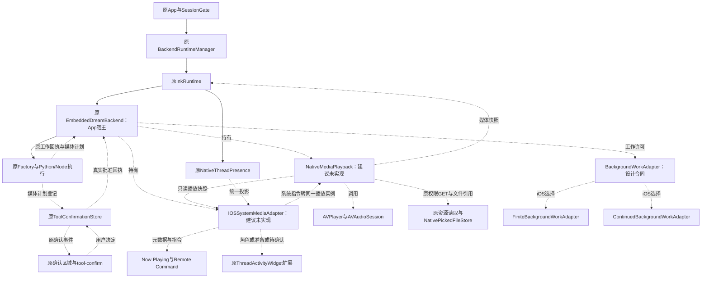

| 对象 | 目标所有者与执行上下文 | 释放条件 |
| --- | --- | --- |
| NativeMediaPlayback | 原App宿主一个实例；所有状态变更在MainActor串行处理 | 显式账户失效、停止/替换会话、进程结束；RN页面离开仅退订 |
| AVPlayer与当前item观察 | NativeMediaPlayback；同一时间一个当前播放item，队列为原生内存数据 | item替换时解除旧观察；会话结束解除周期观察与item引用 |
| 资源fileId与store | 当前媒体item与App宿主；I/O走原URLSession/原资源入口 | 本item不再使用后finish；独立缓存释放继续沿原release；store在使用期保留强引用 |
| IOSSystemMediaAdapter | 原App宿主一个实例；元数据和活动投影串行化 | 仅清理本ownerGeneration及mediaSessionId的命令token、元数据与活动 |
| NativeThreadPresence | 保留原账户与Factory观察责任 | 原退出/换账户释放观察；其unknown不删除仍有效的媒体会话 |
| Widget扩展 | ActivityKit管理；仅接收可显示ContentState | 系统结束活动；不持有AVPlayer、Python、Node、媒体网络请求或后台许可 |
| 后台系统句柄 | 原后台适配器；按具体工作与运行代次持有 | 原工作完成、失败或expiration，按原接口幂等释放一次 |

### 运行期对象关系

图中对象为原生内存关联，新增数据库表为零。TaskBinding表达已接受原工作，播放会话可独立于已结束任务继续。

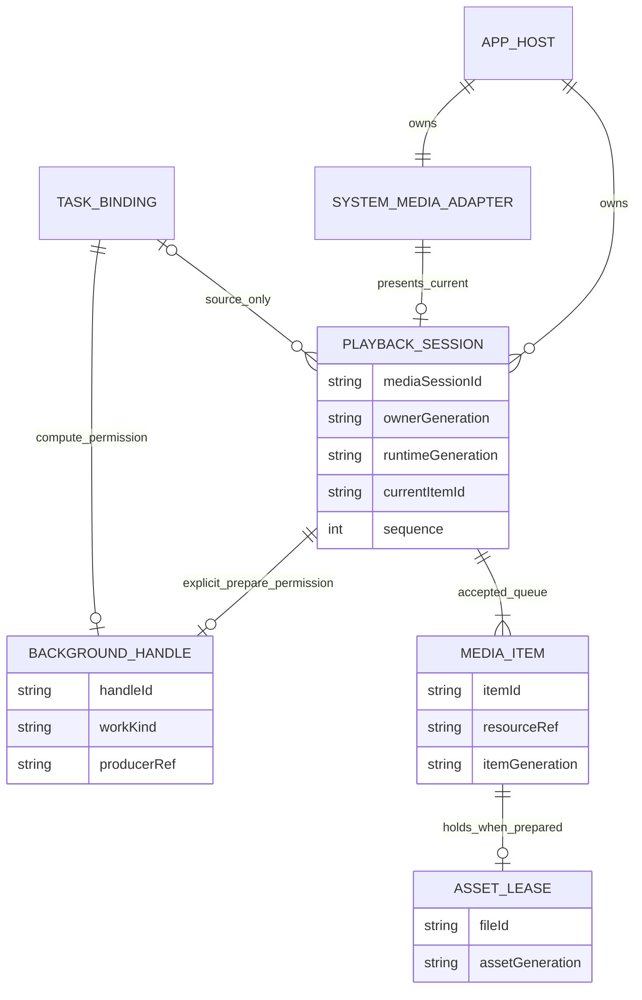

BACKGROUND_HANDLE由计算工作或显式媒体准备工作中的一种持有，两个关系互斥。一个任务可生成多项媒体；一个App仅有一条当前本机播放会话。新媒体操作在用户确认前保留为原Store待确认请求，当前队列与播放保持。

## 数据合同（建议、未实现）

以下为跨桥逻辑类型，后续映射为Swift与TypeScript DTO；本节未引入运行时代码或公开业务HTTP。

```ts
type MediaResourceRef =
  | { kind: 'storage'; storageKey: string }
  | { kind: 'workspace'; sessionId: string; relativePath: string }
  | { kind: 'gateway_stream'; gatewayResourceId: string };

type MediaItemDescriptor = {
  itemId: string;
  resource: MediaResourceRef;
  mediaKind: 'audio' | 'video';
  title: string;
  sourceLabel?: string;
  sourceThreadId?: string;
  sourceTurnId?: string;
};

type MediaRequest = {
  requestId: string;
  items: readonly MediaItemDescriptor[];
  origin: 'agent_local' | 'incoming_delivery';
  targetDeviceRef: string;
};

type MediaCommand = {
  commandId: string;
  expectedOwnerGeneration: string;
  mediaSessionId: string;
  expectedItemGeneration: string;
} & (
  | { kind: 'play' | 'pause' | 'next' | 'previous' | 'stop' }
  | { kind: 'seek'; positionSeconds: number }
);

type MediaSnapshot = {
  ownerGeneration: string;
  runtimeGeneration: string;
  mediaSessionId?: string;
  itemId?: string;
  itemGeneration?: string;
  sequence: number;
  requestState?: 'awaiting_confirmation' | 'approved' | 'rejected' | 'expired';
  presentation: 'role' | 'confirmation_pending' | 'player';
  pendingRequest?: {
    requestId: string;
    summary: string;
    itemCount: number;
    targetDeviceRef: string;
  };
  title?: string;
  sourceLabel?: string;
  queue: readonly { itemId: string; title: string; mediaKind: 'audio' | 'video' }[];
  playbackState: 'idle' | 'preparing' | 'buffering' | 'playing' |
    'paused' | 'ended' | 'failed';
  positionSeconds?: number;
  durationSeconds?: number;
  seekable: boolean;
  errorCode?: string;
};

type MediaCommandReceipt = {
  commandId: string;
  status: 'accepted' | 'applied' | 'rejected' | 'outcome_unknown';
  sequence: number;
  errorCode?: string;
};
```

`InkMediaPlayback`事件区分`snapshot`与`command_result`。前者携带MediaSnapshot；后者携带owner/runtime/mediaSession/item代次及MediaCommandReceipt，按commandId结算原调用。订阅重连先读快照，不依赖旧事件重放；待确认内容通过pendingRequest定位，原资源ref保留在原生队列中。标题与队列摘要仅供界面呈现。

### 媒体计划与批准回执

建议在原服务内把本次媒体操作冻结为MediaPlaybackPlan：`requestId + ToolConfirmationIdentity(thread_id, turn_id, tool_call_id) + items/resource revisions + targetDeviceRef + queueEffect`，其中queueEffect明确replace或append。规范化后计算媒体计划fingerprint，并与原ToolConfirmationPolicy.input_fingerprint关联。

批准后的内部MediaApprovalReceipt携带原identity、requestId、计划fingerprint、owner/runtime代次及已确认决定，由原服务结算后生成并交原宿主核验。它只能从原Store的真实approved结果派生；前端approved布尔值、Agent文案、origin和权限allow均不构成该回执。原生按同一计划消费一次，重复回执返回既有媒体会话；同ID异计划拒绝。

当前ToolConfirmationStore、ToolConfirmationIdentity及确认POST已存在；媒体计划冻结、批准到原生的回执桥接和媒体Tool/provider接入尚未实现。批准前仅登记请求摘要与原确认引用，不创建播放会话。

### 校验与身份

- `ownerGeneration`与`runtimeGeneration`由原生宿主创建。RN传入expected字段仅用于拒绝迟到操作，账户授权仍来自原`/auth/session`及原资源校验。
- `MediaRequest.origin`只标记来源，所有新的Agent媒体操作都进入本次确认。原用户已发送任务、本机来源、工具auto/full-access均不能跳过媒体业务确认。
- `items`须非空且itemId唯一，资源kind及媒体类型按枚举校验。同requestId的相同内容返回原确认状态，异值拒绝；重复批准回执不得重建正在播放的队列。
- 原Thread/turn引用只建立来源关系；原生核对当前账户、原请求及资源归属。来源任务结束后，已批准且交付播放器的媒体可继续；旧turn的迟到输出不能替换新会话。
- 桥接DTO不携带Cookie、Bearer、签名URL、原生file URL或任意媒体网络URL。资源ref只通过原资源入口解析。标题和sourceLabel遵循原DTO长度/字符校验，不写入诊断正文。
- `seek`只接受有限、非负且落在实际seekable范围内的值。时长未知/直播/不可定位时拒绝；duration和position来自AVPlayerItem实际时间信息。
- 命令按当前运行实例内`commandId + payload`去重；同ID异值拒绝。同一命令重复到达返回已有回执。此去重不承担跨进程或远端投递的持久幂等。
- `sequence`在单会话内递增；RN只接受当前owner/runtime/mediaSession/item代次的新快照。旧item的KVO、下载完成、seek completion与错误回调均先核对代次。

## 接口与调用边界

### 原笔记确认链的媒体接入

1. 原媒体业务操作核对原账户/资源元信息后冻结MediaPlaybackPlan，在产生副作用前通过原Service._make_tool_confirm_cb登记原ToolConfirmationPolicy与Future，再发布`tool-input-available`及`tool-approval-request`。现有kind仍用approval；媒体摘要呈现适配为建议、未实现。
2. 原`toolConfirmation.ts`/`ToolConfirmationDock.native.tsx`及Web对应确认区域展示媒体、来源、类型、时长、目标和queueEffect。继续使用`confirmToolCall(threadId, toolCallId, approved, reason, answers, transport)`；HTTP body保持`thread_id/tool_call_id/approved/reason/answers`，turn身份及计划内容从服务端原记录取得。
3. 原`POST /api/claude-agent/tool-confirm`检查登录和Thread归属，Factory.confirm_tool委托原Store原子结算。resolved/approved只表示用户决定；媒体业务回调收到真实批准后再校验计划并向原生交付MediaApprovalReceipt。
4. 新媒体操作只能登记一条确认。普通权限分支已经对同一媒体计划取得的明确用户决定可复用其原identity与fingerprint；auto/full-access的permission allow只决定工具是否可调用。缺少明确媒体决定时，在媒体副作用边界走同一确认通道；不增加第二个接收弹窗。
5. 通用Permission Policy的模式、分类与硬拒绝保持；媒体操作的显式业务同意按本轮用户要求执行。当前媒体Tool/provider/schema与该门控尚未发布，缺少时保持不可播放，不通过低敏分类或提示词绕过。
6. 拒绝、超时、Stop、账户变更或原pending已消失时，回到角色或保留旧播放。409 TOOL_CONFIRMATION_NOT_PENDING沿原精确ID反馈核实，不伪造成approved；恢复先读原消息与pending快照，不重开旧确认。

### RN到原生门面

| 接口 | 输入／返回 | 责任与失败 |
| --- | --- | --- |
| configureMediaPlayback | 预期当前账户；返回默认角色/已有媒体快照 | 复用原native会话验证；绑定不显示新播放器 |
| submitMediaRequest | 已关联原调用的MediaRequest与计划摘要 | 只登记待确认引用；新的播放、媒体字节读取和系统媒体发布均为零 |
| confirmMediaRequest（门面，建议） | 原Thread、toolCallId、用户决定 | 调用原confirmToolCall及原POST；不在本地设置approved，不直接调用prepare |
| activateApprovedMedia（内部） | 原服务结算的MediaApprovalReceipt与匹配计划 | 核验、去重后创建队列与播放器，进入确认后准备；JS普通请求不能直接授予执行 |
| commandMediaPlayback | 已批准会话的MediaCommand | 仅控制已批准范围；新增媒体/目标变更重新确认 |
| getMediaPlaybackSnapshot / subscribeMediaPlayback | 当前绑定；InkMediaPlayback快照 | 退订不改变原生播放；首次无媒体时返回role与空队列 |
| clearMediaPlayback | 原账户失效、切换或用户关闭本次播放器 | 清理本会话并回到角色；原Agent继续沿原退出/Stop规则 |

确认提示的pending权威仍为原ToolConfirmationStore。原生与系统组件只投影原确认引用；App通知中心/Widget点击恢复原Thread，不调用activateApprovedMedia。播放器显示从内部批准回执核验成功开始，资源尚未就绪时显示准备状态，系统Now Playing在真实媒体具备播放状态后发布。

SessionGate订阅清理只退订；明确账户退出/切换调用clear。当前媒体业务接线均建议未实现，原ensureStarted只复用一次启动结果。

### 原生播放器与系统适配接口

| 接口 | 调用者与输入 | 结果 |
| --- | --- | --- |
| NativeMediaPlayback.prepare | 已批准计划与回执、会话/item代次、当前执行许可事实 | 通过原权限GET取得资源并acquire文件；创建AVPlayerItem，准备成功进入buffering/paused；资源或执行条件失败保持原结果 |
| NativeMediaPlayback.command | App或系统控制；同一MediaCommand | MainActor串行校验，调用AVPlayer transport或队列切换；原操作回执更新后发布快照 |
| NativeMediaPlayback.subscribe | 原宿主的系统适配与当前RN订阅 | 输出不可变快照；页面订阅退出不影响其他观察者 |
| IOSSystemMediaAdapter.publishMedia | 当前原生媒体快照、已校验标题/封面/队列能力 | 更新本App的Now Playing元数据及命令可用性 |
| IOSSystemMediaAdapter.publishTaskPresence | 原NativeThreadPresence的账户绑定只读快照 | 只为状态入口提供最近确认的有／无，不生成媒体和播放进度 |
| IOSSystemMediaAdapter.reconcileSurface | 当前账户、批准/播放/待确认快照 | 独占默认角色与系统媒体投影；批准前保持角色，批准后才切换播放器 |
| IOSSystemMediaAdapter.clear | 预期ownerGeneration及mediaSessionId | 删除本会话注册的command targets、清空本App对应元数据、结束对应活动；迟到clear不影响新会话 |

系统适配对象不直接播放、读取资源或修改任务。`NativeThreadPresence.reconcile/init/clear`中的直接ActivityKit写入须在后续实现时转交此对象；Widget扩展保持数据呈现责任。该变更为开发项，当前源码保留原行为。

### 资源准备与文件生命周期

1. storage/workspace ref复用`NativeWorkspaceFileRequest.make`与原认证GET；NativeWorkspaceFileRead将字节写入原私有资源store。当前下载只接受200，不具备Range/HLS流接线资格。
2. NativeMediaPlayback为当前item调用原store的`acquire(fileId)`，同时保留store强引用。AVPlayer只接收原生私有file URL；JS/Widget只收到媒体快照。旧item停止并解除观察后`finish(fileId)`，缓存释放继续按原release和策略处理。
3. RN取消自己的文件观察/释放请求不结束媒体使用计数。store不能随RN facade deinit删除仍在播放的文件；账户清理先停止AVPlayer并结束使用，再释放缓存引用。 旧下载完成回调在代次校验失败时，释放该回调本轮取得的文件引用；不得释放当前新item的文件。
4. 媒体类型、可播放轨道、大小及缓存容量依据实际资源与原资源策略校验，不沿用导入路径的Int.max作为媒体预算。视频画面由App内原生展示接入，系统媒体区域只投影音轨与媒体信息。
5. `gateway_stream`须具备已发布的授权、格式、时效及续取合同；原文件reader不能直接作为HLS/Range传输。能力未就绪返回MEDIA_STREAM_UNAVAILABLE，不将Agent URL直接交给AVPlayer。

### 远端终端与Agent接入

远端网关只定义逻辑port：`listReceivers`返回实际可访问设备及能力；`requestDelivery`提交原请求身份；`readDeliveryReceipt`读取送达、接收、播放的独立状态。当前仓库未确认这些网关合同，port保持unavailable；不新增临时业务HTTP、发现扫描或设备默认ID。

远端提交必须由原网关提供账户、目标、内容授权和请求幂等；接收端沿对应用户的原确认通道取得本次批准后才执行。本机内存commandId不替代远端幂等。提交结果未知只读取原回执，禁止自动重发。需要持久记录或schema时先由Admin Drizzle发布capability，再进入Dream接入；本稿不引入数据库或runtime DDL。

Agent只沿原媒体结果/原用户操作产生接入意图。本稿不新增Claude工具描述、权限分类或自动放行规则。音频合成、格式转换及推送资格按实际能力分别验证。

## 与后台执行适配器的接入

### 保留现有方法，明确工作引用

复用原`request / bind / report / finish / release`合同，原iOS实现选择继续由系统availability、真实进度和工作能力决定。媒体模块不创建后台管理器。

| 工作 | 申请与绑定 | 完成/失效 |
| --- | --- | --- |
| 原Agent计算 | 用户前台操作沿原入口request；bind原threadId/turnId/producerRef | 原真实终态和保存确认后finish；expiration只按原精确生产者收尾 |
| Agent等待媒体确认 | 原调用保持pending；无进展的系统许可按原规则释放 | 原任务running/等待身份保留，播放器尚未创建；批准、拒绝与失效由原确认决定 |
| 用户确认播放后准备资源 | 真实批准回执核验后，本次前台决定可创建`native_media_prepare`工作；原生绑定mediaSessionId、preparationId及URLSession producerRef | 文件准备完成或失败后finish；到期取消该准备实例并保留原请求，原Agent与已有播放保持 |
| 正在播放的媒体 | AVAudioSession及实际播放承担音频用途；不调用计算适配器获取常驻 | 暂停/结束/中断沿实际音频状态释放，计算是否继续由其独立许可决定 |

`native_media_prepare`为建议增加的窄工作种类，首期只用有限后台实现。`bind`内部AcceptedWork扩展为Agent工作引用或NativeMediaPreparation引用二选一；两者的ownerGeneration、runtimeGeneration及producerRef均由原宿主持有。原公开HTTP DTO与Agent状态机保持。该扩展须与原后台接口一同实现并验证，当前合同不宣称已支持媒体准备。

### 交接顺序与竞态

- 原生取得实际媒体输出时只发布原确认提示。用户决定经原服务批准并核验后，应用在前台或仍具适用执行条件时准备媒体；音频会话激活成功、AVPlayer确实开始播放后，系统媒体卡进入playing。
- 计算finish只采信Factory真实终态与保存确认。播放在此前已开始时，计算许可独立释放，音频继续。计算已结束而资源尚未准备好时立即释放计算许可；后台无适用执行条件则保留待播放状态，等待前台明确操作。
- 播放失败不延长计算许可；计算成功不伪造播放成功。播放中的暂停不发出Agent Stop，Agent Stop不调用媒体pause/stop。
- 后台expiration只能定位其原工作引用：Agent引用按原Factory精确取消；媒体准备引用只取消原URLSession准备。旧turn、旧preparationId和旧item的expiration不得停止新播放。
- 系统挂起暂停本地回调，进程结束终止原生与本地运行实例。Widget、Now Playing元数据和播放器封面不提供通用计算许可。

## iOS系统媒体接线

| 系统能力 | 数据与调用规则 |
| --- | --- |
| AVPlayer / AVPlayerItem | 观察item.status、timeControlStatus、真实当前位置、duration及seekable范围；.playing才发布playing，等待数据发布buffering；所有回调带itemGeneration校验 |
| AVAudioSession | 实际准备播放时采用.playback并激活；结束且本会话无音频职责时停用并按系统选项通知其他音频。UIBackgroundModes=audio按真实播放用途配置 |
| MPNowPlayingInfoCenter | 标题、来源、静态MPMediaItemArtwork、有限实际duration、elapsedPlaybackTime与实际playbackRate；系统外框与排列由iOS负责 |
| MPRemoteCommandCenter | 注册本实例需要的play/pause/stop/next/previous/changePlaybackPosition target；可用性来自实际队列与seekable。保存target token，替换/清理只删除本实例注册项 |
| 系统远程命令回执 | handler以线程安全只读快照快速核对，返回系统受理状态；实际命令转MainActor后再次核对代次。系统success仅说明受理，实际结果以播放器快照确认 |
| 音频中断和路由变化 | 接收AVAudioSession中断/路由通知；保留userPaused与中断原因事实。恢复提示不覆盖用户暂停，设备断开沿原音频交互暂停；不发Agent取消 |

NativeMediaPlayback同时保存用户播放意图及引擎观察状态。item尚未准备时的AVPlayer.paused不直接解释为用户暂停；明确play后进入buffering，实际timeControlStatus为playing才进入playing。用户pause/stop意图使后续中断恢复保持暂停，旧seek completion不得恢复播放。

周期位置观察使用实际播放时间并按原生媒体更新配置控制频率，不使用JS timer或SSE字符数推算。位置/rate只在实际播放器状态变化、定位及必要媒体时间观察中更新；Agent token事件不刷新Now Playing。

v4.2封面从同一几何资产生成静态位图，按主题与素材revision缓存；不截取业务页面，不在Widget或系统封面执行逐秒发丝动画。原前台时钟继续沿现有组件。

### 系统展示仲裁

IOSSystemMediaAdapter为同一账户的单一投影点，NativeThreadPresence保持只读任务事实。

| 条件 | 默认角色／确认呈现 | 系统媒体 |
| --- | --- | --- |
| 已登录且无已批准媒体 | 默认v4.2脸型，App内保留原交互；系统入口按可用生命周期显示 | 不创建媒体会话和Now Playing |
| 原媒体确认pending | 角色保持；原Chat确认区域显示具体媒体与按钮，系统只提供恢复原Thread入口 | 本次新播放器不展示，旧播放保持 |
| 用户拒绝、超时或原确认失效 | 保持角色／旧播放，消除已失效提示 | 新播放与媒体准备为零 |
| 原批准回执已核验 | 切换为确认后播放器准备模式 | 准备就绪后发布真实媒体与控制 |
| playing/paused/failed | 按当前有效批准范围显示播放器 | 实际媒体状态，禁止替代任务进度 |
| 媒体结束或用户关闭 | 应用恢复默认角色，系统显示结束时间由iOS决定 | 清理本次元数据与targets，不自动播放新请求 |
| 账户失效 | 清理旧owner确认和媒体，原登录流程保持 | 旧回调失效，不影响后续新会话 |

默认角色与hasActiveThread解耦，后者仅表示已确认任务观察。当前NativeThreadPresence在false时结束活动的行为须在未来系统投影接线中收敛。iOS Live Activity具有系统时限，正常角色模式不通过循环创建活动、静音音频或后台任务续驻；App内角色入口保持。

ThreadActivityAttributes当前使用必填`hasActiveThread: Bool`。建议扩展后的Widget DTO将其声明为可选Bool：true/false继续表示已确认的有／无，缺少任务观察时省略该行，媒体确认入口可在原Chat出现。原Factory与RN二值观察合同保持。presentationKind、confirmationRef、mediaTitle及ownerGeneration等新增显示/返回字段同样可选，旧载荷的Bool正常解码，缺少presentationKind时采用前版任务呈现。App和Widget目标共用同一类型并验证存量活动内容的解码。

旧实例枚举与清理只在原App宿主冷启动或明确账户切换时执行。NativeThreadPresence.init在RN重建期间不得结束新宿主仍持有的媒体状态活动；其clear/reconcile改为提交当前账户观察事实，由单一系统适配对象决定展示。封面使用扩展内共享资产，ContentState不携带凭据、原资源URL、fileId或正文。

返回入口使用待实现的`openMediaTarget`意图，携带opaque request/session引用。Widget/system打开App后，经原SessionGate与资源校验进入对应媒体；导航尚未就绪时由App宿主保留一次待消费意图。URL/NSUserActivity由原App路由配置装配，缺少媒体路由时列为开发前置；不复用OAuth callback路径，也不把返回操作解释为确认播放。

## 正常接入时序：原任务计算到系统播放

新增接口与模块均为建议、未实现；原Factory与原公开发送入口保持。

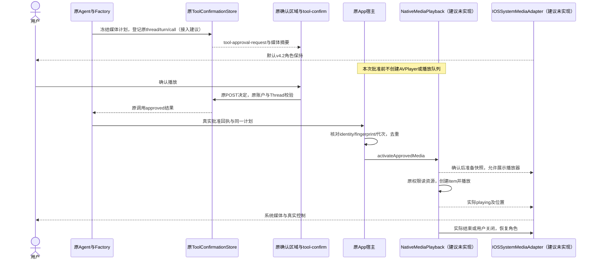

若原结果发布时后台已无可用执行条件，媒体准备保持待前台处理；本图的批准后播放路径需要资源在适用许可有效期间就绪，须单独取得验收证据。

## 原确认与播放控制时序

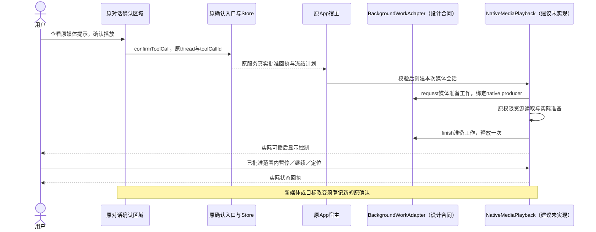

## 异常、到期与恢复时序

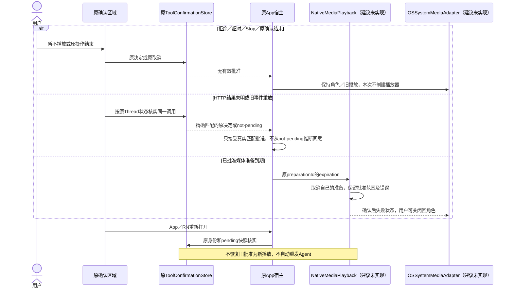

## 播放状态转换

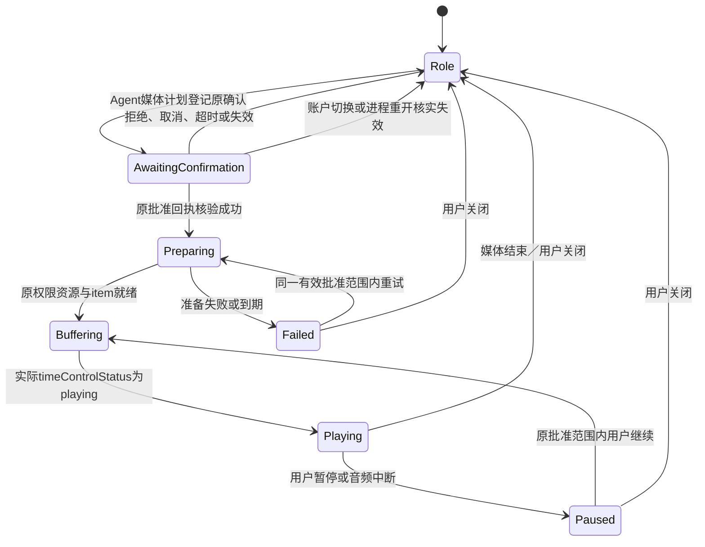

AwaitingConfirmation属于原确认请求层；已有播放可并行保持，MediaSnapshot分别报告requestState与playbackState。本图按新请求进入播放的主路径表达，命令代次校验覆盖全部状态。

## 失败、清理与恢复合同

| 条件 | 处理与错误类别 |
| --- | --- |
| 会话/owner不匹配 | MEDIA_AUTH_REQUIRED或MEDIA_BINDING_CHANGED；拒绝新动作，明确失效时清理本owner媒体；原认证流程保持 |
| 资源缺失、类型或流能力不具备 | MEDIA_RESOURCE_UNAVAILABLE / MEDIA_UNSUPPORTED / MEDIA_STREAM_UNAVAILABLE；保留原条目与错误，不重跑Agent |
| 音频会话激活失败或item错误 | MEDIA_AUDIO_UNAVAILABLE / MEDIA_PLAYBACK_FAILED；不发布playing，及时释放原准备引用，计算结果独立保留 |
| 后台准备到期 | MEDIA_PREPARATION_EXPIRED；取消匹配准备，原资源与请求保留，后台重试为零 |
| 原输出/command/seek迟到 | 依据owner/runtime/mediaSession/item代次拒绝；不覆盖新队列或快照 |
| 远端投递结果未知 | 保留outcome_unknown并读取原投递回执；原网关持久幂等未具备时不提交 |
| RN订阅断开 | 移除该订阅，原生播放与系统targets保持；重新连接先读快照 |
| App进程终止 | 本机Player和句柄结束；新进程核对旧系统活动及原资源，按用户操作恢复媒体 |

恢复检查点只保存当前owner作用域下的原资源ref、队列当前条目身份与有限播放位置等最小指针，沿既有Settings机制与schema校验；不保存媒体字节、签名URL、凭据、原生临时file URL或Agent执行栈。当前store临时文件跨进程不可复用，新进程必须重新授权读取。恢复后默认等待用户播放，任务/投递自动重发为零。

诊断仅记录固定错误类别、操作类别及必要代次关联；媒体URL、标题、来源正文与授权材料不进入新媒体诊断。每个item移除KVO/通知/时间观察并finish一次，每个系统target token释放一次，每个后台句柄沿原合同结束一次。

## 开发拆解与验证

| 工作项 | 后续代码归属 | 关键验证 |
| --- | --- | --- |
| 原确认与媒体批准接线 | 原Service确认回调、ToolConfirmationStore、toolConfirmation与原确认区域；媒体业务入口待发布 | 同一thread/turn/call与输入fingerprint；无许可模式绕过、批准前零播放器/字节读取；拒绝、409、超时、Stop、重复及同ID异计划；笔记确认回归 |
| 原生所有权与桥接 | 原EmbeddedDreamBackend、InkRuntime/InkRuntimeModule、BackendRuntimeManager | 同App单实例、原启动Promise、RN重建不停止播放、owner切换拒绝迟到事件 |
| 媒体与文件准备 | 建议NativeMediaPlayback，原Workspace reader与file store | 原权限、无任意URL、文件引用存续、资源失败、准备到期与旧item回调 |
| 系统媒体与活动仲裁 | 建议IOSSystemMediaAdapter，原NativeThreadPresence、Attributes/Widget | 真实元数据、command tokens单次注册、重复活动收敛、未知任务值保持、字段兼容 |
| 计算与媒体准备绑定 | 原后台适配合同、原Factory/组合根与native准备producer | 不重发Agent、准确turn/prepare绑定、finish竞态、到期不停止其他工作 |
| 音频生命周期与返回入口 | 原App入口、音频声明/路由及原会话门面 | 系统/耳机/App同实例，输出断开、中断、原账户校验、返回不自动批准 |
| 流式资源与远端网关 | 原资源/Gateway owner及已发布capability | 授权与格式、投递持久幂等、目标归属、送达/确认/播放分离；未就绪fail closed |

实现前需先闭合原后台工作观察与窄引用扩展、原服务媒体确认回执、原生播放/会话所有权、文件存续、状态仲裁及媒体返回路由。当前产品视觉与离线演示不替代上述接入。技术合同、Simulator、真机、真实资源/账户及发布分别留证；本轮执行文档结构、Mermaid及离线原型验证。

## 方案评审与官方依据

选择在原App宿主内增加播放器与系统适配两个小型对象，原计算适配合同保持统一；原Thread状态观察与媒体状态通过单一系统投影点仲裁。该结构复用原认证、原GET、文件引用与Widget扩展，分别限制播放器、系统展示和后台许可的职责。

现有后台适配器仍待实现；媒体准备窄工作类型、稳定返回入口、流资源与远端网关尚待合同资格。确认后的后台开播仅覆盖原批准有效、资源与系统执行条件齐备的路径，原计算许可结束后的未知等待保持待前台处理。

2026-11-04读取以下官方Markdown正文：

- [AVPlayer](https://developer.apple.com/documentation/avfoundation/avplayer)：transport、item与实际播放观察。
- [Now Playing信息](https://developer.apple.com/documentation/mediaplayer/mpnowplayinginfocenter)、[Remote Command](https://developer.apple.com/documentation/mediaplayer/mpremotecommandcenter)：系统元数据及命令target接线。
- [音频会话playback](https://developer.apple.com/documentation/avfaudio/avaudiosession/category-swift.struct/playback)：实际音频后台用途与声明。
- [Live Activity数据与呈现](https://developer.apple.com/documentation/activitykit/displaying-live-data-with-live-activities)：App与扩展的数据投影及系统生命周期。

````

## docs/design/multi-platform/mobile-background-execution-technical.md

````markdown
<!-- [Sync] 2026-11-04: 音频交接增加原Store批准门控；等待确认释放无进展许可，默认角色独立展示。 -->
<!-- [Sync] 2026-11-04: 独立链接iOS播放器开发合同，媒体准备窄引用与原后台方法保持统一。 -->
<!-- [Sync] 2026-11-04: 音频交接链接独立系统播放器组件，区分现有任务观察与待开发媒体能力。 -->
<!-- [Sync] 2026-11-03: v4.2角色时钟采用单一共享组件及iOS原生关键帧，避免JS逐帧计算。 -->
<!-- [Sync] 2026-11-03: 落实Factory账户只读观察、RN屏保及Widget候选；后台计算适配继续暂停。 -->
<!-- [Sync] 2026-11-03: 补应用内无操作屏保及iOS Live Activity，共用只读Thread二值聚合；新增接线建议未实现。 -->
<!-- [Input] 本机Agent源码、iOS后台任务、Android前台服务及APP-04产品交互。 -->
<!-- [Output] 移动端后台执行适配器拓扑、对象关系、接口、平台操作、音频衔接与开发验收。 -->
<!-- [Pos] APP-04开发文档；新增适配器及接口均为建议、未实现；Web沿原路径。 -->
<!-- [Sync] 2026-11-03: 从混合稿拆出技术职责，补iOS/Android平台实现、拓扑/类图/对象关系及先计算后播放时序。 -->

# 本机 Agent 后台执行开发文档

## 背景与问题

目标链路为：用户前台启动原任务，手机内原Agent继续计算，音频资源就绪时按需启动播放，原结果完成保存后分别释放计算与音频资源。产品规则归[交互设计](mobile-recovery-interaction.md)，页面骨架归[移动PRD](../../prd/mobile-app/mobile-app.md#前后台与进程重开恢复2026-11-02)，实施状态与命令回执归[执行记录](../../exec/app-experience-foreground-recovery-20261102.md)。

本文所有新增适配器、关联对象、观察回调和播放接线均为**建议、未实现**。图中的现有宿主与Factory继续使用原实现。前稿正文和原六幅图完整保留于[历史快照](history/mobile-recovery-mixed-draft-20261103.md)，快照中的相对路径按原目录解释。

### 当前源码事实

| 模块 | 已有行为 | 开发缺口 |
| --- | --- | --- |
| [BackendRuntimeManager](../../../frontend/src/runtime/BackendRuntimeManager.ts) | 共享一次启动Promise、启动事实和原诊断 | 缺少后台工作接口与许可状态投影 |
| [InkRuntime](../../../frontend/ios/InkMemory/InkReactNative.swift)、[EmbeddedDreamBackend](../../../frontend/ios/InkMemory/EmbeddedDreamBackend.swift) | iOS App内启动CPython与原Node Runtime，保留原实例 | 缺少后台任务注册、系统句柄和独立于页面的工作观察 |
| [iOS组合根](../../../backend/mobile_runtime/ios.py) | 原Factory、ASGI和运行库装配 | 缺少本次提交与后台句柄的内部关联、宿主观察和精确到期收尾 |
| [useNativeChatThread](../../../frontend/app/_dream/components/chat/useNativeChatThread.native.ts) | background关闭reader及准备；active读取原history/status | 页面reader、准备取消与生产者存续需分别处理 |
| [公开Agent入口](../../../backend/routers/claude_agent.py)、[Factory](../../../backend/claude_agent/thread_factory.py) | POST响应开始消费才进入Factory；生产者由bg_task持有，subscriber释放只unsubscribe | 缺少按原turn及生产者匹配的宿主观察/中断接口 |
| [Android InkRuntime](../../../frontend/android/app/src/main/java/com/inkmemory/mobile/InkRuntimePackage.kt) | ensureStarted明确返回CAPABILITY_UNAVAILABLE | Python/Node/Claude、认证与原业务接入尚未就绪 |
| [DreamRuntimeService](../../../frontend/android/app/src/main/java/com/inkmemory/mobile/runtime/DreamRuntimeService.kt)、[Manifest](../../../frontend/android/app/src/main/AndroidManifest.xml) | 非导出、独立:dream_runtime进程的Binder服务骨架 | 缺少实际Runtime、前台服务类型/权限、通知及工作持有 |
| [iOS Info.plist](../../../frontend/ios/InkMemory/Info.plist)及两端原生目录 | 当前未见本文所需后台任务与音频接线 | 后台声明、可播放资源交接和原生播放器均待实现 |

Agent在手机本机运行表示任务编排、工具执行及原Runtime位于手机。原有模型或数据服务的网络调用保持；本方案不改变模型执行位置。Android运行进程与UI进程分离，iOS原运行库由App进程持有。

## 目标与边界

- 在原BackendRuntimeManager与平台宿主职责内增加小型后台执行适配，原业务只提交一次。
- iOS实现系统后台任务适配，Android实现原私有运行服务的前台执行适配。Web保留现有路径，新增Web适配器、空实现和后台系统调用为零。
- 适配器只管理执行许可、实际进度、到期通知与资源释放；原Factory持有任务生产者、认证、权限、消息保存、结算和Stop。
- 持续计算为目标，有限时间为兼容能力。iOS普通Chat尚缺原生观察和准确进度接入；Android尚缺端侧Runtime及前台服务接入。上述缺口闭合前，持续计算验收保持未通过。
- 后台执行均受系统资源与用户停止约束。跨进程自动续跑、任务迁移、新Manager、新业务HTTP、数据库表和业务队列退出范围。

## 概念与规则

### 运行拓扑：谁调用谁，工作在哪个进程

实线表示原有调用方向；虚线表示建议、未实现的后台适配、观察或音频接线。图中的适配选择发生在平台装配层。

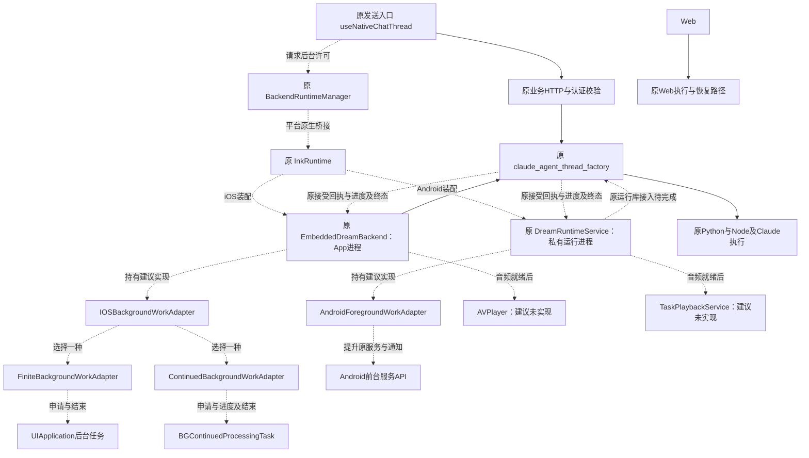

后台系统回调附着已由用户发起的原任务。系统回调创建Thread、重复派发Agent或迁移执行位置的次数均为零。Web入口不加载Native模块；复用现有平台解析与组合根完成装配。

### 适配器类图：统一接口与平台实现

下列类图表达建议代码责任，新增类型均未实现。iOS内部继续区分两种系统API；Android实现复用原Service。

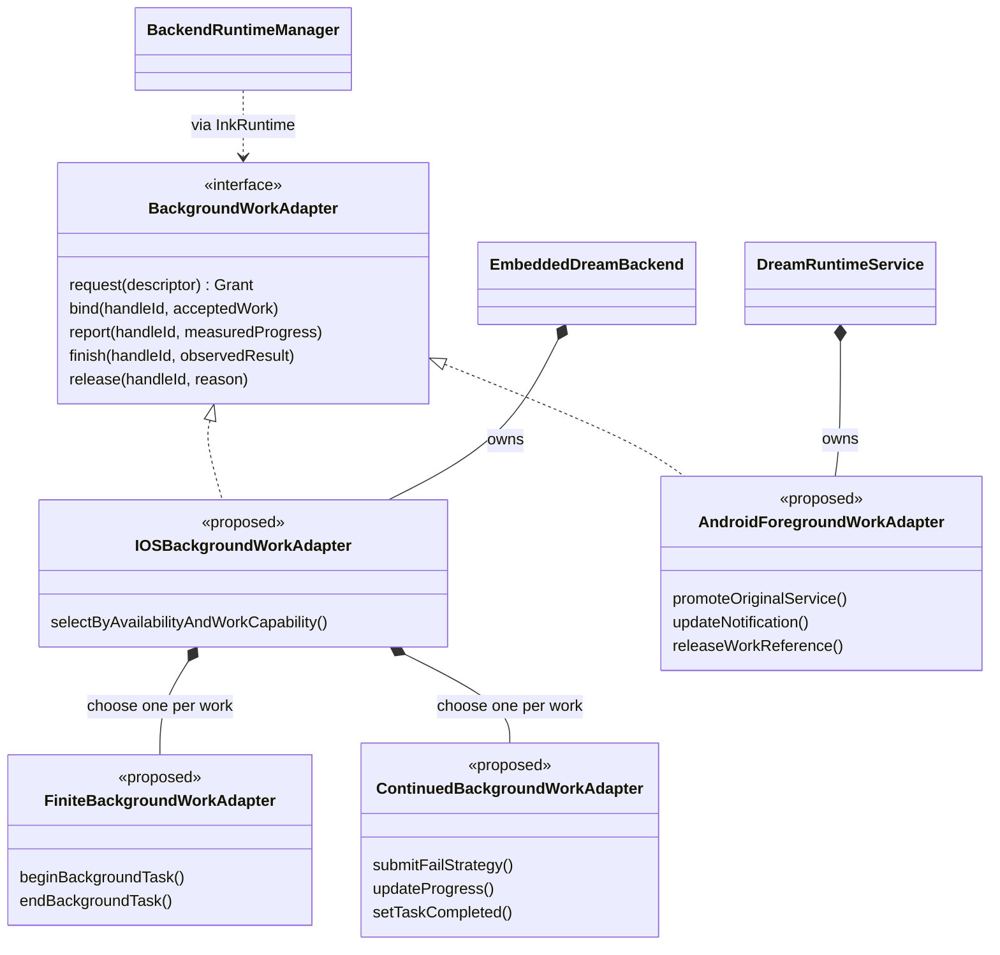

### 对象关系：句柄如何绑定原任务

本图为建议的内存对象关系图。RunBinding、BackgroundHandle与AudioOutput表示运行期关联对象，新增数据库表和持久化schema为零。原Thread与消息仍使用原业务记录。

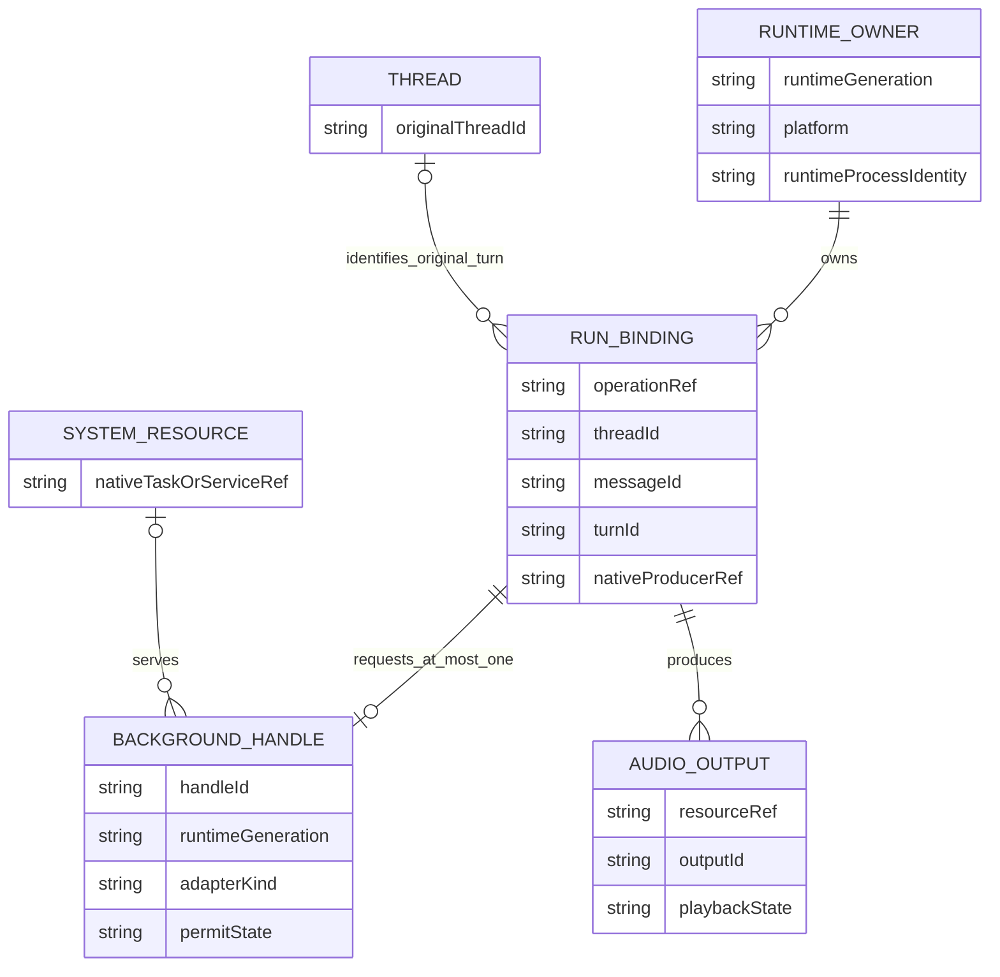

- 同一用户操作最多申请一个后台句柄。iOS系统任务与句柄逐次关联；Android多个活动句柄共享同一前台Service与通知生命周期，按活动引用释放，最后一个引用结束才降级服务。
- request早于原Thread/turn创建时，RunBinding只持operationRef；原Factory建立生产者后补齐原身份与nativeProducerRef，bind最多成功一次。
- runtimeGeneration来自原运行宿主：iOS使用当前App运行实例，Android使用实际:dream_runtime实例。Activity或RN页面重建不生成新的运行任务；运行进程重建使旧句柄失效。
- nativeProducerRef只由原Factory/宿主保存；JS、网页和外部输入不能指定生产者、终态或已保存事实。所有账户与Thread校验继续经过原公开入口。
- 一个turn可产生多个音频输出，按原资源及输出身份去重；音频完成不等于turn完成。重开恢复不自动重播或创建新输出。

### 接口契约与调用位置（建议、未实现）

以下为逻辑DTO与方法合同，具体Swift/Kotlin类型由对应平台实现；接口归现有宿主，未形成新业务API。

| 操作 | 调用者、输入 | 返回/副作用 | 失败处理 |
| --- | --- | --- | --- |
| request | 原发送入口经BackendRuntimeManager/InkRuntime；传本次用户操作引用、工作类型、音频输出要求；任务进度能力由宿主核实 | 返回handleId、adapterKind、requested/active/denied/unavailable；原生生成句柄与运行代次 | 缺Runtime返回unavailable；拒绝保留前台原业务，尚未存在的Android运行库保持fail closed |
| bind | 原宿主内部；传handleId与已认证原请求的threadId/messageId/turnId/原生产者 | 校验运行代次与同一提交，保存只读关联；提交归属就绪后方可退出POST reader | 归属冲突释放本次后台句柄并沿原读取核实；不重放写入 |
| report | 原生产者的内部观察；传同一handleId、实际已完成/总单位及单位含义 | 持续任务更新Progress；Android更新通知；有限实现仅保留事实 | 无可测总量时不生成百分比，不用Token、时间或字符数推算完成比例 |
| finish | 原宿主观察到原任务终态及保存回执 | 成功且保存确认后报告系统成功，失败按实际结果结束；系统资源释放一次 | 保存失败或终态未明时系统完成不写业务成功；原历史与状态继续核实 |
| release | 原宿主；传handleId和实际释放原因 | 串行校验、退出观察、关闭本句柄；Android递减本任务引用 | 重复或迟到调用幂等退出；保持其他任务和音频资源 |

许可事件使用granted、denied、expired、released及unavailable事实。事件带handleId与runtimeGeneration。bind/report/finish为宿主内部调用；RN只读投影许可状态，不接收设置业务终态的权限。release本身只释放后台资源，原任务中断由原执行者处理。

#### 原提交与后台句柄如何关联

1. 用户发送校验通过，原入口调用request；原生创建本次operationRef与handleId。
2. 原Native HTTP装配将句柄关联放入**本机传输内部上下文**，由既有请求所有者携带。该关联需补接线，新增公开HTTP header、URL参数和业务DTO字段为零；Web传输保持。
3. [NativeASGITransport](../../../backend/mobile_runtime/asgi_transport.py)为对应请求消费安装内部关联上下文。原认证/权限通过后，Factory在bg_task与current_turn_id建立时通知同一宿主；宿主核对原请求归属后bind。
4. iOS通过原同进程组合根完成观察；Android经原私有Binder通知实际运行服务，再投影到UI。精确关联的Native传输参数、内部上下文及Factory回调均为待实现项；前台reader不可用来替代这一观察。
5. 原POST懒启动阶段保持提交reader，直至生产者归属确认或原请求失败。绑定后UI可退出消息观察，原生产者及宿主终态观察保持。原[EventBus](../../../backend/claude_agent/event_bus.py)继续承载既有事件，不新增消息队列。

### iOS适配器操作

| 步骤 | 操作与条件 |
| --- | --- |
| 选择 | 编译SDK具备符号、运行时iOS 26及以上，原工作具备可测进度、结束回执和受控收尾时选择Continued；其他情况使用Finite。保留现有最低系统兼容 |
| Finite申请 | 用户工作开始前调用UIApplication.beginBackgroundTask；有效identifier记active；后台切换不重新申请或循环延长 |
| Continued注册与申请 | 在原宿主生命周期注册Bundle ID派生的允许identifier；前台用户动作触发submit，显式使用.fail；提交成功记requested，系统handler交付才记active |
| 系统handler | 核对原句柄及运行代次，只附着原工作。前台业务沿原入口执行一次，无需等待handler取得前台执行资格；迟到handler结束自己的过期任务 |
| 进度与结束 | 原执行者报告真实Progress；计算及保存结束后endBackgroundTask或setTaskCompleted；已结束但尚未交付的请求及时撤销 |
| 到期 | expirationHandler只说明许可结束，回调无原因参数；按原turn和生产者请求有界收尾，及时结束系统句柄，不等待无期限网络/模型/JS |

[Apple持续任务说明](https://developer.apple.com/documentation/backgroundtasks/performing-long-running-tasks-on-ios-and-ipados)要求前台用户动作、进度上报和结束处理，系统可因资源不足终止任务。[有限后台时间](https://developer.apple.com/documentation/uikit/extending-your-app-s-background-execution-time)需在工作开始前申请并及时释放；多个identifier共享系统给予App的时间。API版本依据[官方metadata](https://developer.apple.com/tutorials/data/documentation/backgroundtasks/bgcontinuedprocessingtask.json)。

普通Chat当前的text-delta、tool事件、局部计数和finish尚未接成该后台任务的完整进度契约。**待解决项为原生产者如何提供准确进度及宿主观察**；不能仅填写进度数字即声明合格。有限实现可先改善其许可区间，持续计算目标保留独立验收项。

### Android适配器操作

1. 先完成原DreamRuntimeService内Python/Node/Claude、原认证和公开业务入口。当前ensureStarted拒绝保持；仅增加通知无法补齐运行能力。
2. 在前台用户启动任务时，由InkRuntime经原RuntimeClient调用ContextCompat.startForegroundService启动原运行Service，并经原Binder关联本次request。Service在onStartCommand内及时调用ServiceCompat.startForeground提升并创建任务通知；原业务仍派发一次。
3. Android 14及以上按实际工作声明foregroundServiceType及对应权限。普通Agent工作需要先核对实际用途；未被既有类型覆盖的合法用途可评估specialUse，并声明PROPERTY_SPECIAL_USE_FGS_SUBTYPE及FOREGROUND_SERVICE_SPECIAL_USE。该选择属于待核对方案，Google Play对应声明需审查。
4. dataSync仅适用于符合其定义的数据操作，mediaPlayback仅用于实际播放，shortService只覆盖短时工作；不能将任意Agent计算统一归入这些类型。
5. 原Service持有活动工作与后台句柄；任务进度更新通知，点击返回对应原Thread。通知中显式停止操作沿原认证和精确turn停止；用户通过系统界面停止进程可能没有清理回调，恢复依赖原记录。
6. 最后一个计算引用结束后移除计算前台状态；Service仍有原前台绑定时保留既有宿主实例。无任务、无播放职责且无绑定时结束服务。onTimeout、Binder死亡与服务销毁按实际情况及时清理，START_STICKY重放任务和BOOT_COMPLETED自动启动退出本方案。

具体类型、权限、通知配置与目标SDK从原Android工程读取，不硬编码新版本阈值或运行时长。[启动规则](https://developer.android.com/develop/background-work/services/fgs/launch)限制从后台启动服务，[服务类型](https://developer.android.com/develop/background-work/services/fgs/service-types)定义权限与用途；后台执行时长及存活不作无限承诺。唤醒锁需按真实CPU执行需求独立评估，前台服务状态不自动授予永久唤醒或忽略电池策略。

### 计算到音频：独立所有权与交接

iOS播放器的独立开发合同归[iOS系统播放器开发文档](ios-system-player-technical.md)，直接定义原生播放器、Now Playing/Remote Command、ActivityKit仲裁、资源引用、桥接DTO和正常/异常时序。本文继续维护跨平台后台许可合同；新增native_media_prepare工作与AcceptedWork窄引用扩展按该专项共同实现，均为建议、未实现。

2026-11-04默认角色、媒体确认提示与确认后播放器规则归[独立iOS系统播放器设计](../../prd/mobile-app/ios-system-player.md)。原ThreadActivityWidget继续承担前版任务观察；新的媒体信息、系统播放控制、接收队列及终端推送保持建议、未实现，后续在原宿主职责内单独核对。

音频输入为原任务实际生成、当前账户可读取的音频资源引用及输出身份。Agent先冻结媒体计划并登记原ToolConfirmationStore确认；原服务取得本次明确批准、原宿主校验批准回执后才建立媒体会话。原笔记确认入口与媒体接线详见[iOS播放器确认合同](ios-system-player-technical.md#原笔记确认链的媒体接入)，该媒体接线为建议、未实现。待确认期间只展示原提示，v4.2角色保持；无新播放器、媒体字节读取和Now Playing发布。语音合成/生成能力按原任务与已配置能力核对；本文不增加语音模型或把文本直接当作可播放资源。当前尚无本文要求的原生播放实现，音频生成来源、格式与资源交接为开发前置。

| 平台 | 播放启动与存续（建议、未实现） | 计算与音频的结束条件 |
| --- | --- | --- |
| iOS | 原宿主核验原确认批准后持有AVPlayer；音频资源验证后激活AVAudioSession.Category.playback，Info.plist按实际播放声明UIBackgroundModes=audio；处理音频中断与路由变化 | 播放实际开始确认后可释放已完成计算的句柄，音频独立继续；播放结束或用户停止时释放播放器及会话 |
| Android | 原确认批准后，建议由专门TaskPlaybackService继承MediaSessionService持有Player与MediaSession，真实播放使用mediaPlayback声明与权限；独立于Activity及计算Service | 计算Service与播放Service分别持有自身前台状态；播放就绪后才退出已完成计算的引用，播放结束释放Player/MediaSession |

Android新增播放Service仅承载实际媒体与系统播放控制，计算继续由原DreamRuntimeService持有。控制入口需校验当前输出归属及允许的媒体控制客户端，资源引用沿原权限；不放宽私有计算Service的exported边界。 Android从后台启动或提升播放Service仍须满足当前系统的启动条件，计算前台Service存活不直接证明新增播放Service已获准。原媒体批准回执核验成功后才准备本次播放连接；实际资源就绪后再次核对启动资格，拒绝时保留待播放结果并沿原页面反馈。

交接顺序为：Agent提交媒体计划 → 原确认区域展示媒体信息 → 用户决定经原Store结算 → 原宿主核验批准回执及计划 → 展示播放器并准备资源 → 实际可播后播放。原计算许可在计算结束时释放；等待用户期间释放无实际进展的系统许可，原待确认业务状态沿原Store保存。用户回前台确认后，媒体准备按native_media_prepare独立申请适用许可。播放启动失败时保存原结果并反馈播放失败，及时结束已完成计算的许可。系统已挂起或结束运行进程时，禁止宣称音频能由未执行的本地回调自行启动。

暂停播放不取消原计算；原Stop继续处理任务。任务仍在计算时，计算许可与音频许可分别保持。完整结果已保存而音频仍播放时，计算许可可独立释放。音频缓冲耗尽、用户暂停或播放结束后，无音频期间的计算继续依赖计算适配器。[iOS播放能力](https://developer.apple.com/documentation/avfaudio/avaudiosession/category-swift.struct/playback)、[Apple用途规则](https://developer.apple.com/app-store/review/guidelines/#software-requirements)与[Android媒体后台服务](https://developer.android.com/media/media3/session/background-playback)分别约束对应平台。

### 正常调用时序：两端计算与按需播放（新增接口均建议、未实现）

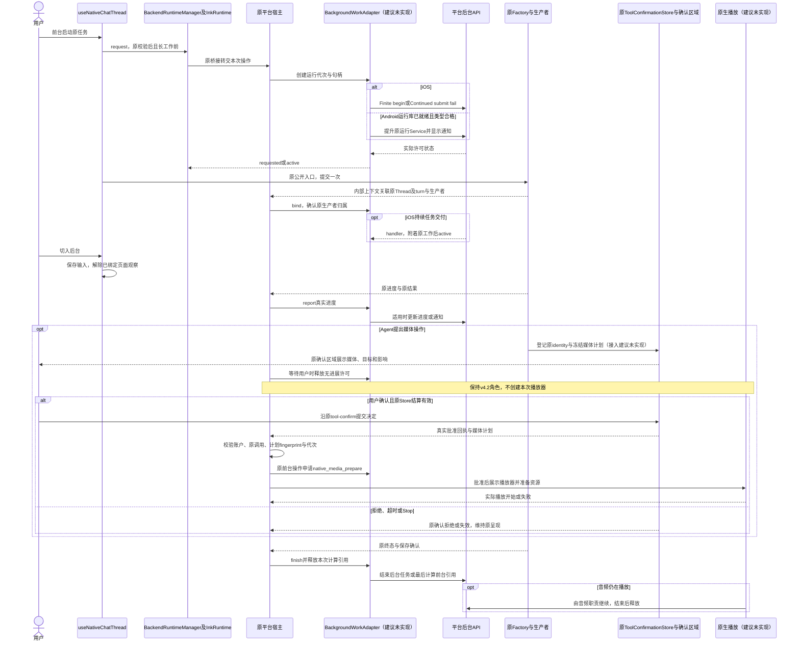

### 异常时序：拒绝、到期、精确收尾与重开

```mermaid
sequenceDiagram
    participant C as 原页面
    participant H as 原平台宿主
    participant A as BackgroundWorkAdapter（建议未实现）
    participant OS as iOS或Android
    participant F as 原Factory与生产者
    C->>H: request本次操作
    H->>A: 申请平台执行能力
    alt 系统拒绝或Runtime未就绪
        A-->>H: denied或unavailable
        H-->>C: 原前台反馈，后台承诺保持未取得
    else 许可有效，原任务已绑定
        OS-->>A: expiration或服务timeout
        A->>H: 许可结束，携带原句柄和运行代次
        H->>H: 核对原turn与原生产者
        alt 仍是原工作
            H->>F: 原内部精确中断适配（建议未实现）
            F-->>H: 可取得时返回原结果与保存事实
        else 任务已结束或已替换
            H->>H: 只退休旧句柄
        end
        A->>OS: 及时释放一次，不等待无期限回调
    end
    Note over OS,F: 进程被终止时可能没有清理回调，本机执行结束
    C->>H: 返回或正常重开，原启动与账户校验
    C->>F: 原GET消息与状态，必要时GET stream
    F-->>C: 原保存结果及真实运行状态
    Note over C,F: 自动重放Agent提交与自动Stop为零
```

### 后台句柄状态

```mermaid
stateDiagram-v2
    [*] --> Requested: 用户任务开始前request
    Requested --> Active: iOS有效句柄或task交付，Android提升成功
    Requested --> Denied: 平台拒绝
    Requested --> Unavailable: 原运行能力缺失
    Requested --> Released: 准备失败或工作已结束
    Active --> Active: 真实进度，页面前后台变化保持
    Active --> Expired: 系统expiration或服务timeout
    Active --> Released: 原终态与保存确认
    Expired --> Released: 精确收尾请求，及时释放系统资源
    Denied --> Released: 保留原前台与恢复
    Unavailable --> Released: 原错误反馈，不生成替代任务
    Released --> Released: 重复或迟到回调幂等退出
    Requested --> Invalidated: 运行进程结束
    Active --> Invalidated: 运行进程结束
    Expired --> Invalidated: 运行进程结束
    Invalidated --> [*]: 新运行实例只按原记录恢复
```

### 到期收尾、停止与读取恢复

原[stop_thread](../../../backend/claude_agent/thread_factory.py)按Thread定位当前bg_task。新增宿主中断入口须在原Factory内核对expected runtimeGeneration、turnId和生产者引用，匹配后复用原取消、持久化与结算；该窄适配为建议、未实现，后台旧回调不得停止后续turn或其他Thread。

用户Stop继续走requestClaudeSubmittedThreadStop及原回执。iOS expirationHandler无原因参数，系统界面取消和资源到期统一记录许可结束事实，业务终态只采信原生产者。Android系统直接停止服务/进程可能无回调，清理与恢复须覆盖该情况。

useNativeChatThread.closeReader需拆开页面订阅释放和准备取消。许可有效且生产者未确认时保持原准备与POST读取；确认后可退出呈现reader，原生观察保持。无许可或到期时取消未派发准备并恢复输入；提交结果未明只读核实。已派发写入始终按原请求身份处理。

返回前台调用原hydrateClaudeThreadSession读取messages/status；running才接续同Thread GET stream。进程重开使用正常启动与原账户校验，读取Settings选择指针、草稿和已上传资源引用，再查原记录。Settings不保存凭据、临时文件字节或任务执行栈；not_found不合成业务成功或取消。Writing侧对话经原入口重新准备活上下文，原发送保护保持。

### 应用内静态动画与iOS系统组件（源码候选，验证独立登记）

本增量对应[双入口产品规则](mobile-recovery-interaction.md#应用内静态动画与系统组件2026-11-03)。复用一份当前账户、本机运行代次的只读状态，分别交RN屏保层和iOS Live Activity。两种显示均不取得任务生命周期控制权。

#### 实现前基线与当前最小适配

| 代码事实 | 本增量适配 |
| --- | --- |
| [原status入口](../../../backend/routers/claude_agent.py):2792–2837经过原账户及Thread归属校验，`running`等于原`lifecycle == running` | 活跃口径沿原状态，SSE连接、页面可见性、CPU采样及后台许可均不代替任务状态。 |
| [Factory](../../../backend/claude_agent/thread_factory.py):1188–1189已提供`list_session_snapshots`；[Pool snapshot](../../../backend/claude_agent/thread_pool.py):280–289只有公共诊断投影；当前turn身份在[私有字段](../../../backend/claude_agent/thread_pool.py):195–201 | 列表快照缺少账户归属字段。沿`observe_thread_presence`内部观察接线，在Factory内按已认证`current_user_id`与原运行状态做只读聚合；既有公共snapshot和HTTP DTO保持。 |
| [Factory原启动](../../../backend/claude_agent/thread_factory.py):460–477记录本次身份并进入RUNNING | 从原状态转换观察首次及后续快照，覆盖全部入口；RN保留的主/侧页面和历史当前页仅提供局部状态。首次快照与观察登记需在同一事件循环序列完成，覆盖其间转换。 |
| [Native Hook](../../../frontend/app/_dream/components/chat/useNativeChatThread.native.ts)已有`visible`输入及Thread读取所有权；[Business](../../../frontend/src/App.tsx):123传入栏目与侧对话可见性 | 屏保显示时在同一输入增加可见条件，底层消息UI停止发布，原运行实例与事件处理保持。其他业务页面保持挂载。 |
| [StartupArtwork](../../../frontend/src/components/StartupArtwork.native.tsx)及[共享路径](../../../frontend/src/assets/startup-artwork.json)已有SVG、主题和减少动态效果处理；[package.json](../../../frontend/package.json)已有react-native-svg，无独立虚化组件 | 屏保叶子复用路径与主题，不挂载StartupScreen的启动文案或重新执行准备。候选已增加时钟指针及心情模式，原三套主题继续复用，视觉效果按Simulator截图验收。 |
| [StateChooser](../../../frontend/app/_dream/components/StateChooser.tsx)沿StateConfig及selectedState显示心情 | 屏保只消费当前账户当日已取得的心情；多笔沿原时间排序取最近已保存项。`unhappy`投影悲伤，原`happy`及其余值投影开心；其他／缺失值默认开心，不写回笔记或修改状态定义。 |
| [iOS工程](../../../frontend/ios/InkMemory.xcodeproj/project.pbxproj):505最低系统为16.4；[Info.plist](../../../frontend/ios/InkMemory/Info.plist)及当前工程未见Live Activity扩展 | 保持最低系统，按可用性装配ActivityKit；需增加Widget扩展及NSSupportsLiveActivities，候选已沿原签名配置派生扩展标识并装配目标，组件资源归同一来源。 |

#### 只读聚合与实例所有权

1. 原生产者宿主观察负责当前已认证账户的**完整本机运行集合**；聚合为`hasActiveThread: Bool`。任一归属已校验的原状态为RUNNING即可投影true；只有完整集合核实后才投影false。等待确认、停止收尾继续由原lifecycle决定。原输入队列和未来任务的业务状态保持，独立队列记录不直接增加该值。
2. 观察包内部带`ownerId/generation/sequence/observedAt`供归属、顺序及陈旧校验；这些元数据不增加业务状态。错误和不完整观察保持原值，首次缺少快照时不提供Bool。原actor、原状态和原持久化均只读，权限校验保持。
3. 原BackendRuntimeManager及平台宿主持有一份聚合快照与订阅，生命周期归当前认证与运行代次；退出登录／换账户清理旧订阅、快照及活动，迟到事件拒绝更新。宿主观察独立于可卸载的RN页面和本地SSE reader，覆盖主、侧及其他本机任务；没有原生观察接线时，此项完整性保持未通过。
4. 屏保层只在可见时消费状态与既有心情快照；ActivityKit接线由原iOS宿主持有，单账户仅一张本轮汇总卡。布尔值变化或必要的进入后台／恢复核对触发发布；逐token推送、独立网络轮询和新的监测进程为零。

#### 候选代码与实例归属（2026-11-03）

| 实例／接口 | 归属与生命周期 | 行为 |
| --- | --- | --- |
| `ThreadFactory.observe_thread_presence` | 原Factory事件循环；当前账户订阅注册到原生账户退出 | 原RUNNING转换后汇总全部本机Thread，初始回执与登记无await；观察异常保留原业务 |
| `mobile_runtime.ios.thread_presence` | 原持久CPython循环；单账户generation绑定 | 二值变化去重并附sequence，旧generation释放不清理新绑定 |
| `NativeThreadPresence` | 原InkRuntime模块；同一正常Session校验后的订阅 | 原`/auth/session`核对user.id，拒绝重定向；同时发布RN事件与ActivityKit；换账户清理 |
| `BackendRuntimeManager` 的presence store | 原App管理器；当前公开owner绑定 | 丢弃旧账户、旧时间及错误回执，未知时省略状态行 |
| `useIdleScreenSaver` | 原Business实例；前台且无占用时一个timeout | genuine触摸更新25秒期限；键盘、心情弹窗、原生选择器／确认和诊断占用延后 |
| `IdleScreenSaver` | 仅覆盖期间挂载；关闭／后台释放 | 每秒指针、原SVG、当日已知心情和同一二值；原页面保持挂载，关闭触摸消费 |
| `ThreadActivityWidget` | iOS ActivityKit管理的独立扩展 | 同一hasActiveThread内容，最近确认标记；false结束本轮，系统决定移除时间 |

`InkRuntime.canShowIdleOverlay`在计时届满时检查当前可见UIKit编辑视图及可见WKWebView的`document.activeElement`编辑属性；查询仅返回布尔值，不读取正文。WKContentView在DOM失焦后仍可保留UIKit responder，因此Web文档使用DOM焦点作为占用依据；隐藏文档跳过。原生确认、系统选择器和诊断占用继续延后显示。

`InkIdleBackdrop`为原生系统材质视图，未保存底层截图。心情通过既有`chooser-view.createdAt`只读投影；chooser.expanded占用回调沿Writing→MoreNavigator→Business传递。新增HTTP、表、APNs、后台常驻和任务控制接口数量为零。Android虚化及系统组件保持未验证。

#### App内无操作层

`frontend/src/components/IdleScreenSaver.native.tsx`提供单一呈现叶子，计时与显示状态由原Business持有，不新增业务管理器。前台且已登录、无键盘焦点及模态交互时，按Notion产品值25秒登记一个可取消timeout；用户触摸、滚动、按键及导航更新最后操作时间。原生局部Web文档沿原焦点／交互观察接入；缺少必要信号时只补文档范围的交互通知，带原documentId/revision，不含正文，不改变业务DTO。

显示前复核账户、页面、前台状态和交互占用，防止迟到timeout盖住确认操作。前后台、页面／账户卸载和任何计时重置清理旧timeout。屏保覆盖业务内容，底层保持挂载；显示期间屏蔽底层触摸与辅助功能焦点，整次关闭手势由屏保消费，恢复原焦点与滚动位置。原工具确认到达时关闭屏保并交原确认UI，保持原权限要求。

SVG路径与画面布局复用现有素材；开屏表情与屏保时钟共用StartupArtwork，当前可见前台实例维护一个整秒计时，隐藏与后台立即停止。时钟模式使用实际本地时间定位三根指针；减少动态效果时取消形变并直接更新真实时间。秒级显示只更新图形，Thread状态由独立的原宿主观察提供。最低一秒开屏展示计时保持原规则，v4.2图形及设备验证按下方现行章节和专项执行记录登记。

页面虚化需核实当前RN渲染能力。当前Info.plist声明`RCTNewArchEnabled=false`，实施优先在原宿主加局部UIVisualEffectView呈现适配；Android按原平台渲染能力核对最小实现。半透明遮罩只作为视觉降级反馈，虚化缺失单列验收；为此升级RN架构、抓取并保存页面截图或加入通用特效框架退出范围。屏保、计时和模糊均不调用后台许可的request/release，不启动新的Runtime。

#### 共享角色／时钟渲染（v4.2）

`StartupArtwork.native.tsx`为唯一角色渲染入口；`StartupScreen`与`IdleScreenSaver`只传模式、心情、尺寸和可见性。iOS的`InkKastentionClock`平台视图将同一七条原路径、十二时位与预声明关键帧交给Core Animation。共享数据由`sync-clock-artwork.py`从用户v4.2原型和原SVG数据生成；该生成器复用现有字体构建工具fontTools 4.60.1，应用依赖与锁文件保持。

```mermaid
flowchart LR
    Startup[StartupScreen] -->|happy与原可见性| Shared[StartupArtwork]
    Saver[IdleScreenSaver] -->|clock与当日心情| Shared
    Shared -->|iOS显示属性| Native[InkKastentionClock]
    Native --> Paths[kastention-clock-v4.2.json]
    Native --> Time[InkClockTime]
    Native --> Animation[Core Animation关键帧]
```

候选包括RN SVG的JS插值、局部WebView和原生图层关键帧。JS插值需要逐帧脚本工作，局部WebView增加独立文档实例；原生图层关键帧复用UIKit，满足原路径、预声明时序和无JS逐帧要求，作为本轮选定适配。

单个可见实例维护一个对齐整秒的一次性Timer。`InkClockTime`定义设备本地离散角度与连续整秒判断；分钟、小时边界分别推进一格，漏秒、时间或时区修正直接定位。`CAKeyframeAnimation`执行指针transform及三条发丝path关键帧，嘴部采用原路径间的290ms形变。JS逐帧回调、Bezier采样、WebView、动画框架和独立渲染进程新增数量为零。隐藏、后台与卸载清理timer及在播动画；减少动态效果继续整秒读时并直接定位。

原生资源缺失时保留原静态StartupArtwork图像，构建资源校验与Simulator视觉验收识别该降级。Android当前沿同一组件入口采用静态SVG及整秒位置，Native发丝关键帧和十二时位适配资格保持待验证。系统Live Activity继续使用同源静态SVG图标，时钟动效的执行范围为App内共享组件。

平台依据：2026-11-03读取本地react-native-svg 15.15.0实现及[官方项目](https://github.com/software-mansion/react-native-svg)，当前接口采用其已支持的元素；iOS预声明关键帧使用[CAKeyframeAnimation](https://developer.apple.com/documentation/quartzcore/cakeyframeanimation)、[values](https://developer.apple.com/documentation/quartzcore/cakeyframeanimation/values)及[keyTimes](https://developer.apple.com/documentation/quartzcore/cakeyframeanimation/keytimes)。HTML的SMIL时序转换为原生关键帧，保留设计数值和路径。

#### iOS锁屏／灵动岛

- `InkThreadActivity`为一个Widget扩展目标，文件归`frontend/ios/InkThreadActivity/`；最小内容为ActivityAttributes与SwiftUI呈现。原App和扩展共同编译同一Attributes类型，动态`ContentState`只含`hasActiveThread: Bool`。共享StartupArtwork资源源文件及两套主题视觉，扩展中不加载React Native、WebView、Python或Node。
- 原iOS宿主`NativeThreadPresence`经当前账户运行观察调用ActivityKit。前台原任务确认活跃后使用`Activity.request`创建活动；系统未授权或拒绝时沿原诊断记录，原任务继续。系统后台执行句柄及其强制进度要求继续归前文适配器，本组件字段保持有／无。
- App可执行期间使用`Activity.update`发布有／无；最后一条确认结束时以false作为`Activity.end`最终内容，由系统决定保留与移除。新的前台任务开启新一轮活动，不循环创建活动延长展示。同一连续活跃期仅成功创建一次；用户移除卡片后该期保持退出展示，全部空闲后再次活跃开启新一轮。原Stop仍在原业务入口。
- 固定显示“最近确认”，保留`ActivityContent.staleDate`陈旧语义：采用该次后台许可可确认的有效截止，无可确认截止时按本次观测时间标记。扩展保持最近二值并采用系统陈旧呈现；不增加“未知”状态或把观察失败写成false。App真正挂起／结束后无本地持续刷新承诺；返回时用`Activity.activities`核对并结束遗留、重复及旧账户活动。
- 点击采用系统默认打开App，随后由原SessionGate、唯一启动Promise和nativeChatRecovery读取恢复。该汇总卡不携带Thread ID、正文、账户ID或凭据；OAuth专用scheme及回调合同保持。多个活跃Thread沿原Chat历史入口查看，新增路由协议为零。

本轮为拟议文档：原生观察、屏保事件、时钟／心情、虚化、Widget扩展和ActivityKit调用均未实现。状态完整性、关闭手势穿透、焦点／确认、原Web相邻回归、系统挂起及进程重开需分别验收。背景服务、APNs服务、数据库表、离线库及独立监测轮询为零。

## 开发拆解与验收

| 开发项 | 归属与修改范围 | 必须取得的证据 |
| --- | --- | --- |
| 统一合同和平台装配 | 原BackendRuntimeManager、平台解析与InkRuntime桥接 | iOS/Android加载各自实现；Web零适配调用，原启动Promise保持 |
| 工作精确关联 | 原Native传输、ASGI、Factory与平台组合根；Android原Binder | POST懒启动前后取消、原turn绑定、旧句柄和迟到handler、零重复派发 |
| iOS两个实现 | 原EmbeddedDreamBackend、InkRuntimeModule、App入口、Info.plist | Finite与Continued各自实际系统回调、真实进度、单次结束与到期处理 |
| Android本机运行前置 | 原InkRuntimePackage、DreamRuntimeService、运行库和认证接线 | 实际手机内Runtime、原账户与公开业务入口；缺失继续unavailable |
| Android后台适配 | 原Service、Binder、Manifest及通知配置 | 合格类型与权限、前台启动、可见通知、多工作引用、timeout/系统停止/进程结束 |
| 音频交接 | iOS宿主AVPlayer、Android媒体播放Service、原音频输出资源 | 无音频时零播放，资源校验、开始确认、中断/失败、独立释放；不借播放替代计算许可 |
| 页面与输入恢复 | 原Chat hook、nativeChatRecovery、Business及SessionGate | 原Stop、确认、主/侧草稿、Writing保护、账户切换、附件恢复及零自动重发 |

先完成精确关联、原生观察与受控收尾合同，再分别接平台实现；iOS持续路径需准确进度，Android需本机运行库与服务用途条件。隔离合同验证、Simulator/模拟器、真机和正常账户模型验收分别留证。文档图示和静态检查只确认设计结构。

## 方案评审

选择“同一原业务执行路径、两个平台适配、iOS内部两种系统机制、音频独立交接”。该结构直接对应平台后台API及既有宿主差异；Web保持原路径。用户任务在原入口启动，适配器结束时只释放本次系统资源。

当前方案给出了开发边界和调用合同。普通Chat准确进度、原生产者宿主观察、精确到期中断、Android本机Runtime/前台服务资格及音频资源来源仍是开发依赖；持续后台计算的产品目标须用实际任务验收。无限常驻和进程终止后继续本地执行超出系统能力承诺。

## 官方资料

2026-11-03核对当前官方资料；平台版本与目标SDK在实施时按实际工程复核。

- [Apple持续后台任务](https://developer.apple.com/documentation/backgroundtasks/bgcontinuedprocessingtask)：系统进度展示、取消和资源回收。
- [Apple expirationHandler](https://developer.apple.com/documentation/backgroundtasks/bgtask/expirationhandler)与[完成API](https://developer.apple.com/documentation/backgroundtasks/bgtask/settaskcompleted(success:))：系统任务结束合同。
- [Apple音频会话使用指引](https://developer.apple.com/library/archive/documentation/Audio/Conceptual/AudioSessionProgrammingGuide/AudioGuidelinesByAppType/AudioGuidelinesByAppType.html)：实际播放、音频会话释放和中断处理。
- [Android用户停止前台服务](https://developer.android.com/develop/background-work/services/fgs/handle-user-stopping)：系统停止与回调限制。
- [Apple Live Activities](https://developer.apple.com/documentation/activitykit/displaying-live-data-with-live-activities)：2026-11-03查阅；Widget扩展及SwiftUI呈现、ActivityKit请求／更新／结束、系统保留期限和重开核对。官方Markdown通过同源`.md`地址读取。
- [Apple Activity.update](https://developer.apple.com/documentation/activitykit/activity/update(_:))与[ActivityState.stale](https://developer.apple.com/documentation/activitykit/activitystate/stale)：2026-11-03查阅；前后台可执行期间更新及陈旧数据语义。组件展示、应用内屏保与系统后台执行资格分别处理。

````
