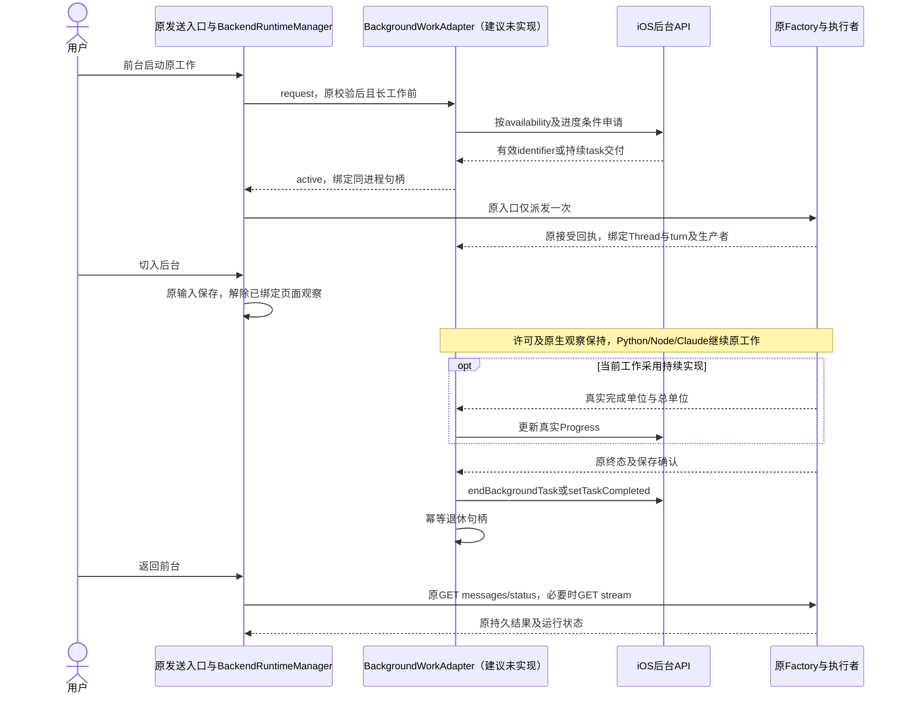
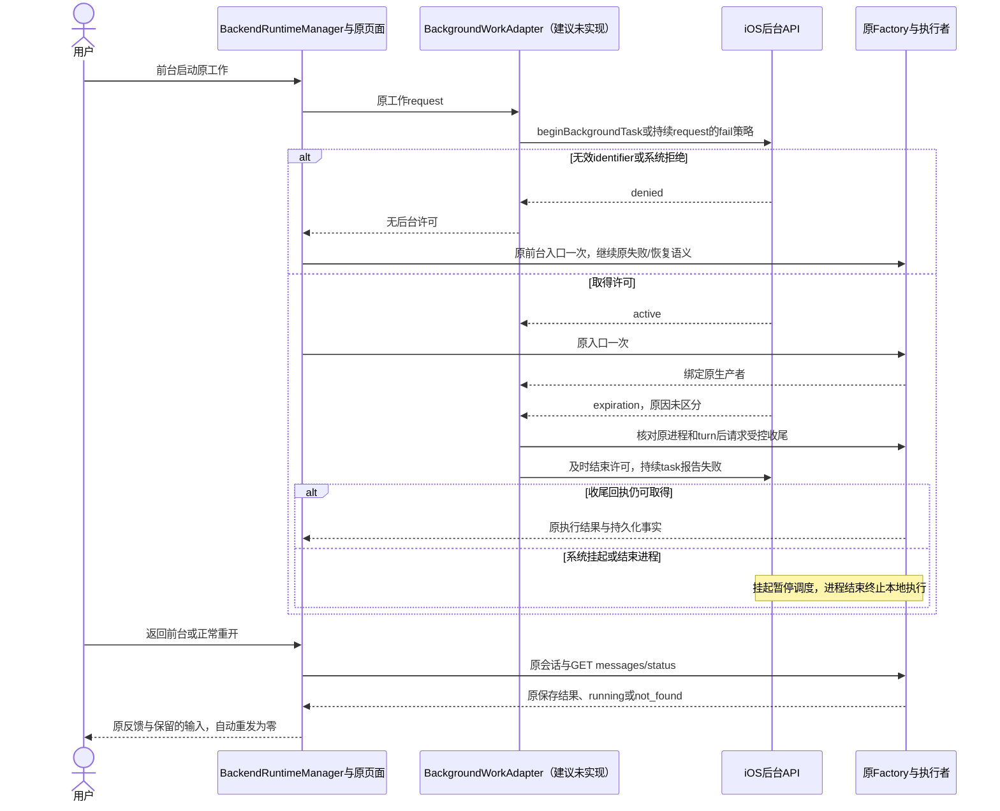
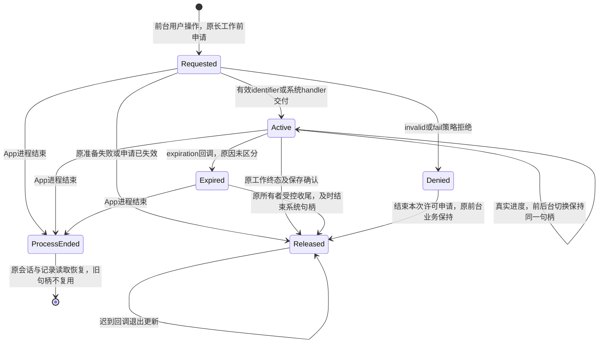
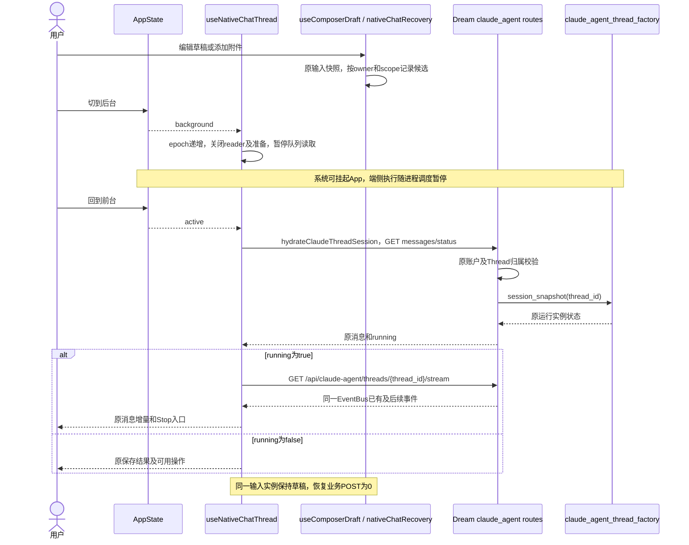
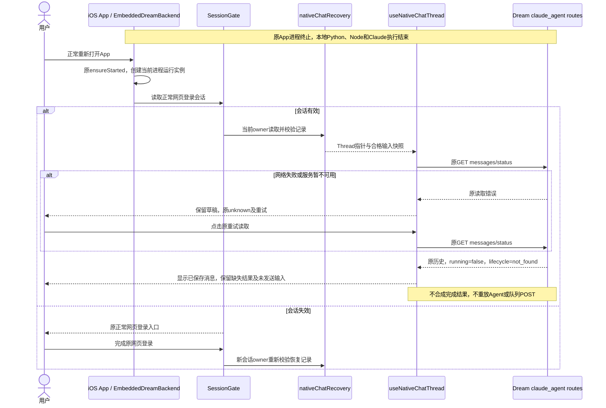
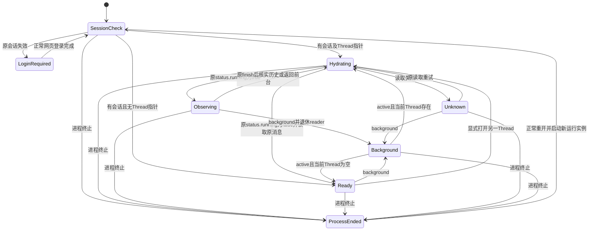

<!-- [Input] iOS后台执行API、原端侧工作所有权、用户前台操作及恢复接口。 -->
<!-- [Output] 两种后台执行适配、系统许可与业务状态、受控收尾及原恢复路径。 -->
<!-- [Pos] APP-04专项解决方案；执行进度与验证回执归exec。 -->
<!-- [Sync] 2026-11-03: 补有限后台时间与iOS26持续后台任务适配方案；新增接口均为建议、未实现，保留原三幅恢复图。 -->
<!-- [Sync] 2026-11-03: 删除打包、其他任务及项目状态叙述，正文集中定义恢复处理。 -->

# APP-04 iOS 前后台与进程重开恢复方案

## 背景与问题

当前问题为：用户在前台发起的Agent工作进入后台后缺少适用的执行时间保障，再次打开时还需恢复原对话、任务结果和未发送输入。处理顺序为：在原工作开始时申请适用的后台时间，许可有效期间继续原Python、Node和Claude执行；系统收回许可、挂起或结束进程后，沿原记录恢复读取。

iOS负责挂起和资源回收。App的background回调负责界面观察和输入保存，后台许可的申请与释放由原生宿主负责。当前`useNativeChatThread`在background关闭reader与准备任务，`BackendRuntimeManager`提供启动与诊断；两者尚未接入本稿建议的后台许可接口。

音乐App的后台音频来自`AVAudioSession.Category.playback`及对应的`UIBackgroundModes=audio`用途。Dream的Agent计算采用任务执行API。音频模式保持音频播放的职责，普通计算使用音频模式持续运行退出本方案；用途规则见[Apple playback](https://developer.apple.com/documentation/avfaudio/avaudiosession/category-swift.struct/playback)及[App Review 2.5.4](https://developer.apple.com/app-store/review/guidelines/#software-requirements)。

## 目标与边界

使用户前台发起的同一次工作在系统许可期间继续执行，兼容有限后台时间和iOS 26持续后台任务。返回前台后读取同一Thread及其任务状态；进程重开后恢复已保存消息、对话选择和未发送输入。Python、Node及Claude继续在App内执行，认证、权限、发送和Stop沿原业务。

采用现有iOS宿主、`BackendRuntimeManager`、原任务所有者、Settings和HTTP读取路径。后台常驻、跨进程自动续跑、任务迁移、音频保活、离线数据库、新业务HTTP和新队列退出本方案。系统资源不足时保留原前台业务能力与读取恢复，后台持续执行时长由系统决定。

## 概念与规则

### 解决步骤

1. **用户启动原工作时申请。** 原发送校验通过后、首次异步准备和原任务派发前，由`BackendRuntimeManager`请求原生适配器。后台申请只附着这次用户操作；原业务入口执行一次。原Thread、message和turn标识生成后补充到同一句柄。进入background时继续已有申请，页面切换不重复申请或延长预算。
2. **许可有效期间保留原业务执行。** App不因background主动关闭Python、Node或Claude。原Factory继续持有生产者；页面可以退出观察，原生许可与终态观察保持。原POST尚未取得生产者归属时，保留提交读取直到归属确认或原请求失败，避免关闭懒启动入口。挂起由系统执行。
3. **到期时受控收尾。** 原生expiration回调先记录许可失效，停止该工作新增后台步骤并请求原工作所有者尽快收尾。该请求绑定同一进程和原turn，原业务终态继续由真实执行与持久化回执确定。许可句柄按API及时结束，后台回调不冒充用户Stop、不重发内容。
4. **返回前台重读同一Thread。** 复用原启动结果与会话读取，调用`hydrateClaudeThreadSession`读取messages/status；`running=true`接续同Thread GET stream，其他状态展示已保存消息。网络失败保留输入和unknown，沿原重试；恢复业务POST为0。
5. **进程重开恢复读取与输入。** 原进程中的Python、Node和Claude执行结束。新进程按正常启动、会话及owner校验读取Settings指针、草稿和已上传附件引用，再经原接口读取消息。`not_found`保留已保存消息和缺失结果，不合成completed/cancelled，不自动续跑或重发。主/侧范围独立，Writing发送由用户经原写作入口重建活上下文；上传中附件提示重新选择。
6. **实际终止按证据定位。** 对齐问题时间、原/新PID和系统日志，分别核实页面遮挡、挂起、崩溃和jetsam。许可失效、reader断开和网络超时分别记录对应事实。

### 后台执行适配器：职责与选择

`BackgroundWorkAdapter`接口和两个实现均为**建议、未实现**。接口在现有`BackendRuntimeManager`与`InkRuntime`桥接职责内使用，原生实现归`EmbeddedDreamBackend`所持宿主生命周期；不另建Manager、执行平台或业务通道。

| 实现（建议、未实现） | 选择条件 | 系统职责与交互 |
| --- | --- | --- |
| `FiniteBackgroundWorkAdapter` | 旧版iOS，或当前工作缺少持续任务所需的真实进度 | `UIApplication.beginBackgroundTask`在工作开始前申请；取得有效identifier后允许有限后台执行；完成或到期时`endBackgroundTask`一次 |
| `ContinuedBackgroundWorkAdapter` | 编译SDK包含API、运行于iOS 26及以上，且本次用户工作具备明确结束条件、真实进度和受控收尾 | 注册并提交`BGContinuedProcessingTaskRequest`；系统交付`BGContinuedProcessingTask`后附着原工作，更新真实`Progress`，结束时调用`setTaskCompleted(success:)` |

新实现以`#available(iOS 26.0, *)`进行运行时选择，实现编译需包含对应SDK符号。原最低系统要求保留。iOS 18使用有限时间实现；iOS 26上未具备进度或收尾条件的工作同样选择有限实现。API首次引入版本由[官方metadata](https://developer.apple.com/tutorials/data/documentation/backgroundtasks/bgcontinuedprocessingtask.json)标为26.0。系统拒绝已选实现后，保留原前台执行及恢复路径；同一次操作不循环切换实现或重新申请来延长后台时间。

持续任务显式设置`.fail`策略，保持交互任务的即时执行语义。Apple默认`.queue`可能让系统延后交付任务；本方案退出该默认队列，由原业务处理前台工作。`submit`成功仅表示申请已受理，收到系统handler前统一记为`requested`，后台执行许可记为`active`需要handler实际交付。旧句柄已释放或原工作已结束后，迟到handler只结束对应系统任务，业务提交次数保持。

原前台业务在申请发出后沿原入口执行，保持自身校验和错误反馈；系统handler仅附着该工作，业务执行无需等待新系统回调才获得前台运行资格。工作提前结束时，撤销尚未交付的系统请求；已交付的任务按实际结果结束。等待用户工具确认时保留原权限与等待状态，释放无实际进展的后台许可；用户沿原确认入口继续时再按本次显式操作核对适配资格。

系统允许的并发数、可用时长和剩余时间均属于系统事实。多个有限时间identifier共享App可用执行时间；新增句柄数量不会生成额外时长。系统排队请求会在用户从App切换器关闭App后取消，见[queue规则](https://developer.apple.com/documentation/backgroundtasks/bgcontinuedprocessingtaskrequest/submissionstrategy/queue)。原生注册identifier以实际Bundle ID派生，允许项归原`Info.plist`，不写业务账户或消息正文；本方案只使用CPU/网络能力。

### 小型接口契约（建议、未实现）

| 操作 | 输入与返回 | 边界 |
| --- | --- | --- |
| `request(work, callbacks)` | 当前用户操作、可测进度能力；返回当前进程的opaque `handleId`及许可状态 | 申请在长工作前发起；授权、消息生成和派发仍由原模块处理 |
| `bind(handleId, acceptedWork)` | 原业务确认的threadId、messageId、turnId和执行者引用 | 申请早于标识生成时先保留本地句柄，原回执补齐归属；系统handler不创建Thread或turn |
| `report(handleId, measuredProgress)` | 原执行者提供的已完成单位、总单位及单位含义 | 同一实际工作单调更新，末尾仍须等待原终态与保存确认 |
| `finish(handleId, observedResult)` | 原成功/失败回执和持久化确认 | 成功且保存确认后向系统报告成功；其他结束按系统任务失败释放，业务记录沿原结果 |
| `release(handleId, reason)` | 原工作结束、许可到期、准备失败或句柄失效 | 在原生串行生命周期内幂等释放一次；业务Thread和任务状态保持原所有者 |

回调只包含`granted`和`expired`等许可事实。句柄关联原生进程代次与已绑定工作；旧进程、旧turn和已释放句柄的回调退出当前工作更新。原后台宿主保持独立于页面的进度、终态与收尾观察，页面卸载仅解除呈现观察。

### 页面、许可与任务状态

| 对象 | 状态与来源 | 含义 |
| --- | --- | --- |
| 页面可见性 | `AppState`的active/inactive/background | 决定呈现、输入焦点及页面观察 |
| 后台许可（建议、未实现） | `requested / active / denied / expired / released`，由原生系统API产生 | 只说明该工作当前的后台执行申请与许可 |
| 进程 | PID、进程代次及系统日志 | 存活、挂起或已结束；JS计时器和网络连接不足以单独判定 |
| 原工作 | 原Factory的running、真实terminal事件及保存结果 | 决定原消息、Stop可用性与业务结果；系统API完成回执只结束系统任务句柄 |

许可active与页面background可以同时存在。许可expired时原工作可能仍在收尾；此时保持原running/待核实反馈。进程终止后，许可关联与本地执行同时结束。

### reader断开与原生产者

当前[公开POST入口](../../../backend/routers/claude_agent.py#L1536)在响应开始消费时调用原Factory；[Factory工作创建](../../../backend/claude_agent/thread_factory.py#L464)将生产者放入独立`bg_task`并由原实例持有。该阶段之后，subscriber的finally只unsubscribe；[GET订阅](../../../backend/claude_agent/thread_factory.py#L696)同样独立释放订阅。[原生ASGI cancel](../../../backend/mobile_runtime/asgi_transport.py#L179)取消的是对应HTTP响应任务。源码支持“生产者已建立后释放reader继续执行”的判断，端侧完整取消链仍需对应旅程验证。

建议将`useNativeChatThread.closeReader`中的页面观察释放与尚未派发的准备取消分开使用。许可有效时保留用户已启动的准备与提交；收到原生产者归属后才允许解除提交reader。原生终态观察保持至原工作结束或受控收尾，后台页面轮询可以暂停。许可未获准或到期时，未派发准备沿原AbortSignal和输入失败恢复处理；已经派发且回执未明时保留原unknown读取核实，业务POST不重放。

### 真实进度与当前缺口

| 当前来源 | 可确认的事实 | 持续后台任务适配条件 |
| --- | --- | --- |
| Chat的text-delta、message-metadata、tool事件及原finish | 接受、增量内容、工具阶段、真实结束 | 未提供可直接使用的全程工作总量。字符数、Token上限、工具调用次数和定时器均不能代替完成比例；当前普通Chat按有限实现设计 |
| 原任务status、todos、Reflections统计与result_count | 原状态、局部计数或结果数量 | 总量可能动态变化，尚未形成与系统任务一致的可测进度契约；持续实现资格待逐任务核对 |
| 原上传进度 | 原上传实例实际已发送/总字节 | 只能表示该次文件传输，Agent计算继续使用其自身事实；本方案不把上传百分比作为Agent进度 |
| 明确数量的用户操作（若原执行者具备） | 已完成项/计划总项以及相同结束条件 | 经原生产者暴露真实进度并确认保存后，才允许选择持续实现；适用任务需单项验证 |

当前`BackendRuntimeManager`只观察启动和错误，尚无脱离UI的turn进度/终态观察与精确收尾入口。最小适配是：由原Factory/EventBus通过同进程宿主通知既有运行实例的接受、进度及终态，绑定原thread/turn/生产者；native回调投影给原管理器。该观察不另建EventBus、业务HTTP或队列。原[service事件处理](../../../backend/claude_agent/service.py#L3494)还会忽略部分`tool_progress`事件，接入前需核对这些事件的实际含义和总量；本方案不宣称现有Agent任务均具备持续执行资格。

### 到期、用户取消与受控收尾

Apple的`BGTask.expirationHandler`无原因参数；持续任务的系统界面取消会触发该handler，系统收回时间或资源变化也可能终止任务。统一登记`background_expired`许可事实，具体原因保持未区分。来源依据为[长期任务说明](https://developer.apple.com/documentation/backgroundtasks/performing-long-running-tasks-on-ios-and-ipados)、[expirationHandler](https://developer.apple.com/documentation/backgroundtasks/bgtask/expirationhandler)和[完成回执](https://developer.apple.com/documentation/backgroundtasks/bgtask/settaskcompleted(success:))。

1. 宿主在系统回调内停止本次工作继续新增后台步骤，向同进程原执行者发出有界的受控收尾请求。请求必须核对进程代次、threadId、turnId及原生产者引用；旧回调不得停止后续turn或其他Thread。
2. 原用户点击Stop继续走`requestClaudeSubmittedThreadStop`及原回执。系统expiration不调用用户Stop的提交意图逻辑；需要原执行者中断时，沿其既有取消机制处理，来源记为后台许可到期。
3. 当前`stop_thread(thread_id)`以Thread定位当前任务。建议在原Factory内为宿主增加“预期turn及生产者一致时中断”的窄适配（建议、未实现），复用原取消、持久化和结算；精确归属、准备阶段取消与原生调用回执均待验证。
4. 系统handler不直接写业务completed/cancelled。原执行者实际取消后，沿原流程产生真实结果；仅许可失效、收尾尚未确认或进程已被回收时保留待核实/缺失结果。原公开状态枚举和正常Stop语义保持。
5. 有限实现完成必要收尾后及时`endBackgroundTask`；持续实现根据原回执结束，expiration或失败调用`setTaskCompleted(success:false)`。释放不等待无期限的网络、模型或JS回调，超时与系统强制终止仍可能发生。每个系统句柄的完成/释放只执行一次。
6. 原工作已经结束时，迟到expiration只退休旧句柄；原系统任务已经释放后，迟到finish不重复调用系统完成API。原进程结束后，只按原记录恢复读取。

### 正常时序：申请后继续同一次工作（新增接口均为建议、未实现）

### 异常时序：拒绝、到期与恢复（新增接口均为建议、未实现）

### 后台许可状态（建议、未实现）

下列原三幅图保留恢复子流程。它们描述页面观察及原读取；许可有效期间的工作执行采用上方新增时序。原图中取消准备的处理用于未获许可或许可退出后的未派发准备，生产者已建立后的reader释放仅解除观察。

### 实例生命周期

| 实例/数据 | 创建与存续 | 进入后台 | 回到前台 | 进程终止与重开 |
| --- | --- | --- | --- | --- |
| iOS App、RCTBridge | 正常启动创建，App进程所有 | 系统可挂起进程，业务执行时间由系统决定 | 仍存活时沿原实例恢复 | 原实例释放；重开创建新实例 |
| EmbeddedDreamBackend、CPython、Node、Claude | 原启动入口一次装配，执行归App进程 | 系统挂起期间执行暂停 | 同进程复用启动事实，任务状态由原查询确认 | 本地执行结束；重开重新启动服务并读取已保存结果 |
| BackgroundWorkAdapter与系统句柄（建议、未实现） | 原生宿主持有，用户原工作开始时申请；独立于RN页面 | 许可有效时维持原工作观察，失效后及时收尾和释放 | 同一次工作复用现存句柄；已失效句柄退出复用 | 原进程句柄作废；重开只读取原业务记录 |
| SessionGate | RN根实例所有 | 保留原会话展示，系统授权遮挡可产生inactive | 合并重读；读取失败保留原页面及重试；失效沿正常登录 | 原平台会话可用性由原读取确认，Settings记录不授予权限 |
| Business、useNativeChatThread | 当前账户及主/侧页面所有 | 暂停页面轮询；已确认生产者后退休呈现reader，许可有效期间保留原准备与生产者 | history/status重读，running才接续GET stream | 从合格指针恢复读取位置；消息及结果由原服务返回 |
| useComposerDraft、上传实例 | 原输入卡所有 | 同实例保留输入，候选接收状态快照 | 保持文本及当前附件；失败沿原输入反馈 | 仅恢复已保存草稿和已上传引用；未完成上传由用户重新选择 |
| Settings恢复记录 | 当前已验证owner下的main或thread作用域 | 随输入状态写入，持久化时机待目标验证 | 校验schema与owner后使用 | 读取失败忽略记录并记固定错误类别；禁止从记录推断登录或任务状态 |
| 已保存的Thread和消息 | 原持久化与归属校验所有 | 保留已接受写入 | 原GET查询 | 已保存数据保留；内存EventBus及CLI执行栈随App进程结束 |

### 最小修改范围（后台适配均为建议、未实现）

- [BackendRuntimeManager.ts](../../../frontend/src/runtime/BackendRuntimeManager.ts)：在原管理器记录当前用户工作与原生许可的关联，启动Promise及错误职责保持。新增小型接口由既有[InkReactNative.swift](../../../frontend/ios/InkMemory/InkReactNative.swift)及[InkRuntimeModule.m](../../../frontend/ios/InkMemory/InkRuntimeModule.m)桥接，不新建业务HTTP。
- [EmbeddedDreamBackend.swift](../../../frontend/ios/InkMemory/EmbeddedDreamBackend.swift)、[iOS入口](../../../frontend/ios/InkMemory/InkMemoryApp.swift)及[Info.plist](../../../frontend/ios/InkMemory/Info.plist)：原宿主持有两个适配实现、注册和系统句柄，复用单次Python/Node启动；只按官方要求声明任务identifier，最低系统兼容保持。
- [useNativeChatThread.native.ts](../../../frontend/app/_dream/components/chat/useNativeChatThread.native.ts)：原用户工作开始时申请，绑定原回执；分开使用页面reader释放与准备取消，复用原hydration和Stop。进度与终态观察在原生宿主存续，页面不承担后台工作所有权。
- [thread_factory.py](../../../backend/claude_agent/thread_factory.py)、[现有EventBus](../../../backend/claude_agent/event_bus.py)及[端侧宿主组合](../../../backend/mobile_runtime/ios.py)：原生产者提供同进程只读观察；宿主的过期收尾须核对原turn及生产者后复用既有取消、保存和结算。缺少的精确观察/中断适配标为待实现及验证，任务状态机、资源算法与公开API保持。
- [nativeChatRecovery.native.ts](../../../frontend/app/_dream/components/chat/nativeChatRecovery.native.ts)、[src/App.tsx](../../../frontend/src/App.tsx)及[SessionGate.native.tsx](../../../frontend/src/platform/SessionGate.native.tsx)：保留原会话、主/侧指针、草稿、附件引用与Writing来源恢复。临时URI、文件字节、凭据及消息历史退出Settings记录。
- [claude_agent.py](../../../backend/routers/claude_agent.py)：原归属校验、running/not_found及GET stream的409语义保持；后台适配新增数据库表、业务接口及业务队列为0。

恢复反馈使用原消息页的读取中、失败与重试区域，原布局见[移动PRD骨架](../../prd/mobile-app/mobile-app.md#前后台与进程重开恢复2026-11-02)。

### 保留的恢复子流程图：同进程前后台

### 保留的恢复子流程图：进程终止、重开及读取失败

### 保留的页面读取状态图

以下状态描述页面读取及操作可用性，服务端任务状态保持原定义。

## 最少验收条件

| 场景 | 预期结果 | 验证方法与执行前提 |
| --- | --- | --- |
| 旧系统及进度条件不足 | 工作前申请有限句柄；完成与到期均只end一次，无固定时长承诺 | 原生接口隔离合同后验证原工作；系统版本及回调分别记录 |
| iOS26合格工作 | 同一用户工作取得系统task、真实进度与完成回执，handler不发起第二次业务提交 | 含API的SDK、明确实际进度、原生handler及平台功能条件齐备后验证 |
| 系统拒绝/迟到交付 | invalid或fail拒绝后保留原前台业务与恢复；requested不宣称active；迟到handler不重发 | 系统回调隔离注入及实际平台拒绝采证；现有业务队列保持 |
| expiration与系统界面取消 | 精确绑定原工作受控收尾；不伪造用户Stop或业务终态；系统句柄及时结束一次 | 无原因回调、原turn已切换、原生产者失效和进程终止分别验证 |
| reader释放 | 原生产者已建立后关闭GET/POST subscriber，原turn继续；建立前不丢弃提交所有权 | 从原公开入口核对原生HTTP cancel、Factory任务引用、真实事件与保存结果 |
| 真实进度资格 | Chat和局部计数缺少可靠总量时选择有限实现；未来合格单位准确单调，禁止计时假进度 | 原执行者事件与系统Progress逐项对应，终态及保存单独确认 |
| 运行中前后台 | 同Thread重读，现存running实例接续GET；草稿保留 | 已有隔离规格后，Simulator/真机普通App分别记录PID、原请求及UI |
| 短暂inactive或登录遮挡 | 正常登录弹窗关闭与主页关系保持，无重复发送 | 正常会话/授权取消；原SessionGate相邻用例及实际UI |
| 网络失败与恢复 | 原unknown/重试，输入保留，原持久结果重新读取 | 可控隔离传输故障；真实账户仅执行普通用户操作 |
| 已完成任务进程重开 | 新PID读取同Thread已保存结果及独立草稿 | Simulator正常终止/重开后比对原消息ID；真机单独复验 |
| 运行中进程终止 | 本地执行结束；只展示原保存结果或用户消息尾部 | 原端侧业务采证、原messages/status与正常Admin结算；页面reload fixture只覆盖JS重建 |
| Stop及迟到事件 | 原用户Stop一次；旧reader无法覆盖当前终态；恢复自动Stop为0 | 原Stop回执、epoch、消息终态及输入恢复用例，实际任务单独取证 |
| 主/侧对话、新对话 | 指针及草稿互相隔离，显式关闭后旧侧弹层退出恢复 | 原Business组合规格；原账户相邻操作，不创建额外业务关系 |
| Writing侧对话 | 草稿可编辑、来源未准备时禁发；原写作入口重建上下文 | 来源GET的id/关联/权限失败与重试；再经原入口发送一次 |
| 已上传/上传中附件 | 合格引用恢复；未完成上传提示重新选择 | 真实文件选择、原上传/发送链路；临时URI与正文退出诊断 |
| 失效/切换账户、损坏记录 | 原登录及归属校验；其他owner不可读；坏记录不阻塞原业务 | 隔离存储错误与原401用例；真实账户步骤保持原权限 |

## 方案评审

**选用“原宿主内的小型适配器＋原业务恢复”。** 申请时机前移到用户启动原工作，许可期间原执行继续，系统收回时间后受控收尾与恢复分别处理。两个实现只适配系统许可、进度和结束回执，业务使用原入口、身份和任务所有者。

方案比较：仅保留恢复读取会遗漏可用后台时间；为普通计算启用音频模式缺少对应音频用途；新增服务器代执行、业务队列或完整平台会扩大当前问题。所选方案按API和真实工作能力适配，保留原执行位置与原业务状态。

实施前置为：精确生产者归属观察、宿主可调用的有界收尾、真实终态/保存回执；持续实现另需真实进度和对应SDK。当前源码尚未具备这些后台适配接口，普通Chat的持续任务进度仍待核对。有限时间路径改善许可期间的连续执行，系统到期、资源回收及进程终止仍按原读取恢复处理。

### 官方资料与查阅日期

2026-11-03读取以下官方正文，Apple页面使用其官方Markdown版本核对：

- [Managing your app’s life cycle](https://developer.apple.com/documentation/uikit/managing-your-app-s-life-cycle)：场景可进入后台、挂起及断开，执行与页面可见性分别处理。
- [Extending your app’s background execution time](https://developer.apple.com/documentation/uikit/extending-your-app-s-background-execution-time)：工作前申请有限后台时间，完成与到期及时结束句柄。
- [Performing long-running tasks](https://developer.apple.com/documentation/backgroundtasks/performing-long-running-tasks-on-ios-and-ipados)、[BGContinuedProcessingTask](https://developer.apple.com/documentation/backgroundtasks/bgcontinuedprocessingtask)与[WWDC25 227](https://developer.apple.com/videos/play/wwdc2025/227/)：前台用户启动、系统执行、真实进度和结束回执。
- [BGTask.expirationHandler](https://developer.apple.com/documentation/backgroundtasks/bgtask/expirationhandler)、[setTaskCompleted](https://developer.apple.com/documentation/backgroundtasks/bgtask/settaskcompleted(success:))及[queue](https://developer.apple.com/documentation/backgroundtasks/bgcontinuedprocessingtaskrequest/submissionstrategy/queue)：过期handler无原因参数，须及时取消工作和清理；系统任务完成与业务终态分别处理。
- [playback](https://developer.apple.com/documentation/avfaudio/avaudiosession/category-swift.struct/playback)及[App Review 2.5.4](https://developer.apple.com/app-store/review/guidelines/#software-requirements)：后台音频用于对应音频业务，普通Agent计算采用任务API。
- [Identifying high-memory use with jetsam event reports](https://developer.apple.com/documentation/xcode/identifying-high-memory-use-with-jetsam-event-reports)：通过同时间报告判定内存压力终止。
- [React Native AppState](https://reactnative.dev/docs/appstate)：定义active、background及iOS inactive事件；任务完成和进程退出原因分别由业务回执与系统记录确认。
