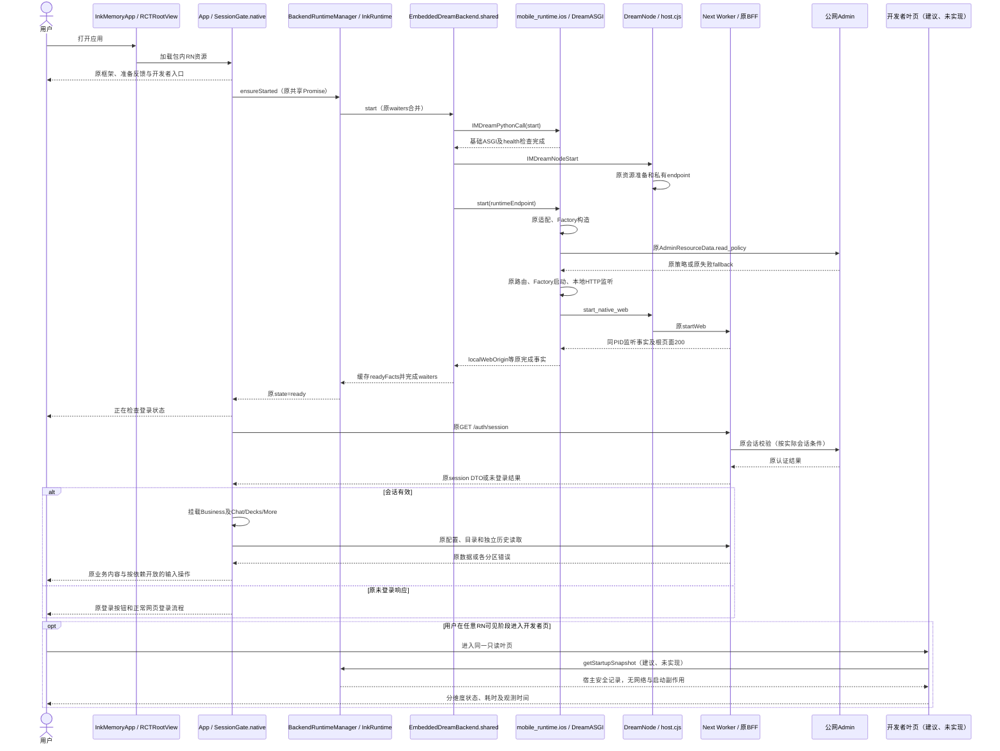
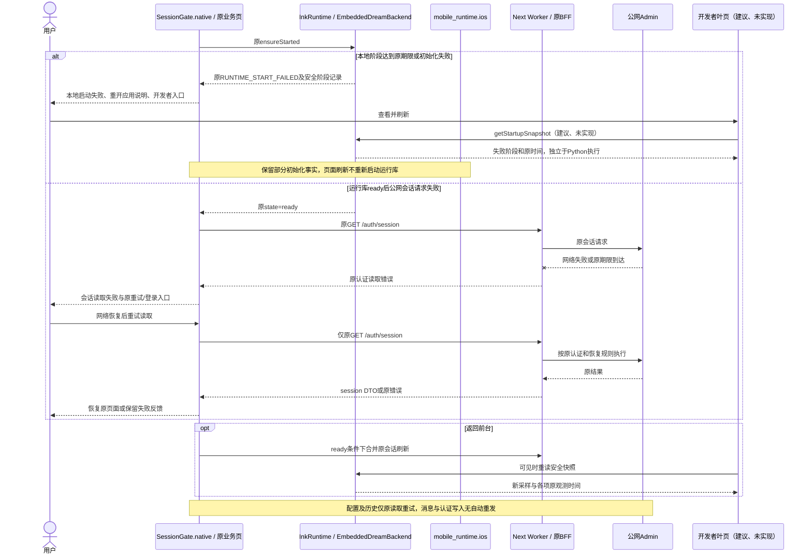
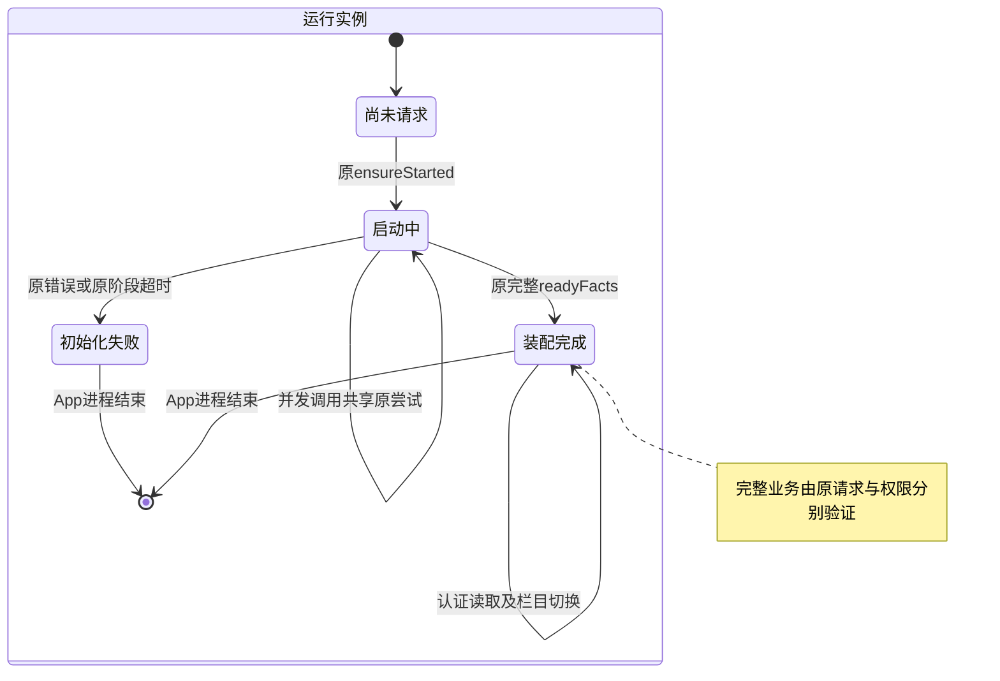
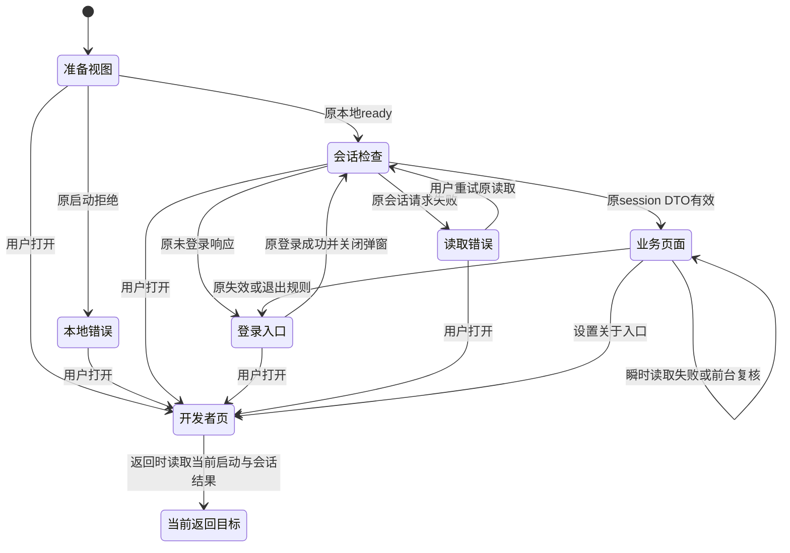
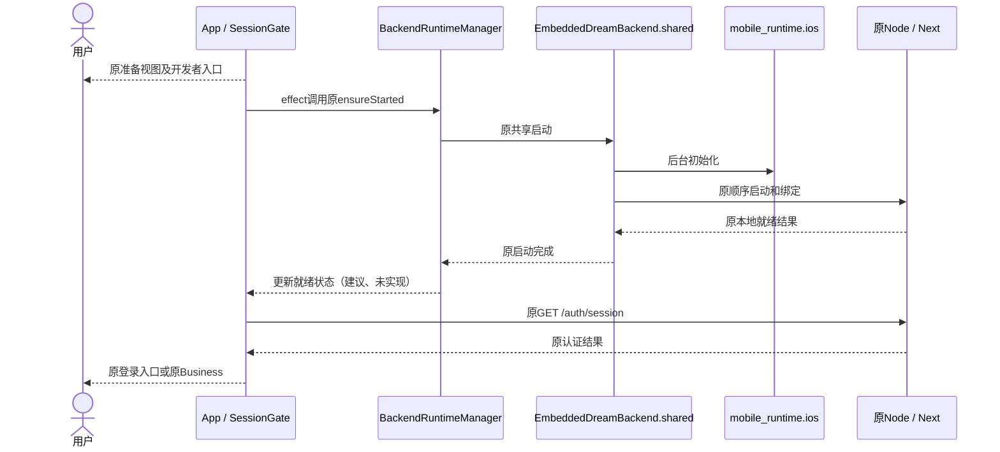
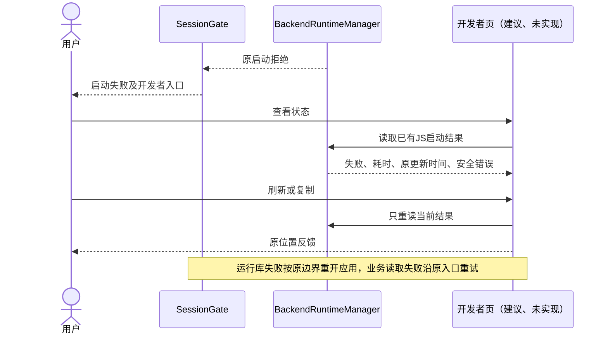
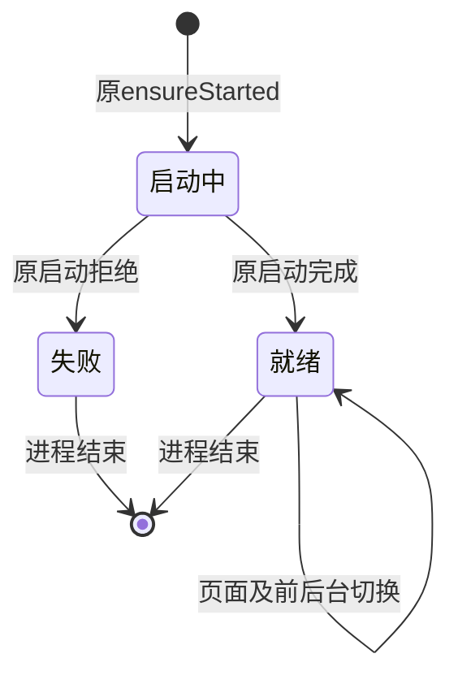
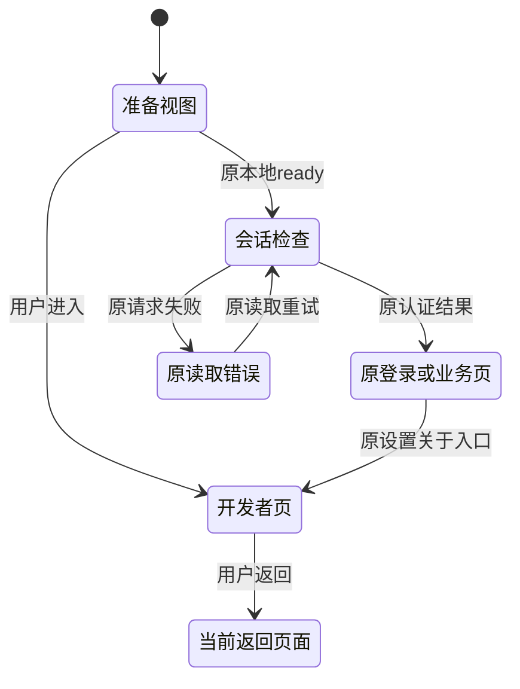

<!-- [Sync] 2026-11-01: 追加独立方案实施前PRD与交互原文，保留原图与未实现阶段说明。 -->
<!-- [Input] 2026-11-01首轮启动设计前稿。 -->
<!-- [Output] 已退出当前方案的原文，供历史追溯。 -->
<!-- [Pos] 历史记录；当前方案按用户纠正收敛为复用后台异步启动。 -->
# 启动设计扩展前稿（历史）

本稿保存用户纠正前的原文。热点分析、性能基线前置、新Native快照、分段埋点和扩展监测均退出当前方案。现行正文归[运行库架构](../mobile-runtime-architecture.md)、[正式交互](../mobile-react-native-interaction.md)及[产品规则](../../../prd/dream-workspace/mobile-app.md)。以下代码块保留原文及原相对链接；原链接按各自来源目录解释。

## 运行库架构补充

来源：`docs/design/multi-platform/mobile-runtime-architecture.md`。

````markdown
## 启动等待与最小调整（2026-11-01）

### 背景与问题

用户观察到移动端启动等待较长。本节依据当前工作树的直接启动链、已有设备回执和当前发布记录判断等待位置。新增监测和交互均为**建议、未实现**；本轮仅交付文档。下方日期小节保留对应构建的实现及验收范围。正式启动交互见[交互补充](mobile-react-native-interaction.md#启动交互与开发者控制页)，产品规则和双视口骨架见[现行PRD](../../prd/dream-workspace/mobile-app.md#启动反馈与开发者控制页)，评审及验收计划见[专项记录](../../exec/mobile-startup-design-review-20261101.md)。

**等待位于本地运行库完成、会话检查和业务读取三个门禁。RN框架渲染没有等待本地ready。** `SessionGate.refresh()`先等待`BackendRuntimeManager.ensureStarted()`，随后调用`loadBrowserSession(clientFetch)`；首次合法会话返回前，`Business`及Chat/Decks/More导航尚未挂载。有效会话下的前台刷新继续保留当前`Business`。`useNativeChatSetup`随后读取配置与Agent目录，原历史Hook独立读取历史。Python的启动装配包含公网资源策略读取，远程等待可发生在本地监听建立之前。实际首帧先后与耗时待平台trace验证。

### 目标与边界

保留原CPython先于Node的顺序、原路由与Factory装配、正常网页登录、Cookie/CSRF、权限、资源策略、任务、SSE和恢复规则。端侧业务继续在设备内执行；公网Admin沿原配置承担账户、数据和策略职责。`https://ink-admin.suoxya.com`为本轮指定部署地址，程序继续读取既有配置键。首帧、界面可操作、本地接口就绪和首次业务响应分别测量。

### 概念与规则

#### 执行单元与直接调用链

| 执行单元 | 当前职责与实际线程/进程 | 依据 |
| --- | --- | --- |
| iOS App进程、UIKit与RN | `InkMemoryApp`创建`RCTRootView`，加载包内Hermes字节码；`App`立即装配`ScreenFrame/SessionGate`；界面交互由RN承担 | [App入口](../../../frontend/ios/InkMemory/InkMemoryApp.swift)、[RN入口](../../../frontend/src/App.tsx) |
| 原生启动所有者 | `EmbeddedDreamBackend.shared.start`进入专用串行`startupQueue`，合并waiters；`InkRuntime`在主队列返回结果。Python初始化和endpoint文件等待均在该后台队列 | [共享后端](../../../frontend/ios/InkMemory/EmbeddedDreamBackend.swift)、[原生模块](../../../frontend/ios/InkMemory/InkReactNative.swift) |
| CPython解释器 | `IMDreamPythonCall`首次初始化一个进程内解释器，导入`mobile_runtime.ios`；调用期间持有GIL，原生HTTP等待释放GIL；并发调用仍受GIL及原启动锁约束 | [解释器适配](../../../frontend/ios/InkMemory/DreamPython.m) |
| Python应用实例 | `start()`创建`DreamASGI`后台线程和持久事件循环，`_submit`同步等待其结果；`_bind_runtime`在事件循环中执行同步文件处理、插件探测、资源策略读取和路由装配 | [iOS组合根](../../../backend/mobile_runtime/ios.py) |
| Node实例 | `IMDreamNodeStart`通过`dispatch_once`在独立`NSThread`执行`node_start`，仍属于同一App进程；host准备guest、Notion资源、私有认证socket和endpoint文件 | [Node入口](../../../frontend/ios/InkMemory/DreamNode.m)、[host](../../../frontend/ios/runtime/host.cjs) |
| Next实例 | host按一次性`webWorker`启动原standalone Next；Worker拥有独立JavaScript执行环境、共享App进程PID，提供原BFF、网页和局部DOM文档资源 | [host.startWeb](../../../frontend/ios/runtime/host.cjs)、[worker](../../../frontend/ios/runtime/worker.mjs) |
| Claude与命令Worker | 原SDK会话建立时创建对应Worker；启动中的guest Python版本探测也使用命令Worker。App启动无需创建模型任务，版本探测仍属于现有启动链 | [插件准备](../../../backend/mobile_runtime/ios_plugin_runtime.py)、[SDK传输](../../../backend/mobile_runtime/ios_claude_transport.py) |
| 本地HTTP监听 | `IOSHTTPServer`以Uvicorn/h11在原`DreamASGI`循环监听动态loopback端口；Next监听配置中的本机origin。私有Node socket承担宿主控制与原Worker通信 | [HTTP所有者](../../../backend/mobile_runtime/ios_http.py) |
| 公网连接 | Python `AdminResourceData.read_policy`、Next BFF会话及原数据读取沿原Admin客户端执行；原iOS Admin JSON适配使用系统URLSession。公网响应与本地监听拥有独立结果 | [资源读取](../../../backend/services/admin_data/resource_data.py)、[BFF客户端](../../../frontend/app/api/_auth/admin-client.ts) |
| Android当前入口 | `InkRuntime.ensureStarted`直接拒绝`CAPABILITY_UNAVAILABLE`；私有`:dream_runtime` Service保留Binder占位，尚未接通合格Python/Node/Next运行实例 | [RN模块](../../../frontend/android/app/src/main/java/com/inkmemory/mobile/InkRuntimePackage.kt)、[Service](../../../frontend/android/app/src/main/java/com/inkmemory/mobile/runtime/DreamRuntimeService.kt) |

当前顺序为`RCTRootView → SessionGate → ensureStarted → CPython/start() → Node/endpoint → start(runtimeEndpoint) → adapters/Factory/routers → IOSHTTPServer → Next监听及根页面200 → /auth/session → Business → 配置/目录及历史读取`。RN框架与本地启动可独立推进；首次业务、登录网页与局部DOM文档仍依赖原本机服务。

#### 阶段、依赖与等待判断

| 阶段 | 执行模块 | 依赖与线程 | 现有证据 | 耗时或验证缺口 | 是否必须等待 | 最小调整建议 |
| --- | --- | --- | --- | --- | --- | --- |
| App启动与RN首帧 | `InkMemoryApp`、`App/SessionGate` | 包内RN资源；原生UI与RN渲染 | 根视图在effect启动后端之前创建 | 缺少设备首帧及主线程采样基线；后台CPU/磁盘竞争尚未量化 | 框架呈现无本地服务依赖 | 复用现有框架，增加可达诊断入口 |
| 解释器初始化、模块导入 | `DreamPython.m`、`mobile_runtime.ios` | `startupQueue`调用；GIL；导入FastAPI等模块 | isolated config、`site_import=0`及一次解释器初始化已存在 | 解释器、首次import、应用初始化缺少独立时间 | 原Python业务须等待；框架独立 | 仅建议分段计时，保持初始化参数与顺序 |
| ASGI基础初始化与health | `_initialize`、`start` | `DreamASGI`线程；创建app/lifespan与内存传输 | 首次`/api/health`在绑定完整运行库之前执行 | health200覆盖基础路由；完整业务仍未绑定 | 仅基础启动检查等待 | 保留现有检查和后续装配 |
| 目录、guest与运行资源 | `DreamNode.m`、`host.cjs` | Node后台线程；Python之后；首次guest复制，后续复用`.ready` | host同步复制、摘要校验、DNS文件更新、ntn校验；构建资源由原打包脚本准备 | 首次资源暂存与保留目录冷启动耗时未分离；安装耗时另列 | 当前Node/命令能力须等待 | 先量化复制与校验成本，保留摘要及路径校验 |
| 原生适配、插件与Notion准备 | `_bind_runtime`、`prepare_plugin_runtime/prepare_notion_runtime` | `DreamASGI`；同步文件校验和guest Python版本探测 | 插件版本探测自身期限30秒；原绑定有endpoint一致性检查 | 缺少导入、文件处理和探测各项耗时 | 当前完整业务依赖这些适配 | 暂缓延后，避免首次工具调用缺少绑定 |
| 资源策略初读 | `IOSFactoryOwner.__init__`、`provider.load` | `DreamASGI`同步调用Admin；`read_policy`读取capabilities及策略 | `provider.load`执行reader后才返回；网络失败沿原fallback；refresher后续才`to_thread` | 无本轮分段实测；原HTTP期限按配置，多个请求可顺序累积 | 现有Factory构造与后续监听等待 | 优先采证；同步I/O移出事件循环仅列条件实施项，仍await原结果 |
| 业务装配与本地接口 | `load_business_routers`、Factory、`IOSHTTPServer.start` | `DreamASGI`；Factory/路由/确认worker绑定后启动HTTP | 本地HTTP监听等待期限10秒 | 该期限覆盖监听等待，导入和先前网络耗时另计 | 原HTTP与受保护业务须等待 | 保留完整装配；记录实际阶段失败 |
| Next及局部文档可达 | `start_native_web`、`host.startWeb` | 同PID监听事件、配置来源一致、实际GET `/`200 | readiness外层25秒、单GET5秒；构建20有Next Ready277ms | 277ms为Next自身日志范围，缺少进程启动到页面可操作总耗时 | 原BFF、登录与局部DOM须等待；RN框架独立 | 保留现有完整门禁 |
| 登录会话与公网Admin | `SessionGate`、`loadBrowserSession`、原BFF | 本地ready后；异步Native HTTP、原远程认证 | 构建20会话200/5.384秒；构建19有30.070秒头前失败 | 历史构建样本，非当前23性能基线；DNS/TLS具体原因未知 | 首次账户内容和业务导航须原会话通过 | 区分本地准备、会话等待与认证错误 |
| 配置、目录和历史 | `Business/useNativeChatSetup`及原历史Hook | 合法会话；配置/目录已`Promise.allSettled`并行 | 构建20配置4.054秒、模型目录6.663秒、历史8.962秒 | 独立请求耗时，整页关键路径需关联实测 | 发送依赖配置/上下文；其他区域按各自读取展示 | 保留现有成功快照和局部重试 |

`async`函数中的同步reader、文件导入和插件探测会占用`DreamASGI`事件循环。专用启动队列隔开了UIKit主线程；首帧卡顿仍需主线程及RN采样才能判定。资源策略同步等待同时具有Python装配依赖和公网耗时，采证按两层记录，避免重复求和。

#### 已有证据与局限

以下为既有执行记录复核，本轮设备操作为零。设备、版本、观测与结果保持原范围。

| 设备与版本 | 观测方式与网络条件 | 可取得结果 | 局限 |
| --- | --- | --- | --- |
| iPhone16、iOS18.0.1、0.1.0/19 | USB调度原App公开HTTP，结合console阶段日志；实际公网网络，未注入断网 | 受控冷启动后`/auth/options`200/7.591秒，同PID后续503/30.070秒；active、连接复用、响应头缺失、正文0 | 冷启动标签来自原记录；耗时为单次GET。物理网络原因、完整首帧和初始化阶段未取得 |
| 同一iPhone、0.1.0/20 | 普通冷启动console与App内公开HTTP，原公网Admin | Next Ready277ms；冷后GET200/2.424秒，暖进程读取200/2.908秒和2.320秒；另有503/9.332秒 | 暖读取覆盖同进程GET，App从后台恢复的热启动需另测；成功请求支持当次可达性 |
| 同一iPhone、0.1.0/23 | 制品、安装和普通进程启动回执 | 来源匹配、安装、进程存在 | 当前安装记录未包含首帧、页面可操作、本地ready、会话及业务耗时 |
| 原产品Simulator各历史构建 | 已有普通登录、冷重开与前后台业务记录 | 功能恢复具有对应阶段回执 | 平台和版本各自成立；无统一启动计时、正常/弱网/断网对照 |
| Android | 当前RN模块与Service源码 | 明确能力未就绪 | 缺少端侧运行资格、启动日志和设备性能样本 |

构建19/20原始回执和console文件名见[执行记录](../../exec/mobile-app-design-review-20261024.md#2026-11-01-usb后台采证与失败连接池修复)、[构建20明细](../../exec/mobile-app-design-review-20261024.md#2026-11-01-构建20原登录协议与一次真实claude任务)；当前制品范围见[构建23](../../deploy/ios-iphone-install-release.md#2026-11-01-当前工作区公网构建23)。网络不稳定继续作为优先假设，现有证据定位到部分公网请求等待，整体启动慢的主因仍待同次启动分段采证。

#### 两种方案与收敛

| 方案 | 适用证据与收益 | 必需依赖与成本 | 决定 |
| --- | --- | --- | --- |
| 1. 复用现有框架，细化等待条件和只读入口 | 框架渲染已与本地ready分开；当前通用错误混合本地启动与认证失败；开发者入口被会话门禁遮挡 | 在原`SessionGate`展示本地/认证阶段；开发者页作为同一App内独立只读叶页；保持原Business/发送门禁 | **选定最小方案，建议、未实现**。导航仍在首次原会话通过后展示，新增提前业务页面数为零 |
| 2. 针对实测Python热点优化 | 同步Admin策略读取和guest探测位于关键链，CPU热点与占比尚未知 | 先取得解释器/import/适配/策略阶段基线；若同步策略I/O明显占用事件循环，可只将原加载调用调度到工作线程并await，保持构造结果和顺序 | **待采证**。不承诺减少网络墙钟耗时；无证据支持提前跳过Factory、权限或插件校验 |

本轮新增后端进程、远程监控、数据库、业务HTTP接口、常驻守护和运行参数均为零。未来实现保留现有CPython→Node顺序、单实例与原后台策略refresher；全量并发和全量懒加载退出方案。基础health200、Next监听、账户认证和首次业务成功分别保留独立结果。

方案2满足实施前提时，仅把原策略reader/load调度至工作线程并await结果；Factory、refresher构造及start仍归原事件循环。原加载结果回交组合根，禁止把整个`IOSFactoryOwner`构造移动到工作线程。该项只解除事件循环中的同步I/O占用，启动关键链仍等待同一策略结果。

#### 最少监测合同（建议、未实现）

复用`EmbeddedDreamBackend`、`InkRuntime`和既有日志。扩展现有Native模块一个只读`InkRuntime.getStartupSnapshot()`，读取固定大小的进程内记录，调用独立于`ensureStarted`、启动串行队列和Python事件循环。记录写入只持有短时同步锁，文件、网络及Python执行期间释放该锁。通过原平台绑定传递固定阶段代码，参数仅含阶段开始/结束和闭集错误码；复用现有模块，新增通用事件系统数为零。

| 记录 | 必要内容与所有者 | 需求 |
| --- | --- | --- |
| 当前实例 | 宿主生成的本次进程标识、应用版本/构建、当前启动尝试；并发调用不新增尝试 | 区分重挂载、重试与进程重开；标识无账户关联且不持久化 |
| 固定启动阶段 | 解释器、首次模块导入、ASGI基础、Node host/资源、Python适配、资源策略初读、业务绑定、本地HTTP、Next页面；每项保留开始、结束、错误及宿主单调时间 | 定位本地、导入、资源与网络耗时。Node host内部暂存细分仅在该阶段成为热点后增加 |
| 原完成事实 | 原生`readyFacts`完成时刻、已取得的Python/Node版本、Python HTTP监听、Next监听和根页面200的原结果；`businessReady=false`原字段保持，endpoint元数据保持私有 | 展示实例及装配完成范围；完整业务按原操作验证 |
| 最近传输结果 | 原Native本地请求和既有Admin定向日志各保留一项安全摘要：固定操作类别、阶段、状态码或闭集错误码、耗时、观测时间 | 本地监听与公网连接独立展示；无观测显示未观测 |
| 快照元数据 | 宿主采样时间、当前AppState、观测所属前台段；UI读取时间另列 | 区分记录更新时间、手动刷新和恢复后的旧观测 |

首次import单独包围第一次`PyImport_ImportModule`；后续模块缓存读取不重算首次导入。跨语言标记统一落在宿主单调时钟，阶段可含子阶段且标明包含关系，合计只统计互斥顶层区间。首帧与可操作时刻通过平台性能工具和实际交互取得；JS effect执行时刻仅作辅助。监测数据进程内保留当前尝试每阶段一项及两项传输摘要，进程结束自然释放。

原生启动重试受真实所有者约束：JS拒绝后清除Promise，`dispatch_once`和host的`webFailure`仍保留；部分Python绑定无事务回滚。当前实现尚无任意失败阶段可安全重启的合同。拟议交互只复用已ready后的原会话/数据重读；在途启动继续共享；本地初始化失败展示重开应用的恢复说明。开发者页刷新仅采样，运行库重启操作退出范围。

### 官方行为核对

查阅日期2026-11-01。[Python初始化与线程文档](https://docs.python.org/3.13/c-api/init.html)定义解释器初始化和GIL接口；[Node24 Worker文档](https://nodejs.org/docs/latest-v24.x/api/worker_threads.html)定义进程内Worker执行；[RN AppState文档](https://reactnative.dev/docs/appstate)定义active/background及iOS inactive。当前实例数、线程入口和等待顺序取自上述仓库代码，官方文档仅用于核对接口语义。

<!-- [Sync] 2026-11-01: 补充启动分段判断、历史设备证据、最小方案及未实现的进程内观测合同；原日期回执保留版本归属。 -->
````

## 正式交互补充

来源：`docs/design/multi-platform/mobile-react-native-interaction.md`。

````markdown
## 启动交互与开发者控制页

### 背景与问题

现有`ScreenFrame/SessionGate`首次渲染返回品牌和等待视图，effect再发起本地启动；实际可见首帧时刻待设备计时。首次会话有效后才挂载`Business`及三栏目；原错误文字将本地启动、会话读取和网络失败合并。设置当前位于`Business → MoreNavigator → StoryWorkspaceSettingsPage → AboutView`，本地启动失败或首次会话等待期间无法到达该入口。

[启动证据与线程判断](mobile-runtime-architecture.md#启动等待与最小调整2026-11-01)定位到本地装配、会话和业务读取三层门禁，Python装配中还包含公网策略初读。用户需要知道当前等待阶段，并在后端失败时读取安全诊断。下文新增交互、记录及`getStartupSnapshot`均为**建议、未实现**；[PRD](../../prd/dream-workspace/mobile-app.md#启动反馈与开发者控制页)拥有产品规则与页面骨架，[评审记录](../../exec/mobile-startup-design-review-20261101.md)拥有实施前提和验收计划。

### 目标与边界

复用当前启动视图、More/设置/关于入口、原生返回、错误区域、复制操作和原请求恢复。提供一个只读开发者叶页，页面只读取本次App进程内观测。正常网页登录、认证和权限、端侧执行、Thread/Run、原配置与业务状态保持原合同。

现有RN框架继续立即呈现。Chat/Decks/More业务导航仍由首次合法会话开放；依赖本地BFF的原网页登录、富文本输入及业务内容按真实依赖展示。后台常驻、重启/停止、数据清理、终端、自动修复、新数据库和远程监控退出范围。Android当前明确显示能力未就绪，其性能及完整业务验收依赖端侧运行库资格。

### 概念与规则

#### 页面呈现与真实依赖

| 区域或操作 | 当前条件与拟议反馈 | 保留规则 |
| --- | --- | --- |
| App框架 | RN资源加载后显示原`ScreenFrame/SessionGate`标题、等待指示与开发者入口 | Python、Node或公网等待均不遮挡该入口；原生资源缺失导致Root无法建立时，仅平台日志可用 |
| 准备视图 | `ensureStarted`未完成显示“正在准备本地服务”；可取得快照时补充最近采样阶段和时间 | 显示真实阶段，无百分比或预测剩余时间 |
| 会话检查 | 原localWebOrigin验证并完成启动后读取`/auth/session`，显示“正在检查登录状态” | 首次会话检查期间保留原框架，受保护内容继续等待 |
| 登录页面 | 原未登录响应后显示原登录按钮；打开原`presentLogin`及网页登录文档 | 原表单、Google系统流程、Cookie/CSRF、成功关闭与取消保持 |
| 业务导航 | 原公开会话DTO校验通过后挂载`Business`，显示Chat/Decks/More | 已挂载Business在瞬时读取失败或前台复核期间保持；原确认失效、退出及账户切换释放按原实现 |
| 输入与发送 | 原`AIInputDock`在local origin及原局部文档就绪后呈现；`uncertain/configLoaded`、Thread上下文与原权限继续决定可用操作 | 首次未认证或本地未就绪期间无新草稿编辑器；保留同一Business中的原草稿、附件、选择与消息 |
| 配置、Agent目录、历史 | `useNativeChatSetup`复用现有配置/目录并行读取；历史继续原独立Hook | 分区显示加载/失败，已有成功数据保留；配置失败继续原发送限制 |
| 独立只读页 | 开发者页依赖RN与宿主安全快照；关于静态内容继续原实现 | 读取账户、订阅、模型或历史仍需原认证与接口，登录前开发者页不挂载这些读取 |

本地ready来自原完整启动结果：Python与适配/Factory/路由绑定、`IOSHTTPServer`监听、同PID Next监听及根页面200。基础`/api/health`、Next日志和`state=ready`各有对应验证范围，完整工具与业务可用性继续按原操作判断。资源策略default、desired、effective和revision继续原所有者及LKG规则，控制页无策略编辑能力。

#### 开发者入口与返回

登录后从“更多 → 设置 → 关于 → 开发者控制页”进入，复用`StoryWorkspaceSettingsPage`现有`about`分类和`AboutView`叶页入口，不增加顶层栏目。首次启动视图、未登录视图及启动错误区域显示同名文本入口，打开**同一只读叶页**。该叶页在`SessionGate`之外由App持有，创建时不调用`ensureStarted`，也不创建需要`ownerId`的设置资源所有者。

使用普通页面返回，回到原准备、登录或关于页面；无新增确认弹窗。打开叶页收起键盘，保留底层实例并隐藏其触控和无障碍入口；返回后由用户重新聚焦输入。查看开发者页期间，原启动、登录读取或已存在任务保留其所有者。完成登录仍沿原sheet关闭次序，控制页收到当前返回目标更新；原会话失效或账户切换时，账户内容按原释放规则处理，宿主安全观测保持本次进程归属。

#### 展示字段与状态依据

页面使用纵向信息区，依次显示当前App版本/构建与本次进程标识、CPython/Node host/Next实例事实、启动阶段表、接口事实、公网最近观测、脱敏错误和最近采样时间。Python/Node版本仅从原完成事实安全投影，未取得时显示未观测；原endpoint元数据保持私有。阶段表显示“开始时间、已用时间/最终耗时、阶段结果”；未记录项显示“未观测”，在途项显示采样时已等待时长。各阶段单调时间、包含关系及安全快照字段归[架构监测合同](mobile-runtime-architecture.md#最少监测合同建议未实现)。

| 展示维度 | 显示依据 | 表达与边界 |
| --- | --- | --- |
| 本地实例：正在启动 | 本次尝试有开始记录，原完成回调尚未返回 | 展示当前已采样阶段；重复调用继续同一尝试 |
| 本地实例：正常 | 同一进程原启动完成记录 | 文案“启动装配完成”，附完成时间；持续存活与每项业务能力按各自观测表达 |
| 本地实例：失败 | 当前阶段记录终止错误或原启动拒绝 | 展示阶段与闭集错误码；缺少细分记录时显示“本地启动失败，阶段未记录” |
| 本地实例：未就绪 | 尚无启动请求，或Android返回能力缺失 | 展示对应事实；页面访问和刷新保留只读行为 |
| Python接口 | 原`IOSHTTPServer.start`记录或最近原本地HTTP结果 | 分别展示“已监听/监听失败/未观测”和最近结果、时间；完整业务按原校验 |
| Next与局部文档 | 原Worker监听、根页面200及已记录失败 | 展示原启动事实；单个局部文档加载错误归该文档反馈 |
| 公网Admin | 既有固定类别的实际Admin请求完成/失败/在途安全摘要 | “最近成功/最近失败/等待原请求/未观测”，附时间与耗时；单次成功仅覆盖当次请求，HTTP权限错误保留原分类 |
| 观测暂停 | AppState为background/inactive，或页面离开 | 暂停页面取样；保留最近快照，文案“观测已暂停”仅修饰观测 |
| 状态过期 | 进入新的前台段尚未重读、记录属于旧进程、传输观测早于本次前台段 | 显示旧记录原时间及“待重新观测”；已有失败和完成事实仍保留原日期归属 |

暂停和过期为观测维度，客户端状态、运行实例及业务任务分别展示。启动完成后观察到Next退出时，仅更新Next行的失败事实，原启动完成记录保留原时间。Android通知栏blur可按原平台可见性暂停页面观察，运行库状态依据真实能力返回。未配置时间阈值时按上述生命周期事件标记过期；不引入任意秒数或新的业务超时配置。

#### 刷新、复制与安全

1. 页面可见且处于前台时，进入叶页、原启动Promise结算、返回active和用户点击“刷新”触发`InkRuntime.getStartupSnapshot()`读取（建议、未实现）。同时发生的读取合并为一次；新采样替换旧快照，离开页面后的迟到结果丢弃。页面仅订阅AppState及原启动结果，没有常驻轮询和新的Native事件流。
2. 刷新只读取宿主进程内记录，不启动运行库，不发起健康探测、公网请求、模型请求或业务重试。按钮读取中显示“正在刷新”并禁止重复派发；完成显示本次采样时间。原传输记录没有变化时保留原观测时间，公网最近结果随原业务请求更新。
3. 读取失败保留最后快照及其时间，页面显示“诊断状态暂时无法读取”，允许再次刷新。快照读取排队独立于Python启动；离开页面只撤销当前UI接收，原启动保持执行。原生桥失效时记录未取得，界面不得推断Python已经停止。
4. 点击“复制脱敏诊断摘要”，从当前快照白名单生成文本，通过现有`InkRuntime.copyText`复制。文本含版本/构建、进程内标识、阶段耗时与结果、本地监听/Next事实、最近Admin固定操作类别及状态/错误码、各项观测时间和过期标记。成功显示“诊断摘要已复制”；失败显示原页内错误，数据和导航保持。无快照时禁用复制；用户无需确认。
5. 登录前允许宿主提供上述不含账户关联的应用身份、阶段、耗时、AppState、闭集错误和接口事实。禁止返回endpoint文件、token、端口认证信息、Cookie/CSRF、密码、完整环境变量、绝对文件路径、用户/Thread/Run标识、正文、完整URL、请求参数和原始异常字符串。错误通过已知代码映射短消息，未知错误仅显示固定通用码。
6. 复用既有Admin定向日志的操作类别、耗时和数字错误，原日志内容不进入页面。需要读取原用户配置、历史、任务或资源策略详情时，继续原API、认证和权限；本页无对应读取入口。

#### 超时、重试和恢复

| 条件 | 页面反馈与重试目标 | 实例、输入与任务 |
| --- | --- | --- |
| 本地启动仍在途，重复打开或前台回调 | 显示当前等待；复用现有Promise、`starting/waiters` | 同一尝试和原所有者，重复实例数为零 |
| 现有Node endpoint/HTTP/Next期限到达 | 原启动失败映射到具体阶段；通过开发者页查看记录，按“请关闭后重新打开应用”说明恢复 | 不提供自动重启按钮；保留原持久化数据 |
| 解释器/import尚无结果且无现有期限 | 显示采样时等待阶段及时间；刷新仅取样 | 不凭等待时长写失败或启动第二个解释器；新的阶段中断机制退出本轮 |
| 部分初始化失败 | 阶段错误及重开应用说明；当前代码缺少该阶段安全重试合同 | `dispatch_once`、粘性`webFailure`及部分绑定继续真实状态；通用重试不重复全链装配 |
| 本地ready、会话请求失败或超时 | “登录状态暂时无法读取”，原重试只重读`/auth/session`；重新登录继续原入口 | 复用ready实例，瞬时失败保留原合法会话；原401按会话规则释放 |
| 原网页登录options读取失败 | 原`AuthEntry`的`Try again`仅重载该登录文档 | 未提交表单按原重载规则重置；已存在业务实例和任务保持 |
| 配置/目录/历史失败 | 原分区反馈与原读取重试，取消被替代的reader | 成功快照、当前Thread、草稿和附件保持；无新业务发送 |
| 网络恢复 | 状态展示沿原请求结果更新；用户通过原失败项重试；active会话刷新继续原合并规则 | 无自动登录提交、消息重发、Stop或终态推断 |
| 进入后台和返回前台 | 暂停控制页取样；active重读宿主快照，并由原SessionGate合并会话刷新 | 本地共享实例保留；系统挂起期间持续执行能力依平台事实；无常驻承诺 |
| 进程重开 | 新进程标识与新启动记录，沿原正常登录和持久化恢复 | 仅承诺原已保存内容恢复；未持久化草稿按现有行为，新增持久化为零 |

取消观测只释放页面读取和AppState监听。业务请求取消、登录取消与Agent Stop继续各自原入口，操作结果分别记录。

### 正常启动与页面加载时序（建议、未实现）



### 超时、网络失败及恢复时序（建议、未实现）



### 运行实例与页面状态转换（建议、未实现）





开发者页覆盖原显示区域时保留原实例。`当前返回目标`由上表当前结果选择；打开页面期间启动或会话状态仍可推进。暂停、过期和刷新中仅修饰观测视图，不进入Thread/Run状态机。

### 实例与监测生命周期

| 实例 | 创建与持有 | 后台、页面离开与取消 | 进程重开及释放 |
| --- | --- | --- | --- |
| App / RN Root | 原iOS Scene、Android Application与主Activity | 原平台生命周期；无额外后台模式 | 进程结束销毁，重开加载原资源 |
| `SessionGate` | 原App根；合并前台和401读取 | 控制页覆盖保持；合法会话下保留Business；原身份变化释放业务文档 | 原会话Cookie由原存储恢复，原AppState listener卸载时释放 |
| `BackendRuntimeManager` | RN模块共享Promise | 并发调用合并，后台不清理成功Promise | JS重建后重新查询原生共享所有者；失败Promise清除只说明调用结果 |
| `EmbeddedDreamBackend`与CPython | 原生进程单例、专用队列、GIL和`DreamASGI` | 查看状态、账户退出和前后台切换均保留；无页面级解释器销毁 | 进程结束释放，新进程重新装配；部分失败无新增重启合同 |
| `IOSFactoryOwner`及原策略refresher | `_bind_runtime`创建并持有 | 原资源策略与任务规则保持，监测无需调用其业务方法 | 原所有者结束，LKG/revision规则保持 |
| Node host / Next Worker / HTTP监听 | 原`dispatch_once`、`webWorker`、`IOSHTTPServer` | 原单实例；系统挂起影响执行，原Worker失败与HTTP错误独立记录 | 新进程新实例；粘性失败由真实进程重开恢复 |
| Claude/命令Worker | 原SDK会话或明确命令调用 | 原SDK/transport拥有取消、退出和清理；观察页无控制权 | 原持久化及恢复协议处理任务 |
| `Business`及局部DOM文档 | 原合法账户及原组件 | 原隐藏保留和文档离开握手；观察页返回保持草稿和Thread | 原已保存历史恢复；未保存输入沿原行为 |
| 安全阶段记录（建议、未实现） | 宿主固定大小内存结构，写入边界由原启动模块报告 | 无数据库、无文件日志副本；短锁期间仅更新记录 | 当前进程结束即释放；无历史跨进程合并 |
| 开发者读取与监测订阅（建议、未实现） | 可见叶页订阅AppState及原启动结果，读取安全快照 | 离页/后台停止页面取样；卸载释放listener，迟到结果按页面读取代次丢弃；无Native常驻订阅 | 页面重新进入取新快照；原运行库、请求和任务保持原所有权 |

### 评审与实施状态

设计采用现有框架、现有设置关于分类、一个只读叶页和一个Native安全快照读取能力。每项新增记录对应启动等待定位、失败可见或观测有效期需求。Python计算和I/O优化待基线，新增并发任务、策略默认值、业务状态及监控平台均为零。设计文档检查与设备验收分别记录于[专项评审](../../exec/mobile-startup-design-review-20261101.md)。
````

## 产品规则补充

来源：`docs/prd/dream-workspace/mobile-app.md`。

````markdown
## 启动反馈与开发者控制页

### 背景与问题

用户需要在启动等待时辨认本地准备、登录检查和业务数据加载，并在本地启动失败时查看运行情况。当前移动框架允许在本地准备期间呈现，实际首帧时刻待测；正常导航仍等待首次登录检查，原设置入口在登录后可达。已有iPhone请求记录包含公网等待，当前版本缺少统一启动分段耗时。现状依据见[运行库分析](../../design/multi-platform/mobile-runtime-architecture.md#启动等待与最小调整2026-11-01)。

### 目标与边界

本节为**建议、未实现**的产品规则。复用原启动视图、“更多 → 设置 → 关于”和正常网页登录，增加同一只读开发者页的两个入口。正常账户、原业务权限、任务、输入和恢复规则继续原定义；端侧任务仍在设备中执行，Admin使用既有公网服务。首帧、页面可操作、本地接口可用和首次业务响应分别验收，性能目标依据后续基线制定。

本轮交付文档与评审。重启、停止、清理数据、终端、自动修复、常驻守护和新监控平台退出范围。普通桌面Web沿原页面；下方桌面参照用于宽屏信息布局，新增Web业务路由为零。

### 概念与规则

1. 应用打开后立即显示原品牌框架、准备反馈与“开发者控制页”入口。本地准备完成后显示“正在检查登录状态”；首次会话通过后显示原Chat、Decks、更多导航。未登录时显示原登录入口，密码、Google、成功关闭和取消继续原流程。
2. 输入区依原本地文档、登录和配置条件显示及开放操作；首次准备期间无新增输入页面。已经打开的对话、输入、附件和成功读取的数据在瞬时读取失败时保留。会话确认失效、退出和账户切换继续原释放规则。进程重开读取原已保存内容，未保存输入沿原行为。
3. 本地启动失败显示对应阶段、安全错误与重开应用说明；入口继续可达。登录检查失败只重试登录状态读取；原登录文档入口读取失败沿原页面重载；配置、目录和历史失败沿各自原读取重试。重试不重新发送消息或重新启动全部运行库。
4. 开发者页从“更多 → 设置 → 关于”进入；首次准备、未登录及错误视图的同名入口打开同一页。普通返回回到当前有效的准备、登录或原设置页面。查看页面期间，原启动和已存在任务继续其原生命周期。
5. 页面分区显示应用版本/构建、本次运行标识、最近采样阶段、阶段耗时、接口情况、公网最近请求结果、更新时间与脱敏错误。本地启动完成、接口已监听和公网最近成功各自展示；完整业务仍按原操作校验。无观测显示“未观测”，旧记录保留原时间。
6. “正在启动”依据真实开始记录；“正常”表达本次启动装配完成；“失败”依据原阶段失败；“观测已暂停”表达后台或离页暂停；“待重新观测”表达新前台段或旧实例记录。客户端观测状态和任务执行状态分别定义，后台或网络变化不写入任务终态。
7. 进入、返回前台、启动结果返回和手动刷新时读取一次宿主记录；同时发生的刷新合并。刷新期间按钮显示“正在刷新”，结束显示本次采样时间；刷新保留各条原请求的观测时间。刷新只读已有记录，公网连接结果随原请求更新。
8. “复制脱敏诊断摘要”复制当前安全快照，成功就地提示“诊断摘要已复制”；失败显示页内错误。无快照时禁用复制。离页释放页面观察，后台暂停取样，返回前台重读；原运行库和任务保持原所有者。
9. 登录前可查看应用版本、本次无账户关联的运行标识、启动阶段、耗时、接口事实、固定请求类别和安全错误码。凭证、用户正文、完整环境、绝对路径、账户/对话/任务标识、完整请求地址和敏感参数均不展示、不复制。读取原业务信息继续执行原认证和权限。
10. Android当前显示“端侧运行能力尚未就绪”，开发者入口可展示实际能力结果；完整启动与业务指标待端侧运行资格后验收。

### 桌面参照与窄屏骨架

```text
桌面宽屏参照：沿现有设置关于进入；信息布局参考
┌ 原设置栏目 ┬ 关于 [开发者控制页] ────────────────────────────┐
│ 原各分类   │ [返回关于] 开发者控制页                        │
│ 关于      │ 版本 / 构建 / 本次运行 / 最近采样时间           │
│           ├ 状态区（内容纵向滚动）─────────────────────────┤
│           │ 本地实例：启动装配完成，完成时间                │
│           │ Python接口：已监听；Next页面：已取得原响应      │
│           │ 公网Admin：最近失败，原观测时间，安全错误       │
│           │ 启动阶段表：阶段 / 开始 / 耗时 / 结果           │
│           │ 脱敏错误；过期标记；观测范围                    │
│           ├ 操作区（固定）─────────────────────────────────┤
│           │ [刷新] [复制脱敏诊断摘要]  原位置操作反馈       │
└───────────┴────────────────────────────────────────────────┘
普通Web沿原设置页面；本轮新增开发者Web路由为零。

窄屏启动、会话等待或本地失败视图（复用原框架）
┌ Ink & Memory ─────────────────────────┐
│ 正在准备本地服务 / 正在检查登录状态   │
│ 或：本地启动失败，请重开应用          │
│ 原等待指示 / 原登录及读取重试         │
│ [开发者控制页]                        │
└──────────────────────────────────────┘
首次会话通过 → 原Chat / Decks / 更多导航
已登录：更多 → 设置 → 关于 → 开发者控制页

窄屏开发者页：两个入口打开同一普通页面
┌ [返回]           开发者控制页          ┐
│ 版本 / 构建 / 本次运行标识             │
│ 最近采样时间；观测暂停或过期提示       │
├ 状态与阶段内容区（独立纵向滚动）───────┤
│ 本地实例：正在启动 / 装配完成 / 失败   │
│ Python接口：监听事实与原时间          │
│ Next：监听和页面响应事实与原时间      │
│ 公网Admin：最近结果与原时间           │
│ 阶段列表：阶段、采样时耗时、结果       │
│ 脱敏错误与对应恢复说明                 │
├ 操作区（固定在系统安全区内）───────────┤
│ [刷新] [复制脱敏诊断摘要]              │
│ 已刷新 / 已复制 / 原位置错误反馈      │
└──────────────────────────────────────┘
页面返回保留原页面与任务；新增确认弹窗为零。
原网页登录弹窗仍按原成功关闭和取消规则执行。
```

正式正常/异常时序、运行实例与页面状态图、生命周期归[启动交互稿](../../design/multi-platform/mobile-react-native-interaction.md#启动交互与开发者控制页)。验收须覆盖冷/热启动、弱网/断网、会话失效、初始化失败、并发启动、前后台、进程重开和开发者刷新；预期、方法、前提和证据归[专项验收计划](../../exec/mobile-startup-design-review-20261101.md#验收计划)。本轮文档检查与真实设备验收分别报告。
<!-- [Sync] 2026-11-01: 补充写作记录与关联对话的现有规则、桌面和窄屏骨架；本轮仅文档，故障根因及设备操作继续采证。 -->
````

## 评审记录

来源：`docs/exec/mobile-startup-design-review-20261101.md`。

````markdown
<!-- [Input] 本轮启动观测需求、当前移动启动链、历史设备回执及仓库文档合同。 -->
<!-- [Output] 问题判断、最小方案、设计评审、后续实施项、验收计划和文档检查回执。 -->
<!-- [Pos] 移动启动与开发者控制页设计执行记录；程序实施与设备验收分项追踪。 -->
<!-- [Sync] 2026-11-01: 完成发现、范围定义、两方案比较及文档交付；新增监测和页面均未实现。 -->

# 移动启动与开发者控制页设计评审

## 背景与问题

用户授权本轮分析、交互设计、文档修订与评审。目标为减少Python准备对前端体验的影响，并提供本地失败时可进入的开发者观测页。代码实现、依赖安装、打包、安装和设备操作留待后续。本轮沿用户已提供的优化提示词执行一次规划，文档修订沿同一计划。

发现阶段读取`AGENTS.md`、直接相关目录合同、现行RN与运行库设计、发布回执、`git status`及直接调用链。定义阶段收敛为三层等待及登录前诊断可达性。发展阶段比较框架等待反馈调整与Python热点优化。交付采用现有框架与最小只读观测；Python具体优化保留基线前提。搜索在取得以上决策依据后收敛，无全仓运行路径改造。

## 目标与边界

| 交付物 | 当前责任与状态 |
| --- | --- |
| [运行库架构](../design/multi-platform/mobile-runtime-architecture.md#启动等待与最小调整2026-11-01) | 主Agent完成现状、阶段表、证据、方案比较与未实现监测合同 |
| [正式交互](../design/multi-platform/mobile-react-native-interaction.md#启动交互与开发者控制页) | 主Agent完成启动反馈、开发者页、正常/失败恢复时序、运行与页面状态图及生命周期 |
| [移动PRD](../prd/dream-workspace/mobile-app.md#启动反馈与开发者控制页) | 主Agent完成产品规则、桌面参照、窄屏骨架、滚动与弹窗关系 |
| 本评审与验收计划 | 主Agent负责设计判断，`luna_test_runner`负责有界文档检查 |
| 程序实施及设备性能验收 | 未执行；新增监测/页面均为建议、未实现 |

开始时已有文档和前端代码未提交改动，包含写作关联对话、移动布局、发布记录及原生聊天。本轮只编辑上述文档、相关README和三个目录合同；会话开始版本保存于`/tmp/ink-mobile-startup-design-20261101-01a196d5/baseline/`，用于区分原有改动与本轮内容。未回退、格式化、提交或暂存已有工作。

## 概念与规则

### 等待原因与证据结论

1. **当前事实**：`ScreenFrame/SessionGate`初次渲染返回准备视图，源码中的框架渲染未等待本地ready；实际首帧时刻未取得。首次业务导航等待`ensureStarted → loadBrowserSession`；之后配置/目录已并行，历史按原Hook独立读取。无证据要求重做前端框架。
2. **当前事实**：CPython首次初始化在原生后台启动队列；Python事件循环还同步处理插件探测与`IOSFactoryOwner`中的Admin资源策略初读。Node host资源暂存、原HTTP和Next准备均在该关键链。UIKit主线程阻塞尚无对应性能回执。
3. **历史证据**：iPhone16/iOS18.0.1构建19公网读取有200/7.591秒及503/30.070秒，后者在响应头前失败；构建20有Next自身Ready277ms、冷后GET2.424秒和暖GET2.908/2.320秒，会话200/5.384秒、配置200/4.054秒、历史200/8.962秒。这些为[原设备记录](../deploy/ios-iphone-install-release.md#系统验证后追加同一构建20真实业务)及[原执行回执](mobile-app-design-review-20261024.md#2026-11-01-构建20原登录协议与一次真实claude任务)的复核，未重跑原账户或模型。
4. **证据边界**：当前安装记录为[0.1.0/23](../deploy/ios-iphone-install-release.md#2026-11-01-当前工作区公网构建23)，包含安装和进程存在，缺少本轮启动分段与页面验收。暖GET与后台返回热启动分别采证；Next277ms无法代表整个App启动。历史网络失败保留其版本归属，具体物理链路原因未知。
5. **推荐方案**：复用原准备框架，分开本地准备、会话等待和业务分区反馈；增加登录前可进入的同一开发者页和一个Native安全快照getter。原Business认证、输入/发送、权限和完整初始化条件保持。Python热点优化待分段基线；同步I/O调度调整继续await原结果，资源策略、插件及路由初始化保持完整。

### 设计评审

| 评审项 | 发现 | 处理方式 | 修订结果 | 剩余依赖 |
| --- | --- | --- | --- | --- |
| 等待定位 | 存在本地装配、装配内公网读取、会话及数据请求 | 沿直接调用链逐项标注线程、依赖及证据 | 架构阶段表和版本证据表已完成 | 同次设备分段计时 |
| 首帧及主线程 | RN框架已独立；现有记录缺少首帧与主线程采样 | 保留原框架，按首帧/可操作分别测量 | 删除额外启动壳层和提前业务页面方案 | 平台性能工具回执 |
| 认证及权限 | 首次Business受原会话DTO控制，输入依赖配置和上下文 | 保留原门禁，仅分段反馈 | 登录前仅显示宿主安全诊断 | 正常登录与失效回归 |
| Python优化 | 热点占比未知，`async`内存在同步I/O | 条件实施仅针对实测热点 | 延后全量并发/懒加载；保留完整适配、Factory及策略结果 | 解释器、import、策略和探测基线 |
| 失败时可达 | 原设置在Business内，启动失败无法进入 | 关于入口与SessionGate外的同一叶页 | 新增叶页一处；入口两处，无新顶层栏目 | 宿主getter独立于启动队列 |
| 监测成本 | 复制全日志、轮询和额外探测会扩大启动成本 | 固定阶段各一项、两项传输摘要、事件时机读取 | 无文件副本、常驻轮询和新Native订阅 | 记录写入短锁及开销对照 |
| 正常状态语义 | 旧readyFacts和health仅代表对应事实 | 启动、接口、公网、业务结果分别展示 | 正常文案限定为启动装配完成；旧记录显示原时间 | 最新原请求结果接入 |
| 暂停及过期 | 页面可见性与运行/任务状态拥有不同生命周期 | 观测维度单独定义；按前台段与实例判定过期 | 无新任务状态和任意时效阈值 | 生命周期回归 |
| 重复启动与失败重试 | Promise/waiters已合并；Node一次初始化及部分绑定存在粘性状态 | 在途复用，ready后只重读失败项，局部初始化失败提示重开 | 删除通用全链重试和自动重启设想 | 并发及失败阶段技术验证 |
| 超时与取消 | 现有期限覆盖不同阶段；解释器/import无统一期限 | 保留原期限；缺少期限时持续显示采样事实 | 观测离开只释放UI接收，不改变原请求或任务 | 原期限和迟到响应回归 |
| 输入、会话及任务 | 已挂载Business已有草稿、Thread和文档所有者 | 原身份变化释放、成功快照保留、原恢复 | 删除新增草稿服务、后台保活与自动业务重发 | 进程重开与真实任务恢复 |
| 字段和接口 | 需要在Python失败时取得宿主阶段 | 一个Native只读getter、固定阶段回调和闭集安全字段 | 无新业务HTTP、数据库、依赖或配置键 | 脱敏白名单与getter合同 |
| 页面与产品范围 | 宽屏和窄屏均需可评审骨架 | PRD正文保留布局，正式稿正文保留业务图 | 滚动、操作区、返回及原登录弹窗关系明确 | 后续真实触控、VoiceOver/TalkBack |

**评审结论：通过。** 本结论覆盖本轮问题判断、最小方案、页面规则、图示、生命周期与验收设计。程序实施未执行，性能提升未验证，真实设备验收未执行；Python优化的具体改动及数值目标待基线。文档检查结果单列于下文。

## 后续实施项

| 工作项 | 范围与负责人 | 前提与交付物 |
| --- | --- | --- |
| I1 取得同次启动基线 | 后续客户端实施者；原iOS运行入口及已安装应用 | 记录设备/系统/版本/资源保留情况/网络/启动方式、首帧和页面可操作；无账户及模型提交时取得本地准备范围 |
| I2 最少阶段与安全快照 | 后续客户端实施者；`EmbeddedDreamBackend`、`InkRuntime`及原Python/Node绑定 | 固定大小内存记录、一个独立getter、原日志安全摘要；无数据库与新监控平台；验证启动失败仍可读取 |
| I3 原准备反馈与开发者页 | 后续前端实施者；原`SessionGate`、App叶页和`AboutView`入口 | 原导航/认证和发送门禁、原复制能力；刷新/返回/后台释放验证；保留业务实例 |
| I4 条件Python优化 | 后续后端实施者；仅实测热点及原组合根 | I1/I2关联基线；提出单阶段改动与收益目标，保持原Factory、策略LKG/revision和工具初始化；未出现热点时仅交付分析 |
| I5 技术检查和真实设备验收 | 技术检查交指定runner，真实账户/模型由主执行者 | 按下表取得命令回执和设备证据；新版本、网络与正常业务结果逐项关联 |

实施顺序为I1基线、I2最少记录、I3交互、I4按证据决定、I5分层验收；必要的基线采集可与记录接入分两轮完成，避免把监测开销计为原性能。实现涉及文档合同与文件头时同步维护；本轮无运行库、权限、Schema或持久化改动。

## 验收计划

### 基线及指标

冷启动指App新进程，保留原安装和业务数据；首次资源暂存单独标记，避免与保留guest目录冷启动混用。热启动指同一进程从后台回到前台，记录后台间隔及系统是否挂起。每个平台、设备、版本和网络组分别保存完整样本；样本数量及分位数报告条件在基线采集方案中固定，样本不足时只列实际值。

| 指标 | 起止点与证据 | 优化目标制定 |
| --- | --- | --- |
| 首帧 | 平台App启动时间到RN首个实际可见帧；平台trace结合录屏 | 取得原版本基线B_frame及自然波动，候选不得因观测新增主线程等待；具体容差据基线登记 |
| 页面可操作 | 启动至准备页开发者入口可点击并成功返回；另列业务导航和输入按原依赖开放时刻 | 在Python与公网仍等待时完成只读入口交互；原业务门禁保持，分别比较B_shell/B_business |
| 本地接口就绪 | 原初始化开始至Python HTTP监听、Next监听及实际根页200，三项分别计时 | 取得B_local与各阶段占比；只对选定热点制定可核对的减少量，其余阶段检查回归 |
| 首次业务响应 | 用户按原入口提交至首个有效业务响应，另列最终完成与持久化 | 使用同账户、同实体和明确选定模型，限制调用次数；取得B_response后制定目标，传输头与有效业务内容分别记录 |

当前缺少B_frame、B_shell、B_local和同条件B_response，数值目标保持待验证。历史GET耗时只作为排查优先级证据。监测开启前后使用同条件版本和设备对照，分别报告本地初始化、远程等待、UI主线程及观测开销；不得用单一“启动完成”取代上述指标。

### 场景矩阵

下列均为后续待执行。可重复故障注入使用明确隔离harness，经公开生产入口和依赖注入执行；真实业务使用用户指定现有真实账户、实体及本机正常Dream/Admin/Gateway与正常数据库，并在日常Admin核对记录。移动端验收额外记录App内执行归属和真实设备结果；本轮指定公网Admin配置沿原职责，公网设备协议回执单独标注其范围。技术检查无法替代真实设备或真实业务验收。

| 场景 | 预期结果 | 验证方式 | 执行前提 | 证据 |
| --- | --- | --- | --- | --- |
| 冷启动、正常网络 | 原框架先呈现；单实例完整装配；原会话后开放业务 | 平台trace、录屏、原阶段及请求回执关联 | 合格原应用、明确版本、保留资源情况、可用原Admin配置 | 同次启动时间线、四项指标、实例数量；待执行 |
| 热启动 | 同PID保留运行库，快照重新采样，原会话读取合并 | 后台/返回录屏、AppState与原请求记录 | 同一应用进程、已记录后台区间 | PID/实例一致、无重复启动、观测时间；待执行 |
| 弱网 | 框架及开发者页可操作；远程等待与本地阶段分别反馈 | 设备网络条件记录及平台网络工具；协议故障技术检查另列 | 可控制本轮设备网络、原请求期限保持 | 网络条件、阶段耗时、原期限结果；待执行 |
| 断网 | 原公网失败清晰，本地ready结果独立；用户重试恢复 | 原设备断网/恢复、原读取入口 | 可恢复的原网络、保留原账户和数据 | 本地状态、公网错误、同一业务记录及零重发；待执行 |
| 会话失效 | 原认证反馈与登录流程；受保护内容按原失效规则处理 | 隔离协议检查；真实设备沿正常账号流程 | 明确测试身份及会话失效方法，不修改无关账户 | 原401/DTO、登录关闭及权限回执；待执行 |
| 初始化失败与原阶段超时 | 安全阶段错误、开发者入口可用、无自动新实例 | 隔离harness在原依赖边界注入失败；目标平台复核 | 测试侧显式故障依赖；原公开入口 | getter可读取、脱敏字段、原期限、无重启；待执行 |
| 无结果阶段等待 | 显示采样阶段与等待时间，记录持续可读 | 隔离harness控制阶段完成时机 | 可控clock及依赖，业务代码无测试分支 | 无虚构失败、无重复解释器；待执行 |
| 并发/重复启动 | 原JS Promise与Native waiters共享同一尝试 | 有界技术合同覆盖RN重挂载和并发调用 | 安装依赖已存在，隔离进程状态 | 初始化/Node/Next创建计数及同一结果；待执行 |
| 前后台与运行中任务 | 页面取样暂停/恢复，任务状态沿原协议 | 技术生命周期检查；真实设备录屏与原任务GET | 明确已有任务；真实模型调用按单独预算 | 原Thread、正文、状态及正常Admin记录；待执行 |
| 进程重开 | 新进程记录、原已保存内容与正常登录恢复 | 原设备重开正常App，经原入口读取 | 已保存原业务实体；保留数据 | 新实例与旧业务归属、原历史一致；待执行 |
| 开发者刷新 | 进入/active/手动刷新合并；失败保留旧快照；离页无迟到更新 | 注入getter的UI合同与目标平台交互 | I2/I3实现，独立于ensureStarted的测试控制 | 读取次数、网络/启动新增调用0、listener释放；待执行 |
| 复制与登录前安全 | 白名单摘要，正确成功/失败反馈，权限保持 | 固定安全fixture与原复制适配；设备剪贴板核对 | 无真实凭证fixture，已实现安全映射 | 摘要字段检查、剪贴板结果、业务读取0；待执行 |
| Android能力缺失 | 原能力错误可见，无模拟成功或远程替代 | 当前能力合同及后续Android设备页面 | 页面适配；Python完整验收需先取得平台资格 | CAPABILITY_UNAVAILABLE与安全诊断；待执行 |

## 文档验证回执

文档检查交由`luna_test_runner`执行；范围为本轮八份文档的Markdown清单、新增引用及锚点、Mermaid语法、状态/图示一致性和增量空白检查。复用已安装的解析工具，依赖安装、浏览器下载、构建、设备和服务操作为零。原文历史问题单列，不扩张本轮清理范围。

指定runner已完成检查，主Agent已读取JSON回执和验证脚本。以下命令在本轮临时验证目录执行，脚本均只读仓库；校验产物保存在`/tmp/ink-mobile-startup-design-20261101-01a196d5/validation/`。

| 实际命令 | 退出码 | 关键输出与范围 |
| --- | --- | --- |
| `python3 /tmp/ink-mobile-startup-design-20261101-01a196d5/validation/doccheck.py` | 0 | 8/8文件存在，233个链接、71个源码引用，缺失0；目录清单及引用路径通过 |
| `python3 /tmp/ink-mobile-startup-design-20261101-01a196d5/validation/new-link-check.py` | 0 | 新增本地链接44、源码链接17、标题锚点20，缺失0 |
| `python3 /tmp/ink-mobile-startup-design-20261101-01a196d5/validation/semantic-check.py` | 0 | 正文、图示及生命周期必需项、未实现标注和新增用语检查通过；包含本轮8路径`git diff --check`，退出0；状态一致性由主Agent逐项评审 |
| `node /tmp/ink-mobile-startup-design-20261101-01a196d5/validation/mermaid-check.mjs` | 1 | 首次无DOM的Node解析遇到`DOMPurify.addHook is not a function`；保留harness失败回执，图示语法随后在真实DOM核对 |
| `node /tmp/ink-mobile-startup-design-20261101-01a196d5/validation/mermaid-chrome-check.mjs` | 0 | 复用已安装Playwright、本机Chrome156及已有mermaid.min.js；当前20/20图、原基线16/16图解析通过，失败0 |

原回执为`doccheck.json`、`new-link-check.json`、`semantic-check.json`、`mermaid-check.json`及`mermaid-chrome-check.json`。runner关闭本轮浏览器上下文并删除明确命名的`chrome-profile-mermaid-validation`，无对应残留进程；用户已有Chrome和服务保持。未安装依赖、下载浏览器、运行应用构建、触碰设备或数据库。

文档验证完成。以上检查覆盖Markdown清单、路径/锚点、图示语法和文档合同；功能、性能提升及真实设备验收均未执行。
````


## 独立方案实施前原文

本节保存独立方案进入源码实施前的原文，页面采用与设备验收以现行稿为准。

来源：`docs/prd/mobile-app/mobile-startup.md`。

````markdown
<!-- [Input] 移动端异步启动、最小改动和最简开发者页需求。 -->
<!-- [Output] 本次功能的产品规则、启动页与开发者页骨架及验收。 -->
<!-- [Pos] 移动应用业务PRD；本次方案独立文档。 -->
<!-- [Sync] 2026-11-01: 从移动应用总PRD拆出，保留最小方案，新增交互均未实现。 -->

# 移动端异步启动与开发者页 PRD

本次任务的产品设计集中在本文。页面骨架见[启动页](#启动页)和[开发者页](#开发者页)；操作时序、状态和生命周期见[独立交互设计](../../design/multi-platform/mobile-startup-interaction.md)。

## 背景与问题

用户希望Python异步启动，前端在准备期间可见，并能查看最简运行状态。当前后台启动路径直接复用；首次登录与业务操作继续等待原依赖。

## 目标与边界

下文新增状态展示和入口为**建议、未实现**。本轮交付独立设计文档，可运行页面尚未实现。方案采用现有异步启动、原准备页面和一个只读开发者页。原登录、权限、输入、任务和恢复规则保持。

性能专项、分段监控、重启、停止、清理、终端和自动修复退出范围。普通Web沿原页面，桌面骨架作为宽屏布局参照。

## 概念与规则

1. 打开应用先显示原框架和准备反馈；后台启动完成后检查原会话，再显示原登录或业务导航。开发者入口在准备、未登录及错误视图均可达。
2. 登录后沿“更多 → 设置 → 关于 → 开发者控制页”进入同一页。返回保留原页面实例、输入和已有任务；会话失效与进程重开沿原恢复规则。
3. 页面只显示原启动调用保存的启动中、就绪或失败、总耗时、更新时间和安全错误。本地就绪与公网已有请求结果分行展示，缺少信息显示未观测。
4. 刷新只重读已有状态；复制输出同一份脱敏摘要，并在原位置显示结果。离页释放观察，后台暂停，前台重读。凭证、正文、完整环境和敏感参数均不展示或复制。
5. 启动失败沿原边界提示重开应用；原登录、配置与历史失败继续各自读取重试。准备期间业务操作按原条件等待，自动业务重发为零。

## 页面设计

### 启动页

沿用现有应用准备视图，显示应用名称、准备或会话检查反馈，以及开发者页入口。启动失败时显示安全错误和原恢复说明。登录、会话读取重试沿原条件展示。

```text
窄屏启动页（复用原准备视图）
┌ Ink & Memory ────────────────────────┐
│ 正在准备本地服务                     │
│ 就绪后：正在检查登录状态             │
│ 失败时：原错误与恢复说明             │
│ 原登录或读取重试（按原条件展示）     │
│ [开发者控制页]                       │
└─────────────────────────────────────┘
原会话通过 → 原Chat / Decks / 更多导航
本页保持原视口，无新增滚动区或确认弹窗。
```

### 开发者页

两个入口进入同一页：准备/未登录/错误视图的“开发者控制页”，以及“更多 → 设置 → 关于 → 开发者控制页”。返回时保留原页面实例，显示其当前结果。

状态区展示已有启动结果、总耗时、更新时间、本地就绪、公网已有结果和安全错误；缺少信息显示未观测。操作区固定，状态内容独立纵向滚动。刷新与复制结果在原位置提示。

```text
桌面宽屏参照：沿现有设置关于布局
┌ 原设置栏目 ┬ [返回关于] 开发者控制页 ──────┐
│ 关于      │ 状态区（纵向滚动）             │
│           │ 启动结果 / 总耗时 / 更新时间    │
│           │ 本地就绪 / 公网已有结果 / 错误 │
│           ├ 操作区（固定）────────────────┤
│           │ [刷新] [复制脱敏摘要]          │
│           │ 原位置成功或失败反馈           │
└───────────┴────────────────────────────────┘

窄屏开发者页
┌ [返回] 开发者控制页 ─────────────────┐
│ 状态区（纵向滚动）                   │
│ 启动结果：启动中 / 就绪 / 失败       │
│ 总耗时 / 最后更新时间                │
│ 本地就绪 / 公网已有结果 / 安全错误   │
├ 操作区（固定在系统安全区内）─────────┤
│ [刷新] [复制脱敏摘要]                │
│ 原位置成功或失败反馈                 │
└─────────────────────────────────────┘
普通页面返回，无新增确认弹窗。
原登录弹窗继续原成功关闭和取消规则。
```

## 验收

核对准备期间页面可操作、原就绪和认证条件、失败反馈、重复启动、前后台及进程重开恢复，以及开发者页刷新/复制的只读行为。方法及证据要求归[专项评审](../../exec/mobile-startup-design-review-20261101.md#验收计划)。本轮文档检查与程序、真实设备验收分别报告。
````

来源：`docs/design/multi-platform/mobile-startup-interaction.md`。

````markdown
<!-- [Input] 本次最小异步启动需求、原Native启动与JavaScript管理器。 -->
<!-- [Output] 本次功能的页面交互、实现依据、正常/异常时序、状态与生命周期。 -->
<!-- [Pos] 移动端异步启动与开发者页正式设计；产品规则及骨架归独立PRD。 -->
<!-- [Sync] 2026-11-01: 从移动总设计拆出本次正文，迁入原四图和实现依据；新增能力未实现。 -->

# 移动端异步启动与开发者页交互设计

本次任务的交互正文集中在本文：[页面与操作](#页面与操作)、[实现依据与最小改动](#实现依据与最小改动)、[正常启动](#正常启动与页面加载时序建议未实现)、[失败恢复](#失败与恢复时序建议未实现)、[状态转换](#运行实例与页面状态转换建议未实现)和[生命周期](#实例与监测生命周期)。[独立PRD](../../prd/mobile-app/mobile-startup.md)包含两页骨架。本文为设计交付，可运行页面尚未实现。

## 背景与问题

Python已由`EmbeddedDreamBackend`在后台启动。用户需要前端在准备期间可见、开发者页可进入，以及最少的就绪和失败反馈。本文的实现依据说明现有调用链；[独立PRD](../../prd/mobile-app/mobile-startup.md)定义启动页与开发者页骨架。下文新增状态展示和入口为**建议、未实现**。

## 目标与边界

复用原后台启动和共享Promise。前端渲染原`ScreenFrame/SessionGate`，开发者页直接读取JS管理器中的启动结果。正常登录、首次业务导航、输入与发送继续原就绪和权限条件。Python内部初始化、业务接口、任务、依赖和运行参数保持原合同。

## 概念与规则

- `SessionGate`的effect发起一次`ensureStarted()`，组件直接返回原准备视图；就绪后读取原`/auth/session`，按原结果显示登录或`Business`。准备期间允许进入开发者页。
- `BackendRuntimeManager`在原Promise上保存启动中、就绪、失败、开始/结束和最后更新时间。重复调用共享原结果；页面通过管理器的一处JS观察接口接收变化，离页解除观察。当前状态的读取和订阅均为建议、未实现；Native桥和Python协议保持。
- 只读开发者页复用“更多 → 设置 → 关于”入口，准备及错误视图打开同一页。页面保留原底层实例，返回时显示当前结果；输入和附件按原页面规则保留。
- 显示启动结果、总耗时、更新时间和脱敏错误。Python/Node/Next的单独阶段没有现成结果时显示未观测；不增加分阶段记录。本地就绪、公网最近结果分行显示；公网信息只取当前页面已有请求结果，无记录显示未观测。
- 手动刷新重读管理器状态，原请求记录保留其原时间；刷新不启动运行库或网络探测。复制通过现有`InkRuntime.copyText`输出相同安全字段，成功/失败在原位置反馈。无凭证、正文、完整环境、完整URL、绝对路径和账户/任务标识。
- 前后台复用AppState：后台暂停页面观察，返回前台读取当前状态；原会话刷新继续合并。暂停仅描述页面观察。进程重开创建新的内存状态，原保存内容由现有业务恢复。
- 启动失败显示原错误及重开应用说明；启动在途继续等待原Promise。会话、配置和历史失败各自沿原读取重试；保留既有成功数据、输入及Thread，自动业务重发为零。Android沿当前`CAPABILITY_UNAVAILABLE`显示能力未就绪。

### 页面与操作

| 页面 | 入口与操作 | 反馈与返回 |
| --- | --- | --- |
| 启动页 | 原`SessionGate`准备视图；effect异步发起启动；可打开开发者页 | 准备中、会话检查或原错误；就绪后继续原登录或业务流程 |
| 开发者页（建议、未实现） | 启动视图与原`AboutView`进入同一只读页；刷新、复制 | 读取原JavaScript启动结果；原位置成功/失败提示；返回保留底层实例 |

两页产品骨架直接位于[独立PRD](../../prd/mobile-app/mobile-startup.md#页面设计)。原登录弹窗由现有`presentLogin`处理，开发者页不改登录提交或关闭次序。

### 实现依据与最小改动

| 对象 | 当前实现 | 最小调整（建议、未实现） |
| --- | --- | --- |
| Python启动 | [EmbeddedDreamBackend](../../../frontend/ios/InkMemory/EmbeddedDreamBackend.swift)在后台串行队列执行；[DreamPython](../../../frontend/ios/InkMemory/DreamPython.m)初始化进程内解释器 | 复用该后台路径，初始化内部顺序保持 |
| 启动调用 | [BackendRuntimeManager](../../../frontend/src/runtime/BackendRuntimeManager.ts)共享一个Promise，原生合并waiters | 同一模块保存启动中、就绪或失败结果，供页面读取 |
| 前端呈现 | [SessionGate](../../../frontend/src/platform/SessionGate.native.tsx)先渲染准备视图，effect内等待启动结果 | 准备视图与开发者页保持可操作；启动成功继续原会话读取 |
| 本地服务 | [iOS组合根](../../../backend/mobile_runtime/ios.py)依原顺序装配适配、Factory、路由、HTTP与Next | 保留原完整ready条件，业务操作按依赖开放 |
| 运行状态 | Native已有启动完成或拒绝结果 | 在原JavaScript启动管理器记录开始、结束、最后更新时间和安全错误；总耗时由开始/结束计算 |
| 开发者页 | 原设置关于入口位于已登录业务内 | 关于增加同一只读叶页，准备视图提供同名入口；读取原JavaScript结果，无新Native方法 |
| 公网连接 | 原登录和业务请求已有结果与错误 | 展示页面已有请求结果；无可用结果显示未观测，刷新状态不发公网探测 |

启动结果中的ready继续表示原本地装配完成，账户、配置及业务请求继续原校验。JS管理器的状态随原Promise更新；刷新仅重读本地状态，失败记录只保留安全错误码。页面离开释放观察，原运行实例继续其既有生命周期。

Python初始化失败沿原错误反馈；当前Node一次性初始化及部分绑定保留原恢复边界。开发者页不提供重启；用户重开应用沿原路径恢复。已ready后的登录或数据失败仅重读对应请求。后台切换、进程重开及任务恢复继续原规则。

### 正常启动与页面加载时序（建议、未实现）



### 失败与恢复时序（建议、未实现）



### 运行实例与页面状态转换（建议、未实现）





### 实例与监测生命周期

| 对象 | 创建与持有 | 离页、后台和结束 |
| --- | --- | --- |
| App与RN | 原应用进程与Root | 前后台沿原回调，进程结束释放 |
| Python、Node、Next及HTTP | 原Native单例、后台队列及原组合根 | 页面切换保持，进程重开重新初始化 |
| 启动结果 | 原`BackendRuntimeManager`模块，共享Promise | 页面读取相同内存结果，JS重建后沿原Native所有者调用 |
| 开发者观察（建议、未实现） | 当前可见页面的JS观察及AppState监听 | 离页解除，后台暂停，前台重读；无常驻轮询 |
| Business与任务 | 原会话、组件、Factory及持久化服务 | 原输入保持、身份释放、Stop及恢复规则继续执行 |

设计与后续最小验证归[评审记录](../../exec/mobile-startup-design-review-20261101.md)。性能分析、新Native接口和分段监控退出本方案；[前稿](history/mobile-startup-expanded-draft-20261101.md)保留历史原文。
````

