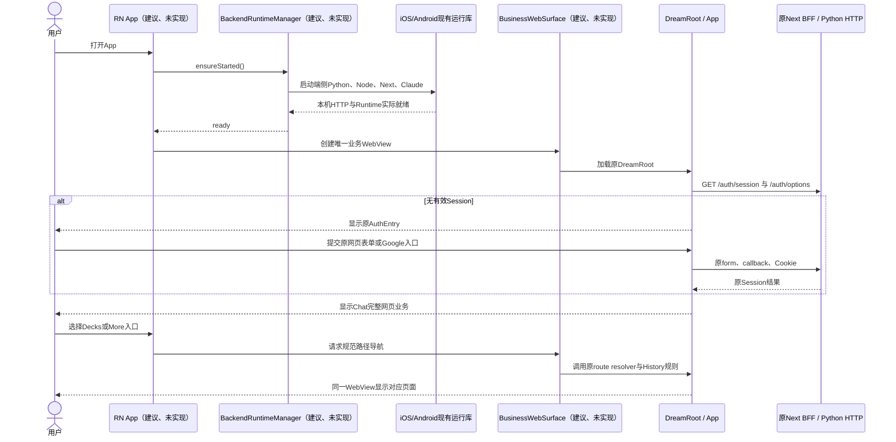
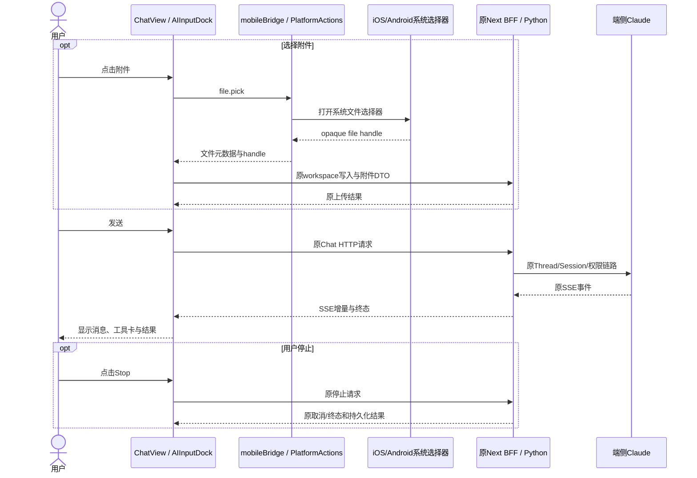
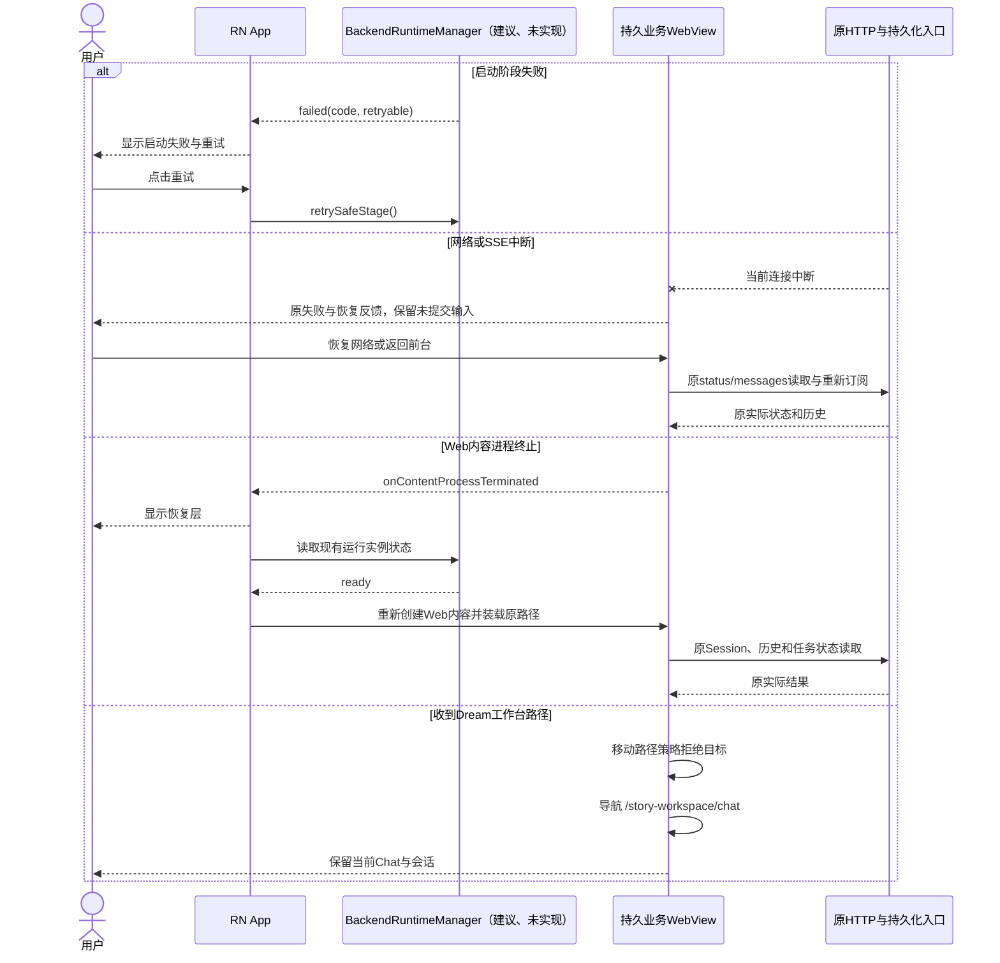
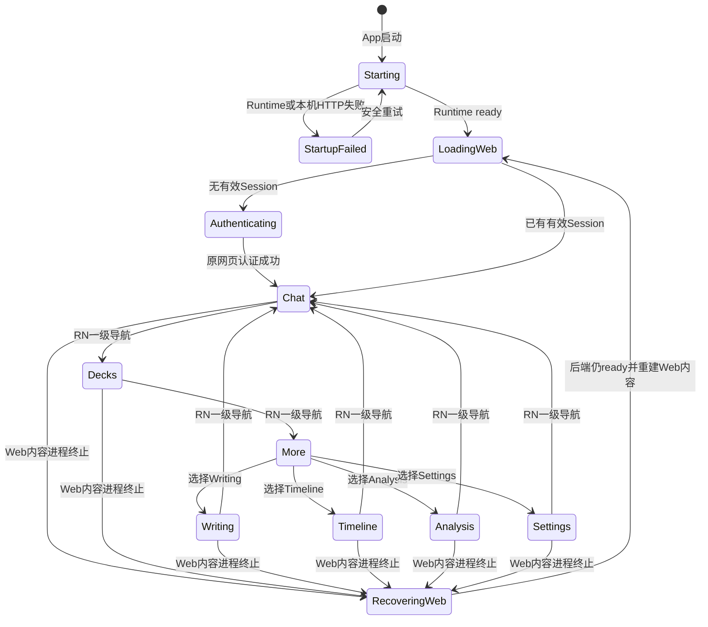

<!-- [Input] 当前Next/React页面树、RN统一客户端目标、端侧运行合同与移动端Dream工作台排除范围。 -->
<!-- [Output] 逐路由、逐页面、逐组件的RN原生化、WebView保留、原样复用清单及最小改动设计。 -->
<!-- [Pos] 跨平台前端承载决策与正式交互设计；后续移动实现按本文清单拆分。 -->
<!-- [Sync] 2026-10-27: 依据当前源码明确首发页面归属、组件边界、时序、改动清单和反过度设计评审。 -->

# React Native 页面承载与组件复用设计

## 结论

React Native继续作为iOS、Android统一客户端框架。首发采用以下确定边界：

- **RN原生化**：App启动与后端准备页、启动失败与重试页、Chat/Decks/More一级导航、More导航页、WebView加载/崩溃恢复层、安全区与系统状态栏、文件选择/保存/分享/外链等系统操作。
- **WebView保留**：正常网页登录、Chat完整业务树、Deck完整业务树、Writing、Timeline、Analysis、内容列表、Settings及其资源/插件/模型页面、Subscription、MCP Apps Host和浏览器授权回调。
- **原样复用**：HTTP DTO、SSE parser、Chat状态推导、Stop/恢复规则、队列规则、工具确认规则、URI解析、MCP结果投影及现有桥接协议。
- **移动端隐藏**：Dream工作台入口、创建、初始生成、运行详情、Episode审核确认、Chat内进行中Dream入口、Dream Deck启动动作及Device Flow页面。Web、后端接口、数据、权限和历史记录保持。

首发不把现有业务页面改写为RN JSX。RN负责应用级页面与系统边界；一个持久业务WebView承载全部范围内网页业务，页面切换不销毁WebView。该边界保留React Native目标，同时把业务回归范围限制在宿主接线和移动入口适配。

## 背景与问题

现有前端由Next客户端入口加载一棵React DOM应用树。[`ClientShell`](../../../frontend/app/client-shell.tsx#L8)关闭SSR并动态加载[`DreamRoot`](../../../frontend/app/_dream/DreamRoot.tsx#L15)；[`App`](../../../frontend/app/_dream/App.tsx#L241)统一拥有认证、Story Workspace路由、Writing、Chat与设置组合。当前移动入口[`frontend/mobile/entry.tsx`](../../../frontend/mobile/entry.tsx#L6)使用`react-dom/client`挂载同一个`DreamRoot`，当前iOS和Android入口分别直接创建WKWebView与Android WebView。仓库尚无React Native依赖与RN Root实现，[`frontend/package.json`](../../../frontend/package.json#L24)能够证明当前依赖状态。

现有设计只定义了“完整业务区域原生或WebView”的原则，缺少真实路由和组件归属。缺口会导致两类实施偏差：全量转换DOM/CSS造成大范围回归，或只增加RN空壳而遗漏导航、登录、Dream入口隐藏、系统文件操作和WebView恢复。

本稿基于当前代码完成发现、问题定义和方案收敛：

1. 以用户可完成的一整项任务划分承载边界。
2. 同一业务树保留同一种渲染器，Chat消息、输入、弹窗和MCP Apps不拆散。
3. RN只接管App级界面与操作系统能力。
4. 原HTTP、Cookie/CSRF、SSE、持久化、Stop和恢复规则继续由现有模块执行。

## 目标与边界

### 目标

- iOS、Android由同一RN应用入口提供启动、一级导航、生命周期和系统能力。
- Next Web继续独立构建和发布；当前DOM页面继续可用。
- Python、Node、Next BFF和Claude继续在设备执行；页面通过原HTTP业务入口访问。
- 正常网页登录、Google入口、权限、DTO、SSE、持久化、计费、停止和恢复语义保持。
- 首发修改集中在RN宿主、WebView承载、移动导航策略和现有bridge适配。

### 本轮排除

- 不实现RN工程、依赖安装、原生工程初始化、构建、签名和发布。
- 不迁移Chat、编辑器、Settings、Deck或MCP Apps为RN组件。
- 不修改Admin、数据库schema、后端业务、Agent权限、计费或登录业务。
- 不增加离线数据库、双向同步、后台常驻、推送、通用插件平台或第二套业务状态机。
- 不展示或适配Dream工作台创建、初始生成、执行与审核确认。

## 概念与规则

### 三类承载定义

| 分类 | 定义 | 代码判断条件 | 首发要求 |
| --- | --- | --- | --- |
| RN原生化 | 由React Native组件直接渲染，拥有App或系统级交互 | Web内容未就绪时仍需展示；涉及安全区、系统返回、文件选择、分享、外链或一级导航 | 只包含下文列出的App级页面与组件 |
| WebView保留 | 当前React DOM页面完整运行在同一持久WebView | 依赖DOM、CSS、Portal、iframe、浏览器History、Cookie、浏览器SDK或复杂网页编辑 | 复用现有页面树与业务合同，增加宿主边界适配 |
| 原样复用 | 同一源码模块被现有Web业务或RN宿主直接调用 | 无DOM渲染依赖，或属于既有版本化bridge/HTTP合同 | 保持导出、字段和状态语义；平台入口只负责调用 |

“持久业务WebView”指RN Root生命周期内只创建一个业务WebView。Chat、Decks、Writing、Timeline、Analysis和Settings通过现有路径切换；Tab切换、More开关和RN重渲染均不重建WebView。登录页面和登录后的业务页面使用同一个Cookie容器。

### 决策规则

1. 用户任务完整性优先。Chat的`ChatView`、`ChatPanel`、`AIInputDock`、`Modal`、文件预览和MCP Apps保持同一WebView。
2. 浏览器能力保持浏览器归属。DOM、CSS、Portal、iframe、`postMessage`、History和浏览器Cookie不转换为伪RN接口。
3. RN导航只控制一级入口；WebView内页面保留现有二级导航、表单、弹窗、滚动和业务状态。
4. RN向WebView发出路径导航时调用一个项目自有移动导航入口；该入口复用`resolveStoryWorkspacePath`与History提交规则。禁止按按钮注入任意JavaScript。
5. RN宿主标识只控制移动入口显示和宿主集成，不改变权限、HTTP DTO、业务状态机或后端执行路径。
6. Dream工作台排除通过入口清单和路径策略完成。移动端不请求创建/启动接口，不删除Web路由和后端实现。
7. 原生系统操作继续使用现有allowlist：`file.pick`、`file.save`、`share.open`、`external.open`。禁止增加任意文件路径、shell、eval或通用native dispatch。

## 当前代码事实

### 路由与页面组合

- [`storyWorkspacePath.ts`](../../../frontend/app/_dream/router/storyWorkspacePath.ts#L22)定义18个静态路由和3个参数路由；[`STORY_WORKSPACE_PATHS`](../../../frontend/app/_dream/router/storyWorkspacePath.ts#L46)给出当前规范路径。
- [`renderStoryWorkspaceRoute`](../../../frontend/app/_dream/router/story-workspace.tsx#L128)把Chat、Writing、Timeline、Analysis、Stories、Characters、Scenes、Decks、Settings、Dream与Execution页面装入同一布局。
- [`App`](../../../frontend/app/_dream/App.tsx#L1694)将`ChatView`、`CollectionsView`、`AnalysisView`和`StoryWorkspaceSettingsPage`传给路由器；Writing另由[`WritingWorkspaceSplitPane`](../../../frontend/app/_dream/App.tsx#L1753)保持独立覆盖层。
- [`StoryWorkspaceSidebar`](../../../frontend/app/_dream/components/story-workspace/layout/StoryWorkspaceSidebar.tsx#L489)当前显示Chat、Dream、Decks与More；More包含Writing、Timeline和Analysis，Settings及退出位于Footer。

### 认证与会话

- [`App`](../../../frontend/app/_dream/App.tsx#L1524)先处理MCP OAuth callback、会话读取和Device Flow页面，再显示登录或业务页面。
- [`AuthEntry`](../../../frontend/app/_dream/components/Auth/AuthEntry.tsx#L35)读取`/auth/options`，通过顶层HTML form提交邮箱/密码或Google登录，并依赖当前网页URL作为`return_to`。
- [`AuthProvider`](../../../frontend/app/_dream/contexts/AuthContext.tsx#L20)通过同源BFF读取与撤销浏览器Session，认证状态不向native bridge暴露凭证。

认证页面必须保留WebView。同一个WebView完成form跳转、callback、Cookie写入和业务页面恢复。RN只显示WebView装载状态；RN不新增登录表单、token存储或Device Flow。

### Chat完整业务树

- [`ChatView`](../../../frontend/app/_dream/components/chat/ChatView.tsx#L324)拥有Thread选择、历史、Dream入口、活动侧栏、文件侧栏、输入、ChatPanel和重连。
- [`ChatPanel`](../../../frontend/app/_dream/components/chat/ChatPanel.tsx#L285)拥有消息历史、SSE增量、工具确认、恢复与终态投影。
- [`AIInputDock`](../../../frontend/app/_dream/components/chat/AIInputDock.tsx#L145)拥有输入、附件、workspace写入、文件input、发送和Stop入口。
- [`ActivitySidebar`](../../../frontend/app/_dream/components/chat/ActivitySidebar.tsx#L48)依赖DOM焦点、body滚动锁、窗口尺寸和浏览器可见性。
- [`Modal`](../../../frontend/app/_dream/components/chat/Modal.tsx#L61)依赖Portal、DOM焦点、键盘捕获、body滚动锁与媒体缩放。
- [`ImMcpAppHostAdapter`](../../../frontend/app/_dream/components/chat/mcp-apps/ImMcpAppHostAdapter.tsx#L184)依赖iframe、`window.postMessage`、CSP、来源和浏览器主题。

当前文本扫描显示`ChatView`约1978行、`ChatPanel`约1682行、`AIInputDock`约965行；三者均包含浏览器依赖。首发拆分该树会同时改动流式消息、输入、附件、工具、弹窗和恢复，超出最小范围。

### 当前移动宿主与协议

- [`frontend/mobile/entry.tsx`](../../../frontend/mobile/entry.tsx#L25)当前在DOM内执行启动检查，安装[`mobileRuntimeTransport`](../../../frontend/app/_dream/platform/mobileRuntimeTransport.ts#L116)后挂载`DreamRoot`。
- [`mobileBridge.ts`](../../../frontend/app/_dream/platform/mobileBridge.ts#L11)已有应用信息、Runtime请求、文件、分享、外链以及生命周期/网络/Runtime事件清单。
- [`contract.json`](../../../mobile/shared/bridge/contract.json#L12)已经定义HTTP形状请求、pull式响应读取、取消和系统操作，不需要为RN页面新增业务方法。
- iOS当前[`InkMemoryApp`](../../../mobile/ios/InkMemory/InkMemoryApp.swift#L12)加载UIKit WebView宿主；Android当前[`MainActivity`](../../../mobile/android/app/src/main/java/com/inkmemory/mobile/MainActivity.kt#L37)直接创建WebView。RN接入将复用这些平台运行库和系统适配代码。

## 页面级承载清单

### RN原生页面

| RN页面/区域 | 用户操作 | 数据来源 | 最小实现边界 | 对现有业务的影响 |
| --- | --- | --- | --- | --- |
| App启动页 | 打开App，查看“正在打开工作区” | `BackendRuntimeManager`实际阶段 | RN `SafeAreaView`、标题、进度文案；等待端侧Runtime与本机HTTP就绪 | 不发业务请求，不创建Thread或Run |
| 启动失败与重试页 | 查看失败原因，点击重试 | 管理器失败码和可安全重试标记 | 同一启动页切换失败状态；只重试未完成的启动阶段 | 不重发POST，不清会话和历史 |
| 根容器 | 承载业务WebView、系统状态栏和恢复层 | App生命周期、WebView生命周期 | 一个RN Root、一个持久业务WebView | WebView重挂载不停止后端，不取消任务 |
| Chat/Decks/More一级导航 | 切换Chat、Decks和More | 固定移动入口策略与当前Web路径 | Chat→`/story-workspace/chat`；Decks→`/story-workspace/decks`；More打开RN导航页 | 不复制网页业务状态；Dream入口缺席 |
| More导航页 | 打开Writing、Timeline、Analysis、Settings | 移动入口清单 | 选择后关闭More并导航同一WebView；保留当前WebView实例 | 只负责入口，不复制页面内容 |
| Web内容加载/恢复层 | 查看加载、Web进程终止和重新装载反馈 | WebView事件、管理器当前状态 | 覆盖WebView的RN状态层；重新装载原路径 | 后端继续由App级管理器持有，恢复后读取原Session和历史 |

RN原生页面不显示后端端口、解释器、进程或能力表。错误信息使用用户可行动的原因和重试入口；技术诊断进入脱敏日志。

### WebView保留页面

| 当前路径/入口 | 当前页面/根组件 | 首发决定 | 取舍依据 | RN宿主接入 |
| --- | --- | --- | --- | --- |
| 未登录根路径 | `LoginForm` / `RegisterForm` → [`AuthEntry`](../../../frontend/app/_dream/components/Auth/AuthEntry.tsx#L35) | 完整WebView | 顶层form、Google跳转、`return_to`、Cookie与原错误反馈属于网页会话 | 使用同一持久WebView；RN不读取凭证 |
| `/oauth/callback` | [`McpOAuthCallbackPage`](../../../frontend/app/_dream/App.tsx#L150) | WebView | 使用当前URL、operation ID、自动提交与窗口关闭语义 | 回调完成后回到原业务路径 |
| `/story-workspace/chat` | [`ChatView`](../../../frontend/app/_dream/components/chat/ChatView.tsx#L324)整棵树 | 完整WebView | SSE、History、DOM输入、附件、Modal、MCP iframe和恢复强耦合 | RN Chat tab导航路径；隐藏Dream专属入口 |
| `/story-workspace/decks` | [`DeckManager`](../../../frontend/app/_dream/components/DeckManager.tsx#L49) | 完整WebView | Deck预览、启动、设置、编辑Modal和浏览器History保持一棵树 | RN Decks tab导航路径；隐藏Dream启动动作 |
| `/story-workspace/writing` | [`App` Writing区域](../../../frontend/app/_dream/App.tsx#L1753) | 完整WebView | EditorEngine、textarea selection、IME、滚动、写作Chat分栏和自定义事件 | More进入；键盘与安全区由WebView/RN共同验证 |
| `/story-workspace/timeline` | [`CollectionsView`](../../../frontend/app/_dream/components/CollectionsView.tsx#L58) | 完整WebView | 虚拟列表、localStorage、报告阅读与窗口尺寸逻辑 | More进入；保留网页滚动 |
| `/story-workspace/analysis` | [`AnalysisView`](../../../frontend/app/_dream/components/AnalysisView.tsx#L526) | 完整WebView | 多段分析、配置Modal、textarea、History与报告阅读 | More进入；保留现有状态与跳转 |
| `/story-workspace/stories` | [`StoryWorkspaceStoriesPage`](../../../frontend/app/_dream/views/story-workspace/StoryWorkspaceStoriesPage.tsx#L34) | WebView保留，移动无一级入口 | 已有内容列表和详情入口，页面规模较小；缺少独立移动任务优先级 | 只接受现有范围内链接或恢复路径 |
| `/story-workspace/characters` | [`StoryWorkspaceCharactersPage`](../../../frontend/app/_dream/views/story-workspace/StoryWorkspaceCharactersPage.tsx#L32) | WebView保留，移动无一级入口 | 保留已有内容读取；Dream stage入口由移动路径策略阻断 | 不进入Dream创建/执行页面 |
| `/story-workspace/scenes` | [`StoryWorkspaceScenesPage`](../../../frontend/app/_dream/views/story-workspace/StoryWorkspaceScenesPage.tsx#L32) | WebView保留，移动无一级入口 | 保留已有内容读取；Dream stage入口由移动路径策略阻断 | 不进入Dream创建/执行页面 |
| `/story-workspace/settings*` | [`StoryWorkspaceSettingsPage`](../../../frontend/app/_dream/views/story-workspace/StoryWorkspaceSettingsPage.tsx#L158) | 完整WebView | Work、Resources、Plugins、Behavior、Model、About含多种网页表单与管理组件 | More进入Settings；保留内部二级导航 |
| `/story-workspace/subscription` | [`StoryWorkspaceSubscriptionPage`](../../../frontend/app/_dream/views/story-workspace/StoryWorkspaceSubscriptionPage.tsx#L134) | 完整WebView | 账户与订阅信息沿原权限和页面合同展示 | 从Settings现有入口进入 |
| Chat中的MCP App | [`ImMcpAppHostAdapter`](../../../frontend/app/_dream/components/chat/mcp-apps/ImMcpAppHostAdapter.tsx#L184) | Chat WebView内部原样运行 | `@modelcontextprotocol/ext-apps`、iframe、CSP、来源和`postMessage`需要浏览器环境 | RN只负责WebView生命周期和外链/文件系统操作 |

Stories、Characters、Scenes保持代码可达用于现有内容链接和恢复。首发不在RN导航新增对应入口。后续若产品确定独立移动任务，再单独评估原生页面；当前实现不提前建立RN副本。

### 移动端隐藏页面与操作

| 当前对象 | 当前证据 | 移动规则 | 最小处理 |
| --- | --- | --- | --- |
| `/story-workspace/dream` | 路由表[`dream`](../../../frontend/app/_dream/router/storyWorkspacePath.ts#L47) | RN导航无入口，WebView拒绝移动宿主发起的该路径 | 保持Web路由和后端接口 |
| `/story-workspace/creation-guide` | 路由表[`creation-guide`](../../../frontend/app/_dream/router/storyWorkspacePath.ts#L56) | 移动路径策略转回Chat | 不装载页面，不发创建请求 |
| `/story-workspace/runs/:id/execution` | 参数路由[`run-execution`](../../../frontend/app/_dream/router/storyWorkspacePath.ts#L71) | 移动路径策略转回Chat | 不展示执行工作台 |
| `/story-workspace/episodes/:id/review` | 参数路由[`episode-review`](../../../frontend/app/_dream/router/storyWorkspacePath.ts#L71) | 移动路径策略转回Chat | 不展示审核确认 |
| `/story-workspace/runs/:id` | 参数路由[`dream-legacy`](../../../frontend/app/_dream/router/storyWorkspacePath.ts#L71) | 移动路径策略转回Chat | 不执行旧路径重定向到工作台 |
| Web侧Dream主导航 | [`StoryWorkspaceSidebar`](../../../frontend/app/_dream/components/story-workspace/layout/StoryWorkspaceSidebar.tsx#L489) | RN宿主中隐藏整个网页一级导航；普通Web保持 | RN底栏无Dream项 |
| Chat“进行中的Dream”页签与卡片 | [`ChatView`](../../../frontend/app/_dream/components/chat/ChatView.tsx#L1527) | RN宿主中不显示Dream页签、列表、刷新与打开操作 | History、Chat和其他活动保持 |
| Chat Dream Deck启动 | [`ChatView`](../../../frontend/app/_dream/components/chat/ChatView.tsx#L961) | RN宿主中过滤Dream agent type对应启动入口 | Deck数据、Web行为和后端接口保持 |
| Activity Dream来源 | [`ChatView`](../../../frontend/app/_dream/components/chat/ChatView.tsx#L1730) | RN宿主中不提供Dream筛选与打开回调 | Chat与Scheduled活动保持 |
| `/oauth/device/verify` | [`App`](../../../frontend/app/_dream/App.tsx#L1548) | 移动端无入口，正常网页登录保持 | Web原Device Flow页面保持 |

移动路径策略只接受RN宿主内的本机业务来源。用户点击被排除的旧链接时，WebView返回Chat并保留当前会话；RN不创建额外确认弹窗。

## 组件级取舍

### 保留在WebView且不改组件实现

| 组件/模块 | 决定 | 依据 |
| --- | --- | --- |
| [`Icons.tsx`](../../../frontend/app/_dream/components/chat/Icons.tsx#L21) | 文件原样保留 | `<svg>`图标随网页业务树运行；RN底栏使用RN侧图标，不导入该DOM组件 |
| [`Modal.tsx`](../../../frontend/app/_dream/components/chat/Modal.tsx#L61)与[`Modal.css`](../../../frontend/app/_dream/components/chat/Modal.css#L8) | 原样保留 | Portal、焦点、滚动锁、缩放和CSS继续由WebView执行 |
| `ChatView`、`ChatPanel`、`AIInputDock` | 保留业务实现 | 同一WebView维持Thread、SSE、输入、附件、Stop和恢复 |
| `ActivitySidebar`、`FileSidebar`、Workspace预览 | 保留业务实现 | DOM焦点、滚动和预览链保持；Dream来源显示由宿主标识控制 |
| `DeckManager`、`DeckEditorModal`、Deck panels | 保留业务实现 | Deck CRUD、预览和设置继续原页面；只隐藏移动排除动作 |
| `CollectionsView`、`AnalysisView`、Writing组件 | 保留业务实现 | 继续使用浏览器编辑、滚动、History和CSS |
| `StoryWorkspaceSettingsPage`及子页面 | 保留业务实现 | Settings搜索、资源、插件、模型、行为和订阅不建立RN副本 |
| `@modelcontextprotocol/ext-apps`、`@mcp-ui/client` | 包与版本原样保留 | 当前包在MCP Host的浏览器iframe协议内运行；禁止修改第三方源码 |
| `ImMcpAppHostAdapter` | 原样保留 | Host、iframe、CSP、origin与消息身份校验继续在Chat WebView内部运行 |

### 原样复用的逻辑和合同

| 模块 | 复用内容 | 使用位置 |
| --- | --- | --- |
| [`chatRuntimeState.ts`](../../../frontend/app/_dream/components/chat/chatRuntimeState.ts#L5) | Stop可用性、reader取消和重连计数推导 | 原Chat WebView；保持当前函数导出 |
| [`chatRecovery.ts`](../../../frontend/app/_dream/components/chat/chatRecovery.ts#L5) | 历史快照恢复判定 | 原Chat恢复 |
| [`assistantTurnHistory.ts`](../../../frontend/app/_dream/components/chat/assistantTurnHistory.ts#L9) | Assistant终态和历史投影 | 原Chat消息 |
| [`activitySidebarModel.ts`](../../../frontend/app/_dream/components/chat/activitySidebarModel.ts#L12) | 活动排序、去重和筛选模型 | Chat活动页；移动仅去除Dream来源输入 |
| [`toolInputSummary.ts`](../../../frontend/app/_dream/components/chat/toolInputSummary.ts#L7) | 工具输入摘要与图片动作判断 | 工具卡片 |
| [`workspaceUri.ts`](../../../frontend/app/_dream/components/chat/workspaceUri.ts#L7) | workspace URI解析和路径约束 | 文件预览与打开 |
| [`chat-schema.ts`](../../../frontend/app/_dream/lib/chat-schema.ts#L16) | Attachment、Model、ToolChoice与Chat DTO | WebView业务和HTTP |
| [`claude-agent-sse-utils.ts`](../../../frontend/app/_dream/lib/claude-agent-sse-utils.ts#L33) | SSE frame解析、合并和消息投影 | Chat增量展示 |
| [`context-compaction.ts`](../../../frontend/app/_dream/lib/context-compaction.ts#L8) | 上下文用量与压缩状态解码 | 输入区和消息状态 |
| MCP [`host-policy.ts`](../../../frontend/app/_dream/components/chat/mcp-apps/host-policy.ts#L8)与[`result.ts`](../../../frontend/app/_dream/components/chat/mcp-apps/result.ts#L41) | Host策略与结果投影 | MCP App WebView业务 |
| [`mobileBridge.ts`](../../../frontend/app/_dream/platform/mobileBridge.ts#L9)与[`contract.json`](../../../mobile/shared/bridge/contract.json#L1) | 方法名、事件名、generation、request ID和错误码 | WebView到RN/native运行库边界 |
| [`mobileRuntimeTransport.ts`](../../../frontend/app/_dream/platform/mobileRuntimeTransport.ts#L116) | HTTP形状请求、pull读取与取消 | WebView访问端侧ASGI |

`threadStop.ts`、`threadInputQueue.ts`、`toolConfirmation.ts`和`threadSessionHydration.ts`含HTTP及浏览器Session header依赖。它们继续原文件运行在WebView；首发不抽离transport参数，也不建立RN副本。

### 需要最小适配的现有文件

| 文件 | 后续最小改动 | 明确不改内容 |
| --- | --- | --- |
| `frontend/app/_dream/platform/mobileBridge.ts` | 增加RN WebView transport分支，继续同一请求/响应envelope | method/event清单、generation、来源和错误码 |
| `frontend/app/_dream/router/story-workspace.tsx`或新增同目录移动路径策略 | 接收RN宿主导航，调用现有route resolver；拦截移动排除路径 | Web路由表、页面组件和普通Web历史 |
| `frontend/app/_dream/components/story-workspace/layout/StoryWorkspaceSidebar.tsx` | RN宿主内隐藏网页一级导航和Dream入口 | 普通Web侧栏、主题、Settings与退出逻辑 |
| `frontend/app/_dream/components/chat/ChatView.tsx` | RN宿主内隐藏Dream页签、Dream启动、Dream活动来源 | Chat History、Thread、SSE、输入、Stop、文件和工具 |
| `frontend/app/_dream/components/DeckManager.tsx`与`components/deck/DeckManagerPanels.tsx` | RN宿主内不显示Dream类型筛选、卡片和启动动作 | Chat类型Deck、Deck设置、普通Web行为和后端数据 |
| `frontend/mobile/entry.tsx` | Web内容入口只负责bridge/transport安装和`DreamRoot`挂载；启动页交给RN | `DreamRoot`和业务页面组合 |
| iOS/Android现有App入口 | 将RN Root接到现有运行库、文件/分享与WebView安全策略 | 端侧Python/Node/Claude所有权和allowlist |

宿主标识应通过只读启动配置或受控bridge capability提供。禁止使用部署环境名称改变业务行为。

### 建议新增且尚未实现的RN文件

| 建议位置 | 职责 | 数量约束 |
| --- | --- | --- |
| `mobile/react-native/src/App.tsx` | App组合根，持有BackendRuntimeManager、WebView和导航状态 | 1个 |
| `mobile/react-native/src/runtime/BackendRuntimeManager.ts` | 调用平台Runtime模块，公开starting/ready/failed，保证单实例 | 1个 |
| `mobile/react-native/src/screens/StartupScreen.tsx` | 启动、失败和安全重试状态 | 1个 |
| `mobile/react-native/src/navigation/MobileNavigation.tsx` | Chat、Decks、More和More入口清单 | 1个 |
| `mobile/react-native/src/web/BusinessWebSurface.tsx` | 唯一持久WebView、路径同步、恢复和bridge收发 | 1个 |
| `mobile/react-native/src/native/PlatformActions.ts` | file/save/share/external的类型化调用 | 1个接口 |

上述目录为后续实现建议。iOS、Android继续使用现有`mobile/ios`与`mobile/android`工程；不新增第三套原生工程。RN平台module只包装已有运行库和系统适配，禁止复制后端管理逻辑。

## 业务交互设计

### 页面关系

```text
RN App
├─ 启动/失败页（RN）
└─ Ready根容器（RN）
   ├─ 持久业务WebView
   │  ├─ 正常网页登录/注册/Google callback
   │  ├─ Chat完整业务树
   │  ├─ Decks完整业务树
   │  ├─ Writing / Timeline / Analysis
   │  └─ Settings / Resources / Plugins / Model / Subscription
   ├─ More导航页（RN覆盖层）
   └─ Chat / Decks / More底栏（RN）

移动路径策略：Dream / Creation Guide / Run Execution / Episode Review / Device Flow → Chat
```

### 正常启动、登录和业务导航时序

图中RN模块均为建议、未实现；Next、React页面与接口名称来自当前代码。



### Chat发送、流式展示和系统文件时序



### 异常与恢复时序



### App与实例状态



关闭More、切换Tab、隐藏WebView和RN组件重渲染均不改变后端实例状态。进入后台不自动停止任务；系统终止App后由新App实例重新装配运行库，并通过原持久化入口恢复业务。

## 最小改动范围

### 后续实施工作包

| 顺序 | 工作包 | 允许修改范围 | 完成条件 |
| --- | --- | --- | --- |
| 1 | RN组合根 | 新增`mobile/react-native/src`；iOS/Android App入口接RN Root | 两平台只创建一个BackendRuntimeManager和一个业务WebView |
| 2 | 运行库包装 | 现有Swift/Kotlin运行库增加RN Native Module入口 | 启动、就绪、安全重试、释放保持单实例；无Mac业务执行 |
| 3 | 持久WebView | `BusinessWebSurface`与`mobileBridge.ts` transport适配 | 原form/Cookie、HTTP pull、取消、生命周期和来源校验通过 |
| 4 | 移动导航 | RN Chat/Decks/More；网页宿主模式隐藏重复导航 | Tab切换不重建WebView；路径与选中态一致 |
| 5 | Dream排除 | 路径策略、Chat Dream入口、Deck Dream启动、Activity Dream来源 | 移动端无入口、无创建调用；普通Web行为不变 |
| 6 | 系统操作 | 复用file/save/share/external协议和平台实现 | 文件选择、上传、下载、保存、分享、外链完成原业务 |
| 7 | 双平台验收 | iOS与Android分别执行完整业务和恢复矩阵 | 登录、Chat、SSE、Stop、前后台、进程重开和升级通过 |

### 明确不改清单

- `Icons.tsx`、`Modal.tsx`、`Modal.css`及现有业务CSS。
- `ChatPanel`、`AIInputDock`、消息渲染、MCP Host、iframe协议和第三方包源码。
- Next Web构建入口、现有Web页面、普通Web Story Workspace导航。
- Admin代码、认证接口、Cookie/CSRF规则、数据库和服务端凭证。
- Python业务路由、Claude业务状态机、Thread/Session、权限、计费和持久化。
- Dream工作台Web实现、后端接口和已有数据。
- 新数据库表、原生业务状态副本、离线队列、后台常驻、推送和发布中台。

## 设计评审

| 评审项 | 发现 | 处理方式 | 修订结果 | 剩余依赖 |
| --- | --- | --- | --- | --- |
| RN目标 | 当前代码仍为React DOM与直接WebView宿主 | RN负责App级页面、导航和系统能力；复用现有平台运行库 | 目标明确，未退回Swift/Kotlin独立宿主路线 | RN工程与依赖尚未初始化 |
| 页面清单 | 原稿缺少真实路由映射 | 按路由表和组件组合逐项登记 | 所有当前Story Workspace路由获得明确承载或排除结论 | 实施时核对新增路由漂移 |
| Chat完整性 | Chat内部包含SSE、附件、Modal、MCP Apps和恢复 | 整棵树保留在单一WebView | 避免多渲染器拆分和第二套状态机 | iOS/Android WebView真实业务验收 |
| 正常网页登录 | 认证依赖顶层form、callback和Cookie | 认证与业务共用同一WebView | 原业务、权限和错误反馈保持 | Google callback与物理设备验证 |
| Dream工作台排除 | 导航、Chat页签、Deck启动和参数路由均可进入 | 同时处理入口、动作和路径策略 | 移动无显示、无创建调用，Web保持 | 需要移动宿主回归用例 |
| 第三方MCP Apps | Host依赖iframe和浏览器协议 | 保留Chat WebView和现有适配器 | 无第三方源码修改 | 双平台iframe/CSP/来源验证 |
| 系统资源 | 当前bridge已有文件、分享和外链方法 | RN包装既有allowlist与平台实现 | 未新增通用native RPC | iOS对应文件操作完整度核对 |
| 后端生命周期 | 页面重建可能误触发后端重启 | App级BackendRuntimeManager单实例持有 | 页面与后端生命周期分离 | 两平台进程终止与重开验证 |
| 改动规模 | 全量RN业务页面迁移会扩大回归面 | 首发只原生化App级页面与系统边界 | 业务组件保持，改动集中 | 后续原生业务页需单独需求和评审 |
| Web兼容 | Next仍使用当前DOM树 | 普通Web导航、组件和CSS保持 | Web发布路径保持 | 需要相邻Web回归 |

### 反过度设计检查

- 一个持久业务WebView，禁止按页面、弹窗、图标或按钮创建多个WebView。
- 一个BackendRuntimeManager，禁止页面各自启动Python、Node或Claude。
- 一个版本化bridge合同，禁止增加组件级Python方法。
- 一个现有HTTP业务路径，禁止建立RN专用业务接口。
- RN More只提供入口，禁止复制Settings数据和表单。
- Dream排除只控制移动显示与导航，禁止删除Web功能或后端能力。
- 后续原生业务页需要明确用户任务、收益、文件清单和独立验收；当前不预建组件库。

## 判定

### iOS实施状态（2026-10-27）

`mobile/react-native/`已新增RN入口、启动/恢复层、Chat/Decks/More和一个原生业务视图绑定；iOS原工程通过CocoaPods连接RN 0.81.5与Hermes。`InkBusinessSurface`复用`MobileHostViewController`和原持久WKWebView。`EmbeddedDreamBackend`按进程缓存就绪事实并合并并发启动。More退出动作交给原`AuthProvider.logout`执行原HTTP；结果通过公开布尔状态反馈。范围内的原DOM/CSS、Icons、Modal与MCP包继续运行。

实现核对新增两项最小适配：`AuthContext`向RN报告登录/失败布尔值并接收明确退出动作；`mobileHost.css`仅在RN宿主取消原网页底栏预留。iOS使用现有WK文件选择，下载由WKDownload交给系统保存/分享；同源MCP子框架保留原CSP与消息校验。

真机首轮构建与安装成功；账户核对发现当前会话与指定测试账户不匹配。正常网页登录、持久导航、真实Chat及恢复的最终验收继续执行，当前构建结果仅覆盖该轮源码。Android接线与验收保持待实施。后续回执归[执行记录](../../exec/mobile-app-design-review-20261024.md)。本文前述“建议、未实现”标识保留为设计制定时点；本节定义最新iOS代码和验证状态。

**待满足明确前提后通过。**

设计已经明确首发每个路由、页面和关键组件的承载方式，React Native目标、现有业务、正常网页登录、端侧执行与最小改动范围一致。实施通过需要满足以下前提：

1. RN工程在现有iOS、Android工程中接线并复用原运行库，形成单一App组合根。
2. 持久WebView完成同一Cookie容器、正常网页登录、HTTP pull、SSE、Stop和进程恢复验证。
3. 移动路径策略与Dream入口隐藏同时覆盖主导航、Chat、Deck、Activity和深链。
4. iOS、Android分别完成文件、分享、外链、键盘、安全区、系统返回和Web内容进程恢复。
5. Next Web执行登录、Chat、Deck、Writing、Timeline、Analysis和Settings相邻回归。

本稿完成方案与评审。RN实现、构建、真实业务验收、签名、商店提交和发布均未在本轮执行。
