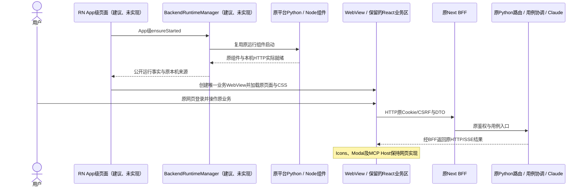
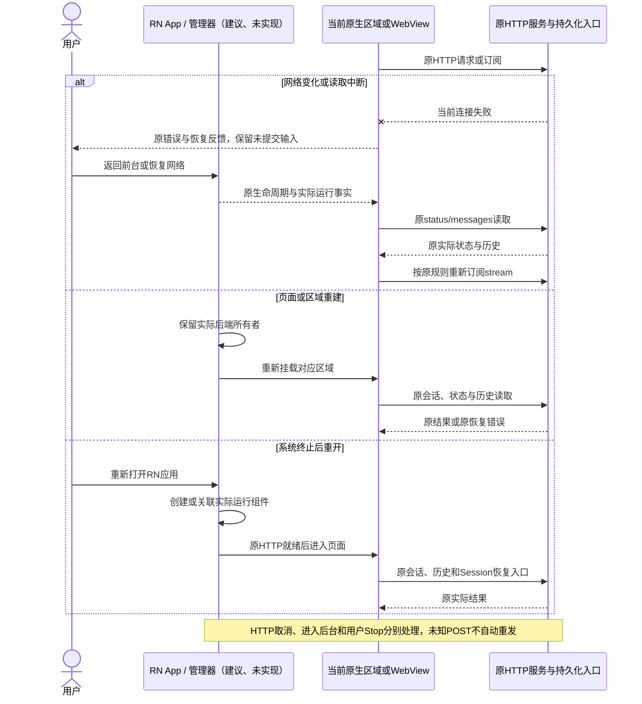
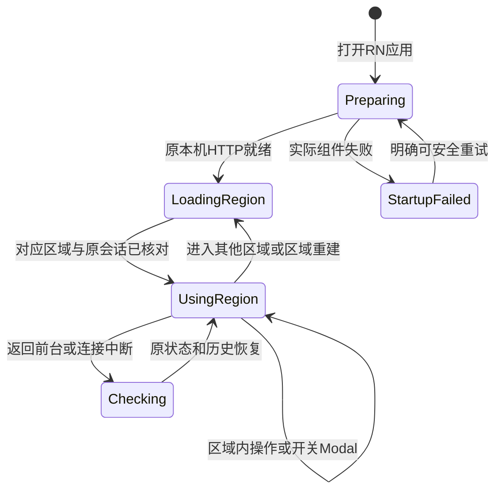

<!-- [Input] React Native统一客户端、Next继续Web发布、减少全量改动及端侧执行目标。 -->
<!-- [Output] RN框架内的承载取舍、组件级复用边界、交互时序和实施验收条件。 -->
<!-- [Pos] 跨平台前端复用决策稿；RN为固定目标，首发边界由具体页面与组件清单确定。 -->
<!-- [Sync] 2026-10-27: 具体路由与组件清单迁入frontend-page-component-allocation.md，本稿保留RN框架内的策略比较。 -->

# React Native框架内的前端复用取舍

当前首发的逐路由、逐页面、逐组件决定见[React Native页面承载与组件复用设计](frontend-page-component-allocation.md)。本文保留方案比较与通用约束；出现范围差异时，以具体清单为准。

## 背景与问题

目标保持为React Native统一iOS、Android客户端，Next继续Web构建与发布，Python/Claude在设备执行。用户要求控制项目整体改动，并指出自有Icons、Modal、CSS与第三方MCP App均具备网页运行条件。取舍围绕RN应用内哪些区域原生渲染、哪些区域复用原网页展开。

发现：React Hooks和纯业务逻辑可按依赖核对复用；原DOM/CSS组件放在WebView时可保留，进入原生渲染器时需要对应适配。定义：固定RN客户端目标，以完整页面或业务区域确定承载范围。发展：比较下列三种RN方案。交付：首发选定RN App级页面与单一持久业务WebView，保留现有页面和业务合同，避免将全部TSX列为默认重写清单。

## 目标与边界

### 保持不变的目标

- iOS、Android以RN为统一App入口和原生工程组织；现有Swift/Kotlin代码作为平台运行库与适配实现复用。
- Web继续通过Next发布；原DOM页面、CSS和当前构建入口保持。
- 移动业务通过本机HTTP访问原Next BFF/Python；Python、Node及Claude继续在设备执行，公网Admin/Gateway保持原职责。
- App级BackendRuntimeManager管理运行实例；Python中介者协调确有需要的用例，复用原Factory/服务，保持原HTTP、权限与持久化。
- 正常网页登录、原form/PKCE、Cookie/CSRF、失效与退出保持。端侧Dream工作台创建、初始生成及审核确认继续退出展示与适配，Web与已有数据保持。

### 三种RN方案的取舍

| RN内的方案 | 页面承载 | 现有TSX/CSS改动 | 主要取舍 |
| --- | --- | --- | --- |
| 一：RN宿主＋原业务WebView | RN承担App入口和运行管理，原页面作为完整业务区 | Icons、Modal、CSS及MCP Host继续原实现；新增RN/运行库接线及必要移动适配 | 改动最小，原业务区域仍为网页渲染，原生交互范围有限 |
| 二：RN App级页面＋完整网页业务区 | RN实现启动、一级导航、恢复层和系统操作；一个持久WebView承载现有业务 | 只适配RN宿主、移动入口与bridge，保留业务页面实现 | **当前首发策略**；RN框架目标明确，业务回归范围集中 |
| 三：全面RN原生页面＋RN Web | 广泛将原DOM页面转换为共享RN组件 | DOM/CSS、事件/Ref、编辑器及相关依赖逐步适配 | 迁移和回归范围最大；首发排除 |

本轮取舍为RN框架内的具体分区与实施顺序。方案二原生化App级页面，业务页面集中在同一持久WebView。未来业务页原生化需要新的产品范围、源码清单和独立验收；当前不预建迁移层。

本稿为设计策略，区域清单、依赖与实际验收仍需实施落实。此前[RN目标交互稿](mobile-react-native-interaction.md)的业务合同继续使用，具体原生化顺序以本稿为准。管理器、中介者与[实例生命周期](mobile-runtime-architecture.md#实例所有权与生命周期)保持。

## 概念与规则

### 判断组件是否修改

修改依据为实际渲染环境和平台需求，代码归属只决定维护所有者。原样保留的DOM组件运行在网页构建与WebView内；RN原生页面不得直接导入这些组件及其CSS并假定原生渲染器能够执行。

| 模块 | 留在网页区域时 | 实际用于RN原生区域时 |
| --- | --- | --- |
| [Icons.tsx](../../../frontend/app/_dream/components/chat/Icons.tsx#L21) | SVG、路径、名称与样式保留 | 仅适配原生区域实际使用的图标；保留路径数据，集中处理SVG渲染与尺寸/颜色 |
| [Modal.tsx](../../../frontend/app/_dream/components/chat/Modal.tsx#L25)和[CSS](../../../frontend/app/_dream/components/chat/Modal.css#L8) | 保留Portal、CSS、焦点与缩放逻辑；实际移动缺陷局部修复 | 共享业务参数，平台弹窗/焦点/返回分别处理；不搬运DOM操作 |
| 普通React组件与Hooks | 保留现有代码与状态 | Hook用途、纯逻辑与DTO继续复用；仅替换平台视图、事件和Ref访问 |
| `@modelcontextprotocol/ext-apps`、`@mcp-ui/client` | 保持包代码和锁定版本，继续网页运行 | 由局部WebView承载原Host页面与iframe，不将包强行转换为原生组件 |
| [ImMcpAppHostAdapter](../../../frontend/app/_dream/components/chat/mcp-apps/ImMcpAppHostAdapter.tsx#L12) | 保留Host、iframe与postMessage | 外层原生区域只适配承载与生命周期；内部协议、来源、CSP和权限保持 |
| 编辑器、Markdown、图表和文件预览 | 继续原网页内容及CSS | 对选定完整业务区域评估原生渲染；复杂网页协议内容继续局部承载 |
| 文件选择、下载、分享与系统返回 | 沿原业务链路接入必要系统操作 | 使用同一业务接口与原权限，原生只处理系统操作和UI反馈 |

`Icons.tsx`和`Modal`不因属于自有代码而默认修改；它们位于原生区域时也无法仅通过原文件导入完成原生渲染。保留原文件、增加必要平台入口，以及共享可移植定义均可按具体使用点选择。

### 页面与构建边界

1. RN入口、原生导航、运行管理与系统能力属于原生构建；保留的DOM/CSS业务属于原Next网页构建。必要的`.native.tsx`、`.web.tsx`入口与解析规则明确配置。
2. 每个保留的网页业务区使用完整页面或自洽的业务树。Chat的输入、消息、Modal和MCP App在迁移前保持同一上下文，禁止按单个图标或按钮创建WebView。
3. 网页区域复用原会话、状态与SSE；原生区域通过HTTP访问相同业务接口。禁止复制业务状态机、DTO或后端逻辑。
4. 首发不新增RN Web共享视图。未来明确原生化某个完整业务页时，单独验证Next接入、SSR/水合与样式边界。
5. 一级导航与网页内导航分别定义所有权，避免重复导航栏、循环返回和页面重挂载导致会话丢失。具体页面选择应对应已确定的业务交互需求。

### HTTP、登录与MCP Apps

持久业务WebView继续同源访问本机Next/BFF，使用原浏览器Cookie与CSRF。登录与业务使用同一个WebView Cookie容器。RN App级页面不读取账户凭证，也不发受保护业务请求。

原生模块只承担运行控制、区域生命周期及必要系统操作。业务正文、发送、Stop、文件与MCP工具调用沿原HTTP/MCP链路；MCP App内部Host、iframe sandbox、CSP和postMessage身份校验保持。第三方包代码与node_modules保持，确有兼容问题时修改项目自有宿主边界。

Python/Node/Claude仍在设备执行，页面承载方式不引入Mac执行转发。应用内网页资源、原生UI与运行库随相应安装包构建和签名；Web继续原Next发布，接口与版本兼容沿原部署设计。

### 中介者与运行管理

BackendRuntimeManager属于RN App级组合根，复用[EmbeddedDreamBackend.shared](../../../mobile/ios/InkMemory/EmbeddedDreamBackend.swift#L9)和原平台启动代码；负责启动、就绪、可安全重试阶段和自有资源释放。页面、WebView及RN Root重建不重复创建后端。

后端中介者模式目标保留，按具体用例协调原Factory/应用服务，继续原HTTP入口、身份、锁、admission、持久化与终态。禁止按Icons、Modal或第三方界面组件添加Python方法，也不为简单委托强制增加空包装。

## 正常业务时序

所有新增RN模块和管理器均为建议、未实现。业务使用现有HTTP合同。

## 异常与恢复时序

## 页面与实例状态

RN App管理器、Hermes、CPython、Node、Next、ASGI、Factory、Claude Worker、Session与MCP实例沿[原生命周期表](mobile-runtime-architecture.md#实例所有权与生命周期)维护。网页文档与原生区域分别拥有自身渲染实例，关闭区域不等于停止整个后端或取消任务。

## 改动范围与验收

| 工作项 | 范围与通过条件 |
| --- | --- |
| RN工程与运行库接线 | RN为App入口，原平台代码作为适配实现；启动、就绪、重挂载和释放通过 |
| 区域清单 | 逐页登记原生/网页承载、入口、会话和返回所有者；禁止按全部TSX默认改写 |
| 基础组件 | 只实现RN启动、导航、恢复层和系统操作需要的组件；保留业务WebView源码/CSS与行为 |
| 登录与HTTP | 同一持久WebView内保留原登录并验证Cookie/CSRF、失效、退出及增量读取 |
| MCP Apps与文件 | 保留第三方包，验证原Host来源/CSP、工具调用、系统文件操作和资源清理 |
| 业务与范围 | 原Chat流、Stop、持久化、恢复、权限及Web回归保持；端侧无工作台创建/审核入口 |
| 双平台运行 | iOS与Android分别验证原库共存、端侧Python/Claude、系统返回/键盘及安装升级 |

优先完成RN入口与现有业务承载。此前3–5/10–16人周估算针对全面业务原生化，不作为当前方案工期；实际工作量按具体清单、基础适配与平台回执重新拆分。Android Python/Claude兼容成本单列。

本轮结论：**RN目标保持，首发原生化App级页面并用一个持久WebView承载现有业务**。设计与验收计划已定义，代码实现、真实业务和发布继续按后续任务执行。

官方资料于2026-10-27查阅：[RN渐进接入](https://reactnative.dev/docs/integration-with-existing-apps)、[RN WebView指南](https://github.com/react-native-webview/react-native-webview/blob/master/docs/Guide.md)。两者支持按页面/区域组织原生和网页承载，实际业务兼容仍需验证。
