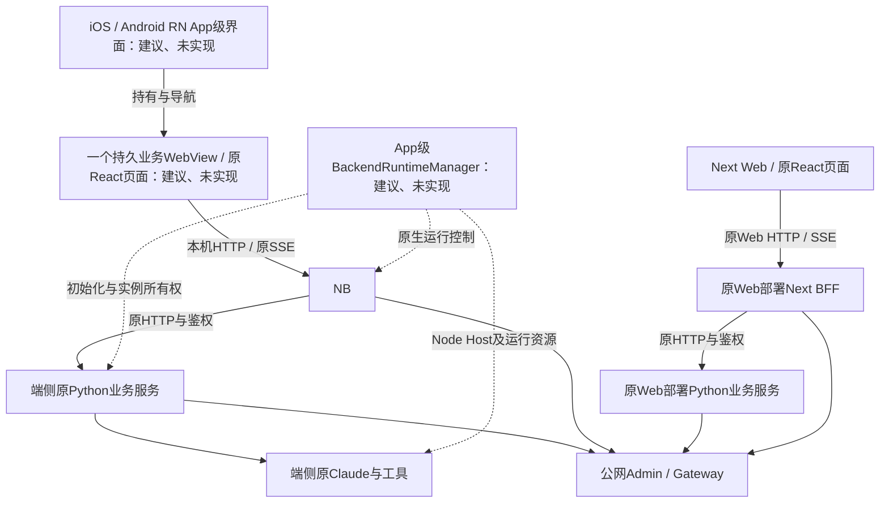
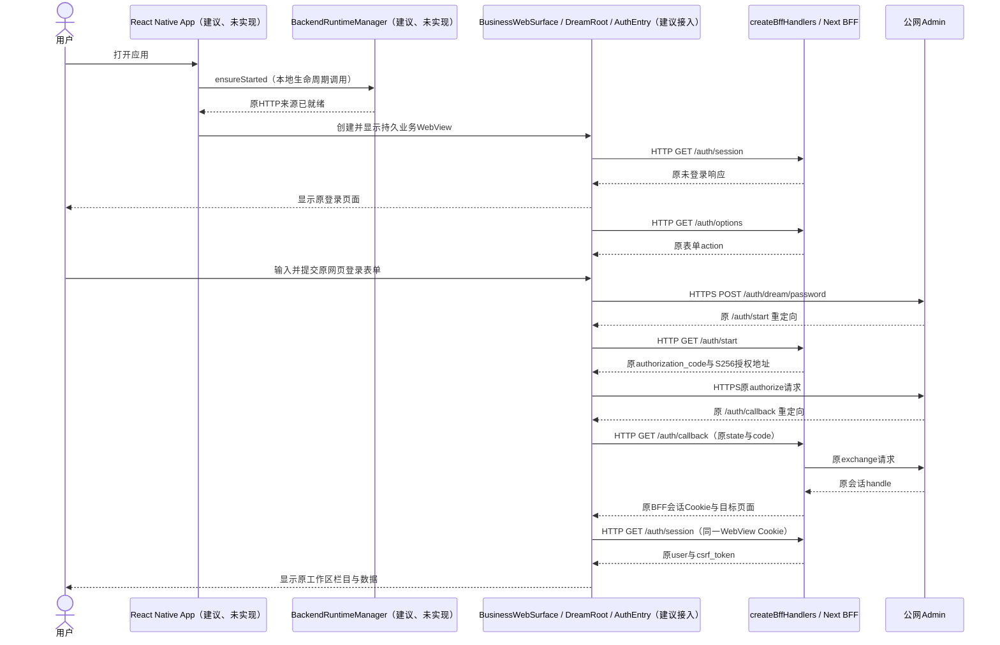
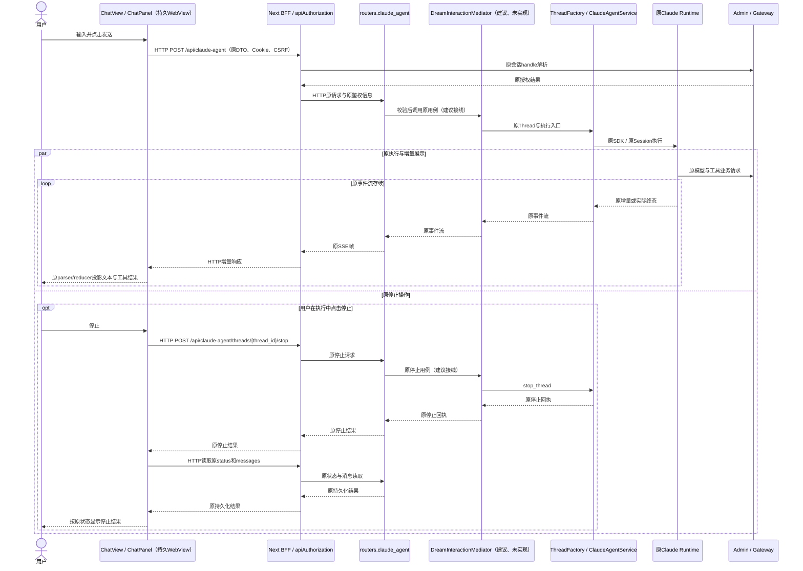
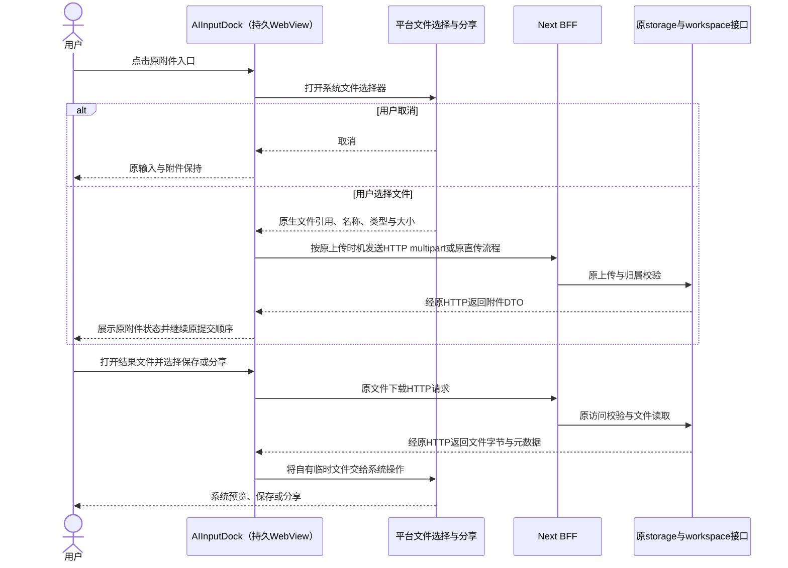
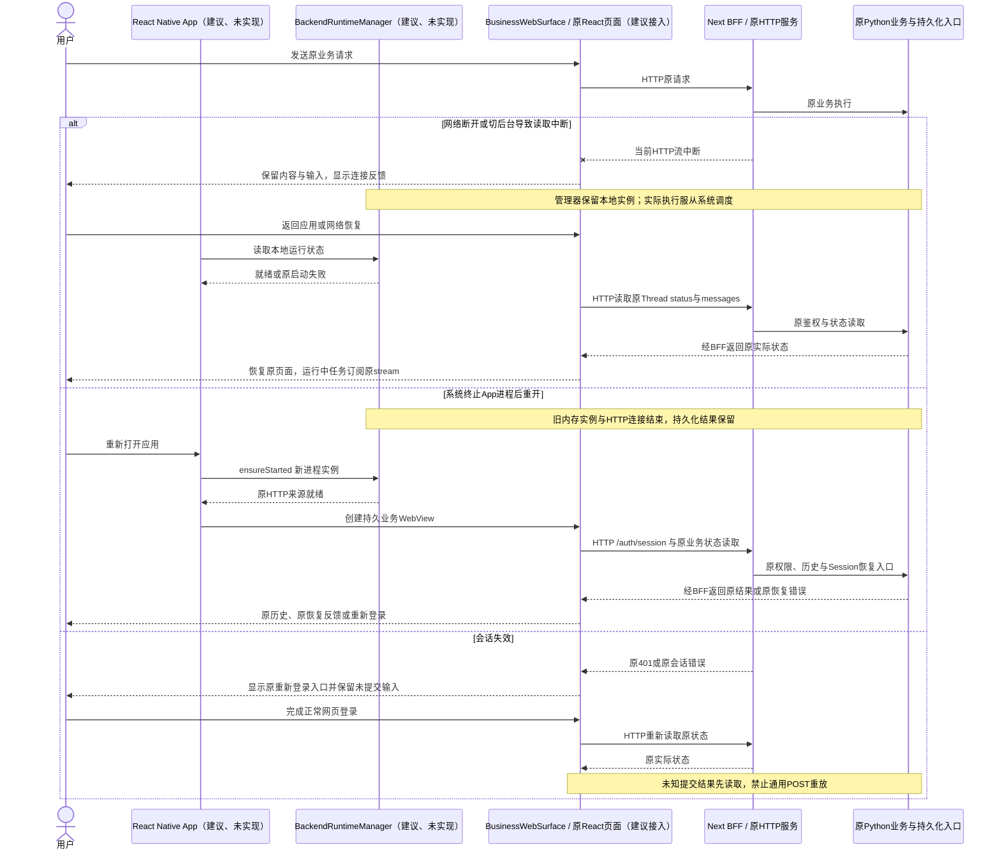
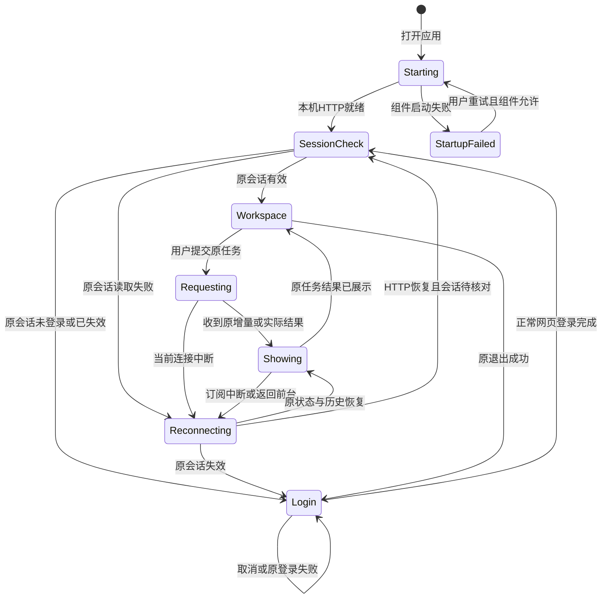

<!-- [Sync] 2026-10-27: 首发固定为RN原生App级页面与一个持久业务WebView，逐路由清单归具体承载设计。 -->
<!-- [Input] RN统一客户端、Next Web发布、持久业务WebView、HTTP业务、端侧运行与模块范围的交流结论。 -->
<!-- [Output] 已选方案结果、三端界面边界、业务时序、生命周期规则及验收。 -->
<!-- [Pos] docs/design/multi-platform/现行跨平台业务交互设计；技术实例合同归同目录架构稿。 -->
<!-- [Sync] 2026-10-27: 按交流结论重组正式正文，迁移跨平台归属并保留前稿原文。 -->

# React Native 移动应用业务交互设计

实施取舍：React Native目标保持。首发原生化App启动、一级导航、恢复层与系统操作，一个持久业务WebView承载现有范围内业务页面。逐路由和逐组件决定见[页面承载与组件复用设计](frontend-page-component-allocation.md)。

## 背景与问题

Ink & Memory需要在保留Web使用与发布能力的同时，生成iOS和Android原生应用。用户选择React Native作为统一客户端框架。首发保留当前React DOM业务页面，通过RN内的持久WebView运行；Next.js继续提供Web。端侧Dream Python和Claude继续在设备执行，业务调用继续使用HTTP；App内独立模块负责后端生命周期，Python应用服务采用中介者模式协调既有业务。

当前代码使用React DOM/Next页面，iOS已有端侧Python、Node和原Claude运行组件，RN与新的生命周期管理器尚未接线。发现阶段确认Chat、认证、Deck、Writing、Analysis、Settings和MCP Apps均依赖浏览器运行环境；定义阶段保留HTTP、正常网页登录与权限，排除端侧工作台创建；方案比较后选定RN原生App级页面与持久业务WebView。RN Web退出首发前置条件，后续仅在产品明确要求某个业务页原生化时评估。

## 目标与边界

### 交流结论与最终方案

| 讨论项 | 已确定结果 | 实施边界 |
| --- | --- | --- |
| 是否采用React Native | iOS、Android使用RN App组合根与各自原生构建工程 | RN原生化启动、一级导航、恢复层和系统操作；原生工程继续链接现有端侧运行库 |
| Web是否继续使用 | Web继续由Next.js构建、路由与发布 | 保留现有入口、SSR及BFF职责，网页渐进迁移 |
| View能否用于Web | RN Web具备后续共享能力，首发不转换现有DOM页面 | Next继续当前DOM树；明确原生化业务页时再验证包转译、SSR/水合和样式 |
| React组件复用 | DOM组件在WebView原样运行；纯业务逻辑、DTO和parser/reducer继续原样使用 | 不把`Icons.tsx`、`Modal.tsx`或CSS转换为RN组件 |
| 移动业务访问 | 持久业务WebView通过本机HTTP访问原Next BFF，再进入原Python业务接口 | 保留原路径、DTO、SSE、Cookie/CSRF、权限与写入顺序 |
| 后端运行位置 | Python、Node、Next BFF和Claude位于端侧；公网Admin/Gateway保留原职责 | 移动业务执行无Mac转发；Web沿原部署拓扑运行 |
| App后端管理 | App级BackendRuntimeManager拥有运行组件的启动、就绪、重试和释放 | 页面、Scene、Activity或RN Root只订阅，禁止重复创建后端 |
| 后端中介者 | Python应用服务以具体用例方法协调现有Factory和服务 | 原路由校验与HTTP合同保持；不引入业务RPC或通用命令总线 |
| 登录 | 保留正常网页登录、原form、PKCE、Cookie、CSRF、失效和退出流程 | 登录与业务共享同一持久WebView Cookie容器；Google回调独立验证 |
| 端侧范围 | Chat、Decks、More及原归属内的保留业务和文件操作 | Dream工作台创建、初始生成和审核确认退出端侧展示与适配 |

上述内容为目标设计。RN入口、管理器、持久WebView接线和新增中介者接线均待实施。当前已有WebView包和真实业务回执分别保留原执行位置，不能替代RN验收。

### 三端总体结构

移动端的原React页面在持久WebView内通过HTTP访问本机服务，Web通过原Web部署入口访问服务。公网Admin继续承担既有账户和数据职责，Gateway继续承担原模型入口。App管理器仅存在于安装包；浏览器页面不负责启动或停止Web服务。

## 概念与规则

### 页面承载与平台差异

| 现有代码 | 复用或适配方式 |
| --- | --- |
| RN启动、失败、恢复与一级导航 | 使用RN组件及平台安全区；不承载业务数据和表单 |
| 认证、Chat、Deck、Writing、Timeline、Analysis、Settings | 在一个持久WebView内保留当前React DOM、CSS、Hooks和浏览器行为 |
| 请求DTO、状态计算、SSE事件投影 | 继续使用原模块，业务状态与终态保持 |
| `MouseEvent`、`UIEvent`、`HTMLElement` Ref和`document/window` | 保持WebView归属，首发不增加`.native.tsx`副本 |
| MCP网页内容 | 保持原Host、iframe、CSP、来源和`postMessage`协议 |
| 文件选择、保存、分享、外链 | WebView发起现有allowlist调用，RN/native平台层执行系统操作 |
| Next Route Handlers、网页登录和BFF | 保留原服务端职责与同一Cookie容器 |

具体文件和“不改”清单见[组件级取舍](frontend-page-component-allocation.md#组件级取舍)。RN Web保留为后续能力；首发无共享RN业务组件目录和批量DOM转换任务。

### 页面与业务范围

| 页面归属 | 保留操作 | 原模块与约束 |
| --- | --- | --- |
| Chat | 历史、会话、输入、队列、工具问题、停止、结果与附件 | [ChatPanel](../../../frontend/app/_dream/components/chat/ChatPanel.tsx)、原Thread与消息接口；可移植视图逐步共用 |
| Decks | 列表、详情、编辑、版本与既有权限内操作 | [DeckManager](../../../frontend/app/_dream/components/DeckManager.tsx)、[原HTTP客户端](../../../frontend/app/_dream/api/voiceApi.ts#L1292)与[原接口](../../../backend/routers/voices.py#L99) |
| More及既有子栏目 | Writing、Timeline、Analysis、Settings等原归属内功能 | 复用原业务设计与接口，平台渲染差异逐页核对 |
| 正常网页登录 | 密码、注册、Google、取消、原错误、失效与退出 | 原AuthEntry、Admin与BFF；Cookie保留在同一持久WebView存储 |
| Dream工作台创建 | 端侧不提供创建、初始生成和审核确认入口 | 首页、导航、More、快捷操作及应用内链接均排除；Web原模块保留 |

端侧主导航为Chat、Decks、More。原Chat中的既有消息、结果与附件继续按原权限读取。界面范围排除不改变原Agent工具、Deck、后端路由、账户权限或已有数据。

### 生命周期与用户操作

| 用户操作或系统事件 | 运行模块行为 | 页面与业务结果 |
| --- | --- | --- |
| 首次打开App | App管理器合并并发启动，原组件与本机HTTP就绪后提供服务 | 准备中 → 原会话检查 → 工作区；失败显示原因和重试 |
| 切换栏目或RN Root重挂载 | 保持同一App级运行所有者 | 页面重新订阅，任务、会话及未提交输入按原规则保持 |
| 网页登录与退出 | 原登录/BFF负责账户；管理器保持运行实例 | 原会话生效或清理，权限与任务规则保持 |
| 网络断开或HTTP取消 | 结束当前请求/订阅，保留本机实际运行状态 | 保留内容和输入；网络恢复先读取原状态与历史 |
| 用户点击停止任务 | 原HTTP stop接口进入原Factory/Service | 读取原回执与持久化状态后更新页面 |
| 前后台切换 | 实例保留并服从系统调度，禁止全局shutdown或自动重发 | 返回前台后核对原状态和历史，再订阅原stream |
| 系统终止进程后重开 | 创建或关联实际运行组件，旧内存实例结束 | 通过原HTTP读取会话、历史与Session，使用原恢复合同 |

[实例所有权与生命周期](mobile-runtime-architecture.md#实例所有权与生命周期)逐项定义App、Android Service、管理器、RN/Hermes、Web渲染、CPython、Node、ASGI、Next BFF、中介者、请求/订阅、Factory、Runner、Claude Worker、Session、MCP及文件实例的创建、就绪、结束和持久化规则。管理模块保留在App内部；界面沿用现有启动与错误区域，不新增后端管理页面。

本稿关联[产品范围与桌面/窄屏骨架](../../prd/dream-workspace/mobile-app.md)、[iOS差异](mobile-ios-interaction.md#react-native目标接入)、[Android差异](mobile-android-interaction.md#react-native目标接入)、[发布设计](../../deploy/mobile-app-release.md)。

### 页面、滚动与返回

桌面与窄屏骨架直接定义在PRD。消息列表和文件内容分别滚动，输入框增高后内部滚动，长代码/表格在内容区域横滚。键盘显示时保持输入和发送/停止可见。底部导航按原响应式规则避让键盘。

iOS安全区域沿用当前页面主背景色，返回手势关闭当前详情或回到来源栏目。Android返回先处理键盘和系统弹窗，再关闭当前详情或返回上一业务页面。附件选择取消、登录取消、分享取消均返回来源页面并保留未提交输入；普通取消操作保持现有确认规则。

### 正常网页登录与HTTP会话

1. `BackendRuntimeManager`就绪后，RN创建一个持久`BusinessWebSurface`。该WebView在栏目切换期间保持同一实例。
2. WebView中的`DreamRoot`与`AuthProvider`通过原`GET /auth/session`读取会话。未登录时由现有`AuthEntry`显示原登录入口。
3. 用户通过原`/auth/options`、网页form、Admin及`/auth/start`、`/auth/callback`完成登录。密码与授权码继续由原流程处理，BFF Cookie写入同一WebView Cookie存储。
4. 后续业务请求继续由该WebView中的原页面发起，携带原Cookie及`x-ink-csrf`；请求来源、Host和回调继续满足原BFF校验。登录过期使用原错误及重新登录入口。
5. Google继续使用现有授权页面及已登记回调。系统浏览器返回App的关联、Cookie回流及取消需要双平台独立验证；该验证为Google入口的发布前提。

## 正常业务时序

下列新增参与者均标注“建议、未实现”；HTTP路径、已有模块和返回结果保持现有命名。

### 启动、登录与进入工作区

### Chat发送、流式结果与停止

图中流式过程包含原消息提交、权限和持久化顺序，现有Factory/Service继续负责这些行为。中介者转交原执行结果，禁止重新定义发送、停止、审批或结算规则。

### 附件、上传与结果文件

原`useFileUpload`的直传与服务端上传选择、附件DTO及workspace写入顺序继续保留。WebView文件请求通过现有桥协议取得opaque文件句柄，再由原上传适配恢复`File`/`Blob`或上传体。大文件采用流式读取，临时文件由对应上传/预览实例释放；系统取消保持原页面与业务记录。

## 异常与恢复时序

HTTP断开、App后台与业务停止分别处理。普通重连优先读取状态与历史，再订阅原`GET /api/claude-agent/threads/{thread_id}/stream`。恢复只使用范围内业务已有、具备明确幂等与恢复合同的入口。缺少恢复证据时展示原错误，不创建替代Run/Thread/Session。管理器和中介者均不主动查询或调度Dream工作台创建、审核确认任务。

后端启动失败发生在业务请求前：现有启动区域显示失败，用户点击重试后仅重试可安全初始化的组件。Node或CPython要求同进程单次初始化时，管理器返回需重新打开应用的明确结果；页面禁止循环重启解释器。

## 页面状态转换

这些状态定义界面展示。后端管理器状态、Run状态、Thread执行状态与确认派发状态分别由各自所有者维护；“本机HTTP就绪”表示运行时装配完成，账户授权与业务成功单独判断。

## 双平台验收计划

以下各项分别在iOS Simulator、物理iPhone和Android目标执行，当前状态均为待实施后验收。

| 验收项 | 预期结果 | 验证方式与执行前提 |
| --- | --- | --- |
| 首次安装与启动 | 一个App级后端实例，原HTTP入口实际可达 | 清洁安装包，核对进程/组件身份、startup状态及原会话响应 |
| RN壳与Web发布 | RN App级页面和持久业务WebView可用，Next继续构建当前React DOM页面 | 后续执行RN生产构建与Next生产构建；核对启动、导航、WebView加载、App Router、样式与浏览器交互 |
| 运行实例复用与部分失败 | 页面/Root/Activity重建保持实际所有者，失败重试只执行可安全重试阶段 | 并发启动、逐阶段故障及句柄/端口检查；注入仅使用具名技术harness |
| 中介者与HTTP合同 | 原路径、DTO、权限、流式顺序及持久化保持，WebView与Web共用用例 | 原生产入口合同验证与Web相邻回归，不复制业务入口或通用重试 |
| 升级与重开 | 原账户、历史与Session可读取，旧运行实例结束 | 上一版本包、同签名覆盖升级、原业务数据与容器路径检查 |
| 正常登录与取消 | 原表单与回调，取消后原页面保持 | 真实账户、已登记来源；分别验证Cookie与CSRF接入 |
| Google与会话失效 | 原授权、取消、返回及重新登录反馈 | 双平台回调与浏览器前提具备；保留原权限范围 |
| Chat流式与停止 | 首帧增量可见，原停止回执与消息保存一致 | HTTP逐帧观察、原模型明确选择与调用预算、正常Admin回查 |
| 工作台创建模块排除 | 首页、导航、More、快捷操作与应用内链接均无创建或审核确认入口 | 检查移动路由/菜单清单及界面，移动UI不调用创建/确认专属HTTP；Web入口、Agent权限与既有数据保持 |
| 断网及前后台 | 查询实际状态后恢复订阅，未知提交不重发 | 有界真实任务，记录HTTP、系统调度与原任务状态 |
| 进程终止重开 | 新运行时实例，原历史与支持的恢复路径 | 保留业务持久化和原Session，核对重复模型调用 |
| 附件与文件 | 原上传时机/DTO，保存分享取消反馈一致 | 原文件业务、系统选择器、上传进度与访问权限回查 |
| 窄屏、键盘与返回 | 发送/停止可见、安全区主色一致、返回位置保持 | 两平台不同屏幕、输入法、长内容与原主题 |
| 相邻Web回归 | 原HTTP、登录、parser、状态与权限合同保持 | 现有Web核心旅程及DTO/SSE合同测试 |
| 构建安装与发布 | 两平台签名包可安装升级，渠道材料符合要求 | 原发布设计中的账号、签名、渠道与资格前提 |

## 证据与评审结论

- 当前Web界面：[AuthEntry](../../../frontend/app/_dream/components/Auth/AuthEntry.tsx#L49)、[ChatPanel](../../../frontend/app/_dream/components/chat/ChatPanel.tsx#L1466)。
- 原认证及HTTP：[createBffHandlers](../../../frontend/app/api/_auth/handlers.ts#L30)、[apiAuthorization](../../../frontend/app/api/_auth/api-proxy.ts#L10)、[CSRF校验](../../../frontend/app/api/_auth/login-boundary.ts#L275)。
- 原业务：[Chat提交](../../../backend/routers/claude_agent.py#L1056)、[停止](../../../backend/routers/claude_agent.py#L2922)、[上传](../../../frontend/app/_dream/hooks/useFileUpload.ts#L104)。[原工作台创建路由](../../../backend/routers/story_workspace.py#L883)保留服务端实现，退出移动交互与验收。
- 官方资料：[React Native环境](https://reactnative.dev/docs/set-up-your-environment)、[原生组件](https://reactnative.dev/docs/intro-react-native-components)、[Native Modules](https://reactnative.dev/docs/turbo-native-modules-introduction)、[网络](https://reactnative.dev/docs/network)，查阅日期2026-10-27。

设计评审结论：**待满足明确前提后通过**。业务入口、HTTP合同、原网页登录、任务状态与持久化边界已定义；React Native视图迁移、Cookie/CSRF接入、HTTP增量读取、管理器实例释放和两平台真实业务回执为实施依赖。本轮文档检查仅验证清单、引用与图示，不构成React Native构建或真实业务验收。
