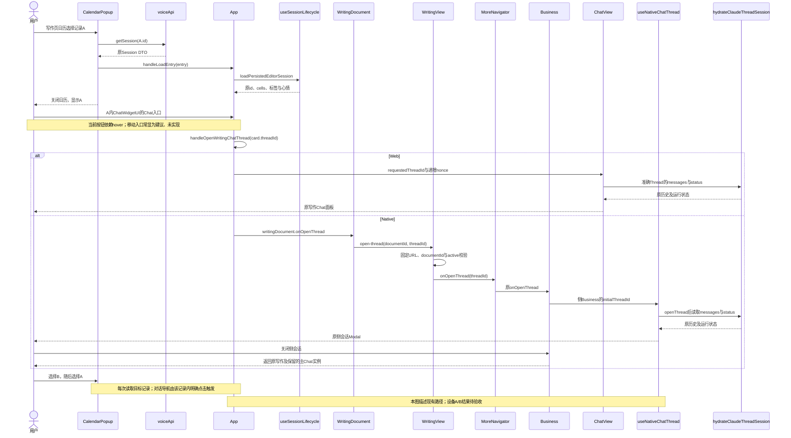
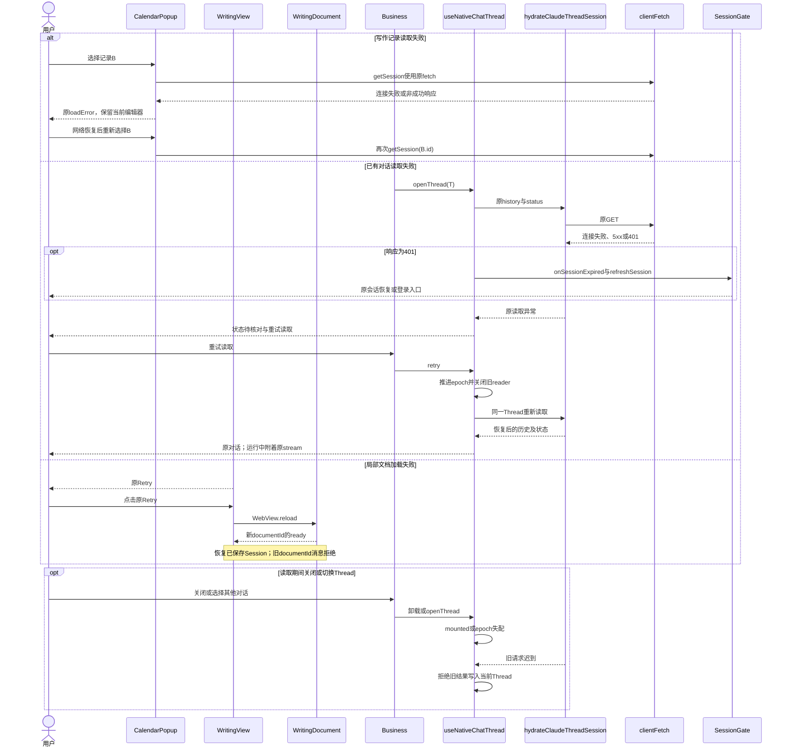
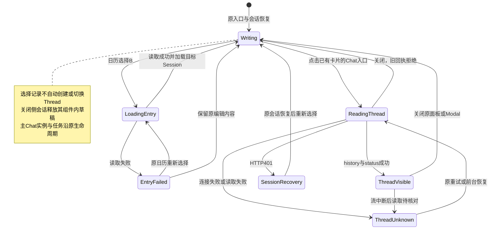

<!-- [Input] 2026-11-01只读诊断阶段的写作关联对话设计原文。 -->
<!-- [Output] 实施前入口、发送上下文建议、时序与状态图历史快照。 -->
<!-- [Pos] 历史证据；现行合同归上级writing-mobile-layout。 -->

# 写作关联对话实施前设计原文

来源：实施开始时HEAD f40a9cfae8e85489a5354ccce7987f0a6a50f57d。下文保留原正文与图示，Markdown相对引用按归档目录修正。

## 写作记录与关联对话

### 背景与问题

用户确认本次“笔记”指“更多 → 写作”或时间线中的写作记录。现行写作编辑对象为`EditorState`，持久化对象为Writing Session。打开指定记录的生产入口位于写作页的`CalendarPopup`日记列表，依次执行`handleOpenEntry → getSession → App.handleLoadEntry → loadPersistedEditorSession`。`CollectionsView`时间线展示日期、历史图片、评论和报告；Web与Native当前均未提供从普通日期卡直接打开写作对话的动作。

当前源码具备写作卡片打开关联Chat的两端接线。`ChatWidgetUI`的Chat按钮以`isHovered=false`初始化，默认透明且不接收指针，只有原鼠标进入事件将其显示；现有Web旅程先hover再点击。触屏入口可发现性存在明确缺口，当前iPhone上的事件与点击结果待验证。端侧发送上下文存在独立差异。[只读诊断与评审](../../../exec/writing-linked-chat-review-20261101.md)保存逐项代码证据、包体来源范围与请求回执。产品规则及骨架归[移动PRD](../../../prd/dream-workspace/mobile-app.md#写作记录与关联对话)。本节与前文排版实施的状态分别维护，本轮新增源码修改为零。

原组件的隔离触摸样本已复现：390宽度、移动触屏初态下，两次点击Chat按钮所在坐标均未触发onOpenChat，底层标题分别折叠和展开；桌面hover后普通点击成功一次。构建22的本地Next静态chunk含相同的false初态、鼠标事件与指针显隐表达式。该证据支持入口显示条件的局部修正，WKWebView真机及实际A/B请求继续独立验收。

### 目标与边界

- 采用Web当前入口和关系：选择写作记录后，由用户点击该记录现有对话卡片的“Chat →”。单纯切换记录只加载编辑内容。
- 保留原编辑、保存、手动建议、Voice关联、主Chat稿、侧会话、任务、Cookie会话、CSRF与服务端资源归属校验。
- 优先使用现有重新读取和重新进入；局部修改以实际故障回执为实施前提。禁止通过换服务地址、重建账户、自动新建Thread、发送模型探测消息解决未知失败。
- 设备构建22已读回；当前RN入口的两项源码摘要与原构建回执匹配。包内Next的逐文件源码来源仍有缺口，完整安装采用资格单列。Android当前设备与包体均未取证。

### 概念与规则

| 对象 | 当前规则与交互 |
| --- | --- |
| 当前记录 | `EditorState.id`标识Writing Session；日历选择后替换编辑器状态、文本、标签和心情，关闭日历 |
| 对话卡片 | 每个`ChatWidgetData.threadId`打开其指向的Thread；一份记录可以含多个卡片。当前非折叠卡片的Chat按钮仍有鼠标悬停显示条件 |
| Voice关联 | `ensureVoiceThread(voiceId, existingThreadId)`优先复用已有Voice Thread；不同记录的卡片允许指向同一Thread |
| 手动写作建议 | `EditorState.writingThreadId`由`WritingSuggestionController`懒创建、保存并复用；该引用与对话卡片分别消费，当前建议卡无直接Chat跳转入口 |
| Web展示 | `handleOpenWritingChatThread`传入准确Thread与递增nonce，`WritingWorkspaceSplitPane`显示原`ChatView`；桌面分栏，Web窄屏采用原覆盖面板 |
| 端侧展示 | `WritingDocument`发送`open-thread`；`WritingView.receive`核对固定URL、documentId和active；`MoreNavigator`透传；`Business`建立原侧会话Modal |
| 主Chat稿 | 端侧切换到更多及打开侧会话保留底层`Business`与输入组件；覆盖期间暂停焦点，返回后恢复原实例 |
| 侧会话稿 | `useComposerDraft`持有组件内未发送稿；关闭Modal会卸载该侧`Business`。Web关闭写作Chat面板或切换Thread会卸载原ChatPanel。跨关闭/跨Thread恢复未发送稿未形成当前合同 |
| 写作正文 | 继续`useSessionLifecycle`的保存与恢复；切换后恢复已保存状态，保存失败沿原反馈处理。即时未保存稿的切换边界列入验证 |
| 已有任务 | 打开、关闭或切换对话只替换观察者并读取原history/status；停止任务继续使用原Stop动作。服务端任务状态与本地流读取状态分别维护 |

#### 请求与反馈

1. 记录读取继续使用`GET /api/sessions/{sessionId}`。读取失败沿`CalendarPopup.handleOpenEntry`的原失败反馈，原编辑器保持；网络恢复后在原日历重新选择同一记录。
2. 打开已有对话继续调用`hydrateClaudeThreadSession`读取原`messages`与`status`。运行中才附着原`GET /api/claude-agent/threads/{id}/stream`；打开和重试均不提交新用户消息。
3. 端侧未知状态使用现有“重试读取”；`retry`替换读取epoch，自动恢复沿原退避策略。`AppState`回前台重新读取。旧epoch或已卸载实例的结果不得更新当前Thread。
4. 原生文档加载失败显示原Retry，点击执行WebView重载。此操作可能影响尚未保存的编辑内容，应优先处理已有对话中的读取失败；记录读取和模型发送均未形成回执时，不连续重发。
5. 401经原`onSessionExpired → refreshSession → SessionGate`恢复；Web局部文档沿原`AuthProvider`。账户退出或切换释放原业务实例。恢复后重新选择原记录及其卡片，跨账户草稿恢复保持关闭。
6. 没有对话卡片、卡片已折叠或卡片缺少threadId时，Chat按钮不渲染；已有threadId的非折叠卡片仍需原悬停条件显示。读取失败使用原读取反馈；缺少关联入口的产品扩展单列需求。当前历史503回执只支持其记录时段和接口的失败判断。
7. Web写作Chat发送包含当前`editor_state`且执行`ensureSessionPersistedForAgent`；端侧侧会话当前只收到threadId。对齐此项属于建议、未实现的发送上下文工作项，不作为本次“无法进入”的已证根因。

#### 后续局部修正条件

| 观察结果 | 处理方式 | 状态 |
| --- | --- | --- |
| 原重试或网络恢复后，同一卡片打开原Thread | 保留现有实现并记录恢复回执 | 待设备复验 |
| 有关联的展开卡片在触屏上缺少可见Chat入口 | 复用App现有mobileWriting值传给原ChatWidgetUI，让移动卡片原按钮可见且可点击；桌面沿原hover，折叠与关联条件保持 | 源码显示条件已证；触摸与包内资源待验证，建议、未实现 |
| 安装资源缺少现有接线 | 按现有构建流程更新对应RN或Next资源，安装前后核对同一bundle ID与资源摘要 | 条件化后续工作，本轮未构建或安装 |
| 点击有open-thread且history/status成功，Modal未显示 | 在`Business`原`sideChat/Modal`呈现处修正具体条件 | 待该故障证据，建议、未实现 |
| 点击未形成open-thread | 在原`WritingDocument/receive`的实际阻断位置修正字段或active接线 | 待该故障证据，建议、未实现 |
| 打开正确Thread，发送时缺少写作上下文 | 在原文档协议内取得绑定本次记录的上下文并等待原保存屏障，再由原request builder发送 | 源码差异已证；发送回执与局部协议评审为实施依赖，建议、未实现 |
| 创建Thread迟到或记录读取乱序 | 复用既有身份校验方式，在对应共享回调核对触发时的Session/目标与当前请求；旧结果停止导航 | 共享控制流风险；待确定性复现，建议、未实现 |

发送上下文修正需覆盖“点击时记录 → 发送前保存 → 同次请求快照”的身份匹配；单纯在打开时复制一份正文不能满足Web发送前的保存规则。该工作限制在现有文档消息与发送入口，无新增HTTP接口、全局存储或平行Chat。后续实现提交需明确同次请求回执、取消与超时沿用的配置，以及保存失败时保留输入并阻止发送的行为。本轮保留此依赖，关闭未经证实的协议扩展实施。

### 关联对话正常业务时序

### 关联对话异常与恢复时序

### 关联对话状态转换

图中状态用于描述页面反馈，当前生产代码沿既有state与epoch执行。拟议修正需先满足[后续实施清单](../../../exec/writing-linked-chat-review-20261101.md#后续实施清单)的证据和依赖；图示不提高设备与真实模型验收状态。
