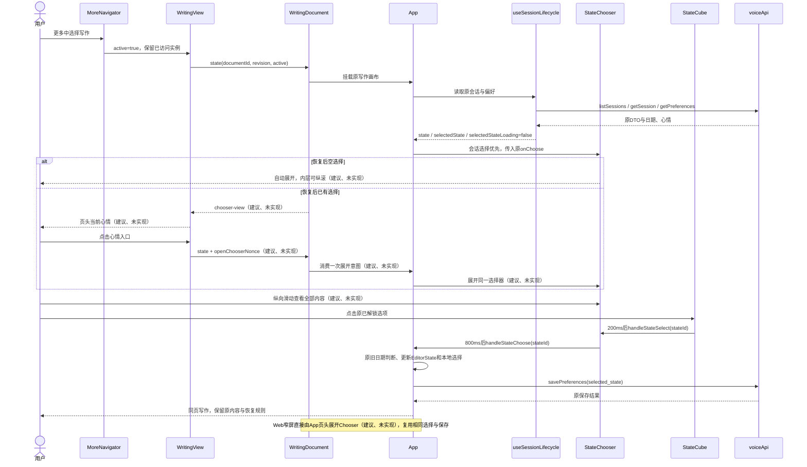
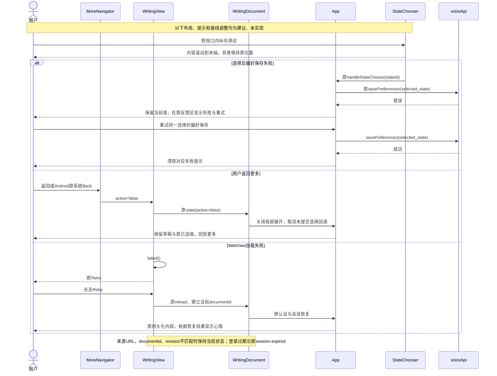
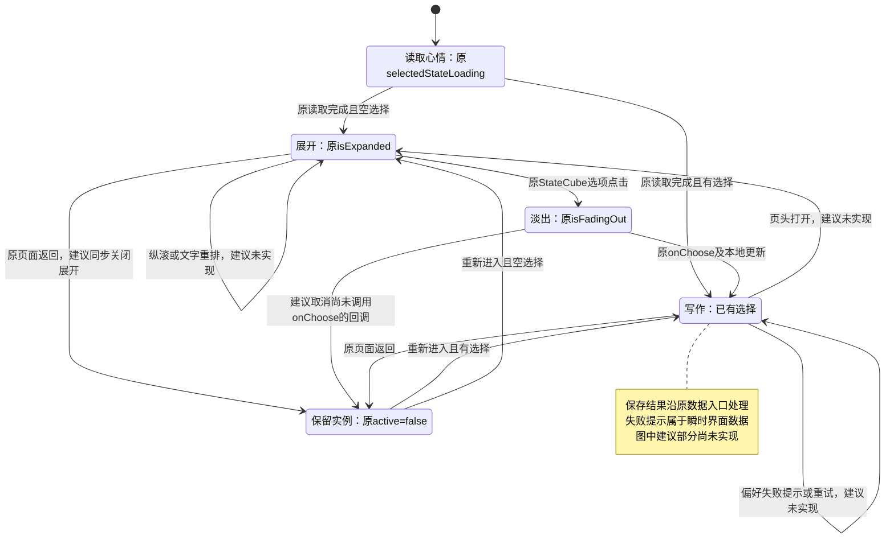

<!-- [Sync] 2026-11-01: 保存实施前评审原文与三图；现行实现归上级writing-mobile-layout.md。 -->
<!-- [Input] 当前App写作画布、StateChooser/StateCube、WritingView.native及原会话生命周期。 -->
<!-- [Output] 写作排版、心情纵向滚动与所属页面导航入口的跨端交互设计。 -->
<!-- [Pos] 聚焦布局设计；产品规则与页面骨架归dream-workspace/mobile-app.md，评审与验证归exec。 -->
<!-- [Sync] 2026-11-01: 源码定位完成；本文调整均为建议、未实现，设备验收待执行。 -->

# 写作排版、心情滚动与导航入口

## 背景与问题

用户反馈“更多 → 写作”手机端段落留白偏大、启动心情界面无法触摸滚动，并要求端侧`StateChooser`进入所属页面导航栏。本轮交付设计与评审，生产代码修改为零。产品规则与桌面、窄屏骨架见[移动应用PRD](../../../prd/dream-workspace/mobile-app.md#写作排版与心情入口)，逐项源码判断、方案取舍及验收矩阵见[评审记录](../../../exec/writing-mobile-layout-review-20261101.md)。

### 当前实现与判断

| 对象 | 当前代码事实 | 证据与判断范围 |
| --- | --- | --- |
| 字体 | 拉丁字符使用Excalifont，中文使用Xiaolai；字体声明使用`font-display: swap`，后备为Georgia/serif | [App.css:5](../../../../frontend/app/_dream/App.css#L5)、[App.tsx:2065](../../../../frontend/app/_dream/App.tsx#L2065)；实际成功加载的字形需要运行时检查 |
| 横线 | `.notebook-lines`绘制全容器稿纸背景，横线周期32.4px，并随内容滚动 | [App.css:273](../../../../frontend/app/_dream/App.css#L273)；属于稿纸背景 |
| 正文 | textarea与高亮层为18px、1.8行高，默认行框32.4px；正文单元外层未设置独立段落下边距；textarea最小高度32px，未显式统一padding、box-sizing与display | [App.tsx:2026](../../../../frontend/app/_dream/App.tsx#L2026)、[App.tsx:2038](../../../../frontend/app/_dream/App.tsx#L2038)、[App.tsx:2060](../../../../frontend/app/_dream/App.tsx#L2060)；默认行距算式一致，间距问题需要区分行距观感、字体变化和单元几何 |
| 高度重算 | 输入、引用就绪、单元数量变化、返回路由及心情变化会触发高度更新；直接路径未监听字体加载完成及容器宽度变化 | [useTextCells.ts:64](../../../../frontend/app/_dream/hooks/useTextCells.ts#L64)、[App.tsx:604](../../../../frontend/app/_dream/App.tsx#L604)；长文换行后高度陈旧属于源码风险，尚无设备复现 |
| 心情展示 | `selectedStateLoading`结束后，非空选择收起，空选择展开；App优先传入会话内选择，再使用偏好选择 | [StateChooser.tsx:41](../../../../frontend/app/_dream/components/StateChooser.tsx#L41)、[App.tsx:1998](../../../../frontend/app/_dream/App.tsx#L1998) |
| 自动触发 | 优先读取`current-session`，否则按用户时区比较最近会话日期；跨日可建立空白会话。偏好`selected_state`按`updated_at`日期恢复 | [useSessionLifecycle.ts:412](../../../../frontend/app/_dream/hooks/useSessionLifecycle.ts#L412)、[useSessionLifecycle.ts:496](../../../../frontend/app/_dream/hooks/useSessionLifecycle.ts#L496)；触发由恢复结果决定，尚无账户首次使用标记或严格每日一次合同 |
| 展开内容 | fixed全屏flex居中，标题48px、下间距60px、立方体300px、说明上间距40px；缺少纵向滚动及内容最小高度约束 | [StateChooser.tsx:248](../../../../frontend/app/_dream/components/StateChooser.tsx#L248)、[StateCube.tsx:586](../../../../frontend/app/_dream/components/StateCube.tsx#L586)；短视口存在裁切风险 |
| 手势与选项 | `StateCube`使用鼠标旋转事件；当前可选内容为配置前3项，前面解锁，其余面锁定；点击后200ms调用`onStateSelect`，Chooser再淡出800ms并调用`onChoose` | [StateCube.tsx:160](../../../../frontend/app/_dream/components/StateCube.tsx#L160)、[StateCube.tsx:258](../../../../frontend/app/_dream/components/StateCube.tsx#L258)、[StateCube.tsx:503](../../../../frontend/app/_dream/components/StateCube.tsx#L503)、[StateChooser.tsx:68](../../../../frontend/app/_dream/components/StateChooser.tsx#L68)；直接路径未发现全局touch preventDefault，手势竞争待设备验证 |
| 页面归属 | Web只在写作画布挂载Chooser；原生`MoreNavigator`挂载持久`WritingView`，其页头已有返回与标题，编辑内容由原局部文档承载 | [App.tsx:1772](../../../../frontend/app/_dream/App.tsx#L1772)、[MoreNavigator.native.tsx:33](../../../../frontend/app/_dream/components/story-workspace/layout/MoreNavigator.native.tsx#L33)、[WritingView.native.tsx:24](../../../../frontend/app/_dream/components/WritingView.native.tsx#L24) |
| 保存与失败 | `handleStateChoose`更新原EditorState及本地选择，再保存偏好；偏好保存失败只写console。原生文档加载失败已有重载按钮 | [App.tsx:880](../../../../frontend/app/_dream/App.tsx#L880)、[WritingView.native.tsx:30](../../../../frontend/app/_dream/components/WritingView.native.tsx#L30)；当前缺少心情偏好保存失败的可见反馈 |

## 目标与边界

1. 原生iOS/Android及Web窄屏采用下面的局部布局；桌面Web保留当前行距、Chooser位置、工具栏和Writing/Chat分栏。
2. 复用原EditorEngine、`useTextCells`、`useSessionLifecycle`、`StateChooser`、`StateCube`、`WritingView.native`与已有文档通信边界。所有调整在这些所有者内完成。
3. 保留会话恢复优先级、时区和跨日规则、配置前3项及锁定面、点击即提交、现有动画、EditorState持久化与偏好写入。打开入口、滚动、取消或导航返回均不触发心情保存。
4. 继续原认证、Cookie、CSRF、资源权限、手动写作建议与Chat跳转。网络仅作为加载和保存失败的条件；布局改动无需新的网络调用。
5. 本文中的样式变量、导航消息、无障碍补充和可见失败提示均为**建议、未实现**。新增依赖、页面重写、全局心情入口、字号设置和持久化状态退出范围。

## 概念与规则

### 排版与稿纸线

| 项目 | 选定规则（建议、未实现） |
| --- | --- |
| 字号与字体 | 沿用18px正文默认值和现有字体资源。WebView、浏览器缩放或文字放大后的有效字号参与同一排版计算；保留当前字体失败时的后备字体。无需等待字体下载即可编辑 |
| 行距 | 移动布局采用1.6倍行高；默认18px对应28.8px。该数值为沿用现有`.voice-comment`的移动排版取值，目的是收紧用户反馈的行间留白；属于样式选择，设备视觉回归继续核对。桌面保持1.8 |
| 共享尺寸 | 在现有App.css内以局部`--writing-font-size`和`--writing-line-height`表达实际尺寸，正文与高亮层共同消费。横线周期等于有效行框高度L，禁止分别保留32px/32.4px/10.8px校准值 |
| 横线范围与相位 | 保留纸色、线色及竖向页边线；移动横线绘制在每个现有TextCell容器内，首线位于首个行框下沿，后续每L重复。建议卡、Chat卡和日期标签使用各自原内容布局。单元局部起线使这些卡片的非整行高度无法累积到下一段正文 |
| 输入与高亮 | textarea显式采用block、统一box-sizing、零padding与零外边距，宽度、字体、行高和换行规则与高亮层一致；空白输入最少一行L。横线与高亮保持`pointer-events: none`。横线依据行框下沿定位，字形基线由实际字体绘制 |
| 段落 | 同一TextCell中的换行保留用户原文；不插入空行。连续TextCell零额外段距；建议卡和Chat卡沿原组件间距。移走心情控件后删除专用32px高度、10.8px间距和首单元0.4px修正；日期与标签独立自然换行 |
| 高度更新 | 复用现有textarea `auto → scrollHeight`更新，在初次引用就绪、正文变化、`document.fonts.ready/loadingdone`、编辑区宽度改变时重新执行。只在实际宽度/有效字体尺寸变化时调度，合并到一帧；监听随页面实例释放，禁止观察自身高度形成循环 |
| 滚动与定位 | 更新前记录当前单元、选择范围和可见位置，更新后保留输入焦点与阅读位置。字体/宽度变化只更新几何；EditorState、保存计时和建议请求保持原规则。移除Chooser槽时同步核对评论定位中的`+32+10.8`，桌面分支保留原计算 |

移动横线局部绘制复用原容器与渐变，无需新组件。该规则同时处理字体换行和建议卡混排；原全页背景继续承载纸色和页边线。字距、字号、段距、文字字节及用户换行保持可分别核对。

### 可用高度、触摸与键盘

- 写作页面由导航栏、现有写作工具区、编辑内容滚动区、原保存/能量反馈及原底部栏目组成。移动弹层占编辑内容可用区域，返回入口继续可见；背景编辑区停止接收触摸和焦点。
- 可用高度取宿主实际提供的内容视口，扣除本页已占用的导航、反馈和安全区。Web窄屏沿现有底部导航高度；原生由宿主处理安全区，局部文档消除Web全局导航占位，避免重复扣减。横屏和窗口缩放重新计算可用空间。
- Chooser内部采用有高度约束的列布局，内容区`min-height: 0; overflow-y: auto; touch-action: pan-y`，滚动覆盖问候、完整立方体和辅助说明。内容短时居中；内容长时从顶部排布并可滚至末端。问候字号与间距随可用宽度收缩、随文字放大自然换行，沿原字体和色彩。
- 原300px立方体作为现有最大尺寸，实际尺寸不超过内容宽度；六面的宽高和半边长位移使用同一个尺寸。选项允许文字换行且触摸区域沿用现有44px操作目标；中排按文字所需高度排布，上下空装饰格让出空间，溢出内容计入滚动范围。文字放大后优先扩大内容高度并滚动，禁止缩小文字掩盖溢出。
- 手指在标题、说明、选项及立方体表面纵向滑动均交由内容区滚动；完成拖动后不得误触选择。保持鼠标旋转行为，新增触摸旋转退出本轮范围；当前可选前面全部可直接触达，锁定面继续锁定。
- 选项自身承担提交操作，正文没有独立确认或关闭按钮。选择后沿原200ms反馈、800ms淡出及`handleStateChoose`返回写作内容。淡出只限制选项重复提交，滚动不得把事件交给背景编辑器。
- 点击导航心情入口先移除textarea焦点并收起软件键盘；Chooser不包含文本输入。字体重排、旋转和返回写作均不自动唤起键盘，用户再次点正文才聚焦。键盘显示期间正文可滚到光标及最后一行。
- `WritingView`保留`scrollEnabled={false}`；触摸滚动由DOM内层处理。iOS WebKit与Android WebView的实际触摸传递列为设备验收项，单一属性不足以确认故障原因。

### 导航入口与返回

| 场景 | 展示与操作（建议、未实现） |
| --- | --- |
| Web窄屏 | 在写作页面内部增加局部页头，左侧“返回更多”、中间“写作”、右侧心情操作；复用已有更多菜单与路由回调。三个原写作工具保留同组，位于页头下方独立操作区，避免与右侧心情入口重叠 |
| 原生 | `WritingView.native`既有页头右侧使用Pressable展示心情图标及当前名称；局部文档移除折叠心情入口。原文档内Calendar、新建及Agent操作继续由App处理，并为现有工具区预留位置 |
| 当前值 | 已有选择显示原图标和`stateConfig.states[id].name`；长名称单行省略，辅助功能提供完整名称和展开状态。未选显示“选择心情”；读取中显示原加载占位并禁用点击。日期与session labels留在正文上方，允许换行 |
| 展开 | 点击只打开同一`StateChooser`，在同一写作页面内替换编辑区域。无需新路由、新实例、额外请求或重复控件。按下和键盘焦点反馈沿现有主题色，原生触摸目标沿用44px |
| 选择后 | 原处理函数完成本地更新后回到同一写作内容与滚动位置，导航显示新值；旧日期会话仍通过原`startDetachedBlankSession(true)`进入今天会话。重新进入按原恢复结果显示当前值 |
| 取消与返回 | 取消使用所属写作页的“返回更多”，Android沿同一`MoreNavigator`系统返回，Web浏览器返回沿原历史。该动作关闭本地展开状态并回到更多，保留已选心情和草稿。再次进入时，有值显示正文，空值继续原自动展开。Chooser内部新增关闭、取消及确认按钮退出范围 |
| 页面隐藏 | `active=false`时关闭局部展开并移除焦点；`StateCube`的200ms回调与Chooser的800ms回调都需在隐藏/卸载时清理，展开及提交回调同时检查当前active，阻止隐藏后重开或提交。已经调用`onChoose`的原保存继续执行。重新激活仍依据原选择和loading决定展示。此项仅管理局部交互生命周期 |

当前`components/chat/Modal`会提供背景点击、Escape和关闭按钮；直接套用会增加Chooser的退出动作。本方案复用项目的受限高度与内层滚动做法，在原Chooser内完成，并保持上述页面返回规则。

### 原生导航与局部文档接线

当前`WritingDocument.protocol.ts`只携带显示状态及跨页面意图；心情名称、加载状态和打开Chooser消息尚未定义。以下为**建议、未实现**，范围仅限既有边界：

1. 文档向宿主发送`chooser-view`展示消息：当前`documentId`、单调递增展示revision、`loading`、`selectedStateId`、显示名称及展开状态。展示revision在该文档的展示消息内递增，与宿主发送的state revision分别计数。原生图标呈现沿`StateChooser.tsx`内`getMiniStateIcon`的现有几何与ID映射，在既有WritingView内使用项目已安装的`react-native-svg`表达；该原生呈现尚未实现。不传全文、标签、账户凭证或完整StateConfig。
2. 宿主通过原`state`消息增加`openChooserNonce`。仅在ready、active且loading结束时发送；文档按当前documentId、递增revision和一次nonce消费，调用同一Chooser展开动作。读取未就绪时入口保持禁用。
3. 宿主校验来源URL、documentId、展示revision及字段类型；旧文档、乱序或无效消息保持原显示值。文档重载时先清空宿主展示并禁用入口，ready后等待当前文档展示消息。
4. `WritingDocument`将打开意图传给App，App继续独占`handleStateChoose`与持久化；宿主仅持有展示数据并触发展开。禁止宿主再调用`savePreferences`或自行生成心情默认值。
5. 切页关闭时由现有`active`消息传递，`MoreNavigator`原返回、账户实例和`documentId`生命周期继续复用。无需增加全局EventBus、服务接口或平台适配层。

### 反馈、失败与恢复

| 条件 | 当前行为与选定处理（建议调整均未实现） |
| --- | --- |
| 字体加载中或失败 | 继续后备字体输入。加载完成后重算几何；下载失败保持后备字体与可编辑正文，无阻塞弹窗 |
| 心情读取中 | 沿`selectedStateLoading`占位，禁用导航操作；读取完成依原恢复值展开或收起 |
| 读取失败 | 现有生命周期catch会使用当前engine/default并结束loading。本轮保留该语义；空值展开不能单独证明用户当天尚未记录 |
| 偏好保存失败 | 原处理已更新本地选择，catch仅console。建议在原页面反馈区提供“心情保存失败，请重试”，重试只重发当次`selected_state`偏好写入；不再次调用整个`handleStateChoose`、新建会话或重放动画。旧响应只更新其会话/选择对应的提示，当前值已变化时清除旧重试入口 |
| 编辑会话保存失败 | 继续现有会话持久化路径与反馈；偏好保存成功与EditorState保存分别处理，不将本地显示变化声明为服务端全部保存成功 |
| 局部文档加载/进程失败 | 沿`WritingView.failed`和已有Retry重新加载，已持久化会话由原入口恢复。未保存文字的恢复能力沿原合同，保留设备故障验证依赖 |
| 登录过期 | 沿`session-expired`与原会话刷新/登录流程；标题动作禁用，禁止绕过认证 |

失败提示只占用当前页面既有反馈区域；反馈与重试使用瞬时界面数据，持久状态、请求重试策略和后台队列均保持原合同。

### 平台差异

| 平台 | 必要差异与验收前提 |
| --- | --- |
| iOS原生 | RN页头与WKWebView内滚动分别负责区域；安全区由宿主占用一次。验证键盘收起后视口、字体下载切换、系统文字放大及VoiceOver触达。当前协议未携带RN fontScale，WebView实际文字缩放能力待真机确认，禁止仅凭原生文字可缩放声明编辑正文通过 |
| Android原生 | 同一RN页头及DOM编辑器；系统Back沿原MoreNavigator返回，Chooser隐藏动作随active传入；验证WebView触摸、键盘resize、安全区和TalkBack。无需新增后端或独立页面实现 |
| Web窄屏 | 页面页头位于原底部导航上方，内层编辑器滚动；验证地址栏收放、浏览器返回、文字放大与横屏。复用项目现有窄屏边界；手机横屏沿现有移动识别规则，桌面缩窄沿现有宽度规则 |
| 桌面Web | 原18px/1.8、背景线、正文Chooser、操作入口与分栏继续保持。新布局作用域同时区分窄屏和`data-writing-document`，避免原生横屏受桌面媒体查询覆盖 |

### 正常业务时序

### 异常与恢复时序

### 页面状态转换

状态图复用原读取、展开、淡出与active状态；加载失败重试属于原生框架已有ready/error状态。字体切换、横竖屏、缩放和网络失败均不新增业务状态。

## 交付与验收

实施顺序为共享移动排版和滚动、Web窄屏页头、原生既有边界接线；每项以[验收矩阵](../../../exec/writing-mobile-layout-review-20261101.md#验收计划)所列前提和证据判定。文档通过只代表设计与文档检查完成，代码实现、浏览器交互验证、原生设备验收继续单独记录。
